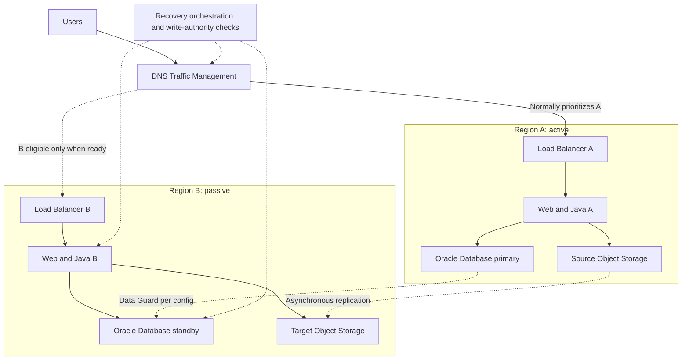
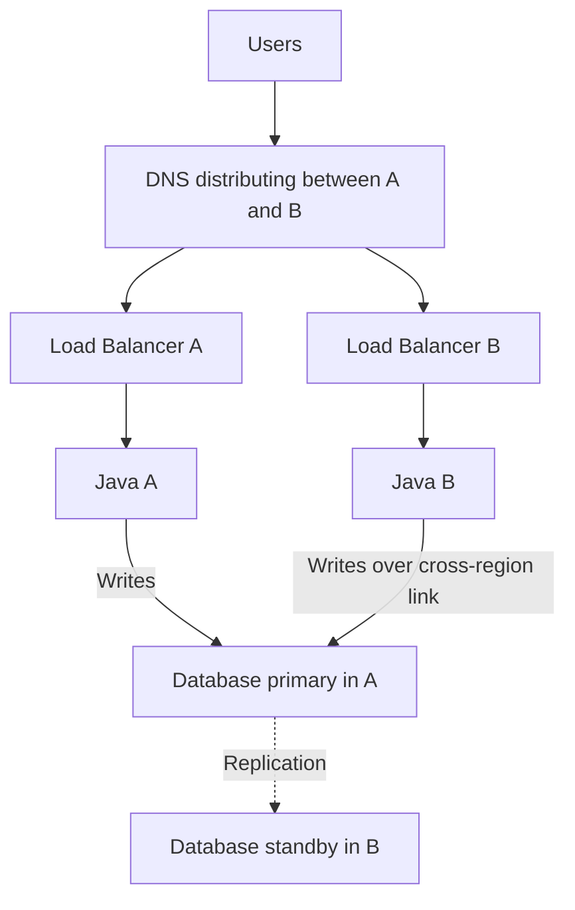

# Multi-Region Deployment Using Active-Passive and Active-Active Models

In the **High Availability Architecture** chapter of the **CLOUD_PROVIDERS_ORACLE** module, this lesson covers deploying applications across multiple Oracle Cloud Infrastructure regions using active-passive and active-active models. The focus is on user routing, data write authority, state synchronization, and system-wide recovery procedures, combining OCI networking, Compute, storage, and Oracle Database services.

Deploying two copies of an application in two regions only creates two places capable of running code. To keep serving when a region fails, you must define which data remains usable, which side holds write authority, which dependencies must be ready, and where users are routed. That design must integrate IAM, monitoring, automation, and cost estimation.

## 1. Starting from Business Recovery Objectives

### 1.1. Distinguishing Intra-Region HA from Multi-Region Resilience

Distributing hosts across availability domains or fault domains mitigates failures inside a region. If an entire region or a critical regional dependency becomes unavailable, the system needs a sufficiently independent environment in another region.

Multi-region resilience does not replace HA within each region. Once failed over to region B, the application still needs to tolerate a single-host failure or maintenance inside B. Having only a single app server in each region may still fail everyday availability goals.

Before choosing a model, lock down:

- **RTO**: maximum acceptable time to restore the defined service level.
- **RPO**: acceptable data loss measured in time or confirmed business data points.
- **Post-incident service level**: full functionality, read-only, or restricted operations.
- **Fault scope**: single service failure, cross-region link failure, regional outage, or logical data corruption.
- **Authority transfer conditions**: who or what orchestrator may decide, and what evidence is required.

### 1.2. Running Scenario

Consider an order management application with a Java backend, Oracle Database, and attachments in Object Storage. Region A serves primarily; region B is either the standby environment or co-serves depending on the model.

The following targets are learning assumptions, not OCI SLAs:

| Business Component | Illustrative Target | Additional Details to Define |
| --- | --- | --- |
| Order API | Recover within 15 minutes on regional loss | Which write functions must recover first? |
| Test order data | RPO no greater than 60 seconds | Measured on app-confirmed transactions, not just replication status |
| Attachments | Recovery plan consistent with orders | Avoid orders existing without their promised saved files |
| Catalog reads | Can serve stale data within an allowed window | How long is the window and how does the UI indicate it? |
| User sessions | May require re-login | Is losing unsaved cart state acceptable? |

If real payments are involved, set separate targets and reconciliation procedures with payment systems. Never apply test-order loss assumptions to financial data without analyzing business requirements.

## 2. At Which Layer Do Active-Passive and Active-Active Differ?

### 2.1. Comparison Table

| Criterion | Active-Passive | Active-Active |
| --- | --- | --- |
| Normal traffic handling | One primary region handles selected business traffic | Two or more regions concurrently handle selected business traffic |
| Other environment | Prepared at cold, minimal, warm, or hot readiness | Actively serving and able to absorb additional load |
| Write authority | Typically one side holds write authority for a dataset | May still have one writer, partitioned writers, or multi-writer |
| Failover on outage | Activate target environment and shift authority/traffic in order | Remove failed side from rotation, rebalance load and ownership if needed |
| Key challenges | Startup speed, data freshness, and switchover duration | Data consistency, conflicts, latency, and capacity after losing one side |
| Typical cost profile | Standby and replication resources not serving full load | Active resources plus headroom for shifted cross-region load |

The model name alone does not determine RTO or RPO. Active-active can still lose unreplicated data; a hot active-passive setup can fail over faster than an under-provisioned active-active setup or one with broken write-authority controls.

### 2.2. Do Not Equate App Active-Active with Multi-Writer Databases

At least three distinct topologies are commonly called active-active:

1. **Active-active apps in two regions, single-writer database**: Java in A and B both serve, while writes go to one primary.
2. **Each region owns a data partition**: such as partitioning by tenant; each tenant still has only one authoritative writer at a time.
3. **Two databases writing the same dataset**: requires replication and conflict resolution aligned with business rules.

When documenting an architecture, specify active-active at the DNS, web, Java, data-read, or data-write layer. Writing merely “two-region active-active” leaves operators unsure what is permitted when the two regions lose contact.

## 3. OCI Foundation Required in Both Regions

### 3.1. Independent Networks and Serving Entry Points

A reference foundation includes:

- VCN A, e.g., `10.10.0.0/16`, and VCN B, e.g., `10.20.0.0/16`, with non-overlapping CIDRs.
- Private subnets for web/Java/database as required, plus each region's own load balancer.
- Gateways, internal DNS, NSGs, and management paths that work when A is unavailable.
- Cross-region links only for replication or truly required dependency access.
- Artifacts, configs, certificates, secrets, and deployment permissions prepared for B.

Each region's OCI Load Balancer distributes to backends within its own regional scope. Region selection sits in front, such as OCI DNS Traffic Management; no single VCN or regional load balancer spans two regions automatically just because application names match.

For topologies needing private cross-region networking, use DRG and remote peering connections. Configure subnet routes, DRG/attachment routes, and security rules on both sides. Connected peering does not imply every required subnet or port is reachable. [Oracle: Remote VCN Peering through an Upgraded DRG](https://docs.oracle.com/en-us/iaas/Content/Network/Tasks/scenario_e.htm).

### 3.2. Region B Must Not Depend Completely on a Single Point in A

Region B may have plenty of Compute yet still fail to recover if only A holds:

- Artifacts or images needed to launch new hosts.
- Registries, CI/CD runners, or deployment tool state/locks.
- Internal DNS used to locate databases or authentication services.
- Decryption keys, wallets, passwords, or config endpoints.
- The sole network link from corporate offices to the cloud.
- Documentation and permissions needed to execute recovery.

Map dependencies along the actual recovery path: from logging into management environments to fetching secrets, opening the database, and completing an order. Cached dependencies can mask hidden links until tokens, DNS, or certificates require renewal.

## 4. Active-Passive Architecture on OCI

### 4.1. Reference Topology



The path from Java B to the database in the diagram represents the dependency used after B is activated. While in standby, app B must not attempt writes to the database still holding the standby role. Load balancer or hosts in B may run for technical checks while receiving zero live business write traffic.

### 4.2. Choosing Passive Readiness Level

| Readiness Level | Pre-Provisioned in B | Remaining Work on Recovery | Trade-Off |
| --- | --- | --- | --- |
| Backup and restore | Backups, IaC definitions, and runbooks | Provision, restore, configure, and start | Minimal running resources; typically longest recovery time |
| Pilot light | Select core components and required replication | Scale/create missing tiers | Must validate dependencies and capacity at activation |
| Warm standby | Stack running at reduced capacity | Scale capacity, switch data/authority and traffic | Balances running resources against scaling duration |
| Hot standby | Stack near full required serving capacity | Switch roles, verify, and cut over | Higher standby cost; fewer provisioning steps |

Different organizations interpret these labels differently. Specify exact host counts, sizes, database roles, and manual/automated steps rather than treating a tier name as proof of meeting RTO.

A warm standby with just two small VMs cannot automatically absorb A's full load. If additional hosts must launch during an incident, provisioning, boot, and warm-up belong inside RTO; allocation capacity is also an assumption that must be tested.

## 5. Synchronizing Data by State Category

### 5.1. Inventorying Data to Recover

| State Category | OCI Mechanisms to Consider | What Must Be Verified on Region Switch |
| --- | --- | --- |
| Oracle Database | Data Guard or DB-service-specific DR | Role, sync level, service connections, protection mode, licensing |
| Files in Object Storage | Bucket replication and initial backfill process | Freshness, target bucket write access, app endpoints, service permissions |
| Boot/block volumes | Replication or backup/copy per supported topology | Replica activation, volume attachment, and app consistency |
| Artifacts and configuration | Versioned releases published to both environments | Hashes/builds, regional configs, reachability when A is lost |
| Sessions/cache | Rebuild, accept loss, or sync as required | Re-logins, stale data, and UX impact |
| Queues/background jobs | Durable storage, checkpoints, replay, or routing per design | Lost events, duplicate handling, and consumer permissions |
| Keys and secrets | Service-appropriate replication/provisioning | Decryption capability and secret versions needed in B |

### 5.2. Data Guard for Single-Primary Models

Data Guard maintains a standby by shipping and applying redo. With Oracle Base Database Service, cross-region configs must meet support prerequisites such as version/edition, realm, networking, and encryption. Do not copy Base Database procedures verbatim onto Autonomous Database or another topology. [Oracle Base Database: About Oracle Data Guard](https://docs.oracle.com/en/cloud/paas/base-database/guide/dg-about.html).

Distinguish three operations:

- **Switchover**: planned role reversal while both sides can coordinate, typically used for maintenance or scheduled drills.
- **Failover**: promoting standby to primary when the current primary fails or becomes unreachable; may incur data loss depending on protection mode and sync state.
- **Reinstate/rebuild**: returning the old database to its proper role after establishing the authoritative data source.

Do not treat “standby Available” as sufficient: inspect transport/apply lag, replication errors, and recoverable data points. An old lag sample does not prove freshness at the moment A went silent. [Oracle: Perform Database Switchover and Failover](https://docs.oracle.com/en/cloud/paas/base-database/dg-sofo/).

### 5.3. Object Storage and Volumes Do Not Auto-Sync Atomically with the Database

Object Storage replication is asynchronous; the destination bucket remains read-only while receiving replication. Objects created before enabling a policy are not automatically backfilled. Prepare historical backfill, service permissions, and the step to make the destination bucket writable during role transition. [Oracle: Object Storage Replication](https://docs.oracle.com/en-us/iaas/Content/Object/Tasks/usingreplication.htm).

For example, the database in B already has order `ORD-123`, yet the associated confirmation file has not arrived in bucket B. The app may load the order screen while business recovery remains incomplete. Design detection for pending files, data publication points, and reconciliation instead of checking database lag alone.

If an operation can only be confirmed after data is durable in multiple stores, explicitly design those steps and confirmation checks. That can add latency; never assume an atomic distributed transaction exists between a database and object storage.

Block Volume replication is also asynchronous and has its own recovery workflow. A volume replica is not guaranteed to be an application-consistent database copy; use data protection mechanisms suited to the software writing to the volume. [Oracle: Block Volume Replication](https://docs.oracle.com/en-us/iaas/Content/Block/Concepts/volumereplication.htm).

Replication does not replace backups. Accidental deletes or bad writes can propagate to replicas, whereas point-in-time recovery requires pre-error snapshots. Protect and test historical restore capability independently of region failover.

## 6. Routing Users with DNS Traffic Management

### 6.1. Failover Policies and Weighted Policies

OCI DNS Traffic Management supports steering policies that prioritize endpoints for failover and distribute answers by weight. Health Checks can evaluate answers. Active-passive typically prioritizes A before B; active-active can distribute by weight or geolocation/proximity policies suited to users. [Oracle: Overview of Traffic Management](https://docs.oracle.com/en-us/iaas/Content/TrafficManagement/Concepts/overview.htm).

DNS steering changes DNS responses; it does not migrate open TCP connections, promote databases, or sync sessions. A 50/50 weight in DNS does not guarantee exactly half of HTTP requests enter each region due to resolver caching and client behavior.

Also test what happens when all answers are marked unhealthy and how fallback rules in the policy behave. Never assume every configuration returns empty or automatically halts all write requests when no endpoint is healthy.

### 6.2. TTL Is Not a Guaranteed Failover Duration

If setting a 30-second TTL for a test, some clients may receive the new endpoint on their next lookup. However, actual user cutover time also depends on:

- Failure detection window and multi-probe evaluation.
- Decision time, data recovery, and target app startup.
- DNS resolvers, OS caches, and JVM caches.
- Keep-alive connections, HTTP pools, mobile clients, and retry logic.
- Older cached TTLs still active if TTL was only lowered right when the outage began.

Therefore, a 30-second TTL does not mean system-wide RTO is 30 seconds. For planned switchovers, lower TTL early enough per policy and measure real client behavior.

### 6.3. Health Endpoints Must Reflect Eligibility to Receive Traffic

An endpoint like `/health/traffic` can return eligible status only when the app has valid configuration, mandatory dependencies are ready, and the region holds valid serving authority. If it returns HTTP 200 merely because the Java process is alive, DNS can steer users to B before B has write authority.

Process liveness, backend readiness, and region-wide serving eligibility are distinct checks. Never let every probe execute heavy queries or write transactions. Combine lightweight probes with controlled synthetic transactions to validate business flows.

OCI Health Checks monitor public endpoints externally; checking private dependencies requires probes with suitable private reachability. Never expose databases publicly just so external monitors can connect. [Oracle: Health Checks Overview](https://docs.oracle.com/en-us/iaas/Content/HealthChecks/Concepts/healthchecks.htm).

Write authority must still be enforced on the business processing path. DNS is not a barrier guaranteeing no cached client or background job still contacts the old region.

## 7. Controlled Active-Passive Failover Workflow

### 7.1. Recovery Sequence

A reference runbook should include:

1. Confirm incident scope via multiple signals; distinguish regional loss from a single probe failure or cross-region link failure.
2. Identify the responsible coordinator, claim regional failover authority, and record a recovery operation ID.
3. Prevent the old side from continuing writes via designed fencing/ownership controls; keep B disabled for writes until prerequisites pass.
4. Assess the recovery point and potential data loss; apply business-approved RPO decision rules.
5. Promote databases and activate dependent storage/queue systems in dependency order.
6. Start or scale app B, loading regional configuration, permissions, and new-role connection strings.
7. Run a representative transaction, reconcile required data, and verify workers run only where authorized.
8. Mark endpoint B eligible for traffic and update routing per chosen policy.
9. Monitor errors, load, and straggler clients still hitting A; handle retries without duplicating business effects.
10. Keep B as the authoritative source and re-establish redundancy rather than rushing back to A.

Some steps can run in parallel, but exposing write traffic must come after data and write-authority gates. Throughout cutover, the old side should respond appropriately to clients caching old endpoints.

### 7.2. Fencing and Split-Brain

Split-brain occurs when two sides simultaneously believe they hold write authority over the same dataset without proper consistency coordination. Losing contact with A from B does not prove A stopped serving: A may still receive clients, jobs, or callbacks over another network path.

Fencing invalidates the old writer's authority before or atomically with granting new authority under a safe protocol. Mechanisms can rely on database roles, quorum ownership, fencing tokens checked at the write target, or proven resource isolation. An in-memory Java flag, a config file, or deleting a DNS answer is not strong enough to guarantee this.

If single-writer authority cannot be verified, the design needs an agreed fallback behavior such as staying read-only or pausing consistency-sensitive writes. Never turn missing evidence into permission for both sides to write.

### 7.3. Pseudocode for Control Gates

This pseudocode illustrates runbook logic, not directly runnable OCI CLI commands:

```text
recover_to(region_B, recovery_operation_id):
    assert recovery_operation_has_authority()
    assert acquire_single_recovery_coordinator()

    keep_write_traffic_disabled(region_B)
    evidence = verify_old_writer_fenced_or_safe_ownership_transfer()
    if not evidence.valid:
        stop_write_activation("cannot prove write authority")

    recovery_point = inspect_recoverable_business_data(region_B)
    assert recovery_point_satisfies_approved_recovery_policy(recovery_point)

    promote_data_services_if_needed(region_B)
    activate_required_storage_and_consumers(region_B)
    start_or_scale_application(region_B)

    assert intended_writer_role_is_effective(region_B)
    assert business_validation_passes(region_B)

    mark_region_traffic_eligible(region_B)
    update_routing_policy_if_required(region_B)
    record_results_and_continue_monitoring()
```

Each function requires concrete implementation and verifiable evidence in the real environment. The orchestrator must distinguish unrun steps, succeeded steps, and ambiguous timeouts. Re-running a step must never blindly promote another database or replay payment jobs.

## 8. Failback Is a Planned Data Transition

### 8.1. When A Recovers

Once B has accepted new transactions, B holds the authoritative history. Never flip DNS back to A merely because A's health check turns green: A's data may be stale or diverged.

A failback procedure typically requires:

1. Keep A excluded from serving writes and assess its stale data state.
2. Reinstate or rebuild A from the valid source per the database/storage mechanism in use.
3. Re-establish replication in the needed direction, typically from B to A while B is primary.
4. Verify A's freshness, business data, schemas, artifacts, and scaling readiness.
5. Pick a planned cutover window, control writers, and execute a switchover if supported by the topology.
6. Verify app A, shift traffic in a controlled manner, and monitor stragglers on B.
7. Re-establish redundancy, backups, and recovery plans for the restored roles.

Exact steps depend on each service. For Object Storage, reversing write authority and replication requires a dedicated workflow; never treat a target bucket like a folder you can arbitrarily sync both ways.

### 8.2. Distinguishing Routing Rollback from Data Rollback

Before B accepts writes, reverting routing can be simple if other conditions still hold. Once B accepts writes, returning users to old data can lose recent transactions. Runbooks must explicitly mark the point of no return where DNS-only rollback is no longer valid.

In multi-writer models, failback must also handle backlogs, conflicts, and data convergence. Never restart old replication without understanding whether it will re-introduce stale edits or previously discarded data.

## 9. Viable Active-Active Architectures

### 9.1. Two App Regions, One Primary Database



This model lets both application tiers serve concurrently, yet B's write path still depends on database A and the network link to A. When A is lost, data authority must transition per runbook; never assume writes still work just because Java B stays alive.

If reading from a replica in B, verify service support/licensing and replication lag. Immediate read-after-write may return stale data. For views needing instant visibility of newly created orders, read from the writer, maintain suitable affinity, or use explicitly designed version-check and timeout mechanisms.

### 9.2. Partitioning Write Authority by Tenant or Data Domain

One approach assigns each tenant a home region. A handles writes for tenant group A, B handles writes for tenant group B, while replicas support recovery or reads per system capabilities.

When a tenant moves home regions, ownership metadata needs a version/epoch and safe transition rules. Clients or workers holding stale metadata must not continue writing with expired authority. Merely hashing a tenant ID to a region does not solve transferring authority when that region goes offline.

Partitioning writes reduces conflicts but complicates cross-tenant transactions and shared data. Global catalogs, shared inventory, and system-wide quotas need dedicated designs rather than assuming everything obeys tenant boundaries.

### 9.3. Dual-Write Databases and Bidirectional Replication

Oracle GoldenGate can be evaluated for supported active-active topologies. GoldenGate replicates logically and asynchronously; when both sides modify the same rows, conflict detection and resolution are required. This is a distinct data architecture, not flipping a write switch on a Data Guard physical standby. [Oracle GoldenGate: Comparing Active-Active and Active-Passive](https://docs.oracle.com/en/database/goldengate/core/26/ggsol/active-active-vs-active-passive.html).

The topology must define which tables/columns are written where, global uniqueness, conflict handlers, and replication loop prevention. Key, supplemental logging, and DDL requirements must follow actual database/GoldenGate versions. [Oracle: GoldenGate Active-Active Guidance](https://docs.oracle.com/en/database/oracle/oracle-database/26/haovw/ogg-active-active-guidance-dev-and-admin1.html).

## 10. Data Conflicts and Required Java Application Behavior

### 10.1. An Example That Cannot Be Fixed by “Last Write Wins”

Suppose inventory for an item is 1 in both regions. During replication lag, A sells one unit and B also sells one unit; each local check sees stock available.

Even if conflict resolution later picks a single final value, two customers may have already received purchase confirmations. Values converging to one number does not undo broken business promises or external side effects.

Options include designating one authority for that item, allocating separate inventory quotas per region, or using consistency protocols matching transaction requirements. Each option trades off latency, partition availability, and operational complexity.

### 10.2. Unique IDs and Idempotency Are Different Problems

Order IDs must avoid collisions when generated in multiple places. However, generating UUIDs does not stop a retried user request from creating two orders with two different UUIDs.

Applications need idempotency keys for retryable business operations, scoped to user/domain and payload per defined policy. Processed outcomes must be persisted durably so retries receive the matching result.

In an asynchronous dual-writer topology, local unique constraints in each database do not stop the same key from being accepted simultaneously in both places before replication arrives. Route key checks to an authority, use a coordination mechanism, or apply business-approved deduplication rules.

### 10.3. Queues, Schedulers, and Side Effects

Running the same Java app in two regions can cause schedulers to send duplicate emails, batches to double-charge, or consumers to reprocess events. Classify which jobs run only in the active-authority region, which partition by shard, and which are safe to rerun.

A successful database transaction plus an external side effect does not form an atomic transaction by default. Consider outboxes and idempotent consumers with clear semantics, while verifying guarantee boundaries across replication and failover.

JDBC and HTTP connection pools need matching timeouts, connection refresh, and retry policies. Never blindly replay every write request after a network error: the commit or side effect may have succeeded while the response was lost. These decisions are part of recovery architecture, not minor Java library details.

## 11. Configuration, Permissions, and Capacity in the Target Region

### 11.1. Preparing Regional Configuration

Using the same build artifact reduces drift, while OCIDs, endpoints, subnets, buckets, and connection strings must map per region and role. Separate business logic configuration from resource identifiers so each can be validated independently.

The example below is an internal team-defined design contract, **not an OCI Full Stack DR or Terraform API schema**:

```yaml
application: orders
strategy: active-passive
recoveryTargets:
  rtoSeconds: 900
  orderDataRpoSeconds: 60
regions:
  A:
    normalRole: active
    configProfile: orders-region-a
  B:
    normalRole: passive
    configProfile: orders-region-b
activationGates:
  - write_authority_verified
  - recoverable_data_policy_satisfied
  - required_dependencies_ready
  - business_validation_passed
traffic:
  policyIntent: failover
  dnsTtlSecondsForExperiment: 30
failback:
  mode: planned_after_data_resynchronization
```

Contracts must map to real resources, execution steps, and verification evidence. Never treat a field named `write_authority_verified` as an active fencing mechanism.

### 11.2. Keys, Secrets, and IAM

Verify permissions for orchestrators, applications, and replication services in both regions. Compartments and policies do not automatically replicate regional service configs or make new resources reachable.

For Vault and encryption keys, OCI supports replication under specific service conditions; verify vault/key types and supported features. Do not assume key replication means all app secrets, wallets, or passwords are already provisioned properly in B. [Oracle: Replicating Vaults and Keys](https://docs.oracle.com/en-us/iaas/Content/KeyManagement/Tasks/replicatingvaults.htm).

Public domain certificates must be valid at both entry points per design. Credential and certificate rotation procedures must update standby environments, not just the active side. Drills must exercise fresh credential retrieval rather than relying on cached valid tokens.

### 11.3. Capacity After Losing a Region

In a two-region active-active setup normally splitting traffic 50/50, each side must absorb post-incident load or operate under an agreed degraded mode. For example, if each region sustains at most 600 requests/second and total peak load is 1,000 requests/second: normal operation succeeds, yet one surviving region falls short.

A planning condition is:

```text
Remaining safe capacity after chosen fault scope
    >= Post-incident load to serve
```

Account for CPU, memory, database connections, I/O, bandwidth, queues, and auth services. An autoscaling ceiling does not guarantee instances can be provisioned instantly when another region suffers an outage.

If using Compute capacity reservations, verify the exact AD/shape and actually reserved quantity. Reservations can be created with less capacity than requested when capacity is tight; never assume seeing a reservation resource proves sufficient capacity. [Oracle: Creating a Capacity Reservation](https://docs.oracle.com/en-us/iaas/Content/Compute/Tasks/capacity-reservations-create_tabs.htm).

## 12. Automating with OCI Full Stack Disaster Recovery

OCI Full Stack Disaster Recovery helps create, execute, and monitor multi-tier recovery plans combining built-in and custom steps. It orchestrates an already-prepared topology; it does not design consistency models or convert an app into active-active on its own. [Oracle: About Full Stack Disaster Recovery](https://docs.oracle.com/en/cloud/iaas/disaster-recovery/cssgm/about-disaster-recovery.html).

A typical setup workflow includes:

- Define DR Protection Groups and member resources within protection scope.
- Create switchover/failover plans per supported service capabilities.
- Add custom steps for apps, workers, business checks, and traffic routing as needed.
- Order step dependencies so data and write authority are ready before admitting traffic.
- Run prechecks and track execution logs/results by operation ID.
- Refresh plans whenever topology, resources, or app configurations change.

Prechecks catch readiness issues such as broken replication, missing resources, or wrong roles. They do not replace transaction drills, side-effect checks, or measuring application RTO/RPO. [Oracle: Prechecks Performed by Full Stack DR](https://docs.oracle.com/en/cloud/iaas/disaster-recovery/cssgm/reference/prechecks-performed-by-full-stack-disaster-recovery.html).

When authoring custom steps, define idempotency, timeouts, stop conditions, and error recovery. A timed-out step may have already altered a resource; orchestrators must re-read state before retrying. Place logs and control tooling where they remain accessible under expected failure scopes.

Isolate drills from production using appropriate networks, data, and permissions. Specifically prevent test apps from triggering real payments, emails, or external callbacks. Verify drill support per protected resource type rather than assuming every step is side-effect-free.

## 13. Measuring RTO, RPO, and Drilling Realistic Scenarios

### 13.1. Illustrative Timeline

Suppose a drill records these milestones:

| Time | Event |
| --- | --- |
| 10:00:00 | Simulated fault begins blocking user business completion |
| 10:00:20 | Monitoring detects anomaly |
| 10:01:20 | Decision and safe authority-transfer evidence complete |
| 10:03:00 | Database B holds new role and meets prerequisites |
| 10:04:00 | App B and mandatory dependencies are ready |
| 10:04:15 | B is marked eligible and routing policy updates |
| 10:05:30 | Test client group resumes completing business flows steadily |

Client/business-level RTO in this drill is 5 minutes 30 seconds. Do not cite database promotion duration or DNS update time alone as application RTO. Steps may overlap in parallel, so timelines should track the real critical path rather than mechanically summing every step.

If the last confirmed transaction in A occurred at `09:59:58`, while the reconciled business recovery point in B is `09:59:40`, the gap is 18 seconds in this example. Reconcile transaction IDs and statuses to determine exact missing data; timestamp differences alone do not prove every transaction in that window was lost.

Each data type has its own recovery point. Never report an “18-second RPO for the whole system” without verifying files, queues, and related side effects.

### 13.2. Scenarios to Drill

| Scenario | Risk to Observe | Evidence to Collect |
| --- | --- | --- |
| Endpoint A fails while DB A stays healthy | Shifting app traffic does not always mean promoting DB | Incident-specific decision and post-shift write path |
| A–B link lost while clients reach both | Split-brain, backlogs, and stale reads | Which side writes, which degrades, and why |
| Entire A environment lost within test scope | Hidden dependencies and missing capacity | B's recovery while unable to call any A dependency |
| Replication lag exceeds target | Recovery succeeds yet violates RPO | Lag, recovery point, stop policy, or approved exceptions |
| DNS/clients cling to old endpoint | Requests continue hitting A post-cutover | Request distribution, errors, retries, and writer fencing |
| B lacks new secrets or certificates | Hosts run yet fail to serve | Fresh credential fetch, TLS handshakes, and alerts |
| Background tasks run on both sides | Duplicate emails/charges/event processing | Job ownership, idempotency, and side-effect reconciliation |
| A returns after B accepted writes | Reversion to stale data or backward replication | Authoritative source and failback verification |

Shutting down a listener does not fully simulate losing a region; cutting a peering link does not prove the remote region is dead. Document how faults were injected and the boundaries of conclusions.

### 13.3. Continuously Monitoring Recoverability

Collect user latency, error rates, endpoint health, replication lag, backlogs, conflicts, per-region request counts, step durations, and provisioning availability. Also track age of monitoring samples and time since the last drill.

Build an explainable readiness indicator: which prechecks failed, which dependencies are missing, which capacity is short, and which data/config versions drifted. A dashboard showing every instance `Running` answers none of those questions.

## 14. Cost and Choosing the Right Model

### 14.1. Counting Both Steady State and Recovery

A budgeting model may include:

```text
C_multi_region = C_compute_A + C_compute_B
               + C_database_and_replication
               + C_storage_backup_replica
               + C_cross_region_and_egress
               + C_load_balancer_DNS_monitoring
               + C_orchestration_drills_and_ops
```

Rates and billing units must be verified per actual service, shape, licensing, region, and contract from the [Oracle Cloud Price List](https://www.oracle.com/cloud/price-list/). Never infer total cost from VM count alone or assume replication is always free.

Active-passive can lower idle app compute while adding scaling work, validation, and capacity risk. Active-active uses both sides normally while still needing headroom for lost-region load. Two regions each running at 50% max capacity do not magically deliver 100% post-failure capacity unless sized appropriately.

Beyond infrastructure, budget engineering effort for conflict handling, drills, data reconciliation, and runbook updates. Lower infra spend that requires hours of manual incident recovery may miss overall targets.

### 14.2. Choosing Based on Business Characteristics

| Dominant Need | Option to Evaluate | Decision Criteria |
| --- | --- | --- |
| Tolerates relatively long restore times | Backup/restore or pilot light | Proven restore within RTO and data within RPO |
| Wants low disruption with simple single-writer control | Warm/hot active-passive | Sufficient sync, fencing, and target capacity |
| Two user geographies need closer frontend/API | App active-active with clear data roles | Measured latency to data and writer-loss handling |
| Tenants have separable data ownership | Home-region/partitioned active-active | Safe ownership transfer and shared-data handling |
| Must write same dataset in multiple regions | Purpose-built active-active data tier | Clear solutions for consistency, conflicts, and invariants |

You can evolve from a drilled active-passive baseline toward active-active where it adds clear value. There is no need to move every table and feature to multi-writer at once. Conversely, any workflow that cannot tolerate lost data or duplicate execution must have write-authority and durable confirmation mechanisms meeting that requirement regardless of label.

## 15. Capstone Practice

### 15.1. Preparing the Design and Test Environment

1. Select two regions meeting service availability, realm, latency, and data residency needs.
2. Document state inventory, RTO/RPO, and features allowed to degrade.
3. Provision both environments via IaC with regionalized artifacts, configs, and secrets.
4. Pick a concrete data model; a first exercise can start with a supported primary and standby.
5. Configure replication, seed initial data, and verify permissions in B.
6. Create per-region endpoints and steering policies; keep writes disabled in B until authorized.
7. Write failover and failback runbooks with preconditions, owners/orchestrators, and per-step evidence.
8. Execute bounded drills, capture timelines, reconcile data, and evaluate surviving capacity.

These are practice guidelines, not pre-executed deployment or test results on an OCI tenancy. Meeting targets must be established using measurements from your actual environment.

### 15.2. Testing Individual Endpoints and DNS Paths

From a host authorized to test public endpoints, you can use PowerShell to inspect current DNS answers:

```powershell
Resolve-DnsName -Name 'orders.example.com' -Type A
```

To test one region's listener directly while preserving hostname and SNI, use `curl.exe --resolve`. The IP below belongs to the documentation address block; replace it with your test environment endpoint:

```powershell
curl.exe --fail --silent --show-error `
  --resolve 'orders.example.com:443:203.0.113.10' `
  'https://orders.example.com/health/traffic'
```

Testing an endpoint directly does not prove regular clients have switched regions; it bypasses DNS answer selection for that hostname. Also verify normal resolution paths, multiple resolvers/clients, and a real business transaction. Never disable TLS verification to treat a misconfigured listener certificate as healthy.

### 15.3. Completion Criteria and Common Pitfalls

| Symptom | Causes to Investigate |
| --- | --- |
| DNS switched yet users still error | B unready, client caches, pools holding stale connections, missing dependencies |
| B runs yet only reaches database A | Connection string or data model still points to A |
| DB B promoted yet some orders lack files | Database and Object Storage recovery points diverged |
| Both sides write after cross-region link drops | Insufficient fencing/ownership or jobs bypassing control gates |
| Global IDs exist yet orders duplicate | Confusing unique IDs with operation idempotency |
| Standby rejects uploads after failover | Target bucket still read-only or app uses wrong endpoint/permissions |
| Scaling B fails to hit required host count | Capacity, quota, placement, or bootstrap failures |
| A recovers and accepts stale writes | Automatic failback triggered solely by health without data resync |
| Prechecks green yet RTO misses target | Untimed business verification, DNS/client lag, decisions, or warm-up |

A complete design specifies which region receives which traffic, who holds write authority for each dataset, which recovery points are guaranteed, and what happens when two regions lose contact. Only when failover, failback, transaction correctness, and post-failure capacity are backed by test evidence does multi-region deployment truly support OCI application availability.
