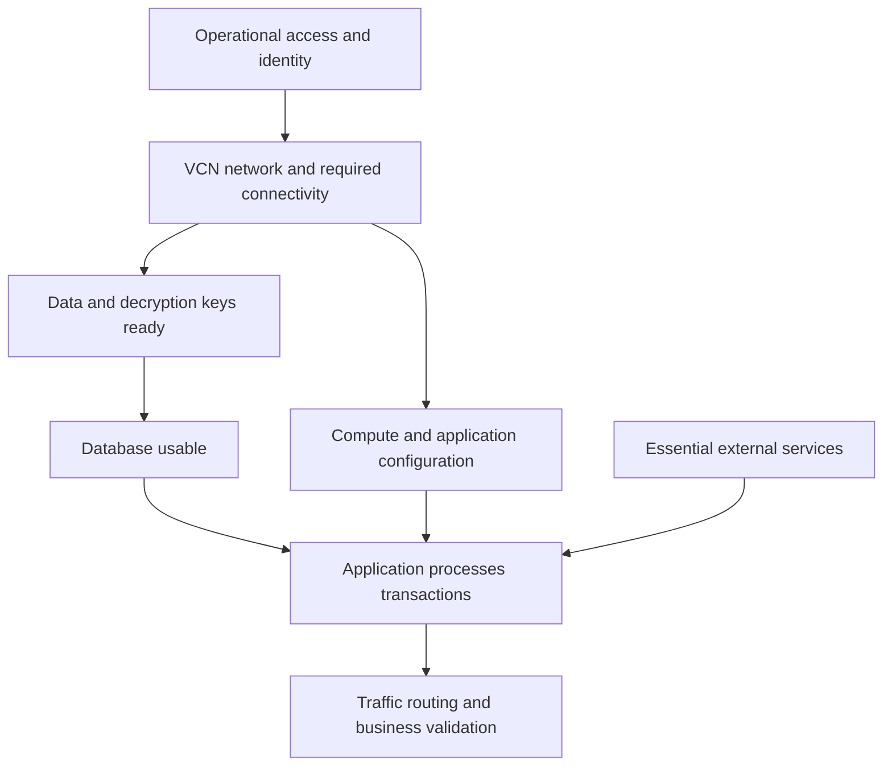

# Defining RPO, RTO, and Workload Criticality Classification

An e-commerce system running on Oracle Cloud Infrastructure (OCI) can have complete backups and still fail to meet recovery requirements: the latest order data might not have been transferred to the standby location, or the database might already be open while the application cannot accept payments yet. Therefore, backup and disaster recovery design must start with business questions: **how much data can be lost, how long can the service remain unavailable, and which functions must be brought back first?**

Within the scope of the Oracle Cloud Infrastructure module, this lesson connects recovery objectives with tenancy, compartment, IAM, VCN, Compute, storage, and Oracle database services. The expected outcome is a set of requirements clear enough to guide architecture selection, operational authorization, monitoring, automation, and DR cost control.

## 1. Learning outcomes and workload scope

After this lesson, learners can:

- Distinguish between RPO, RTO, measured recovery time, and actual unrecoverable data volume.
- Define the boundary of a workload by its business function and dependencies.
- Classify criticality based on business impact rather than relying solely on server specifications.
- Translate recovery objectives into requirements for data, infrastructure, processes, and OCI budget.
- Design a drill with timestamps and evidence to determine whether objectives are met.

A **workload** here is a collection of components serving a single business function. For example, an order-intake workload may consist of an API running on Compute, an Oracle Database, a bucket storing documents, a task processor, connectivity to a payment gateway, and DNS resolution.

A virtual machine may be only one component of a workload. Conversely, a shared database may serve multiple workloads with different criticality levels.

When defining scope, write a verifiable statement, such as:

> The order-intake workload is considered recovered when customers can sign in, create orders, receive an order ID, and check payment status in the standby environment; order and payment data must satisfy the agreed reconciliation rules.

This statement prevents concluding "recovered" merely because a server has transitioned to a running state.

## 2. RPO: objective for recoverable data point

### 2.1. Definition and interpretation

**Recovery Point Objective (RPO)** is the acceptable limit of data loss, typically expressed in time. For example, an RPO of 5 minutes means the recovery approach must limit potential data loss to a 5-minute window prior to the incident, within the agreed data scope and scenario. Oracle also defines RPO in terms of the tolerable level of data loss during DR recovery. [Source: Oracle — Full Stack DR Terminology and Concepts](https://docs.oracle.com/en-us/iaas/disaster-recovery/doc/disaster-recovery-terminology.html).

RPO is an **objective**, not proof that existing copies meet that objective. During a drill, you must identify the last consistent data point that can actually be restored and compare the result against the RPO.

For an ordered data stream with reliable timestamps, potential data loss can be illustrated as:

```text
Measured data loss window
    = time when data writes were disrupted
      - last consistent data point actually recoverable
```

This formula assumes timestamps share a common time reference and the recovery point has been verified. For distributed data, late-arriving events, or multiple independent writers, looking only at the maximum timestamp is insufficient; checkpoints, transaction IDs, or appropriate reconciliation rules are required.

### 2.2. Calculation example

Suppose an order workload has the following milestones:

| Milestone | Timestamp | Meaning |
| --- | --- | --- |
| Last transaction confirmed recoverable at the standby location | 13:56 | Verified data point |
| Primary system stopped accepting writes | 14:00 | Start of disruption |
| Agreed objective | RPO 5 minutes | Acceptable limit |

The potential data loss window is `14:00 - 13:56 = 4 minutes`. On the time dimension, this result falls within the 5-minute objective. However, transactions inside and outside that window must still be checked: are any records missing, duplicated, or partially written?

If the average rate is 120 orders/minute, a 4-minute window corresponds to roughly 480 potentially affected orders. This is an estimate to understand impact; the exact count must be reconciled using order IDs and transaction confirmation logs.

### 2.3. Backup frequency does not automatically prove RPO

Consider a backup:

- Data point represented by the backup: 13:00.
- Backup creation completed: 13:25.
- Transfer of the backup to the standby location completed: 13:35.
- Incident rendering the primary system unusable: 14:00.

If this is the only recoverable point and no additional logs exist, the potential data loss window is **60 minutes**, because the data point is 13:00. You must not treat the copy completion time of 13:35 as the data point and conclude only 25 minutes were lost.

When evaluating RPO, account for the time the data was protected, copy creation time, transfer time, failed runs, and usability of the copy under the specific failure scenario. A copy that remains within the blast radius of a full region outage cannot be used to prove RPO for a region-loss scenario.

### 2.4. An RPO of 0 requires clearly stated conditions

An RPO of 0 is often used to require zero loss of transactions confirmed as successful by the system. For this requirement to be meaningful, you must define:

1. Where is the confirmation boundary: the API, the queue, or a committed database transaction?
2. Which data falls under the commitment: orders, payments, attachments, or all of them?
3. Which failure scenarios are in scope for protection?
4. What mechanism guarantees the data is durably persisted in a recoverable location?
5. What does the system do when the network link or standby location fails to meet the protection condition?

Reducing data loss can increase write latency or require restricting writes when protection conditions are no longer met. This trade-off must be agreed upon with the business owner.

## 3. RTO: objective for service downtime

### 3.1. Fixing the start and end points

**Recovery Time Objective (RTO)** is the maximum acceptable downtime an application or service can tolerate before being restored. [Source: Oracle — Full Stack DR Terminology and Concepts](https://docs.oracle.com/en-us/iaas/disaster-recovery/doc/disaster-recovery-terminology.html).

In this lesson, the RTO measurement convention starts when the business function is disrupted and ends when the function meets the agreed recovery criteria. Therefore, detection time and the decision to activate DR are both included in the measurement.

```text
Measured recovery time
    = time when business recovery criteria are met
      - time when disruption began
```

If a dashboard only starts counting when an operator clicks to run the DR plan, that figure is plan execution time, not the full service downtime.

### 3.2. Building a time budget

The following example is a hypothetical budget for a workload with a 45-minute RTO, with steps executed sequentially in this plan:

| Phase | Budget | Required outcome |
| --- | --- | --- |
| Detect and confirm disruption | 3 minutes | Alert raised and impact scope identified |
| Decide to activate DR | 5 minutes | Incident commander and recovery plan designated |
| Prepare required dependencies | 7 minutes | Access, networking, and configuration ready |
| Restore or switch database role | 12 minutes | Database usable and eligible for writes |
| Start applications | 5 minutes | Application components connected to right dependencies |
| Shift traffic flow | 5 minutes | Users routed to the standby location |
| Business validation | 3 minutes | Sample transaction flows succeed |
| Time buffer | 5 minutes | Absorb variance from expectations |
| **Total** | **45 minutes** | Covers the entire recovery window |

Corresponding milestones might be: disruption at 14:00, detection at 14:03, activation at 14:08, and business validation at 14:40. Measured recovery time is 40 minutes, leaving 5 minutes under the target.

If network and database preparation can run in parallel, draw a dependency graph to compute the **critical path**. Do not mechanically sum all independent tasks; nor should you use the fastest task's duration to represent the whole system.

### 3.3. Recovery to what service level?

RTO must include concrete completion criteria. Hypothetical example:

- The order-creation API can sustain at least 100 requests/second.
- Sample transaction success rate meets internal acceptance thresholds.
- Database, document files, and payment states do not violate chosen consistency rules.
- Operations staff can access, observe, and troubleshoot incidents in the standby environment.

These thresholds are chosen by the business. If only read-only lookup mode is restored while order creation remains stopped, record that as a separate service tier with its own objective.

### 3.4. Distinguishing RTO from other limits

| Concept | Core question | Key distinction |
| --- | --- | --- |
| RPO | How much data can be lost? | Points backward to the pre-incident data point |
| RTO | How fast must the service return? | Points forward to the post-disruption recovery process |
| Maximum tolerable downtime | When does impact become unacceptable? | May need extra time for reconciliation and backlog processing |
| Availability target or SLA | How available is the service over an evaluation period? | Does not itself define data-loss limits or single-DR recovery time |
| DR plan execution time | How long does the recovery workflow run? | May exclude detection and decision-making |

For example, the business tolerates a maximum outage of 120 minutes, but after the application returns, 30 minutes of reconciliation and 45 minutes of backlog processing are needed. Assuming sequential steps, at most 45 minutes remain for service recovery. Clearly state where the 45-minute RTO ends and what work takes place afterward.

## 4. Business Impact Analysis before choosing architecture

**Business Impact Analysis (BIA)** is the process of determining how disruptions affect operations and using those findings to establish recovery priorities. For OCI workloads, the session should include the business owner as well as application, database, infrastructure, security, and operations teams.

Oracle places defining RPO, RTO, and assessing disaster impact in the DR strategy planning phase, before selecting technical solutions. [Source: Oracle — Plan Your Disaster Recovery Strategy](https://docs.oracle.com/en/solutions/oci-best-practices/plan-your-disaster-recovery-strategy.html).

### 4.1. Questions to answer

| Question group | Examples of evidence to gather |
| --- | --- |
| Business functions | Which customer flows or internal operations will stop? |
| Time-based impact | How does damage differ after 15 minutes, 1 hour, 4 hours, and 1 day? |
| Data-loss impact | Can data be recreated, from what source, and how long does it take? |
| Sensitive periods | Do month-end, peak hours, or closing periods have different requirements? |
| Commitments and obligations | Which contracts or policies impose specific limits? |
| External dependencies | What options exist for payment gateways, enterprise links, or identity providers? |
| Workarounds | How long can operations fall back to manual processing or read-only mode? |
| Recovery capability | Who is on call, who decides, and who signs off on business acceptance? |

Avoid asking only "is this system important?" because most system owners will say yes. A more useful question is: "If it stops for two hours and loses 15 minutes of data, which business activities are affected, and what evidence supports that impact?"

### 4.2. Separating outage impact from data-loss impact

Two workloads of equal criticality can have different RPO/RTO pairs:

- An inventory lookup portal must return quickly, but can tolerate 30-minute-old data in standby mode.
- A digitally signed records repository can tolerate hours of downtime, yet losing a single confirmed record is unacceptable.
- Analytical reports can be regenerated from source data, so loss of intermediate data and loss of source data must be evaluated differently.

Therefore, do not force RPO and RTO to be equal or always move together.

## 5. Building a criticality classification table

The table below is an **illustrative convention for an organization**, not a standard OCI tiering, not Oracle Maximum Availability Architecture (MAA) tiers, and not a performance commitment for Oracle services.

| Internal tier | Typical impact | Illustrative RPO | Illustrative RTO | Recovery direction |
| --- | --- | --- | --- | --- |
| C1 — Critical | Core transactions halt; data loss causes major consequences | 0–5 minutes | 15–45 minutes | Frequently updated standby data, pre-provisioned capacity, rigorous drills |
| C2 — Important | Significant impact, but workarounds exist | 15 minutes | 2 hours | Partial standby, automated recovery, reasonably fresh copies |
| C3 — Supporting | Can wait within a working window | 4 hours | 8 hours | Backup/restore or rebuild from code and configuration |
| C4 — Deferrable | Can stop longer or regenerate from other sources | 24 hours | 48 hours | Cost-prioritized, retaining data needed to rebuild |

These numbers are starting points for discussion. Each workload still needs a concrete pair of objectives per scenario. If C1 has an RTO range of 15–45 minutes, the workload's record must not simply say "C1"; it must specify its own target, such as 45 minutes.

### 5.1. How to make classification decisions

1. Record impact when the service stops across time milestones.
2. Record consequences of losing a transaction, a file, or a time window of data.
3. Determine alternative processing capability and the time limit of that workaround.
4. Check mandatory obligations so an average score does not mask a strict constraint.
5. Propose a tier and RPO/RTO targets along with incident scope.
6. Validate against cost, technical capability, and test results.
7. Have the business owner and operational owner approve the targets and residual risk.

A scoring rubric can aid discussion, but a total score does not replace a business decision. A severe safety impact or mandatory obligation can justify a high tier even if other criteria score low.

### 5.2. Criticality changes over time

A payroll workload may tolerate extended downtime mid-cycle while requiring high priority right before payout deadlines. Different targets can be designed by phase if operational schedules, standby capacity, and activation responsibilities are clearly defined.

Do not automatically downgrade an environment labeled `non-production` if it actually hosts the sole artifact repository or tooling required to recover production.

## 6. Mapping dependencies and recovery order on OCI

A C1 workload cannot meet its RTO if an essential dependency takes hours to recover. Distinguish between a system's own business criticality and the minimum capability it must provide to recover other systems.



This is an illustrative dependency diagram. A real system may have multiple parallel branches and some configurations already prepared in advance.

| OCI component or dependency | Must be specified in DR requirements | Risk if omitted |
| --- | --- | --- |
| Tenancy, compartment, IAM | Which users and services may operate standby resources; required permission scope | Data copies exist but lack permissions to recover |
| VCN, subnet, routing, NSG, DNS | Traffic paths from users to applications and from applications to data at standby | Servers run but cannot communicate |
| Compute and software | Images, artifacts, configuration, capacity, and startup order | Instances launch but application fails to work properly |
| Block Volume, File Storage, Object Storage | Recovery point, usable copies, consistency state with the application | Data missing or components out of sync |
| Oracle Database | Recovery/role-switch method, required logs, consistency point, write eligibility | Database opens but fails data requirements |
| Keys, secrets, certificates | Usability at recovery location and corresponding access permissions | Cannot decrypt data or establish connections |
| Monitoring, logs, notifications | Observability even when the primary environment is unavailable | Slow detection and missing acceptance evidence |
| External services | Endpoints, allowlists, connectivity, and coordination procedures | Business flows blocked even though OCI components run |

A compartment is a boundary for organizing and authorizing resources; creating a compartment named `dr` does not create an independent fault domain. Identify which actual region, availability domain, or fault domain resources reside in, and which scenarios render them simultaneously unavailable.

You do not necessarily have to elevate an entire dependent system to a high tier. For example, the order workload may require authentication and lookup of a minimal dataset within 45 minutes, while administrative reports of the dependent system can recover later. This separation must be documented and tested.

## 7. Binding targets to specific incident scenarios

An RPO/RTO pair without a scenario easily leads to misunderstanding. Restarting a single instance does not prove recovery time for losing an entire region.

| Scenario | Assumed blast radius | What must be proven |
| --- | --- | --- |
| Single instance or process failure | Other data and services remain usable | Load shift or restart within target |
| Single availability domain unavailable | Resources and dependencies in that AD affected | Copies and capacity in surviving scope meet requirements |
| Primary region unavailable | Recovery cannot rely on primary region resources | Data, networking, permissions, and capacity in standby region suffice |
| Accidental deletion or data corruption | Errors may have propagated to replicas | Clean recovery point exists and method to identify it is ready |
| Operational account compromised | Risk of modification or deletion across many resources | Recovery access path and copy protection match chosen threat model |
| Loss of connectivity to enterprise/partner | Cloud side may still be operational | Alternate connectivity or clear degraded service level exists |

**HA, backup, and DR solve different parts of the problem.** HA maintains service through certain component failures. Backup provides historical data points for recovery. DR orchestrates restoring business functions after major disruptions, encompassing data, infrastructure, dependencies, and people.

For logic errors detected late, a clean data point may lie farther back than the RPO designed for infrastructure failures. For example, corruption starts at 08:00 but is detected at 12:00; a replica at 11:59 may already contain the error. Separately evaluate how to find a clean point, retention duration, and how to replay valid transactions after that point.

A 30-day backup retention answers how far back you can roll. A 5-minute RPO answers how much data can be lost under the chosen scenario. These two values do not replace each other.

## 8. Translating RPO/RTO into OCI design choices

### 8.1. Selecting a recovery strategy

Oracle describes approaches such as backup/restore, pilot light, warm standby, and active/active in its DR guidance. [Source: Oracle — Disaster Recovery, Cloud Adoption Framework](https://docs.oracle.com/en-us/iaas/Content/cloud-adoption-framework/disaster-recovery.htm).

The table below explains how to use them when defining requirements; do not assign a fixed RPO/RTO to each model:

| Strategy | Pre-staged assets | Remaining work during incident | Decision question |
| --- | --- | --- | --- |
| Backup and restore | Backups, storage location, IaC, and recovery runbooks | Provision resources, restore data, bring application up | Can the largest dataset be restored within RTO? |
| Pilot light | Keep certain core components at the standby location | Scale application tier and complete serving path | How long do idle/unstarted components take to become ready? |
| Warm standby | A running stack at lower capacity than production | Scale capacity, switch roles, and route traffic | Is there enough capacity and time to absorb required load? |
| Active/active | Multiple locations actively serving traffic | Isolate failed part, balance load, and handle data state | How are data consistency, write conflicts, and site loss handled? |

Higher cost usually accompanies maintaining more data, capacity, and processes. However, actual cost depends on configuration and operations. You cannot infer that active/active automatically has RPO 0 or zero downtime purely from the architecture name.

### 8.2. Data on Block Volume

OCI Block Volume provides asynchronous replication for volumes, boot volumes, and volume groups. Oracle explicitly notes that replication complements backups rather than replacing them; replication RPO can vary with write load. [Source: Oracle — Block Volume Replication](https://docs.oracle.com/en-us/iaas/Content/Block/Concepts/volumereplication.htm).

Implications when setting requirements:

- Do not use a "replication enabled" label as proof of meeting a 5-minute RPO.
- Verify the actual usable data point, especially under heavy write load or after configuration changes.
- Having a replica does not prove the application recovers to a consistent state. Test recovery behavior of the OS, application, and related databases.
- If multiple volumes together hold one business state, design a consistent recovery method for that dataset.

### 8.3. Data on Object Storage

Object Storage replication is asynchronous. According to Oracle documentation, objects existing before policy creation are not automatically replicated; object deletions at the source after policy creation are propagated to the destination. Therefore, verify initial data is protected and do not treat replication as a way to roll back to arbitrary historical versions. [Source: Oracle — Object Storage Replication](https://docs.oracle.com/en-us/iaas/Content/Object/Tasks/usingreplication.htm).

For example, orders in the database with a 5-minute RPO paired with document files transferred daily create a data skew gap. Set separate requirements for documents and decide whether a transaction counts as recovered if its associated file is still missing.

### 8.4. Oracle Database and Data Guard

Data Guard offers different protection modes. Maximum Performance ships redo asynchronously with respect to commit; Maximum Availability has protection conditions depending on synchronization state and can continue operating when the standby stops acknowledging sync. Redo acknowledgment options also affect protection levels under multiple failures. [Source: Oracle — Data Guard Protection Modes](https://docs.oracle.com/en/database/oracle/oracle-database/21/sbydb/oracle-data-guard-protection-modes.html).

When proposing targets for a specific Oracle database service on OCI, check the supported features and configurations of that exact service, version, and deployment model. Do not assume every database has the same DR options.

Distinguish two phenomena:

- **Transport lag:** change data that has not yet reached the standby can increase data-loss risk if the primary is lost.
- **Apply lag:** data that has arrived but is not yet applied can increase the time before the database is ready for use.

Redo that has been received, intact, and is applicable can still participate in recovery. Therefore, do not equate apply lag with guaranteed data loss. Conversely, a dashboard showing low lag does not replace checking transaction completeness after recovery.

### 8.5. Automation with Full Stack Disaster Recovery

OCI Full Stack DR orchestrates recovery plans across multiple application tiers and provides prechecks to verify readiness. [Source: Oracle — About Full Stack Disaster Recovery](https://docs.oracle.com/en-us/iaas/disaster-recovery/doc/about-disaster-recovery.html).

In the design, state clearly which mechanism protects the data, which parts the workflow automates, and which steps require human decision or confirmation. Automation reduces manual steps but does not create a data point that was never protected.

A passing precheck also does not replace evidence of recovery time and transaction correctness from an end-to-end drill.

## 9. End-to-end example: classifying an order-intake workload

### 9.1. Context and hypothetical requirements

An enterprise deploys on OCI:

- API and background jobs on Compute.
- Oracle Database storing orders and payment statuses.
- Object Storage storing documents.
- VCN and routing components serving access.
- An external payment gateway outside OCI.

The business owner determines that losing more than 5 minutes of orders is unacceptable; order intake must return within 45 minutes when the primary region is unavailable. Standby must serve at least 100 order-creation requests/second. These values are hypothetical for the example, not OCI commitments.

### 9.2. Classification by data segment and function

| Component/function | Proposed target | Treatment in recovery scope |
| --- | --- | --- |
| Orders and payment links | RPO 5 minutes, RTO 45 minutes | Prioritize transaction verification and reconciliation |
| Mandatory transaction documents | Meet the same agreed consistency boundary | Do not allow an order to recover while missing required documents |
| Regenerable cache | No independent RPO for cache data | Factor rebuild time and load impact into RTO |
| Analytics dashboard | RPO 4 hours, RTO 8 hours | Recover after order-creation flow; retain needed source data |
| Sign-in and connection config | Ready before order-creation acceptance | Mandatory dependency even though it does not directly generate revenue |

The order-intake workload is classified as C1 under the illustrative convention. The dashboard does not need to come up first just because it sits in the same product, though if it shares a database or infrastructure, actual isolation limits must be checked.

### 9.3. Cross-system consistency

Suppose the standby database has orders up to 13:56 while the destination bucket only has complete documents up to 13:40. You cannot cite the database's RPO alone to claim the whole workload achieves a 5-minute RPO.

Design options to evaluate may include:

- Protecting documents to an equivalent requirement as transactional data.
- Confirming order completion only once mandatory durability conditions are satisfied.
- Allowing a "pending document" state if the business accepts it and a reliable backfill path exists.
- Using transaction IDs and reconciliation sources to identify data needing recovery or reprocessing.

There is no universal rule that taking the minimum timestamp across all systems yields a consistent state. You must prove the recovery point and relationships among records, objects, events, and external transactions.

### 9.4. Detecting a design unable to meet RTO

Another proposal only stores a 2 TiB database backup and expects to restore at an effective throughput of 200 MiB/second. Assuming this entire volume must be read and written along the recovery path:

```text
2 TiB = 2 × 1024 × 1024 MiB = 2,097,152 MiB

Assumed minimum data transfer/restore time
    = 2,097,152 / 200
    ≈ 10,486 seconds
    ≈ 175 minutes
```

This number already exceeds the 45-minute RTO before adding resource provisioning, log apply, application startup, and acceptance testing. This is an illustrative calculation with an assumed throughput, not a performance forecast for an OCI service.

Design conclusion: the current approach cannot meet the target. Evaluate maintaining pre-staged data at the standby location, increasing restore throughput, reducing the dataset brought up first, or renegotiating targets based on impact and cost. Changing only the backup schedule while keeping this restore path does not solve the time limit.

## 10. Capturing requirements in an verifiable record

The template below is an illustrative design record inside the documentation, not an OCI configuration to apply directly:

```yaml
workload_id: order-intake
business_owner_role: Sales business owner
operations_owner_role: Cloud operations team
target_criticality: C1
scenario: Primary region unavailable
rpo_target_minutes: 5
rto_target_minutes: 45
rto_clock_start: Time when order-creation flow is disrupted
rto_clock_end: Order-creation flow at standby location meets acceptance criteria
minimum_service:
  create_order_requests_per_second: 100
  mandatory_flows:
    - Sign in
    - Create order and receive order ID
    - Check payment status
protected_data:
  - Orders
  - Payment links and statuses
  - Mandatory documents per consistency rules
dependencies:
  - Identity and DR operation permissions
  - Network and connectivity to payment gateway
  - Keys, secrets, and configuration at standby location
acceptance_evidence:
  - Disruption and recovery timestamps
  - Reconciliation of confirmed transaction IDs
  - Load test and business flow results
failover_authority_role: Incident commander
review_trigger: After major changes or when a drill fails
```

In a real record, add resource identifiers, copy locations, owners, last-updated timestamps, known limits, and evidence sources. Sensitive information is referenced through an appropriate secrets manager rather than copied directly into runbooks.

Also separate three values:

| Value | Example | Meaning |
| --- | --- | --- |
| Business objective | RTO 45 minutes | What must be achieved |
| Design estimate | 40 minutes | Hypothesis from modeling and component tests |
| Measured result | 57 minutes in latest drill | Evidence that the target is currently not met |

Do not change the target to 57 minutes just to turn a failed drill into a pass. If the target must change, obtain a business decision and record the corresponding impact.

## 11. Measuring and drilling against the target

### 11.1. Measuring data before, during, and after recovery

A practical approach is to write verification transactions with unique IDs, sequence numbers, standardized timestamps, and proof of system-confirmed success. After recovery, reconcile against data at the standby location:

- Which transactions were confirmed at the source but are missing at the destination?
- Are there gaps between transaction IDs rather than only missing tail records?
- Were any transactions replayed or side effects executed twice?
- Do database records match documents and statuses in external systems?

A record with a recent timestamp does not prove all older records were recovered. Clock skew can also make results look better than reality. Use a unified time standard and evidence aligned with how the application confirms transactions.

### 11.2. Recording sufficient milestones to measure RTO

A minimum drill log should include:

| Milestone | Suggested evidence source |
| --- | --- |
| Start of function disruption | External synthetic transaction checks and application logs |
| Incident detection | Monitoring alerts |
| Decision to activate DR | Incident coordination log |
| Start/end of each step | Workflow logs and operator actions |
| Traffic shifted to standby | Routing logs and user-side checks |
| Business criteria and minimum load met | Verification transaction results and load measurements |

Use audit logs to correlate who acted on resources with execution timestamps; use monitoring and application logs to verify serving capability. Metric names and alert integrations must follow each service's actual capabilities; unavailable values must be gathered via separate checks or measurements.

### 11.3. Designing drills true to the scenario

1. Clearly choose the simulated failure, data volume, and representative load.
2. Lock in start point, end point, and acceptance criteria beforehand.
3. Verify the plan does not inadvertently depend on components assumed lost.
4. Execute recovery within the organizationally approved drill scope.
5. Measure actual data, time, and service level.
6. Record the slowest bottleneck, permission errors, capacity shortfalls, and manual interventions.
7. Assign remediation actions and re-verify the affected parts.

A planned switchover while the source is healthy is not equivalent to a failover when the source fails abruptly. Record explicitly which type was tested. Likewise, restoring a backup in a small environment does not prove production recovery capability with larger data and higher load.

When testing transactional data, isolate side effects such as payments, sending emails, or creating shipping labels so test execution does not trigger unintended business transactions.

### 11.4. Monitoring distance to target

With a 5-minute RPO, alerting only once the data point is already older than 5 minutes usually leaves insufficient time to intervene before breaching. Early warning thresholds can be set based on lag growth rate and intervention capacity, but specific thresholds must come from operational data.

Track at a minimum:

- Age of the actual recoverable data point at the standby location.
- Failed backups, missing logs, or unusable copies.
- Configuration, artifact, or secret drift between primary and standby environments.
- Capacity and permissions needed for the next recovery step.
- Most recent drill results against current targets.

If only an indirect indicator such as backup completion time can be measured, document that indicator's limitations instead of labeling it as a verified RPO result.

## 12. Balancing targets, cost, and feasibility

Shorter RPOs typically require more continuous data protection. Shorter RTOs typically require more pre-staged capacity and automation. These two dimensions affect budgets in different ways.

| Cost category | Items to include in comparison |
| --- | --- |
| Data | Standby copies, historical backups, growth, and retention period |
| Network | Data transfer and links supporting replication/recovery |
| Capacity | Compute, database, and resources kept pre-provisioned |
| Software | Usage terms and licensing costs tied to database options |
| Operations | On-call coverage, access management, runbook upkeep, automation, and drills |
| Residual risk | Potential data loss, downtime, and reconciliation effort |

Specific monetary figures must be derived from configurations and current pricing information at estimation time. Do not use a single flat price assumption to argue every workload should run standby.

When comparing two options, present the same incident scope, data volume, recovery load, and consistency requirements. If a cheaper option recovers only partial functionality, state that scope clearly rather than comparing it directly against full-service recovery.

Cost can be reduced by bringing core business flows up first and deferring reports or non-essential jobs, provided that minimum service level is accepted and tested. Ensure deferred jobs do not bottleneck the database or exhaust capacity right after failover.

Once the system stabilizes at the standby location, returning service to the primary requires a separate plan covering data synchronization, role switching, routing, and rollback capability. The failback window does not automatically sit inside the initial RTO measurement, yet it still impacts cost, risk, and long-term operations.

## 13. Common mistakes that make targets meaningless

| Mistake | Consequence | Fix |
| --- | --- | --- |
| Setting the same RPO/RTO for every workload | Overspending on low-criticality parts or underprotecting core ones | Conduct BIA by function and data |
| Using backup completion time as the data point | Underestimating potential data loss | Use the data timestamp the backup represents and actual recoverability |
| Using active replica status to prove RPO | Missing gaps or data skew in copies | Reconcile checkpoints and transactions |
| Counting only from workflow execution start | Omitting detection, decision, and preparation | Fix measurement convention from business disruption |
| Ending at database open | Omitting connectivity, routing, and business checks | Validate an end-to-end transaction flow |
| Treating replication as the entire backup strategy | Unable to roll back before propagated logic errors | Design clean historical points and retention |
| Setting RPO to 0 without stating conditions | Committing beyond actual protection mechanisms | Lock confirmation boundary, durability, and failure scope |
| Skipping IAM and dependency checks at standby | Plan blocked even when data assets are intact | Drill with real operational identities and permissions |
| Testing only with small data or low load | Unrealistic time estimates | Test with representative data and load, factoring in growth |
| Not updating after changes | Old targets no longer fit new architecture | Tie DR review to data, app, and infrastructure changes |

## 14. Hands-on exercise: build recovery profiles for three OCI workloads

This exercise focuses on design and verification methods; it does not require creating billable resources.

Assume a system has three workloads: order intake, a document lookup portal, and daily analytical reports. Learners perform:

1. Write the boundary and one business acceptance flow for each workload.
2. Build an impact table for outages of 15 minutes, 1 hour, 8 hours, and 1 day.
3. Separate data that cannot be recreated, data that can be reconciled, and data that can be rebuilt.
4. Select an internal tier and a concrete RPO/RTO pair for the primary-region-loss scenario.
5. Map dependencies including IAM, networking, applications, databases, storage, and external services.
6. Propose a recovery strategy and specify which data or capacity must be pre-staged.
7. Build a time budget, accounting for parallel steps and the critical path.
8. Design evidence to verify data point, timing, and service level.
9. Record unverified assumptions along with the owner responsible for resolving them.

The deliverable is a table like the following, with every cell filled with a justified decision:

| Workload | Owner | Scenario | Tier | RPO | RTO | Minimum service level | Mandatory dependencies | Strategy | Acceptance evidence |
| --- | --- | --- | --- | --- | --- | --- | --- | --- | --- |
| Order intake | … | … | … | … | … | … | … | … | … |
| Document lookup | … | … | … | … | … | … | … | … | … |
| Analytical reports | … | … | … | … | … | … | … | … | … |

The profile is ready to move to detailed design when a reader can clearly determine: what must be recovered, which data is protected to what point, who holds activation authority, at what level service returns, and what evidence proves RPO/RTO compliance. Items not yet drilled must be marked as assumptions or estimates, not proven recovery capabilities.
