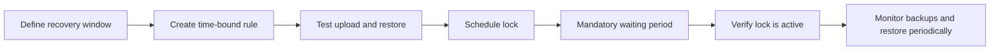
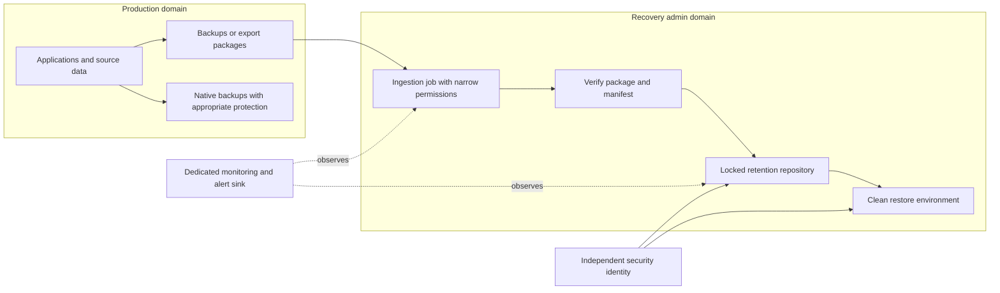

# Protecting Backups Against Accidental Deletion and Compromised Accounts

## 1. Goal: preserving a reliable restore point

In the **Backup and Disaster Recovery** chapter of Oracle Cloud Infrastructure (OCI), creating a fresh backup is only the first step. When an operator accidentally deletes resources or an account is compromised, the system must preserve a copy that is old enough, intact, and still decryptable to restore business operations.

A backup marked "successful" can still fail to support recovery if:

- It is deleted alongside the source data.
- It is overwritten with corrupted or unauthorized encrypted data.
- Data remains, but decryption keys, wallets, catalogs, or dependent copy chains are lost.
- Only administrators of the compromised environment hold permission to restore.
- No clean point prior to data tampering can be identified.
- Time to retrieve the backup and rebuild the system exceeds acceptable business limits.

After this lesson, learners can select anti-deletion mechanisms suitable for each OCI backup type, separate backup creation from deletion permissions, protect encryption keys, establish an independent recovery domain, and verify readiness with restore tests.

The running example is an order-processing application on Compute using Block Volume and Oracle Database. Application backup files go to Object Storage; database backups and volume backups are managed by each service's native mechanisms.

## 2. Threat analysis before choosing features

### 2.1. Accidental deletion and account compromise have different scopes

Accidental deletion usually happens when a script receives the wrong OCID, a cleanup loop targets the wrong compartment, or an operator deletes the newest backup instead of an expired one.

When an account is compromised, an attacker may attempt to use legitimate privileges to:

1. Delete backups or shorten retention periods.
2. Disable backup schedules so no new restore points exist.
3. Modify IAM permissions, groups, or dynamic groups.
4. Remove decryption capability by disabling keys.
5. Disable monitoring channels to prolong dwell time undetected.
6. Write large volumes of junk data to exhaust quotas and inflate cost.
7. Corrupt source data and wait for clean copies to expire.

Therefore, protection must cover **backup content**, **protection configuration**, **encryption keys**, **recovery identities**, and **operational evidence**.

### 2.2. Identify which accounts could be lost

| Compromised account or identity | Assumed capability | Required protection boundary |
| --- | --- | --- |
| Application account | Read or modify data authorized for the app | No permission to delete backups or modify retention policies |
| Backup agent | Write new backups, read scoped source data | Cannot delete, overwrite, or administer backup repository |
| Infrastructure operator | Manage workloads or some storage resources | Separate permission to alter protection from key administration |
| IAM administrator | Grant additional permissions and alter groups | Active retention locks and independent admin domain when needed |
| Key administrator | Disable or schedule deletion of managed keys | Separate monitoring, separation of duties, and suitable key recovery |

Removing delete permissions from a backup agent reduces risk if the agent is compromised. It does not stop an IAM administrator from re-granting permissions. Resisting modification by higher privileges requires service-enforced retention locks and protecting remaining dependencies.

No single checkbox protects this entire chain. Each layer requires a specific assumption and verification method.

## 3. Distinguish protection layers

| Mechanism | What it solves well | Limits to understand |
| --- | --- | --- |
| Least privilege | Prevents normal identities from dangerous actions | Permissions can be re-granted by IAM administrators |
| Versioning | Retains prior versions to handle overwrites or accidental deletes | Does not stop privileged users from deleting versions |
| Unlocked retention | Prevents modification or deletion while the rule is active | Authorized users can edit or remove the rule |
| Retention lock | Enforces keeping copies for the retention period within service limits | Does not create clean backups, protect every key, or guarantee restore |
| Cross-region copy | Reduces single-location dependency | Same admin account can still affect both locations |
| Independent admin domain | Reduces blast radius of compromised production accounts | Must inspect IAM, federation, keys, pipelines, and emergency accounts |
| Restore test | Proves copies can be read and used | Must be repeated when data, software, or configuration changes |

**Immutable content** and **non-deletable before expiration** are two properties to check separately. A snapshot that does not support direct editing is not necessarily protected from deletion.

Likewise, encryption protects data confidentiality under specific conditions; it does not replace anti-deletion permissions. Retention locks protect copy existence within their designed scope; they do not prevent unauthorized reading if an identity with read access is compromised.

## 4. Choose the right mechanism per OCI backup type

### 4.1. User-managed copies stored as objects

For application backup files, dumps, or recovery packages stored in your own buckets, use Object Storage retention rules to retain objects for the required period.

Rules are configured at the bucket level and apply to objects in that bucket. For time-bound rules, retention is calculated per object from its Last Modified timestamp. While protected, objects and related metadata cannot be modified, overwritten, or deleted within service boundaries. See [Object Storage Data Retention Rules](https://docs.oracle.com/en-us/iaas/Content/Object/Tasks/usingretentionrules.htm).

Organize buckets by retention period and data type, for example:

```text
app-backup-daily-45d
app-backup-monthly-365d
recovery-evidence-90d
```

These are illustrative names and durations. Do not dump all data into a single bucket and assume each "folder" receives independent retention.

### 4.2. Block Volume, Boot Volume, and Volume Group backups

OCI Block Storage supports backup protection options including prevent deletion, retention lock, and indefinite hold. Release notes record the addition of ransomware-resilient backup protection on August 11, 2026; verify actual features and interfaces of the service in use. See [Block Volume release notes](https://docs.oracle.com/en-us/iaas/releasenotes/services/blockvolume/).

Distinguish their purposes:

| Option | Operational meaning |
| --- | --- |
| Retention period | Defines how long a backup is kept before becoming eligible for configured expiration |
| Prevent deletion | Blocks manual deletion, while allowing authorized users to change protection |
| Retention lock | Cannot disable the lock; cannot delete early or shorten retention |
| Indefinite hold | Retains backup until an authorized user removes the hold |

With Block Storage retention lock, duration can be extended, and the backup's encryption key cannot be changed. Prevent deletion does not stop automatic expiration at the configured retention limit. See [OCI Block Storage Adds Ransomware-Resilient Backup Protection](https://blogs.oracle.com/cloud-infrastructure/oci-block-storage-adds-ransomware-backup).

Block Volume backups may be stored independently by the service on Object Storage, yet they remain resources managed through Block Volume. Do not assume there is a user bucket where you can attach Object Storage retention rules to these backups.

If volumes belong to a volume group, member retention settings must be configured via the backup policy attached to the group per service guidance. Inspect attributes on actual backups; looking only at the intended policy does not prove every backup is locked. See [Creating a Block Volume Backup](https://docs.oracle.com/en-us/iaas/Content/Block/Tasks/create-bv-backup.htm).

### 4.3. Oracle Database backups via Recovery Service

For supported Oracle Databases protected by Oracle Database Autonomous Recovery Service, retention lock is applied at the protection policy. The service requires a minimum 14-day waiting period before the lock takes effect. During the waiting period, configuration can still change; afterward, retention can only be increased. See [Retention Lock](https://docs.oracle.com/en-us/iaas/recovery-service/doc/protection-policy-locking.html).

Once locked, Recovery Service prevents modifying or deleting backups during the retention window, even for tenancy administrators. See [Immutability and Anomaly Detection](https://docs.oracle.com/en-us/iaas/recovery-service/doc/recovery-service-fault-tolerance.html).

Verify the exact database type, attached policy, and lock state. Do not assume every database branded Oracle or every copy in Object Storage automatically has this mechanism.

### 4.4. Decide by specific resource

| Data to recover | Where protection is controlled | Additional checks needed |
| --- | --- | --- |
| Application-generated backup files | User bucket retention rules | Backup format, complete object upload, manifest |
| Block or Boot Volume backups | Block Storage retention and protection options | Backup state, policy, volume group, keys |
| Recovery Service–supported databases | Protection policy and retention lock | Support scope, effective policy, point-in-time recovery capability |
| Separate copies in recovery domain | Corresponding mechanism at target | Target permissions, target keys, copy transfer lag |

Do not apply the 14-day waiting period of Object Storage or Recovery Service across all other features. Each service has its own configuration lifecycle.

## 5. Designing retention rules and locks on Object Storage

### 5.1. Active rules and locked rules are two distinct states

Object Storage supports time-bound rules and indefinite rules. Time-bound rules fit defined recovery windows. Indefinite rules keep data until removed by authorized users; an indefinite rule cannot be locked like a time-bound rule.

Locking a time-bound rule is irreversible. Object Storage enforces a mandatory 14-day delay; once locked, duration can only be increased. Neither tenancy administrators nor Oracle Support can remove a locked rule to bypass protection. A bucket must be empty before it can be deleted. See [Creating an Object Storage Data Retention Rule](https://docs.oracle.com/en-us/iaas/Content/Object/Tasks/usingretentionrules_topic-To_create_a_retention_rule.htm).

A rollout workflow should make this clear:



During the waiting period, the rule may protect objects, but the configuration itself is not yet immutable. Dashboards should distinguish "retention configured", "lock pending", and "lock active".

### 5.2. Retention is not counted from the day you click lock

For example, an object has Last Modified on November 1 and a 45-day retention rule. The retention period is evaluated per object and active rule—it does not restart a fresh 45 days when the rule is locked on November 20.

Therefore, when evaluating an older restore point, check remaining retention across actual components. A recently locked bucket does not prove every backup inside it still has a full fresh protection window.

Protection expiration date is also not necessarily the exact date an object is immediately deleted. Objects may persist until an operation or lifecycle policy is allowed to delete them.

### 5.3. Features that cannot be arbitrarily combined

Key Object Storage interactions:

- Lifecycle can transition storage tiers, but cannot delete objects protected by retention.
- Incomplete multipart uploads are not protected by retention like committed objects.
- Retention does not block bucket re-encryption.

These limits are documented in [retention rules documentation](https://docs.oracle.com/en-us/iaas/Content/Object/Tasks/usingretentionrules.htm).

Versioning and retention have compatibility constraints: you cannot add a retention rule to a bucket with versioning enabled, and you cannot enable versioning on a bucket with active retention rules. If you need both multi-version capability and immutable storage, design separate buckets with distinct roles. See [Object Storage Versioning](https://docs.oracle.com/en-us/iaas/Content/Object/Tasks/usingversioning.htm).

An Object Storage replication destination cannot have retention rules. Do not diagram a replication destination and assume you can lock retention directly on that same bucket. If an immutable repository is also needed, design a pipeline writing to a separate storage bucket and verify permissions, lag, checksums, and completeness. See [Troubleshooting Object Storage Replication](https://docs.oracle.com/en-us/iaas/Content/Object/Troubleshooting/usingreplication_topic-Troubleshooting_Replication.htm).

## 6. Authorizing so writers cannot destroy copies

### 6.1. Separate roles by action

A reference role structure:

| Role | Allowed | Should not hold in daily operations |
| --- | --- | --- |
| Backup writer | Write new backups to the designated target | Delete, overwrite, read entire repository, edit retention |
| Backup verifier | Read copies, verify checksums and restore capability | Administer IAM, destroy backups |
| Restore operator | Read backups and create recovery resources in assigned scope | Shorten retention, manage keys tenancy-wide |
| Retention administrator | Configure durations and locks via controlled process | Act as identity for production applications |
| Key administrator | Manage key lifecycle within assigned scope | Read all backup data if unnecessary |
| Security observer | Read logs, receive alerts, inspect configurations | Modify or disable monitored log sources |

A small team does not need six separate individuals. However, automated identities and routine permissions must be separated; privileged actions can run through logged elevation sessions.

Backup agents running on Compute can use instance principals and dynamic groups to avoid placing long-lived API private keys in scripts. For other runtimes, choose the principal model supported by that runtime. Dynamic group matching rules must also be protected: allowing arbitrary resources into the group expands the agent's privileges.

### 6.2. Example permission to write new objects only

Example within the same tenancy granting object creation only under a defined prefix:

```text
Allow dynamic-group BackupWriters to manage objects in compartment BackupVault where all {target.bucket.name='app-backup-daily-45d', target.object.name='orders/*', request.permission='OBJECT_CREATE'}
```

The statement uses the verb `manage`, yet conditions restrict the actual granted permission to `OBJECT_CREATE`. It does not grant `OBJECT_DELETE`, `OBJECT_OVERWRITE`, read access, or bucket modification.

This applies the write-once access pattern described by OCI at [Object Storage Objects](https://docs.oracle.com/en-us/iaas/Content/Object/Tasks/managingobjects.htm). Replace group, compartment, bucket, and prefix with actual resources; add the identity domain name when required by the tenancy's identity model.

A read policy for the recovery role could be:

```text
Allow group RestoreOperators to read objects in compartment BackupVault where target.bucket.name='app-backup-daily-45d'
```

Permissions to create volumes, create databases, use keys, access networks, or read bucket metadata are separate permissions granted according to specific restore operations. These two statements do not constitute the complete policy for a backup system.

Some tools also invoke list, head, or multipart upload calls. Inspect the APIs actually called instead of immediately adding `manage object-family in tenancy` when a tool reports missing permissions.

### 6.3. OCI permissions are cumulative

A narrow policy does not revoke permissions granted by another policy. If `BackupWriters` also belongs to a group with `manage all-resources in tenancy`, a create-only statement does not make that identity create-only.

When auditing, inspect the entire permission path: groups, dynamic groups, parent compartment policies, tenancy policies, and relevant cross-tenancy access relationships. Test with the exact identity used in the job rather than using an administrator account and extrapolating.

For Block Volume backups, removing `VOLUME_BACKUP_DELETE` from daily roles is a risk-reduction layer; see [Securing Block Volume](https://docs.oracle.com/en-us/iaas/Content/Security/Reference/blockstorage_security.htm). It does not replace retention lock when defending against actors capable of changing IAM.

### 6.4. Protect login paths and automated credentials

- Enable MFA and session controls for administrative users.
- Inventory API keys, auth tokens, pipeline credentials, and service principal permissions.
- Revoke credentials when operators leave or during an incident.
- Separate daily-use accounts from emergency accounts.
- Never use public pre-authenticated requests or shared credentials as the default access path to a backup repository.
- Control who can edit pipelines and job runners, as they can control the job's principal.

MFA for interactive logins does not protect exposed API credentials. Drill scenarios must account for both Console paths and the API paths the system actually uses.

## 7. Isolating the backup repository from potentially compromised domains

### 7.1. Compartments are an authorization organization layer

Placing backups in a separate compartment helps apply clear policies, quotas, and operational ownership. This is useful, but it does not override broad permissions at the tenancy or parent compartment level.

Similarly, a copy in another region improves resilience against geographic disasters. If the same identity can destroy backups in both regions, that copy is not independent against account compromise.

Evaluate independence by asking: "If this production identity is compromised, which copies can it delete, deprive of keys, shorten retention on, or block from restoring?"

### 7.2. Architecture with a dedicated recovery domain



The recovery domain can be a strictly controlled compartment or a separate tenancy if requirements demand higher administrative separation. When using a separate tenancy, examine admin accounts, identity providers, provisioning processes, pipeline runners, and keys at the target. Two tenancies depending on the same compromised admin account still share a common risk.

One option is having a job in the recovery domain pull backup packages from the source using narrow read permissions. Production holds no administrative credentials for the target repository. Another option lets the producer only create new objects at the target while an independent verifier assesses copy quality.

Cross-tenancy paths must be designed around both sides' API and policy capabilities. Do not assume every managed backup type exports or copies across tenancies like a plain file. For Block Volume and databases, verify service-supported copy or restore operations; for application backup packages, prove the package suffices to restore the application.

Never call a network-accessible repository a "physical air gap." Describe isolation level in terms of actual permissions and connectivity paths.

### 7.3. Network paths and quotas

Job runners or restore hosts can reside in private subnets. Design DNS, routes, NSGs, service gateways, or private endpoints per supported service and region. There is no need to open the entire production network into the recovery environment just to fetch backups.

Separate budgets, quotas, and rate limits for the pipeline. A writer lacking delete permissions can still write vast numbers of new objects; if objects are locked, that junk data may have to be retained until expiration.

Monitor storage capacity, object counts, growth rates, and age of the newest backup. A repository safe from deletion that runs out of space for new backups also fails long-term recovery goals.

## 8. Protecting encryption keys and recovery dependencies

### 8.1. Data still exists, yet keys are unusable

If backups use customer-managed keys in OCI Vault, key lifecycle permissions form a separate impact path. Disabling a key can render data and resources using that key unusable. See [Disabling a Vault Key](https://docs.oracle.com/en-us/iaas/Content/KeyManagement/Tasks/managingkeys_topic-To_disable_a_key.htm).

Notably, when a key enters Pending Deletion, data encrypted with that key becomes inaccessible immediately per service documentation; impact does not wait until the final deletion date. During the cancelable window, execute emergency runbook procedures. See [Deleting a Key](https://docs.oracle.com/en-us/iaas/Content/KeyManagement/Tasks/managingkeys_topic-To_delete_a_key.htm).

Consequently, a backup retention lock does not guarantee the backup can always be decrypted. Separate service key-usage permissions from permissions to disable, schedule deletion, or administer vaults.

### 8.2. Align key lifecycle with backup lifecycle

Build a dependency table:

| Component | Must record | Conditions for recovery |
| --- | --- | --- |
| Customer-managed key | OCID, region, version, and usage locations | Key available, policy valid, service permitted to use |
| TDE wallet or keystore | Type, version, and protected locations | Sufficient material and credentials per database plan |
| Backup catalog, control file | Timestamp and relationship to backup sets | Locate and assemble all parts needed for restore |
| Application secrets | Re-issuance source and owner | Can mint fresh credentials in a clean environment |
| Software and configuration | Versions, images, parameters, and dependencies | Rebuild system compatible with the backup |

If using vault or key backup/restore features, verify vault type, state, and supported operations. Key backups must be protected and test-restored; merely recording an OCID is not a key backup. See [Backing Up and Restoring Vaults and Keys](https://docs.oracle.com/en-us/iaas/Content/KeyManagement/Tasks/backingupvaultsandkeys.htm).

When rotating keys or changing key associations, retain readability of older copies through their full recovery lifecycle. Never delete a key solely because production has moved to a new key.

Key replication must also be evaluated for lifecycle propagation. Synchronous replication of configuration does not replace an independent recovery point.

## 9. Sizing the retention window by incident detection time

### 9.1. The newest backup is not necessarily clean

Silent corruption or intrusion can persist for days before detection. If you only keep three days of backups, by the time the incident is discovered all remaining points may already hold corrupted data.

An estimate for clean-point retention:

```text
W >= Δ + L_detect + L_investigate + L_restore + M
```

Where:

- `W`: required protection window for a clean point.
- `Δ`: maximum interval between suitable backup points.
- `L_detect`: maximum expected time from data impact to detection.
- `L_investigate`: time to identify a clean point and blast radius.
- `L_restore`: time to retrieve data, rebuild, and verify.
- `M`: safety margin.

Hypothetical example:

```text
Δ             = 1 day
L_detect      = 20 days
L_investigate = 3 days
L_restore     = 2 days
M             = 7 days

Model minimum W = 33 days
```

The team might select 45 days for the daily tier, then add monthly copies for longer-term needs. This is a design example, not an OCI default or regulatory mandate.

The model is only helpful when detection-time assumptions have grounding. If dwell time cannot be bounded, longer history, anomaly detection, and multi-tier restore points are required.

### 9.2. Distinguish operational RPO from post-attack clean point

A 24-hour RPO for host failure does not guarantee losing only 24 hours of data when a security incident has persisted for 20 days. The identified clean point may be much older.

The runbook must specify:

- Earliest and latest verified clean restore points.
- Valid transactions occurring after that point.
- Ability to replay transactions from trusted sources.
- Who decides acceptable data loss.

RTO must also include actual time to fetch copies, provision resources, grant permissions, and validate business logic as agreed. Storing every backup in slow-retrieval tiers may fail short RTO targets.

### 9.3. Preserve the entire recovery chain

A restore point may depend on a full backup, incrementals, archived redo logs, control files, and wallets. Locking only the latest incremental while the base full backup loses protection can render the set unusable.

For self-managed packages in Object Storage, maintain manifests and design retention across all dependencies. Rules evaluated independently by each object's age do not understand that "this full is still required by that incremental."

For managed backup services, use service-supported retention and restore testing mechanisms. Do not manipulate internal storage artifacts as if they were plain application files.

## 10. Monitoring changes and detecting when backups lose protection

### 10.1. Watch both destructive actions and silent absence

| Signal | Risk detected | Required response |
| --- | --- | --- |
| Attempt to delete or overwrite backups | Accidental deletion, buggy script, or anomalous behavior | Identify principal, scope, and operation outcome |
| Edit rule or lock schedule | Repository still holds data, but future protection is lost | Compare against approved configuration |
| Disable backup or copy schedule | Old points remain, but no fresh points appear | Alert on backup age |
| Modify IAM, groups, dynamic groups | Writer or operator privileges expanded | Audit effective permissions |
| Disable or schedule deletion of keys | Risk of losing backup readability | Follow key emergency runbook |
| Disable logging or alert channels | Loss of visibility | Alert via independent notification channel |
| Spike in object count or storage size | Abnormal writes, cost surge | Throttle write sources and investigate |

An alert for "no valid new backup within X hours" is often as important as a deletion alert. An attacker may not need to destroy old copies if they can simply wait for them to expire.

### 10.2. Distinguish Audit from object-level access logs

OCI Audit records supported APIs. Specifically for Object Storage, Audit documentation scopes coverage to bucket-related events and excludes object-related events. Therefore, you cannot simply enable an Audit dashboard and assume every object deletion is observed. See [Overview of Audit](https://docs.oracle.com/en-us/iaas/Content/Audit/Concepts/auditoverview.htm).

For object operations, enable appropriate service logs in OCI Logging. Write Access Events include actions like PUT, POST, and DELETE; Read Access Events reflect corresponding reads. Service logs are delivered on a best-effort basis, so do not use the absence of a log entry as sole proof that an action did not occur. See [Details for Object Storage](https://docs.oracle.com/en-us/iaas/Content/Logging/Reference/details_for_object_storage.htm).

Combine logs with copy inventories, retention state, backup age, and restore results. Store configuration evidence and reports where production accounts cannot arbitrarily alter them.

### 10.3. Prove alerts actually arrive

Test a denied action in a lab and verify the chain:

```text
Test request
  → observable log or signal
  → detection condition
  → notification
  → on-call acknowledgment
  → ticket or incident log
```

Record the elapsed time from action to notification. When notification channels or job runners fail, the team must still have a way to notice that checks have stopped.

Never log credentials, secrets, or full customer payloads merely to aid investigation.

## 11. Object Storage lab: separating IAM and retention

### 11.1. Scope and lab identities

This lab uses synthetic data, a new bucket, and a short **unlocked** time-bound rule. The goal is to observe anti-deletion controls without creating an irreversible lock during a short exercise.

Prepare a configured OCI CLI and roles:

| Identity | Permissions for the test |
| --- | --- |
| `LABADMIN` | Create lab bucket, upload sample data, and create an unlocked rule |
| Backup writer | Create new objects only within assigned scope |
| `RETENTIONTEST` | Permitted to delete lab objects, but cannot edit or remove retention rules |
| `RESTORE` | Read lab objects; cannot delete or modify rules |

Profile names are examples only. The backup writer can be a dynamic group using an instance principal instead of a user profile. Record the actual principal used for each test.

Do not use a single administrator account for every step and conclude the writer has least privilege.

### 11.2. Create synthetic data and a dedicated bucket

The PowerShell example below uses a fresh directory and bucket name per run:

```powershell
$namespace = '<object-storage-namespace>'
$compartmentId = '<lab-compartment-ocid>'
$labId = [Guid]::NewGuid().ToString('N')
$bucketName = 'backup-protection-lab-' + $labId
$objectName = 'orders/' + $labId + '/sample.json'

$labDir = Join-Path ([System.IO.Path]::GetTempPath()) ('oci-backup-lab-' + $labId)
New-Item -ItemType Directory -Path $labDir | Out-Null

$sourceFile = Join-Path $labDir 'sample.json'
$restoredFile = Join-Path $labDir 'sample-restored.json'
$sample = '{"orderId":"LAB-1042","status":"ACCEPTED","amount":125000}'
[System.IO.File]::WriteAllText($sourceFile, $sample, [System.Text.UTF8Encoding]::new($false))

$expectedHash = (Get-FileHash -LiteralPath $sourceFile -Algorithm SHA256).Hash

oci --profile LABADMIN os bucket create --namespace-name $namespace --compartment-id $compartmentId --name $bucketName --public-access-type NoPublicAccess
if ($LASTEXITCODE -ne 0) { throw 'Failed to create lab bucket' }
```

Placeholders must be replaced before running. Verify account, region, namespace, and output compartment match the lab environment.

This bucket tests retention; do not enable versioning on it. The synthetic payload is a small JSON file so the test does not rely on multipart upload.

### 11.3. Create an unlocked rule and upload

```powershell
oci --profile LABADMIN os retention-rule create --namespace-name $namespace --bucket-name $bucketName --display-name 'lab-retain-1-day' --time-amount 1 --time-unit DAYS
if ($LASTEXITCODE -ne 0) { throw 'Failed to create retention rule' }

oci --profile LABADMIN os retention-rule list --namespace-name $namespace --bucket-name $bucketName

oci --profile LABADMIN os object put --namespace-name $namespace --bucket-name $bucketName --name $objectName --file $sourceFile --no-overwrite --no-multipart
if ($LASTEXITCODE -ne 0) { throw 'Failed to upload lab object' }
```

The command omits `--time-rule-locked`; this rule is not scheduled to lock. Read back the rule, duration, and status before proceeding; allow time for service propagation. Syntax and parameter semantics are documented at [OCI CLI retention-rule create](https://docs.oracle.com/en-us/iaas/tools/oci-cli/latest/oci_cli_docs/cmdref/os/retention-rule/create.html).

`--no-overwrite` is a client-side option to avoid overwriting same-named objects. The protection layer to verify remains service-side IAM and retention. See [OCI CLI object put](https://docs.oracle.com/en-us/iaas/tools/oci-cli/latest/oci_cli_docs/cmdref/os/object/put.html).

Log the bucket name, object name, rule ID, upload timestamp, and hash in the exercise record. In production systems, equivalent details belong in a protected backup manifest or catalog.

### 11.4. Test the writer role separately

Use the exact backup writer principal to run these operations:

| Writer action | Expected result |
| --- | --- |
| PutObject with a new name in allowed prefix | Succeeds |
| Overwrite existing object | Denied |
| Delete object | Denied by permissions |
| Modify retention rule | Denied by permissions |
| Read or list if not granted | Denied |
| Create object outside granted bucket or prefix | Denied |

With a writer limited to `OBJECT_CREATE`, tools that also call HEAD or LIST may error before upload. Check which APIs the tool invokes; you can use a client calling PutObject directly to verify creation rights. Do not expand read, delete, and bucket management rights just to make a tool run conveniently.

If an out-of-scope action succeeds, inspect other policies and group memberships. This result only tests the IAM boundary; it does not yet prove retention blocks a user who has delete rights.

### 11.5. Test retention using an identity with delete rights

Use profile `RETENTIONTEST`, which already has object delete rights but cannot edit rules:

```powershell
oci --profile RETENTIONTEST os object delete --namespace-name $namespace --bucket-name $bucketName --name $objectName
```

Confirm the target synthetic object when prompted by the CLI. Expect the service to reject the request because the object is protected by retention. Record the error code, request ID, principal, and timestamp.

If the result is merely an authentication or authorization error, the retention test missed its objective. Confirm the role truly holds delete permission using a test object in a separate lab bucket without retention, rather than loosening rule-admin rights on the bucket under test.

Similarly, an overwrite test where the client skips the call because of `--no-overwrite` does not prove the server blocks overwrites. To verify the server layer, use a principal with overwrite rights and send an actual service request against the synthetic object, then inspect the rejection reason.

### 11.6. Read back data and compare

```powershell
oci --profile RESTORE os object get --namespace-name $namespace --bucket-name $bucketName --name $objectName --file $restoredFile
if ($LASTEXITCODE -ne 0) { throw 'Failed to download object' }

$actualHash = (Get-FileHash -LiteralPath $restoredFile -Algorithm SHA256).Hash
if ($actualHash -ne $expectedHash) { throw 'Downloaded content does not match' }

$restored = Get-Content -LiteralPath $restoredFile -Raw | ConvertFrom-Json
if ($restored.orderId -ne 'LAB-1042') { throw 'Business data is invalid' }
```

The download command is documented at [OCI CLI object get](https://docs.oracle.com/en-us/iaas/tools/oci-cli/latest/oci_cli_docs/cmdref/os/object/get.html).

This test proves the synthetic object remains readable and bytes are unchanged. For real backups, the next step must open the backup package with the appropriate tool and restore business data; downloading a file successfully is insufficient.

### 11.7. Verify an active lock in a separate exercise

An unlocked one-day lab rule does not prove resistance to an administrator removing the rule. To verify the lock layer:

1. Choose a duration and test payload aligned with the service's waiting period.
2. Schedule the lock through a controlled change process.
3. Monitor throughout the waiting window and read back status after the effective timestamp.
4. Use an authorized role to attempt shortening the duration, removing the rule, or deleting a protected object.
5. Confirm rejection comes from the lock mechanism rather than merely IAM.
6. Restore the data and save evidence.

Do not delete an unlocked rule in a lab and treat it as a retention lock failure: unlocked rules are designed to permit administrative changes. Likewise, do not set an excessive duration just to observe an error, as that can incur longer storage costs than intended.

When concluding an unlocked lab, the owner can remove the test rule or wait out expiration and clean up recorded resources. For locked repositories, budget for storage costs and post-expiration cleanup; there is no "unlock quickly" shortcut.

## 12. Verifying volume and database backups

For managed backup services, apply the same permission-testing principle using the APIs and attributes of the exact service.

### 12.1. Block Storage backup checklist

- Confirm the backup completed and references the right volume or volume group.
- Record actual retention, prevent deletion, retention lock, and indefinite hold attributes.
- Confirm which roles can modify each attribute.
- Distinguish automatic expiration from manual deletion requests.
- Restore to a new volume and inspect the filesystem or application data.
- Verify accessibility of keys needed for that copy.

Never enable retention lock on production backups just to test a command. Prepare a test backup, considered duration, and corresponding retention plan before activating an irreversible mechanism.

### 12.2. Recovery Service checklist

- Database falls within supported scope and is actively protected.
- Protection policy matches recovery targets.
- Expected lock timestamp and active lock state are recorded.
- Do not conclude immutability merely from having just toggled the lock option.
- Perform a restore or recovery through service-supported paths.
- Evaluate restore point, permissions, networking, and elapsed time.

Recovery Service's lock waiting period must be tracked separately; guidance notes a minimum 14-day period at [Using Retention Lock to Protect Backups](https://docs.oracle.com/en-us/iaas/recovery-service/doc/about-policy-locking.html). This operates in real wall-clock time and cannot be replaced by an instant test.

## 13. Restoring in a clean environment and incident handling

### 13.1. Maintain a recovery record

Example application manifest structure:

```json
{
  "backupId": "orders-20261121T030000Z",
  "source": "orders-prod",
  "format": "application-backup-v1",
  "recoveryPointUtc": "2026-11-21T03:00:00Z",
  "objects": [
    {
      "name": "orders/20261121T030000Z/data.bin",
      "sha256": "<sha256-of-data>",
      "sizeBytes": 1048576
    }
  ],
  "requiredBackupIds": [],
  "keyReference": "<key-or-wallet-reference>",
  "verification": {
    "restoreTest": "PASSED",
    "verifiedBy": "independent-backup-verifier",
    "verifiedAtUtc": "2026-11-21T04:00:00Z"
  }
}
```

This is an illustrative application-managed schema. `PASSED` status must be recorded only after an actual test, never pre-populated inside an upload pipeline.

A checksum generated by the same compromised process does not prove data is clean; it mainly detects alterations relative to a known value. Verify on the trusted side, combining format checks, business invariants, and where appropriate manifest signatures using an independent key.

Protect manifests, dependency lists, and restore evidence at an appropriate security level. Never store the sole backup map exclusively on a production host that could be lost.

### 13.2. Runbook for suspected account compromise

A reference handling sequence:

1. Log the incident, affected resources, and incident coordinator.
2. Isolate suspected compromised identities, revoke credentials, and halt further changes per incident response procedures.
3. Preserve logs, inventories, and evidence before cleaning up data.
4. Verify retention, encryption keys, backup schedules, and cross-domain copies remain intact.
5. Determine the time window when data began to be affected.
6. Select a clean point with a complete dependency chain.
7. Provision a recovery environment using trusted identities and configurations.
8. Restore, run security checks, and verify business integrity.
9. Re-issue or rotate required credentials before opening service.
10. Reconcile interim transactions and perform a controlled traffic cutover.

Never restore directly into an environment still controlled by compromised accounts or malware. Images, startup scripts, users, credentials, and configurations inside a backup can also carry unsafe state.

If a key is scheduled for deletion, handle the key path in parallel with the data path. A backup set locked under retention that cannot be decrypted is not a usable recovery option.

### 13.3. Criteria for a successful drill

A drill should produce evidence covering:

| Verification area | Example evidence |
| --- | --- |
| Pre-expiration protection | Delete request with valid permissions rejected by retention mechanism |
| Authorization | Writer cannot edit rules, delete, or read out of scope |
| Accessibility | Independent recovery identity can read copies and use keys |
| Integrity | Hashes or tool-level backup validation pass |
| Consistency | Database opens, constraints and business data are valid |
| Clean point | Justification for selecting pre-incident or verified point |
| Timing | Recorded time for retrieval, provisioning, recovery, verification, and cutover |
| Detection | Alerts reach the right responders and receive acknowledgment |
| Cost | Recovery resources inventoried with cleanup schedule |

Drill schedules must match system criticality and repeat after major changes to database versions, encryption, backup formats, policies, or network infrastructure.

## 14. Cost and protection automation

### 14.1. Estimate before locking

With independent daily full backups and before compression or optimization, approximate capacity is:

```text
Capacity ≈ size per copy × number of retained copies
```

For example, 100 GB per day retaining 45 copies equals roughly 4,500 GB of backup data. This is a simplified model and must not be used to infer incremental capacity calculations of managed backup services.

Also account for:

- Weekly and monthly backup tiers plus copies at other targets.
- Logs, catalogs, manifests, and supported key backups.
- Costs for data retrieval, tier transitions, data transfer, and spinning up restore environments.
- Storage that must be retained even when erroneous data is written after a repository is locked.
- Minimum retention periods or retrieval characteristics of chosen storage tiers.

Budget alerts help detect cost spikes; they do not replace quotas or write rate controls. When usage surges abnormally, prioritize stopping the faulty writer and investigating; never build runbooks assuming you can break retention locks to cut costs immediately.

### 14.2. Automate while preserving permission boundaries

A backup pipeline should separate at least three responsibilities:

```text
Create backup data
  → upload and record completion
  → independent verifier inspects
  → update catalog
  → verify retention and restore capability
```

Cleanup jobs must not run under the same create-only identity. Changes to retention, keys, and backup schedules should have change trails, version-controlled configurations, and drift detection.

A periodic audit job can read inventory alone and report:

- Latest backup is too old.
- Backup expected to be locked is not locked.
- Retention duration is below requirement.
- Copy job failed or destination copy unverified.
- Key is in an abnormal state.
- Latest restore test is overdue.

Audit reports must never mark `PASSED` merely because a file exists. Incomplete steps must explicitly record failed or unverified status.

## 15. Mistakes to avoid

| Mistake | Why it misses the goal | How to fix |
| --- | --- | --- |
| Backups share production admin rights with no lock | One account can affect both data and copies | Enable retention locks and separate admin paths |
| Only hiding the Delete button in UI | API or CLI can still delete if permissions remain | Restrict IAM and test all real access paths |
| Treating a pending-lock rule as immutable | Configuration can still be altered | Track until lock reaches active effective state |
| Using prevent deletion as a retention lock | Authorized users can change protection | Choose mechanisms matched to threat level |
| Assuming Object Storage rules apply to managed backups | Resources are governed by different services | Use native features and inspect actual attributes |
| Forcing versioning and retention on the same bucket | Invalid configuration or flawed design | Separate bucket roles and pipelines |
| Assuming cross-region replicas always resist compromised accounts | Both locations may share one admin identity | Evaluate permissions and locks at both ends |
| Locking data while letting ops accounts delete encryption keys | Backups exist but become unreadable | Separate key duties and maintain key recovery path |
| Keeping only the newest backup | Latest copy may contain tampered data | Keep multiple points covering detection windows |
| Checking checksums without restoring | Does not prove recovery chain and business usability | Restore in a clean environment |
| Not alerting when backups stop running | Clean copies can silently expire | Monitor valid backup age and protection coverage |
| Locking long durations before estimating cost | Bad data may still have to be retained | Pilot with synthetic data, estimate, and control writers |

Backup protection on OCI must preserve a restore point that a compromised production account cannot arbitrarily destroy, while safeguarding keys, dependencies, and identities needed to use it. The ultimate proof is an actual restoration with business validation completed within an acceptable timeframe.
