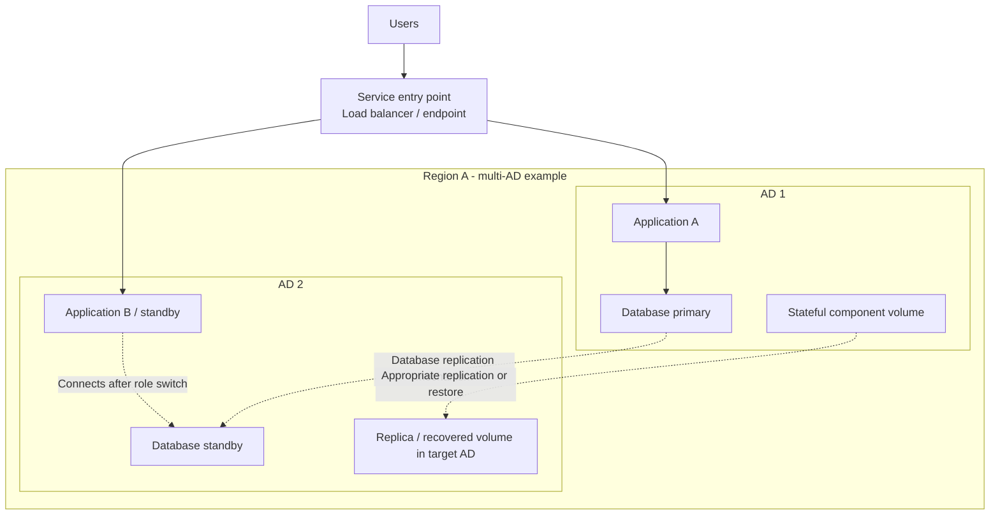
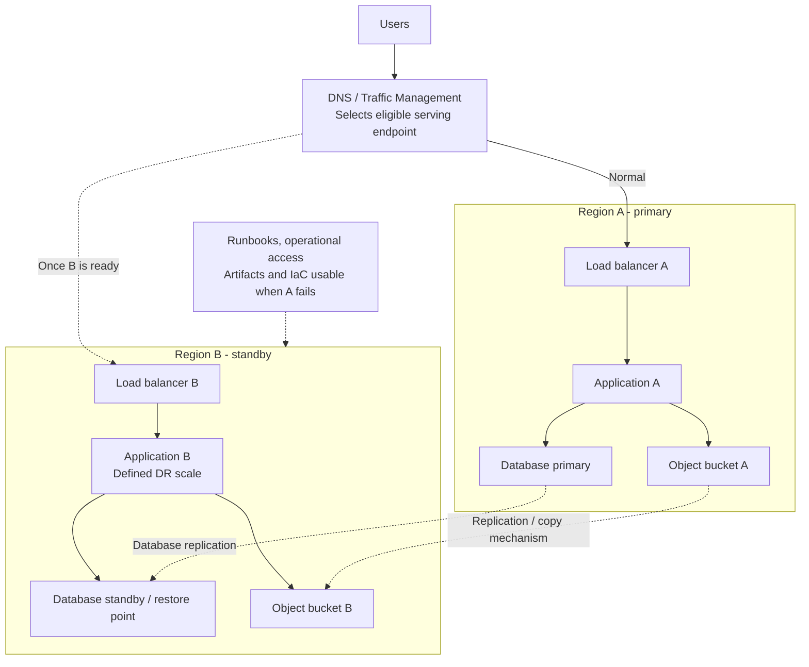
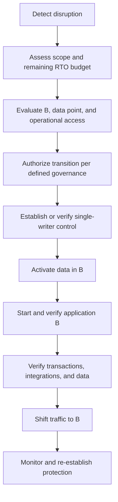

# Designing Intra-Region and Cross-Region Disaster Recovery

Disaster Recovery (DR) is the ability to bring a service back into operation after an incident exceeding normal self-healing capabilities. A database copy in another location only solves part of the problem: the application also requires networking, encryption keys, access permissions, configuration, user entry points, and a procedure to determine which side is permitted to write data.

In Oracle Cloud Infrastructure (OCI), DR design must connect components from tenancy, compartment, and IAM to VCN, Compute, storage, and Oracle databases. This lesson focuses on choosing recovery scopes within a region and across regions, automatable implementation patterns, measuring recoverability, and controlling cost.

## 1. Start with the failure scope

### 1.1. Region, availability domain, and fault domain

A Region is a geographic area in OCI. A region contains one or more availability domains (ADs); fault domains (FDs) distribute resources across separate hardware groups inside an AD. Never assume every region has multiple ADs. [Oracle: Regions and Availability Domains](https://docs.oracle.com/en-us/iaas/Content/General/Concepts/regions.htm).

Three placement levels answer three distinct questions:

| Placement | Example failure addressed | Limit to recognize |
| --- | --- | --- |
| Multiple FDs in the same AD | A host rack or maintenance event affects part of a cluster | Still shares dependency on the AD |
| Multiple ADs in the same region | One AD ceases serving | Still resides within the same region |
| Multiple regions | Primary region no longer meets serving requirements | Must handle data copies, config, and cross-region traffic routing |

Multiple VMs do not equal multiple independent fault domains. If all applications, databases, keys, and deployment pipelines live in one place, multiplying VM counts does not create a complete DR solution.

### 1.2. HA and DR complement each other

High Availability (HA) typically handles component failures by continuing service through healthy peers. DR focuses on recovering after a larger event, which may require provisioning resources, switching data roles, or shifting serving locations.

The boundary between HA and DR depends on the system. An intra-region standby database may serve both HA objectives and AD-loss recovery. What matters is stating the protected scenario explicitly:

| Scenario | Measures typically needed |
| --- | --- |
| Application process failure | Process monitoring, health checks, and routing requests to other backends |
| Single VM failure | Replacement instance, reproducible configuration, and off-VM data |
| Single AD unavailable | Serving components and usable data in another AD |
| Entire region unavailable | Recovery environment in another region plus independent access paths |
| Accidental deletion or bad data update | Backups, version history, or point-in-time recovery |
| Bad configuration deployed everywhere | Known-good configuration versions, rollout controls, and rollback capability |

Cross-region replication withstands site outages, yet can also replicate bad changes. Therefore, never treat a live replica as the sole defense against logical data errors.

## 2. Translate business requirements into RTO and RPO

### 2.1. Define from the user service perspective

- **Recovery Time Objective (RTO)**: maximum outage duration the design must satisfy before the service returns to an agreed service level.
- **Recovery Point Objective (RPO)**: maximum acceptable loss of recent data, typically expressed as the time between the recoverable data point and the incident timestamp.
- **Post-recovery capacity**: the traffic load and functional scope that must be served once DR takes effect.

"Database is open" is not the RTO endpoint for an ordering API. Users must also resolve DNS, complete TLS handshakes, sign in, and finish transactions through the application.

Example requirements for an API:

| Scope | Illustrative target |
| --- | --- |
| Loss of one AD | RTO <= 10 minutes; RPO <= 1 minute |
| Loss of primary region | RTO <= 30 minutes; RPO <= 5 minutes |
| Capacity while running on DR | At least 60% of peak load, prioritizing order placement and lookup |
| Logical data error | Clean restore point within chosen retention window |

These are hypothetical requirements for analysis, not commitments from OCI or a specific database configuration. You must select services, replication mechanisms, and resource levels able to meet them, then verify through drills.

### 2.2. Allocate the RTO budget

You can break down the budget as:

```text
Measured_RTO =
    detection_time
  + decision_time
  + data_activation_time
  + application_startup_time
  + traffic_shift_time
  + service_validation_time
```

Some steps can run in parallel; in that case, calculate using the longest dependent path. The formula above is a simple budgeting aid, not a provider-guaranteed timing formula.

Example cross-region recovery plan:

| Task | Budget |
| --- | --- |
| Detect user-impacting incident | 2 minutes |
| Determine scope and decide to switch | 3 minutes |
| Activate or switch data roles | 7 minutes |
| Start and verify applications | 5 minutes |
| Shift traffic | 3 minutes |
| Validate user-facing transactions | 5 minutes |
| Sequential model total | 25 minutes |

With a 30-minute target, 5 minutes of buffer remain. If database restoration alone takes 40 minutes, lowering DNS TTL cannot rescue the target.

### 2.3. Measure RPO using recoverable data

Suppose:

- Incident halts service at 10:15:00.
- Latest consistent recoverable data point corresponds to 10:11:30.
- Transactions through the new service resume at 10:40:00.

When milestones are consistently defined and measured:

```text
Data window at risk = 10:15:00 - 10:11:30 = 3 minutes 30 seconds
Service downtime    = 10:40:00 - 10:15:00 = 25 minutes
```

Compared against a 5-minute RPO and 30-minute RTO, this drill satisfies those limits.

However, a "replication active" timestamp does not prove a transaction exists and is usable at the destination. Reconcile transaction IDs, committed data, client-side logs, or a meaningful business watermark. If system clocks drift across hosts, subtracting timestamps can mislead.

A system writing both to a database and to object storage must recover a valid business state. A database referencing a file not yet present in the target region still constitutes missing data, even when individual services report replication success.

## 3. Select a DR model before selecting tools

| Model | Pre-staged at target before incident | Impact on RTO | Core trade-off |
| --- | --- | --- | --- |
| Backup and restore | Usable backups, infrastructure code, and recovery runbooks | Usually longer due to provisioning and data loading | Lower idle cost, but depends on restore speed and provisioning |
| Pilot light | Data and minimal core components; most app tiers not serving | Requires initialization or scaling up | Reduces idle running resources, yet keeps many steps on the recovery path |
| Warm standby | An active deployment at smaller capacity | Can be shorter if scaling is fast and data is fresh | Must maintain configuration and test scale-up capacity |
| Active-active | Multiple locations actively serving traffic | Can reduce traffic-shift time | High complexity in data writes, consistency, conflicts, and operations |

RTO or RPO cannot be inferred purely from the model name. A warm standby with slow replication still has a large RPO. An already-running environment missing decryption keys or valid endpoints can still fail to recover.

For transactional systems using Oracle Database, a more manageable option for practical deployments is staging applications in two places while **only one location holds primary write authority**. Active-active at the application tier does not mean two arbitrary databases may independently write to the same dataset.

Tier services by criticality:

- Ordering service requires standby data and pre-staged application capacity.
- Internal reporting can recover more slowly from backups.
- Caches can be regenerated if authoritative source data remains intact.
- Non-urgent analytics can pause to yield capacity to core transactions.

## 4. Designing intra-region DR

### 4.1. Multi-AD regions

A reference architecture includes:

- Applications distributed across ADs or standby app capacity in another AD.
- Database standby appropriate to the chosen service.
- Volume data with a recovery plan to the target AD.
- User entry points and network configuration able to reach surviving components.
- Historical backups for logical error recovery alongside continuously updated copies.



The diagram shows an architectural target, not an assertion that all services switch identically. Application B might serve ahead of time against the primary database or open only once destination data is ready.

For Oracle Base Database Service, Oracle recommends placing the standby in a different AD when possible; if in the same AD, separate FDs. Support conditions also depend on version, edition, networking, and the service's Data Guard configuration. [Oracle: About Oracle Data Guard](https://docs.oracle.com/en/cloud/paas/base-database/guide/dg-about.html).

### 4.2. Do not treat volumes as directly portable resources

Block Volumes are scoped to an AD; a volume cannot simply be detached and attached directly to a VM in an arbitrary region or AD. Backups can be restored as new volumes in an eligible AD, or replicas can be used and activated per service procedures. [Oracle: Overview of Block Volume](https://docs.oracle.com/en-us/iaas/Content/Block/Concepts/overview.htm).

For an application storing data across multiple volumes, know their consistency relationships:

- Do data volumes and log volumes need to be restored to the same point?
- Is the filesystem quiesced, or does the application have suitable crash recovery?
- After restoration, are mount points, ownership, and device configs right?
- Does runtime state truly need replication, or should it rebuild from artifacts?

Never assume multiple independent volume copies form an application-consistent backup.

### 4.3. Single-AD regions

You can distribute applications across FDs and leverage HA features of chosen services to mitigate component failures. However, you cannot create a second AD by adding subnets or compartments.

If requirements include surviving loss of the entire AD in a single-AD region, you must consider another region. Explicitly state in the design that an intra-region approach covers a smaller failure set.

### 4.4. When to prefer intra-region recovery?

Intra-region recovery fits when the outage is confirmed within a single component or AD and the rest of the region remains healthy enough to serve. It keeps applications closer to data and reduces network changes compared to switching regions.

Do not wait indefinitely hoping the primary AD soon returns. Set time thresholds and escalation criteria to move to cross-region recovery based on remaining RTO budget.

## 5. Designing cross-region DR

The cross-region goal is maintaining recoverability when essential components of region A cease serving. Region B must hold sufficiently independent data, resources, and operational paths to execute the plan.



### 5.1. What must exist before an incident

A warm standby can pre-stage:

| Component | Required state in region B |
| --- | --- |
| VCN, subnets, NSGs, and routes | Deployed and network paths verified |
| Database | Standby or recovery mechanism synchronized, data freshness measured |
| Application | Version compatible with data; able to start and scale |
| Load balancer and TLS | Listeners, certificates, and backend sets tested |
| Artifacts | Retrievable when region A is unreachable |
| Secrets and keys | Access permissions, versions, and usage procedures ready in B |
| Storage | Data sufficiently fresh with plan to transition into serving state |
| Observability | Logs, metrics, alerts, and synthetic probes running outside region A |
| Operations | On-call staff and automation able to access from surviving environments |

Subscribing to region B does not automatically create these resources. Nor should you assume load balancers, public IPs, or region A endpoints migrate as-is to B.

### 5.2. Standby scale must match disaster demand

If primary uses 12 instances while standby has only 2, prove those 2 instances can serve minimum functions or scale up fast enough.

Also test:

- Shapes and provisioning capacity in region B.
- Quotas, service limits, and available IPs in subnets.
- Concurrent startup behavior of multiple instances.
- Connection limits and database throughput after cutover.
- Backlog load from queues and client retries.

Do not treat granted quotas as guaranteed proof every VM will launch instantly during a disaster. If RTO depends on available compute, consider keeping more pre-provisioned capacity or capacity reservations supported by the service.

### 5.3. Do not leave hard dependencies back on region A

A common design flaw is failing over applications to B while still:

- Reading secrets only in A.
- Pulling images from a registry located solely in A.
- Using internal DNS resolvable only via hosts in A.
- Sending auth requests to components deployed solely in A.
- Writing synchronous logs to a single sink in A and blocking when that sink fails.

Map the dependency graph for the entire transaction flow. For every dependency, define how it operates in B, a fallback option, or degraded service behavior.

## 6. Choose protection mechanisms per data type

There is no single "replicate entire application" button that applies uniformly across all components. Each data type needs its own mechanism, freshness metric, and activation step.

| Data type | Options to evaluate | What to prove during recovery |
| --- | --- | --- |
| Transactions in Oracle Database | Data Guard or database service DR option | Correct primary role, usable data, valid app connections |
| Data on block/boot volumes | Replicas or backup and restore | Volumes activated, attached, mounted, app recovers consistently |
| Application objects | Replication or managed copies | Complete objects, right versions, destination writable |
| Shared files | Copy/backup mechanism suited to File Storage and app | Exports, mounts, permissions, and consistency verified |
| Configs, secrets, and artifacts | Distribute or replicate by resource type | Right versions, readable, no dependency on failed region |
| Caches and regenerable data | Rebuild from authoritative sources | Warm-up does not overload data sources |

### 6.1. Oracle Database and Data Guard

Data Guard maintains standbys by shipping and applying redo from the primary. Switchover and failover are role-transition operations, not moving the database VM intact to another location. Choose appropriate protection modes and transport settings, and measure both redo transport lag and apply lag. [Oracle: Introduction to Oracle Data Guard](https://docs.oracle.com/en/database/oracle/oracle-database/26/sbydb/introduction-to-oracle-data-guard-concepts.html).

Do not infer "RPO equals 0" solely from enabling Data Guard. Outcomes depend on protection mode, sync state, accessible data, and transition type. Synchronous transport also carries latency trade-offs and specific behavior when links fail.

With Base Database Service, verify edition, Active Data Guard eligibility, and licensing. For service-supported cross-region topologies, prepare VCN peering and matching network rules; do not merely create a standby and overlook inter-region connectivity. [Oracle: About Oracle Data Guard](https://docs.oracle.com/en/cloud/paas/base-database/guide/dg-about.html).

Applications must define how they locate the database after role changes: service names, endpoints, connection strings, and rebuilding connection pools. A pool holding stale connections does not automatically point to the new primary simply because application DNS updated.

### 6.2. Autonomous Database has dedicated DR options

Autonomous Data Guard can use intra-region or cross-region standbys. Backup-Based Disaster Recovery uses backups to instantiate a peer upon transition, offering different cost and recovery-time trade-offs from a continuously updated standby. Do not apply Base Database Service procedures verbatim to Autonomous Database. [Oracle: Use Standby Databases with Autonomous Data Guard](https://docs.oracle.com/en-us/iaas/autonomous-database-serverless/doc/autonomous-data-guard.html).

Automatic failover in Autonomous Data Guard is documented for local standbys under eligible conditions; it does not automatically apply to cross-region standbys. Region transition plans require explicit initiation via operators or designed automation. [Oracle: Automatic Failover with a Standby Database](https://docs.oracle.com/en-us/iaas/autonomous-database-serverless/doc/autonomous-data-guard-auto-failover.html).

When selecting a service, separately confirm RTO/RPO, support eligibility, endpoints, wallets, and access permissions for the exact topology. Do not treat specifications for one database type as commitments for another.

### 6.3. Block Volume replication and backups

OCI supports asynchronous replication of block volumes, boot volumes, and volume groups to supported destinations. Initial sync can take considerable time; RPO varies with write volume and real conditions. Do not use enabled replication as proof of a 5-minute RPO. Cross-AD replication availability also depends on multi-AD regions. [Oracle: Block Volume Replication](https://docs.oracle.com/en-us/iaas/Content/Block/Concepts/volumereplication.htm).

Separate two recovery paths:

- **Replicas** serve scenarios needing a near-current state elsewhere.
- **Backups** provide historical points to recover when the current state is corrupted.

When copying volume backups to another region, you need read/copy permissions at the source and backup creation permissions at the target. If using Vault keys for target copies, prepare matching keys and cryptographic permissions. Never assume source keys automatically travel with data. [Oracle: Copying a Volume Backup Between Regions](https://docs.oracle.com/en-us/iaas/Content/Block/Tasks/copy-bv-backup.htm).

Restoring a filesystem containing database files does not replace proper backup/recovery design for that database. Storage-layer consistency and transactional consistency must be evaluated separately.

### 6.4. Object Storage replication

Points to account for in OCI design:

- Destination buckets must exist beforehand.
- Objects uploaded before policy creation are not automatically replicated by the new policy.
- Replication is asynchronous; source deletions can propagate to the destination.
- Destination buckets receiving replication remain read-only.
- To write at the destination during transition, handle replication state per supported procedures.

Therefore, plan initial data seeding and verify destination contents. [Oracle: Object Storage Replication](https://docs.oracle.com/en-us/iaas/Content/Object/Tasks/usingreplication.htm).

A "policy active" status does not prove all business files exist in B. Verify manifests or critical object sets, checksums when needed, and database reference integrity.

For example, an order exists while its PDF invoice has not arrived in B. The design must detect and regenerate or backfill the file rather than returning success for an order whose document is unreadable.

### 6.5. Design a business-consistent recovery point

Independent database and object replication do not form a cross-service distributed transaction. Risk can be reduced via options such as:

- Recording explicit processing state in the database.
- Using an outbox or job-tracking pattern to complete object creation.
- Publishing records only after mandatory data exists.
- Running reconciliation jobs to detect missing references, orphaned objects, and incomplete tasks.
- Using idempotency keys so retries do not create duplicate transactions.

These choices belong to application design. DR must verify them after recovery, not just check VM counts or standby states.

## 7. Preparing networking, IAM, and Infrastructure as Code

### 7.1. Target networking is a system that must be tested

Region B needs VCNs, subnets, routes, NSGs, internal DNS, and required gateways for the topology. When peering two VCNs, avoid overlapping CIDRs and verify bidirectional paths.

Test these paths:

1. Users to the new endpoint.
2. Load balancer to backends.
3. Applications to the database.
4. Applications to Object Storage, Vault, and artifacts.
5. Automation to APIs and managed hosts.
6. Operators to systems via standby administrative channels.

If the application integrates with external partners, prepare allowlists for egress addresses in B. Switching the database while unable to reach the payment gateway leaves order placement unrecovered.

Network connectivity for Data Guard and replication managed by a storage service are different mechanisms. Do not assume every replication type requires a user-configured network path like a database does.

### 7.2. IAM, secrets, and keys must work during an incident

Separately define permissions for:

| Actor | Required scope |
| --- | --- |
| Infrastructure pipeline | Provision resources in the right compartments in A and B |
| Application in B | Read secrets, decrypt, and access data under its new role |
| DR orchestrator | Execute actions defined in the plan |
| On-call operators | Access, view logs, diagnose, and perform authorized transitions |

Do not equate "same tenancy" with "all secrets and keys are ready in both regions." Build a resource mapping table and test permissions using the exact principal that will run during DR.

A dynamic group matching only VM OCIDs in A will not authorize new VMs in B. A secret with the right name but wrong version can point applications to the wrong database.

DR permissions must be prepared beforehand and tested periodically. A plan relying on creating new policies after the primary region fails may miss its RTO budget.

### 7.3. Reproduce with IaC without blindly cloning resources

Use Terraform or OCI Resource Manager to maintain two environments from shared structures with region-specific parameters. Values such as subnet OCIDs, database endpoints, keys, buckets, and shapes must be mapped per region.

Illustrative design document example, **not an OCI schema or directly applicable configuration file**:

```yaml
application: orders
topology: warm-standby
primary:
  region: REGION_A
  capacity: normal
standby:
  region: REGION_B
  capacity: reduced
recovery_objectives:
  regional_rto_minutes: 30
  regional_rpo_minutes: 5
data_authority:
  writer_count: 1
  promotion_requires_fencing_evidence: true
dependencies:
  database: database-native-standby
  objects: replication-plus-initial-copy
  secrets: prepared-in-target-region
  artifacts: available-without-primary-region
traffic:
  target_enabled_after_business_validation: true
```

These fields force the implementation team to clarify decisions before picking specific resources and APIs.

Infrastructure code, state, artifacts, and execution runners are also DR dependencies. Ensure access to them when region A is unreachable. Avoid simultaneously changing architecture, application versions, and serving location in the middle of an incident.

## 8. Orchestration with OCI Full Stack Disaster Recovery

### 8.1. Role scope of the service

Full Stack Disaster Recovery groups resources of an application stack and orchestrates transition plans. It supports both intra-region and cross-region topologies; to protect against full-region outages, use a cross-region topology. [Oracle: How Full Stack Disaster Recovery Works](https://docs.oracle.com/en-us/iaas/disaster-recovery/doc/how-disaster-recovery-works.html).

A DR Protection Group gathers components for coordinated recovery. Two groups form a peer relationship with corresponding roles; the group itself is a regional resource and does not move across regions during transition. [Oracle: Overview of Disaster Recovery Protection Groups](https://docs.oracle.com/en/cloud/iaas/disaster-recovery/cssgm/overview-protection-groups.html).

Do not mistake adding a member for having created sufficient standby data. For example, volume group prechecks verify compatible replicas or backups exist at the destination; those prerequisites must be established for the chosen resource model. [Oracle: Prechecks Performed by Full Stack Disaster Recovery](https://docs.oracle.com/en-us/iaas/disaster-recovery/doc/prechecks-disaster-recovery.html).

### 8.2. Plan types

| Plan | Purpose |
| --- | --- |
| Switchover | Planned transition when source and target remain eligible to coordinate |
| Failover | Recovery at target after an unplanned outage without relying on clean source shutdown |
| Start Drill | Provision a drill environment as supported by the topology |
| Stop Drill | End and clean up the drill environment |

In Full Stack DR, end drills to return the protection group pair to a state allowing corresponding transition plans. Never let an open drill become a blocker during a real incident. [Oracle: Types of Disaster Recovery Plans](https://docs.oracle.com/en-us/iaas/disaster-recovery/doc/dr-plans-type.html).

### 8.3. Runbooks must still reflect business dependencies

Custom steps may be required to validate APIs, pause schedulers, switch external integrations, or verify data. Each automation step should define:

- Preconditions before execution.
- Timeouts and progress observability.
- Verifiable success outcomes.
- Behavior when re-run.
- Stop conditions when prerequisites fail.
- How to resume or recover after partial execution.

An "application start" script should verify the right version is running and connected to the right primary rather than blindly spawning another process.

A passing technical precheck does not prove business transactions succeed. Add user-perspective probes as acceptance gates for the new serving site.

## 9. Planned and unplanned transition runbooks

### 9.1. Planned switchover

Example sequence at the architecture level:

1. Verify B has sufficient resources, valid standby data, and compatible versions.
2. Pause or drain new write transactions in A per the transition window.
3. Drain in-flight requests and jobs; record watermarks to preserve.
4. Confirm replication mechanisms meet each service's switchover conditions.
5. Switch database roles and prepare other data stores per plan.
6. Start application B, verify write permissions and dependencies.
7. Shift user endpoints once B satisfies serving criteria.
8. Monitor errors, data, and capacity; re-establish protection for the new primary.

Concrete steps must match supported topologies and services. This is not a command sequence replacing plans generated by Full Stack DR.

If synchronization conditions fail during a planned switchover, halt and handle per predefined policy. Never convert it into a potentially lossy failover merely to finish on schedule.

### 9.2. Failover when region A is unavailable

Failover introduces incomplete information: A not responding does not prove writes stopped. Only one network path or a subset of users might be unable to reach A.



Before letting B accept writes, require evidence or enforceable control that A cannot continue writing conflicting updates to the protected dataset. Options depend on architecture: database roles, write leases, data-tier fencing, or enforceable shutdown/isolation mechanisms.

**Changing DNS is not fencing.** Clients may cache stale DNS, keep long-lived connections, or arrive over alternate paths. If single-writer exclusivity cannot be established, follow the agreed risk policy: hold read-only mode, continue investigating, or accept an exception under explicit authority.

Runbooks must record the data point promoted and the transaction window at risk of loss. Never mask unshipped data behind a "failover succeeded" label.

### 9.3. Criteria before opening traffic

Before exposing endpoint B to users, confirm:

- Database holds the right role and the application can run required operations.
- Buckets and volumes are in usable states.
- TLS certificates, hostnames, and external access paths work.
- Workers, schedulers, and consumers do not run unintended duplicates.
- Connection limits and minimum load have been tested.
- A uniquely identified test transaction completes end to end.
- Logs and alerts in B are observable.

Open traffic in waves or with rate limits to absorb thundering herds. Environment B must account for client retries and backlog work, not just steady-state traffic.

## 10. Shifting traffic is more than updating a DNS record

OCI DNS Traffic Management provides failover policies to prioritize answer pools and attach health checks. This is a DNS answer selection mechanism; it does not prove the chosen database has been promoted or the application holds write permission. [Oracle: Creating a Failover Policy](https://docs.oracle.com/en-us/iaas/Content/TrafficManagement/Tasks/create-tm-policy-failover.htm).

Distinguish:

| Mechanism | Decision being made |
| --- | --- |
| Backend health check | Can a specific backend accept requests inside a pool? |
| Regional endpoint check | Does the region's serving endpoint meet defined criteria? |
| Business validation | Do user transactions complete with valid data? |
| DR decision | Is role and serving-location transition authorized? |

A standby endpoint might return 200 on a landing page while still barred from writing orders. Never let shallow checks route users into that state.

### 10.1. TTL and existing connections

Low TTL helps reduce how long resolvers retain DNS answers per configuration, yet cannot force every client to update simultaneously. Account for resolver caches, application caches, and open connections.

Traffic-shift budgets should include:

- Time to detect endpoint status.
- Time to update policies or records.
- Time for clients to receive new answers.
- Reconnection and retry time.
- Latency to the new region and application adaptation.

Lowering TTL only after an incident hits does not shorten remaining lifetimes of previously cached answers. If DR requires specific TTLs, prepare and test them beforehand.

### 10.2. Client-side checks

In PowerShell, you can run these checks after replacing placeholders:

```powershell
$serviceHost = 'orders.example.com'

Resolve-DnsName -Name $serviceHost
curl.exe --fail --show-error --connect-timeout 5 --max-time 15 "https://$serviceHost/readyz"
```

This tests DNS and HTTP only, not full transaction processing. Add creating and querying a uniquely identified test order in an authorized environment.

Never skip TLS certificate verification just to get a green check. When testing endpoint B before switching DNS, preserve the right hostname and SNI using proper test methods rather than hitting raw IPs and ignoring certificate errors.

Clients may experience timeouts even after the server commits a transaction. Therefore, post-DR retries must pair with idempotency keys or business rules preventing duplicate orders.

## 11. Failback and re-establishing protection

### 11.1. Region A returning does not mean immediate failback

After failover, B is the new data authority. A may hold stale state or transactions created on a superseded branch.

Never automatically start application A and allow writes simply because infrastructure checks turn green. First:

1. Isolate the old role and identify data and operations that occurred during the disruption.
2. Establish the authoritative data source per post-failover state.
3. Rebuild or reinstate resources in A using service-supported mechanisms.
4. Establish replication from the current primary to the standby location.
5. Reconcile and handle transactions from the at-risk loss window.
6. Re-verify DR readiness of the new topology.

In Full Stack DR, a failover plan does not automatically clean up all old source state or pre-configure every reverse transition setting. Execute reset and reconfiguration procedures suited to each member type. [Oracle: Troubleshooting Full Stack Disaster Recovery](https://docs.oracle.com/en-us/iaas/disaster-recovery/doc/troubleshooting.html).

### 11.2. Failback is a planned transition

To return service to A, execute it as a planned switchover after A is synchronized and verified. Keep B as primary as long as needed to complete reconciliation and stabilize operations.

The crucial goal is **restoring fault tolerance**, not merely returning to the original site. While B runs without a valid standby copy, the service may be up yet still lack required protection.

Changes made while running in B must be controlled: schema versions, secrets, firewall rules, certificates, and patches must all be reflected in the failback plan.

## 12. Drills to prove the design works

### 12.1. Test more than resource status

A drill should answer:

- Can the target environment be provisioned or activated without relying on the source?
- What is the newest recoverable data point?
- What is the measured RTO from disruption to resumed user transactions?
- Do database and object data match?
- Can B serve the agreed load?
- Were duplicate payments, emails, or jobs triggered?
- After the drill, do replication status and resources return to design state?

A VM booting successfully is insufficient to declare DR success.

### 12.2. Prepare a small test dataset

In a lab Oracle Database schema, create a probe table to record test markers:

```sql
CREATE TABLE dr_probe (
    probe_id    VARCHAR2(64) PRIMARY KEY,
    recorded_at TIMESTAMP WITH TIME ZONE DEFAULT SYSTIMESTAMP NOT NULL,
    payload     VARCHAR2(200) NOT NULL
);

INSERT INTO dr_probe (probe_id, payload)
VALUES ('lab-probe-0001', 'before-dr-test');

COMMIT;

SELECT probe_id, recorded_at, payload
FROM dr_probe
WHERE probe_id = 'lab-probe-0001';
```

`recorded_at` captures row creation time, not a guaranteed commit timestamp. The test generator should separately log commit-confirmation times and each transaction's ID. Use fresh IDs per run to avoid mixing runs or violating primary keys.

After recovery or role transition in the lab, query confirmed IDs and verify payloads. If using a drill copy, write test data only to a writable clone—never attempt direct edits on a physical standby.

To test across data types, construct a lab transaction consisting of:

1. A database record with a unique business ID.
2. An object holding matching content and ID.
3. A manifest recording object name, checksum, and completion status.
4. A client-side log confirming operation acceptance.

After the drill, reconcile all four sources. Do not compare total row counts alone, as identical counts can still contain different IDs.

### 12.3. Exercise sequence

The steps below are for an isolated lab environment; this lesson performs no changes on OCI on the learner's behalf.

**Step 1 — Select scenario and targets.** Choose intra-region AD recovery or cross-region recovery, specifying RTO, RPO, and minimum load. If a region has only one AD, do not set hypothetical cross-AD targets.

**Step 2 — Inventory.** List applications, databases, volumes, buckets, DNS, TLS, secrets, keys, artifacts, partner links, and owners. For each item, note source, target, replication mechanism, and verification step.

**Step 3 — Build target foundation.** Deploy networking, permissions, logging, artifacts, and mandatory resources. Use the same deployment method intended during an incident.

**Step 4 — Complete data protection.** Wait for initial sync or first backups/copies to finish. Check initial seeding of older data, lag, and decryption capability.

**Step 5 — Prepare runbook.** Define ordering, decision-makers, write-authorization conditions, stop gates, and re-run handling. If using Full Stack DR, run prechecks and add necessary business validations.

**Step 6 — Execute an isolated drill.** Use a test environment or appropriate drill feature. Block unintended side effects to production email, payments, webhooks, and queues.

**Step 7 — Measure recovery.** Record every milestone, read back probe data, run transactions, and ramp load to the chosen DR level. Test from a client outside the simulated failure zone.

**Step 8 — Re-establish and clean up.** End the drill per procedure, re-check replication, alarms, and retained resources. Confirm the system remains protected after the exercise.

### 12.4. Scenarios must be tested separately

| Drill scenario | What it proves |
| --- | --- |
| Loss of one VM | HA or local replacement mechanism works |
| Loss of one AD | Resources in another AD suffice to serve and access data |
| Loss of primary region | Target procedures have no hard dependency on failed region |
| Replication interrupted | Alerts fire before RPO is breached |
| Historical backup restore | Can return to a clean point rather than only taking the live replica |
| Key or secret unusable | Security dependencies are detected and handled properly |
| Retry after failed step | Automation does not double-promote or create duplicate resources |
| Failback | Data and roles are correct after reversing protection direction |

Simulating network loss from a single client only proves one access path failed. Never treat it as proof of full region-loss testing.

## 13. Monitoring and controlling DR cost

### 13.1. Monitor recoverability, not just primary uptime

| Signal | What to verify |
| --- | --- |
| Replication lag and status | Is target data fresh enough for objectives? |
| Latest usable backup/copy | Is an independent, sufficiently fresh restore point available? |
| Latest restore result | Can backups actually be read, decrypted, and restored? |
| Configuration drift between A and B | Is the target region missing critical changes? |
| Certificates, secrets, and permissions | Are any dependencies expiring or altered? |
| Quotas, IPs, and resource capacity | Can DR reach target serving scale? |
| DR plan and drill status | Is the plan ready to execute? |
| Synthetic transactions in eligible target | Do components coordinate properly? |

If primary is healthy while replication has been halted for a day, DR readiness has degraded. Alerts must surface this before disaster strikes.

Record the latest drill date, runbook version, application version, and measured results. A DR report predating a major schema migration may no longer represent the current system.

### 13.2. Account for both standby cost and activation cost

Cost models should include:

- Standby Compute and databases, plus applicable licensing requirements.
- Replica data, backups, retention history, and drill copies.
- Cross-region data transfer by mechanism and usage.
- Load balancers, monitoring, logs, and network links.
- Scale-up capacity during DR activation.
- Drill costs, resynchronization, and resources retained afterward.
- Operational effort, reconciliation, and automation upkeep.

Not every service needs the same DR tier. Prioritize transactions and sign-in, defer heavy reporting, disable non-essential jobs, and expose partial functionality when running in the standby region.

However, saving money by skipping keys, networking, or restore readiness strips away recovery prerequisites. Every scope reduction must state its impact on RTO, RPO, or post-disaster capacity.

Budget alerts detect unplanned spend. If drill resources must stop automatically, build and test a dedicated mechanism; never treat a budget alert as a command that automatically tears down resources.

## 14. Common design mistakes

| Misconception | Consequence | Design fix |
| --- | --- | --- |
| Multiple VMs equal DR | All may still fail in one fault domain | Map every component to FD, AD, and region |
| Backups in A survive losing A | No usable data at the recovery site | Stage copies and restore paths in target scope |
| Replicas always replace backups | Bad changes or deletions can propagate to target | Keep historical points and drill clean restores |
| Updating DNS completes failover | Databases, write rights, or data not ready | Activate and validate stack before opening traffic |
| Auto-promoting B when A stops replying is safe | Split-brain dual writers may emerge | Design fencing and decisions under incomplete info |
| Cloud API returning success meets RTO | Users still cannot finish transactions | Measure from client side through full business flow |
| Having quota guarantees instant VM launch | Slow recovery due to actual capacity limits | Test provisioning and pre-stage adequate capacity |
| When primary region returns, start old apps | Writes to stale branch, wrong replication direction | Reinstate/rebuild and execute planned failback |
| Keeping IaC in primary is enough | Rebuild tools unreachable when primary fails | Protect state, code, artifacts, and runners |
| Running a drill once is enough | Topology changes invalidate old plans | Re-drill after major changes and on schedule |

## 15. Minimum record for an operable DR design

A production-ready plan requires:

1. **Incident matrix:** protection levels for VM, AD, region, and data-corruption failures.
2. **Recovery targets:** RTO, RPO, functions, and post-transition capacity.
3. **Dependency map:** networking, data, identities, keys, secrets, artifacts, and external services.
4. **Resource inventory:** source/target mappings and protection mechanisms per component.
5. **Write-authority rules:** how primary is chosen and split-brain prevented.
6. **Runbooks:** switchover, failover, historical restore, re-protect, and failback.
7. **Drill evidence:** timestamps, transaction IDs, reconciliation outcomes, and served load.
8. **Operations plan:** alerts, owners, access paths, and cost.

Intra-region design addresses defined local scenarios. Cross-region design extends geographic fault tolerance while requiring data and recovery paths prepared elsewhere. DR quality is proven when the service resumes with valid data within agreed limits and immediately retains protection for the next incident.
