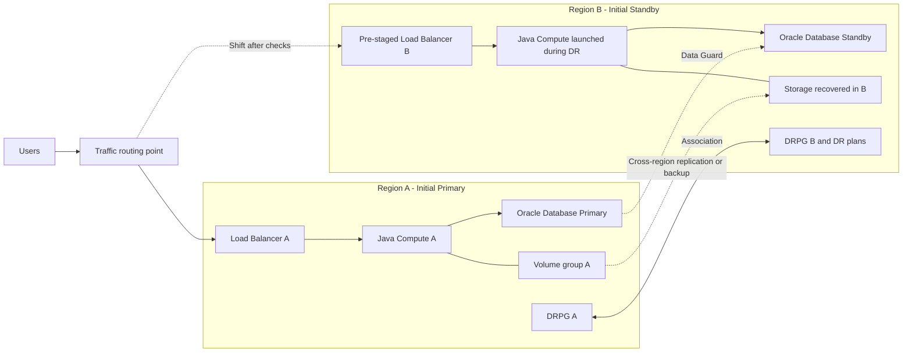

# OCI Full Stack Disaster Recovery and DR Protection Groups

In the **Backup and Disaster Recovery** chapter of the Oracle Cloud Infrastructure (OCI) module, this lesson covers organizing and orchestrating multi-tier application recovery using **OCI Full Stack Disaster Recovery**, abbreviated as **Full Stack DR**. The focus is on DR protection groups, recovery plans, readiness conditions, and verifiable operational procedures.

After this lesson, you can:

- Define the scope of a DR protection group and the primary–standby relationship of a paired group.
- Choose between switchover, failover, and DR drill according to the operational scenario.
- Divide responsibilities among data replication, target infrastructure, and orchestration workflows.
- Design recovery ordering, IAM authorization, and business outcome verification.
- Measure recovery time, potential data loss, and DR configuration cost.

## 1. What problem does Full Stack DR solve?

A Java order-processing system may consist of a Load Balancer, two Compute instances, an Oracle Database, volumes storing files, and a notification service. When the primary region fails, having the database running in the standby region is not enough for users to keep placing orders. The application also needs the right connection addresses, credentials, networking, load balancer backends, and traffic routing.

Full Stack DR orchestrates and manages the recovery process across system tiers. The service creates, executes, and tracks DR plans; operators insert application-specific actions into the workflow. This role is described in [About Full Stack Disaster Recovery](https://docs.oracle.com/en-us/iaas/disaster-recovery/doc/about-disaster-recovery.html).

When designing operations, distinguish:

| Mechanism | Question to answer | Example in ordering app |
| --- | --- | --- |
| Backup | Can we roll back to saved data? | Restore data prior to accidental deletion |
| Replication | How up-to-date is data at the destination? | Monitor standby database lag |
| High availability | How do we keep serving on local component failure? | Remove a faulty application server from backend |
| DR orchestration | Which components recover, in what order, and how is it verified? | Recover data, start app, verify, then shift traffic |

Adding a resource to a protection group does not prove the resource has usable copies at the destination. For each component, separately define **how data is recovered**, **how it starts at the target**, and **how post-recovery verification runs**.

Logical data errors can also be propagated by replication to the standby. Therefore, DR must pair with backups suited to the incident type. This lesson focuses on orchestrating a topology already prepared for DR; procedures for recovering corrupted data still need separate design.

## 2. Resource model of Full Stack DR

### 2.1. DR protection group, member, and association

A **DR protection group (DRPG)** groups OCI resources that must recover together into a single management scope. A **Member** is a resource declared within the group. Two DRPGs are paired into an **association** with primary and standby roles; each group has only one peer in an association. See [Full Stack Disaster Recovery Terminology and Concepts](https://docs.oracle.com/en-us/iaas/disaster-recovery/doc/disaster-recovery-terminology.html).

Cross-region example used throughout this lesson:

| Item | Region A | Region B |
| --- | --- | --- |
| DRPG | `orders-drpg-a` | `orders-drpg-b` |
| Initial role | Primary | Standby |
| Function | Represents stack serving production | Represents recovery-receiving side |
| Operation logs bucket | `orders-dr-logs-a` | `orders-dr-logs-b` |
| Plan to transition to B | Source side of transition | Created and executed while standby |

A and B are locations, not fixed roles. After a successful transition to B, B serves production and A becomes the standby side.

Compartments define administrative and authorization scope; VCNs define network space; DRPGs define DR orchestration scope. In the inventory, record the actual OCID and compartment of each member rather than inferring access rights or network connectivity from group names.

The phrase "consistency grouping" in DRPG descriptions does not mean every database, volume, and bucket is captured at the exact same transactional instant. If orders live in a database while PDF invoices live on separate storage, the application must still detect and handle cases where they recover to different timestamps.

### 2.2. DR plan and DR plan execution

A **DR plan** is a workflow definition; a **DR plan execution** is one run of that workflow. A plan can run multiple times, with each execution keeping its own progress, outcome, and logs.

Plans are created in the DRPG currently acting as standby. Plans on the primary side remain inactive; once roles reverse, inspect plans on the new standby before the next transition. See [Overview of Disaster Recovery Plans](https://docs.oracle.com/en-us/iaas/disaster-recovery/doc/overview-dr-plans.html).

```text
Initially:
  A = Primary       B = Standby
  Create/run takeover plans in B.

After successful transition A -> B:
  A = Standby       B = Primary
  Prepare/verify takeover plans in A for the B -> A direction.
```

Flipping role metadata does not replace switching databases, starting apps, and shifting traffic. Reconcile DRPG roles against actual stack state, especially when an execution fails mid-way.

### 2.3. Choose boundaries by business service

For an ordering system, recovery scope may include app servers, volume groups, and the transactional database. DNS, secrets, certificates, SMTP, and payment gateways must appear in the inventory, whether handled as members, custom steps, or external preparation.

If multiple applications share a database, do not design groups as if each application switches the database independently. Identify who owns the database role switch, blast radius, and transition ordering for dependent applications. Every shared resource needs a clear orchestration decision.

## 3. Sample recovery architecture for the ordering service

Suppose the system has two Java application servers on Compute and Oracle Base Database Service using Data Guard. In this illustrative design, the app servers are **moving instances**; target networking and load balancer are pre-staged. Updating backends and shifting traffic are separate operations with checks before opening service.



Dashed lines represent data mechanisms or recovery actions, not an assertion that all resources in B are already created and serving. The association between two groups is not a replication data link.

The deployment inventory should include:

| Component | Prepared at target | Evidence of usability |
| --- | --- | --- |
| VCN, subnets, routes, NSGs | Paths to database, storage, required services | Connectivity from app location in B |
| Java Compute | Shape, AD, subnet, VNIC mapping, app config | Instances boot; app reaches readiness |
| Volume group | Replication or backups in B | Suitable recovery point; volumes attached and mounted |
| Oracle Database | Data Guard configured per service | Role and recovered data verified |
| Load balancer | Listeners, certificates, backend sets | Backend B healthy; test endpoint transaction succeeds |
| Secrets and encryption keys | Read permissions and usability in B | App accesses them via actual auth mechanism |
| DNS/routing | Switching mechanism and update permissions | Real clients reach B and complete transactions |

This is the example's design inventory, not a mandatory list of all member types supported by the service.

## 4. Members and two ways to organize Compute

### 4.1. Built-in capabilities depend on resource type

Full Stack DR generates built-in plan groups based on members and plan type. Supported resource types include various Compute, database, storage, load balancing, and OKE services, but switchover, failover, and drill capabilities are not uniform. Verify the exact service, deployment variant, and plan in [Full Stack DR Built-in Plan Groups for DR Plans](https://docs.oracle.com/en-us/iaas/disaster-recovery/doc/built-in-plan-groups.html).

A database with built-in failover steps does not necessarily have full built-in drill steps. For Base Database in this example, the database portion for a drill must be designed and verified per actual capability; creating a start drill plan does not prove an isolated usable database exists.

For OCI-managed databases, prepare Data Guard using service-supported mechanisms before adding corresponding orchestration. Self-managed databases on Compute or other engines may require custom steps to switch roles using appropriate tools. See database integration in [Full Stack Disaster Recovery FAQ](https://www.oracle.com/cloud/full-stack-disaster-recovery/faq/).

### 4.2. Moving instances

Moving compute fits when the app can boot in another region from protected storage. Instances are launched at the target during DR; this is not live migration preserving RAM or running processes.

For moving instances, prepare a volume group containing the boot volume and related block volumes, plus replication or backups to the destination. For non-moving instances, typically protect data block volumes while managing target boot volumes separately. See [Preparing Block Storage for Full Stack Disaster Recovery](https://docs.oracle.com/en-us/iaas/disaster-recovery/doc/block-storage-disaster-recovery.html).

Before choosing moving instances for a Java app, check:

- JDBC URLs and internal endpoints are not hardcoded to A.
- The app does not rely on old IPs/hostnames for license validation or external partner links.
- Configuration in B selects the right secrets, certificates, and environment parameters.
- Launching a new instance does not auto-start cron jobs, consumers, or billing jobs before data is ready.
- New instances can reach required scripts and APIs when A loses connectivity.

### 4.3. Non-moving instances

Non-moving uses pre-staged dedicated instances on each side instead of recreating the same server in another region. The standby app may already be installed but inactive; starting/stopping instances depends on member and plan configuration. Oracle illustrates the model in [Full Stack DR Billing Details](https://docs.oracle.com/en-us/iaas/disaster-recovery/doc/billing-details.html).

| Criterion | Moving | Non-moving |
| --- | --- | --- |
| Target instance | Created during recovery | Already exists |
| Primary dependency | Storage recovery, launch capacity, network mapping | Software, configuration, and data parity |
| Risks to measure | Launch time, missing shape or quota | Config drift, patch mismatch, standby jobs firing prematurely |
| Reducing uncertainty | Drill launches under realistic conditions | Test both sides and app activation capability |

An existing or stopped instance does not guarantee capacity or readiness when needed. Choose topology based on measured timings, resource needs, and acceptable cost.

## 5. Four types of DR plans

| Plan | Situation | Purpose |
| --- | --- | --- |
| Switchover | Planned transition, both sides reachable | Gracefully stop primary then bring stack up on standby |
| Failover | Unplanned outage at primary | Recover at standby without depending on cleanly stopping primary |
| Start drill | Verify recoverability | Stand up a drill stack on the standby side |
| Stop drill | Conclude drill | Tear down drill stack, return config to ready state |

These are the types in [Types of Disaster Recovery Plans](https://docs.oracle.com/en-us/iaas/disaster-recovery/doc/dr-plans-type.html). Drills preserve primary/standby roles. When a drill is active, complete Stop drill and handle related state before running switchover or failover.

### 5.1. Switchover: controlling the transition

For example, the operations team performs weekend maintenance on A. Because both sides remain healthy, you can stop accepting new writes, wait for in-flight transactions to finish, check synchronization, and transition orderly.

The example's acceptance criteria require that requests confirmed before the cutoff reconcile in B, the app connects to the right database, and both sides never accept writes simultaneously. Zero data loss requires proof from database mechanisms and write-quiesce procedures; the plan name does not substitute for evidence.

### 5.2. Failover: recovering when waiting for primary is impossible

Failover is considered when waiting for primary recovery would breach business deadlines. Before opening writes in B, determine the recovery point and how to prevent A from resuming independent writes.

**Fencing** is any measure preventing one side from continuing its writer role: controlling application write privileges, isolating endpoints, or using appropriate database role management. Inability to reach A does not prove all processes in A have stopped.

Decision-makers need to know which data is unconfirmed, how ambiguous transactions will be handled, and when service will reopen. For orders, idempotency request keys help reduce duplicate creation when clients retry after disruption.

## 6. Plan groups, plan steps, and dependencies

A plan contains multiple **plan groups**. Groups execute sequentially; **plan steps within the same group execute in parallel**. Display order of two steps inside a group does not create an execution dependency.

The logical example for custom business steps below is not a fixed OCI built-in list or order:

```text
Group A: Confirm database holds expected role and connectivity
    Step A1: Verify write permissions for application

Group B: Start applications
    Step B1: Start app node 1   ┐
    Step B2: Start app node 2   ┘ run in parallel

Group C: Pre-traffic checks
    Step C1: Check via internal load balancer
    Step C2: Verify application version

Group D: Shift traffic
    Step D1: Execute chosen routing transition mechanism
```

If the app requires the database to be ready, never place database checks and app startup in the same group expecting them to run sequentially.

Full Stack DR analyzes member dependencies to generate workflows. For built-in groups, keep default ordering and only adjust after full impact analysis. See [Dependency Mapping](https://docs.oracle.com/en-us/iaas/disaster-recovery/doc/dependency-mapping.html). Custom steps must align with the readiness milestones generated by the workflow.

Each custom step needs an operational contract:

| Attribute | What must be defined |
| --- | --- |
| Entry condition | Database writable? Volumes mounted? Endpoints exist? |
| Action | A single explainable, observable change |
| Exit condition | State proving completion |
| Timeout | Maximum wait before reporting failure |
| Retry | How to handle partial completion from a prior attempt |
| Error handling | Halt the plan or continue with understood impact |

A timeout does not necessarily mean the resource remained unchanged. The API may have received the request before the client lost connection. Retry logic must inspect current state rather than blindly creating duplicates or repeating side effects.

## 7. IAM and automation execution paths

### 7.1. Operators and execution principals

Viewers, plan editors, and principals acting on Compute, databases, and storage require explicit authorization. Permissions on Full Stack DR resources do not automatically include permissions on the services orchestrated by the plan. See [Policies](https://docs.oracle.com/en-us/iaas/disaster-recovery/doc/policies.html).

Oracle recommends resource principals for Full Stack DR, with dynamic groups and policies scoped by managed resource types. See [Resource Principals](https://docs.oracle.com/en-us/iaas/disaster-recovery/doc/policies/resource-principals.html).

Example illustrating only partial compartment permissions, insufficient to run an entire stack:

```text
Allow group DR-Observers to read disaster-recovery-family in compartment DR-Lab
Allow dynamic-group DRPG-Lab to manage disaster-recovery-family in compartment DR-Lab
Allow dynamic-group DRPG-Lab to manage object-family in compartment DR-Logs
```

`DR-Observers` only reads DR resources. `DRPG-Lab` needs matching rules for the deployed principals. Add permissions on members and related services in their respective compartments per documentation instead of copying broad tenancy-wide policies.

Specify who runs prechecks, who edits plans, who executes regional transitions, and who reads logs. Database passwords must never appear inside script bodies or command-line arguments likely to surface in logs.

### 7.2. Automation must work when primary is unreachable

User-defined steps/prechecks can run scripts on Compute via Run Command, use local or Object Storage scripts, or invoke OCI Functions. Custom prechecks run alongside built-in prechecks, and prechecks execute in parallel. See [Add User-Defined Precheck](https://docs.oracle.com/en-us/iaas/disaster-recovery/doc/add-user-defined-precheck.html).

If using Compute, verify Oracle Cloud Agent, the Run Command plugin, execution permissions, OS accounts, and endpoint connectivity. See [Policies for Compute Service and Oracle Cloud Agent](https://docs.oracle.com/en-us/iaas/disaster-recovery/doc/compute-service-policies.html).

Failover is not autonomous if scripts reside only on a host in A, or always fetch secrets from an endpoint unavailable during A's outage. Verify script storage, execution host, principal, networking, logging, and regional dependencies of all automation.

## 8. Prechecks, readiness, and business correctness

### 8.1. Prechecks validate orchestratable configuration

Prechecks catch errors before modifying the stack. For Compute/storage, checks include replication or backup configuration, target recovery resources, and related volumes. Coverage depends on members; see [Prechecks Performed by Full Stack Disaster Recovery](https://docs.oracle.com/en-us/iaas/disaster-recovery/doc/prechecks-disaster-recovery.html).

Interpret results by timestamp and scope. A configuration passing yesterday may fail today if quotas, encryption keys, policies, or networking changed.

### 8.2. Check at the right time

Do not put every application check into initial plan prechecks. If app server B has not been launched yet, calling endpoint B at that stage fails due to timing.

| Check | Timing | Example |
| --- | --- | --- |
| Configuration | Before plan | Subnets, recovery data, and orchestration permissions |
| Custom step preconditions | Before the corresponding step | Access to required artifacts or secrets |
| Readiness | After database, storage, and app are up | Connected to right database, app ready |
| Business | Before opening traffic and after cutover | Create/read a test order with a unique ID |

The Bash script below is for a **post-startup check step**, running on a host with network reachability to the test endpoint. `/internal/dr-readiness` is an endpoint implemented by the example app itself, not a built-in OCI endpoint or standard across all Java apps:

```bash
#!/usr/bin/env bash
set -euo pipefail

: "${DR_READINESS_URL:?Target stack readiness URL must be provided}"

status_code="$(curl --silent --show-error \
  --output /dev/null \
  --write-out '%{http_code}' \
  --connect-timeout 5 \
  --max-time 15 \
  "$DR_READINESS_URL")"

if [[ "$status_code" != "200" ]]; then
  printf 'DR readiness not met; HTTP=%s\n' "$status_code" >&2
  exit 1
fi

printf 'DR readiness passed\n'
```

The app must define what HTTP 200 means: valid target configuration, valid database, and usable minimum dependencies. The script checks HTTP only; it does not verify order integrity or measure RPO. Restrict access to the endpoint, return no secrets, and avoid creating real transactions on every health check.

For readiness checks gating traffic opening, failure must halt service opening. Auxiliary notification failures may follow a separate policy if the impact is understood and accepted.

## 9. Hands-on setup of a DRPG pair

### 9.1. Preparation

Use test data and two regions supporting the required services. Record OCIDs, compartments, and configuration owners. Prepare:

1. Target VCN, subnets, routes, and NSGs with proper connectivity for the app.
2. Standby database and data sync via service-supported mechanisms.
3. Volume groups and target replication or backups for moving compute.
4. Network mappings for launching in B; check shapes, limits, and capacity.
5. Load balancer, certificates, secrets, and backend/routing update methods.
6. Operation logs bucket and authorized writer principal.
7. Startup scripts, app verification checks, and recovery-time logging.

Execute the exercise in a lab environment via Console and read-only status commands. Production transitions require runbooks validated against actual configurations.

### 9.2. Create and associate

Create `orders-drpg-a` in A and `orders-drpg-b` in B; select an execution logs bucket for each group. See [Create Disaster Recovery Protection Groups](https://docs.oracle.com/en-us/iaas/disaster-recovery/doc/create-dr-protection-groups.html).

Associate the two groups, assigning A primary and B standby. A group with an existing peer cannot simultaneously associate with another peer; handle existing associations before changing relationships. See [Associate a Disaster Recovery Protection Group](https://docs.oracle.com/en-us/iaas/disaster-recovery/doc/associate-disaster-protection-groups.html).

Confirm peer OCIDs and regions afterward. Similar names in the Console do not prove the association is right.

### 9.3. Add members by topology

For moving instances in this example, declare instances on the primary side with matching target configurations; do not add dummy moving members on the standby to make the two lists symmetrical. Adding moving instances on the standby is not an accepted configuration in member validation.

Add volume groups and databases on the proper sides per each resource type's instructions. Lists in A and B may differ in shape because recovery mechanisms differ. For items outside built-in support, document responsible steps and validation criteria.

### 9.4. Generate and complete plans

On B while it is standby, create `orders-switchover-to-b` and `orders-failover-to-b`. Review built-in groups generated from actual members, then add custom steps at the right dependency points.

Switchover requires controlled write quiesce. Failover avoids hard dependencies on actions in A. Both need target app checks and traffic-opening steps. Only create drills once isolation and recovery of every tested tier are defined.

Set timeouts based on observation, confirm steps are enabled, and run prechecks. Never open traffic while mandatory preconditions remain unclear.

### 9.5. Read status via OCI CLI

The Bash commands below are read-only. They require a configured OCI CLI with authentication and read permissions. Replace placeholders with actual region and OCIDs:

```bash
export DR_REGION='REPLACE_WITH_STANDBY_REGION'
export DRPG_ID='REPLACE_WITH_DR_PROTECTION_GROUP_OCID'

oci disaster-recovery dr-protection-group get \
  --region "$DR_REGION" \
  --dr-protection-group-id "$DRPG_ID"

oci disaster-recovery dr-plan list \
  --region "$DR_REGION" \
  --dr-protection-group-id "$DRPG_ID" \
  --all

oci disaster-recovery dr-plan-execution list \
  --region "$DR_REGION" \
  --dr-protection-group-id "$DRPG_ID" \
  --all
```

Syntax references: [dr-protection-group get](https://docs.oracle.com/en-us/iaas/tools/oci-cli/latest/oci_cli_docs/cmdref/disaster-recovery/dr-protection-group/get.html), [dr-plan list](https://docs.oracle.com/en-us/iaas/tools/oci-cli/latest/oci_cli_docs/cmdref/disaster-recovery/dr-plan/list.html), [dr-plan-execution list](https://docs.oracle.com/en-us/iaas/tools/oci-cli/latest/oci_cli_docs/cmdref/disaster-recovery/dr-plan-execution/list.html).

Cross-check IDs, peer, role, and lifecycle state against the inventory. Empty results warrant checking region, compartment, and permissions before concluding a resource does not exist.

## 10. Drilling without production side effects

Start drill provisions a validation stack, yet business safety depends on how the app is isolated. A clone holding real data can still send emails, charge cards, or pull jobs from production queues if run with unmodified settings.

Before drilling, establish:

- Separate test endpoints; never point production hostnames to the drill stack.
- Drill database/data separated from production writer roles per supported mechanisms.
- SMTP, webhooks, and payments pointed to sandboxes or properly blocked.
- Schedulers, consumers, and batch jobs governed by drill configuration.
- Test accounts and synthetic data tagged for reconciliation and post-test cleanup.
- Owner designated to run Stop drill and verify custom resource cleanup.

Recommended sequence:

1. Record DRPG pair state, data baseline, and measurement start time.
2. Run drill prechecks and resolve unmet conditions.
3. Run Start drill; monitor groups/steps and operation logs.
4. Test order creation/retrieval through the isolated stack's endpoint.
5. Record per-tier timings, manual steps, and errors.
6. Run Stop drill; verify remaining resources, replication, and DRPG pair readiness.

Retain execution IDs, timestamps, logs, script versions, and business test results. A green status screenshot alone does not explain how far the stack recovered.

If a real incident occurs during a drill, conclude the drill before executing regional transition plans. An active drill is not a normal standby state.

## 11. Switchover, failover, and failback

### 11.1. Planned switchover

Runbook for the ordering example:

1. Confirm transition scope and coordinated maintenance window.
2. Record data checkpoints, state on both sides, and latest prechecks.
3. Stop new writes, drain in-flight transactions, and stop necessary workers.
4. Run plan in B; monitor database, storage, and Compute.
5. Verify app config, database role, and test transactions in B.
6. Open traffic via prepared mechanism and verify from client side.
7. Verify new roles, reverse data protection, and post-cutover monitoring.

These are business responsibilities that must be covered by built-ins, custom steps, or operational procedures; creating a default plan does not automatically guarantee every item runs.

### 11.2. Unplanned failover

Runbooks need transition decision criteria and designated decision-makers. Determine outage scope, recovery point evidence, and how to prevent dual writers.

Once decided, run the plan on the eligible standby without waiting for stop steps in unreachable A. After infrastructure finishes, verify database, data, app version, and access paths before declaring service recovered.

If accepting unsynchronized data, record the time window and transactions needing reconciliation. A succeeded plan does not prove every order confirmed before the incident survived.

### 11.3. Prepare for failback

Once B is serving, new data in B is authoritative. Region A coming back online is not a reason to immediately start old apps and flip DNS.

Before B → A, complete:

- Confirm actual database roles and prevent old stack from accepting unintended writes.
- Rebuild/resynchronize A per each service's procedure as needed.
- Verify reverse replication and recovery point in A.
- Inspect plans, mappings, secrets, and principals in A as the new standby.
- Run prechecks, validate appropriately, and execute a planned switchover when ready.

Copies that accepted independent writes do not auto-merge via association. Conflicts require separate data and business reconciliation.

## 12. Measuring RTO and RPO with evidence

**Recovery Time Objective (RTO)** is maximum acceptable downtime. **Recovery Point Objective (RPO)** is maximum acceptable data loss, typically expressed in time. These are business objectives; measured results must be compared against them.

Hypothetical timing example:

| Milestone | Timestamp |
| --- | --- |
| Users first unable to place orders | 09:00 |
| Detection and alert | 09:03 |
| Failover execution started | 09:08 |
| Orchestration workflow completed | 09:18 |
| Transaction via primary endpoint succeeds | 09:22 |

Execution took 10 minutes, yet service outage lasted **22 minutes**. Against a 15-minute RTO, this misses the target. Optimization must examine detection, decision, execution, and traffic validation together.

For non-overlapping intervals:

```text
Observed outage duration
  = detection
  + decision/initiation
  + recovery and orchestration
  + verification/traffic opening until business usability
```

Suppose the latest proven recovery point was 08:58:30 and the outage hit at 09:00: the potential data-loss window is 90 seconds. Against a 60-second max RPO, evidence falls short. This is a timeline calculation example, not an OCI latency commitment.

For orders, reconcile pre-incident confirmed transaction IDs, recovered records, and external payment states. Databases and files using different replication paths require cross-checking consistency rather than taking a single lag metric as system-wide proof.

## 13. Execution failure mid-way

A failed execution may have partially altered the stack. For example, the database switched roles while the second app node timed out. Blindly re-running everything can cause further disruption.

Pause, resume, retry, skip, and cancel have state-dependent rules. See [Manage Disaster Recovery Plan Executions](https://docs.oracle.com/en-us/iaas/disaster-recovery/doc/perform-dr-operations.html) and [Lifecycle States of Full Stack Disaster Recovery Resources](https://docs.oracle.com/en-us/iaas/disaster-recovery/doc/lifecylce-states-fsdr.html).

Handling procedure:

1. Record execution ID, group/step, error message, and timestamp.
2. Read logs alongside actual state of affected resources.
3. Distinguish unstarted, completed, and partially completed actions.
4. Fix root cause: permissions, mappings, capacity, network, or data.
5. Retry when safe to re-run; use state-appropriate controls.
6. Re-verify business conditions before opening traffic.

| Symptom | First check |
| --- | --- |
| API unauthorized | Principal, policies, compartment, member permissions |
| Launch failed | Shape/capacity, quotas, AD, subnet, VNIC, source storage |
| Storage failed to recover | Target replication/backups, mappings, encryption keys |
| Database transition error | State, Data Guard, database service logs |
| Script failed to run | Agent/plugin, OS permissions, script storage, network/API |
| App healthy yet clients fail | Backends, listeners, certificates, DNS, client config |

Never Skip mandatory role-switch or data-check steps just to turn an execution green. If skipping an auxiliary step, record its impact and follow-up action.

**Cancel is not rollback.** Canceling can leave the stack inconsistent; canceled executions cannot be resumed or retried. Reconcile and handle components individually per [Cancel a Disaster Recovery Plan Execution](https://docs.oracle.com/en/cloud/iaas/disaster-recovery/cssgm/manage-disaster-recovery-plan-executions/cancel-a-disaster-recovery-plan-execution.html).

Resetting a DRPG to Active also only manages state—it does not undo database, volume, or app changes. Perform it only after understanding and resolving actual inconsistencies.

## 14. Maintaining plans as topology evolves

Adding app servers or editing mappings/members can cause plans to drift from topology. Tracking such changes must be part of infrastructure change management.

For plans needing updates, the service uses **refresh then verify**. After refresh, inspect added, modified, or removed groups/steps and ordering; verify validates the new structure. See [Refresh a Disaster Recovery Plan](https://docs.oracle.com/en/cloud/iaas/disaster-recovery/cssgm/refresh-plan.html) and [Verify a Disaster Recovery Plan](https://docs.oracle.com/en-us/iaas/disaster-recovery/doc/verify-plan.html).

Verify does not mean the app has been successfully drilled. Prechecks and testing proportional to change impact are still needed.

```text
Application/infrastructure change
  -> update inventory and members/mappings
  -> refresh/verify as needed
  -> check scripts, timeouts, dependencies
  -> precheck
  -> appropriate recovery verification
  -> archive evidence and update runbooks
```

Not every app change is auto-detected. Changing a JDBC URL can break B's connectivity even when the member list stays unchanged. Manage drift for both application and DR resources.

Full Stack DR also offers **Automatic DR**, which automatically executes plans upon selected database operations. This is a separate configuration, not enabled by default when creating a DRPG. If used, evaluate triggers, permissions, business conditions, and repeated events. See [Manage Automatic DR Configuration](https://docs.oracle.com/en-us/iaas/disaster-recovery/doc/manage-autodr.html).

## 15. Monitoring, cost, and serving capability

| Phase | What you need to know |
| --- | --- |
| Pre-incident | Freshness of recovery data, latest prechecks, pending changes |
| During recovery | Active group/step, elapsed time, errors, owner |
| Post-recovery | Business flow, client errors, reverse replication, resilience to next incident |

Operation logs explain orchestration; app logs, database logs, and business probes explain actual service health. Correlate via execution ID, timestamps, and script versions. Control read access because custom scripts might inadvertently log sensitive data.

Budget separately for orchestration, Compute, standby databases, storage/replication, data transfer, load balancing, logs, and drill resources. Use real parameters and applicable tenancy pricing; inactive apps do not mean a standby is completely free.

Cost-saving decisions must tie to measurable impact:

- Moving reduces always-on Compute, but requires launch time and suitable boot data.
- Non-moving pre-stages host environments, but increases upkeep and drift control.
- Capacity preparation reduces provisioning uncertainty, while carrying cost and scope considerations.
- Drills need expiration limits, cleanup steps, and tracking of script-created resources.
- Log/backup retention must meet investigation, recovery, and business needs.

A standby that boots yet lacks capacity still misses objectives. Test minimum required serving load, even when the business accepts reduced initial functionality.

## 16. Lab completion criteria

Learners should produce evidence for:

- Correct A/B sites, roles, association, and plan creation/execution locations.
- Clear data recovery paths for each component and items outside built-ins.
- Principals, permissions, networking, and scripts still supporting failover when A is unreachable.
- Dependencies placed in proper groups rather than relying on parallel step order.
- Prechecks and drills aligned with each data service's capabilities.
- Successful test transaction at target with zero production side effects.
- Target RTO/RPO, measured results, and data needing reconciliation recorded.
- Stop drill completed, custom resources cleaned up, DR returned to ready state.
- Procedures for partial execution failures and conditions to fail back.

The exercise deliverable is a DRPG pair with plans and recovery evidence for **one concrete business service**. Design value lies in returning the service to usable state with verified data, authorization, and recovery time.
