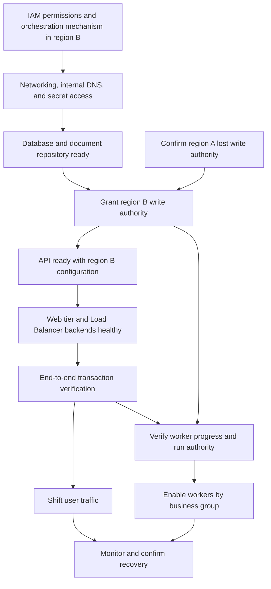

# Building DR Plans for Multi-Tier Applications

## 1. Objectives and scope

An application can start up in a standby region and still fail to restore service: the web tier returns a landing page while the API points at the old database, invoice files have not been replicated, or background workers continue charging cards in both regions. Therefore, a disaster recovery plan—or **DR plan**—must specify how to return the entire business workflow to a valid operating state.

Within the **Backup and Disaster Recovery** chapter of the **CLOUD_PROVIDERS_ORACLE** module, this lesson focuses on designing DR for multi-tier applications on Oracle Cloud Infrastructure (OCI). Scope spans tenancy, compartment, IAM, VCN networking, Compute, storage, Oracle Database, orchestration, monitoring, and standby environment cost.

After this lesson, learners can:

- Translate business continuity requirements into verifiable RTO, RPO, and acceptance criteria.
- Map dependencies across tiers, identify protected data, and define recovery ordering.
- Design procedures for switchover, failover, drills, and failback to the original region.
- Divide responsibilities between OCI Full Stack Disaster Recovery and custom-built business steps.
- Evaluate success via end-to-end transactions, data consistency, and measured recovery time.

Timings, configurations, and thresholds in this lesson are **design assumptions for a sample application**, not performance commitments or OCI SLAs. When applying them, substitute numbers measured on your actual architecture, services, and regions.

## 2. A DR plan protects a business service

### 2.1. Sample architecture

Consider the order-management application `OrderHub`, serving users via `orders.example.com`:

| Component | Role | State required upon recovery |
|---|---|---|
| DNS and Load Balancer | Route requests to the active region | Routing target, TLS certificates, healthy backends |
| Web tier on Compute | Serve UI | Application version, endpoint configuration |
| API tier on Compute | Authenticate and process orders | Database connectivity, secrets, permissions, compatible version |
| Background workers | Issue invoices, send notifications | Exclusive run authority, processing progress, duplicate prevention |
| Oracle Base Database Service | Store orders and business state | Database in right role, recovered transactions, connection service |
| Object Storage | Store documents and invoices | Objects present, right versions, right read/write permissions |
| Cache or login sessions | Accelerate access, maintain experience | Rebuildable or require re-login per design |
| External systems | Payments, email, partners | Connectivity, IP allowlists, reconciliation of prior side effects |

The chosen model is **active-passive with a warm standby in region B**. Region A serves normal traffic. Region B has networking, Load Balancer, standby Compute, security components, and replicated data; processes capable of writing or producing external side effects are kept inactive.

Compute instances are pre-created separately in each region; this lesson uses a non-moving approach for the application tier. Switching roles does not mean a running VM, IP address, or VCN automatically moves intact to another region. If choosing moving instances, also design network mappings, volumes, and target instance launch times.

### 2.2. Distinguish protection mechanisms

| Mechanism | Primary problem solved | What the DR plan must still supply |
|---|---|---|
| Intra-region high availability | Instance failure or single fault domain within design scope | Continuity when the entire region becomes unusable |
| Backup and restore | Recover data from copies at saved points | Target infrastructure, restore time, connectivity, business testing |
| Replication | Maintain a data copy at target | Role switching, lag checks, handling corrupted data already replicated |
| DR orchestration | Execute steps in dependency order | Preparing copies, access rights, and valid business rules |

Backups remain necessary even with a standby. A technically valid data-deletion mistake can propagate to replicas; having a live replica does not automatically provide a restore point prior to the error.

To choose investment levels, compare three approaches:

- **Backup/restore:** reduces always-on resources, but the recovery path typically includes provisioning infrastructure and restoring data.
- **Pilot light:** maintains essential data and foundational components, scaling application resources when needed.
- **Warm standby:** stages more components ready, trading off higher ongoing maintenance and configuration-sync cost.

Warm standby does not automatically guarantee sufficient capacity. If Compute must scale up before opening service, provisioning time and capacity availability must be included in the plan.

## 3. Setting RTO, RPO, and recovery criteria

### 3.1. RTO starts when service is disrupted

**Recovery Time Objective — RTO** is the service recovery time target. For OrderHub, assume the target is restoring order creation and lookup flows within **30 minutes** from when the service first becomes disrupted.

Agree on how two milestones are defined:

```text
T_outage    = time when the service stops meeting agreed criteria
T_recovered = time when the service in region B meets those criteria
Measured_RTO = T_recovered - T_outage
```

Do not take the moment an operator clicks Execute as the sole start point. Detection, assessment, and decision-making also consume the RTO budget.

A target allocation for the example:

| Activity on the critical recovery path | Budget |
|---|---:|
| Detect and confirm impact | 2 minutes |
| Decide to activate DR | 3 minutes |
| Final prechecks and confirm old region lost write authority | 4 minutes |
| Switch roles and verify data at target | 7 minutes |
| Start and configure API/web tiers | 4 minutes |
| Business validation before admitting customers | 3 minutes |
| Shift traffic and validate from client side | 3 minutes |
| Buffer for variance and controlled retries | 4 minutes |
| **Total** | **30 minutes** |

The table assumes major phases execute sequentially. When parallel branches exist, calculate using the longest dependent path plus wait times and non-parallelizable work; do not mechanically add durations of all individual tasks.

### 3.2. RPO is the data-loss requirement

**Recovery Point Objective — RPO** is the acceptable data-loss limit, typically expressed as a time interval. Suppose OrderHub requires **RPO no greater than 2 minutes for confirmed orders**.

To evaluate it, determine the reliably recovered business data point:

```text
Observed data-loss window = T_outage - T_latest_recoverable_business_state
Target: this window must not exceed 2 minutes
```

For example, region A fails at 10:00:00. The database in B has received and applied transactions up to roughly 09:59:20; related invoices are fully verified only up to 09:58:30. You cannot cite database lag alone to conclude the entire application meets RPO.

The 09:58:30 milestone is only a candidate for analysis. To treat it as a consistent point, verify via checkpoints, manifests, or application reconciliation rules. Taking the oldest timestamp across data stores does not automatically create atomicity between them.

If business rules permit confirmed orders to hold invoices in `PENDING_DOCUMENT` state, the system can open the ordering flow first and regenerate invoices afterward. If invoices are mandatory before confirmation, corresponding data must be verified before declaring recovery.

### 3.3. Define eligible serving state

OrderHub is considered recovered only when:

1. Region B is the sole region authorized to perform business writes and run workers producing external side effects.
2. The database in B accepts transactions via the right service, with expected permissions and operating mode.
3. Order and document data satisfy published consistency rules.
4. A synthetic test transaction with a unique ID creates an order, reads it back, and checks document status.
5. Real access paths across DNS, TLS, Load Balancer, and API operate stably during the defined observation window.
6. Minimum capacity mode and deferred features are approved by the business owner.

A Load Balancer health check returning HTTP 200 only proves the probed endpoint responds. It does not substitute for the conditions above.

## 4. Mapping dependencies and recovery inventory

### 4.1. Recovery dependency map

The diagram below depicts "must be ready before" relationships, not all packet flows:



An email-sending worker can start later than the API if degraded mode permits. A worker settling payment transactions may sit directly on the mandatory recovery path. Dependencies must derive from actual application behavior.

### 4.2. Resource inventory

Each inventory row should contain actual OCIDs or identifiers in both regions, compartment, owner, recovery mechanism, and verification criteria.

| Group | Prepared in region B | Evidence required before opening service |
|---|---|---|
| Networking | VCN, subnets, routes, NSGs, DNS resolvers, on-premises paths if any | API reaches database, secrets, and external systems via the right paths |
| Compute | Images or instances, host config, required agents, app artifacts | Right release, sufficient minimum capacity, ops tasks executable |
| Database | Standby and connections suited to chosen Oracle Database service | Right role, right service, read/write capability, timely lag metrics |
| Object Storage | Destination bucket, replication policy, initial data | Sample business objects readable and write rights transitioned per procedure |
| Volume/File Storage if present | Copies, mount mappings, access permissions | Right data attached/mounted; app verified post-recovery |
| Secrets and encryption keys | Secrets, certificates, keys, and usage permissions at target per design | Decryption/secret reads succeed without region A dependency |
| Load Balancer and DNS | Backend mappings, certificates, health checks, routing rules | Reachable by exact hostname from target client networks |
| Orchestration and observability | Control channel, script locations, logs, alarms, dashboards | Executable and readable when region A is unreachable |

A VCN is a regional resource. A route pointing to a private IP in A or an internal domain still resolving to A can let B boot while failing to serve. Compartments are organizational and authorization boundaries; placing resources in another compartment does not automatically create network connectivity or isolation.

### 4.3. Commonly overlooked dependencies

- Emergency operational accounts, MFA, Console/API access, and communication channels when normal login systems are impacted.
- Artifacts, container images, or installation packages that scripts in B still pull from A.
- TLS certificates, database wallets, secret versions, and rotation policies.
- Egress IP addresses of B not yet allowlisted by banks, partners, or on-premises systems.
- VPN, FastConnect, DRG, and internal DNS whose sole operational path transits region A.
- Quotas, service limits, and capacity for required shapes in B.
- Licenses and usage terms for standby databases or software.
- Monitoring that checks instance liveness only, without testing transactions and data readability.

## 5. Designing data recovery and write authority

### 5.1. Databases have dedicated role-transition mechanisms

For Oracle Base Database Service, Data Guard maintains standbys by shipping and applying redo. Switchover performs a planned role swap; failover promotes the standby to primary when the old primary fails or becomes unreachable. Reinstate returns a database to the standby role when conditions are met. See [About Oracle Data Guard](https://docs.oracle.com/en/cloud/paas/base-database/guide/dg-about.html).

In OrderHub's design, the database team owns:

- Defining protection mode, redo transport mechanism, and data targets suited to inter-region latency.
- Publishing how transport lag, apply lag, and metric freshness are checked.
- Defining connection services after role changes; updating or rebuilding application connection pools.
- Specifying supported failover procedures, reinstate conditions, and standby rebuild plans.

Do not run the same command sequence across Base Database, Exadata, and Autonomous Database simply because all run Oracle Database. Service type, Data Guard configuration, and Full Stack DR support determine exact operations.

You can run these read-only queries in an eligible Oracle Database environment with an account authorized on the views:

```sql
-- Confirm role and open mode of the connected database.
SELECT database_role, open_mode
FROM v$database;

-- Observe on the physical standby prior to role transition.
SELECT name, value, unit, time_computed, datum_time
FROM v$dataguard_stats
WHERE name IN ('transport lag', 'apply lag');
```

These are diagnostic queries, not role-transition commands. A small lag value with a stale `datum_time` does not prove the standby is keeping up. After role transition, verify via application connections and test transactions rather than looking solely at a database status screen.

### 5.2. Object Storage has its own recovery lifecycle

OCI Object Storage replication operates asynchronously; the destination bucket remains read-only while receiving replication. Objects existing before policy creation are not automatically replicated by the new policy. See [Object Storage Replication](https://docs.oracle.com/en-us/iaas/Content/Object/Tasks/usingreplication.htm).

Therefore, the sample data plan needs three parts:

1. Seed the initial dataset and verify the manifest before judging DR ready.
2. Track completeness via business objects or verifiable markers, not just an active policy indicator.
3. Transition the destination bucket to writable state via a tested procedure and prepare to re-establish reverse replication when switching serving regions.

Making the destination bucket writable terminates incoming replication; this state change must be controlled. If Full Stack DR already orchestrates this step, do not run a duplicate script. See [Stopping Replication to the Object Storage Destination Bucket](https://docs.oracle.com/en-us/iaas/Content/Object/Tasks/usingreplication_topic-To_stop_replication_on_the_destination_bucket_and_make_the_bucket_writable.htm).

### 5.3. Consistency across multiple data stores

Suppose the API inserts an `ORDER_CONFIRMED` row in the database and then uploads a PDF to a bucket. A failure between the two steps can produce a confirmed order missing its file, even before considering replication.

One design pattern for OrderHub is:

- Write the order and an outbox event within a single database transaction.
- Workers generate the file under a deterministic key derived from `order_id` and document version.
- Mark document completion only after verifying object existence and matching checksum.
- During recovery, replay incomplete events under the same key rather than creating uncontrolled duplicate documents.

Outbox helps track progress; it does not automatically make external side effects exactly-once. For payments or partner APIs, require receiver-supported idempotency keys plus lookup and reconciliation of completed transactions.

Caches should be rebuilt only once confirmed they are not the sole source of truth. If a queue or session store holds irreplaceable business state, include it in RPO scope with its own recovery mechanism.

### 5.4. Preventing dual-region writes

**Fencing** is revoking or disabling the old region's ability to write and produce business side effects. It is a prerequisite for transferring authority, not merely updating DNS.

For OrderHub, control at least three layers:

| Layer | What to prevent | How to verify per design |
|---|---|---|
| Database | Both sides acting as writable primary | Role-transition outcome and database configuration state |
| API | Old APIs writing via stale connections or stale data | Write privileges/leases expired; probe on old access path rejected |
| Workers, schedulers | Old jobs charging payments, sending alerts, or double-processing | Time-bounded run authority, fencing tokens, receiver-side dedup |

A lease only works if writers actually enforce lease or token validation and halt upon expiration. Never treat a configuration variable `ACTIVE_REGION=B` on one host as full split-brain protection.

If region A loses connectivity, stop commands sent to A may fail to execute. You need a pre-designed, pre-tested approach—for example, write authority gated by an external mechanism outside the failed region combined with supported database procedures. If exclusive write authority cannot be confirmed, halt at the decision gate and assess risk; never automatically open B simply because DNS switched.

## 6. Specifying an executable runbook

Runbooks must be stored where operations teams can reach them when A goes down. An executable runbook must specify:

| Section | Required contents |
|---|---|
| Scope | Application, environment, A-to-B direction, covered scenarios |
| Objectives | RTO/RPO and minimum service mode |
| Authority | Who declares DR, who accepts data loss, who signs off business readiness |
| Entry criteria | Current roles, replica status, target permissions and capacity |
| Each step | Executing person or system, inputs, outputs, timeout, dependencies |
| On failure | Where to stop, who handles it, how to assess post-error state |
| Re-run | Inspect state before retrying; retry limits |
| Evidence | Execution ID, logs, timestamps, markers, and test outcomes |
| Completion | Customer-opening criteria, monitoring, re-protecting, and failback |

The example below is an **application-team-defined descriptive template**, not a schema to import directly into OCI:

```yaml
application: orderhub
scenario: unplanned-region-loss
source_region: REGION_A
target_region: REGION_B
objectives:
  rto_minutes: 30
  rpo_seconds: 120
minimum_service:
  create_order: required
  read_order: required
  invoice_generation: may_be_delayed
steps:
  - id: confirm-single-writer
    owner: incident-commander-and-database-lead
    requires:
      - target-prechecks-passed
    success_evidence:
      - source-write-authority-revoked
      - target-role-transition-approved
    on_failure: stop-and-escalate
  - id: validate-target-api
    owner: application-team
    requires:
      - target-data-ready
      - target-configuration-applied
    timeout_seconds: 240
    on_failure: keep-customer-traffic-closed
```

`source-write-authority-revoked` must point to real system evidence, not a manually ticked checkbox to bypass a step. A complete runbook defines how that evidence is gathered and who holds authority to confirm it.

Automated steps should be **idempotent** where appropriate: inspect current state first, and if the goal is already met, verify and exit cleanly. For role-changing or external-side-effect actions, check state after a timeout before retrying. A timeout can occur even when the service-side operation actually completed.

## 7. Mapping to OCI Full Stack Disaster Recovery

### 7.1. Protection groups and DR plans

Full Stack DR organizes resources into a DR Protection Group, abbreviated DRPG. Two DRPGs are associated in primary and standby roles. DR plans are created in the DRPG holding the standby role; plans on the standby side transition workloads to that side. See [Full Stack Disaster Recovery Terminology and Concepts](https://docs.oracle.com/en-us/iaas/disaster-recovery/doc/disaster-recovery-terminology.html).

For OrderHub:

- `orderhub-a` represents application components in A.
- `orderhub-b` represents standby components in B.
- Each resource is added as a member per supported resource types and configurations.
- The runbook inventory still lists dependencies not directly orchestrated by the service.

Grouping resources into a DRPG does not create distributed transactional consistency across databases, buckets, and payment gateways. The application team remains responsible for its designed consistency rules.

### 7.2. Sequential groups, parallel steps

**Plan groups execute sequentially**; **steps within the same group execute in parallel**. Therefore, never place "start API" and "post-start API check" in the same group if the latter must wait for the former. See [Overview of Disaster Recovery Plan Executions](https://docs.oracle.com/en-us/iaas/disaster-recovery/doc/overview-dr-plan-executions.html).

One way to organize custom steps for OrderHub:

| Logical phase | Tasks that can run together | Tasks that must wait for prior phase |
|---|---|---|
| Foundation checks | Independent artifact, secret, and network checks | Any action consuming those check results |
| Write-authority assurance | Confirm fencing and role-transition decision | Opening databases/app tiers for writes |
| Data recovery | Data operations per real dependencies | APIs consuming recovered data |
| Configure and start API | Configure independent API nodes | Transaction checks needing healthy APIs |
| Verification | Independent flow checks using dedicated test IDs | Routing customers into region B |
| Open service | Routing and enabling workers per design | Final recovery sign-off |

This table is a dependency analysis aid, not a list of OCI built-in group names. When using Full Stack DR, preserve built-in ordering suited to the plan type and member types, then insert business steps at appropriate points. Do not force one generic table onto all volume, database, file system, or Compute configurations. Oracle warns that altering default ordering can cause failures or unpredictable results; see [Default Order of DR Plan Groups](https://docs.oracle.com/en-us/iaas/disaster-recovery/doc/Order-of-dr-plan-groups.html).

### 7.3. Built-in vs. custom steps

Tasks like configuring the application, verifying leases, testing orders, and reconciling documents typically require application-team steps. Full Stack DR supports user-defined steps via Run Command on DRPG member instances or via Oracle Functions; functions used in failover should reside in the standby region. See [Add User-Defined Plan Groups and Steps](https://docs.oracle.com/en-us/iaas/disaster-recovery/doc/add-user-defined-plan-groups.html).

For OrderHub, emergency orchestration tasks must run in B without needing SSH into A. Scripts, access permissions, networking, and artifacts for those tasks are all DR dependencies.

Configure step failure behavior by criticality:

- Fencing, data role transitions, and business validation: halt on failure.
- Cache warm-up or auxiliary reports: allow continuation only when degraded mode is approved.
- All steps: bounded timeouts, logs clear enough to determine state, and zero credential printing.

Prechecks catch configuration errors, yet do not prove post-transition business transactions will succeed. Run prechecks periodically and before transitions while keeping end-to-end validation inside the plan. After refreshing a plan, inspect ordering and re-verify per [Verify a Disaster Recovery Plan](https://docs.oracle.com/en-us/iaas/disaster-recovery/doc/verify-plan.html).

## 8. Preparing authorization and operational readiness

### 8.1. Separate permissions by responsibility

Separate who edits configurations, who executes DR, and which identities services/scripts use. With resource principals, permissions for executing resources are granted via dynamic groups and corresponding policies; required permissions also depend on member types and target services invoked. See [Policies for Full Stack Disaster Recovery](https://docs.oracle.com/en-us/iaas/disaster-recovery/doc/policies.html).

The matrix below is a responsibility design for the example, not a complete OCI policy list:

| Role | Responsibility | Pre-incident verification |
|---|---|---|
| Incident commander | Decide activation, approve degraded mode | Holds plan execution rights and standby access paths |
| Database team | Decide data state, roles, reinstate/rebuild | Can read metrics and run approved procedures |
| Infrastructure team | Networking, Compute, storage, capacity | Target resources authorized and usable |
| Application team | Config, workers, fencing, testing | Custom steps run under the exact intended identity |
| Business representative | Sign off flows and data-loss limits | Criteria, test data, and decision contact ready |

Do not test permissions only with the admin account that built the plan. Test using the exact identity invoked during an incident, in the exact target compartments and resources.

### 8.2. Verify region B independence

A readiness drill should confirm B operates assuming zero read access to region A resources:

- Start applications from artifacts reachable at target.
- Read secrets, use encryption keys, and load certificates per region B design.
- Collect logs and open dashboards without depending on jump hosts in A.
- Connect to external systems via B's egress paths and DNS.
- Perform operational actions using standby accounts and access channels.

For keys or secrets, merely "having created a resource with the same name" is insufficient. Prove needed data actually decrypts or credentials are accepted by target systems.

## 9. Failover runbook when region A cannot serve

Failover handles unplanned incidents. Do not design it to depend on cleanly shutting down every application in A; that capability may be gone. Given OrderHub's constraints, an operational sequence is:

| Step | Action | Proceed condition | When unmet |
|---|---|---|---|
| 1. Confirm incident | Check transactions, network, and impact scope | Service confirmed disrupted with clear timestamp | Investigate further; avoid failover on a single alarm |
| 2. DR decision | Weigh repair time in A, data lag, remaining targets | Authorized person accepts transition and data risk | Log decision; do not assume authority to accept data loss |
| 3. Check target | Prechecks, permissions, capacity, artifacts, secrets, network | B meets conditions to run the plan | Remediate in B or pick alternative recovery path |
| 4. Confirm fencing | Revoke write and job-run rights in A via designed mechanism | Evidence rules out dual-region writes | Halt before opening writes in B |
| 5. Recover data | Execute role switch, activate copies per service | Roles, data point, and consistency meet criteria | Keep customers out; evaluate another restore point |
| 6. Configure and start apps | Apply endpoints, secrets, mounts, release in B | API/web use region B resources properly | Halt at app tier; do not blindly re-run role switch |
| 7. Validate | Run isolated data and transaction tests | End-to-end results pass with no uncontrolled side effects | Fix and retest while traffic stays closed |
| 8. Shift traffic | Update chosen DNS/traffic mechanism | Clients from target networks reach B and transact | Diagnose DNS, TLS, backends, connection caches |
| 9. Open workers | Enable job groups per exclusive authority and verified progress | No duplicate side effects; backlog drains normally | Pause faulty job group; hold minimum service if permitted |
| 10. Confirm and monitor | Record recovery milestone, watch SLOs and reconciliation | Business accepts; monitoring active | Keep incident open; do not declare complete |

Step 4 is both a business and technical decision gate. Revoking privileges may begin before step 3; exact implementation ordering must match tested fencing mechanisms and built-in plan groups.

If metrics are too stale to prove RPO, record RPO as undetermined or breached per available evidence. Never report RPO met solely because database failover succeeded.

### DNS is not an instant switch

Low TTL reduces resolver caching time per configuration, yet does not flush resolver caches, client caches, JVM caches, or open connections. Therefore:

- Prepare TTLs and traffic-shift mechanisms before an incident.
- Test from networks representative of users, not just from Console or a VM inside B.
- Verify certificates and hostnames in B before changing public targets.
- Include convergence time in RTO and maintain fencing in A even while straggling clients hit the old target.

Once new transactions occur in B, flipping DNS back to A is not a data rollback. Any reverse transition must rely on current sync state and write authority.

## 10. Planned switchover

Switchover applies when both sides remain healthy and can coordinate regional transition. It enables stopping writes proactively, waiting for synchronization, and verifying before opening target traffic. Full Stack DR distinguishes switchover from failover workflows; see [Configure OCI Full Stack Disaster Recovery](https://docs.oracle.com/en/solutions/full-stack-dr-weblogic-platform/configure-full-stack-disaster-recovery.html).

Sample application procedure:

1. Schedule, designate decision-makers, and announce the maintenance window per ops process.
2. Run prechecks; confirm B holds the right release, compatible schema, and sufficient capacity.
3. Close new write paths in A, drain in-flight transactions, and stop jobs producing external side effects.
4. Record final business checkpoint; verify matching data arrived in B and apps no longer write to A.
5. Switch data roles via supported procedures; update replication directions as appropriate.
6. Start B application components per dependencies and grant exclusive write authority to B.
7. Validate before opening traffic, then shift customers and enable approved worker groups.
8. Confirm A holds proper standby role and data protection is re-established.

Switchover reduces risk when the source can be controlled, yet still requires verification. Never conclude zero data loss solely from the plan type name; outcomes still depend on drained transactions, all state stores, and external side effects.

## 11. Verifying the application before admitting customers

### 11.1. Three verification layers

| Layer | Example check | What it catches |
|---|---|---|
| Infrastructure | Instances, mounts, routes, TCP and TLS connections | Infrastructure or transport path not ready |
| Data | Database role, markers, objects, and checksums | Wrong role or missing required data |
| Business | Create test order, read back, verify idempotency and documents | Configuration errors or cross-tier coordination bugs |

An OrderHub test suite should use a test tenant and dedicated order prefixes with reconciliation and cleanup. Never trigger live payments or real emails during drills unless explicitly approved in scope.

Also verify lost login sessions. If the design expects users to sign in again, test the login flow in B and note that impact in recovery criteria.

### 11.2. Example readiness gate

The Bash example below illustrates a **custom endpoint built by the application team**, not a default OCI API. It checks Load Balancer B using the real hostname prior to updating DNS. It assumes valid TLS certificates in B for that hostname, network reachability from the runner to the Load Balancer, `curl` and `jq` installed, and internal protection on the endpoint.

```bash
#!/usr/bin/env bash
set -euo pipefail

: "${DR_LB_IP:?Set the target load balancer IP}"
: "${EXPECTED_REGION:?Set the target region identifier}"
: "${EXPECTED_RELEASE:?Set the approved application release}"

for attempt in $(seq 1 12); do
  if payload=$(curl --fail --silent --show-error \
      --connect-timeout 3 --max-time 10 \
      --resolve "orders.example.com:443:${DR_LB_IP}" \
      "https://orders.example.com/internal/dr-readiness"); then
    if jq -e \
      --arg region "$EXPECTED_REGION" \
      --arg release "$EXPECTED_RELEASE" \
      '.ready == true
       and .region == $region
       and .release == $release
       and .database.role == "PRIMARY"
       and .database.readWrite == true
       and .dependencies.objectStore == "READY"
       and .dependencies.identity == "READY"
       and .syntheticOrderPassed == true' \
      <<< "$payload" >/dev/null; then
      printf 'Target readiness gate passed\n'
      exit 0
    fi
  fi
  sleep 5
done

printf 'Target readiness gate failed\n' >&2
exit 1
```

The endpoint must compute results from real checks with timestamps and freshness validation. Never hardcode `ready: true`, return credentials in responses, or disable TLS verification to pass the gate.

`syntheticOrderPassed` can reflect a recently completed probe with a traceable ID and log. Never create an un-idempotent transaction on every health check poll. The step invoking this script needs a timeout exceeding total retry duration plus check time; for instance, 240 seconds in this model must be confirmed by measurement.

This gate does not replace verifying fencing, deciding RPO, or testing real DNS resolution after region switch. Those pieces of evidence are gathered in dedicated runbook steps.

## 12. When a step fails

Multi-tier orchestration is a sequence of state transitions, not an atomic transaction that rolls back as a unit.

| Situation | Appropriate response |
|---|---|
| Precheck reports missing permission | Stop before role switch, fix the policy/identity, and retest |
| Database role-switch command times out | Determine true state via service and logs; retry only once prior call confirmed incomplete |
| Database is primary in B, but API fails | Keep A fenced, keep traffic closed, fix config or app in B |
| API runs, but mandatory documents are missing | Keep validation step failed; recover data or enter approved degraded mode |
| DNS switched, yet some clients still hit A | Keep blocking writes in A, inspect resolvers/caches and client connections |
| Workers double-process | Halt affected workers, reconcile via idempotency keys before resuming |
| Monitoring cannot read logs in B | Fix observability; evidence is insufficient to close the incident |

After failure, record execution ID, failed step, timestamp, modified resource states, and manual actions taken. Before resuming, reconcile actual state against what the runbook expects.

Never trigger multiple concurrent executions or multiple independent tools switching the same database simultaneously. Enforce a single control authority and an operational lock/rule preventing overlapping operations on the same application.

## 13. Failing back to region A and restoring protection

After failover, B holds new transactions. Region A must remain isolated until its role and data are clearly resolved.

Failback has two distinct parts:

### 13.1. Re-establish a trustworthy standby environment

1. Confirm root cause of the incident in A is resolved.
2. Reconcile data that may exist only in A against data and external side effects generated in B.
3. Reinstate or rebuild the standby database per conditions and tooling of the chosen service.
4. Establish B-to-A data replication, covering database, objects, and other state stores.
5. Verify images, releases, secrets, networking, backends, and orchestration resources in A.
6. Update members, mappings, and plans per current roles; refresh and verify as needed.

Never merge old-primary data into the new primary via a blanket restore. Unreplicated transactions may require business reconciliation, especially when external payments occurred.

### 13.2. Execute switchover from B to A

Pick a failback window only once A is an eligible standby, data synchronization meets criteria, reverse plans are tested, and an execution window is approved. Then follow the planned switchover procedure: stop writes, confirm checkpoints, switch roles, validate, and shift traffic.

Failback is a separate operational objective, not something to rush immediately after B begins serving. However, **restoring protection levels** must not be neglected: while lacking a valid standby or backups, the application runs at higher risk than initially designed.

## 14. Drilling and gathering evidence

### 14.1. Progressing from config checks to regional cutover tests

A drill program can escalate gradually:

1. **Tabletop:** operations walks through scenarios and decisions against runbooks without altering infrastructure.
2. **Prechecks and readiness checks:** verify configurations, permissions, replicas, and dependencies.
3. **Isolated DR drill:** recover a test environment while blocking live system side effects.
4. **Planned switchover:** shift live service within an organizationally approved scope.
5. **Controlled chaos/failure test:** evaluate detection, fencing, RPO, and failover under more realistic conditions.

When using Full Stack DR Start Drill/Stop Drill, verify support per member type and current configuration. Drill environment provisioning does not replace designing isolated networking, DNS, and egress.

For OrderHub, the drill environment must use a dedicated domain, test or appropriately sanitized data, sandbox partner accounts, and controls blocking real payments/emails. After Stop Drill, verify spawned resources, costs, and replication state of the live environment.

### 14.2. Scenarios to cover

- A is unreachable, while B and B's control channels remain operational.
- A stays running under network partition; test fencing while old clients or workers are still alive.
- Database keeps up while buckets still lag on documents.
- Secrets in B hold wrong versions or lack permissions.
- Capacity is unavailable for scale-up configurations during DR.
- Clients still cache A's target or hold stale connection pools.
- A side-effecting step completed, yet the orchestrator received a timeout.
- Reverse recovery path was not updated after an application change.

### 14.3. Results report

Required report fields:

| Data | Meaning |
|---|---|
| Plan and release versions | Identifies the exact configuration tested |
| Disruption, detection, decision, and recovery timestamps | Calculates RTO and identifies waiting bottlenecks |
| Checkpoints/markers and verified transactions | Assesses recovered data point |
| Fencing evidence | Proves no two regions held write authority simultaneously |
| API, object, worker, and client outcomes | Proves cross-tier recovery |
| Per-phase durations and retries | Identifies bottlenecks and budget variance |
| Degraded modes, remaining defects, and approver | Defines recovered service scope |
| Post-drill action items | Owners and remediation deadlines |

For instance, a **hypothetical** report showing 27-minute RTO and 75-second observed data-loss window meets this lesson's numeric thresholds if supporting evidence is complete and consistent. If two workers still hold authority to submit payments, the overall outcome remains a fail even though both numbers sit within targets.

## 15. Monitoring, changes, and cost control

### 15.1. Observe readiness before disaster strikes

A DR dashboard should surface:

- Data lag alongside measurement freshness.
- Latest precheck results and plan state after changes.
- Release, image, schema, or configuration drift between A and B.
- Secret reads, network connectivity, and artifact checks in B.
- Standby capacity, service limits, and missing resources.
- Worker run authority, leases, and deduplication status.
- Ability to use backups to recover prior to a replicated data error.

After major changes to schema, networking, member types, releases, or authentication, assess impact on both DR directions. If not yet retested, document the gap rather than continuing to cite old drill results as proof for the new architecture.

### 15.2. Cost must pair with recovery time

Standby costs may include Compute, databases, replica storage, backups, networking, logs, Load Balancers, and drill resources. This lesson assumes no fixed pricing; the design team must check actual prices and service terms when budgeting.

Adjustments must be evaluated via measurement:

| Adjustment | Expected benefit | What must be verified |
|---|---|---|
| Reduce always-on app nodes in B | Lower idle resource spend | Whether scale time and capacity meet RTO |
| Keep data copies closer to ready | Reduce data-recovery work | Lag, upkeep cost, and actual protection |
| Rebuild caches during DR | Avoid replicating non-essential state | Database load on cold cache and warm-up time |
| Clean up drill resources | Prevent test resources accruing ongoing cost | Do not accidentally delete real DR assets |
| Automate config drift detection | Fewer emergency operational errors | Detections drive tracked remediation |

Tag resources by application, environment, owner, and DR purpose to allocate cost. A cheaper environment that misses minimum service levels fails the objective; a costlier environment still requires drills to prove effectiveness.

## 16. Hands-on exercise: building a DR plan

Execute in an isolated learning environment with test data. The exercise goal is producing an evidenced, operable plan—not merely provisioning a few standby resources.

1. **Define minimum service:** select two mandatory flows, one deferrable flow, and consistency rules between database and documents.
2. **Set targets:** record RTO/RPO, measurement start point, completion criteria, and who approves degraded mode.
3. **Build inventory:** record A/B resources, planned member types, OCIDs, compartments, artifact sources, secrets, and external dependencies.
4. **Map dependencies:** separate stateless components from data stores; highlight which steps can run in parallel.
5. **Prepare data:** configure database and document protection; verify initial dataset and validation checkpoints.
6. **Design fencing:** describe what forces APIs and workers in A to stop writing, even under network partition.
7. **Create DRPG and plans:** add supported members, review built-in groups, add business steps and timeouts.
8. **Run under exact identities:** test permissions and execution in B; do not rely on initial setup admin credentials.
9. **Test gates:** intentionally misconfigure an endpoint or release and confirm validation fails with traffic kept closed.
10. **Drill:** record timestamps, markers, and logs; verify orders, documents, workers, and client access paths.
11. **Test reverse direction:** define reinstate/rebuild, resync, and source switchover in the learning environment.
12. **Finalize runbook:** close missing dependency gaps, document failure responders, and clean up test resources afterward.

Deliverables are a dependency design, resource inventory, bidirectional runbooks, write-authority verification mechanism, and drill report. An operable DR plan must clearly answer: **which data recovers, in what order, who may write, when customers are admitted, and what evidence proves recovery**.
