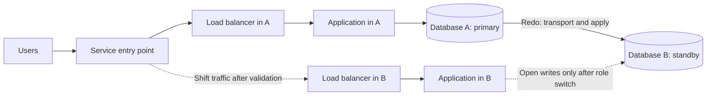
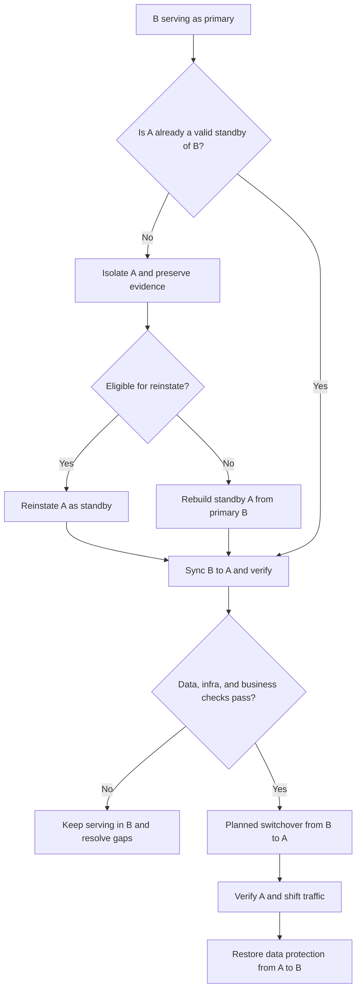

# Controlled Switchover, Failover, and Failback

In the **Backup and Disaster Recovery** chapter of the **CLOUD_PROVIDERS_ORACLE** module, this lesson covers transitioning a system running on Oracle Cloud Infrastructure (OCI) between primary and standby locations. Scope spans Oracle databases, Compute, storage, networking, access permissions, and application transaction flows.

A role transition is complete only when users can execute valid business operations in the new serving location, the old location can no longer perform unauthorized writes, and the system has ongoing data protection re-established. A successful status from a database operation alone is insufficient to declare the service recovered.

After this lesson, learners can:

- Choose switchover or failover based on actual state and acceptable data loss.
- Define proceed conditions, stop gates, and evidence for each transition step.
- Prevent split-brain, control stale connections, and verify transactions after switching serving locations.
- Restore standby relationships and then execute a planned failback.
- Structure manual runbooks or automate with OCI Full Stack Disaster Recovery.

## 1. Distinguish role-transition operations

In a single-primary-writer architecture, **primary** is the database currently responsible for writing transactions; **standby** is the standby database. Region names do not dictate roles: after a transition, the original standby region may serve as primary for days.

| Operation | Usage scenario | Expected outcome |
| --- | --- | --- |
| Switchover | Planned transition when both sides can coordinate | Primary and standby exchange roles orderly |
| Failover | Primary fails or is unreachable; service must recover on standby | Standby is promoted to the new primary |
| Reinstate | Return a database excluded after failover back into standby relationship | That database becomes a standby of the current primary |
| Failback | Return service to the desired site after running elsewhere | Restore data toward the target then execute a planned transition |

Oracle Data Guard ships and applies redo to maintain a standby. With Base Database Service, a valid switchover guarantees zero database data loss; failover may incur data loss—for example, under Maximum Performance mode when some redo has not reached the standby. Never infer zero RPO solely from having Data Guard enabled. [Oracle: About Oracle Data Guard](https://docs.oracle.com/en/cloud/paas/base-database/guide/dg-about.html), [Oracle: Perform Database Switchover and Failover](https://docs.oracle.com/en/cloud/paas/base-database/dg-sofo/).

Database guarantees do not automatically cover the entire business transaction. For example, an order-creation transaction committed while the notification task still sits in the memory of a Compute instance. A successful database role transition does not prove the notification will be sent exactly once.

**Failback is an operational procedure**, not an undo button for failover. Once the new location accepts transactions, new data created there must be preserved when preparing to return.

## 2. Reference architecture and protected data scope

Assume an ordering application deployed in an active/passive model:

- Region A currently serves: load balancer, application on Compute, Oracle Database primary.
- Region B is standby: pre-staged networking and configuration, application able to start or scale per runbook, Oracle Database physical standby.
- Clients connect via a service domain name; the application uses managed database service names and connection configurations.
- Attachments reside in Object Storage; queues, scheduled jobs, and payment integrations are managed as separate dependencies.
- Backups carry their own retention policy for rolling back prior to logical errors.



The diagram depicts initial state. Once B becomes primary, data protection must be established from B to an eligible standby location.

Do not equate "having a standby database" with "having a complete DR system." The runbook must map every component:

| OCI or application component | What must be prepared for transition |
| --- | --- |
| Tenancy, compartment, and IAM | Operator identities; target resource permissions; automation rights; evidence read access |
| VCN, subnets, routes, NSGs, and DNS | User-to-app paths; app-to-database paths; admin and sync paths |
| Compute and deployment config | Images, app versions, startup flags, provisioning capability, serving capacity |
| Oracle Database | Exact target database, current role, Data Guard health, connection services, recovery data point |
| Block Volume, File Storage, Object Storage | Native protection mechanisms; consistency point; attach, mount, or endpoint switch to the right side |
| Vault, certificates, and credentials | Accessibility of keys, secrets, wallets, and certificates in the target region |
| Queues, schedulers, and external integrations | Job ownership, checkpoints, deduplication, and partner IP allowlists |
| Monitoring, Logging, and Audit | Visibility on both old and new sides; audit trail of decisions and recovery actions |

This is a design checklist to verify against the specific system. Resources do not automatically gain copies or matching configs in another region merely by sharing a tenancy.

## 3. Defining targets and acceptance boundaries

### 3.1. RPO: how much data can be lost?

**Recovery Point Objective (RPO)** is the target for tolerable data loss, typically expressed in time. A 30-second RPO means the business accepts at most 30 seconds of potential data loss under the agreed scope and measurement method.

State the scope explicitly: database, attachments, messages, and partner transactions may have different recovery points. An ordering app's RPO must consider orders referencing files absent in region B or emitted messages whose underlying transaction does not exist.

When evaluating a standby, distinguish:

- **Transport lag** reflects delay in shipping redo from source to destination.
- **Apply lag** reflects delay in data applied at standby relative to source, combining transport and apply delays.
- Redo received but not yet applied may require extra recovery time; do not automatically count all apply lag as guaranteed lost data.
- Lag values must accompany measurement timestamps; a stale zero sample does not prove the standby is currently caught up.

Lag semantics and sample freshness are documented by Oracle in [V$DATAGUARD_STATS](https://docs.oracle.com/en/database/oracle/oracle-database/19/refrn/V-DATAGUARD_STATS.html).

If contact with the primary is lost and source-confirmed commits can no longer be fully observed, record **undetermined data loss** alongside available evidence. Never turn a lack of evidence into a "zero data loss" claim.

### 3.2. RTO: when are users actually served?

**Recovery Time Objective (RTO)** is the service recovery time target. In this runbook, actual downtime is measured from when the business stops meeting serving criteria until it meets those criteria again.

The recovery budget must cover incident detection, decision-making, fencing, data recovery, application startup, traffic steering, and validation. Some tasks run in parallel; measure time along the critical dependency path rather than mechanically summing all tasks.

Illustrative example: target RTO is 20 minutes, yet database role transition takes 4 minutes while requesting secret access takes 25 minutes. This architecture still misses the application's target.

### 3.3. Three control gates

A runbook can be structured around three gates:

1. **Before role transition:** confirm the right system, right target, write authority controlled on the old side, and data risk accepted.
2. **Before opening traffic:** confirm new primary, dependencies ready, synthetic transaction succeeds, and old-side write prevention remains active.
3. **Before closing incident:** confirm service stability, data reconciled, and backups plus standby relationships restored or covered by an approved interim plan.

Each gate requires an owner, evidence, deadline, and failure handling procedure.

## 4. Preparing the runbook before cutover day

The runbook must be specific enough for another on-call engineer to execute. Phrases like "wait until stable," "check database," or "switch DNS" must be replaced with targets, conditions, and observable outcomes.

| Item | Required evidence | When unmet |
| --- | --- | --- |
| Identification | Tenancy, compartment, region, resource OCIDs; DB unique name and current role | Halt to confirm exact targets |
| Data scope | List of state stores and checkpoints per component | Do not publish whole-app RPO |
| Synchronization | Data Guard state, lag sample freshness, ability to process remaining redo | Investigate or obtain explicit risk sign-off |
| Operational permissions | Tested operator and automation identities on target resources | Fix permissions before cutover window |
| Target capacity | Quotas, limits, provisioning ability, app and storage capacity | Add capacity or apply planned reduced scope |
| Connectivity | Network checks from real app hosts to database, secrets, and external systems | Fix routing or related configs |
| Writers | List of APIs, batches, schedulers, consumers, integrations, and admin tools able to write | Not eligible to open writes on new side |
| Backups | Eligible copies, accessibility, and prior restore-test evidence | Complete data rescue options |
| Concurrent changes | No conflicting role switches, restores, or infra changes running | Postpone or coordinate via single control point |
| Failure recovery path | Distinguish before vs. after target takes transactions; decision-maker | Complete prior to execution |

For planned transitions, lower DNS TTL early enough so old records expire before cutover. Also account for resolvers, client caches, and long-lived connections; low TTL does not close connection pools or block clients using cached addresses.

Budget for both regions running concurrently, load testing, log retention, data transfer, and potential standby rebuilds. Consider capacity reservations if provisioning wait times risk breaching RTO; balance standby resources using drill timings and actual costs.

## 5. Fencing: keeping write authority on exactly one side

**Split-brain** occurs when both sides act as write authorities, creating divergent data histories. Being unable to reach region A from an operations console does not prove applications inside A have stopped. They may still run batch jobs or receive transactions over another network path.

**Fencing** prevents the old side from continuing impactful operations after losing authority. Coverage must span real writers:

- Block or pause transaction-creating flows at APIs, workers, schedulers, and writable integrations.
- Stop or isolate old-side components via reliable management mechanisms when infrastructure and permissions allow.
- Enforce write permissions bound to database roles or tested lease/quorum ownership mechanisms.
- Keep the old side isolated if it restarts; prevent app self-healing from unintentionally relaunching workers.

Updating DNS only changes how some clients resolve endpoints; it does not revoke write privileges on existing connections. Blocking users at the load balancer alone also misses batch jobs and direct database connections.

Never treat sending a stop command as proof of successful fencing. The runbook needs confirmation—such as completed platform actions, halted writers, or active write-exclusion enforcement. If the primary is severed and cannot be verified via the control plane, rely on pre-designed exclusion mechanisms; never assume it cannot come back up.

For managed database services, use service-supported role-transition mechanisms and states; do not apply OS-level operations meant for another database model. Application-tier fencing remains necessary for schedulers and external side effects like payment submissions.

If you cannot prove the old side lost write authority and lack reliable exclusion controls, **do not open writes on the new side**. The incident commander must decide on additional isolation, restricted service modes, or specialist escalation.

## 6. Planned switchover procedure

Switchover fits maintenance, site migration, or live transition drills when both sides can coordinate. The procedure below is an operational pattern for active/passive applications; specific thresholds and actions must bind to the deployed system.

### Step 1: Confirm scope and lock orchestration

Record change ticket ID, start time, coordinator, current primary, and target standby. Pause deployment pipelines or automation that might modify the same resources.

Only one control point may drive the role transition. If another automated system holds ownership, coordinate with it before issuing new requests.

### Step 2: Bring the application to a switchable state

Close incoming write endpoints or place write functions into maintenance mode. Drain in-flight requests within allowed limits; handle long-running transactions per agreed procedures.

Stop producers before draining queues if the design requires emptying queues. For queues persisting across transitions, record checkpoints and transfer consumer ownership instead of forcing a full drain.

Stop schedulers and background jobs in A. Log in-progress work for controlled resumption. Draining needs timeouts: never let one hung transaction exhaust the entire maintenance window without a decision.

### Step 3: Verify consistency point and switch readiness

Once no new writes occur within the locked scope:

- Confirm Data Guard status and run role-transition readiness checks via service tooling.
- Inspect redo, gaps, and fresh lag metrics.
- Reconcile committed business transaction watermarks against data expected to recover.
- Confirm non-database data stores have reached the chosen consistency point.

Never use a zero lag value alone in place of service readiness checks. If the two sides lose communication here, switch to incident assessment; never convert to failover merely to bypass a failing switchover check.

### Step 4: Execute switchover through one orchestration channel

For Oracle Base Database Service, initiate the action on the target standby in the database's Data Guard section. The interface may use Data Guard Groups or association configs depending on resources; consult documentation matching your actual setup. Confirm the exact target before submitting. [Oracle: Perform Database Switchover and Failover](https://docs.oracle.com/en/cloud/paas/base-database/dg-sofo/), [Oracle: Enable Oracle Data Guard](https://docs.oracle.com/en/cloud/paas/base-database/guide/dg-enable.html).

Monitor executions or work requests if provided, and inspect actual roles afterward. Never run Full Stack DR and manual role-transition commands concurrently on the same database pair.

The required result is database B becoming primary and database A becoming standby. If state is unclear, keep applications write-blocked, read logs, and reconcile roles; do not blindly resend requests.

### Step 5: Start dependencies and test in B

Prepare storage, access permissions, secrets, database services, applications, and dependencies in proper order. Start application B initially via a restricted test path before opening full public traffic.

Verify the application uses the right new primary. Connection endpoints may change or stay constant via service mechanisms; verify actual behavior. Refresh connection pools if needed to evict stale connections to the old side.

Test one uniquely identified business transaction: write, commit, read back, and inspect dependent records. In production environments, use controlled test accounts and data to avoid unintended partner side effects.

### Step 6: Shift traffic and job ownership

Only steer traffic once the pre-traffic gate passes. Monitor DNS or traffic steering, load balancers, and real clients; ramp traffic gradually if architecture allows.

Re-enable schedulers and consumers in B from recorded checkpoints. Confirm they remain disabled in A. A healthy web tier does not authorize auto-enabling background jobs on both sides.

### Step 7: Accept results and maintain protection

Monitor errors, latency, utilization, backlogs, and transactions over the defined observation window. Confirm new data from B is protected back to A or the chosen standby; confirm backups and alerts match the new roles.

If tests fail before B accepts business writes, evaluate a rollback plan after confirming state on both sides. Once B accepts writes, any subsequent transition must preserve new data and pass matching sync checks; never "point DNS back to A" as an isolated undo step.

## 7. Failover procedure when primary fails

Failover prioritizes restoring service under incomplete information. It still demands clear decision gates, especially when data loss is possible or the old side might still write.

### 7.1. Assess and declare the incident

Gather signals across layers: synthetic transactions, connection errors, applications, databases, networking, and platform health. Failure of one app host or one network route does not prove an entire region must fail over.

Compare estimated repair time against remaining RTO. If the primary remains reachable and a safe switchover fits within acceptable time, consider that option. Otherwise, authorized decision-makers record the failover decision, service scope, and accepted data-loss risk.

A decision record should include:

```text
Incident ID: INC-DR-EXAMPLE
Recorded primary: Region A / database orders_a
Target standby: Region B / database orders_b
Disruption start time: ...
Evidence of write prevention in A: ...
Recovery data point and evidence freshness: ...
Estimated or undetermined data loss: ...
Business risk approver: ...
Coordinator and role-transition authorization time: ...
```

This is a record template, not an OCI configuration format.

### 7.2. Select target and control write authority

If multiple standbys exist, choose based on data recoverability, configuration state, serving capacity, and app connectivity—not merely geographic distance or naming order.

Block writers and execute old-side fencing per design. Prevent old-side automation from auto-reopening service when networking returns. If target capacity is short, apply pre-planned degraded modes or provision within remaining time budget.

### 7.3. Recover and promote standby to primary

Gather any still-usable redo and let service recovery mechanisms process within supported capabilities. Losing contact with the source does not mean all unapplied data is unrecoverable.

Execute failover following the exact service runbook and monitor results. Never add custom force-promote steps skipping data solely to save time without formal approval of the resulting loss.

After execution, confirm the target database truly holds the primary role, is open as required, and is reachable by apps. A request-accepted acknowledgment without final completion status does not mean the database is ready.

### 7.4. Restore applications and open service

Run checks similar to switchover: storage, keys, secrets, connectivity, app version, and real transactions along client paths. Open traffic only after confirming single-side write authority.

Clients seeing timeouts may not know whether a prior transaction committed. On retry, require idempotency keys or status lookup by request ID. Prevent retries from creating duplicate orders or payment charges.

Once B begins accepting transactions, treat B as the authoritative data source per the transition decision. Records appearing in A on a divergent branch must be preserved for reconciliation; never merge two database histories directly.

### 7.5. Recovery measurement example

Suppose a drill establishes definitively that the source stopped writing at 09:00:00. The latest consistent recoverable data point in B corresponds to 08:59:52; drill metrics and logs reliably establish both timestamps.

| Milestone | Observed result |
| --- | --- |
| 09:00 | Business disruption starts; source stops writing |
| 09:01 | Monitoring detects incident |
| 09:04 | Failover decision recorded |
| 09:05 | Fencing confirmation completed |
| 09:09 | Database B ready in primary role |
| 09:13 | Application B passes internal tests |
| 09:16 | Begins receiving user traffic |
| 09:18 | Business criteria restored |

Application downtime is **18 minutes**, not the database's 9 minutes alone. The at-risk data window is **8 seconds under the example's assumptions**; actual lost transactions must be reconciled.

Against a 20-minute RTO and 30-second database RPO, these measurements meet both targets. Do not declare whole-application RPO until files, queues, and external systems are checked. In real incidents, if you cannot prove when the source stopped writing or the exact recovery point, do not subtract timestamps to claim a precise RPO.

## 8. Failback: returning after running in region B

### 8.1. Distinguish returning after switchover vs. after failover

After a successful switchover, A is typically already B's standby. To return, resolve the maintenance cause, sync data from B to A, and perform a reverse switchover.

After failover, A may no longer participate in valid data protection. Therefore, before returning, reinstate the standby relationship or rebuild A from B.



There is no requirement to fail back the moment region A reappears. Weigh stability, root cause, capacity, and the risk of another transition against continuing to serve from B.

### 8.2. Reinstate restores the standby relationship

With Base Database Service, after failover the old primary appears as a disabled standby. Once the fault is fixed, reinstate returns it to standby for the current primary; it does not make A primary again. [Oracle: Reinstate a Database](https://docs.oracle.com/en/cloud/paas/base-database/dg-reinstate/).

In Data Guard Broker, reinstate eligibility depends on conditions such as Flashback Database enabled prior to failover and sufficient flashback logs remaining. If recovery conditions are unmet, you may need to recreate the standby from the new primary. Check exact service and version requirements beforehand. [Oracle: Switchover and Failover Operations](https://docs.oracle.com/en/database/oracle/oracle-database/21/dgbkr/using-data-guard-broker-to-manage-switchovers-failovers.html).

Before reinstating or rebuilding A:

1. Keep applications and write paths in A isolated.
2. Confirm B is authoritative primary and actively backed up.
3. Preserve data, logs, and evidence needed from A for investigation or reconciliation.
4. Estimate size, bandwidth, and sync time; monitor impact on B.
5. Use service-supported operations to restore A to standby role.

Rejoining A to B's data branch does not merge transactions that existed only on A's old branch. If a missing transaction must be applied to B, handle it at the business layer with duplicate checks, auditing, and data approval.

### 8.3. Conditions permitting return to A

Before failback, confirm:

- Root cause in A is resolved with an adequate stability observation period.
- A is a valid standby of B; synchronization and switchover readiness checks pass.
- Compute, networking, storage, secrets, database services, and certificates in A support the current app version.
- Configuration changes made while running in B have been applied to A.
- Change window, staffing, stop gates, and abort procedures are ready.
- Backups and ongoing protection once A becomes primary are prepared.

Execute switchover from B to A: stop writers in B, drain, verify sync, switch roles, test A, shift traffic, then enable schedulers and consumers in A. Afterward, confirm B acts as standby and receives new data from A.

If A accepts new transactions and then fails at the application tier, failing back to B must account for new data written in A. Never start B as an independent primary using an outdated config saved in a runbook.

## 9. Orchestration with OCI Full Stack Disaster Recovery

### 9.1. Role of the orchestration service

OCI Full Stack Disaster Recovery groups resources into a **DR Protection Group** and uses **DR Plans** to orchestrate transitions.

Switchover plans perform planned transitions requiring two-way coordination. Failover plans focus on bringing up services at the standby without depending on stopping every service at the primary. Start DR Drill and Stop DR Drill plans test recovery using a stack copy where supported. [Oracle: Full Stack Disaster Recovery Terminology and Concepts](https://docs.oracle.com/en-us/iaas/disaster-recovery/doc/disaster-recovery-terminology.html).

Therefore, inspect where the runbook actually implements fencing; do not assume "running a failover plan" proves all old writers stopped. Nor should you assume every resource type shares identical drill support or built-in step groups. Verify supported capabilities per member and add custom steps as needed. [Oracle: Built-in Plan Groups for DR Plans](https://docs.oracle.com/en-us/iaas/disaster-recovery/doc/reference/full-stack-dr-built-in-plan-groups-for-dr-plans.html).

Full Stack DR is an orchestration layer. Data and dependencies still require each service's own protection mechanisms, configs, and permissions. A complete transition must include business steps that an auto-generated infrastructure plan cannot infer.

### 9.2. Designing step ordering and checkpoints

A reference sequence for switchover is:

```text
Confirm pre-transition gate
  -> block new writes and background job sources
  -> drain and record checkpoint
  -> verify data eligible for transition
  -> switch database role via supported mechanism
  -> prepare storage and target dependencies
  -> start target application
  -> test via restricted access path
  -> confirm pre-service-opening gate
  -> shift traffic and job ownership
  -> monitor and re-establish protection levels
```

Exact ordering must follow real dependency graphs and built-in plan group requirements. For instance, target networking must pre-exist, volumes must be ready before app mounts, and some prep steps can run in parallel. Do not replace all service-specific ordering with this reference list.

For failover, steps contacting region A must behave predictably when A does not respond. Distinguish steps impossible because the source is gone from mandatory safety steps that must be proven by another mechanism.

When roles flip between sides, review protection groups, targets, and reverse-direction plans. Failback may involve data remediation outside the plan before executing a switchover matching current roles.

### 9.3. Custom steps must tolerate retries

A worker startup script should inspect actual state before acting. If the worker already runs the right version with proper ownership, a retry must not spawn an unintended competing consumer.

Each custom step needs:

- Explicit target identifiers as inputs; verify current primary and standby before mutating state.
- Timeouts, exit codes, and logs traceable to incident or execution IDs.
- Pre- and post-conditions; sensitive data redacted from logs.
- Safe re-runnability or explicit manual verification required before retry.
- Orchestration locks and ownership controls that the old side cannot illicitly reclaim.

If using leases or coordination locks to enforce single-writer authority, lock storage and expiration logic must survive region loss. A lock file sitting on the primary itself is insufficient to authorize the surviving side.

### 9.4. Prechecks, topology changes, and failure handling

Running prechecks before execution validates involved steps and members. Passing prechecks does not prove full application transactions have been drilled or will finish within RTO. [Oracle: Prechecks for Disaster Recovery Plan Executions](https://docs.oracle.com/en-us/iaas/disaster-recovery/doc/prechecks-dr-plan-executions.html).

Modifying members or certain DR Protection Group settings requires a plan refresh. After refresh, re-verify the plan, including group order and alignment with current topology. [Oracle: Configuration Changes Requiring Plan Refresh](https://docs.oracle.com/en-us/iaas/disaster-recovery/doc/plan-deletion-post-update.html), [Oracle: Verify a Disaster Recovery Plan](https://docs.oracle.com/en-us/iaas/disaster-recovery/doc/verify-plan.html).

When a plan fails mid-way, first identify which steps already modified resources and actual database roles. A failed plan status does not mean the database did not switch roles.

Full Stack DR provides retry for failed executions; resume applies to paused executions. Canceled executions cannot be resumed or retried that way. Do not treat cancel as rolling all resources back to initial state. Select the next action only after reconciling actual states and guidance for that execution type. [Oracle: Manage Disaster Recovery Plan Executions](https://docs.oracle.com/en-us/iaas/disaster-recovery/doc/perform-dr-operations.html).

Never skip a failed step tied to fencing, role verification, or data consistency simply to force the plan into a succeeded state.

## 10. Observing databases and applications during transition

### 10.1. Read-only SQL examples for Oracle Database

The commands below target Oracle Database environments allowing access to dynamic performance views with proper privileges, such as databases managed on Base Database Service. They are not a generic administrative script for Autonomous Database.

Check identity and role on each database:

```sql
SELECT db_unique_name,
       database_role,
       open_mode,
       switchover_status
FROM v$database;
```

Check lag-related metrics on the standby:

```sql
SELECT name,
       value,
       unit,
       time_computed,
       datum_time
FROM v$dataguard_stats
WHERE name IN ('transport lag', 'apply lag', 'apply finish time')
ORDER BY name;
```

When collecting output, record observation timestamp and host location to avoid confusing both sides. Do not rely on hostnames still containing "primary" from earlier; compare `DB_UNIQUE_NAME` against actual roles.

For physical standbys, open mode varies by configuration; not every standby shares the same `OPEN_MODE`. Never open a standby for business queries solely to satisfy a test step not designed for that state.

`V$DATAGUARD_STATS` returns zero rows when queried on a primary. An unchanging `DATUM_TIME` across multiple samples signals no fresh source data is arriving; inspect `TIME_COMPUTED` and sample freshness. Never assume "zero rows means zero lag." [Oracle: V$DATAGUARD_STATS](https://docs.oracle.com/en/database/oracle/oracle-database/19/refrn/V-DATAGUARD_STATS.html).

These queries are supporting evidence, not substitutes for role-transition readiness checks, redo recovery, and service operation outcomes.

### 10.2. Do not apply identical operations to Autonomous Database

Autonomous Database uses the service's Autonomous Data Guard interfaces and workflows. For example, cross-region switchover is initiated from the target standby; do not copy Base Database Service host-admin or Data Guard Broker steps straight onto Autonomous Database. [Oracle: Perform a Switchover](https://docs.oracle.com/en-us/iaas/autonomous-database-serverless/doc/autonomous-data-guard-switchover.html).

Local standby automatic failover differs from cross-region standbys. Current documentation notes Autonomous Data Guard automatic failover does not apply to cross-region standbys; cross-region transitions follow supported workflows. [Oracle: Automatic Failover with a Standby Database](https://docs.oracle.com/en-us/iaas/autonomous-database-serverless/doc/autonomous-data-guard-auto-failover.html).

Runbooks must name the exact service type, standby type, and post-transition application connection method. Never assume full access to every dynamic performance view or OS layer on fully managed databases.

### 10.3. Verify serving capability via business flows

An HTTP 200 health check only proves an endpoint responds. Recovery validation must exercise real user paths with controlled data and impact.

| Verification layer | How to verify | Signal to halt traffic opening |
| --- | --- | --- |
| Routing | Access from representative client networks; observe where requests land | Some clients still hit the old region with write ability |
| Database connection | Inspect endpoint, service, and database role used by app | Pools connect to wrong side or fail auth |
| Transactions | Submit uniquely keyed request, commit, and read back via app | Returned success yet saved record missing |
| Related data | Read attachments and dependent records for the same entity | Database and storage out of sync |
| Retries and idempotency | Resubmit same request ID per system design | Creates duplicate records or side effects |
| Consumers and schedulers | Check task ownership and checkpoint progress | Both sides execute the same job |
| External integrations | Check connectivity, certs, and access from target region | Partner rejects source IP or receives duplicate calls |
| Capacity | Watch errors, latency, backlogs, and resources while ramping load | Service works only under tiny test load |

After transitioning, align alerts with actual roles. Monitoring must detect both a failing new primary and a primary running without a valid standby.

Record timestamps for detection, decision, fencing, role transition, traffic opening, and service acceptance. Combine app logs, orchestration outputs, work requests, and Audit logs to explain who did what and what was observed. Never record passwords, wallets, or secrets in incident logs.

## 11. Common errors and handling

| Situation | Risk | Controlled handling |
| --- | --- | --- |
| Switching DNS before checking new primary | Users hit apps unable to write or pointing at wrong DB | Hold traffic gated until business check passes |
| Primary unreachable from one probe | May just be a network fault; old side still writes | Verify from multiple paths and enforce designed fencing |
| Zero lag on stale sample | Underestimating data loss | Check sample freshness and state uncertainty |
| Plan fails after DB switched roles | Re-running everything may affect wrong role | Reconcile each resource's true state before next step |
| Old region returns and auto-starts schedulers | Concurrent jobs or double submissions | Keep isolated until ownership is formally re-granted |
| Starting B app with A's secret config | Broken connections, wrong target, unexpected writes | Inspect config from the live app process in B |
| Treating reinstate as failback | A is not primary yet receives write traffic | Verify role; shift traffic only after switchover and tests |
| Rebuilding A before preserving divergent data | Losing evidence of transactions unique to old branch | Preserve investigative data before destructive actions |
| Testing only at low load | DR region overloads under real users | Measure capacity and ramp traffic observably |
| Removing standby resources right after cutover | New primary lacks required protection | Restore backups and standby before cost optimization |

If logical errors, deleted records, or bad updates replicated to the standby, failing over can carry those defects onto the new primary. Evaluate restoring from backups or an earlier point in time while handling transactions occurring after that point. DR and backup cover distinct risk scopes within one data protection plan.

## 12. Scoped hands-on exercise and required evidence

Execute in a lab environment authorized for test transactions and service disruption. Use only resources inside exercise scope; never run primary-loss tests against live user-serving environments.

### 12.1. Prepare test data and criteria

Build a test app or transaction suite with unique request IDs. Log app-confirmed results for post-transition reconciliation.

Each probe record should capture request ID, send time, response status, and created entity ID. Distinguish rejected requests, confirmed successes, and ambiguous timeouts.

Set RPO, RTO, and service criteria for the exercise. Numbers in earlier examples are illustrative assumptions, not OCI timing commitments.

### 12.2. Drill switchover from A to B

1. Capture evidence of both database roles, sync status, and reachability in region B.
2. Block new writers, drain tasks, and record checkpoints.
3. Execute switchover per the service in use.
4. Run business checks in B, then shift traffic.
5. Resubmit one request ID to verify deduplication.
6. Confirm A is now standby with fresh sync metrics from B.

Record timestamps for each milestone and true business outage duration. Never substitute Console operation timing for end-user application experience.

### 12.3. Drill failover and failback

Choose a fault simulation allowed and realistic for the platform. If only severing one network path, document that it simulates a connectivity loss—not proof of full region loss.

Execute the failover decision, prove fencing, select the recovery point, and bring B into service. Write new data in B to prove failback must preserve post-failover data.

When A returns, keep A's applications isolated. Reinstate or rebuild standby per actual conditions, sync data from B to A, then run a planned switchover back. Confirm data created while running in B survives failback.

If using Full Stack DR Drill, verify supported member types and workflows beforehand. Isolate external system impact so drill copies never send real emails, payments, or messages. Finish with stop drill and confirm zero leftover drill resources or unintended write paths.

### 12.4. Results dossier

The exercise dossier should include:

- Resource diagram, initial roles, and roles after each transition.
- Proceed/stop criteria and accountable role-transition decision-makers.
- Fencing evidence, sync state, and confidence level of the recovery data point.
- Recovery timeline, measured RTO, and RPO-scope reconciliation results.
- Results for transactions, retries, background jobs, storage, and external links.
- Post-exercise status of backups, standbys, alerts, and resources.
- Notable costs incurred plus bottlenecks or missed targets.

These pieces of evidence turn a one-off role-switch click into a repeatable, auditable, improvable process. Success must be confirmed simultaneously across data, write authority, business flows, and post-transition protection levels.
