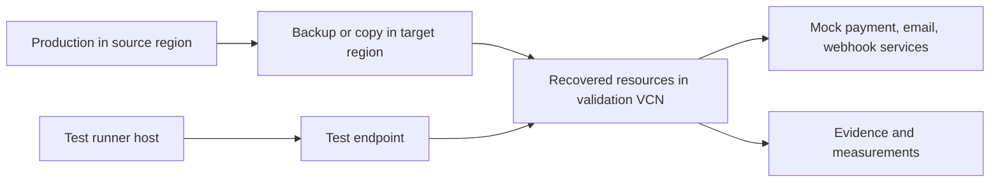

# Restore Testing and Periodic DR Drills

## 1. Objectives and scope

In the **Backup and Disaster Recovery** chapter of Oracle Cloud Infrastructure (OCI), restore testing answers the question: "From the copies we retain, can we restore valid, usable data?" Disaster recovery (DR) drills extend that question to: "Can the entire service resume operating within our committed downtime and data-loss limits?"

A successful backup job only proves copy creation completed according to the tool's conditions. It does not prove the operations team holds the permissions, decryption keys, resources, network configurations, and procedures to bring the application back into service.

After this lesson, learners can:

- Design tests progressing from a single file or volume to full business flows on OCI.
- Measure actual recovery time and data-point lag, then compare against RTO/RPO.
- Prepare a test environment with properly scoped IAM, VCN, and connectivity.
- Build drill runbooks, gather evidence, handle errors, and verify post-drill protection.
- Schedule tests according to service criticality, architectural changes, and budget.

Exercises use a hypothetical ordering application: Compute running the app, Block Volume holding attachments, Oracle Database storing orders, and a Load Balancer receiving traffic. The DR design includes a standby region. Not every component is backed up or recovered by the same mechanism; this lesson focuses on verifying outcomes and dependency chains across them.

## 2. Distinguish verification levels

| Activity | What is done | What it proves | What remains unverified |
| --- | --- | --- | --- |
| Backup monitoring | Check schedules, status, copy age, and standby copies | Copy creation and storage run per observable metadata | Readability, decryption, restore, and data usability |
| Integrity verification | Read backups, check checksums, or run database tools | Detects certain physical, read, or missing-piece errors | OS, application, and business operation post-restore |
| Restore testing | Actually restore to new resources and reconcile data | Specific recovery path works for the tested dataset | Entire service and dependencies outside test scope |
| Tabletop exercise | Walk through scenarios via discussion without altering systems | Whether roles, contacts, and runbook decisions are clear | Speed and correctness of technical execution |
| Isolated DR drill | Stand up a recovered stack in a segregated environment | Multiple technical steps and business flows run together | Real user cutover and true source-unavailability behavior |
| Planned regional switchover | Shift service to standby region during a change window | Role-switch, routing, and target operations procedures | Abrupt source loss and corresponding data loss |

These levels complement one another. Restoring one file does not prove full-application DR meets requirements. Performing a switchover while the source remains healthy also does not fully simulate failover when the source region is unreachable.

For Oracle Databases directly managed by your team, RMAN can validate backup readability:

```text
RMAN> RESTORE DATABASE VALIDATE;
RMAN> RESTORE ARCHIVELOG ALL VALIDATE;
```

These commands require an RMAN connection and appropriate privileges; backup selection depends on the RMAN repository and configuration. They read and check backups without generating restored output files. Thus, an actual restore and recovery on a test database is still necessary. For managed database services, use service-supported features and permissions instead of assuming direct RMAN access. See [Oracle Database: Validating Database Files and Backups](https://docs.oracle.com/en/database/oracle/oracle-database/19/bradv/validating-database-files-backups.html).

## 3. Define "pass" before starting

### 3.1. RTO is the objective; measured time is the result

**Recovery Time Objective (RTO)** is the maximum downtime the service aims to stay within. During a drill, agree on:

- Start milestone: when the incident disrupts service or the declared simulated incident begins.
- End milestone: when the service meets the agreed acceptance criteria.
- Scope: recovering one component, minimum viable functionality, or full capacity.

Calculation used in this lesson:

```text
Actual recovery time
  = service acceptance timestamp - simulated disruption start timestamp

Time objective met
  when actual recovery time <= RTO
```

If you start the stopwatch after already building VCNs, obtaining permissions, and locating backups, the result reflects only the remaining tasks. To evaluate whole-service RTO with that figure, include missing mandatory tasks from a real incident scenario.

Do not sum durations of parallel steps to compute total time. Use real wall-clock milestones; analyze the longest dependent path to find where improvements are needed.

### 3.2. RPO must rely on usable data points

**Recovery Point Objective (RPO)** is the maximum data loss the service aims to tolerate. In testing, identify the latest point before the incident that the recovered system consistently preserves.

```text
Recovered data-point lag
  = simulated incident timestamp - verified recovered data point

Data objective met
  when measured lag <= RPO
```

Backup job completion time is not automatically the recovered data point. For databases, this depends on backup chains, archived redo, recovery capability, and service mechanisms. Across multiple components, check a consistent business point spanning both the database and related files or objects.

For example: the database contains orders up to 09:57 while attachments exist only up to 09:40. You cannot declare the whole app met a three-minute RPO for a 10:00 incident solely because the database held the 09:57 record.

### 3.3. Measurement example

Suppose the service has a 60-minute RTO, 15-minute RPO, and must serve order creation and lookup under a defined test load.

| Timestamp | Event |
| --- | --- |
| 09:52 | Last transaction in test stream verified fully recovered, including data and related files |
| 10:00 | Simulated incident declared; stop injecting new test baseline data for the drill |
| 10:05 | Incident detected, scope confirmed, and coordinator assigned |
| 10:12 | Recovery decision finalized and restore point selected |
| 10:31 | Database recovered, mandatory data checks passed |
| 10:39 | Application and test endpoint ready |
| 10:49 | Business acceptance, monitoring, and required load verified |

Measured time is 49 minutes; data lag is eight minutes. Both fall within the example's objectives. The transaction count lost in that eight-minute window must still be reported separately because equal durations can hold vastly different business volumes.

Use UTC for collection logs and synchronize host clocks. For business data, record transaction IDs, commit order, or suitable consistency markers; do not treat application-assigned timestamps as absolute commit proof. If using per-minute heartbeats, document measurement resolution and unproven gaps.

## 4. Choose scenarios and drill levels

Every drill should test a specific hypothesis. For example: "If the source region becomes unreachable, the on-call team can restore the ordering service in the target region within 60 minutes, with consistent data lagging no more than 15 minutes."

| Scenario | Controlled test approach | Required evidence |
| --- | --- | --- |
| Accidental file deletion | Restore one file version into a new test location | Hash, size, access permissions, and ability to open file |
| Data volume corruption | Create new volume from backup and attach to test host | Mountable, readable data, and usable by app |
| Corrupted database data | Recover a separate database copy prior to error point | Data accurate at chosen point, business constraints pass |
| Compute loss | Launch new host from prepared recovery source, reconfigure app | Boot, mounts, configs, secrets, and smoke tests pass |
| Source region unreachable | Operators use only resources, copies, and docs already at standby | Full recovery chain without accessing source |
| Primary operator absent | Alternate on-call uses runbooks and pre-provisioned identities | No personal passwords or undocumented tribal knowledge needed |
| Latest copy unusable | Select an older copy per defined criteria | New data-point lag measured and pass/fail determined |

You do not need to disrupt a real region to test source-loss hypotheses. Instruct operators not to touch source resources, rely only on copies already at the target, and log every time they had to "ask help" from the source. If the scenario still requires copying a backup from the source after the incident begins, log that as an unresolved dependency.

Data-corruption scenarios must prioritize finding a **clean restore point**, rather than defaulting to the newest copy. Replication can carry bad changes; an active standby copy does not mean its data is fit for recovery.

## 5. Prepare the OCI test environment

### 5.1. Resource scope and authorization

An exercise design might use a `dr-validation` compartment, a test VCN, and dedicated drill identities. Compartments aid organization, authorization, and cost tracking; they do not create network isolation.

Before the test, clarify:

- Tenancy, region, compartment, and OCIDs of source backups, target copies, and test resources.
- Operator or workload automation identities; do not use tenancy-wide admin accounts by default.
- Permissions to read backups and create, attach, and operate recovery resources in the target compartment.
- Service permissions to use encryption keys and read secrets per design.
- Access paths to Console, CLI, bastion, or admin networks when source infrastructure is down.

If testing cross-region Block Volume backup copy, separately check copy permissions at source and backup-creation permissions at target, plus key permissions for customer-managed encryption. Do not assume existing volume-management rights cover all copy cases. See [Oracle: Copying a Volume Backup Between Regions](https://docs.oracle.com/en-us/iaas/Content/Block/Tasks/copy-bv-backup.htm).

For keys and secrets, list dependencies per service: what must exist in the target region, who may use it, and how access is restored. Never assume a single key or secret OCID works unchanged in every region.

### 5.2. Isolate networking and side effects



This diagram illustrates recovery and verification flow; it does not imply every OCI service shares one backup mechanism.

Apply practical safeguards:

- Use subnets, NSGs, and route tables restricting ingress/egress to test requirements.
- Use dedicated drill hostnames or private DNS; check both DNS resolution and actual destination IPs.
- Never flip production public DNS during an isolated restore test.
- Point email, SMS, payments, and webhooks to mocks or sandboxes.
- Stop schedulers, batch jobs, and consumers that could read production queues before starting recovered apps.
- Confirm database connection strings, Object Storage endpoints, and secrets point to test resources.
- Check DRGs, peering, VPNs, and Internet egress; two separate VCNs can still be bridged.

Recovered data may still contain real information. Restrict access, keep sensitive data out of evidence logs, and apply masking when needed. If masking alters data or prep time, record its impact on measurement scope.

### 5.3. Capacity, configuration, and cost limits

Verify quotas, service limits, required Compute shapes, storage capacity, IP addresses, and service availability in the target region beforehand. Available quota does not guarantee physical capacity for every shape at all times.

Budget for temporary compute, recovery storage, copies, data transfer, and applicable database licensing. Apply tags like `drill-id`, `owner`, and `expires-at`; expiration tags inform cleanup processes—they do not auto-delete resources. Budget alerts also require a human or mechanism to act, rather than acting as a spend kill-switch.

If a test uses smaller datasets, weaker shapes, or more pre-staged infrastructure than the real plan, record the differences. Results from that configuration do not prove production RTO and capacity.

## 6. End-to-end restore testing runbook

The runbook must be clear enough for another on-call engineer to run. For each step, record owner, inputs, actions, expected outcome, timeout, and failure handling.

### Step 1 — Lock the drill dossier

Record a drill ID and fixed scope:

```yaml
drill_id: order-service-drill-01
scenario: source-region-unavailable
environment: isolated-validation
rto_target_minutes: 60
rpo_target_minutes: 15
recovery_scope:
  - oracle-database
  - application-compute
  - attachment-data
  - test-endpoint
acceptance:
  - consistent-business-data
  - synthetic-order-create-and-read
  - agreed-test-load
  - monitoring-and-alert-path
  - no-production-side-effects
```

This is a runbook metadata template defined by operations, not an OCI service import config.

Assign coordinator, infrastructure operator, database lead, business validator, and timekeeper. One person may wear multiple hats in a small team, yet authority to start, abort, and sign off must be explicit.

### Step 2 — Select and identify recovery sources

Record details so others locate the exact copies:

- Resource type, backup OCID, or database backup identifier.
- Region, compartment, and copy state where restore will run.
- Expected data point, copy age, base full backup, and dependent components if any.
- Encryption keys, recovery config, archived redo, or other items needed on the restore path.
- Compatible application version, schema, and configuration.

Never write only a display name like "latest backup." Backup lists change over time, and display names are not unique identifiers.

If testing region loss, pick copies already ready in the target region prior to the simulated incident timestamp. Cross-region copy latency must remain inside RPO design rather than being omitted from tests.

### Step 3 — Establish data baseline and simulated incident

Generate synthetic data following application workflows in an authorized environment. Store transaction markers in an evidence store outside the resources being restored.

A minimal reconciliation ledger includes:

```text
sequence | transaction_id | commit_observed_at_utc | attachment_sha256
000101   | test-order-101 | 2026-11-21T02:50:00Z    | <saved sha256>
000102   | test-order-102 | 2026-11-21T02:51:00Z    | <saved sha256>
000103   | test-order-103 | 2026-11-21T02:52:00Z    | <saved sha256>
```

Timestamps here reflect when the test harness observed commit confirmation, not a replacement for database recovery-point mechanisms. Use the same transaction IDs to check both database records and attachments. Reconcile the entire sequence; checking only `MAX(timestamp)` can miss gaps in the middle.

Announce the incident timestamp in UTC and segregate data generated afterward. In drills that do not disrupt production, real transactions after the simulated cutoff still occur, so do not conflate them with the drill's RPO measurement window.

### Step 4 — Restore into new resources

Create isolated target resources and verify OCIDs before executing. Never overwrite source resources during an isolated test.

For databases, choose a service-supported path: restore from backup, point-in-time recovery, or eligible clone options. Time selection, restore targets, and recovery actions differ across Base Database, Exadata, and Autonomous Database; do not apply one generic command list to all types.

Distinguish two phases:

- **Restore** copies backup contents into target resources or datafiles.
- **Recovery** brings data to a consistent state or target point via appropriate mechanisms, such as applying redo for Oracle Database.

For apps with both databases and external files, choose a consistent point or run designed reconciliation. Independently restoring each component to "newest possible" can leave orders referencing nonexistent files.

### Step 5 — Verify data and usability

Verify from lower layers up to business layers:

1. Resources created cleanly, devices match, and paths are reachable.
2. Filesystems or databases open in expected mode.
3. Required files, tables, and objects are present.
4. Sample data matches hashes or values; recovered transaction sequences have no unexpected gaps.
5. Business invariants hold: order totals, statuses, order–line-item relations, and attachments.
6. Application reads, writes new synthetic data, and reads back cleanly in the test environment.
7. Performance meets defined thresholds over an adequate observation window.

Row counts are only one signal. Two datasets with identical row counts can differ in IDs, values, or states. File checksums likewise only prove files match samples, not that overall business logic works.

### Step 6 — Measure, sign off, and log deviations

Record start/end timestamps and request or work request IDs when provided. Keep failure logs even when retries succeed. Retry time and operator wait time both count toward the scenario's recovery time.

If evidence cannot confirm the recovered data point, record "undetermined" instead of guessing RPO. If recovery finishes past deadline, report "recovered successfully, missed RTO."

### Step 7 — Clean up and re-verify protection

After archiving evidence:

- Stop applications, consumers, and scheduled jobs in the test environment.
- Detach and delete temporary resources using the recorded OCID list in dependency order.
- Retain backups per retention policies; never delete source copies merely because a drill ended.
- Confirm no stray volumes, databases, Load Balancers, IP addresses, or temporary resources remain incurring spend.
- Confirm backup schedules, replication, and alerts on protected production systems remain healthy.
- Revoke temporary permissions and dispose of test data per agreed retention rules.

Cleanup is part of the runbook. Lingering test resources or standby protection not yet back to normal constitute incomplete drill closure.

## 7. Hands-on: restoring a Block Volume in an isolated environment

This exercise validates an application file volume. It does not substitute for Oracle Database recovery testing.

### 7.1. Prerequisites

Prepare an isolated Linux Compute test host without original volumes attached; a Block Volume backup holding synthetic files; and a SHA-256 manifest saved independently before the backup. The test host and restored volume must sit in the same availability domain to attach the volume.

OCI allows restoring a volume backup to another availability domain within the same region. To restore in another region, a backup copy must exist in that destination region. See [Oracle: Overview of Block Volume](https://docs.oracle.com/en-us/iaas/Content/Block/Concepts/overview.htm).

To test region loss, use a backup previously copied to the destination region. If testing restore only within the source region, restrict conclusions to that scope.

Inputs include sample files, relative paths, and a trusted manifest. Storing the sole manifest inside the backed-up volume lets corruption or tampering invalidate the comparison.

### 7.2. Steps on OCI

1. Select the target region and right compartment in Console.
2. Open Block Volume Backups and locate the backup by its recorded OCID.
3. Choose restore block volume; select the test compartment, matching availability domain, and prepared encryption settings.
4. Name it with the drill ID, record the new volume OCID, and wait for available state.
5. Attach the new volume to the test Compute host using the appropriate attachment type.
6. Inspect the block device and filesystem before mounting. Do not format the newly restored volume.
7. Mount to inspect data; prefer read-only mode per filesystem guidance. Some filesystems require journal replay or specific options.
8. Verify against the manifest, open sample files, and test read permissions as the application user.
9. If write tests are needed, use the restored copy in the test environment with new synthetic data; leave baseline verification evidence untouched.

Oracle notes that restore creates a new volume and warns against attaching a restored volume to a host still running the original volume due to duplicate filesystem/volume identifiers in some OSes. Using a separate test host avoids volume mix-ups and mitigates this risk. See [Oracle: Restoring a Backup to a New Volume](https://docs.oracle.com/en-us/iaas/Content/Block/Tasks/create-restore-to-new-volume-bv-volume-backup.htm).

### 7.3. Verification on Linux

Run these commands on the Linux test host after completing attachment. They are not PowerShell commands and do not perform the mount themselves:

```bash
# Inspect to identify the right block device, filesystem, and mount point.
lsblk -f
findmnt

# After mounting the restored volume at /mnt/restore-test:
# the manifest uses relative paths and was saved beforehand in an independent location.
cd /mnt/restore-test
sha256sum --check /opt/drill-evidence/expected.sha256
```

Minimum pass criteria: zero missing files in the manifest, all hashes match, and the application user can read mandatory files. `OK` checksum output alone does not mean a production directory was altered; this checks the new volume at a test mount point.

After read-only verification, run application exercises on the test volume to confirm write permissions and new-file processing. Separately report volume restore time, attach/mount time, and time until the app meets required performance; resource `AVAILABLE` status is not whole-service acceptance.

### 7.4. Extending to boot volumes and databases

Restoring a data volume does not prove a recovered instance will boot. Boot volume tests must verify the OS, attachment, boot configs, app services, networking, and secret retrieval.

Likewise, a volume backup containing database files does not automatically prove the database can recover to the desired point. Usability depends on consistency and database-supported recovery procedures. For Oracle Database, verify database open, recovery chain, and business transactions via the chosen recovery path.

## 8. Whole-application DR drills

### 8.1. Recover by dependency order

Example logical order for the ordering application:

```text
Operational identity and access permissions
  -> networking, internal DNS, required keys and secrets
  -> data: consistent database and files/objects
  -> configuration and applications
  -> test endpoint
  -> business flows, load testing, and monitoring
  -> sign-off and drill closure
```

Independent items can be prepared in parallel. However, never start consumers before confirming target queues, never let apps write before locking in the target database, and never expose endpoints to testers before confirming network boundaries.

Acceptance flow for the example:

1. Access via test hostname and valid certificate.
2. Sign in with a test account.
3. View older orders and read corresponding attachments.
4. Create a new synthetic order, update its status, and read it back.
5. Invoke sandbox integrations and confirm zero real payment transactions occur.
6. Run load at the agreed target level, measuring latency and error rates.
7. Inject a controlled test error to verify logs, metrics, and alert paths within test scope.

An endpoint returning HTTP 200 only shows a health probe responded. If it bypasses the database, authorization, and mandatory business flows, that evidence is insufficient.

### 8.2. Drill abort conditions

The coordinator must halt or isolate immediately upon observing:

- Recovered components writing to production databases or queues unexpectedly.
- Real emails, webhooks, or payments firing.
- Source resources modified outside agreed scope.
- Access or data exposed to people outside drill scope.
- Exceeding safety time limits, budgets, or capacity constraints.
- A real production incident requiring DR capacity.

When halting, record each component's state before cleanup. Stopping a drill does not mean rollback is finished; verify the environment returns to a safe, protected posture.

### 8.3. Distinguish ending a drill from failback

Isolated drills typically end by stopping and deleting test recovery resources; production keeps its original role.

After a real service cutover, **failback** must address data sync direction, database roles, dual-write controls, routing, and business validation back at the original source. Never shift DNS back before verifying data accuracy and write-exclusion safeguards. Failback requires its own runbook and measurements; a smooth failover does not automatically guarantee a smooth failback.

## 9. Using OCI Full Stack Disaster Recovery when appropriate

OCI Full Stack Disaster Recovery orchestrates many steps of a DR plan via DR protection groups and DR plans. It is an orchestration tool for configured topologies and supported resource types; do not assume it auto-discovers every business dependency or provisions all missing target infrastructure.

### 9.1. Prechecks, Start Drill, and Stop Drill

An operational drill workflow can be structured as:

1. Verify member list, target configurations, copies, and dependencies of the protection group.
2. Check support levels for each resource type and plan type.
3. Run prechecks, save outputs, and fix failing items.
4. Review generated plans and custom steps, especially networking, endpoints, and external integrations.
5. Run Start Drill per supported topology.
6. Run the application team's data, business, and performance verification suite.
7. Run Stop Drill, inspect cleanup, and verify protection state.

Prechecks are passive checks against plans and members; they do not mutate topology. Passing results help surface or eliminate certain misconfigurations, yet do not substitute for actual recovery and business sign-off. Oracle also notes only one precheck or plan execution can run at a time on a protection group pair. See [Oracle: Overview of DR Plan Executions](https://docs.oracle.com/en-us/iaas/disaster-recovery/doc/overview-dr-plan-executions.html).

Start Drill spins up a test stack in the standby protection group; Stop Drill tears down resources created for the drill. However, support varies by resource type: Oracle's built-in plan groups table lists resources supporting switchover/failover that do not support Start Drill/Stop Drill, such as standard Oracle Database entries in that table. Check your exact database type rather than extrapolating from Autonomous Database to Base Database. See [Oracle: Full Stack DR Built-in Plan Groups](https://docs.oracle.com/en-us/iaas/disaster-recovery/doc/built-in-plan-groups.html).

If a component lacks built-in drill support, define a service-supported restore/clone path or controlled custom step. Report conclusions strictly for verified components; never mark the whole application passed if the core database went untested.

### 9.2. Drills still affect DR readiness state

According to Oracle documentation, while a drill is active, the protection group pair enters a drill-in-progress state; operations such as switchover, failover, or another Start Drill are blocked until Stop Drill completes. Therefore, bound drill windows and prepare an abort path if a real incident strikes. Never assume a drill that leaves production untouched has zero impact on DR operational readiness. See [Oracle: Types of Disaster Recovery Plans](https://docs.oracle.com/en-us/iaas/disaster-recovery/doc/dr-plans-type.html).

After Stop Drill, verify protection group status, replication, and leftover resources. Do not close the console merely because an app verification step passed.

### 9.3. Do not confuse drills with switchover/failover

- **Drill:** validates on a test copy within topology capabilities; application side effects still require explicit control.
- **Switchover:** planned role exchange while both required sides remain healthy.
- **Failover:** service transition when source suffers an outage; data conditions and reachability may differ from switchover.

Drills selecting one of these modes must explicitly state impact and target evidence. Never run a live failover merely to substitute for an isolated restore exercise.

## 10. Scheduling periodic tests

The schedule below is a starting point for designing an internal testing program, not a mandatory cadence or OCI availability guarantee. Actual frequency depends on outage impact, data change rates, organizational requirements, and staffing.

| Reference cadence | Activity | Artifacts to retain |
| --- | --- | --- |
| Daily | Monitor backups, restore point age, copies/replication, failure alerts | Exception list, owners, current risk level |
| Weekly | Run appropriate prechecks, verify permissions and target copy presence | Step outcomes, config errors, recent changes |
| Monthly | Rotate sample restores across data groups or services | Reconciled data, timings, decryption and access |
| Quarterly | Drill one complete business flow in the standby environment | Recovery metrics, data consistency, load, side effects |
| Semiannual or annual | Broader multi-team scenario drills; consider planned switchover if appropriate | Decision speed, comms, role swap, and failback plan |
| After major changes | Focused test on affected components | Evidence DR remains operable post-change |

Changes that should trigger additional testing include:

- Changes to IAM policies, identity domains, auth mechanisms, or automation identities.
- Changes to encryption keys, secrets, certificates, or how apps fetch configuration.
- Database upgrades, schema changes, new images, or boot script edits.
- Subnet, NSG, route, DNS, Load Balancer, or cross-region connectivity changes.
- Backup policy, retention, copy schedule, replication, or Data Guard topology changes.
- Rapid data growth, shape changes, or new business dependencies.
- Primary on-call turnover or discovering runbooks cannot be executed independently.

Do not test only the newest backup and smallest dataset. Rotate through fresh copies, older copies near retention expiration, destination-region copies, large datasets, and data encrypted across active key versions.

Sampling controls cost but limits conclusions. If only two of ten databases were tested this month, the report must explicitly state the remaining eight lack current evidence.

## 11. Automating tests for repeatability

Automation should support a process already well understood. Before scheduling periodic provisioning/cleanup, run manually under close control to confirm exact inputs and acceptance gates.

An appropriate automation flow can be sketched in pseudocode:

```text
acquire execution lock scoped by service and drill window
verify region, compartment, backup source, and permissions
create record with start timestamp
provision resources tagged with drill-id; immediately log every created OCID
wait for request state with bounded timeout
verify data, business flows, and endpoints
record results, deviations, and timings
in finally block:
    archive logs and resource inventory
    clean up exact created resources if state permits
    verify DR protection posture returned to normal
    report cleanup errors separately; release execution lock
```

Practical requirements:

- **Prevent overlaps:** a new scheduled run must never collide with an active run.
- **Idempotency/re-runnability:** check existing resources and request IDs before retrying; avoid uncontrolled duplicates.
- **Bounded waits:** distinguish slow, in-progress, and failed operations; script timeouts do not cancel service-side tasks.
- **Complete error reporting:** restore errors, validation errors, and cleanup errors are distinct outcomes.
- **Scoped permissions:** automation identities may only touch resources designated for the workflow.
- **Protect secrets:** logs must never print passwords, tokens, private keys, or secret payloads.
- **Preserve evidence before cleanup:** cleanup must never delete the sole log proving why a run failed.

Use OCI Monitoring, Logging, Audit, Events, or service-supported notifications to collect signals. Audit traces control-plane admin actions; database and application logs verify actual recovery contents and business behavior. Never assume one log source covers everything.

Isolated data-restore automation must never escalate automatically into shifting production traffic when a smoke test fails. Production cutovers belong strictly to designed runbooks and approved scopes.

## 12. Evidence dossiers and post-drill reporting

An evaluative dossier must show **what was tested, on which data, under what conditions, and how far it succeeded**.

| Evidence group | Minimum contents |
| --- | --- |
| Identification | Drill ID, service, executors, sign-off approver |
| Hypothesis | Incident type, source access restrictions, simulated parts |
| Recovery source | Backup OCID or ID, region, data point, and dependencies |
| Environment | Target region/compartment, configs, data, deviations from production |
| Timings | Disruption, detection, decision, per-step, and acceptance timestamps |
| Data | Recovered transactions, gaps, hashes, reconciliations, consistency markers |
| Technical | Restore/recovery outcomes, logs, request IDs, errors, retries |
| Business | Mandatory test suite, results, load thresholds, validator |
| Closure | Cleaned resources, retained items, replication, protection state |
| Improvements | Defects, impact, remediation actions, owners, retest deadlines |

Example result record for the timeline in section 3:

```text
Drill: order-service-drill-01
Scope: isolated recovery in standby region
Targets: RTO <= 60 minutes; RPO <= 15 minutes
Actual recovery time: 49 minutes
Verified data lag: 8 minutes
Mandatory business flows: passed
Observed production side effects: none
Post-drill cleanup and protection status: passed
Limitations: public DNS cutover and full production load not tested
Conclusion: meets criteria for published drill scope
```

Separate three conclusions:

- **Technical success:** restore/recovery operations and corresponding checks finished.
- **Service targets met within test scope:** required time, data, business, and capacity criteria passed.
- **Operational readiness post-drill:** temporary resources cleaned up, data protection and DR capability back to required posture.

A defect with an assigned owner is still an open defect. After fixing it, retest the affected scope before updating the conclusion.

## 13. Common failures and remediation

| Symptom | Causes to inspect | Next action or test |
| --- | --- | --- |
| Backup succeeds yet restore denied | Wrong region/compartment, missing read/create rights, insufficient key policy | Test with exact operational identity; log missing actions and rights |
| Target copy exists yet cannot decrypt | Key, key state, or usage permissions mismatched | Verify key path per service and region with a real restore |
| Resources launch yet app fails | Wrong connection strings, secrets, images, schema, or mounts | Walk dependency order and compare against recorded config versions |
| Database opens yet business state wrong | Wrong recovery point, missing related data, replicated bad changes | Reconcile by transaction and test a more appropriate restore point |
| Measured RPO too large | Sparse backup schedule, slow copy, missing logs, or failed latest copy | Isolate each lag source, tune protection, and re-measure |
| RTO too long | Waiting for permissions, finding backups, capacity gaps, manual/unautomated steps | Analyze wall-clock time on the longest dependency path |
| HTTP health check passes yet orders fail | Health check skips business dependencies | Add read/write checks and data reconciliation |
| Restored app sends real emails | Production schedulers, endpoints, or secrets carried over | Isolate egress, fix config, and verify before starting app |
| Next DR plan run blocked | Drill never ended or lingering unfinished execution/state | Inspect executions, run proper stop procedure, verify status |
| Spend keeps rising after drill | Leftover temporary resources or partial shutdown | Reconcile created OCIDs, tags, and resource reports post-cleanup |

Never improve metrics by excluding hard steps from the clock without disclosure. If infrastructure must be pre-staged to hit RTO, update operational architecture, ongoing spend, and maintenance conditions for those pre-staged assets.

## 14. Checklist for the next drill

### Before running

- [ ] Specific incident hypothesis, scope, RTO/RPO, and business criteria defined.
- [ ] Uniquely identified backup sources, expected restore point, and independent reconciliation data ready.
- [ ] Copies, keys, secrets, and docs usable when source is unreachable.
- [ ] Executors hold scoped permissions and independent admin paths.
- [ ] VCN, endpoints, sandbox integrations, and side-effect blocks verified.
- [ ] Abort, cleanup, real-incident handling, and cost-limit plans ready.
- [ ] All differences from production documented in the dossier.

### During execution

- [ ] Log timestamps, request IDs, resource OCIDs, and per-step outcomes.
- [ ] Maintain scenario constraints; log whenever an exception is required.
- [ ] Verify data, transaction chains, related files, and business flows.
- [ ] Include retries, decision waits, and verification waits in corresponding timings.
- [ ] Abort if safety limits are breached or unintended side effects appear.

### After execution

- [ ] Compare measured results against RTO/RPO and capacity criteria for the exact tested scope.
- [ ] Archive both failure evidence and conclusion limitations.
- [ ] Complete Stop Drill if using Full Stack DR and verify protection state.
- [ ] Clean up temporary resources, inspect backups/replication, and revoke temporary permissions.
- [ ] Assign every finding an owner, due date, and retest plan.
- [ ] Lock in next drill date and change triggers for interim testing.

Recoverability is proven through accurate data, usable services, clearly measured timings, and repeatable procedures. Periodic testing pays off by surfacing gaps before an incident, closing them, and maintaining evidence that the next recovery meets committed objectives.
