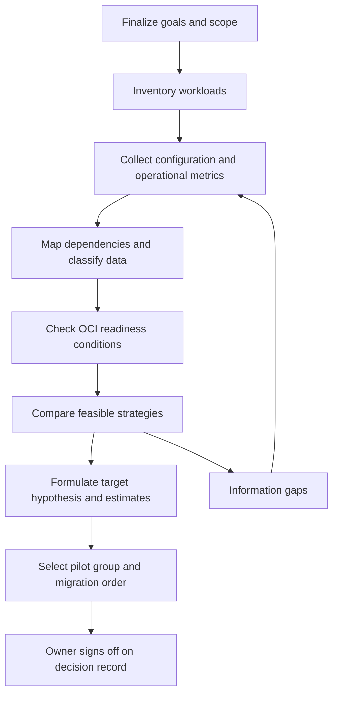
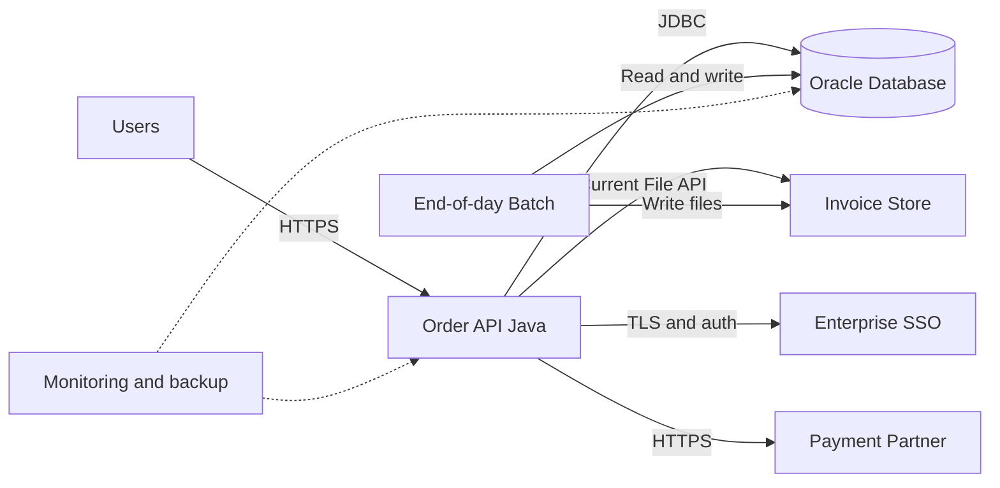
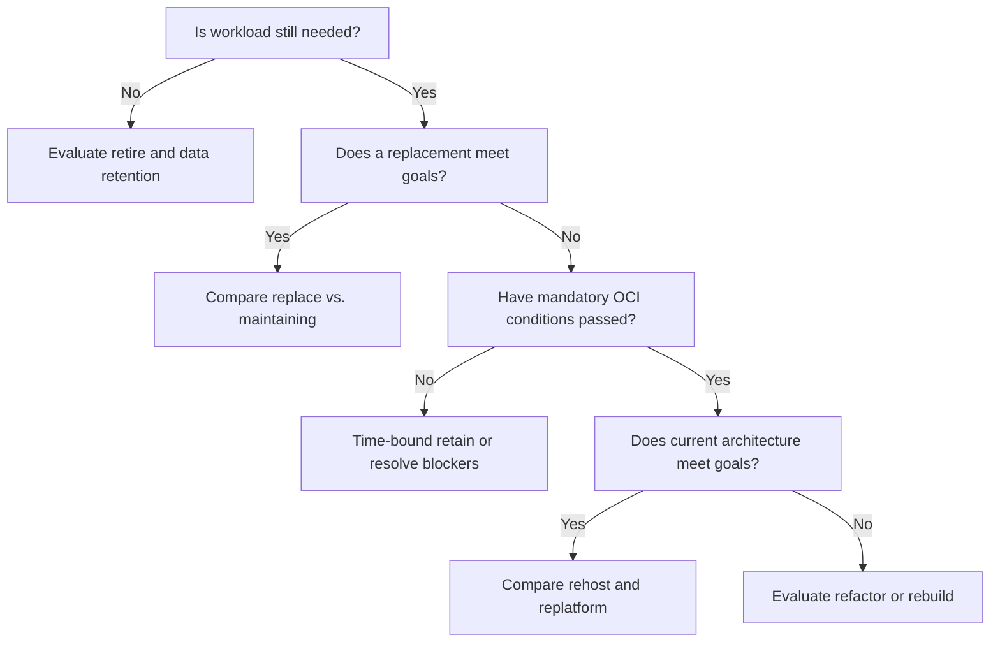

# Current-State Assessment and Migration Strategy Classification for OCI

## 1. Objectives and Expected Outcomes

In the **Migration and Multicloud** chapter of the **CLOUD_PROVIDERS_ORACLE** module, current-state assessment is the step that turns the desire to “move the system to the cloud” into an evidence-backed set of decisions. The destination is Oracle Cloud Infrastructure (OCI), but the unit of decision-making is the workload: an application or a group of components that together deliver a business capability.

A virtual machine booting on OCI does not prove that the business workload has migrated successfully. The application must also allow logins, access the right data, reach related systems, meet processing time targets, and be handed over to the operations team.

After this lesson, learners will be able to:

- Build an inventory of applications, infrastructure, data, and accountable owners.
- Collect sufficiently representative metrics instead of simply copying source machine specifications.
- Map dependencies to identify components that must move together.
- Assess readiness for OCI tenancy, compartment, IAM, VCN, Compute, storage, and database services.
- Classify workloads as retire, retain, rehost, replatform, refactor, or replace according to goals and constraints.
- Propose migration order, pilot scope, and prerequisites to resolve before cutover.

The output of the assessment is a **migration decision record** for each workload. The record must answer: what to move, why, where to, to what extent it changes, what remains unknown, and who approves that decision. This lesson stops at assessment and classification; detailed deployment configurations are created once the option has sufficient evidence.

The Oracle Cloud Adoption Framework also places application portfolio evaluation in the context of business, technical characteristics, integration, cost, and risk. Therefore, a server list is only one input to the evaluation. [See Oracle Business Architecture](https://docs.oracle.com/en-us/iaas/Content/cloud-adoption-framework/ea-business-architecture.htm).

## 2. Distinguishing Three Decision Layers

### 2.1. Portfolio Decisions

Is the application still needed? Does it overlap in functionality with another system? Does it have an actual owner and active users? An application that no longer delivers value can be retired instead of continuing to consume budget on OCI.

### 2.2. Architecture and Operations Decisions

For applications that need to continue running, what is the appropriate level of change? Keep the software as-is on Compute, move to a managed database service, or change how components are split and how state is managed?

Choosing a managed service changes operational responsibilities. You must redefine who is responsible for patching, backups, security configuration, recovery, monitoring, and incident response; you cannot assume all responsibilities have shifted to the provider.

### 2.3. Execution Decisions

Only after selecting the strategy do you determine the replication tools, synchronization process, and official traffic switch, called **cutover**. For example, rehost is the strategy; a VM replication tool is the means of execution. Do not choose rehost simply because a VM migration tool is already available.

Similarly, online vs. offline migration is a choice about data transfer method and outage level. These two choices do not replace the classification into rehost, replatform, or refactor.

| Decision Layer | Key Question | Output Artifact |
|---|---|---|
| Portfolio | Is this application still needed? | Keep, retire, or replace |
| Architecture | Keep or change platform, source code, operating model? | Strategy and target candidate |
| Execution | How to move data and traffic? | Candidate tools, testing, cutover plan |

## 3. Repeatable Assessment Process



This is an iterative process. If it is not yet known which tables a month-end batch accesses, the decision must remain pending verification. An “unknown” cell with an assigned owner and due date is more useful than a guessed answer written just to complete the table.

### 3.1. Finalizing Goals with Measurable Conditions

A goal like “modernize the system” is not specific enough to select a strategy. Convert it into concrete conditions, such as:

- Exit the data center before the contract expiration deadline.
- Limit planned outage duration within a defined window.
- Reduce test environment provisioning time from several days to an agreed timeframe.
- Add rehearsed and timed recovery capability.
- Attribute costs per application and environment via compartments or tags.

Goals can conflict. A tight data center exit deadline often increases the value of a low-change option, whereas a requirement to drastically reduce operational effort may make replatforming worth the investment. The record must document the priority order and the decision maker when trade-offs arise.

### 3.2. Defining the Assessment Scope

A clear scope specifies which environments, which applications, which data sources, and which observation timeframe are included. Production, test, development, standby, and seasonal-only systems must be distinguished.

Do not automatically treat resources missing from old diagrams as out of scope. When a new dependency is discovered, record it and ask the owner to evaluate its impact on the workload under assessment.

## 4. Building a Workload-Based Current-State Inventory

### 4.1. Minimum Information Set

Each application has a stable identifier. Servers, databases, file shares, and integrations are linked back to that identifier; avoid using IP addresses as business identifiers because IPs can change.

| Category | Information to Record | Relevance to the Decision |
|---|---|---|
| Business | Function, users, operating hours, peak seasons, revenue or outage impact | Priority level and change windows |
| Owners | Business, application, database, network, security, and on-call operations owners | Providers of evidence and sign-off |
| Lifecycle | Active development vs. maintenance only, end-of-support date, replacement plan | Retire, retain, or required modernization level |
| Compute | Physical or VM, hypervisor, OS and version, CPU architecture, allocated CPU/RAM | Compatibility and target candidates |
| Application | Runtime, framework, middleware, packaging and release method | Code change scope and redeployability |
| Database | Engine, version, edition, configuration, size, growth, features in use | Service selection and data approach |
| Storage | Block, file, object; actual used capacity; permissions, metadata, locking, IOPS | Target storage semantics and performance |
| Connectivity | Inbound/outbound flows, DNS, network paths, CIDR, ports, TLS, proxy | Post-migration connectivity |
| Identity | SSO, directory, service accounts, certificates, secrets, provisioning workflow | IAM design and auth integration |
| Operations | Monitoring, logs, backups, batch schedules, patching, deployment, incident handling | Operational handover on OCI |
| Service Continuity | RPO, RTO, cutover outage tolerance, rollback scenario | Testing and cutover constraints |
| Cost & Licensing | Current cost, contracts, licenses, support, and expiration dates | Feasibility and total cost |

Do not lump all data into a single “storage” field. Databases, upload directories, temporary files, and logs have different recovery requirements, access permissions, and lifecycles.

### 4.2. Separating Facts, Requirements, and Assumptions

A good record separates three types of information:

| Type | Example | Handling |
|---|---|---|
| Measured Fact | p95 response time is 320 ms during the observation window | Attach source, timestamp, scope |
| Requirement | Business owner requires p95 under 400 ms at target load | Attach approver and acceptance criteria |
| Assumption | Application can run on two instances without local sessions | Record verification test and owner |

If requirements have not been agreed upon, do not use the current state as the default requirement. A system that currently takes six hours to recover does not mean the business accepts a six-hour RTO.

### 4.3. Confidence Level of the Record

Three simple levels can be used:

- **High:** valid measurements or configurations exist and are confirmed by the owner.
- **Medium:** documentation or verbal confirmation exists, but recent measurements are missing.
- **Low:** inferred information, outdated documentation, or no accountable owner.

For example, “no users” is not enough to retire a workload if based solely on an infrastructure team guess. The application might only serve quarterly financial close. Logs, business calendars, and owner confirmation must be combined.

## 5. Collecting Representative Evidence

### 5.1. Combining Multiple Sources

The CMDB shows declared resources, the virtualization platform shows actual allocated resources, monitoring shows utilization, and the business team explains what the load means. No single source completely replaces the others.

The collection process should combine interviews, architecture documentation, automated discovery, and operational observation. When information conflicts, explicitly note the discrepancy and verify it before using it to finalize an option.

The observation window must cover meaningful cycles. Two to four weeks may be a starting point in an example project, but it is not a sufficient rule for every system. If there are quarter-end batches, sales campaigns, or irregular billing runs, corresponding historical data must be added or controlled load testing arranged.

### 5.2. Metrics Set for Sizing

| Component | Metrics to Collect | Common Misconceptions |
|---|---|---|
| CPU | Average, p95, peak, peak duration, host contention | Low average CPU does not rule out batch bottlenecks |
| RAM | Working set, peak, swap, reclaimable cache | Allocated RAM does not equal required RAM |
| JVM | Heap/non-heap, GC pause, threads, connection pool | Adding CPU does not solve all GC or pool issues |
| Disk | Used capacity, growth, IOPS, throughput, latency, read/write ratio | Large enough disk does not guarantee enough IOPS or low enough latency |
| Network | Directional traffic, RTT, errors, packet loss, concurrent connections | Nominal bandwidth does not equal effective transfer rate |
| Business | Transactions/sec, p95 response time, error rate, batch completion time | Spare machine capacity does not prove business targets are met |

p95 is the value that 95% of samples do not exceed within the observation set. You must specify whether samples are per-minute, per-request, or another unit. CPU p95 and transaction latency p95 are two different metrics.

Do not select a shape by mechanically converting source CPU count to OCPU count. You must verify vCPU/OCPU units, architecture, processor generation, and shape limits, then use load testing to validate the candidate configuration. [See Compute Shapes](https://docs.oracle.com/en-us/iaas/Content/Compute/References/computeshapes.htm).

### 5.3. Assessing Java Applications

For a Java service, beyond JDK and framework versions, determine:

- Whether there are native libraries, JNI, or binaries tied to a specific CPU architecture.
- Whether sessions, uploaded files, caches, and temporary files reside in RAM or local disk.
- How JDBC URLs, DNS, truststores, certificates, and secrets are supplied.
- Whether connection pools have appropriate limits, timeouts, and connection recovery behavior.
- Whether scheduled tasks run inside the application process; would scaling to multiple instances cause duplicate task execution?
- Whether there are dependencies on hostname, MAC address, absolute paths, or hard-coded IPs.
- Whether the artifact can be rebuilt and redeployed from a pipeline or only exists as an installation on the server.

An application packaged as a container can still depend on local disk or run duplicate jobs when replicas increase. Packaging format alone does not prove an application is ready for a container orchestration platform.

### 5.4. Local Data Collection Example

The Linux commands below illustrate reading information on a machine within the assessment scope. They are not a complete assessment toolset and must not be run in this lab on production servers without appropriate authorization.

```bash
# OS, architecture, and CPU information
cat /etc/os-release
uname -m
lscpu

# Memory, storage devices, and filesystem capacity
free -m
lsblk -f
df -hT

# Listening TCP/UDP ports visible to the current account
ss -lntu
```

This is a point-in-time snapshot. It does not provide load history, a full integration list, or data consistency levels. Do not collect passwords, private keys, connection strings containing secrets, or customer data into inventory tables; only record where those secrets are managed and who owns them.

## 6. Mapping Dependencies Before Grouping Migration Waves

### 6.1. What Should a Dependency Edge Include?

A diagram that simply says “App connects to DB” is not enough. Each relationship needs source, target, protocol, port, connection initiation direction, authentication method, frequency, volume, and outage impact.

| Source → Target | Exchange Method | Characteristics to Verify | Consequence of Separating Locations |
|---|---|---|---|
| Users → Application | HTTPS via DNS name | Certificates, SSO, proxy, allowlist | Changing endpoint may break access |
| Application → Database | JDBC via configured listener | Round-trip count, transactions, pool | Higher RTT slows transactions |
| Application → File Share | NFS/SMB per configuration | Locks, renames, UID/GID or ACL, file watcher | Changing storage type may alter behavior |
| Application → Partner | API over TLS | Source IP, mTLS, rate limits, timeouts | New egress IP may be rejected |
| Batch → Database | Scheduled job | Timing, intermediate data, rerun conditions | Duplicate runs or missing results |
| Application → Shared Platform | DNS, directory, mail, monitoring | Network path, identity, time zone | VM runs, but business function still fails |

### 6.2. Synchronous Dependencies and Latency Cost

Suppose a transaction performs 40 sequential round trips to the database. If separating the two components increases RTT from 1 ms to 8 ms, the added network wait time is approximately:

```text
40 × (8 − 1) ms = 280 ms per transaction
```

This is a simple model to surface risk; it excludes server processing, pooling, data transfer, parallel calls, or protocol optimization. It shows why tightly coupled applications and databases generally must be evaluated as a group rather than moving the application to OCI first while leaving the database far away without testing.

### 6.3. Dependency Map Illustration



In this example, the migration group may include the API, database, and batch. SSO and the payment partner are external dependencies; connectivity from the target must be verified. The invoice store requires a separate storage decision while preserving the link between business records and files.

A **migration group** does not have to be the entire system. It is a set of components planned to move in coordination to avoid incompatible states during cutover. If you want to split a group, you must prove that temporary connectivity, latency, and consistency behavior remain acceptable.

### 6.4. Hidden Dependencies

Do not overlook private DNS, NTP, license servers, directories, expiring certificates, external callbacks, cron jobs, and shared accounts. Network logs only show flows occurring during the observation window; they may miss a quarterly job.

For multicloud systems, document the source account/cloud, regions on both ends, network management owner, alert recipients, and escalation contact when a flow crosses multiple providers. “Private connectivity exists” does not answer who is on call when that link fails.

## 7. Assessing Readiness for OCI

The goal of this step is to find conditions that change the migration option. You do not need to design every resource yet, but you must know whether the target can meet requirements.

### 7.1. Tenancy, Compartment, and IAM

Verify the target tenancy, administrators, access provisioning workflow, and environment isolation model. A compartment is a scope for organization and policy enforcement; creating a compartment alone does not complete authorization design.

The record must specify:

- Which compartment the application belongs to, who manages it, and who can view costs.
- Which team assesses, which deploys, which operates, and which audits.
- How service accounts or workloads obtain permissions to access resources.
- How secrets, certificates, and encryption keys are stored, rotated, and revoked.
- Where administrative and deployment logs are stored, and who can read them.

Do not solve missing permission design by proposing a shared admin account. For the assessment phase, prefer appropriately scoped read permissions; permissions to replicate data or create resources are evaluated separately per task.

### 7.2. Region, Network, and Connectivity

A region choice must be checked against data residency requirements, available services, latency to users and related systems, resource limits, provisioning capacity, and disaster recovery options. Do not assume every region has the exact same set of services or availability domain structure.

Essential VCN questions include:

- Does the target CIDR overlap with on-premises or the other cloud?
- Which subnets are for applications, databases, and management? Which components truly need public addresses?
- Which flows require corresponding NSGs, routes, and private DNS resolution?
- Does the link via DRG, Site-to-Site VPN, FastConnect, or an inter-cloud option meet RTT, throughput, and redundancy needs?
- Must new egress IPs be re-registered with partners?
- Do DNS, certificates, proxies, and shared service endpoints still work from the target?

Private connectivity and encryption are two properties that must be checked separately. FastConnect offers encryption add-ons such as IPSec over FastConnect and MACsec with corresponding support conditions; do not assume the entire path is encrypted solely from the connection name. [See FastConnect Security](https://docs.oracle.com/en-us/iaas/Content/Network/Concepts/fastconnectsecurity.htm).

### 7.3. Compute and Storage

For Compute, check image/OS, CPU architecture, drivers, shape, boot mode where relevant, software dependencies, and vendor support status together. Switching from x86 to Arm is a compatibility change that must be proven; it must not be treated as an automatic consequence of picking a cheaper shape.

For storage, start with the application behavior that must be preserved:

| Source Need | OCI Target Candidates to Evaluate | Evidence to Add |
|---|---|---|
| Data disk attached to VM | Block Volume | Capacity, IOPS, throughput, latency, attachment and access model |
| Shared file share | File Storage when protocol and requirements fit | Permissions, locking, mount method, application behavior, and performance |
| Files accessed via object API or long-term archive | Object Storage | API usage, permissions, lifecycle, retrieval time, and cost |
| Database data | Storage belonging to the target database architecture | Consistency mechanism, backup, recovery, and service support |

The table above is a candidate list, not a guaranteed mapping. An application that performs filesystem operations like rename, file locking, or directory traversal cannot be moved to Object Storage simply by changing paths. If the data access method must be modified, that change must appear in the strategy.

### 7.4. Oracle Database

The database needs its own record linked to the applications using it. At a minimum, document:

1. Version, edition, deployment architecture, and support status.
2. Character set, time zone, current used size, growth rate, and rate of change generation.
3. Features actually in use, HA configuration, encryption, and OS or filesystem dependencies.
4. PL/SQL, database links, external jobs, directory objects, authentication integration, and external tasks.
5. Whether backups are restorable, most recent restore test, measured duration, and reconciled data.
6. JDBC/driver version and application behavior when the database changes endpoint or disconnects.
7. Licensing approach, support, operational responsibilities, and target service requirements.

You can evaluate self-managed databases on Compute, managed database services, or another option suited to the workload. Do not lock in Autonomous Database solely because the source is Oracle Database; you must verify features, required administrative privileges, and application changes.

OCI Database Migration includes pre-migration assessment tools to detect features or structures that pose issues for the target and suggest remediation. These results add compatibility evidence; they do not replace functional, performance, or recovery testing. [See Configuring validation options](https://docs.oracle.com/en-us/iaas/database-migration/doc/configuring-validation-options.html).

If changing the database engine—for example, from Oracle to another engine—you must account for schema conversion, SQL, stored procedures, data types, transaction handling, and related application changes. That scope usually goes far beyond copying a database to a new host.

### 7.5. Data, Security, and Recovery

Classify data by sensitivity level, owner, permitted storage locations, retention period, access permissions, and deletion requirements. The inventory should only contain metadata needed for assessment; sample data used for testing must be handled according to agreed requirements.

The following concepts must be kept separate:

| Concept | Question to Answer |
|---|---|
| RPO | After an incident, what is the maximum data loss window the organization accepts? |
| RTO | After an incident, within what target timeframe must the service be restored? |
| Cutover outage | During the planned migration, how long may the business function be stopped or degraded? |
| Cutover data-loss limit | During the official switch, to what extent must committed transactions be preserved? |
| HA | Which component failures can the design withstand within the chosen scope? |
| DR | When an incident exceeds HA scope, where and how is the service recovered? |

Do not use RTO in place of the cutover window. Do not infer “zero data loss on switch” from having replication. You must prove final sync state, stop writes to the source at the right moment, switch connections, and reconcile results.

A multi-instance setup also does not automatically satisfy DR. The record must state the protected failure scope, remaining shared dependencies, and planned drill evidence.

### 7.6. Operations, Automation, and Cost Control

Assess the ability to recreate environments from infrastructure code and artifacts, configuration management, new releases, application rollback, patching, backups, and monitoring. If only one person can reinstall the system manually, that is a risk to record.

Define at minimum the signals to observe at the target: business latency, error rate, load, capacity, database connections, replication lag, and recovery alerts. For multicloud systems, clarify where alerts surface and which team owns end-to-end accountability.

For cost, there must be an owner for cost tags/compartments, alert thresholds, and a cleanup schedule for test resources. OCI Budgets supports soft thresholds and spending alerts; a budget itself is not a mechanism that automatically stops all resources when a threshold is hit. [See OCI Budgets](https://docs.oracle.com/en-us/iaas/Content/Billing/Concepts/budgetsoverview.htm).

## 8. Classifying Migration Strategies

### 8.1. Aligning Terminology Before Classification

Different documents may use different sets of “Rs,” merge refactor with rearchitect, or separate rebuild, repurchase, and relocate into distinct groups. This lesson uses six practical decision groups: **retire, retain, rehost, replatform, refactor, and replace**. Rebuild is treated as a rewrite option requiring separate evaluation when the scope of change is very large.

Do not treat the number of Rs as a goal. Every label must be accompanied by a concrete description of how the platform, source code, data, and operational responsibilities will change.

| Strategy | Decision Meaning | Example in an OCI-Targeted Portfolio | Key Evidence |
|---|---|---|---|
| Retire | Decommission an application or component no longer needed | Remove a duplicate reporting system, retain required archive records | Owner sign-off, dependencies resolved, data retention plan |
| Retain | Keep in the current state for an intentional period | Keep an on-premises control system with controlled OCI integration | Reason to keep, cost, risk, and review date |
| Rehost | Move with minimal architectural and software change | Move compatible VM workloads to OCI Compute, continue self-managing software | Compatibility, support, connectivity, data consistency, and testing |
| Replatform | Change platform for operational benefits while keeping most business logic | Move a self-managed database to an appropriate OCI database service | Feature compatibility, admin changes, and regression testing |
| Refactor | Significantly modify code or architecture to meet new requirements | Decouple async processing, remove local sessions, change state management | Engineering capacity, testing, data, and long-term value |
| Replace | Substitute with another product or service | Replace a custom app with a functionally suitable SaaS | Fit-gap, data migration, integration, switching and exit costs |

Oracle distinguishes replatforming by a platform change with limited code modification. For example, moving a self-installed database to a database service is a platform change, whereas continuing to self-install the database on target infrastructure is closer to rehost. [See Replatform definition in Oracle Cloud Foundation](https://docs.oracle.com/en/cloud/foundation/cloud_strategy/modernizationpatterns/replatform.html).

### 8.2. Retire: Controlled Decommissioning

Retire fits when a function is no longer used, has been replaced by another system, or no longer delivers enough value to maintain. Decommissioning still requires work: user confirmation, removing integrations, handling batch schedules, archiving required data, checking audit access, and revoking accounts.

A low-CPU server is not proof that an application is useless. The retire decision belongs to the business owner together with the relevant data and operations stakeholders.

### 8.3. Retain: Keeping with Rationale and Review Milestone

You may retain due to latency to on-premises equipment, support restrictions, insufficient evidence to move data, or an upcoming system replacement. Retain does not mean forgetting the system; it still requires risk management, cost tracking, patching, and integration upkeep.

A good retain decision states “keep until after the fiscal close, re-evaluate at the agreed milestone once load metrics and vendor confirmation are available,” rather than just writing “not moving yet.”

### 8.4. Rehost: Reducing Initial Scope of Change

Rehost is often worth considering when there is an infrastructure exit deadline, compatible workloads, and a current architecture that remains suitable. However, IPs, routes, DNS, drivers, OS settings, and monitoring integrations may still need updates.

Do not treat a VM snapshot as sufficient proof of database consistency. You must determine whether snapshots are crash-consistent or application-consistent in the specific method, how multiple volumes and VMs are coordinated, and the corresponding restore verification test.

A major risk of rehost is carrying over over-provisioned resources, end-of-support software, manual configuration, and single points of failure. If choosing “rehost first, optimize later,” clearly document the owner, trigger conditions, budget, and evaluation milestone for the optimization phase.

### 8.5. Replatform: Changing Platform and Operations

An application can keep most of its logic while moving its runtime, OS, or database to a different platform. Benefits may come from new provisioning, patching, backup, or scaling models; these must be weighed against adaptation effort.

Containerizing an application onto Kubernetes can be a replatform if it mainly changes how it runs, but it may include refactoring if sessions, storage, and processing flows require deep changes. Describe the actual changes rather than classifying solely by service name.

### 8.6. Refactor and Rebuild: Purposeful Deep Change

Refactor fits when architectural limitations block goals such as independent scaling, reducing synchronous dependencies, or improving resilience. Account for development cost, testing, data model changes, training, and parallel run duration.

It can be done incrementally in parts, with clear boundaries and measurable outcomes. Do not default to splitting every application into microservices. If choosing rebuild, separately evaluate the ability to reproduce all business rules, migrate historical data, and operate two versions during the transition.

### 8.7. Replace: Transforming Both Business Process and Data

Replace can reduce custom software maintenance, but it also introduces new requirements for integration, authorization, data export, contracts, and user training. A fit-gap analysis is needed: which features exist out of the box, which require process adjustments, and which have no solution yet.

If the replacement service lives outside OCI, that decision is still valid in a portfolio assessment. The goal is choosing the right option, not forcing all workloads into a single deployment location.

### 8.8. One Application Can Have Multiple Strategies

For example, the Java tier is rehosted onto Compute, the database is replatformed to an appropriate service, temporary directories are retired, and the reporting module is replaced. At the application level you can record a **hybrid/combined approach**, with per-component classifications and coordination conditions.

Hybrid and multicloud describe workloads spanning multiple environments. They do not dictate the degree of code or platform change. A multicloud architecture can still contain rehost, replatform, or retain components.

If organizational documentation uses “relocate” for moving an entire virtualization platform to a compatible environment, define that meaning explicitly and check supported solutions. Do not conflate relocate with converting VMs into Compute instances that have a different operational model.

## 9. Selecting a Strategy via Disqualifiers and Comparison

### 9.1. Handling Mandatory Conditions First

Before scoring, flag options that fail mandatory conditions:

1. Data residency and processing location are unacceptable.
2. There is no support confirmation for critical software, or licensing rights remain unclear.
3. No approach meets data loss, cutover, or recovery requirements.
4. Network dependencies and latency fail business targets.
5. Scope of work exceeds committed timeline, budget, or capacity.

A condition lacking evidence is marked **pending verification**, not assumed passed. A high total score cannot compensate for an unmet mandatory condition.

### 9.2. Initial Decision Tree



This tree helps produce a candidate list. It does not replace comparing cost, timeline, risk, and test results.

### 9.3. Illustrative Scoring Matrix

After filtering mandatory conditions, suitability can be scored from 1 to 5; higher is better. Weights must be agreed upon based on project goals.

| Criterion | Example Weight | Rehost | Replatform | Refactor |
|---|---:|---:|---:|---:|
| Meets deadline | 30% | 5 | 3 | 1 |
| Low implementation risk | 25% | 4 | 3 | 2 |
| Reduces operational burden | 20% | 2 | 4 | 4 |
| Appropriate total cost | 15% | 3 | 4 | 2 |
| Aligns with long-term direction | 10% | 2 | 4 | 5 |
| Weighted score | 100% | 3.55 | 3.45 | 2.30 |

```text
Rehost score = 5×0.30 + 4×0.25 + 2×0.20 + 3×0.15 + 2×0.10
             = 3.55 / 5
```

These are hypothetical figures to illustrate the method, not a default judgment on the strategies. Increasing the weight on reducing operational work or changing the deadline can alter the ranking. Record the rationale for every score and test sensitivity rather than treating small margins as definitive conclusions.

Data confidence must be recorded alongside the score. A cost score based on quotes and a tested configuration differs from one based on unverified license estimates.

### 9.4. Separating Fit from Readiness

**Fit** answers whether a workload should move to OCI under this option. **Readiness** answers whether the prerequisites are currently met to execute it.

An application highly suited for replatforming may still not be ready due to a missing database assessment, unavailable network path, or lack of an operator. The record must show these two conclusions separately to avoid scheduling a workload solely because it has high value.

## 10. Estimating to Test Feasibility

### 10.1. Estimating Target Configuration from Load

Do not use source sizing as the final target configuration. Create at least one baseline configuration and one load-based configuration with headroom. State the observation window, growth assumptions, and test load to be used for comparison.

For example, a VM allocated 16 vCPUs and 64 GiB RAM may typically use only a fraction of its resources. That creates an opportunity to evaluate rightsizing, not enough to conclude it can be cut by a fixed ratio. You must check batch peaks, source host CPU contention, active memory, GC, and target performance goals.

If a functional test uses a smaller configuration than production, the results only prove the tested functions. Confirming sizing requires running representative load on a configuration and topology equivalent to the production option.

### 10.2. Estimating Initial Copy Time

Use consistent units: capacity in bytes, bandwidth in bits per second, one byte equals eight bits.

```text
Theoretical transfer time (seconds)
    = Data to transfer (bytes) × 8 / Bandwidth (bits/second)

Estimated transfer time (seconds)
    = Data to transfer (bytes) × 8
      / (Nominal bandwidth × Effective utilization factor)
```

Suppose 2 TiB must be transferred over a 200 Mbit/s link with only 70% effective utilization for the migration stream:

```text
2 TiB = 2 × 1024^4 bytes
Effective bandwidth = 200 × 10^6 × 0.70 = 140,000,000 bits/second

T ≈ (2 × 1024^4 × 8) / 140,000,000
  ≈ 125,658 seconds
  ≈ 34.9 hours
```

This estimate covers data transfer under the stated assumptions only. It excludes source read time, snapshot or export creation, retries, encryption/decryption, import, index creation, validation, and traffic switchover. Compression or skipping unused blocks can reduce transfer volume; tool and real-data evidence is required before committing to it.

Therefore, a two-hour outage window cannot be assumed sufficient to copy the entire 2 TiB in this example. Pre-loading plus change synchronization, or another verified approach, may be needed.

### 10.3. Change Rate and Catch-Up Capability

For online synchronization, assess the source rate of change generation, transfer capacity, and target apply speed. When comparing quantities, use the same units and understand the actual change volume the tool must process.

If the source sustainably generates changes faster than the effective processing capacity of the entire pipeline, lag will grow. A larger network pipe does not solve every case if the bottleneck lies in reading source logs or applying changes at the target.

The cutover window may require the following steps:

```text
Restrict or stop writes at source
    → Wait for final changes to apply
    → Verify consistency point and reconcile
    → Switch endpoints or traffic
    → Run critical business verification tests
    → Resume normal operations
```

Both rollback decision time and rollback execution time must be factored into an operable plan. Newly written data at the target changes the problem: pointing DNS back to the old source does not automatically move new transactions back.

### 10.4. Scenario-Based Total Cost Estimation

A comparison model requires matching functional scope, load, availability level, and timeframe. The list price of a VM does not represent the total cost of a workload.

```text
One-time migration cost
    = Assessment + Target prep + Data transfer + Testing
      + Training + Parallel operations + Old environment retirement

Recurring operating cost
    = Compute + Storage and performance + Backup + Network
      + Database/platform + Licenses/support + Observability
      + Operations labor + Allocated shared infrastructure cost
```

In practice, define an accounting method to avoid double-counting: a license or support item may already be included in a service price. Separately record taxes, currency, exchange rate if applicable, discounts, commitment term, and pricing date.

Compare at least the same-scope scenarios: status quo, migration via the preferred option, and a viable alternative. Include parallel run duration, backup copies, logs, test resources, and connectivity/egress fees on each side in multicloud options.

The assessment record only documents contracts and licensing options needing verification. Do not assume all current licenses are portable to OCI, or use a generic CPU ratio to conclude required license counts. Final options must be confirmed by contract owners and relevant vendors for the exact planned configuration.

## 11. Putting Tools in Their Proper Role

### 11.1. Oracle Cloud Migrations

Oracle Cloud Migrations supports discovering, organizing assets, planning, and migrating supported sources such as VMware VMs and AWS EC2 to OCI Compute. Inventory and sizing suggestions help produce an initial plan; validating application correctness still must be done separately. [See Overview of Oracle Cloud Migrations](https://docs.oracle.com/en-us/iaas/Content/cloud-migration/cloud-migration-overview.htm).

Cross-check source type, platform version, guest OS, architecture, and target shape against the supported list at planning time. An image's ability to boot does not automatically prove the OS or application vendor supports that configuration. [See Specifications for Using Oracle Cloud Migrations](https://docs.oracle.com/en-us/iaas/Content/cloud-migration/cloud-migration-requirements-specifications.htm).

Before adding a tool to the plan, specify required permissions, needed network openings, helper component deployment, temporary resources, and permission revocation upon completion. Do not use a discovery tool as a substitute for confirming owners, business processes, or dependencies absent during the observation window.

### 11.2. Database Assessment and Migration Tools

Pre-migration assessment tools answer part of the compatibility question. Database migration tools handle a specific load and synchronization method. Backup/restore, logical data movement, and replication have different characteristics; select based on the source–target pair, features, volume, and outage goals.

In the assessment record, simply list candidate tools along with verification conditions. Do not write “we have an online tool so downtime is zero.” You must know how unsupported objects, schema changes during migration, sync lag, and in-flight transactions at cutover are handled.

### 11.3. Separating Test Plans from Production

Oracle Cloud Migrations allows creating multiple migration plans to compare configurations, costs, and run test deployments. Oracle recommends isolated test networks to avoid conflicts with production. [See Managing Migration Plans](https://docs.oracle.com/en-us/iaas/Content/cloud-migration/cloud-migration-manage-migration-plans.htm).

For cloned applications, control email, payments, callbacks, batch schedules, and connections to live data. A test clone that boots successfully can still cause business impact if it keeps running jobs or calling partners like production.

Test costs must be budgeted alongside a resource cleanup schedule. Specifically with Oracle Cloud Migrations, temporary resources in the tenancy can incur charges even though the migration service itself charges no usage fee. [See Tenancy Resources Used in Migration](https://docs.oracle.com/en-us/iaas/Content/cloud-migration/cloud-migration-overview.htm).

## 12. End-to-End Example: Classifying a Java Ordering System

### 12.1. Current State and Hypothetical Constraints

An enterprise wants to exit its data center within four months. All details below are illustrative data to demonstrate applying the method:

| Component | Current State | Constraints and Gaps |
|---|---|---|
| Order API | Two Linux x86 VMs running Java; application has artifacts and a pipeline | Need to prove sessions do not depend on a single instance |
| Order DB | Oracle Database, ~2 TiB actual used data | Features not yet fully evaluated against target service |
| Invoice Store | File share storing invoices; app uses file API | Locking and batch update method not yet fully confirmed |
| Settlement Batch | Runs end-of-day, reads/writes DB and generates invoices | Must prevent two copies running concurrently during testing |
| Legacy Report | Report duplicates functionality of a new analytics system | No formal sign-off to retire yet |
| SSO and Partners | Remain outside the migration group | Need new network paths, DNS, certificates, and allowlists |

The business owner allows a maximum two-hour cutover outage and requires preserving committed transactions. Incident RPO/RTO are collected and finalized separately. The initial link surveyed is 200 Mbit/s; long-term throughput and database change-rate measurements are not yet available.

### 12.2. Preliminary Classification by Component

| Component | Candidate Option | Rationale | Conditions to Finalize |
|---|---|---|---|
| Order API | Rehost to OCI Compute | Keeps change scope within deadline; artifacts can be redeployed | Compatibility, sessions, network, integration and load testing |
| Order DB | Replatform to suitable OCI database service | Goal exists to reduce part of operational work | Feature assessment, support, licensing, sync, and recovery |
| Invoice Store | Evaluate File Storage matching current behavior | Avoid changing file API in wave 1 if requirements are met | File semantics, permissions, mount, performance, and DB consistency |
| Settlement Batch | Keep logic, move coordinated with API and DB | Tight data relationship | Schedule, permissions, paths, duplicate-run prevention, and reconciliation |
| Legacy Report | Retire candidate | Function may already be replaced | Owner sign-off, zero remaining dependencies, data retention plan |
| SSO and Partners | Retain in current location | Not in wave 1 move scope | Connectivity from OCI and end-to-end flow testing |

This is a combined option, not yet an approved plan. The rehost label on the API does not mean every component of the system is also rehosted. Invoice Store is awaiting assessment results, so a final strategy label has not yet been assigned to storage.

### 12.3. Immediate Conclusions Possible

With the transfer assumptions in Section 10, transferring the full 2 TiB alone takes roughly 34.9 hours. Therefore, an offline database migration waiting until the two-hour window to start copying does not meet the stated constraint.

The assessment team must evaluate pre-loading plus change synchronization using a supported method, while measuring change generation rate and apply speed. If it cannot meet the target, either the technical approach must change or constraints must be renegotiated with authorized stakeholders; do not retain an unverified commitment.

The API, database, and batch are evaluated together to avoid latency increases and data drift. SSO and partners can remain outside OCI if testing proves the integration path meets requirements. Keeping them creates a hybrid or multicloud architecture depending on actual placement, while introducing cross-environment operational responsibilities.

### 12.4. Action List to Turn Classification into a Decision

| Item to Verify | Example Owner | Completion Evidence |
|---|---|---|
| Database features and objects vs. target | DBA | Assessment report and remediation plan per issue |
| Month-end data and change rate | DBA and App | Measurements covering batch runs and representative load |
| Sessions and jobs with multiple instances | Java Team | Test results and saved configuration |
| Network paths, DNS, egress IP | Network Team | Connectivity matrix and measurements from target environment |
| Permissions, secrets, test data | Security and App | Confirmed permission scope and management approach |
| Licenses and support status | Contract Owner | Confirmation for planned configuration |
| Cutover and rollback with new data | App, DBA, Business | Rehearsed runbook and reconciliation results |

Once these items have results, the record has sufficient basis to lock the strategy, test configuration, and migration schedule.

## 13. Grouping Migration Waves from the Dependency Map

A **wave** is a group of workloads planned for the same migration batch. Wave grouping is based on dependencies, risk level, delivery team capacity, and learning value, rather than VM lists alone.

It can be structured in sequence:

1. Prepare minimum foundation: permissions, compartments, network, monitoring, backups, and cost controls.
2. Select a pilot workload with acceptable risk that still represents real deployment patterns.
3. Complete functional, integration, load, recovery, and operational readiness tests aligned with targets.
4. Move subsequent groups based on dependencies and lessons learned.
5. Confirm decommissioning of source resources after meeting retention conditions and closing the rollback window.

Do not pick an overly trivial system as proof that all critical workloads are ready. A pilot without a database, SSO, or batch processing does not validate those risks for later waves.

Each wave needs entry and exit criteria. For example: enter only when network paths are tested, capacity/quotas are sufficient, and backups plus on-call staff are ready; exit only when business signs off, metrics meet targets, and no critical unresolved issues remain.

Keep tightly coupled data components within the same coordinated plan. If a split-wave migration is unavoidable, design the interim state as a real operating state with an owner, monitoring, budget, and handling for link failures.

## 14. Decision Record Template for a Workload

The template below is populated from assessment evidence. This is educational record content, not OCI resource declaration syntax or an instruction to run tools.

```text
Workload ID:
Name and business function:
Environments in scope:
Business / Technical / Operations owners:

Goals and priority order:
Mandatory dates or windows:
Incident RPO:
Incident RTO:
Allowed cutover outage:
Cutover data preservation requirement:

Source components and versions:
Data, actual used size, growth, and change rate:
Load metrics / observation window / evidence sources:
In-group and external dependencies:
Security, data residency, and retention requirements:

Mandatory conditions passed / failed / pending verification:
Strategies compared:
Recommended strategy per component:
Candidate OCI targets and components kept outside OCI:
Degree of code, platform, and operational process change:
Rationale for selection and rejection of alternatives:

Cost estimate, scope, assumptions, and pricing date:
Current readiness level:
Information gaps and assigned owners:
Risks, impact level, and planned mitigations:
Candidate tools and support conditions to verify:

Test scope and acceptance criteria:
Planned wave and coordinating teams:
Cutover criteria and abort criteria:
Rollback principles, write-source switch point, and reconciliation method:
Source system retirement conditions:
Approver / approval date / review date:
```

A decision can be in a “conditionally recommended” state. For example, database replatforming is preferred provided compatibility assessment and sync rehearsals pass; the fallback option is another supported configuration, with cost and risk updated separately. Do not call a fallback option ready if it has not been verified.

## 15. Checking Assessment Outputs

Before handing off to deployment planning, confirm the following questions have answers or assigned owners to resolve them:

- Does the scope cover all related apps, databases, files, batches, and shared systems?
- Does every workload have an owner and measurable goals?
- Do metrics cover peak loads, business cycles, and evidence sources?
- Do dependencies specify direction, protocol, auth requirements, and impact if separated?
- Have OCI constraints on network, permissions, support, resources, data, and recovery been checked to the required depth?
- Does the strategy describe actual changes and a viable fallback option?
- Do estimates include data transfer, parallel operations, test resources, and costs across involved clouds?
- Has fit been separated from readiness?
- Does the test plan include business and data reconciliation and isolate unintended side effects?
- Does rollback account for new transactions created at the target, and does the source system have clear retirement conditions?

Open questions must remain visible in the record. The output should show implementers where evidence exists, where assumptions remain, and which decisions must wait, rather than handing over a pre-picked list of services.

## 16. Common Pitfalls

| Pitfall | Consequence | How Assessment Addresses It |
|---|---|---|
| Inventorying VMs without inventorying business functions | Missed integrations, no one signs off | Link resources back to workloads and owners |
| Choosing one strategy for the entire portfolio | Unnecessary cost or scope of change | Classify by goals and per component |
| Treating average load as enough for sizing | Slowdowns or errors at peak hours | Measure representative load, batches, and business metrics |
| Equating rehost with zero changes | Broken DNS, drivers, secrets, routes, or support | List required changes and compatibility conditions |
| Keeping database remote without measuring RTT | Slow transactions despite spare CPU | Measure per flow and round-trip count |
| Replacing file share with object storage by capacity only | Broken file behavior, permissions, and locking | Assess access semantics before choosing target |
| Treating replication as meeting cutover needs | Sync lag or inability to roll back | Measure lag, control write source, and reconcile |
| Assuming replication tools validate the application | VM boots but business logic fails | Define functional, integration, and operational tests |
| Treating budgets as a hard spending cap | Resources continue incurring charges | Assign monitoring owner, clean up resources, apply proper controls |
| Not setting a review date for retain | Temporary decisions become forgotten | Record milestone, revisit trigger, and owner |

## 17. Oracle Documentation for Cross-Reference

The following pages address specific questions from this lesson. Support matrices, services, limits, and pricing must be re-verified against the actual source–target option before implementation.

| Reference Topic | Official Source |
|---|---|
| Portfolio assessment and linking business goals | [OCI Cloud Adoption Framework — Business Architecture](https://docs.oracle.com/en-us/iaas/Content/cloud-adoption-framework/ea-business-architecture.htm) |
| Platform change boundaries | [Oracle Cloud Foundation — Replatform](https://docs.oracle.com/en/cloud/foundation/cloud_strategy/modernizationpatterns/replatform.html) |
| VM discovery, planning, and migration | [Overview of Oracle Cloud Migrations](https://docs.oracle.com/en-us/iaas/Content/cloud-migration/cloud-migration-overview.htm) |
| Source, OS, architecture, and shape compatibility | [Specifications for Using Oracle Cloud Migrations](https://docs.oracle.com/en-us/iaas/Content/cloud-migration/cloud-migration-requirements-specifications.htm) |
| Comparing options and test deployments | [Managing Migration Plans](https://docs.oracle.com/en-us/iaas/Content/cloud-migration/cloud-migration-manage-migration-plans.htm) |
| Compute units and shape specifications | [Compute Shapes](https://docs.oracle.com/en-us/iaas/Content/Compute/References/computeshapes.htm) |
| Pre-migration database assessment | [Database Migration — Configuring validation options](https://docs.oracle.com/en-us/iaas/database-migration/doc/configuring-validation-options.html) |
| Encryption over FastConnect links | [FastConnect Security](https://docs.oracle.com/en-us/iaas/Content/Network/Concepts/fastconnectsecurity.htm) |
| Soft thresholds and cost alerts | [OCI Budgets](https://docs.oracle.com/en-us/iaas/Content/Billing/Concepts/budgetsoverview.htm) |
