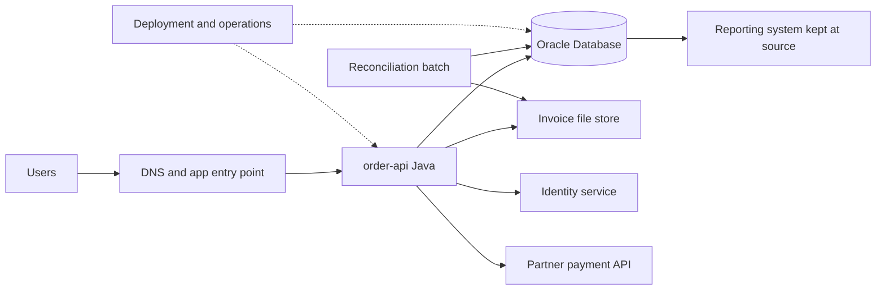

# Dependency Assessment, Sizing, and Cutover Planning

A migration wave to Oracle Cloud Infrastructure (OCI) can only be reliably scheduled when the project team knows three things: what the system depends on, what load the target resources must handle, and how to switch service ownership while keeping data under control. Replicating enough virtual machines solves only part of this work.

In the **Migration and Multicloud** chapter of the **CLOUD_PROVIDERS_ORACLE** module, this lesson moves from current-state assessment to an actionable cutover record. The scope covers applications, Oracle Database, network connectivity, identity, operations, and costs when moving from a data center or another cloud to OCI. Numbers in the examples are hypothetical values for calculation purposes, not Oracle default configurations or pricing.

## 1. Required Outputs Before Scheduling Migration

After this lesson, learners will be able to build dependency maps, calculate initial OCI configurations from measured metrics, group migration waves, and author runbooks with abort, rollback, and acceptance criteria.

A preparation record should have interconnected outputs:

| Output | Decision Covered | Primary Accountable Owner |
| --- | --- | --- |
| Workload inventory | Which components belong to the app, who owns them, which environments are in scope | Application owner and operations |
| Dependency map | Which components must move together, which can be retained | Architect and relevant system owners |
| Baseline and sizing sheet | CPU, RAM, storage, I/O, network needs, load during failures | Operations, DBA, and performance team |
| Target OCI design | Region, compartment, IAM, VCN, Compute, storage, database | OCI platform team |
| Data and cutover plan | Copy method, synchronization, write-blocking, traffic switch, reconciliation | DBA and migration lead |
| Acceptance and rollback record | What defines pass, when to abort, how to recover data | Business owner and go/no-go decision maker |
| Estimate and handover | Operating cost, migration cost, alerts, on-call staff | Finance, operations, and service owner |

The planning unit should be a **workload serving a business capability**, not just a server. An ordering workload might comprise two Java machines, a database, a scheduler, invoice files, service accounts, and connectivity to a payment gateway.

## 2. Finalizing Business Requirements and Cutover Limits

### 2.1. Distinguishing Downtime, RTO, and RPO

- **Allowed cutover downtime** is the outage window the business accepts during the scheduled switchover.
- **RTO** (Recovery Time Objective) is the target time to restore service after an incident, with agreed start and end milestones.
- **RPO** (Recovery Point Objective) is the acceptable data loss target, usually expressed as a time interval.

For example, a system allows stopping writes for at most 30 minutes during the cutover night, sets an incident RTO of 60 minutes, and an incident RPO of 5 minutes. These three values serve three different decisions. A 5-minute RPO also does not permit arbitrarily dropping five minutes of orders during a controlled cutover. The project team can require full reconciliation of every committed transaction prior to closing the source.

State the scope of each target clearly: RTO for a single-instance failure differs from RTO for a region loss; database RPO does not yet cover attachments or unprocessed messages.

### 2.2. Questions Requiring Specific Owners

1. How many users, transactions, and concurrent sessions occur at peak hours?
2. Which processes must not be interrupted, such as payments, ledger closing, or invoice issuance?
3. Are there change freezes, peak seasons, month-end jobs, or partner schedules affecting the migration window?
4. Which data is permitted in the target region? Who approves the data scope used in rehearsals?
5. Which systems must stay at the source, and for how long?
6. Who has authority to abort the cutover, accept results, or trigger rollback?
7. What is the budget limit for steady state and parallel operations duration?

An unconfirmed assumption needs an owner, a confirmation deadline, and the impact if wrong. Example: “Partner allows adding OCI egress IPs before rehearsal; if incomplete, do not enable live payment flows.”

## 3. Evidence-Backed Current-State Assessment

### 3.1. Collecting Application and Infrastructure Inventory

For each asset, record at minimum:

| Information Group | Fields to Collect | Decision Supported |
| --- | --- | --- |
| Identity and ownership | ID, application, environment, business owner, technical owner, criticality | Scope and acceptance signer |
| Compute | Physical or VM, x86/Arm architecture, allocated CPU, RAM, hypervisor | Compatibility and host migration approach |
| Software | OS, kernel, JDK, middleware, native libraries, drivers, agents | Reinstall, upgrade, or keep as-is |
| Data | Engine, version, charset, actual used size, growth, file locations | Target service and movement method |
| Application config | Endpoints, connection pools, sessions, caches, write directories, config variables | Changes before cutover |
| Operations | Batch schedules, backups, restores, deployment, monitoring, logs, on-call | Operational takeover on OCI |
| Commercial | Licenses, vendor support, BYOL terms or license-included options | Feasibility and cost estimate |

“A machine has a 4 TB disk” differs from “data to transfer is 1.2 TB.” Record allocated capacity, used capacity, data actually needing replication, and change generation rate together. Distinguish decimal GB/TB from binary GiB/TiB in all calculations.

Also inventory less visible resources: cron jobs, systemd timers, batch execution accounts, SMTP relays, license servers, NTP, internal DNS, secrets, certificates, database links, and shared directories. A task that runs only on month-end can dictate the entire plan.

### 3.2. Combining Multiple Discovery Sources

Asset management catalogs show declared systems; deployment configs show intent; metrics, logs, and traces show actual behavior. Interviewing application owners explains what tools cannot see, such as manual steps before financial close.

OCI provides **Oracle Cloud Migrations** to discover, organize assets, replicate, and plan launches for workloads within its supported scope. This tool supports VMware and AWS EC2 migration flows per the service's eligibility matrix. The resulting VM inventory does not replace identifying all business relationships across applications. [Overview of Oracle Cloud Migrations](https://docs.oracle.com/en-us/iaas/Content/cloud-migration/cloud-migration-overview.htm)

Before choosing a tool, check source type, CPU architecture, guest OS, disk type, image, and target resources against current support documentation. A VM's ability to boot on OCI is not enough to conclude the application vendor supports that configuration. [Requirements and Specifications for Oracle Cloud Migrations](https://docs.oracle.com/en-us/iaas/Content/cloud-migration/cloud-migration-requirements-specifications.htm)

Each assessment finding should include evidence source, timeframe, update timestamp, and confidence level. For instance, “API calls database over TCP 1521, observed in 14 days of connection logs and confirmed by DBA” is stronger than “probably uses Oracle.” If the observation window does not cover month-end close, note the gap rather than treating log silence as proof of zero dependency.

### 3.3. Quick Inspection on a Linux Machine

The following commands illustrate reading current state on an authorized assessment machine. They create a point-in-time snapshot, not a long-term baseline:

```bash
# Resources and filesystems
lscpu
free -h
lsblk -f
df -hT

# Listening ports and current TCP connections
ss -lntup
ss -ntp state established

# Services and scheduled tasks
systemctl list-units --type=service --state=running
systemctl list-timers --all
crontab -l
```

Some process details require appropriate privileges; `crontab -l` only shows the current user's crontab. Seeing no connection at inspection time does not mean the application never connects. For running systems, prefer existing monitoring data; any added agents or load tests must go through managed change control.

Do not copy passwords, private keys, or tokens into assessment sheets. The record only needs to reference where secrets are managed, the owner, and the provisioning process.

## 4. Mapping Dependencies to Find Co-Migration Groups

### 4.1. Modeling Both Nodes and Edges

Graph nodes can be applications, databases, queues, file shares, identity services, or partners. Edges represent directed relationships with explicit meaning: API call, file read, data write, message send, or authentication.

A dependency table should have at least these columns:

| Source → Target | Protocol and Data Direction | Frequency or Characteristics | Migration Constraint | Evidence and Verifier |
| --- | --- | --- | --- | --- |
| order-api → order-db | TCP 1521; read and write | Many sequential queries per request | RTT-sensitive; prefer co-location | Application trace; DBA |
| order-api → payment-api | HTTPS 443; send request and receive result | Synchronous; has timeout, retry | Egress IP must be on allowlist | Gateway logs; integration owner |
| order-api → invoice-share | NFS; create and read PDF | Per confirmed order | Preserve file permissions and DB consistency | Mount config; operations |
| settlement-job → order-db | SQL; read and update | 01:00 daily | Only one side may run the job | Batch schedule; finance team |
| order-api → identity-provider | HTTPS; authenticate or fetch metadata | Login and token refresh | DNS, certificates, system clock | OIDC config; IAM team |

Beyond ports, record hostnames, name resolution, timeouts, auth mechanisms, access rights, data sensitivity, payload sizes, and behavior when the target fails. Connection initiation direction differs from data exchange direction; this affects firewall and route design.

### 4.2. Classifying by Impact

- **Runtime-critical dependencies:** databases, authentication, or license servers the application needs to operate.
- **Latency-sensitive dependencies:** multiple synchronous calls or sequential queries within one transaction.
- **Data and consistency dependencies:** files, databases, queues, or caches that must jointly reflect a valid business state.
- **Asynchronous dependencies:** queues, ETL, or file exchange; focus on backlog, ordering, and duplicate-processing prevention.
- **Operational dependencies:** CI/CD, DNS, monitoring, backups, secrets management, and admin access.
- **External dependencies:** partners, SaaS, network providers, or other operations teams with independent lead times.

One edge can belong to multiple categories. A payment gateway connection is synchronous, requires source IP allowlisting, and needs idempotency to prevent double-charging on retries.

### 4.3. Dependency Graph Example for an Ordering Application



The arrow `DB → Report` represents a data feed without asserting yet whether reporting connects directly or uses a replica. Clarify the mechanism in the edge table before using the graph to group waves.

If the API and database chat heavily, moving the API to OCI while keeping the database at the source can increase response time even when target CPU is idle. Suppose a request makes 20 sequential round trips and RTT increases by 14 ms:

```text
Approximate added latency = 20 × 14 ms = 280 ms/request
```

This estimates only the communication component, excluding processing time and connection pool effects. For parallel calls or different round-trip counts, re-measure on actual flows.

### 4.4. From Map to Migration Group

Group components tightly coupled by latency or state into a **migration group**, meaning a group moved under a coordinated plan. Cyclic call relationships do not automatically force every system to move simultaneously; look for edges separable via queues, read replicas, API contracts, or tested temporary links.

For example, the “ordering” group might include the API, database, invoice store, and reconciliation batch. The IdP and payment gateway remain in place with pre-provisioned connectivity. Reporting kept at the source receives data through a mechanism with acceptable latency rather than pulling heavy direct queries across the WAN.

For every edge crossing the OCI–source or OCI–other-cloud boundary, plan routes, DNS, auth, encryption, latency, bandwidth, transfer cost, and link-loss behavior. Until a critical edge is proven working, its group is not ready for cutover.

## 5. Establishing a Baseline Before Sizing

### 5.1. Choosing a Representative Measurement Window

Observe full load cycles: weekdays, weekends, backups, batches, marketing campaigns, and period closes if any. You can start with a few weeks, but workload characteristics must dictate the window. A system spiking every quarter must not be sized from a quiet week alone.

Record both the sampling interval and aggregation method. CPU p95 of one-minute samples differs from CPU p95 of hourly averages; overly coarse sampling hides short spikes that increase latency. p95 means 95% of observations do not exceed that value, not that the system never exceeds it. For workloads that cannot tolerate overload during rare spikes, also inspect p99, maximum values, and spike duration.

| Dimension | Metrics to Measure | How to Read to Avoid Mis-Sizing |
| --- | --- | --- |
| CPU | Utilization, run queue, wait time, steal if any, per-process load | Distinguish CPU starvation from I/O wait or lock wait |
| RAM | Working set, RSS, heap/native memory, swap, major page faults | Do not equate allocated RAM with actual required RAM |
| Disk | Read/write IOPS, I/O size, throughput, latency, queue depth | Separate random and sequential workloads |
| Network | Bidirectional traffic, RTT, packet loss, retransmissions, connection count | High bandwidth does not guarantee fast transactions |
| Application | Requests/sec, concurrency, p95/p99 latency, error rate, queue lag | Compare at matching business load and dataset |
| Database | Transactions, resource-heavy SQL, wait events, redo, sessions, memory areas | Identify bottlenecks before adding resources |
| Long-term storage | Capacity, growth, retention, backups, replicas | Account for transition and recovery states |

Do not sum individual machine p95 values and treat that as cluster p95: peaks may occur at different times. To size aggregate load, sum by matching timestamps first, then compute percentiles. Also check for overlapping peaks if backups or batches are rescheduled after migration.

### 5.2. Tying the Baseline to Business Outcomes

Example baseline for `order-api`:

```text
Measurement window: 28 days, including one month-end close
Design peak load: 300 requests/second
p95 latency at that load: 420 ms
Error rate at that load: 0.15%
CPU p95 on 8-vCPU source VM: 60%
Application working set at peak: 24 GB, unit-normalized
Projected load growth in planning horizon: 25%
Projected working set growth: 20%
```

These values only make sense with scope defined: which endpoints, read vs. write mix, payload size, and warm vs. cold cache. Post-migration tests must keep those conditions sufficiently equivalent to evaluate fairly.

## 6. Multi-Dimensional OCI Target Sizing

### 6.1. Normalizing CPU Units and Validating with Benchmarks

Do not copy the source vCPU count directly into the OCI OCPU field. According to OCI documentation, x86 Compute maps 1 OCPU to 2 vCPUs; Arm A1 uses a different mapping, and other Arm families must be verified individually. Flexible shapes allow selecting CPU and RAM within shape limits; network bandwidth and VNIC counts also scale with CPU configuration. [Compute Shapes](https://docs.oracle.com/en-us/iaas/Content/Compute/References/computeshapes.htm)

An initial estimation formula is:

```text
D_source = N_source × U_source

N_target >= D_source × (1 + G) / (U_target × K)

Where:
N_source : normalized source CPU units
U_source : CPU utilization ratio at design load
G        : load growth rate over planning horizon
U_target : maximum desired CPU utilization at design load
K        : processing capacity of one target CPU unit vs. one source unit
N_target : target CPU units in the same reference system
```

`K` must be calibrated using an application benchmark. Assuming `K = 1` only creates a test configuration; it does not prove two CPU generations or architectures are equivalent. With SMT CPUs, single-threaded workloads, encryption, or native libraries, unit conversion requires even tighter validation.

Applying the example numbers:

```text
D_source = 8 × 0.60 = 4.8 source vCPU units
N_target >= 4.8 × 1.25 / (0.60 × 1) = 10 target vCPUs

If choosing x86 Compute with the mapping above:
10 vCPUs = 5 OCPUs for the entire design load in this model
```

Do not multiply by another generic safety factor if `U_target` already includes headroom, unless a specific risk is justified. Growth, utilization target, and fault tolerance are three separate factors and must be shown explicitly to avoid under-counting or double-counting.

### 6.2. Sizing for Single-Node Failure

If using two nodes and requiring full load handling when one node fails, each remaining node must carry the full design load. With the 5-OCPU total load example, the initial test configuration is **two nodes of 5 OCPUs each**, not two nodes of 2.5 OCPUs each.

With `n` identical nodes needing to tolerate `f` failed nodes:

```text
(n - f) × capacity_per_node >= design_load
```

This condition considers compute capacity only. To achieve availability, the application must also handle sessions, health checks, connection pools, cache warm-up, and traffic distribution. An app storing private sessions in RAM might have enough CPU yet still drop user sessions when a node fails.

Distribute nodes across fault domains or availability domains matching the design and region capabilities. Do not assume every region has the same number of availability domains. Databases, file stores, and external links must have matching availability plans; two app VMs do not eliminate single points of failure in those layers.

### 6.3. RAM: Accounting for Non-Heap Memory

For Java, account for heap, metaspace, direct buffers, thread stacks, native libraries, agents, and OS memory. Low CPU does not prove RAM can be reduced.

Illustrative formula with non-overlapping components in consistent units:

```text
Required RAM >=
    [app_working_set × (1 + growth) + OS_and_agents]
    / (1 - RAM_headroom_ratio)

Example:
    [24 × 1.20 + 4] / (1 - 0.20)
    = 41 GB
```

You might test 48 GB RAM per node if the shape and RAM/OCPU ratio allow. Standardize OS measurement units with configuration units before provisioning. Then verify via GC pauses, native memory, page faults, swap, and latency when one node carries full load.

Do not set `-Xmx` to the instance's entire RAM. If the application needs 24 GB total working set, do not misread that as a 24 GB heap and then add all native memory a second time.

### 6.4. Storage: Capacity, IOPS, Throughput, and Latency

A disk with enough capacity does not guarantee enough performance. Separate at least four needs:

1. Currently used data capacity and growth through the design horizon.
2. Read/write IOPS at design load, along with I/O size.
3. Throughput for batches, backups, restores, or data scans.
4. Latency and queue depth acceptable to the application.

Simple relationship between IOPS and throughput:

```text
Approximate throughput = IOPS × I/O_size

8,000 IOPS × 16 KiB = 125 MiB/second
8,000 IOPS × 256 KiB = 2,000 MiB/second
```

At the same 8,000 IOPS, bandwidth demand differs by 16x. Calculate using observed I/O sizes; mixed I/O requires examining the distribution rather than applying one size to all operations.

In OCI Block Volume, actual performance also depends on the volume, performance tier, shape, attachment type, and instance-side limits. Raising volume performance does not resolve bottlenecks in Compute or the filesystem. Check both per-volume and per-instance limits during design. [Block Volume Performance](https://docs.oracle.com/en-us/iaas/Content/Block/Concepts/blockvolumeperformance.htm)

Example: currently used data is 1.2 TB, growing 0.05 TB/month, designed for 12 months while keeping at least 20% free space:

```text
Minimum target capacity = (1.2 + 0.05 × 12) / 0.80 = 2.25 TB
```

After calculating, add items missing from the raw numbers: indexes, temporary space, redo/archive logs, generated files, and maintenance overhead if any. Backups, snapshots, and recovery copies are accounted as separate capacity, retention, and cost lines. Do not assume all of that capacity sits on a single volume.

Also do not replace file shares or block devices with Object Storage merely because per-GB pricing looks attractive. Verify access interfaces, permissions, file locking, rename operations, consistency required by the app, and code modification costs.

### 6.5. Network and Copy Time

Initial raw transfer time can be estimated as:

```text
T_copy = data_to_transfer × 8 / effective_bandwidth
```

With 2 decimal TB and 400 Mbit/second effective bandwidth:

```text
T_copy = 2 × 10^12 × 8 / (400 × 10^6)
       = 40,000 seconds
       ≈ 11.1 hours
```

This excludes snapshots, export/import, verification, retries, and source or target queuing. “Effective” must be measured or grounded after link and protocol limits, not nominal port speed. Once effective bandwidth is used, do not subtract the same overhead a second time.

If the outage window is only 30 minutes, copying all 2 TB during downtime does not fit these assumptions. You need pre-copying, change synchronization, reducing data to transfer, or revising requirements accepted by the business.

For continuous synchronization, also check catch-up capability:

```text
T_catchup ≈ backlog / (apply_rate - generation_rate)
```

If backlog is 60 GB, source generates 20 MB/second, and target applies 50 MB/second (all decimal):

```text
T_catchup ≈ 60,000 / (50 - 20)
          = 2,000 seconds
          ≈ 33.3 minutes
```

Choose a change unit consistently measured by the tool, such as redo stream or CDC stream; do not assume changed bytes in data equal actual bytes transferred. If apply rate does not exceed generation rate, backlog cannot shrink while the source keeps operating. After closing all write paths, generation rate drops toward zero, though you must still verify no batches or integration accounts are writing.

### 6.6. Database Sizing Requires Separate Evaluation

For Oracle Database, also assess version and edition, charset, timezone, active options, schema sizes, LOBs, special objects, database links, directory objects, external tables, scheduler jobs, and dependent services. Record SGA/PGA needs, redo, temporary space, sessions, and critical query patterns.

Deciding between self-managed Compute, Base Database Service, Exadata Database Service, or an Autonomous option must rely on feature compatibility, operational needs, licensing, and availability targets. Do not translate application VM OCPUs straight into database sizing; the target database service may use different resource models and units that need cross-checking.

OCI Database Migration includes an assessment feature to help select methods and check applicability, configuration, or source–target incompatibilities. Results must match the actual source–target pair rather than being extrapolated from another successful migration. [Assessment in OCI Database Migration](https://docs.oracle.com/en-us/iaas/database-migration/doc/create-assessments.html)

For Oracle Database performance metrics, use only diagnostic reports and features within permitted licensing scope. Benchmarks must include write transactions, batches, backups, and recovery behavior, rather than measuring only a simple read query.

## 7. Turning Assessment Results into an OCI Design

The target design must answer where resources live, who can operate them, how data travels, and who detects incidents:

| Decision | Details to Lock Before Rehearsal |
| --- | --- |
| Tenancy and compartments | Where production, network resources, and temporary migration resources reside; owners and cost tags |
| IAM | Permissions for deployers, migration services, and workloads; compartment scope; secret issuance and revocation |
| Region and provisioning capacity | Available services, data residency needs, limits, quotas, actual allocatable capacity |
| VCN | Non-overlapping CIDR ranges, subnets, routes, NSGs/security lists, DNS, and source links |
| Compute | Shape, architecture, image, node count, placement, bootstrap, and resize strategy |
| Storage and database | Data model, performance, encryption, backup, restore, and failure plan |
| Monitoring | App metrics, logs, database, alerts, dashboards, and on-call alert recipients |
| Automation | Terraform/Resource Manager or equivalent, environment variables, app config, and cleanup schedule |

Compartments scope resource organization and authorization; connectivity design still requires VCNs, routes, and network rules. An IAM policy allowing metadata reads does not create a TCP path to the database, and opening a port does not grant login privileges.

Check CIDRs across source, OCI, and other clouds from the start. Overlapping ranges complicate routing or force re-addressing. Check outbound and inbound paths, private DNS, partner-visible source IPs, and certificate issuance for new names.

If using FastConnect, separately define link encryption requirements and how they are met; do not infer traffic is already encrypted solely from the private connection nature. [FastConnect FAQ](https://www.oracle.com/cloud/networking/fastconnect/faq/)

Sufficient limits and quotas do not guarantee every shape is immediately allocatable in the desired placement. Test resource provisioning early or prepare capacity alternatives before locking the cutover date. Do not wait until cutover night to discover an incompatible image or unavailable shape.

## 8. Choosing Migration Methods Based on Measured Constraints

### 8.1. Separating Application Strategy from Data Movement Mechanism

Components within the same workload can use different approaches:

| Approach | When It May Fit | Work to Include in the Plan |
| --- | --- | --- |
| Temporary retain | Hardware, data residency, or contract constraints exist | Cross-environment connectivity, operator, review deadline |
| Retire | No remaining users or replaced by another system | Business confirmation, data archival, dependency termination |
| Rehost | Need to preserve most structure and minimize app changes | VM compatibility, drivers, network, licensing, and post-move ops |
| Replatform | Want managed services and accept config or partial app edits | Feature compatibility, testing, data, and ops responsibility shifts |
| Refactor | Need architectural changes to address long-term limits | Dev scope, timeline, testing, and team capability |

For example, the API can be redeployed from a pipeline onto OCI Compute, the database moved via a suitable data migration flow, and reporting kept at the source. There is no requirement for every component to go through a single tool.

Switching x86 to Arm requires verifying the JDK, container images, JNI, agents, native libraries, and commercial software. Portable Java bytecode does not guarantee the entire runtime environment is compatible. Image replication mechanisms also do not turn x86 executables into Arm executables.

### 8.2. Choosing Offline or Online for Data

| Option | Key Conditions | Risks to Mitigate |
| --- | --- | --- |
| Offline: stop app then copy/export/import/restore | Measured total time fits window; method compatible | Slow transfer, slow restore, missed remaining write paths at source |
| Online: initial load then sync changes | Source–target and objects supported; sufficient rights, bandwidth, apply rate | Backlog, unsynced objects, DDL, ordering, and open transactions |
| VM replication | Source, OS, disk, and architecture within tool scope | Application consistency and multi-VM coordination |
| Fresh app deployment then state switch | Pipeline recreates environment; config and data managed separately | Missing hidden configs, secrets, or files written on old host |

For supported cases, online database migration typically involves an initial load followed by applying ongoing changes; offline requires scheduling an appropriate outage. Match the specific flow and source–target conditions rather than treating “online” as a zero-downtime guarantee. [Oracle Database Migration Methods](https://www.oracle.com/database/cloud-migration/)

Snapshotting one VM does not prove the database, invoice files, and messages for the entire workload share the same business checkpoint. The plan must specify checkpoint creation, in-flight transaction handling, final delta sync, and cross-store state validation.

For files, the final copy must preserve permissions and metadata required by the app. For queues, decide whether to drain beforehand, migrate backlog, or keep using the source queue during transition. For caches, know whether they can be fully rebuilt or hold unpersisted business data.

## 9. Grouping Migration Waves and Organizing the Critical Path

A **migration wave** is an execution batch of one or more qualified groups. Do not split evenly by VM count if doing so cuts across data or latency constraints.

Example sequence:

| Wave | Scope | Exit Criteria to Advance |
| --- | --- | --- |
| Foundation | IAM, compartments, VCN, source link, DNS, logging, budgets | Permissions, connectivity, and alerts verified |
| Pilot | Copy of a representative workload in a test environment | Method, performance, and recovery proven |
| Non-production | Integration and staging environments of workloads | Reproducible pipeline, full dependencies, passing runbook rehearsal |
| Production | Tightly coupled application and data groups | Sync ready, go/no-go passed, decision makers present |
| Transition completion | Retained reporting, temporary links, source resources | Ops acceptance and source retirement conditions met |

A pilot should share production traits like database, integrations, and data size while keeping business impact controlled. Booting an empty VM only tests a fraction of infrastructure.

Document the critical path: network link provisioning lead time, limit increases, license provisioning, partner allowlist updates, bulk data copying, and recovery drills. These items often govern the cutover date more than Compute instance creation time.

For prolonged multicloud setups, set review dates for temporary links. If the app sits in OCI while the database stays at the source, establish a cross-environment operating design with dedicated SLOs, alerts, and budgets; do not let a transitional state become permanent architecture unapproved.

## 10. Example Record for the Ordering Workload

### 10.1. Finalized Decisions

Suppose the workload has an 8-vCPU source app VM, 24 GB working set, Oracle Database with 1.2 TB data, and invoice files on NFS. Load is projected to grow 25%; max write stop during cutover is 30 minutes. Incident targets are 60-minute RTO and 5-minute RPO within the scope approved by the service owner.

| Item | Design or Test Requirement | Basis |
| --- | --- | --- |
| App tier | Two x86 Compute nodes, each tested with 5 OCPUs and 48 GB RAM | Sizing formula and single-node loss tolerance |
| Load balancing | Service-capability health checks; verify sessions and draining | Two nodes only help if traffic shifts properly |
| Database | Select service after assessment; re-measure CPU, memory, I/O, backup, recovery | Insufficient evidence to lock config from capacity alone |
| DB data capacity | 2.25 TB starting point per growth, plus uncounted items | Current demand, 12-month growth, and free-space ratio |
| Invoice files | Keep compatible file interface in wave 1; final sync when writes close | Relationship between order records and files |
| IdP and payments | Keep old location; test DNS/TLS and allowlists from OCI | External dependencies needed immediately |
| Reporting | Keep at source; feed data via chosen and tested mechanism | Avoid chatty queries across WAN |
| Write state | Only one system permitted to write in each phase | Prevent split-brain data and duplicate batches |

The “database config not yet locked” item is a mandatory pre-production task, not an item to skip. The sizing sheet can record confidence levels and benchmark results to distinguish proposed configurations from proven ones.

### 10.2. Measurable Acceptance Thresholds

Example thresholds approved by the business owner for this workload:

- Serve 375 requests/second matching the projected transaction mix, p95 latency ≤ 500 ms, and error rate ≤ 0.5% over the agreed measurement window.
- When one application node stops serving, the remaining node still meets approved load and latency thresholds; do not merely check that the process is running.
- After closing source writes, every committed source transaction reconciles with the target up to the final checkpoint; zero unexplained discrepancies remain.
- Test orders create records, invoice files, and related notifications; retries do not create duplicate orders or charges.
- Alerts reach the right on-call staff; backups are taken and restore tests prove recovery within the required scope.
- Time to close writes, switch over, and reopen service fits within the rehearsal-measured window.

These are thresholds for this example, not universal standards. Criteria must specify load, measurement interval, calculation method, and approver.

## 11. Authoring a Cutover Runbook with Decision Points

### 11.1. Before the Cutover Window

The runbook needs step IDs, executor, verifier, max duration, inputs, actions, output evidence, and failure branches. Minimum preparation:

1. Close critical blockers: network, IAM, images, licenses, resource provisioning capacity, and database compatibility.
2. Create target environment from reproducible config; deploy tested application version.
3. Complete initial data load and prove synchronization catches up under real load.
4. Verify backups and restore capability; identify the recovery checkpoint.
5. Rehearse both the success path and rollback branch, recording actual timings.
6. Prepare DNS or load balancer changes, certificates, IP allowlists, and callback paths.
7. Confirm schedule to stop batches, consumers, schedulers, write APIs, and integration accounts.
8. Define coordination channel, decision maker, latest decision deadline, and reporting data.

If changing DNS, lower TTL early enough so old records have a chance to expire. TTL does not guarantee every client switches immediately: app caches, connection pools, resolvers, and partners can delay convergence. Rehearse handling traffic still hitting the old entry point; it must reject writes or forward safely by design.

### 11.2. Illustrative Sequence in a 30-Minute Window

The table below is a time budget requiring rehearsal proof. The pre-write-open rollback branch takes up to 12 minutes, making minute 18 the latest decision point:

| Elapsed Since Closing Writes | Action | Condition to Proceed |
| --- | --- | --- |
| 0–4 min | Block new write requests, drain transactions, stop related batches and consumers | Verify all write sources are closed |
| 4–10 min | Sync final changes, record checkpoint, check replication errors | Target reaches required checkpoint; zero relevant backlog |
| 10–16 min | Reconcile data, verify files, confirm target app configuration | No material discrepancy; connectivity checks pass |
| 16–18 min | Authorized person makes go/no-go decision | Enough time left for the chosen branch |
| 18–24 min if go | Keep source write-blocked, switch entry point, open writes on OCI in controlled manner | Only target accepts writes; sample business transactions pass |
| 24–30 min if go | Ramp traffic per plan, monitor errors, latency, and reconciliation | Service meets initial acceptance criteria |
| 18–30 min if no-go before target writes | Abort cutover, restore service at source per runbook | Target has no new business writes; source returns consistent |

Before running write-based business test transactions on OCI, record the write-authority switch timestamp. A test transaction on production data is still new data that must be preserved if rolling back. Pre-go checks should use read operations or isolated test data with understood impact.

Never run schedulers concurrently at source and target. Source write-blocking must cover users, jobs, integration accounts, and direct access paths. Simply switching DNS while leaving the source database accepting writes can create two divergent datasets.

### 11.3. Two Distinct Rollback Scenarios

**Before target accepts business writes:** if the source remains the authoritative dataset, all writes were properly stopped, and the target has generated no new state, the source can be reopened via the rehearsed branch. Hanging requests, queued messages, and executed config changes still need handling.

**After target accepts business writes:** immediately routing traffic back to the old source risks losing newly created orders, payments, or files. At this point, you need a pre-built mechanism: supported and tested reverse synchronization, controlled reconciliation/transfer of new data, or roll-forward recovery on OCI. Never enable concurrent writes on both sides to “keep service running.”

Decision makers must know whether post-write-open options meet approved recovery targets. If there is no viable data rollback path within the allowed time, treat opening target writes as an explicit point of no return—crossed only after all corresponding conditions pass.

### 11.4. Sample Go/No-Go Rules

Do not open writes at the target if any of these conditions hold:

- Not all write paths at the source are confirmed blocked.
- Replication failed, checkpoint not reached, or material data discrepancies remain unexplained.
- Connectivity to IdP, database, files, or payment partner is not working.
- Load test failed thresholds, alerts did not reach on-call staff, or an authorized decision maker is absent.
- Remaining time is insufficient for the rehearsed handling branch.

Thresholds must be verifiable with evidence such as checkpoints, reconciliation results, transaction logs, and timestamps. “Looks fine” is not a go condition.

## 12. Controlling Costs and Resources During Transition

Separate estimates into three phases: preparation, parallel run, and steady-state operations. Counting only the post-retirement bill leaves the project underfunded for its most resource-intensive phase.

```text
Migration cost =
    source resources while still retained
  + target resources
  + replication and rehearsal resources
  + temporary storage, backups, and replicas
  + network connectivity, data transfer, and partner services
  + licenses, support, and operations labor
```

Oracle Cloud Migrations may use temporary resources like Compute for hydration, Object Storage, and Block Volume; include these billable resources in the estimate. Do not assume zero orchestration service fee means the entire migration incurs no charges. [Tenancy Resources Used in Oracle Cloud Migrations](https://docs.oracle.com/en-us/iaas/Content/cloud-migration/cloud-migration-overview.htm)

For multicloud, include traffic-generating sides and link contracts; apply actual unit rates for each transfer direction and service. Estimates need a reference date and assumptions on data volume, parallel run duration, and rehearsal count. Avoid quoting a fixed figure without underlying unit rates and volumes.

OCI Budgets supports soft limits and spending alerts; it does not automatically stop resources from continuing to incur charges. Control plans must combine alerts, assigned owners, tags, appropriate quotas, and an approved resource cleanup schedule. [Budgets](https://docs.oracle.com/en-us/iaas/Content/Billing/Concepts/budgetsoverview.htm)

While keeping the source for rollback, continue maintaining access controls, backups, security, and on-call coverage. “Traffic switched” does not mean the source can be left unmanaged.

## 13. Post-Cutover Monitoring and Source Retirement Conditions

Establish a hypercare monitoring phase with application owners, DBAs, networking, and operations. Track baseline metrics: requests/sec, p95/p99 latency, errors, GC, database waits, I/O latency, replication/reporting lag, and costs. Compare under equivalent load; a low-traffic day does not prove sizing succeeded.

Reconcile data across multiple layers:

- Technical integrity: required objects, import/replication errors, constraints, and checkpoints.
- Business counts and values: order counts, period totals, payment statuses, unique business keys.
- Cross-store relationships: records have matching invoice files; messages are neither dropped nor duplicated.
- Integration flows: partner callbacks, reports, and batches continue on schedule.

Comparing row counts alone can miss corrupted contents or offsetting errors. If using data checksums, define scope and method so both sides produce comparable results while avoiding overload during service hours.

Retire the source only after meeting plan conditions: business owner sign-off, rollback retention window expired, target backups/restores passing, no unresolved dependencies, and required archival data stored per policy. Then revoke credentials, remove temporary routes/allowlists, clean up migration resources, and update operational records. Data deletion or resource termination steps must strictly follow the approved migration scope.

## 14. Readiness Checklist Before Locking Production Schedule

| Check Question | Required Evidence |
| --- | --- |
| Are all components and owners known? | Timestamped inventory with confirmed scope |
| Does every critical edge have a plan? | Map, edge table, and cross-environment test results |
| Is sizing grounded and fault-tolerant as chosen? | Baseline, formula, benchmark, and node-loss test |
| Can OCI provision resources with right permissions and network? | Test provisioning results, IAM, route, DNS, and link checks |
| Can data copy and catch up within required time? | Initial load measurements, apply rate, backlog, and final sync drill |
| Is the data correctness proof agreed? | Checkpoints, reconciliation criteria, and acceptance signer |
| When to abort and who decides? | No-go thresholds, latest decision point, RACI/responsibility list |
| Does rollback preserve new writes? | Separate pre/post-write-open runbooks and rehearsal results |
| Who operates post-move and which budget pays? | On-call roster, alerts, backup/restore, estimate, and source retention limit |

An item without evidence must become an action item with an accountable owner and due date. Production schedules are reliable only when assumptions capable of breaking cutover have been verified or accepted by authorized stakeholders with a mitigation plan.
