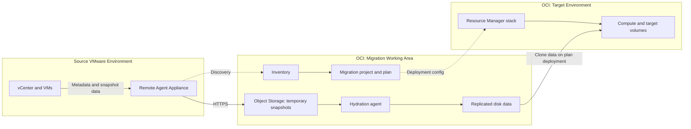

# Oracle Cloud Migrations and Virtual Machine Migration

Migrating a virtual machine to Oracle Cloud Infrastructure (OCI) involves more than copying disks. The target machine must boot, reach its required dependent services, preserve data integrity, and accept traffic within the agreed outage window. In the **Migration and Multicloud** chapter of the `CLOUD_PROVIDERS_ORACLE` module, this lesson guides you through organizing that process with Oracle Cloud Migrations (OCM).

After this lesson, learners will be able to distinguish OCM components; prepare tenancy, compartments, IAM, VCN, and storage; run a migration wave with a test run; and plan cutover, rollback, and operational handover. The end-to-end example uses a Java application on VMware, followed by highlighting differences when the source is AWS EC2.

## 1. Choosing the Right Migration Scope

OCM supports discovery, planning, data replication, and VM deployment onto OCI Compute. The two sources used in this lesson are VMware vSphere and AWS EC2 using EBS. For VMware, an appliance deployed at the source participates in the migration; for AWS, discovery uses a service connection. [OCM Overview](https://docs.oracle.com/en-us/iaas/Content/cloud-migration/cloud-migration-overview.htm).

You must check source platform version, guest OS, CPU architecture, and target shape **together**. The ability to migrate a VM does not guarantee every disk layout, driver, or application inside the VM is compatible. Support lists can change; do not assume Hyper-V, every physical server, or every VM type follows the exact same OCM workflow. [Supported platforms, OS, and shapes matrix](https://docs.oracle.com/en-us/iaas/Content/cloud-migration/cloud-migration-requirements-specifications.htm).

For the application, the primary approach in this lesson is **rehost**: moving the VM's OS, software, and data to new Compute infrastructure, then adjusting necessary configurations. OCM does not automatically turn a Java application into containers, change its deployment model, or turn a self-managed Oracle Database inside a VM into a managed database service.

For example, a VM running Java connected to an Oracle Database presents three options requiring separate decisions:

| Option | What Actually Changes | What Needs Resolving |
| --- | --- | --- |
| Move the app VM, keep database at source | Where the app runs and the network path to the database | Latency, private connectivity, DNS, and inter-cloud traffic |
| Move both the app VM and the database VM | Where both tiers run; database remains self-managed | Stop/start ordering and data consistency |
| Move the app while changing the database service | Both app infrastructure and data platform | A separate database migration plan with compatibility checks |

This lesson implements the first option in the hands-on example. If moving the database as well, a data plan owned by the database administrator must be added.

## 2. Components and Data Paths

### 2.1. Reading Console Objects Correctly

| Object | Meaning |
| --- | --- |
| Source environment | Source environment represented in OCI |
| Asset source | Connection details used for source discovery |
| Inventory asset | Record describing a discovered resource |
| Migration asset | Resource selected for migration |
| Migration project | Group of resources and migration plans |
| Migration plan | Mapping to target resource configurations |
| Target asset | Deployment configuration for one target resource |

Inventory is metadata, not a VM already running on OCI. Successful discovery also does not mean data has been transferred. [OCM Terminology](https://docs.oracle.com/en-us/iaas/Content/cloud-migration/cloud-migration-overview.htm).

### 2.2. VMware-to-OCI Compute Flow



In the VMware flow, replication uses source snapshots, stages data temporarily in Object Storage, and then the hydration agent writes data to Block Volumes. Incremental replication requires VMware Changed Block Tracking (CBT) and a common baseline snapshot. [VM replication mechanism](https://docs.oracle.com/en-us/iaas/Content/cloud-migration/cloud-migration-understand-vm-replication.htm).

The diagram illustrates responsibilities and data flows, not a complete firewall rule list. The network path for copying the VM and the path for the post-migration app to access the database are two requirements that must be designed separately.

### 2.3. Application-Level Checks

Data in RAM, open TCP sessions, and in-flight process state do not become continuous active sessions on the new VM. Design client retries, connection draining, transaction completion, and service restarts based on application behavior.

With multiple related VMs, each VM having a snapshot does not prove the entire system has a shared point of consistency. For instance, an app disk image at 10:00 and a database disk image at 10:03 may not form a valid recoverable state. Operators must define which data is authoritative, how writes are stopped, and what consistency evidence is required before opening service at the target.

## 3. Preparing OCI Before Connecting Source Machines

### 3.1. Separating Temporary Resources from Target Workloads

A manageable structure includes:

| Compartment | Purpose |
| --- | --- |
| `Migration` | OCM objects, temporary replication and hydration resources |
| `Migration_secrets` | Vault and secrets for source connectivity |
| `Destination` | Target instances and post-migration operational resources |

OCM resources should reside in the working compartment created or reused by the prerequisite stack. Permissions for Compute and networking in the target compartment must be configured when the target sits separately. OCM also uses the `CloudMigrations` defined tag namespace with keys `SourceEnvironmentType`, `SourceEnvironmentId`, `SourceAssetId`, `MigrationProject`, `ServiceUse`. [Preparation prerequisites and compartment separation](https://docs.oracle.com/en-us/iaas/Content/cloud-migration/cloud-migration-get-started.htm).

Add business tags such as owner, migration wave, and expiration date for project-managed resources. Do not delete or replace tags required by OCM merely to standardize naming by internal habit.

### 3.2. Preparing the Prerequisite Stack and IAM Permissions

On the Cloud Migrations Overview page, run the prerequisite deployment flow via OCI Resource Manager. Review the configuration and Terraform plan before applying; verify compartments, enabled source types, and permissions to be created. When the Console indicates prerequisites need updating, apply updates before the migration wave. [Deploying prerequisites for OCM](https://docs.oracle.com/en-us/iaas/Content/cloud-migration/cloud-migration-deploy-overview.htm).

IAM must serve both human operators and service components. A user group having Console access does not mean the remote agent, discovery plugin, replication plugin, or hydration agent has sufficient permissions. Use official policy templates and scope them to appropriate compartments, buckets, and secrets. Do not replace service policy sets with one broad permission statement and consider configuration complete. [OCM service policies and dynamic groups](https://docs.oracle.com/en-us/iaas/Content/cloud-migration/cloud-migration-servicepolicies.htm).

A helpful permission checklist for implementers:

| Principal | Question to Verify |
| --- | --- |
| Prerequisite administrator | Can create or update the required IAM resources and stacks? |
| Migration operator | Has rights to manage projects, plans, and monitor tasks within assigned scope? |
| Source discovery component | Can read connection details and secrets for the right source? |
| Replication component | Can take snapshots, read source data, and use the staging location? |
| Target deployment component | Has rights to the exact Compute, volumes, VCN, and subnets needed? |

This table is a responsibility analysis tool, not a policy set to copy and deploy. If discovery succeeds but replication fails, inspect the principal whose action was denied rather than repeatedly escalating privileges for the Console-logged-in user.

### 3.3. Managing Source Credentials

Store source credentials as secrets in OCI Vault; grant read access only to the exact components using those secrets. Discovery and replication credentials can be separated. Migration credentials should have least privilege and be revoked after completion. [How OCM uses source credentials](https://docs.oracle.com/en-us/iaas/Content/cloud-migration/cloud-migration-providing-external-source-environment-credentials.htm).

In the deployment record, document the secret OCID and rotation owner—never passwords or access keys. Never place credentials in tags, resource names, screenshots, Git, or shared guide content.

### 3.4. Checking Capacity and Target Infrastructure

List resources that must coexist during the test run: source VMs, source appliance, hydration agent, staging data, replicated volumes, and test VMs. Then verify service limits, compartment quotas, and actual provisioning capacity in the chosen region/availability domain.

Reserve separate capacity for the hydration agent instead of exhausting CPU/RAM quotas on final VMs. Also check network and storage limits; a replication job may require temporary resources beyond the expected VM count. Granted limits and actual shape capacity at runtime are two different conditions.

Pre-select subnets, routes, NSGs or security lists, management paths, and how boot errors will be observed. The target must reach DNS, time sync, package repositories, or operational endpoints per organizational policy. Factor these dependencies into the plan rather than waiting until SSH fails to add them.

## 4. Assessing VMs and Grouping Waves by Dependencies

### 4.1. Minimum Profile per VM

Collect OS- and application-level profiles alongside discovery tool metadata:

| Group | Data to Record |
| --- | --- |
| Identity | Source ID, hostname, owner, environment, and criticality |
| Operating system | Version, CPU architecture, boot firmware, kernel, and storage/network drivers |
| Disks | Boot/data disks, capacity, actual used data, filesystems, and mounts |
| Performance | CPU/RAM over typical load cycles, IOPS, throughput, and latency |
| Connectivity | DNS, static IPs, inbound/outbound ports, databases, queues, shared folders |
| Data | Location of persistent data, rate of change generation, how to stop writes |
| Automation | Cron, systemd timers, app schedulers, consumers, and backup agents |
| Operations | Login method, monitoring, logs, backups, acceptance owner, and rollback |

Check disk paths in `/etc/fstab`, hard-coded IP configs, hostnames, proxies, certificates, allowlists, and hardware-dependent software. A VM booting does not prove those configurations are suitable for OCI.

For Windows or commercial software, confirm licensing and support options for the exact target configuration before running production. License options appearing in the Console do not replace checking applicable terms. For EC2 sources, do not assume data on instance store is covered by the EBS migration flow.

### 4.2. Example Java Application to Migrate

Suppose VM `orders-app-01` runs Java, with a separate Oracle Database and a directory storing exported report files:

```text
Users -> orders endpoint -> Java API
                            |-> Oracle Database
                            |-> token issuing server
                            |-> report file store
                            |-> email sending service

Java scheduler -> read orders -> generate reports -> send email
```

A plain VM list would miss the scheduler, email, and file store. If the test instance still connects to the production database, the scheduler could send duplicate emails even with zero users accessing the test machine.

Therefore, define a **migration wave** by the dependency set that can move and be accepted together. In this example, wave 1 moves the application VM; the database at the source is intentionally retained. Connections from OCI to the database, token service, and file store must be verified before cutover. If network latency causes transactions to miss targets, adjust wave scope or redesign data-tier placement.

### 4.3. Selecting Target Configuration Based on Representative Load

OCM provides recommendation strategies such as As is, Average, Peak, or Percentile. These help pick CPU/RAM and compare options; percentile selection requires the appropriate metric type. The metric window must cover the load behavior being evaluated. [Sizing strategies and cost estimates](https://docs.oracle.com/en-us/iaas/Content/cloud-migration/cloud-migration-understanding-migration-strategies-cost-estimates.htm).

For Java, inspect heap, off-heap memory, GC, thread counts, connection pools, and database latency. Do not cut RAM simply because current heap is small; also do not map source machines to new shapes assuming every vCPU/OCPU number carries identical performance.

In the example, test at least order read, order creation, and report export transactions under representative load. Agree on acceptable latency and error rates before comparing results; looking only at CPU can misjudge a target starved for disk performance or penalized by extra database round trips as passing.

## 5. Preparing Source VMware Connectivity

### 5.1. Required Network Paths

The Remote Agent Appliance must resolve OCI names as well as vCenter/ESXi FQDNs and synchronize time. Key paths include HTTPS to OCI and vCenter, VMware host access on default ports, plus the appliance management path. Discovery may succeed while replication still lacks connectivity to hosts. [Appliance network requirements](https://docs.oracle.com/en-us/iaas/Content/cloud-migration/cloud-migration-remote-agent-appliance.htm).

The table below lists key points for the VMware-to-OCI flow; verify against the official port table before configuring firewalls:

| Connection Path | Port/Service | Purpose |
| --- | --- | --- |
| Admin machine to appliance | TCP 3000 | Registration, supported administration |
| Appliance to OCI and vCenter | TCP 443 | HTTPS/API |
| Appliance to ESXi | Default VMware ports, including 902 per official requirements | Access for replication |
| Appliance to network infrastructure | DNS 53, NTP 123; DHCP if used | Name resolution, time, addressing |

Allow only necessary admin machines to access the registration port. Design outbound rules per endpoint and organizational policy; do not expose the appliance publicly just to bypass connectivity errors.

The HTTPS path used for migration does not automatically create private connectivity from OCI applications back to an on-premises database. If the target workload still depends on the source, deploy appropriate network connectivity and verify non-overlapping CIDRs, bidirectional routes, DNS, and actual latency.

### 5.2. Installing and Registering the Remote Agent Appliance

In Remote Connections, create or select a source environment in the right compartment and region. Download the appliance VM from the Console, deploy the OVA file into vSphere, and configure networking. Choose one or two network adapters matching paths to VMware and OCI; power on the VM and verify network details. [Appliance installation guide](https://docs.oracle.com/en-us/iaas/Content/cloud-migration/cloud-migration-install-remote-agent-appliance.htm).

Next, use Register agent in the source environment to link the appliance with OCI. The admin machine must reach the appliance address. Complete verification, wait for the agent to show Active state and Healthy heartbeat, then begin discovery. [Registering the Remote Agent Appliance](https://docs.oracle.com/en-us/iaas/Content/cloud-migration/cloud-migration-register-remote-agent-appliance.htm).

Create dedicated vCenter credentials for migration work. Discovery and replication accounts have different goals: reading config does not imply creating/deleting snapshots or reading disk data. Test permissions on the exact VM/folder scope instead of using a full vCenter admin account to bypass permission errors.

After registration, record the source environment, agent, credential secret, and corresponding source resources in the deployment record. Looking in the wrong region or compartment in the Console can mislead operators into thinking the agent does not exist and creating redundant resources.

## 6. Discovery, Projects, and Replication

### 6.1. Discovering and Reconciling Inventory

Create an asset source with vCenter details and secret reference, then run discovery. Compare results against the surveyed VM profile: matching identity, all disks present, right OS, and metrics needed for sizing. If using a discovery schedule, note the last update time to know what point in time the inventory reflects.

If a VM is missing from inventory, check permission scope, connection details, and agent status before picking another machine with a similar name. Do not use display names as unique identifiers in environments with multiple vCenters or cloned VMs.

### 6.2. Creating Projects by Wave

Create a migration project for the group of machines scheduled to cut over together; you can use the wizard to create the project along with an initial plan and replication schedule. Use clear naming to distinguish tests, migration waves, and target environments. [Creating a migration project](https://docs.oracle.com/en-us/iaas/Content/cloud-migration/cloud-migration-create-migration-project.htm).

Add verified inventory assets to the project. Lock the replication compartment, bucket, and availability domain per the OCI Compute migration flow. An asset attached to another project cannot be arbitrarily re-added; the replication compartment and bucket also cannot be arbitrarily changed after creating the migration asset. [Adding migration assets and configuring replication location](https://docs.oracle.com/en-us/iaas/Content/cloud-migration/cloud-migration-add-assets.htm).

Evidence to store at this stage includes source ID list, corresponding migration assets, disks to move, and acceptance owner. If a data disk holding report files is missing, successful boot volume replication still fails wave objectives.

### 6.3. Running the Initial Copy and Update Cycles

Organize replication into three operational milestones:

1. **Initial copy:** transfers the bulk data volume; measure actual duration and impact on the source.
2. **Update cycles:** track delta volume, completion time, and replica freshness.
3. **Final cycle:** executed after stopping writes and shutting down the source per the approved cutover plan.

Do not infer data freshness solely from a “scheduled” label. Check whether actual jobs succeeded, which source data timestamp that run represents, disks covered, and remaining errors. A 15-minute schedule can fall hours behind if jobs drag on or repeatedly fail.

Monitor snapshots and source datastore capacity during replication. Resolve errors using service and source-platform procedures; avoid manually deleting snapshots used as replication baselines as this can break incremental continuation.

## 7. Estimating Time, RPO, and Cutover Window

### 7.1. Distinguishing Quantities

- **RPO:** maximum acceptable data loss, usually expressed in time. Must be evaluated against recoverable data points and actual consistency.
- **RTO:** target time to restore service after an outage. This is the target for the overall recovery process.
- **Cutover downtime:** duration the service is unavailable to users during a planned switch.
- **Replication time:** one component of the deployment schedule, not identical to downtime or RTO.

For a controlled cutover, you may set a goal of preserving all committed transactions before write lock. Claiming that goal was met requires a successful final replication and data verification, not merely pointing to replication schedule frequency.

### 7.2. Transfer Time Calculation Example

The self-contained example below uses binary units and end-to-end measured throughput:

```text
Data to transfer D                   = 600 GiB
Effective throughput B               = 50 MiB/s
Average data change rate C           = 8 MiB/s

Ideal initial transfer time
    = D / B
    = 600 × 1024 / 50 seconds
    = 12,288 seconds, approximately 3.41 hours
```

This estimates data transfer only, excluding snapshot creation, disk processing, resource waits, retries, or hydration. Do not take total provisioned disk capacity as guaranteed bytes to transfer; use measurements from the pilot wave.

For backlog to shrink, effective processing speed over a sustained period must exceed change generation rate. In the example, `C < B` is a favorable sign but does not prove the migration will finish on time. Load can spike; source, network, and target can take turns becoming bottlenecks.

Suppose at write lock 10 GiB remain to transfer in the final cycle:

```text
T_final_transfer = 10 × 1024 / 50 seconds ≈ 3.4 minutes

Projected outage budget:
    Drain, stop writes, and shut down VM  2.0 minutes
    Final replication                     3.4 minutes
    Deploy and boot target                5.0 minutes
    Mandatory checks                      5.0 minutes
    Switch endpoints                      2.0 minutes
    Buffer                                5.0 minutes
    Total                                22.4 minutes
```

If only 20 minutes of outage are allowed, the plan **does not meet requirements**. Re-measure, shorten optimizable steps, reduce pre-cutover delta, or agree on a different window. Do not drop data checks or remove the buffer just to make numbers look compliant.

## 8. Building Migration Plans and Running Isolated Tests

### 8.1. Separating Test Plans from Production Plans

Use separate plans to test configurations, costs, or environments. Test plans should place VMs in an isolated network to avoid conflicting with live systems. A single project can hold multiple plans for these purposes. [Managing migration plans](https://docs.oracle.com/en-us/iaas/Content/cloud-migration/cloud-migration-manage-migration-plans.htm).

Suggested configuration matrix for the example:

| Attribute | Test Plan | Production Plan |
| --- | --- | --- |
| Deployment location | Compartment/subnet dedicated to testing | Prepared operational compartment/subnet |
| Published endpoint | Internal name for testers | Official service endpoint |
| Database connection | Test database or controlled access path | Database selected as authoritative source |
| Schedulers and consumers | Blocked before workload startup | Enabled in cutover sequence |
| Email, payments, webhooks | Stub or sandbox environment | Confirmed production endpoints |
| Lifespan | Assigned reclamation date | Per operational policy |

Isolation must exist **before the first boot**. If the source VM auto-starts services on boot, block side-effect egress paths at the network layer, then adjust config inside the isolated environment. Changing the hostname after the VM has already sent emails or picked up jobs is too late.

### 8.2. Verifying Target Assets

Cross-check target compartment, shape, CPU/RAM, capacity type, VCN/subnet, public IP, and volume performance for every machine. Check these attributes at the target asset level, especially when overrides differ from plan defaults. [Configuring target assets](https://docs.oracle.com/en-us/iaas/Content/cloud-migration/cloud-migration-configure-target-asset.htm).

For the Java machine in the example, choose a target without a public IP if access via load balancer or private management channel meets requirements. This is an architectural choice for the example, not a mandatory rule for all OCM migrations.

Do not pick preemptible/reclaimable capacity solely for low price on workloads needing continuous uptime. If using capacity reservations or dedicated hosts, confirm resources and suitability for operational goals upfront.

### 8.3. Generating and Deploying the Resource Manager Stack

Once required data has replicated successfully and the plan is verified, choose **Generate RMS stack**. OCM creates a Resource Manager stack from the plan; stack generation and resource deployment should be kept distinct. [Generating a stack from a migration plan](https://docs.oracle.com/en-us/iaas/Content/cloud-migration/cloud-migration-estimate-cost-execute-migration-plan.htm).

Review the Terraform plan, confirm planned resources, networking, and disks, then deploy the stack via the Resource Manager workflow. Monitor the job, then use **Created resources** to inspect actual instances and volumes. [Deploying a migration plan stack](https://docs.oracle.com/en-us/iaas/Content/cloud-migration/cloud-migration-deploy-rms-console.htm).

A test VM is a point-in-time deployment. Do not assume this VM automatically continues receiving subsequent replication updates. After final replication, production must be deployed via the rehearsed procedure using the final dataset; do not simply swing DNS to an old test deployment.

If the plan needs adjustments after a test run, intentionally manage the lifecycle of old stacks and resources. Clearly record which deployment corresponds to which data timestamp to avoid accepting the wrong VM.

### 8.4. Multi-Layer Acceptance Testing

| Check Layer | Evidence to Collect |
| --- | --- |
| Operating system | Clean boot, all disks mounted, login works, accurate time |
| Network | DNS, routes, TLS, app ports, and connectivity to dependencies work |
| Application | Java service starts, reads right config, accesses resources |
| Data | All critical files present, right records/transaction markers, data access succeeds |
| Business | Representative transaction flows and scheduled tasks execute properly |
| Performance | Latency, throughput, errors, and GC meet agreed criteria |
| Operations | Logs, metrics, alerts, backups, and admin access function |

Example commands to read state on the target Linux VM, executed via an authorized admin session:

```bash
# Replace unit name and URL with actual application values.
lsblk -f
findmnt
ip route
systemctl is-active orders.service
journalctl -u orders.service --since '15 minutes ago' --no-pager
curl --fail --silent --show-error http://127.0.0.1:8080/health
```

The last command only proves what the health endpoint checks. If health returns `200` even when the database fails, add evidence from authorized test transactions. Hash comparison suits static files; for changing data, use transaction markers and reconciliation methods agreed by the data owner.

## 9. Production Cutover Runbook

OCM distinguishes test runs from production migration: for production, shut down the source VM and run one more replication to capture the latest data. Include that action in the runbook alongside stopping writes, deploying, and application acceptance. [Difference between test migration and production migration](https://www.oracle.com/cloud/compute/virtual-machines/migration/faq/).

### 9.1. Before the Cutover Window

- Freeze configuration changes and lock IDs of resources in the wave.
- Confirm rehearsal results, step timings, and abort decision thresholds.
- Check restorable backups, operator permissions, credentials, and on-call leads per tier.
- Lock authoritative data source, drain method, write locks, and stopping schedulers/consumers.
- Verify target capacity, latest replication job, and reachability of dependencies.
- Prepare load balancer, DNS, or route changes; if lowering DNS TTL, do it early enough.
- Lock the latest point in time when rollback remains viable within the allowed window.

Low DNS TTL does not guarantee every client or connection pool switches immediately. Measure endpoint switchover time in rehearsals and account for existing persistent connections.

### 9.2. Sequence Within the Window

| Step | Action | Condition to Advance |
| --- | --- | --- |
| 1 | Enable maintenance mode or drain traffic | No new work accepted |
| 2 | Finish in-flight work, stop background tasks, and lock writes | Confirmed final data point is accepted |
| 3 | Stop services, power off source VM per runbook | No source machine accepting writes or running jobs |
| 4 | Run final replication | Job succeeds and covers the right assets/disks |
| 5 | Deploy production from final data per tested plan | Exact dataset, config, and target resources |
| 6 | Run technical, data, and business checks at target | Mandatory acceptance criteria met |
| 7 | Switch endpoint and open traffic in a controlled manner | Users hit right target; no split-brain writes |
| 8 | Monitor and confirm load intake | App owner accepts results; error thresholds not breached |

In the app-tier-only example, the source database remains authoritative. Still, the old app VM must stop processing before enabling the target scheduler to avoid both sides generating reports or sending notifications.

If the wave includes a database VM, the DBA adds checkpoints, shutdown/startup ordering, and cross-machine consistency evidence. Do not treat the generic sequence in the table as sufficient for every database.

### 9.3. Data-Driven Go/No-Go Determination

Example criteria set by a project might include: all volumes present, final data reconciliation passed, critical business flows passing, errors not exceeding baseline, and enough remaining time for recovery options.

If final replication fails, do not use an older copy and claim zero data loss. If the target boots but cannot reach the database, keep the system out of traffic rotation; fix within allotted buffer time or execute rollback per agreed thresholds.

## 10. Rollback and Protecting Authoritative Data

Rollback must be designed before cutover with a clear decision maker. Split into two scenarios based on whether the target has received write data:

| Scenario | Reasoning and Action |
| --- | --- |
| Target has received no writes; source preserved at stop point | Isolate/stop target workload; confirm zero new writes; restore source and endpoints per runbook |
| Target has received write data | Lock writes at target, identify new data generated, decide reverse sync/reconciliation or recovery via proper data mechanism before reopening source |

Keeping the source VM undeleted only provides an infrastructure option. It does not automatically update the source database, files, or queues with new changes made on OCI.

For example, after the target accepts 200 new orders, turning the old source database back on could make those 200 orders vanish from the serving system. Even if both app tiers share a database, re-running jobs can cause duplicate emails or duplicate side effects. Consider idempotency, job state storage locations, and externally sent outputs.

In the runbook, explicitly mark the **rollback strategy transition point**: up to when a fast fallback to the old source is possible, and from when data recovery or fixing forward on the target is required. Never assume source-to-OCI replication acts as an automatic reverse-sync mechanism.

## 11. Differences When the Source Is AWS EC2

The evaluation goal remains a properly working target machine, but VMware preparation steps cannot be reused verbatim:

| Aspect | EC2 Flow Attention Points |
| --- | --- |
| Discovery and credentials | Configure AWS asset source, AWS permissions, and corresponding secret |
| Source disks | Confirm EBS is in scope; handle non-EBS data separately |
| Replication permissions | Rights to create/read snapshots and block-read APIs per official config |
| Architecture | OS, image, and target shape must match source architecture |
| Service dependencies | Check S3, queues, DNS, IAM roles, and endpoints used by the app |
| Source costs | Include snapshots, APIs, and data transfer in estimates per used service |

AWS discovery and replication use different components, so secret read access must apply to the right principals. OCM separately documents EC2, EBS, and metric/cost retrieval permissions when using corresponding recommendation capabilities. [Credentials and permissions for AWS sources](https://docs.oracle.com/en-us/iaas/Content/cloud-migration/cloud-migration-aws-credentials.htm).

For encrypted EBS, also verify AWS KMS key permissions for reading snapshots; missing key permissions can fail replication even with valid EC2 credentials. OCM handles Linux boot configuration but does not automatically perform the same changes for Windows. For OSes requiring driver preparation prior to replication, complete that step before copying. [Encrypted EBS and boot handling](https://docs.oracle.com/en-us/iaas/Content/cloud-migration/cloud-migration-understand-vm-replication.htm), [source OS requirements](https://docs.oracle.com/en-us/iaas/Content/cloud-migration/cloud-migration-requirements-specifications.htm).

An application that used an EC2 instance profile to call AWS APIs will not automatically have an equivalent AWS identity when running on OCI. In dependency assessment, record how the app obtains credentials and decide the post-migration access mechanism. If still calling AWS services from OCI, measure latency, verify permissions, and include cross-cloud transfer costs in ongoing operations.

## 12. Monitoring and Troubleshooting by Stage

Split observability into three layers: orchestration status, data progress, and workload health. Every alert should identify the asset, active step, and accountable owner.

| Symptom | First Investigation Direction |
| --- | --- |
| Agent unhealthy or disconnected | DNS, time, HTTPS/proxy, registration details, and appliance diagnostic logs |
| Discovery misses machines | Credentials, source permission scope, asset source, compartment, and region |
| Discovery succeeds but replication fails | Snapshot/disk permissions, path to ESXi or source block API, secret, and staging location |
| Replication very slow | Actual throughput, data change rate, source snapshots, and job backlog |
| Hydration or temporary resource creation fails | Quotas, capacity, policies, VCN/subnets, and job error details |
| Target instance fails to boot | Boot mode, drivers, mounts, volume config, and serial console output |
| Boots but no SSH/RDP | Routes, NSG/security list, OS firewall, and login credentials |
| Login works but app fails | DNS, certificates, secrets, connection strings, and external VM dependencies |
| Reports/emails executed twice | Are schedulers/consumers on source, test machine, and target running simultaneously? |

Read errors at the earliest failing step and remediate by the relevant principal and resource. Do not spawn a batch of extra plans or instances just to retry without knowing whether the fault lies in source, IAM, data, or target.

A useful progress report states the latest successful replication, corresponding source data point, disks covered, backlog, and app check results. An instance state of `RUNNING` is only one piece of operational evidence.

## 13. Costs, Handover, and Closing the Migration Wave

OCM charges no additional service usage fee, but consumed resources still incur costs. Estimates on the migration plan primarily reflect target Compute and volume specs, not all temporary charges of the migration wave. [Service cost scope](https://www.oracle.com/cloud/compute/virtual-machines/migration/faq/), [cost estimate limitations](https://docs.oracle.com/en-us/iaas/Content/cloud-migration/cloud-migration-understanding-migration-strategies-cost-estimates.htm).

Budget for the entire period where source and target coexist:

```text
Migration wave cost
  = retained source resources
  + staging and temporary replication resources
  + test deployments
  + target production environment
  + connectivity and data transfer
  + observability, backups, and rollback retention window
```

Track resources via tags and compartments; record owner, retention deadline, and deletion criteria. Budgets/cost alerts should work alongside resource governance workflows rather than replacing inspection and reclamation of test runs.

Once the workload stably handles traffic, complete the following:

1. Hand over admin rights, network diagrams, configs, dashboards, alerts, and runbooks to operations.
2. Enable and verify backups on OCI; test the recovery path against workload requirements.
3. Confirm availability requirements are met. If the app previously relied on VMware cluster HA, a single rehosted instance does not prove equivalent availability.
4. Retain the source for the agreed rollback period; clearly mark the source out of service to prevent unplanned restarts.
5. Complete the project per OCM lifecycle, then reclaim each temporary resource group based on actual resource lists.
6. Revoke migration credentials, appliances, test VMs, snapshots, volumes, and leftover network resources once unused.

Distinguish deleting stack metadata, destroying stack-managed resources, and deleting OCM objects. Before any destroy operation, inspect state and associated instances/volumes; never destroy a production stack simply because its name contains “migration.” Likewise, do not delete buckets, Vaults, or working compartments while other projects still use them.

## 14. Lab Exercise with Verifiable Outputs

Practice with a Linux VM containing no sensitive data, running a simple Java application with sample data. Prepare authorized OCI/VMware accounts, an isolated test subnet, and cost limits before starting. Names below are illustrative and must be replaced with your lab environment's resources.

| Stage | Tasks | Outputs to Record |
| --- | --- | --- |
| Preparation | Create prerequisites, permissions, secrets, network, and replication location | Mapping table of compartment, subnet, bucket, secret, and owner |
| Discovery | Install/register agent, create asset source, run discovery | Asset ID matching sample VM and disk list |
| Organization | Create project `lab-orders-wave-01`, add asset | Mapping from source VM to migration asset |
| Replication | Run initial copy and one update cycle | Duration, measured data, and job status |
| Test Run | Create plan `lab-orders-test`, deploy into isolated subnet | Target instance/volume, boot evidence, and app results |
| Rehearsal | Drain, stop writes, power off source, final replication, target deploy | Actual timeline and final data marker |
| Recovery | Simulate failure before target writes, then fall back to source | Rollback result and execution time |
| Cleanup | Delete exact lab resources when finished | Remaining resource list and observed cost |

One way to verify the final copy is creating a marker file on a migrated disk right before stopping the source, recording its hash, and confirming that file/hash on the final deployment. Also use sample transactions to check application data. The marker file method is only evidence for the checked file; it does not replace database consistency verification.

Never reopen the source if the target can still accept writes or run background tasks. In the lab, isolate/stop the target before restoring the source, and explicitly note the tested scenario is rollback **before the target receives write data**.

The lab succeeds when you can point to which VM moved, what timestamp the final data represents, the target configuration and network path, which checks the app passed, how long cutover or fallback took, and which resources continue incurring charges. These are the pieces of evidence required before taking a similar wave into production.
