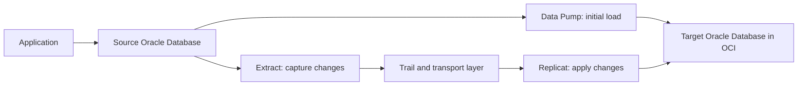

# Oracle Database Migration with Data Pump, RMAN, and GoldenGate

## 1. Objectives and Context

In the **Migration and Multicloud** chapter of the **Oracle Cloud Infrastructure (CLOUD_PROVIDERS_ORACLE)** module, database migration is the process of moving data, objects, connectivity, and business operations to a prepared target environment. Simply copying data is only part of it: the application must also access the right service, use proper privileges, continue generating valid keys, and be recoverable after an incident.

This lesson focuses on three technologies:

- **Oracle Data Pump**: logically exporting and importing data and metadata.
- **Oracle Recovery Manager (RMAN)**: backing up, recovering, and supporting physical data movement.
- **Oracle GoldenGate**: capturing and applying changes to keep source and target synchronized during migration.

After this lesson, learners will be able to select an approach based on downtime requirements, explain the relationship between initial load and ongoing changes, build a workflow to switch applications to OCI, define rollback conditions, and estimate temporary resources.

The end-to-end example is a sales system running Oracle Database 19c in a data center or another cloud. The target is Oracle Base Database Service in OCI; where the target is Autonomous Database, differences are noted separately. Illustrative commands use Oracle Database 19c and GoldenGate 19.1 syntax. Before executing, cross-check exact versions, patches, editions, CDB/PDB architecture, and supported services.

## 2. Distinguishing Three Problems Before Choosing a Tool

### 2.1. Logical vs. Physical Migration

**Logical migration** moves objects and their data into an existing target database. For example: moving the `SALES` schema into a new PDB, changing tablespaces, or upgrading versions along a supported compatibility path.

**Physical migration** moves data blocks or backups to reconstruct a database or part of a database. This approach usually preserves physical structure and requires strict checks on platform, version, encryption, and storage configuration.

Do not infer speed solely from the “logical” or “physical” label. LOB data, index counts, bandwidth, read/write speeds, and parallelism all affect actual duration. Oracle distinguishes these two directions in the [Oracle Database migration technology overview](https://www.oracle.com/database/cloud-migration/).

### 2.2. Offline, Online, and Application Outage Time

In this lesson:

- **Offline migration**: freeze write sources to create a final dataset, transfer data, and verify before opening writes at the target.
- **Online migration**: the source keeps serving during most of the data load; a synchronization mechanism transfers ongoing changes to the target.
- **Cutover**: the window transferring service authority from source to target, including blocking writes, completing transactions, confirming sync, switching connections, and reopening the application.

Running an export while the database remains open does not by itself create an online migration process. Without a mechanism to transfer changes occurring after the snapshot, the target still misses those changes.

Metrics to agree upon:

| Metric | Meaning in the Migration Plan |
|---|---|
| Downtime | Time during which business functions cannot serve normally |
| RPO | Maximum acceptable data loss in the event of an incident |
| RTO | Maximum time to restore service in the event of an incident |
| Replication lag | Delay across capture, transport, or apply stages |
| Final data checkpoint | Transaction or recovery point the target must reach before opening writes |

Planned cutover downtime does not replace RTO. Likewise, low replication lag does not prove zero RPO.

### 2.3. Option Selection Table

| Key Condition | Option to Evaluate | What Must Be Proven |
|---|---|---|
| Moving selected schemas with a sufficiently long maintenance window | Data Pump | Export, transfer, import, and verification fit the window |
| Moving a large database with compatible physical environments | RMAN | Restorable backup and sufficient redo up to final point |
| Source must keep accepting writes during data load | Data Pump combined with GoldenGate | No gaps or duplicates between initial load and CDC |
| Need low downtime via a physical path | RMAN combined with Data Guard in supported configs | Redo sync, role transition, and app connectivity |
| Target is Autonomous Database | Logical path, typically Data Pump; add GoldenGate if online needed | Feature compatibility and target service privileges |
| Changing platform or endianness | Data Pump or supported transportable process | Platform matrix, file conversion, and metadata |
| Source is a managed service on another cloud | Choose after checking source privileges | Read rights for redo, logging, export, and connectivity actually granted |

This is a selection guide, not a certification matrix. Zero Downtime Migration (ZDM) workflows can orchestrate these technologies; see [Introduction to Zero Downtime Migration](https://docs.oracle.com/en/database/oracle/zero-downtime-migration/26.1/zdmug/introduction-to-zero-downtime-migration.html). Product names do not guarantee zero downtime for every application.

## 3. Assessing the Source and Preparing OCI

### 3.1. Profiling Source and Target

Before taking dumps or backups, record:

| Group | Information Needed |
|---|---|
| Database | Version, Release Update, edition, `COMPATIBLE`, CDB/PDB |
| Platform | Operating system, CPU, platform name, endianness |
| Data representation | Database character set, national character set, timezone file, BYTE/CHAR semantics |
| Capacity | Actual data, LOBs, indexes, temp, undo, backups, and free space |
| Change rate | Hourly redo, peak load, long transactions, end-of-day batches |
| Objects | Tables, keys, partitions, data types, packages, materialized views |
| Dependencies | Database links, directories, external tables, BFILEs, jobs, external files |
| Security | TDE, keystore, credentials, permissions, auditing, and transit encryption needs |
| Application | Service names, drivers, connection pools, timeouts, retries, integrations, batch location |

DBAs with privileges on the corresponding views can use these illustrative queries:

```sql
SELECT banner_full
FROM v$version
WHERE banner_full LIKE 'Oracle Database%';

SELECT name, db_unique_name, platform_name, cdb,
       log_mode, force_logging, current_scn
FROM v$database;

SELECT parameter, value
FROM nls_database_parameters
WHERE parameter IN ('NLS_CHARACTERSET', 'NLS_NCHAR_CHARACTERSET');

SELECT filename, version
FROM v$timezone_file;

SELECT name, value
FROM v$parameter
WHERE name = 'compatible';
```

With CDBs, explicitly note whether queries ran in root or a PDB; do not use results from one container to infer all other containers. Database character set and application session NLS settings are also two separate layers.

If moving to Autonomous Database, run the Cloud Premigration Advisor Tool (CPAT), resolve detected incompatibilities, and save results for rehearsals. The tool assists planning; business checks must still be performed separately. See [Autonomous Database migration prerequisites](https://docs.oracle.com/en-us/iaas/autonomous-database-serverless/doc/migration-autonomous-database-prerequisites.html).

### 3.2. Preparing the Target Environment in OCI

A ready target environment should have:

1. Clear compartment, operations owner, and cost tags.
2. Target database provisioned with CPU, storage, IOPS, and space for import or recovery.
3. Private subnet, NSGs or security lists restricting access to required sources.
4. Network path tested over Site-to-Site VPN or FastConnect, including return path and DNS resolution.
5. Dedicated bucket for staging dumps or backups if the workflow uses Object Storage.
6. Migration accounts, database rights, OS rights, and OCI IAM policies scoped appropriately.
7. Monitoring, job logs, capacity alerts, and post-cutover backup policy.

**OCI IAM does not replace privileges inside Oracle Database.** A principal allowed to read objects in a bucket cannot necessarily export schemas; a database DBA also does not automatically have permissions to upload objects to OCI.

Separate three checks: reaching the listener, authenticating to the database, and performing data operations. All three must pass before entering the migration window.

In multicloud systems, add latency measurements from the application to the target database. An application executing many SQL calls per request can slow down noticeably even when data migration succeeded cleanly.

### 3.3. Estimating Time from Measurements

A simple estimate for data transfer:

```text
T_transfer ≈ actual_data_to_transfer / effective_throughput
```

Self-calculated example: 800 GiB at 80 MiB/s effective throughput takes roughly 10,240 seconds, or 2 hours 51 minutes just for transfer. This excludes export, import, index builds, recovery, verification, and switching connections.

For online options, measure both change generation rate and backlog processing speed. If apply speed does not exceed generation rate over a sustained interval, the system cannot catch up merely by waiting longer.

To budget trail storage, you can use:

```text
Estimated trail capacity
  ≈ measured trail generation rate × max outage duration × safety factor
```

A hypothetical example of 20 MiB/s over 6 hours produces roughly 422 GiB of trail before headroom. Do not equate trail size with redo size: the ratio depends on objects and capture configuration.

## 4. Data Pump: Controlled Logical Migration

### 4.1. Mechanism and Scope

`expdp` creates dump files containing data and metadata; `impdp` reads dumps to create or load objects at the target. You can select schemas, tables, or other scopes.

Dumps are read and written by database server-side processes. `DIRECTORY` is a database object pointing to a server-side path; it is not a download folder on the machine running the command. Both database privileges and OS filesystem permissions for the Oracle process must align. See [Data Pump overview and file location management](https://docs.oracle.com/en/database/oracle/oracle-database/19/sutil/oracle-data-pump-overview.html).

Data Pump fits when you need selective data movement or want to recreate logical structures at the target. Exporting a schema does not mean every external dependency or out-of-database file has moved.

### 4.2. Offline Workflow for the SALES Schema

Example assumptions:

- Source is a PDB with connect alias `SRC_PDB`.
- Target is a separate PDB with alias `OCI_PDB`, dedicated to this migration.
- Schema to move is `SALES`; source data resides in `SALES_DATA`.
- DBA has created tablespace `APP_DATA` at the target and ensured sufficient quota.
- Account `MIG_ADMIN` has required migration privileges. When operating on other schemas, appropriate Data Pump roles such as `DATAPUMP_EXP_FULL_DATABASE` or `DATAPUMP_IMP_FULL_DATABASE` are needed per task.
- Filesystem directories are created and permissioned beforehand. `CREATE DIRECTORY` does not create OS directories.

**Step 1 — Prepare directories in each PDB.**

The DBA connects to the exact source and target PDBs and creates corresponding objects:

```sql
-- In source PDB.
CREATE DIRECTORY MIG_DIR AS '/u02/migration/export';
GRANT READ, WRITE ON DIRECTORY MIG_DIR TO MIG_ADMIN;

-- In target PDB.
CREATE DIRECTORY MIG_DIR AS '/u02/migration/import';
GRANT READ, WRITE ON DIRECTORY MIG_DIR TO MIG_ADMIN;
```

The Linux paths only illustrate the database host environment. Two identically named directories can point to different paths. For schemas spanning multiple tablespaces, create full mappings rather than changing just one name.

**Step 2 — Freeze write sources and record the data point.**

Block writes from apps, schedulers, ETL, ops tools, and integrations. Complete or handle open transactions per procedure. Then record the SCN:

```sql
SELECT current_scn
FROM v$database;
```

`FLASHBACK_SCN` requests data exported as of a consistent SCN; it does not include transactions committed after that SCN. The source must have enough undo to serve the snapshot throughout export. This parameter uses Flashback Query and does not require enabling Flashback Database. See [Data Pump Export parameters](https://docs.oracle.com/en/database/oracle/oracle-database/19/sutil/oracle-data-pump-export-utility.html).

**Step 3 — Export using a parameter file.**

Illustrative contents of `sales_export.par`:

```text
DIRECTORY=MIG_DIR
SCHEMAS=SALES
DUMPFILE=sales_mig_%U.dmp
LOGFILE=sales_export.log
FILESIZE=10G
FLASHBACK_SCN=<RECORDED_SCN>
LOGTIME=ALL
METRICS=YES
```

Replace `<RECORDED_SCN>` with the actual number before running:

```bash
expdp mig_admin@SRC_PDB parfile=sales_export.par
```

The parameter file is read on the client machine; dumps and logs reside on the server per `MIG_DIR`. Let the tool prompt for the password or use a managed credential method; avoid passing passwords on the command line.

Wait for the job to finish, inspect the log, and record all dump pieces and their sizes. Transfer only completed dump sets; do not move files while the job still uses them.

**Step 4 — Transfer dumps to the target.**

You can transfer over a private link or stage via Object Storage. Build a manifest with filename, size, and SHA-256, then compare at the target. File hashes detect transfer corruption; they do not prove business data accuracy.

If using a bucket, ensure retention covers rehearsals, retries, and rollback windows. Move data to slow-restore archive tiers only after no import or emergency restore need remains.

**Step 5 — Review DDL before importing.**

Illustrative contents of `sales_import.par`:

```text
DIRECTORY=MIG_DIR
SCHEMAS=SALES
DUMPFILE=sales_mig_%U.dmp
LOGFILE=sales_import.log
REMAP_TABLESPACE=SALES_DATA:APP_DATA
LOGTIME=ALL
METRICS=YES
```

Generate the preview file:

```bash
impdp mig_admin@OCI_PDB parfile=sales_import.par SQLFILE=sales_ddl_review.sql LOGFILE=sales_sqlfile.log
```

`SQLFILE` writes planned DDL without executing DDL to load the schema. Inspect tablespaces, users, privileges, and old-environment references before actual import. `REMAP_TABLESPACE` maps storage for data-bearing objects; the target schema needs sufficient quota. See [Data Pump Import: SQLFILE and REMAP_TABLESPACE](https://docs.oracle.com/en/database/oracle/oracle-database/19/sutil/datapump-import-utility.html).

**Step 6 — Actual import and acceptance.**

```bash
impdp mig_admin@OCI_PDB parfile=sales_import.par
```

The target must be in an agreed state for this load. Do not use `TABLE_EXISTS_ACTION=REPLACE` or `APPEND` as a default retry tactic: one may overwrite objects, the other may duplicate data.

After import, classify all errors and check invalid objects, constraints, indexes, data, and business flows. Evaluate statistics and execution plans before opening live load; do not infer performance merely from import success.

If renaming schemas is needed, evaluate `REMAP_SCHEMA`. However, separately check hard-coded schema names in code, cross-schema references, and application configs.

### 4.3. When the Source Keeps Accepting Writes

An SCN can produce a consistent load while the source remains active. Yet after import, the target reflects only the load point, without automatically receiving later changes.

To reduce downtime along a logical path, GoldenGate or a supported synchronization workflow is required. Do not take a dump from the previous day and simply change connection strings on cutover day.

### 4.4. When the Target Is Autonomous Database

Do not apply Base Database Service filesystem examples verbatim to Autonomous Database. In workflows reading dumps from Object Storage, you need supported credentials or resource principal setup, dump URIs, and a directory for logs.

The sample below assumes credential `MIG_OBJ_CRED` is properly created in Autonomous Database and the client supports corresponding parameters:

```bash
impdp admin@ADB_HIGH directory=DATA_PUMP_DIR credential=MIG_OBJ_CRED dumpfile=https://objectstorage.<region>.oraclecloud.com/n/<namespace>/b/<bucket>/o/sales_mig_%U.dmp schemas=SALES logfile=sales_adb_import.log
```

Replace placeholders and configure TLS or mTLS connections per service requirements. Tablespace mappings, users, privileges, and features must be adapted for the target based on assessment results. See [Data Pump import from Object Storage to Autonomous Database](https://docs.oracle.com/en/cloud/paas/autonomous-database/serverless/adbsb/load-data-data-pump-import.html).

## 5. RMAN: Physical Migration and Recovery Chain

### 5.1. What Must Be Moved?

An RMAN plan must identify backup data, recovery metadata, archive logs, instance configuration, file locations, and required decryption material. Specifically:

- **Restore** reconstructs files from backups.
- **Recover** applies redo to advance files to a recovery point.
- **Opening the database and serving** also depends on recovery state, services, PDBs, security, and target service setup.

A backup taken while the source is still accepting writes does not represent the final cutover transactions. Maintain the full log sequence up to the agreed point.

Do not treat “restore succeeded” as proof the database was properly upgraded. If changing major versions, a dedicated upgrade path and compatibility checks are required.

### 5.2. Platform and Endianness

A standard restore command cannot apply to every platform pair. Oracle offers cross-platform options; among them:

- Moving an entire database via described methods requires both platforms to share the same endianness and meet other conditions.
- Transportable tablespaces can support different endianness, but require appropriate datafile conversion and metadata transfer.
- `RMAN CONVERT` is one step in a workflow; it does not automatically resolve all target database constraints.

See [RMAN: transporting data across platforms](https://docs.oracle.com/en/database/oracle/oracle-database/19/bradv/rman-transporting-data-across-platforms.html). Therefore, when moving from AIX to Linux, determine the exact platform and method rather than guessing from OS names alone.

### 5.3. Example Creating and Validating Backups at the Source

The snippet below illustrates a source in `ARCHIVELOG` mode, backing up to disk and using an SPFILE. This covers backup creation, not the full target database build process in OCI.

Connect to RMAN with an appropriately privileged OS account:

```bash
rman target /
```

Run inside RMAN:

```text
RUN {
  BACKUP AS BACKUPSET
    DATABASE FORMAT '/u02/migration/db_%U.bkp'
    PLUS ARCHIVELOG FORMAT '/u02/migration/arc_%U.bkp';

  BACKUP CURRENT CONTROLFILE
    FORMAT '/u02/migration/ctl_%U.bkp';

  BACKUP SPFILE
    FORMAT '/u02/migration/spf_%U.bkp';
}

LIST BACKUP SUMMARY;
RESTORE DATABASE VALIDATE;
```

Ensure sufficient space and coordinate with other backup jobs so needed logs are not deleted while building the migration backup set. See [Oracle database and archive log backup example](https://docs.oracle.com/en/database/oracle/oracle-database/19/upgrd/backing-up-oracle-db-for-upgrading.html).

`RESTORE DATABASE VALIDATE` reads backups selected by RMAN to verify restorability without writing datafiles. It does not prove every recovery step, PDB open, and application startup will succeed. Know which backup set RMAN selects; during rehearsals with multiple backups, constrain selection per plan and inspect logs. See [validating database files and backups](https://docs.oracle.com/en/database/oracle/oracle-database/19/bradv/validating-database-files-backups.html).

### 5.4. Target Build Sequence

An RMAN runbook must specify these steps for the exact service:

1. Prepare compatible Oracle Home, patches, storage, and instance configuration.
2. Record DBID, database name, and parameters needed for the chosen restore or duplicate strategy.
3. Place backups and required decryption material where the target can access them.
4. Restore or prepare parameter files, controlfiles, and repository; catalog backup pieces if workflow requires.
5. Map datafiles, tempfiles, and redo to target filesystem or ASM.
6. Restore and recover to the exact endpoint, resolving any missing logs completely.
7. Open the database per actual recovery state, verify PDBs, and create application services.
8. Validate business functionality, configure backups, and verify integration with OCI management tooling.

Do not put `OPEN RESETLOGS` into every runbook as a default command. How the database opens depends on the recovery type and controlfile used. Likewise, specify clearly whether using restore or duplicate, and whether keeping or changing DBID per workflow.

With Base Database Service and Exadata Database Service, follow supported migration methods so the database works properly with service backups, patching, and management. Do not replace a managed database using ad-hoc file operations. [OCI environment prep example for RMAN migration](https://docs.oracle.com/en/solutions/migrate-database-with-rman/prepare-services-cloud-accept-migrated-data1.html) illustrates preparing a compatible target, private networking, and storage access.

### 5.5. TDE and Decryption Material

An RMAN database backup does not automatically back up the TDE wallet. When data or backups require TDE keys, manage the keystore, key history, and opening the keystore at the target via supported workflows. See [managing keystore and encrypted data backups](https://docs.oracle.com/en/database/oracle/oracle-database/19/asoag/managing-keystore-and-tde-master-encryption-key.html).

Distinguish clearly:

| Component | Role |
|---|---|
| TDE keystore | Holds keys needed for encrypted data or backups per config |
| Client wallet | Supports connectivity or credential storage per deployment |
| OCI API signing key or Object Storage credential | Authenticates access to OCI resources |
| Backup password | Decrypts backups when password encryption mode is used |

Copying a file named “wallet” does not prove it holds the right keys. Rehearsals must include opening encrypted data at the target while protecting key backups separately from data per policy.

### 5.6. Reducing Downtime via Physical Path

You can evaluate an initial backup combined with incremental or redo application steps in a supported workflow. For compatible setups, RMAN combined with Data Guard is a physical online migration path; see [Oracle Cloud migration best practices](https://docs.oracle.com/en/database/oracle/oracle-database/26/haovw/migration-oracle-cloud-best-practices1.html).

RMAN itself is not a logical CDC mechanism for schemas. Adding incrementals also does not remove the need to identify and apply final changes before the source relinquishes write authority.

## 6. GoldenGate: Initial Load and Change Synchronization

### 6.1. Architecture to Understand

In a logical migration option:



During the load, the application continues writing to the source; the target only receives data through migration tasks. Once cutover completes, application connections switch to the target.

The term **Oracle Database Data Pump** in the diagram refers to `expdp/impdp`. In GoldenGate Classic, “data pump” can also refer to a trail-forwarding process; these two concepts are not the same tool.

### 6.2. Preparing Capture and Apply

Conditions to verify include:

- Source runs `ARCHIVELOG` and retains redo long enough for capture plus expected interruptions.
- Minimal supplemental logging and schema- or table-level logging are enabled per configuration.
- GoldenGate support is enabled via `ENABLE_GOLDENGATE_REPLICATION` per version requirements.
- Evaluate `FORCE LOGGING` to limit operations that do not generate full redo.
- Identify row-identification keys and check tables lacking keys.
- Confirm support for data types, DDL, LOBs, partitions, and capture/apply modes.
- Grant proper rights to Extract and Replicat accounts; secure credentials and transport paths.

Additional logging increases redo volume, so measure the impact on the source. [Preparing Oracle Database for GoldenGate](https://docs.oracle.com/en/middleware/goldengate/core/19.1/oracle-db/preparing-database-oracle-goldengate.html) details logging levels and corresponding conditions.

Commands changing logging, parameters, or privileges must be run by a DBA in the exact container and instance scope. Do not copy non-CDB configs to a CDB while ignoring root, PDBs, and fully qualified object names.

### 6.3. Initial Load Boundary: No Gaps or Duplicate Applies

Suppose a table's initial load reflects data up to point `S`:

```text
Data already in initial load:   ... up to S
Changes to apply next:           after S ...
```

Starting apply too early can cause duplicate-key errors or re-apply existing changes. Starting too late loses a slice of changes. With long-running transactions, you cannot pick a safe point simply by checking wall-clock time and starting Extract.

Oracle supports **per-table instantiation**: preparing tables so Data Pump carries instantiation CSN metadata, importing that metadata into the target, and having Replicat filter out changes already in the load. This approach does not require every table to share a single global SCN. See [GoldenGate initial load and instantiation](https://docs.oracle.com/en/middleware/goldengate/core/19.1/admin/instantiating-oracle-goldengate-initial-load.html).

A deployment sequence must ensure:

1. Assess and control open transactions, especially long-running ones.
2. Prepare logging and instantiation for the exact target object set.
3. Register, position, and start capture via a verified procedure so no needed transactions are missed.
4. Keep Replicat from applying to tables currently being loaded.
5. Export/import per the chosen instantiation method.
6. Confirm instantiation metadata and mappings exist at the target.
7. Start apply, monitor errors, and catch up changes.

Example GGSCI commands to prepare tables once aliases and source rights are ready:

```text
DBLOGIN USERIDALIAS gg_src
ADD SCHEMATRANDATA SRC_PDB.SALES PREPARECSN WAIT
INFO TRANDATA SRC_PDB.SALES.*
```

`WAIT` may block on active transactions; assess impact and handle long transactions before the planned window. PDB-prefixed names must match login method and capture architecture. See [ADD SCHEMATRANDATA](https://docs.oracle.com/en/middleware/goldengate/core/19.1/gclir/add-schematrandata.html).

Part of a Replicat configuration may include:

```text
DBOPTIONS ENABLE_INSTANTIATION_FILTERING
```

This is only a fragment explaining the mechanism, not a full GoldenGate configuration. Credential aliases, checkpoints, trails, mappings, and apply mode choices are still needed. The parameter is documented in [DBOPTIONS](https://docs.oracle.com/en/middleware/goldengate/core/19.1/reference/dboptions.html).

Do not arbitrarily combine the earlier offline parameter file containing `FLASHBACK_SCN` into a per-table instantiation workflow. If using a common SCN or another method, redesign the relationship between snapshot, capture, open transactions, and apply start point. Do not use `HANDLECOLLISIONS` to mask load boundary mismatches.

### 6.4. Components Not Assumed Automatically Synchronized

| Component | Decision Required |
|---|---|
| Sequences and identities | Approach to keep key generation safe at the target |
| DDL | Support scope, filters, and schema change freeze timing |
| Triggers | Prevent re-firing side effects on apply; test behavior when app writes directly |
| Schedulers and batches | Keep target jobs disabled until role switch |
| Database links, external files, BFILEs | Recreate or move external database resources |
| Users, roles, grants, credentials | Verify privileges and access secrets at the target |
| Keyless tables or special data types | Verify capture/apply support and row-identification strategy |

GoldenGate provides sequence replication for supported configurations, but it does not automatically cover them via table mappings alone. Also do not blindly reset every sequence to `MAX(id)+1`: consider increment, cache, cycle, and key generation rules. See [GoldenGate SEQUENCE](https://docs.oracle.com/en/middleware/goldengate/core/19.1/reference/sequence.html).

### 6.5. Evidence the System Has Caught Up

Monitor simultaneously:

- Status of Extract, transport, and Replicat.
- Capture/apply lag, checkpoints, and trail backlog.
- Remaining capacity for archive logs and trails.
- Long transactions, apply errors, discarded rows, and unmapped objects.
- Data reconciliation at a consistent boundary.

Example status checks in GoldenGate Classic:

```text
INFO ALL
INFO EXTRACT E_SALES, DETAIL
LAG EXTRACT E_SALES
INFO REPLICAT R_SALES, DETAIL
LAG REPLICAT R_SALES
```

Process names are examples. With Microservices or OCI GoldenGate, use the corresponding management interface and metrics.

After blocking source writes and finishing all transactions, you can commit a marker in a control table included in replication scope. Confirm the marker reaches the target, zero relevant backlog remains, and every apply stream has passed the required point. One marker on one stream does not prove other parallel streams have finished.

A zero displayed lag value is only an operational signal, not yet a sufficient condition to open writes at the target.

## 7. Validating Data and Business Operations

### 7.1. Choosing the Right Comparison Time

Comparing a live changing source against a lagging target creates hard-to-interpret discrepancies. Reconcile against a designed snapshot/logical point, or perform final reconciliation once the source is frozen and the target has caught up.

Do not compare internal SCNs of two independent databases and assume equal numbers mean identical data states. With GoldenGate, the source point must be correlated through replication metadata and checkpoints.

### 7.2. Multi-Layer Verification

| Layer | Sample Checks | Limitations |
|---|---|---|
| Transferred files | Manifest, size, hash | Does not check business content |
| Structure | Objects, columns, constraints, indexes, invalid objects | Valid structure does not guarantee valid data |
| Data | Counts, totals, key ranges, partial content checks | Aggregates do not prove row-by-row identity |
| Business | Ordering, payments, refunds, reports | Requires representative data and expected outcomes |
| Operations | Backup/restore, jobs, monitoring, permissions, performance | Needs testing near production-like load |

Example independent checks on source and target at the same data boundary, for a sample table with matching columns:

```sql
SELECT COUNT(*) AS row_count,
       MIN(order_id) AS min_order_id,
       MAX(order_id) AS max_order_id,
       SUM(total_amount) AS total_amount
FROM sales.orders;

SELECT status, COUNT(*) AS row_count, SUM(total_amount) AS amount
FROM sales.orders
GROUP BY status
ORDER BY status;

SELECT object_type, COUNT(*) AS invalid_count
FROM dba_objects
WHERE owner = 'SALES'
  AND status = 'INVALID'
GROUP BY object_type;
```

Matching values are preliminary evidence. For critical tables, reconcile by partition or key range, comparing contents and LOBs under clear normalization rules. Mismatched tables must be traced and fixed via procedure rather than blindly re-running the entire migration.

### 7.3. Checking from the Java Application

One successful manual SQL connection is not enough. Test the real Java application:

- JDBC driver compatible with target version and TLS mode.
- URL uses the exact PDB service, e.g., `jdbc:oracle:thin:@//db.internal:1521/SALES_APP` for a corresponding setup.
- Pool evicts stale connections and establishes connections to the target.
- Transaction timeouts and retries do not create duplicate business transactions.
- Sequences, timestamps, Vietnamese characters, and large payloads process properly.
- Critical SQL has latency and execution plans meeting requirements.

If the app still runs in another cloud, also measure the duration of a complete business transaction. Inter-cloud latency may highlight the need to move the app closer to the database or reduce SQL round trips.

## 8. Cutover Runbook and Rollback Options

### 8.1. General Cutover Sequence

Steps may vary by tool, but each milestone needs an owner and evidence:

| Milestone | Action | Condition to Proceed |
|---|---|---|
| G0 | Check target, backups, logs, and on-call staff | Sufficient resources; rehearsal passed |
| G1 | Block all write sources, settle open transactions | No uncontrolled writers remain |
| G2 | Complete final export, final recovery, or final apply | Target reaches agreed data checkpoint |
| G3 | Reconcile data and check dependencies | No blocking discrepancies remain |
| G4 | Switch connection strings, service discovery, or secret configs | Connection pools refreshed and target identity verified |
| G5 | Open writes at target by group | Test transactions pass and do not write back to source |
| G6 | Monitor, confirm backups, and hand over | Stability criteria met for defined period |

At G2:

- Offline Data Pump must finish export/import of the frozen source state.
- RMAN must restore/recover to the final point with complete logs.
- GoldenGate must prove required streams applied all changes prior to the boundary.

Changing DNS alone does not ensure all sessions switched target: resolvers, apps, and pools may cache entries or hold open connections. Verify where transactions actually land while keeping write-blocking active on the old source.

### 8.2. Two Distinct Rollback Scenarios

**Target has not accepted new business writes:** reopening the source can be evaluated if the source remains intact, all connections are routed back properly, and no unhandled side effects occurred. Verify both test transactions and external systems.

**Target has accepted new business writes:** the old source no longer contains the full new state. Switching connections back immediately can lose transactions committed at the target.

The second scenario requires a rehearsed plan, such as supported and pre-configured reverse replication, a write-frozen reverse migration wave, or fixing forward at the target to continue operating. Never assume one-way GoldenGate can be safely reversed simply by swapping mappings.

In all approaches, prevent both sides from accepting unintended concurrent writes. If a bidirectional architecture is required, handling loops, key generation, and conflicts is a separate problem.

### 8.3. Abort Criteria Before Opening Writes

Example criteria defined by a migration team:

- Missing archive logs or trails needed for the final checkpoint.
- Unable to prove the boundary between initial load and CDC.
- Critical tables missing from migration scope.
- Totals or reconciled data mismatched.
- Unable to decrypt encrypted data.
- Payment or order creation flows failing.
- Target lacks a verified backup and recovery plan.

An expiring maintenance window is not a reason to skip data evidence. Go or rollback decisions must rest on pre-agreed criteria.

## 9. Automation, Monitoring, and Cost Control

### 9.1. Using Orchestration Tools When Appropriate

Evaluate OCI Database Migration or ZDM to manage assessment, preparation, data loading, and synchronization via supported workflows.

Check orchestration tool requirements independently. A source may allow manual `expdp` yet not appear on a migration service's supported list. Likewise, privileges on a managed Oracle database in another cloud may restrict source actions.

Cross-check [OCI Database Migration source database requirements](https://docs.oracle.com/en-us/iaas/database-migration/doc/source-database-requirements.html) and [target database requirements](https://docs.oracle.com/en-us/iaas/database-migration/doc/target-database-requirements.html) at deployment time rather than keeping a static version list in a runbook.

Automation should persist inputs, data checkpoints, job states, and per-step results. Retry steps must be state-aware: never append-import onto already loaded data or reopen writers simply because a script exited without checking results.

### 9.2. Monitoring Resources That Can Disrupt Migration

- Source CPU, I/O, and sessions during export or capture.
- Target CPU, temp, undo, I/O, and storage during import, index builds, or apply.
- FRA, archive logs, trails, network errors, and catch-up rate.
- Failed jobs, invalid objects, application errors, and transaction latency.
- Ability to take fresh backups after role transition.

Set alerts before storage fills up. Deleting logs to free space without checking capture/recovery can force reloading the data.

### 9.3. Costs and Licensing

Estimates should include:

| Cost Item | Situations Increasing Cost |
|---|---|
| Source and target running concurrently | Multiple rehearsals or extended rollback windows |
| Dumps, backups, and trails | Retaining multiple versions and buffering long outages |
| Data transfer | Egress on source cloud, re-transfers, multicloud testing |
| Temporary target capacity | Extra CPU, IOPS, or storage for import and catch-up |
| Migration tools | Services, deployments, and corresponding license terms |
| Post-cutover copies | Retaining old source and backups for acceptance windows |

Verify editions, options, and license terms for parallelism, compression, GoldenGate, and Data Guard per specific plan. Licensing permitted for a migration workflow should not be assumed valid for long-term replication deployments.

OCI Budgets supports tracking and alerts; the plan still needs an owner to stop temporary resources, revoke credentials, and clean up data once retention expires.

## 10. Common Errors and Isolation Steps

| Symptom | First Place to Check |
|---|---|
| Data Pump reports directory error or cannot open file | Container, directory object, DB privileges, filesystem permissions, server-side path |
| Export fails with snapshot too old | SCN, export duration, undo retention, and source change rate |
| Import hits object-exists or duplicate-key errors | Target state, prior load, and existing-object handling policy |
| Import fails on tablespace or quota | Complete tablespace mappings, created tablespaces, and schema quota |
| RMAN missing files or archive logs | Manifest, catalog, selected backup, log sequence, and recovery point |
| Restore works but encrypted data is unreadable | Keystore, exact key version, open state, and access permissions |
| GoldenGate apply fails with duplicate or row-not-found | Instantiation boundary, mappings, keys, target writers, and discarded errors |
| Lag grows continuously | Change rate vs. capture/apply speed, I/O, network, locks, and long transactions |
| Target data is right but app still writes to source | Stale pools, DNS cache, batch configs, service discovery, and credentials |
| Migration finished but transactions are slow | Multicloud latency, execution plans, statistics, and target resource sizing |

Never resolve by ignoring failed rows and declaring completion. Every data error needs scope, root cause, and post-fix reconciliation results.

## 11. Comprehensive Lab Exercise

Use two isolated lab environments and synthetic data; never run illustrative commands directly against production.

### 11.1. Phase A — Offline Data Pump

1. Prepare the `SALES` schema with customer, order, and order-item tables, including keys and Vietnamese text data.
2. Record row counts, total amounts, and several business test cases with expected outcomes.
3. Freeze writes, record the SCN, and export using a parameter file.
4. Transfer all dump pieces, comparing manifest and hashes.
5. Generate SQLFILE, review DDL, then import into the target PDB.
6. Compare data, check objects, and run the application against the target service.

Record in the lab report: step timings, actual transferred size, resolved errors, and post-import data evidence.

### 11.2. Phase B — RMAN and Recoverability

1. Use a lab database authorized for backups; identify CDB/PDB and RMAN connection rights.
2. Create database, archive log, controlfile, and SPFILE backups per example conditions.
3. Inspect the backup set RMAN selects and run validation.
4. On a separate lab target, rebuild the database via the appropriate restore/recovery runbook.
5. Verify data, services, PDBs, and application access.
6. If TDE is used, add a test using the exact keystore and keys at the target.

The result must prove recovery to the chosen point; a “backup completed” log line is insufficient.

### 11.3. Phase C — GoldenGate for Reduced Downtime

1. Prepare logging, privileges, keys, and a marker table prior to initial load.
2. Configure capture alongside instantiation; test a long-running transaction to verify the load boundary.
3. Keep a transaction-generating program running at the source during export/import.
4. Start apply per the chosen instantiation method.
5. Monitor trails, lag, and check data once the target catches up.
6. Block source writers, settle open transactions, write a final marker, and confirm all related streams finished.
7. Reconcile, switch application pools, and open writes only at the target.
8. Rehearse rollback separately both before and after the target receives new transactions.

Compare measured downtime between Phase A and Phase C while accounting for resources, complexity, and operational requirements.

## 12. Completion Criteria for a Migration Wave

A migration wave is only ready for handover with evidence that:

- All in-scope data and dependencies moved completely.
- The target reached the final data checkpoint with zero lost or duplicated transactions.
- Applications write to the right target, generate keys safely, and no uncontrolled writers remain.
- Performance, permissions, monitoring, backups, and recoverability meet requirements.
- Rollback has clear boundaries; temporary resources have owners and cleanup deadlines.

Technology choices must pair with empirical evidence: Data Pump needs an accurate, complete load; RMAN needs a usable recovery chain; and GoldenGate needs a verified boundary between initial load and subsequent changes.
