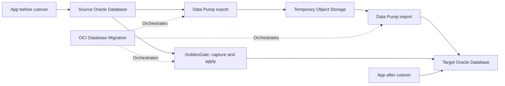

# Database Migration Service and Reducing Downtime

## 1. Objectives and Scope

In the Migration and Multicloud chapter of the Oracle Cloud Infrastructure (OCI) curriculum, Database Migration Service helps organize moving data from a source database to a target. The goal of this lesson is to design a measurable Oracle Database migration with a stop point before switching applications and a handling plan if results fall short.

After this lesson, learners will be able to:

- Distinguish offline and online migration, initial data load, and change synchronization.
- Prepare tenancy, compartments, IAM, networking, and storage resources for migration.
- Estimate the outage window based on measured data.
- Build a cutover, reconciliation, and rollback decision workflow aligned with data-write state.
- Monitor lag, system load, cost, and post-migration database operability.

The lesson focuses on logical Oracle Database migration to Oracle database services supported by OCI Database Migration. The end-to-end example is an ordering application running in a private data center, migrating the database to OCI while the application tier can be moved separately.

## 2. What Does Database Migration Service Orchestrate?

### 2.1. Resources to Distinguish

Key service concepts include:

| Resource | Meaning in the Migration Process |
| --- | --- |
| Connection | Describes a database along with required connectivity details |
| Migration | Configuration of source, target, data scope, and migration method |
| Migration job | A single execution of a migration, carrying status, progress, and diagnostics |
| Validation job | A pre-execution check of prerequisites and configuration |
| Private endpoint | Network access point enabling the service to reach resources on private addresses |

A migration is the configuration; a migration job is one execution of that configuration. Save the job ID when investigating errors or comparing runtimes across rehearsals. [OCI Database Migration Terminology](https://docs.oracle.com/en-us/iaas/database-migration/doc/database-migration-terminology.html).

A migration plan must also specify responsibilities belonging to the application team: stopping write requests, draining in-flight transactions, updating connection configs, refreshing connection pools, and running business tests. Getting data to the new target completes only part of moving the system.

### 2.2. Supported Scope Is an Entry Condition

Before deploying, verify the exact combination of version, edition, OS platform, CDB/PDB architecture, and source management environment. For example, current source documentation has limits regarding Oracle Database on Windows and certain Amazon RDS Oracle configurations; restricted admin privileges on managed services also affect preparation. Do not infer from both systems running Oracle Database that every migration flow is supported. [Source database requirements](https://docs.oracle.com/en-us/iaas/database-migration/doc/source-database-requirements.html).

Targets can belong to supported Autonomous AI Database, Base Database Service, or Exadata Database Service families. Oracle Database options on multicloud infrastructure have separate account and tenancy linking requirements. For lab exercises, lock a specific source–target pair before creating resources. [Target database requirements](https://docs.oracle.com/en-us/iaas/database-migration/doc/target-database-requirements.html).

Support matrices must be re-checked during planning. This lesson does not use a static version matrix in place of documentation for the actual configuration.

## 3. Offline, Online, and What “Reducing Downtime” Means

### 3.1. Offline Migration

With offline migration, updates to the source must stop before migration begins. Data moves to the target via an initial load flow; for Oracle Database, Oracle Data Pump is the primary component of this flow. [Migration type](https://docs.oracle.com/en-us/iaas/database-migration/doc/migration.html), [Oracle migration methods description](https://www.oracle.com/database/cloud-migration/).

The operational advantage is having fewer continuous synchronization components. In return, the write-stop window must accommodate both data movement time and the steps needed for the application to operate on the target.

Offline fits when systems are small, extended outages are allowed, or online prerequisites cannot be met. For instance, an internal reporting system permitting weekend outages can prioritize operational simplicity over maintaining extra synchronization infrastructure.

### 3.2. Online Migration

Online migration combines initial data load with change replication via Oracle GoldenGate. During most of this process, the application can continue writing to the source. Migration synchronization is unidirectional from source to target. [Online migration](https://docs.oracle.com/en-us/iaas/database-migration/doc/online-migration.html).

| Criterion | Offline | Online |
| --- | --- | --- |
| Source continues accepting writes during load | Updates must stop | Can continue under supported conditions |
| Additional work | Organize load and app switch | Add capture, apply, and backlog management |
| Required write-stop time | Usually includes data load duration | Focused on final sync and app switch |
| Operational trade-off | Simpler workflow | More components to monitor and thorough preparation needed |

Never promise “zero application downtime” simply because online is chosen. Read–write applications still need a controlled window to stop final source writes, complete synchronization, and switch connections. Oracle documentation explicitly describes stopping the source workload before proceeding with switchover in this case. [Preparing for application switchover](https://docs.oracle.com/en-us/iaas/database-migration/doc/preparing-application-switchover.html).

### 3.3. Three Distinct Measurements

- **Total migration duration:** from starting execution steps to completion; can span many hours.
- **Application outage time:** from when users cannot perform required business actions until business operations resume.
- **Data loss target:** amount of committed transactions the business accepts missing at the target after cutover.

In a planned migration, you can target zero loss of committed transactions within migration scope. That criterion must be proven through write control and reconciliation, not assumed automatically from choosing online.

## 4. Two-Stream Data Architecture



The diagram illustrates initial load via Object Storage. The initial load stream builds the baseline dataset, while the sync stream delivers subsequent changes to the target. DMS orchestrates the steps; data paths still need adequate bandwidth and access rights.

OCI also offers data-transfer medium options like database links or file storage, depending on supported configurations. When using dumps, ensure enough space in the export directory and temporary staging location. [Creating resources and data transfer mediums](https://docs.oracle.com/en-us/iaas/database-migration/doc/creating-resources.html).

Capturing a consistent point and starting capture must be coordinated. Do not manually export at an arbitrary point and start replication independently: the gap between the two steps can contain missed or double-applied transactions. If adjusting the standard flow is necessary, understand the corresponding checkpoints and instantiation conditions.

## 5. Preparing Infrastructure and Database

### 5.1. Locking Data Scope and Dependencies

A minimum inventory must specify:

| Group | Details to Determine |
| --- | --- |
| Database | Version, patch level, edition, CDB/PDB, character set, and time zone |
| Data | Schemas, large tables, LOBs, hot tables, and growth rate |
| Objects | Views, packages, sequences, triggers, constraints, and database links |
| Writers | APIs, batches, schedulers, ETL, consumers, and manual operation accounts |
| External DB dependencies | Files, payment integrations, queues, and reporting systems |
| Business | Order counts, total amounts, payment statuses, and invariants to preserve |

Separate objects included in initial load, objects continuously synchronized, and objects requiring supplemental handling. A table importing successfully does not prove every operation type on that table is supported by replication.

For DDL changes, schedule a schema freeze during the migration window or design a verified approach for those exact change types. Altering structures between load and sync can cause components to interpret the same table differently.

### 5.2. Compartments, IAM, and Secrets

Use compartments to organize where connections, migrations, jobs, and dependent resources reside. Structure operations, network admin, and database admin groups around real responsibilities.

The example below illustrates only one group's permissions on DMS resources; this is not a complete policy set for a migration:

```text
Allow group MigrationOperators to manage odms-connection in compartment MigrationLab
Allow group MigrationOperators to manage odms-migration in compartment MigrationLab
Allow group MigrationOperators to manage odms-job in compartment MigrationLab
```

Depending on the flow, permissions for networking, GoldenGate, Object Storage, Vault, keys, secrets, and assessments are also needed. Administrators should consult Policy Builder and dependent resources to grant proper scope. [Required policies](https://docs.oracle.com/en-us/iaas/database-migration/doc/required-database-migration-policies.html).

OCI IAM rights and SQL privileges inside the database are two separate layers. Having permission to create a migration does not mean having privileges to export schemas or configure capture inside the DB.

Manage passwords and keys using the secret mechanism of the chosen flow; never place them in source code repos, screenshots, or public logs. Decide upfront who can read secrets, who rotates credentials, and when temporary accounts are revoked.

### 5.3. Verifying Networking Path by Path

Build an “initiator → receiver” matrix rather than only checking if an admin machine can reach the DB.

- Migration service and endpoints must reach databases per connection configs.
- GoldenGate components must reach DBs requiring capture/apply.
- Flows using Object Storage must reach storage endpoints.
- If the method requires SSH, SSH paths and matching permissions must exist.
- Post-cutover applications must reach the target DB endpoint.

Take ports from actual listeners and connection types. SQL*Net typically involves 1521 or the target config's TLS port; HTTPS uses 443; SSH is only needed when the flow uses it. Check routes, NSGs/security lists, OS firewalls, and DNS. [Port requirements](https://docs.oracle.com/en-us/iaas/database-migration/doc/port-requirements.html).

VPN or FastConnect provides the network path; database privileges and DNS resolution still need separate checks. For multicloud, add return routes, overlapping IP ranges, bandwidth limits, and egress fees from the source location.

The **Test connection** feature checks network and database/socket connectivity. Success does not yet prove the link can sustain continuous migration traffic. [Testing connectivity](https://docs.oracle.com/en-us/iaas/database-migration/doc/testing-connection-registered-database.html).

### 5.4. Capture Prerequisites and Log Capacity

For online Oracle migration, DBAs must check requirements for ARCHIVELOG, FORCE LOGGING, supplemental logging, GoldenGate settings, accounts, and patches. Configuration must follow source type and exact CDB/PDB context; managed environments may require dedicated procedures. [Preparing the source database](https://docs.oracle.com/en-us/iaas/database-migration/doc/preparing-source-database-offline-migration.html).

The following queries are strictly for inspection in Oracle environments with read privileges on the corresponding views:

```sql
SELECT name, log_mode, force_logging, supplemental_log_data_min
FROM v$database;

SELECT name, value
FROM v$parameter
WHERE name IN (
    'enable_goldengate_replication',
    'streams_pool_size'
);

SELECT parameter, value
FROM nls_database_parameters
WHERE parameter IN (
    'NLS_CHARACTERSET',
    'NLS_NCHAR_CHARACTERSET'
);
```

Do not turn one query result into a complete readiness conclusion. For example, minimal supplemental logging does not replace schema/table-level logging required by capture.

Retain redo/archive logs long enough for capture to resume after incidents. Estimate space from peak log generation rate, initial load duration, tolerable outage duration, and headroom. Trail space and target apply capacity must also be monitored.

Changing logging modes may require restarts or impact performance. Prepare these in a separate plan before the cutover window; do not let a source configuration step become unplanned downtime.

## 6. Estimating Time and Catch-Up Capability

### 6.1. Transfer Time Is Only One Piece

Simple model for a data transfer stage:

```text
Approximate transfer time = Actual data transferred / Measured effective throughput
```

Self-calculated example using decimal units:

```text
Actual data transferred = 600 GB = 600,000 MB
Throughput = 75 MB/s
Time = 8,000 seconds, roughly 2 hours 13 minutes
```

This is not total migration time. Export, import, index creation, LOB handling, CPU, I/O, encryption, and sequential steps can dominate. Some stages overlap; do not mechanically add or omit durations. Full-flow rehearsal results form the basis for scheduling.

### 6.2. Backlog Reduction Condition

Let:

- `B`: amount of pending changes awaiting processing.
- `λ`: rate of new changes entering the pipeline.
- `μ`: processing and apply rate of the pipeline, measured on the same unit basis.

In a steady model, when `μ > λ`:

```text
Catch-up time ≈ B / (μ - λ)
```

Example `B = 24,000 MB`, `λ = 20 MB/s`, `μ = 60 MB/s`: roughly 600 seconds are needed to drain the backlog if rates stay constant. Upon stopping writes, idealizing `λ = 0`, the remaining 24,000 MB still needs 400 seconds to apply. Such a backlog already exceeds a 5-minute window before even switching the application.

If `μ ≤ λ`, running longer will not solve catch-up. Find the bottleneck in capture, link, trail, target CPU/I/O, table design, or large transactions, then re-rehearse.

Do not compare source redo bytes directly against applied data bytes as if they are the same quantity. The formula is a capacity model; use normalized metrics or actual measured pipeline throughput to decide.

### 6.3. Outage Budget

An illustrative allocation defined by an operations team:

| Task During Cutover | Illustrative Budget |
| --- | --- |
| Block new writes and drain workload | 40 seconds |
| Complete final sync and DB switchover | 60 seconds |
| Switch connections, refresh pools | 40 seconds |
| Minimum business verification | 40 seconds |
| Buffer and decision time | 120 seconds |
| **Total** | **300 seconds** |

These numbers are example targets, not OCI performance guarantees. If it only fits inside 5 minutes under ideal conditions with zero decision time, the plan lacks sufficient buffer for a production switch.

## 7. Preparing and Executing Migration Jobs

### 7.1. Assessment and Validation Answer Two Questions

Assessment analyzes migration options by source, target, scope, and operational requirements. When using this feature, check assessment support limits separately from migration support limits; the two sets of conditions are not necessarily identical. [Creating an assessment](https://docs.oracle.com/en-us/iaas/database-migration/doc/creating-assessment-oracle-migrations.html).

Validation checks migration configuration before running. If Premigration Advisor is enabled in a supported flow, review the report on the job details page and resolve findings. A passing validation does not replace business testing on target data. [Validating a migration](https://docs.oracle.com/en-us/iaas/database-migration/doc/validating-migration.html).

During rehearsals, save:

- Source–target pair, schema/table scope, and initial load config.
- Errors requiring fixes, accepted warnings, and the accountable person for each decision.
- Objects needing extra handling, processing time, and cutover impact.
- Measured source load, transfer speed, and apply capability.

If changing network config, credentials, or data scope after validation, evaluate which checks must rerun before the next execution.

### 7.2. Console Workflow

Hands-on sequence for a prepared lab environment:

1. Select the right tenancy, region, and compartment.
2. Create source and target connections with proper network info, service name, and credentials; test connections.
3. Create the migration, picking the exact two connections and data scope.
4. Select the initial load medium; for this lesson's example, use Data Pump via Object Storage and a dedicated bucket.
5. Enable online replication, supplying GoldenGate config matching a supported deployment method.
6. Run validation, inspect detailed results, and fix unmet conditions.
7. When starting the job, configure a pause point after the monitor replication lag phase to retain decision control before switchover.
8. Monitor initial load and synchronization; resume from the pause point only when cutover criteria are met.

Label names may vary by UI and target type. Official hands-on guides also illustrate registering connections, choosing initial load, configuring replication, and validation. [Online migration guide](https://docs.oracle.com/en/learn/ocidms-online-mgrt/index.html).

Never launch production without confirming pause behavior. A job left to run straight through can proceed into switchover before the application team finishes preparing.

### 7.3. Identifying Phases

Key phases in the Oracle flow:

| Phase | What to Observe |
| --- | --- |
| Validate | Source, target, and component configuration prerequisites |
| Prepare replication | Capture preparation at source |
| Initial load export/upload/import | Data load progress and resource consumption |
| Post initial load | Post-import processing results |
| Prepare replication target | Apply initialization at target |
| Monitor replication lag | Ability to reach catch-up state |
| Switchover App | Completing database-side transition |
| Cleanup | Cleaning temporary migration flow components |

The Console uses human-readable names; the API uses codes like `ODMS_MONITOR_REPLICATION_LAG` and `ODMS_SWITCHOVER`. Logs may show `ZDM_` phase names because the service uses Zero Downtime Migration workflows. [Oracle migration phases](https://docs.oracle.com/en-us/iaas/database-migration/doc/oracle-migration-phases.html).

Use job status together with per-phase logs to diagnose issues. Do not assume finishing initial load means writes can open at the target.

## 8. Designing Cutover for Read–Write Applications

### 8.1. Preparing Stop Points and Proceed Conditions

For Oracle-to-Oracle online migration, Oracle instructs pausing after the **Monitor replication lag** phase, stopping source workloads, then resuming the job to execute switchover. This flow uses a barrier transaction and verifies source–target transfer; certain objects needing reload are also handled during transition. Open the target workload only after switchover completes. [Preparing for application switchover](https://docs.oracle.com/en-us/iaas/database-migration/doc/preparing-application-switchover.html).

The pause point is a runbook decision gate. While still in sync state, the app continues using the source and must not arbitrarily write to the target. Operations must specify who can resume the job and what evidence authorizes it.

Before the cutover window, agree on:

| Criterion | Example Team-Defined Standard |
| --- | --- |
| Replication | Capture/apply active; lag stably low for 15 minutes |
| Data | Reconciliation at consistent points passes requirements |
| Workload | All writers and long transactions inventoried |
| Application | Target config, wallet/TLS, and connection pool rehearsed |
| Failure plan | Abort/proceed decision point defined with accountable owner |
| Target operations | Monitoring, backups, and capacity sufficient for live load |

Specific thresholds must derive from the outage window and rehearsal results. “Lag below a threshold” is only a condition to consider starting cutover, not proof all final transactions have arrived.

### 8.2. Runbook During the Cutover Window

**Step 1 — Record starting state.**

Save timestamp, job in paused state, latest monitoring snapshot, active endpoints, and leads. Freeze app releases, schema changes, and admin tasks that could skew measurements.

**Step 2 — Block new write requests.**

Switch the system to maintenance mode or the rehearsed write-control mode. Stop producers, consumers, schedulers, ETL, and batches with write privileges. If still serving reads from the source, ensure read paths do not generate hidden writes such as session updates, business audit entries, or read-status flags.

**Step 3 — Drain workload and confirm quiet source.**

Wait for accepted transactions to finish within allowed time; watch active sessions, long transactions, and queues. For transactions needing cancellation, follow agreed policy so the app can safely retry.

Do not just stop one API and conclude the source has no writes left. Support accounts, periodic jobs, and existing pooled connections can continue generating updates.

**Step 4 — Complete job switchover.**

Resume the migration at the prepared point. Monitor the transition phase, apply errors, and remaining object handling. Wait for completion evidence of the authoritative flow before allowing the target workload.

Never skip errors or alter checkpoints to save time. When switchover fails to pass, follow the rehearsed decision branch.

**Step 5 — Switch application connection config.**

Update secrets, connect strings, service names, wallets, or corresponding deployment configs. Refresh connection pools to clear stale connections; verify app sessions actually land on the target DB.

If using DNS to switch endpoints, account for TTL, resolver caches, and in-app caches. Changed DNS does not guarantee existing live connections have switched targets.

**Step 6 — Minimum verification and controlled workload open.**

Before opening live writes, verify DB identity, app privileges, and ability to read required data. Then open write flows per plan, run clearly identifiable verification transactions, and observe outcomes.

Test writes on the target create an event that must be accounted for in rollback planning, even when called a smoke test. Define how test transactions are purged or reconciled; do not let them be confused with real data.

**Step 7 — Monitor and confirm.**

Re-enable background jobs in dependency order. Watch connection errors, timeouts, retries, API latency, DB resources, and business discrepancies. Save the exact timestamp live writes began on the target, as this milestone alters rollback handling.

### 8.3. Write Retries and Handling “Unknown Outcome”

An order request may have committed at the source, yet the client lost connection before receiving the response. After cutover, the client retries and creates a duplicate order if the app lacks idempotency controls.

Use stable request IDs, appropriate unique constraints, and transaction lookup flows. Database migration preserving data does not automatically guarantee exactly-once execution for every network request.

## 9. Reconciling Data at a Meaningful Point

### 9.1. Picking the Same Comparison Boundary

Comparing source row counts at 10:00 against target row counts at 10:05 while the source keeps accepting writes can report mismatches even when replication works normally.

During rehearsals, use a closed dataset or supported consistent-snapshot mechanism. At cutover, the easiest-to-explain method is stopping all source writers, completing final sync, then reconciling critical datasets before live workload mutates the target.

Do not assume two independent DBs share a common SCN for direct comparison. Consistency points must tie to the migration mechanism and data scope, not merely similar-looking numbers.

### 9.2. Combining Multiple Check Layers

| Layer | Examples | Limitations to Understand |
| --- | --- | --- |
| Structure | Tables, indexes, constraints, packages, and grants | Existing objects do not guarantee usable objects |
| Aggregate | Row counts, total amounts, order counts by status | Different errors can cancel each other out |
| Detailed | Comparing keys and values across data slices | Time-consuming if scanning huge tables in full |
| Business | Paid orders have full line items and ledger entries | Requires understanding system rules |
| Application | Login, order lookup, and test order creation | Represents only tested flows |

Hypothetical example assuming table `APP.ORDERS` has columns `ORDER_ID`, `CREATED_AT`, `STATUS`, `TOTAL_AMOUNT`, `CURRENCY`. Run the identical query on source and target at the agreed comparison boundary:

```sql
SELECT
    status,
    currency,
    COUNT(*) AS order_count,
    SUM(total_amount) AS total_amount,
    MIN(order_id) AS min_order_id,
    MAX(order_id) AS max_order_id
FROM app.orders
WHERE created_at >= TIMESTAMP '2026-11-01 00:00:00'
  AND created_at <  TIMESTAMP '2026-11-02 00:00:00'
GROUP BY status, currency
ORDER BY status, currency;
```

Understand `CREATED_AT` data type and timezone conventions. Never sum amounts across multiple currencies into one total. The query above is an aggregate check; matching totals still need detailed reconciliation for critical data.

For large tables, partition comparison scopes by key or time. If using checksums, normalize NULLs, encoding, numeric types, timestamps, and LOB representations. Hashing is a discrepancy-detection tool under a specific design, not absolute proof for the entire system.

### 9.3. Checking Objects Beyond Data Rows

Verify separately:

- Sequences/identities will not generate duplicate keys once the app starts writing at the target.
- Constraints and triggers are in states matching application design.
- Packages, views, and compilable objects are not invalid beyond accepted levels.
- Grants, synonyms, and app accounts satisfy business needs.
- Database links, schedulers, external jobs, and external integrations do not point to the wrong environment.

Some components may be handled automatically by the migration flow, yet acceptance checklists must verify final states rather than assuming from job completion.

## 10. Rollback Plan and Data Boundaries

### 10.1. Before Target Accepts Independent Writes

When the source remains the sole receiver of business transactions and the target has no independent changes, aborting cutover so the app stays on the source can be designed. However, confirm the source remains serviceable, background tasks restore cleanly, and job state permits the chosen branch.

If the cleanup step has already run, do not assume the old replication can be resumed. Preparing another migration may be required; exact handling depends on the active phase and resource state.

### 10.2. After Target Accepts Writes

Because migration sync flows one way source → target, there is no basis to expect new target transactions to flow back to the source automatically. This consequence must be built into rollback design. [Online migration sync limits](https://docs.oracle.com/en-us/iaas/database-migration/doc/online-migration.html).

Example:

1. Target accepts order `ORD-9001` after cutover.
2. Old source lacks this order.
3. Simply switching the app back to the source leaves users seeing a missing order; retries may even create another record.

Handling options must be chosen and prepared upfront:

| Option | Prerequisites |
| --- | --- |
| Fix forward on target | Can restore service within allowed time and keep new data |
| Purpose-built reverse sync | Supports exact change types; conflicts and switch timing tested |
| Extract and merge delta | Able to identify new transactions, apply order, and reconciliation rules |
| Restore per approved plan | Clear understanding of recovery point, potential data loss, and duration |

Never enable concurrent writes on both sides by toggling DNS back and forth. If multi-site writes are needed, that is a dedicated data architecture with conflict and consistency rules, not default migration behavior.

### 10.3. Keeping the Old Source Under Control

After cutover, the source may be retained during an observation period per organizational policy. Prevent old apps and jobs from continuing to write, restrict access, and explicitly mark the point from which this source became stale.

Pre-cutover backups restore a known state. Those backups do not contain new transactions created exclusively at the target and do not replace a data-merge plan on rollback.

## 11. Monitoring and Incident Handling

### 11.1. Watching Four Signal Groups Simultaneously

| Group | Signals to Collect |
| --- | --- |
| DMS | Job state, active phase, errors, and per-phase duration |
| Replication | Capture/apply health, lag, checkpoints, backlog, and trail space |
| Infrastructure | CPU, memory, I/O, log capacity, throughput, and link errors |
| Application | Error rate, timeouts, latency, retries, duplicates, and business metrics |

Lag is meaningful when probes stay current and both capture and apply remain active. A small yet stale value is not proof of catch-up. Conversely, a low-transaction source may need heartbeats or suitable observability to interpret metrics.

When setting alerts, combine time thresholds with process states. Illustrative example: alert when lag rises continuously over multiple checks, capture/apply stops, or log space approaches insufficiency for expected processing time.

### 11.2. Common Scenarios

| Symptom | First Place to Check | Operational Decision |
| --- | --- | --- |
| Test connection fails | IP, DNS, listener, routes, NSGs, firewalls, credentials, and secrets | Fix connectivity before running migration |
| Validation fails | Failing phase details, DB privileges, Data Pump/GoldenGate configs, source–target conditions | Fix root cause; do not ignore notices |
| Initial load slow | Source reads, export/import, bandwidth, LOBs, target CPU and I/O | Tune bottlenecks one by one and re-measure |
| Lag grows despite healthy network | Slow apply, large transactions, resource starvation, or table traits | Delay cutover until catch-up is proven |
| Capture missing required logs | Archive log retention, log purging, and checkpoints | Assess recoverability; reload may be needed |
| Job needs intervention | Phase logs and status, recent changes, lost resources | Choose resume or recreate per error guidance |
| App errors post-switch | Actual endpoint, stale pools, wallets, grants, timeouts, external deps | Block writes if needed; preserve evidence to decide recovery |

When errors occur, save the job ID, phase, timestamp, and secret-scrubbed logs. Never delete trails, directory objects, accounts, or buckets while investigation or resume is still needed.

## 12. Costs and Post-Migration Availability

### 12.1. Budgeting for Both Systems Coexisting

Migration costs must include:

- Source and target databases during parallel operations.
- Replication, compute, and related storage resources depending on deployment.
- Dumps, Object Storage or file storage, archive logs, and trails.
- Network links, source egress, and rehearsal duration.
- Retaining old source, backups, and post-switch operations.

Use current region unit rates, contracts, and actual configurations when budgeting. Never treat a service name as proof the entire migration incurs zero cost.

Set tags and review deadlines for temporary resources. After acceptance, check job cleanup and team-created resources; clean up only after evidence retention, security, and rollback windows are satisfied.

### 12.2. Migration Success Alone Is Not Enough for Long-Term Ops

Target availability must be designed to system needs: proper redundancy setup, backups, recoverability, app connectivity, and operational permissions.

After cutover, verify:

1. Target backups work and operations knows how to restore.
2. Alerts reach the right accountable owners.
3. Production load creates no new CPU, I/O, or connection-limit bottlenecks.
4. Critical queries have acceptable response times.
5. Background tasks run only where designated.
6. Temporary credentials are revoked or rotated on schedule.

Analytical loads from another cloud hitting the target DB also need network latency and data transfer fee evaluation. Separate the “move DB to OCI” decision from the “where to place the full app tier” decision to measure each change's impact.

## 13. Hands-On Exercise: Building an Acceptable Migration

### 13.1. Lab Context

Use a supported Oracle Database source and OCI target pair in an environment without sensitive data. Schema `APP` holds order and order-line tables; a workload creates, updates status, and queries orders.

Self-set lab goals:

- Source stays available during initial load and synchronization.
- Write-stop window under 5 minutes.
- Every transaction committed before closing source appears at the target.
- No business agent writes concurrently to both DBs.
- Implementers can explain failure-handling branches both before and after target accepts writes.

Never use a tiny dataset run to commit production timings. Test sets should represent large tables, LOBs, long transactions, write rates, and critical dependencies.

### 13.2. Lab Steps

1. **Inventory and baseline:** record schema scope, writers, change rate, and pre-migration app latency.
2. **Prepare OCI:** compartments, IAM, network, secrets, staging storage, target DB, and replication config.
3. **Create and test connections:** verify both migration connectivity and app connectivity to target.
4. **Validation:** fix errors and list objects needing extra handling.
5. **Run online migration:** perform initial load, measure source/target load, and observe backlog drain rate.
6. **Hold at pause point:** let sync stabilize; test controlling the job per runbook.
7. **Rehearse cutover:** stop all writers, drain, resume switchover, and switch connections.
8. **Reconcile:** use the exact data boundary, combining aggregate queries with detailed and business checks.
9. **Open load:** run clearly identifiable test transactions, then open workload per plan.
10. **Accept and clean up:** confirm monitoring, backups, permissions, old source, and temporary resource costs.

In the lab, you can deliberately throttle apply resources to watch lag rise, then restore config to watch backlog shrink. Run failure tests before the cutover window and avoid deleting logs/checkpoints; the goal is learning to recognize loss of catch-up capability.

### 13.3. Completion Evidence

Lab results need metrics rather than just a success-status screenshot:

| Evidence | Details to Record |
| --- | --- |
| Scope config | Source, target, migration type, schema, and transfer medium |
| Progress | Initial load duration, key phases, and catch-up time |
| Cutover | Write-stop timestamp, switchover done, connection switch, live write open |
| Integrity | Structural, aggregate, detailed reconciliation, and business invariants |
| Application | Read/write results, retries, pools, and integrations |
| Operations | Backups, alerts, permissions, costs, and temporary resource status |
| Rollback | Viable decision at each point, especially after target accepts writes |

Measured outage duration must reflect the defined business experience. If the app still cannot create orders after the job completes, the order-creation outage window is still ongoing.
