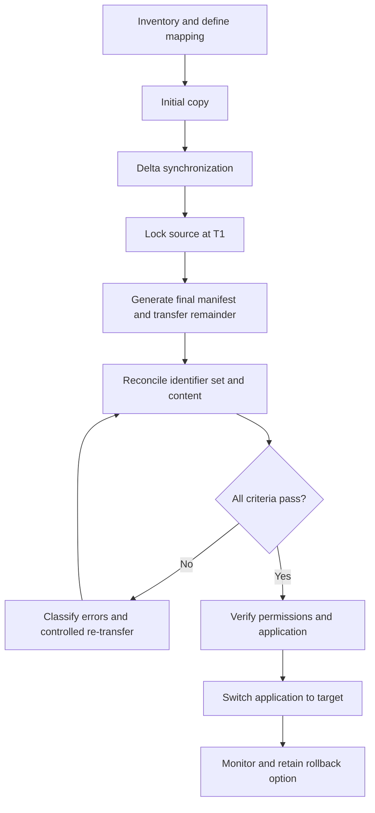

# Migrating File and Object Data with Integrity Verification

## 1. Objectives and Scope

In the **Migration and Multicloud** chapter of the **CLOUD_PROVIDERS_ORACLE** module, data migration is part of an Oracle Cloud Infrastructure (OCI) deployment with authorization, monitoring, and cost control. A copy job finishing successfully is not enough to conclude the application can already use the data at the target.

This lesson focuses on file and object data: moving from on-premises or another cloud into OCI File Storage, moving directory trees into OCI Object Storage, and reconciling data when migrating between object stores. Database topics appear only to clarify boundaries: copying datafiles while a database is actively writing does not produce a consistent recoverable copy.

After this lesson, learners will be able to:

- Distinguish byte-level data preservation from preserving names, metadata, and application state.
- Choose appropriate transfer paths between filesystems and object stores.
- Generate manifests from a stabilized source and use SHA-256 for independent reconciliation.
- Execute a File Storage copy flow and an Object Storage hands-on exercise using the OCI CLI.
- Handle discrepancies, perform controlled re-transfers, and make cutover decisions based on evidence.

The hands-on commands below target Linux with Bash, GNU findutils, GNU coreutils, `rsync`, `jq`, and a configured OCI CLI. These are examples for learners to run in their own environment; paths, bucket names, and regions must be replaced with actual resources.

## 2. What Conditions Constitute “Integrity”?

### 2.1. Four Layers to Verify

| Layer | Question to Answer | Appropriate Evidence |
| --- | --- | --- |
| Complete dataset | Are any files, objects, or versions missing or extra? | Source–target identifier list, counts, and total bytes |
| Exact content | Does target data match the byte stream of the locked source? | Per-item checksums, ideally reconciled independently end-to-end |
| Usable form | Do names, access rights, and metadata meet application requirements? | Mapping table, attribute checks, testing under app identity |
| Consistent point in time | Do items belong to the same data state meant for migration? | Snapshot or write-stop point, delta logs, and data-lock record |

For example, having 1,000 files at source and 1,000 files at target can still be wrong: one missing file replaced by an out-of-scope file; two differently named files holding identical content; or files captured at incompatible timestamps.

Matching SHA-256 proves content equivalence with negligible collision probability in practice, provided you are comparing the right items against the right source version. It does not prove the original source meets business requirements.

### 2.2. Set-Based Acceptance Formulation

Let:

- `S` be the set of source identifiers at the lock point.
- `D` be the set of target identifiers within migration scope.
- `f` be the mapping rule from source identifier to target identifier.
- `H(x)` be the SHA-256 of the entire content of item `x`.

If an exact copy within the defined scope is required, the content condition is:

```text
f must be injective: two distinct source items must not overwrite the same target.

f(S) = D

For every s in S:
    size(s) = size(f(s))
    H(s) = H(f(s))
```

Permissions, metadata, and application readability are additional conditions. If the target is allowed to contain out-of-scope data, explicitly define scope `D` using a separate bucket, prefix, or managed list; do not compare the entire bucket and interpret results arbitrarily.

## 3. Files and Objects Have Different Semantics

### 3.1. Not Every Attribute Maps Directly

| Attribute | Filesystem | Object Storage | Decision Required |
| --- | --- | --- | --- |
| Identifier | Path in directory tree | Object name in bucket and namespace | Exact name-mapping rule |
| Directories | Real directory entities and empty dirs | `/` in names typically groups by prefix | Must empty directories be recreated? |
| Permissions | UID/GID, mode; possibly ACLs | IAM and service access configs | Translate permission needs to target model |
| Links | Symlinks and hard links | No automatic POSIX equivalent | Store links, dereference, or package? |
| Metadata | Mtime, xattr, and other attributes | Content-Type, Content-Encoding, custom metadata, object properties | Which attributes must be preserved? |
| Versions | Depends on filesystem or snapshots | Multiple versions per name when versioning is enabled | Migrate current version or history? |

For example, `reports/2026/summary.csv` can become an object with the same name. That object does not automatically carry `0640` permissions or the source file owner. Storing UID/GID in metadata also does not make Object Storage enforce POSIX permissions.

For data requiring full file structure preservation, you can package it into a suitable archive and upload the archive to Object Storage. That introduces two verification problems: integrity of the archive and correctness of data after extraction. This approach changes data access patterns and removes the ability to read individual files via the object API.

### 3.2. Name Collisions to Detect Upfront

In multicloud migrations, valid object names at the source may not safely map to local paths. Cases to inspect include:

- `a` and `a/b`: can coexist as two distinct keys, yet collide if `a` must be both a file and a directory simultaneously.
- `Report.csv` and `report.csv`: can collide on case-insensitive systems.
- Names with Unicode diacritics in different normalization forms.
- Keys with leading `/`, `..` segments, special delimiters, or invalid names on the target OS.
- Two source directories stripped of paths leaving only basenames.

Never lowercase, normalize Unicode, or strip prefixes without checking injectivity of `f`. If renaming is unavoidable, save a reversible mapping linking each source key, source version, and target key.

## 4. Planning Before Data Transfer

### 4.1. Source Inventory and Locking Criteria

An inventory should contain at least: item count, total capacity, size distribution, change generation rate, special file types, critical metadata, and history retention requirements.

Two 2 TB datasets can require completely different approaches. A dataset of a few hundred large files is usually bandwidth-bound; a dataset of tens of millions of small files can be bottlenecked by listing operations, metadata, request rates, and per-file open overhead.

Define upfront:

1. RPO: is any loss of changes between the lock point and cutover acceptable?
2. Write-stop duration and allowed application outage duration.
3. Which datasets require full content verification.
4. Rules for handling updates, renames, deletes, and overwrites.
5. Acceptance criteria when target metadata differs from source.
6. Evidence storage location, cutover decision maker, and source retention period.

### 4.2. Choosing Transfer Path and Tool Placement

| Scenario | Implementation Direction |
| --- | --- |
| Source and target are both filesystems | Mount or access both ends via a data-mover host; use filesystem-aware tools |
| Directory tree to OCI Object Storage | Use OCI CLI, SDK, or a tool verified for key mapping |
| Other object store to OCI | Use dual-ended tool or staging area; check metadata and versions separately |
| OCI File Storage to Object Storage | Use a host with filesystem read and bucket API rights; decide packaging upfront |
| Data volume hard to transfer over network in time | Evaluate alternative transfer options currently supported in region/tenancy; keep same acceptance criteria |

Oracle documents File Storage transfer methods, including `fpsync`/`rsync` for certain Linux flows and `rclone` for File Storage to Object Storage flows. Tool choice still depends on the data semantics to preserve. [File Storage data transfer documentation](https://docs.oracle.com/iaas/Content/File/Tasks/transferring-data-to-and-from-file-storage.htm)

A data-mover host in a private subnet can reach supported Oracle services via a Service Gateway when routing and security rules align. A Service Gateway does not create connectivity from another cloud into OCI. [OCI Service Gateway](https://docs.oracle.com/en-us/iaas/Content/Network/Tasks/servicegateway.htm)

### 4.3. Separating Infrastructure, API, and Data Permissions

In OCI, placing a bucket or filesystem in a compartment organizes administrative scope. Permission to view resources in the Console does not mean permission to read contents.

A permission design for migration jobs should distinguish:

- **Source:** list and read data; grant write only if the job has another defined responsibility.
- **Target:** list, create data, and read back for verification; add overwrite rights only if the workflow truly requires it.
- **Configuration:** whoever provisions buckets, File Storage, VCNs, or encryption keys may differ from the identity running copies.
- **File Storage:** also account for NFS connectivity, export options, and UID/GID permissions on files.
- **Encryption keys:** confirm required permissions to use keys per the chosen configuration.

Prefer short-lived job identities or auth mechanisms suited to the runtime environment. Never place private keys, tokens, pre-authenticated secret URLs, or encryption keys into manifests, logs, or shared examples.

## 5. Manifest as the Data Reconciliation Contract

### 5.1. What to Record in a Manifest?

A manifest is an inventory describing the locked dataset. An operational manifest can split into run metadata and data entries:

```json
{
  "run_id": "migration-001",
  "source_checkpoint": "snapshot-or-freeze-t1",
  "hash_algorithm": "SHA-256",
  "scope": "current-content-only",
  "entries": [
    {
      "source_path": "docs/readme.txt",
      "destination_key": "batch-001/docs/readme.txt",
      "size_bytes": 128,
      "sha256_hex": "<64-hex-characters>"
    }
  ]
}
```

This is a structural example; sizes and checksums must be computed from actual data. For versioned objects, add version identifiers or a mechanism pinning each object read. If preserving history, one line per current key is insufficient.

The manifest should not sit inside the data tree being hashed, because adding or updating the manifest alters the dataset itself. Store manifests, transfer outputs, and reports in a separate evidence area.

### 5.2. Protecting the Manifest and Source

A manifest built from an actively changing source can capture one file at T1 and another at T2. Even a file being written can change mid-hash.

Common ways to lock the source:

- Filesystem snapshots, combined with application quiesce when needed.
- Pausing writes then creating an immutable export.
- For object data, using an immutable namespace/prefix or pinning each version to read.

A filesystem snapshot does not guarantee business consistency across multiple services or multiple filesystems. If an application writes a document and an index referencing it, lock a compatible state across both.

A manifest file and its own checksum sitting in a folder the job can modify is not enough to prevent intentional tampering. When tamper-evident proof is needed, sign the manifest or store the original where permissions and change history are independently controlled.

### 5.3. Distinguishing Checksum Types

| Value | What It Is Used For | Pitfalls to Avoid |
| --- | --- | --- |
| Size | Low-cost detection of obvious discrepancies | Equal size does not mean identical content |
| Whole-content MD5 | Reconciliation when both ends share algorithm and calculation | Do not use MD5 as tamper-proof evidence |
| Whole-content SHA-256 | End-to-end manifests, less dependent on part splitting | Must hash exact same bytes and compare same encoding |
| Multipart checksum | Verification per service rules and parts | Do not compare directly with whole-file hash if computed differently |
| ETag | Identifying object state, supporting conditional operations | Never assume ETag is MD5 or SHA-256 |

OCI provides MD5 and supports an optional checksum algorithm from the documented algorithms. Returned checksums may be Base64-encoded; multipart rules must be handled separately. [Object Storage security and checksums](https://docs.oracle.com/en-us/iaas/Content/Security/Reference/objectstorage_security.htm)

Hex and Base64 are two encodings of the same hash byte sequence. Never compare a 32-character hex MD5 string directly against a Base64 string without converting. When hashing data, do not alter newlines, text encoding, compression, or decompression between calculations if the criterion is byte-for-byte preservation.

Example computing Base64 MD5 of a small file:

```bash
openssl dgst -md5 -binary /srv/export/sample.bin | openssl base64 -A
```

For a small file using a single PUT, OCI CLI accepts `--content-md5` so the service verifies request content; a mismatch rejects the request. The example below intentionally uses `--no-multipart` and does not apply to files exceeding single-PUT limits. [OCI CLI put reference](https://docs.oracle.com/en-us/iaas/tools/oci-cli/latest/oci_cli_docs/cmdref/os/object/put.html)

```bash
FILE=/srv/export/sample.bin
MD5_B64=$(openssl dgst -md5 -binary "$FILE" | openssl base64 -A)

oci os object put \
  --namespace-name "$NS" \
  --bucket-name "$BUCKET" \
  --region "$REGION" \
  --name samples/sample.bin \
  --file "$FILE" \
  --no-multipart \
  --no-overwrite \
  --content-md5 "$MD5_B64"
```

The OCI variables in the example are explained in the hands-on section. Request checksums catch errors on one leg; reading back from the target and reconciling against the manifest also verifies picking the right objects and dataset.

## 6. Overall Workflow: Copy, Reconcile, Switch Over



### 6.1. Initial Copy and Delta Sync

The initial transfer can run while the application stays active to reduce outage duration. The result of this pass is only a baseline.

Delta passes must handle creations, updates, renames, and deletions properly. In object stores, renames are often implemented by creating the new name and deleting the old; a tool that only copies new data can leave both names behind.

Distinguish **tool-level sync** from **content verification**. A tool may skip files based on size and mtime without re-hashing full contents.

### 6.2. Locking the Source Before Final Acceptance

At milestone T1:

1. Stop write tasks or switch to a fixed snapshot/export.
2. Wait for in-flight write requests to complete per application mechanism.
3. Record the checkpoint and generate the final manifest.
4. Transfer remaining changes along with the in-scope deletion list.
5. Keep source and target stable during reconciliation.

If the app keeps writing to the source during acceptance, mismatched checksums may simply reflect two different versions. Do not fix it by repeatedly regenerating manifests until results happen to match.

### 6.3. Delete Only After Having a Clear List

Deleting to make the target match the source is a separate operation requiring scope and evidence. Before executing, export the list of items planned for deletion, verify you are pointing at the exact source–target pair, and confirm the source is not mis-mounted or empty due to an error.

Never use deletion to resolve bad checksums. A corrupted item must be isolated or overwritten with the right version; bulk deletion can destroy evidence and out-of-band data.

## 7. File Flow: Linux Source to OCI File Storage

### 7.1. Preparing Both Ends

Suppose the data-mover host can access:

- Immutable source at `/mnt/source-t1`.
- Target File Storage mounted at `/mnt/oci-files`, with a directory dedicated to this migration wave.
- Evidence area at `/srv/migration/audit/files-001`.

Before copying, verify mounts and write permissions using the exact job identity. If the target mount breaks while the mountpoint directory still exists, copying could write into the data-mover's local disk.

```bash
findmnt -T /mnt/source-t1
findmnt -T /mnt/oci-files
```

Compare outputs against the expected filesystem/export. Simply seeing the path exist does not satisfy this step.

### 7.2. Dry Run and Copy

```bash
set -euo pipefail

SRC=/mnt/source-t1
DST=/mnt/oci-files/dataset-001
AUDIT=/srv/migration/audit/files-001

mkdir -p -- "$DST" "$AUDIT"

rsync -aHn --numeric-ids --itemize-changes \
  "$SRC/" "$DST/" > "$AUDIT/preview.txt"

# Review preview and confirm source and target before running the next command.
rsync -aH --numeric-ids --info=progress2 \
  --log-file="$AUDIT/copy.log" \
  "$SRC/" "$DST/"
```

The trailing `/` on the source path matters: the example above copies the contents inside `SRC` into `DST`.

Here, `-a` enables archive mode; `-H` adds hard link preservation; `--numeric-ids` uses numeric UID/GIDs. Archive mode does not automatically include ACLs and extended attributes; evaluate support on both ends before adding corresponding flags. [rsync documentation](https://download.samba.org/pub/rsync/rsync.1)

Copying UID/GIDs requires appropriate privileges at the target. Preserving numeric UIDs is insufficient if the same number maps to a different account in the new environment. For sparse files, also check how the tool preserves sparse regions and actual physical space after copying.

### 7.3. Re-checking Content and Attributes

Once the source is fixed, a checksum dry run can find differences:

```bash
rsync -aHnc --numeric-ids --itemize-changes \
  "$SRC/" "$DST/" > "$AUDIT/remaining-differences.txt"

# List only extras at target; -n keeps this command non-destructive.
rsync -aHn --numeric-ids --delete --itemize-changes \
  "$SRC/" "$DST/" > "$AUDIT/extras-preview.txt"
```

`-c` changes update detection to compare checksums rather than only mtime and size. A dry run returning exit code 0 can still list differences; read the report rather than using exit code as proof “both ends match.” [Meaning of rsync checksum and dry-run options](https://download.samba.org/pub/rsync/rsync.1.html)

For regular files, create a SHA-256 manifest as shown in the next section and check at `DST`. Content manifests do not cover empty directories, symlink targets, hard link relationships, or permissions. Those need a separate metadata inventory and verification under the application account.

If using NFS mounts, also test actual read/write from the Compute host running the application. A copy host with broader privileges than the application can produce misleading permission test results.

## 8. Hands-On: Immutable Directory Tree to OCI Object Storage

### 8.1. Exercise Contract

The exercise uses a dedicated, empty bucket with the Standard storage tier for immediate read-back. The source is a fixed export tree containing only directories and regular files. Every file in the tree, including hidden and empty files, is in scope.

Specific assumptions:

- Relative path names map directly to object names; no prefix is added.
- No symlinks, sockets, devices, or FIFOs; no nested snapshot trees inside the source.
- No renaming, encoding changes, or content modifications during upload/download.
- No other tasks write to the source or bucket throughout the exercise.
- Migrate current content only; do not preserve POSIX permissions, empty directories, or version history.
- The verification host uses a Linux filesystem supporting the names in the dataset.

Test a small set first, including an empty file, hidden file, names with spaces, Vietnamese names, and two directories holding files with the same basename. For large datasets, include a file big enough to actually traverse the multipart flow.

### 8.2. Declaring and Checking Scope

```bash
set -euo pipefail
export LC_ALL=C

SRC=/srv/migration/export-t1
AUDIT=/srv/migration/audit/objects-001
BUCKET=migration-lab-001
REGION=ap-singapore-1

[[ -d "$SRC" && "$SRC" != / ]]
mkdir -p -- "$AUDIT" /srv/migration/verify

# Fresh directory for each verification run; do not reuse previously downloaded data.
RESTORE=$(mktemp -d /srv/migration/verify/objects-001.XXXXXX)
MANIFEST="$AUDIT/SHA256SUMS"

NS=$(oci os ns get --region "$REGION" --query data --raw-output)

EXISTING=$(oci os object list \
  --namespace-name "$NS" \
  --bucket-name "$BUCKET" \
  --region "$REGION" \
  --all --query 'data | length(@)' --raw-output)

[[ "$EXISTING" == "0" ]] || {
  echo "Stop: bucket is not empty or listing result did not match expectations." >&2
  exit 1
}
```

`NS` is the Object Storage namespace, `BUCKET` is the bucket name, and `REGION` is the bucket's region. Replace sample values before running.

Paginated listings must be handled completely. With OCI CLI, `--all` fetches all pages; do not use `--limit` in place of a full inventory. [OCI CLI list reference](https://docs.oracle.com/en-us/iaas/tools/oci-cli/latest/oci_cli_docs/cmdref/os/object/list.html)

Check that no special files exist:

```bash
SPECIAL_COUNT=$(find "$SRC" -mindepth 1 \
  ! -type f ! -type d -printf '.' | wc -c)

[[ "$SPECIAL_COUNT" -eq 0 ]] || {
  echo "Stop: source contains items outside the regular-file/directory contract." >&2
  exit 1
}
```

The empty-bucket check above evaluates listed current objects. In environments needing certainty there is no version history or uncommitted multipart uploads, inventory those objects separately; this exercise should use a new dedicated bucket.

### 8.3. Creating the Manifest Outside the Source Tree

```bash
(
  cd -- "$SRC"

  find . -type f -print0 |
    sort -z |
    xargs -0 -r sha256sum --binary -- > "$MANIFEST"

  find . -type f -printf '%P\0' |
    sort -z > "$AUDIT/source-files.nul"
)

[[ -s "$MANIFEST" ]] || {
  echo "Stop: exercise requires at least one source file." >&2
  exit 1
}
```

Piped lists use NUL delimiters to avoid splitting names with spaces or newlines incorrectly. GNU `sha256sum` produces a manifest format with filename escaping rules; keep that file intact for `--check` rather than splitting lines in a word-by-word loop.

`SHA256SUMS` holds names like `./docs/readme.txt`, relative to the source root. `source-files.nul` holds names like `docs/readme.txt` for comparison against object keys. Both formats serve distinct steps while describing the exact same file set.

Save source identity, checkpoint, manifest creation time, and tool versions in the run's evidence system. Do not proceed if the source is not genuinely frozen.

### 8.4. Upload and Inspecting the Report

```bash
oci os object bulk-upload \
  --namespace-name "$NS" \
  --bucket-name "$BUCKET" \
  --region "$REGION" \
  --src-dir "$SRC" \
  --no-overwrite \
  --verify-checksum > "$AUDIT/upload-result.json"

jq -e '
  has("upload-failures") and
  has("skipped-objects") and
  (.["upload-failures"] | length == 0) and
  (.["skipped-objects"] | length == 0)
' "$AUDIT/upload-result.json" > /dev/null
```

`bulk-upload` supports `--verify-checksum`; the report lists succeeded, failed, and skipped groups. Never interpret skips caused by `--no-overwrite` as proof the data is already right. [OCI CLI bulk-upload reference](https://docs.oracle.com/en-us/iaas/tools/oci-cli/latest/oci_cli_docs/cmdref/os/object/bulk-upload.html)

The exercise intentionally stops if any item is skipped. After an interrupted run, the bucket is no longer empty; to resume, resolve the failure list and verify existing objects, or pick a fresh test target. Do not remove safety checks just to make the script keep running.

Do not attach a single `sha256` metadata header across an entire bulk-upload command and treat it as each file's individual checksum. Individual checksums must be computed and tied to the exact key.

### 8.5. Comparing Key Sets, Not Just Counts

```bash
oci os object list \
  --namespace-name "$NS" \
  --bucket-name "$BUCKET" \
  --region "$REGION" \
  --fields name,size \
  --all > "$AUDIT/objects.json"

jq -j '.data[] | .name, "\u0000"' "$AUDIT/objects.json" |
  sort -z > "$AUDIT/object-keys.nul"

cmp -- "$AUDIT/source-files.nul" "$AUDIT/object-keys.nul"

jq '{
  object_count: (.data | length),
  total_bytes: ([.data[].size] | add // 0)
}' "$AUDIT/objects.json"
```

`cmp` must exit cleanly. This is a byte-exact name comparison under the exercise assumptions. If one object is missing and another extra object exists, total counts can still match while these lists differ.

With a shared bucket, filter to the exact dedicated prefix before comparing and apply the same mapping to the source list. Adding `batch-001/` during upload gives target keys that prefix; you cannot reuse the unprefixed list from the example above verbatim.

### 8.6. Reading Back the Target and Verifying SHA-256

```bash
oci os object bulk-download \
  --namespace-name "$NS" \
  --bucket-name "$BUCKET" \
  --region "$REGION" \
  --download-dir "$RESTORE" \
  --no-overwrite > "$AUDIT/download-result.json"

jq -e '
  has("download-failures") and
  has("skipped-objects") and
  (.["download-failures"] | length == 0) and
  (.["skipped-objects"] | length == 0)
' "$AUDIT/download-result.json" > /dev/null

(
  cd -- "$RESTORE"

  find . -type f -printf '%P\0' |
    sort -z > "$AUDIT/restored-files.nul"

  cmp -- "$AUDIT/source-files.nul" "$AUDIT/restored-files.nul"

  sha256sum --check --strict -- "$MANIFEST" |
    tee "$AUDIT/sha256-check.txt"
)

echo "Reconciled key set, downloaded file set, and SHA-256 of all files in scope."
```

`bulk-download` can download objects in a bucket or by prefix and offers options for handling colliding filenames. Using a fresh download directory here prevents confusing data from prior verification runs. [OCI CLI bulk-download reference](https://docs.oracle.com/en-us/iaas/tools/oci-cli/latest/oci_cli_docs/cmdref/os/object/bulk-download.html)

The commands in Section 8 run sequentially in the same Bash session to preserve variables and `set -euo pipefail`. With `pipefail`, an error from `sha256sum` is not masked by `tee` succeeding.

Each check has a distinct job:

- Comparing source against object list catches missing or extra keys.
- Comparing source against downloaded file list catches mapping bugs when materializing objects into files.
- Checking SHA-256 catches differing content.
- Reading upload/download reports preserves per-item failure evidence.

You can test error detection by modifying one file in `RESTORE` and re-running the manifest check. It must fail for that file. Never regenerate the manifest from a bad download to “fix” verification results.

## 9. Multipart and Migration Between Object Stores

### 9.1. Why Are Multipart Checksums Easily Misunderstood?

A large object can be split into multiple parts for upload. The combined value can depend on part sizing and service rules, so identical content does not necessarily produce the same multipart checksum across two providers.

Example:

```text
Source: split into 64 MiB parts
Target: split into 128 MiB parts

The final assembled content may be identical,
but you cannot infer that multipart checksums must match.
```

OCI documents multipart MD5 as aggregated from part checksums. When using this checksum type for reconciliation, account for the exact rules and part boundaries. [Multipart checksums in Object Storage](https://docs.oracle.com/en-us/iaas/Content/Security/Reference/objectstorage_security.htm)

A part-size-independent verification method is hashing the entire byte stream read at source and at target with the same algorithm, then tying results to the exact key and version. If using whole-object checksums provided by two services, first verify both sides truly use the same algorithm, scope, and encoding.

### 9.2. Do Not Assume Every Command Has the Same Verification Mechanism

`put`, `bulk-upload`, and `sync` are different commands. According to OCI documentation, `os object sync` has no automatic checksum-verification option like the upload flow used in the exercise. Therefore, sync jobs still need a separate reconciliation step. [Object Storage sync behavior](https://docs.oracle.com/en-us/iaas/Content/Object/Tasks/sync-object.htm)

When using multicloud tools, directly verify what copy, sync, and check modes mean. A “check” mode may fall back to size-only if two backends share no compatible hash type. Reports must state how many items were hash-compared, size-only compared, unreadable, or skipped.

### 9.3. Preserving Metadata and Versions via an Allowlist

Object migration requires explicit decisions on:

- Content-Type and Content-Encoding: wrong attributes can cause browsers or apps to mishandle data even when bytes match.
- Application metadata: reconcile keys and values per agreed rules.
- Cache-Control and headers meaningful to the application.
- Historical versions and delete markers if scope requires keeping history.
- Access settings, retention policies, and encryption keys at the target.

Never use version IDs or ETags between two services as content comparison keys. Store source–target relationships in the manifest; metadata may require translation, while version IDs are typically generated per system.

If reading a source object multiple times while it is still being updated, HEAD and GET can observe two different states. Use specific versions or service-supported conditional reads, or freeze the source before verifying.

## 10. Performance, Monitoring, and Cost

### 10.1. Estimating the Migration Window

Rough estimate for baseline data transfer time:

```text
T ≈ capacity_bytes × 8 / effective_throughput_bits_per_second
```

Hypothetical example of 2 decimal TB and 400 Mbit/s effective throughput:

```text
T ≈ 2 × 10^12 × 8 / (400 × 10^6)
  ≈ 40,000 seconds
  ≈ 11.1 hours
```

This is single-pass transfer time only under those assumptions. Add inventory time, reading source for hashing, staging writes, deltas, retries, and reading target for verification. Full download verification can add another transfer pass nearly equal to total size.

Delta passes converge only if change-processing capacity exceeds change-generation rate. If the source generates 100 GB per hour while the tool only transfers 60 GB of changes, running more cycles will never reach a lockable state.

### 10.2. Bounded Parallelism Scaling

Increase concurrency incrementally based on throughput, error rates, and remaining resources. More workers can increase hashing CPU contention, file descriptors, disk I/O, API requests, or network saturation without cutting total time.

For small files, consider batch packaging if the target app permits. Packaging also changes the verification unit and retry unit: one bad small file can force re-transferring an entire archive.

### 10.3. Minimum Monitoring Table

| Metric | Meaning |
| --- | --- |
| Items inventoried / transferred / verified | Separates copy progress from acceptance progress |
| Bytes transferred and effective throughput | Spots bottlenecks and estimates remaining time |
| API errors, timeouts, and retries | Identifies permission, network, and quota issues |
| Missing, extra keys, and bad hashes | Classifies discrepancies for precise remediation |
| Change generation rate and delta lag | Assesses ability to lock source |
| Staging space, logs, and incomplete uploads | Prevents disk exhaustion or unexpected retained resources |

Combine tool logs with appropriate service metrics in OCI Monitoring and admin events in Audit. Aggregate metrics do not replace per-item checksum reports.

Costs to include cover data-mover hosts, temporary filesystems and staging, read/write/list requests, multi-copy storage, incomplete multipart uploads, and data transfer fees on both providers. Read-back passes may incur retrieval fees or restore requests depending on storage tier. Check pricing and service terms at planning time; never apply a blanket zero-fee assumption to every transfer route.

## 11. Error Handling and Re-Transfer

| Symptom | Likely Cause | Remediation Direction |
| --- | --- | --- |
| Counts match but key lists differ | Wrong prefix, collision, or out-of-scope data | Compare identifier sets and check mapping rules |
| Sizes match but SHA-256 differs | Source changed, wrong version read, or content altered | Freeze source, fetch exact version, re-transfer item |
| All compared MD5s differ | Comparing Base64 vs. hex or multipart vs. whole-file checksum | Verify algorithm, scope, and encoding |
| Checksums match but app cannot open | Wrong permissions, Content-Type, Content-Encoding, or reference | Inspect metadata and test access with app identity |
| Target has old files deleted at source | Copy flow only adds and updates | Build in-scope deletion list, dry-run, then apply |
| Objects were skipped | Name collision or filter rule | Read reason and verify content; do not count as success |
| Large upload failed midway | Network, timeout, or compute resource issue | Handle parts per tool; inventory incomplete uploads |
| rsync reports unable to preserve owner or mode | Execution rights, export options, or incompatible permissions model | Adjust permission design and re-verify attributes |
| Mount path holds data while expected filesystem is empty | Copied into local directory due to broken mount | Stop job, verify mount, re-plan transfer |

Every retry must preserve its link to the original manifest and source checkpoint. If the source has moved to a newer version, that is a new data batch requiring a corresponding manifest or delta record.

Controlled retries should read back existing items and confirm correctness before skipping. When overwriting is required, confirm writes come from the locked source version, within exact scope, without overwriting valid changes newly created by the target application.

## 12. Application Switchover and Rollback

### 12.1. Cutover Gate Conditions

A migration wave is ready to switch over only when:

- The source checkpoint is defined and still accessible.
- Source–target identifier sets match mapping rules with zero unresolved collisions.
- All mandatory items passed content verification per defined criteria.
- Metadata discrepancies are fixed or logged as justified exceptions.
- Reports show zero unexplained transfer errors, read errors, or skipped items.
- The app reads data using its actual identity and passes required business operations.
- Mechanisms to switch endpoints, mounts, or app configs are prepared alongside a rollback plan.

If using sampling for content verification, document the sampling scope and accepted risk level. Never write “all data verified” when only a subset was checked.

### 12.2. Rollback Depends on When Target Starts Accepting Writes

Before the target receives new data, rollback can be simpler: keep the source authoritative and revert application configuration to the source.

After the target accepts writes, rollback must also preserve or reconcile new changes. Merely flipping endpoints back to the old source can lose post-cutover data. Procedures must specify which identity writes at each moment and how to prevent both ends from becoming authoritative simultaneously.

Keep the source read-only during the observation window when appropriate. Never delete the source immediately after a copy command finishes. End the retention period only after agreed acceptance, operational, and retention conditions are satisfied.

## 13. Applied Example

A team needs to move a document repository from on-premises NFS to OCI. The current application opens files via paths and preserves group permissions, so the team picks OCI File Storage as the active target. A separate export is uploaded to Object Storage to satisfy archival requirements of another system.

The team executes:

1. Inventory the directory tree, identifying symlinks, UID/GIDs, and out-of-scope folders.
2. Perform background transfer into a dedicated target directory on File Storage.
3. Stop writes during the cutover window and lock an export at T1.
4. Generate a content manifest and metadata inventory from T1.
5. Sync deltas and inspect the extras list via dry run.
6. Reconcile SHA-256 and test permissions under the application account.
7. Upload the locked export to a dedicated bucket, verify key sets, then read back to reconcile.
8. Switch application mounts/configs, monitor errors, and retain the source for the agreed duration.

If the Object Storage export drops empty directories and POSIX permissions per the agreed contract, that is an intentional semantic change. If the File Storage copy fails to preserve required permissions, matching content checksums are still insufficient to accept the active target.

Completion evidence for this wave includes the T1-bound manifest, mapping table, transfer reports, content and metadata reconciliation results, application test results, plus source retention and rollback terms.
