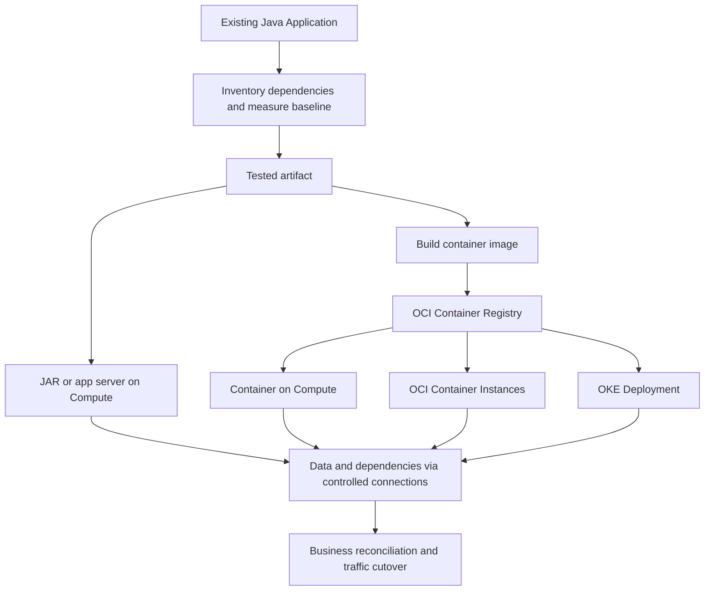

# Migrating Java Applications to Compute, Containers, and OKE

Migrating a Java application to Oracle Cloud Infrastructure (OCI) involves three tightly linked decisions: where the application will run, how dependencies will connect, and how traffic will shift. Getting a JAR file onto a new server solves only startup. A complete migration must also preserve transactions, protect credentials, maintain observability, and provide a viable rollback path.

In the **Migration and Multicloud** chapter of the **CLOUD_PROVIDERS_ORACLE** module, this lesson focuses on the Java application layer: running directly on OCI Compute, packaging into containers, and deploying on Oracle Kubernetes Engine (OKE). Tenancy, compartments, IAM, VCN, storage, and database components are included specifically where they affect application deployment and operations.

## 1. Expected Outcomes and Example Scope

After this lesson, learners will be able to:

- Inventory dependencies and identify changes required before moving an application.
- Choose between Compute, containers on Compute, OCI Container Instances, or OKE based on operational requirements.
- Deploy a Java service with externalized configuration, resource limits, health checks, and graceful shutdown.
- Organize pre-cutover testing, traffic shifting, and rollback while accounting for data compatibility.
- Set up permissions, performance monitoring, and cost controls for the target environment.

The end-to-end example is the `order-api` service, currently running in a data center or another cloud. The service provides APIs to create and look up orders, connects to an Oracle Database over JDBC, and may call an external payment gateway.

Illustrative configuration snippets assume:

| Component | Lab Assumptions |
| --- | --- |
| Application | Spring Boot 3.5, with Spring Boot Actuator and appropriate security configuration |
| Java | JDK 21 verified compatible with source code, libraries, and JDBC driver |
| Packaging | Maven builds executable JAR `target/app.jar` |
| HTTP Port | `8080` on the Java process |
| Data | External database; connection details supplied by environment |
| Container | Linux `amd64`; for Ampere/Arm, build and test the corresponding variant |
| OKE | Cluster using managed nodes; networking and permissions already prepared |
| CLI Tools | Examples use Bash on a Linux deployment host or equivalent environment |

This is an example configuration, not a mandate to upgrade every application to Java 21 or Spring Boot 3.5 before migrating. For systems on Java 8, Java 11, or application servers, retain a supported runtime and evaluate compatibility separately. Versions in the examples should also not be assumed to be the latest.

OCIDs, registry namespaces, digests, database addresses, and secret paths must be replaced with your lab environment's values. The application and deployment files shown below are files learners must prepare; the lesson does not assume they already exist in the project.

## 2. Assessing the Application Before Choosing a Platform

### 2.1. Distinguishing Infrastructure Migration from Java Platform Changes

These three changes carry different risk levels:

1. **Rehost:** keep deployment close to the current state; move JARs or the application server to Compute.
2. **Replatform:** repackage, separate configuration and state from the host, and move the app into containers or OKE.
3. **Refactor:** alter design, such as extracting background jobs or moving sessions to a shared store.

You can go straight to OKE when both the application and operations team are ready. No intermediate steps are required. A monolith deeply tied to OS or application server features may suit Compute initially.

Do not bundle a JDK upgrade, major framework upgrade, database swap, and deployment platform shift into a single cutover without testing each change separately. For example, upgrading Spring Boot 2 to 3 may entail migrating Java EE APIs from `javax.*` to `jakarta.*`; that is a framework ecosystem change, not an inherent requirement of running on OCI. Also do not mechanically replace every `javax.*` package, because not all packages with that prefix moved to Jakarta.

### 2.2. Checklist of Items to Collect

| Group | Information to Record | Migration Impact |
| --- | --- | --- |
| Runtime | JDK vendor/version, JVM flags, GC, locale, timezone, truststore | Can affect dates/times, TLS, and memory usage |
| Native binaries | JNI, `.so` libraries, fonts, system tools | May depend on CPU, libc, or OS packages |
| Packaging | Executable JAR, WAR, EAR, external libraries | WAR/EAR may require an application server and separate domain |
| Application server | JNDI, datasources, JMS, JTA/XA, realms | Containerization does not automatically replace these services |
| Database | JDBC URL, schema, pool, TLS/wallet, session limits | Determines connectivity and max replica count |
| State | HTTP sessions, caches, uploads, working directories | Must be handled before swapping hosts or scaling replicas |
| Background tasks | Cron, schedulers, consumers, distributed locks | Multiple replicas can cause duplicate job execution |
| Network | DNS, proxies, internal endpoints, IP allowlists, ports | Needs valid paths to all dependencies |
| Secrets | API keys, passwords, certificates, rotation workflow | Determines secret injection and app identity |
| Operations | Logs, metrics, traces, backups, start/stop scripts | Basis for creating alerts and new runbooks |
| Performance | Load, p95/p99, startup, GC pauses, DB waits | Baseline needed to evaluate target environment |
| Commercial | Licenses for JDK, application server, database | Must be verified against applicable terms |

For example, a WebLogic app using JMS and XA does not become a standalone Spring Boot service merely by copying the WAR into a JRE image. You can keep WebLogic on Compute or choose an appropriate WebLogic-on-Kubernetes deployment, but you still must handle domains, persistent stores, transactions, and licensing.

### 2.3. Baseline and Acceptance Criteria

Example agreed by an application team before migration:

- Lookup API has p95 ≤ `300 ms` at `100 requests/second`.
- Server-side error rate under `0.5%` over the defined measurement window.
- Zero duplicate orders or double charges when clients retry.
- Stopping one replica loses zero committed transactions.
- Fallback to old environment within `15 minutes` while rollback conditions remain valid.

These are illustrative targets. When measuring, hold dataset, request types, read/write ratio, concurrency, warm-up duration, and load generator placement constant. Comparing an already warmed-up legacy system against a freshly started JVM can lead to false performance conclusions.

## 3. Choosing Compute, Containers, or OKE

### 3.1. Options Do Not Sit on a Single Axis

**Compute** provisions virtual or bare-metal machines. **Containers** are a way to package and run processes. **OKE** is a managed Kubernetes service. Containers can still run on Compute; having a Dockerfile does not mean you need Kubernetes.

| Option | Best Fit When | Remaining Operational Responsibilities |
| --- | --- | --- |
| JAR/app server on Compute | Need environment close to current state; OS dependencies exist | OS, JDK/server, processes, patching, multi-host management, updates, recovery |
| Containers on Compute | Want consistent artifacts without needing Kubernetes yet | Host/runtime, networking, restarts, replica distribution, deployment |
| OCI Container Instances | Simple container workloads without needing Kubernetes API | Images, config, connectivity, restart policy, multi-instance design |
| OKE | Multiple services/replicas needing rollouts, scheduling, Kubernetes ecosystem | Workloads, resources, IAM/RBAC, app networking, observability, upgrade coordination |

OCI Container Instances run one or more containers without requiring users to manage underlying servers. The service lets you configure resources, networking, and restart policies, fitting workloads that do not need a Kubernetes platform. Container restart capability does not replace multi-instance design, load balancing, and recovery when an instance fails. See [Container Instances overview](https://docs.oracle.com/en-us/iaas/Content/container-instances/overview-of-container-instances.htm) and [configuring restart policies](https://docs.oracle.com/en-us/iaas/Content/container-instances/creating-a-container-instance.htm).

### 3.2. Reference Migration Flow



Compute usually minimizes initial changes. OKE can streamline subsequent releases when operations already has Kubernetes workflows. Compare total effort and cost over the application's lifecycle rather than comparing single-replica compute prices alone.

## 4. Preparing OCI Foundation and Data Connectivity

### 4.1. Compartments, IAM, and Application Identity

Create environment boundaries via compartments, such as `app-dev` and `app-prod`, following organizational governance. Apply application, environment, owner, and cost-center tags from the start.

Separate permissions by role:

- Infrastructure team manages VCNs, subnets, Compute, OKE, and load balancers within assigned scope.
- Build pipeline pushes images to required repositories.
- Image-pulling components have read access to needed repositories.
- Applications access only business secrets, buckets, or required resources.
- Operators can observe and deploy within the right namespace without default cluster-wide admin privileges.

On Compute, you can use **instance principals**: place instances in a dynamic group, grant OCI IAM policies, and configure the OCI SDK to use the corresponding provider. This avoids distributing user API keys onto machines. Still control who can log into the instance, because machine access may allow using that identity. See [calling OCI services from instances](https://docs.oracle.com/en-us/iaas/Content/Identity/Tasks/callingservicesfrominstances.htm).

On OKE, **workload identity** grants OCI permissions to workloads bound to a Kubernetes ServiceAccount. This feature requires an enhanced cluster and a supporting OCI SDK. Adding `serviceAccountName` to a manifest alone neither configures authentication in Java nor grants OCI IAM policies. Policies should be scoped to cluster, namespace, ServiceAccount, and target resources. See [granting workloads access to OCI resources](https://docs.oracle.com/en-us/iaas/Content/ContEng/Tasks/contenggrantingworkloadaccesstoresources.htm).

Distinguish three layers: OCI IAM, Kubernetes RBAC, and database accounts. Bucket read access does not allow editing a Deployment or logging into Oracle Database. App identity calling OCI APIs also differs from registry credentials pulling images before the container starts.

### 4.2. VCN and Network Flows

Typical design:

```text
Client
  -> DNS / TLS entry point
  -> Load Balancer or ingress
  -> Compute instances or OKE Services/Pods
  -> Oracle Database / cache / internal systems

Deployment host
  -> VPN, Bastion, or controlled management path
  -> private endpoint / application hosts
```

Prepare each flow:

| Flow | Items to Verify |
| --- | --- |
| Client to entry point | DNS, certificates, TLS, timeouts, and allowed sources |
| Load balancer to backend | Backend ports, health checks, NSGs/security lists |
| App to database | Routes, DNS, listener/endpoint, TLS, and account rights |
| Runtime/node to registry | DNS, egress, and image pull rights |
| App to OCI services | Service endpoints, appropriate routes, and IAM |
| App to Internet | NAT/proxy or prepared egress path |
| Deployment host to Kubernetes API | Network path to endpoint, OCI auth, and RBAC |

Service Gateway serves supported OCI services per network configuration; it is not an egress gateway to arbitrary Internet addresses. Private subnets need explicit egress. For OKE, also budget IPs for nodes, CNI pods, services, and control plane flows; do not apply single-VM rules to an entire cluster.

Applications do not need public IPs merely to serve users behind a load balancer. Restrict SSH, management ports, and Actuator strictly as needed.

### 4.3. Keeping the Database at Source Initially

You can move the application to OCI while keeping Oracle Database at the source. In that case, VPN or FastConnect and related connectivity become part of application architecture alongside DNS, bidirectional routing, and IP allowlists.

Simple estimate:

```text
Time from sequential network round trips ≈ sequential_call_count × RTT
```

If one request makes 20 sequential database calls and RTT rises from `2 ms` to `25 ms`, added network delay may be roughly `20 × 23 = 460 ms`, excluding other processing. Connection pools reuse connections but do not eliminate per-query latency.

Measure from the target environment. If targets fail, consider query/batching optimization, migrating app and data in the same wave, or redesigning. Adding CPU does not directly fix a round-trip latency issue.

During a temporary multicloud phase, clarify where writes are allowed, consumer/scheduler ownership, egress IPs, and data transfer costs. Retries need timeouts, backoff, and idempotency to avoid duplicate writes when links drop.

## 5. Standardizing the Application Before Deployment

### 5.1. Separating Configuration from Artifacts

One artifact should be reusable across environments. JDBC URLs, usernames, passwords, and endpoints are injected externally rather than baked into JARs or images.

Example `application.properties` for the sample app:

```properties
server.port=${SERVER_PORT:8080}
server.shutdown=graceful
spring.lifecycle.timeout-per-shutdown-phase=30s

management.endpoints.web.exposure.include=health,info
management.endpoint.health.probes.enabled=true
management.endpoint.health.show-details=never

spring.datasource.url=${APP_DB_URL}
spring.datasource.username=${APP_DB_USER}
spring.datasource.password=${APP_DB_PASSWORD}
spring.datasource.hikari.maximum-pool-size=${APP_DB_POOL_MAX:10}
```

Datasource properties assume the app uses Spring JDBC/JPA with HikariCP. The Actuator dependency is required. If Spring Security or custom filters are present, permit probes to reach the exact health endpoints without login redirects while protecting other management endpoints.

Secrets are supplied via environment mechanisms. Never place passwords in Dockerfiles, Git, ConfigMaps, or `-D...` flags visible in command invocations. Environment variables can still be read by sufficiently privileged users, so restrict access to configs, logs, and ops roles.

### 5.2. Resolving State Before Scaling Replicas

- Move uploads and long-lived outputs to Object Storage or a store matching access semantics.
- If a shared filesystem is required, evaluate File Storage, permissions, and concurrency; Object Storage does not directly replace a POSIX filesystem.
- Handle HTTP sessions via a shared store or stateless design avoiding local session affinity.
- Extract schedulers into separate workloads or use verified distributed locks and duplicate-execution prevention.
- For consumers, check acks, retries, dead-letter handling, and idempotency.
- For containers, log to stdout/stderr; allow ephemeral files to vanish when pods are replaced.

Sticky sessions can work temporarily, yet sessions still drop when a backend dies. Persistent Volumes also do not automatically solve two replicas writing the same file or running the same job.

### 5.3. JVM Memory Budget

Process memory is larger than Java heap:

```text
Process memory ≈ heap + metaspace + code cache
               + thread stacks + direct/native buffers
               + native libraries + other overhead
```

Setting `-Xmx` equal to the entire memory limit risks the OS/container killing the process before heap fills. Conversely, heap can throw `OutOfMemoryError` before the process hits the container limit.

With a `1 GiB` limit, `-XX:MaxRAMPercentage=60.0` reserves roughly 60% of JVM-detected memory for maximum heap. This is a starting point for measurement, not a universal ratio. The remainder must cover native memory, threads, and buffers. Verify the JVM detects container limits accurately on the chosen runtime.

Too low a CPU limit can stretch startup, cause throttling, and trigger probe timeouts. CPU requests govern scheduling, not hard limits. Do not mechanically equate Kubernetes CPUs with OCPUs across all Compute architectures; check actual shapes.

## 6. Path A: Deploying JARs on OCI Compute

### 6.1. Preparing Host and Artifact

The example uses Linux with systemd, compatible JDK installed, and dependency connectivity verified. `/usr/bin/java` must point to the verified JDK.

1. Create instances in the right compartment/subnet, choosing shapes from baseline.
2. Configure NSGs, host management, and OS patching.
3. Verify `java -version`, timezone, DNS, truststore, and native libraries.
4. Deliver CI-built artifacts and checksums via controlled deployment channels.
5. Create a service account and directories with least privilege.

Example one-time setup on a fresh host; adjust shell paths for your distribution:

```bash
sudo useradd --system --home-dir /opt/order-api \
  --shell /sbin/nologin orderapi

sudo install -d -o root -g orderapi -m 0750 \
  /opt/order-api/releases /etc/order-api

# CI provides checksum referencing the filename in this directory.
cd /tmp
sha256sum -c order-api-2026.11.1.jar.sha256

sudo install -o root -g orderapi -m 0640 \
  /tmp/order-api-2026.11.1.jar \
  /opt/order-api/releases/order-api-2026.11.1.jar

sudo ln -sfn /opt/order-api/releases/order-api-2026.11.1.jar \
  /opt/order-api/current.jar
```

Checksums must come from trusted CI records. Computing a checksum yourself after downloading does not prove artifact provenance.

Pipeline or operators create `/etc/order-api/runtime.env` owned by `root`, mode `0600`, holding `APP_DB_URL`, `APP_DB_USER`, `APP_DB_PASSWORD`, `APP_DB_POOL_MAX`. Supply secrets via controlled processes. A JDBC URL for an Oracle TCP service might be `jdbc:oracle:thin:@//db.internal.example:1521/ORDERS`. If the database requires TCPS, wallets, or custom config, use exact service-provided details.

### 6.2. Managing the Process with systemd

Example `/etc/systemd/system/order-api.service`:

```ini
[Unit]
Description=Order API
Wants=network-online.target
After=network-online.target

[Service]
Type=simple
User=orderapi
Group=orderapi
WorkingDirectory=/opt/order-api
EnvironmentFile=/etc/order-api/runtime.env
ExecStart=/usr/bin/java -Xms512m -Xmx2g -XX:+ExitOnOutOfMemoryError -jar /opt/order-api/current.jar
Restart=on-failure
RestartSec=5s
TimeoutStopSec=45s
KillSignal=SIGTERM
MemoryMax=3G
NoNewPrivileges=true
PrivateTmp=true
ProtectSystem=strict
ProtectHome=true
StateDirectory=order-api
ReadWritePaths=/var/lib/order-api
UMask=0027
StandardOutput=journal
StandardError=journal

[Install]
WantedBy=multi-user.target
```

This example caps the service cgroup at `3 GiB`, with max heap `2 GiB`. The host must retain enough memory for OS, agents, and other processes. Tune values after load testing. `StateDirectory` provides a writable folder for acceptable local needs; cross-host shared data must still live externally.

Start and inspect:

```bash
sudo systemctl daemon-reload
sudo systemctl enable --now order-api
sudo systemctl status order-api --no-pager
sudo journalctl -u order-api -n 100 --no-pager
curl --fail http://127.0.0.1:8080/actuator/health/readiness
```

`network-online.target` does not prove the database is ready. The application still needs disconnect-handling logic. Systemd's `active` status also does not replace HTTP checks and business tests.

### 6.3. Multi-Host Setup and Rollback

So one host failure does not halt the entire service, place multiple instances behind a load balancer distributed across availability domains/fault domains per region capabilities. Not every region has multiple availability domains.

When updating hosts one by one:

1. Drain the host from new requests and let in-flight requests finish.
2. Place the new JAR in a new release path while keeping the old artifact.
3. Flip the `current.jar` symlink and restart the service.
4. Wait for readiness, verify business APIs and logs/metrics.
5. Return the host to the backend pool, then update the next host.

On failure, pull the host from traffic, point back to the old release, restart, and verify before re-enabling traffic. Running the old JAR also depends on schema/data compatibility. Boot volume backups do not replace application rollback or database backups.

## 7. Path B: Container Packaging and Publishing via OCIR

### 7.1. Building a Non-Root Runtime Image

The Maven project must produce an executable JAR named `target/app.jar`, for example by setting `finalName` to `app` and configuring the Spring Boot Maven Plugin to repackage. `mvn clean verify` must pass before containerizing.

Example Dockerfile for a project with `pom.xml` and `src/`:

```dockerfile
FROM maven:3.9-eclipse-temurin-21 AS build
WORKDIR /workspace
COPY pom.xml ./
COPY src ./src
RUN mvn -B -ntp clean verify

FROM eclipse-temurin:21-jre-jammy
WORKDIR /app
COPY --from=build --chown=10001:10001 /workspace/target/app.jar /app/app.jar
USER 10001:10001
ENV JAVA_TOOL_OPTIONS="-XX:MaxRAMPercentage=60.0 -XX:+ExitOnOutOfMemoryError -Djava.io.tmpdir=/tmp"
EXPOSE 8080
ENTRYPOINT ["java", "-jar", "/app/app.jar"]
```

Multi-stage builds keep build tools out of the runtime image. Exec-form `ENTRYPOINT` delivers stop signals directly to Java. Base image tags here are illustrative; pipelines must manage patching, vulnerability scanning, and digest pinning per build reproducibility standards.

If Maven needs a private repository, pass credentials via proper build-secret mechanisms. Never `COPY` a config file containing passwords into a layer expecting a subsequent delete command to erase traces. Use `.dockerignore` to exclude secrets, Git metadata, logs, and temporary artifacts from the build context.

### 7.2. Testing the Image Before Pushing

Example build for Linux x86 nodes:

```bash
docker buildx build --platform linux/amd64 \
  --load -t order-api:2026.11.1 .

docker run -d --name order-api-local \
  --memory=1g --cpus=2 \
  --read-only \
  --tmpfs /tmp:rw,nosuid,nodev,size=128m \
  --cap-drop=ALL \
  --security-opt=no-new-privileges \
  --stop-timeout=45 \
  --env-file /secure/order-api-container.env \
  -p 127.0.0.1:8080:8080 \
  order-api:2026.11.1

curl --fail http://127.0.0.1:8080/actuator/health/readiness
docker logs --tail 100 order-api-local
docker stop order-api-local
```

The env file sits in a secure location, holds app config, and is never committed. The database must be reachable from the container network. Test stopping while requests are active, not only when idle.

An image running on an x86 laptop does not prove it works on Ampere nodes. For Arm, build `linux/arm64` or use multi-architecture images; test JNI and monitoring agents too. Base images using a different libc also need testing with native dependencies.

### 7.3. Pushing Images to OCI Container Registry

Retrieve the **tenancy's Object Storage namespace** to form the OCIR path; this is not a Kubernetes namespace and does not necessarily match the tenancy name. Create a private repository and appropriate access rights before pushing.

Example using the Ashburn OCIR endpoint—change to match your deployment region:

```bash
export REGISTRY='iad.ocir.io'
export TENANCY_NAMESPACE='<OBJECT_STORAGE_NAMESPACE>'
export IMAGE_TAG="$REGISTRY/$TENANCY_NAMESPACE/java/order-api:2026.11.1"

docker login "$REGISTRY"
docker tag order-api:2026.11.1 "$IMAGE_TAG"
docker push "$IMAGE_TAG"
docker image inspect "$IMAGE_TAG" --format '{{index .RepoDigests 0}}'
```

When logging in, username has the form `<tenancy-namespace>/<oci-username>`; federated accounts may need an identity domain prefix per tenancy configuration. The password is an OCI auth token for registry access, not the Console password. See [pushing images with Docker CLI](https://docs.oracle.com/en-us/iaas/Content/Registry/Tasks/registrypushingimagesusingthedockercli.htm?Highlight=docker) and [registry credential formats](https://docs.oracle.com/en-us/iaas/Content/Registry/Tasks/registrypullingimagesusingthedockercli.htm).

Record the `registry/namespace/repository@sha256:...` produced by the push in release records. Deploying by digest pins exact image contents because tags can be repointed. Do not confuse the Docker image ID with the registry digest.

### 7.4. Running Containers on Compute or Container Instances

**On Compute:** use tested images, externalized configs, resource limits, and container lifecycle management across reboots or exits. Operations still patches host/runtime, collects logs, and maintains multiple hosts if fault tolerance is needed.

**On Container Instances:** pick image, shape, subnet/NSG, environment config, and restart policy. Supply private repository access per service docs; Kubernetes `imagePullSecrets` do not apply directly. For continuous HTTP services, evaluate restart policies and place multiple instances behind a load balancer if availability targets require.

Both options require verifying shutdown duration, status, health checks, and new version rollout workflows. A running container does not yet prove the app is ready to serve requests.

## 8. Path C: Deploying the Application on OKE

### 8.1. Preparing the Cluster and Access Rights

Before deploying, confirm:

- Kubernetes and deployment tooling are supported and mutually compatible.
- Managed node pools have sufficient CPU/RAM, with at least two nodes for multi-replica examples.
- CPU architecture matches images; if mixed architectures exist, proper scheduling/images are configured.
- Routes, DNS, CNI, IPs, and node/pod network flows are prepared.
- Paths to OCIR, database, logging, and required endpoints exist.
- Deployers hold scoped OCI IAM and Kubernetes RBAC rights.
- Spare capacity exists for extra pods created during rolling updates.

With a private Kubernetes API, the host running `kubectl` must have network reachability to the endpoint. A laptop or Cloud Shell with OCI CLI does not automatically have all necessary private network routes.

Example generating an isolated kubeconfig:

```bash
mkdir -p "$HOME/.kube"

oci ce cluster create-kubeconfig \
  --cluster-id '<CLUSTER_OCID>' \
  --region '<OCI_REGION>' \
  --file "$HOME/.kube/oci-java-migration" \
  --token-version 2.0.0 \
  --kube-endpoint PRIVATE_ENDPOINT

export KUBECONFIG="$HOME/.kube/oci-java-migration"
kubectl config current-context
kubectl get nodes -o wide
```

The kubeconfig uses OCI CLI to fetch per-user tokens; the CLI must be present and using the right profile. If RBAC forbids listing nodes, an administrator verifies node pools on behalf of the deploy account. See [setting up OKE access](https://docs.oracle.com/en-us/iaas/Content/ContEng/Tasks/contengdownloadkubeconfigfile.htm).

Administrators bootstrap namespace `java-migration`, quotas, and Role/RoleBindings. Creating a namespace is a cluster-level action; daily deployers may only have permissions inside the granted namespace.

```bash
# Use bootstrap account if namespace does not exist yet.
kubectl create namespace java-migration

# Use application deployment account.
kubectl auth can-i create deployments.apps -n java-migration
kubectl auth can-i get pods -n java-migration
```

### 8.2. Image Pull Secrets and Application Secrets

Before applying manifests, prepare two Secrets in the same namespace as the pods:

| Secret | Type/Content | Purpose |
| --- | --- | --- |
| `ocir-pull` | `kubernetes.io/dockerconfigjson`, valid registry credentials | Pull private OCIR images |
| `order-db` | Holds key `APP_DB_PASSWORD` | Supply database password |

Example creating from files prepared by a secret agent or CI on the deployment host:

```bash
kubectl -n java-migration create secret generic ocir-pull \
  --type=kubernetes.io/dockerconfigjson \
  --from-file=.dockerconfigjson=/secure/ocir/config.json

kubectl -n java-migration create secret generic order-db \
  --from-file=APP_DB_PASSWORD=/secure/order-db-password
```

The Docker config must hold usable `auths` for the exact registry; a file merely referencing a local credential helper on a personal machine will fail. The password file holds the exact value without trailing unintended newlines. Restrict permissions and lifecycles of source files.

Creating registry secrets directly from auth tokens is also covered in [OKE pulling images from OCIR](https://docs.oracle.com/en-us/iaas/Content/ContEng/Tasks/contengpullingimagesfromocir.htm). Avoid leaving real tokens in shell history, CI logs, or command transcripts.

Kubernetes Secrets are not secure merely due to Base64 encoding. RBAC, encryption at rest, and rotation workflows are required. If using OCI Vault, choose a deployed and verified integration mechanism; the manifest below does not automatically sync secrets from Vault.

### 8.3. Sample Deployment Manifest

Save as `order-api-oke.yaml` in your lab deployment set. Before applying, replace the JDBC URL, username, and full `image` reference with the real digest. The app needs the Spring Boot config from earlier; both Secrets must already exist.

```yaml
apiVersion: v1
kind: ServiceAccount
metadata:
  name: order-api
  namespace: java-migration
---
apiVersion: v1
kind: ConfigMap
metadata:
  name: order-api-config
  namespace: java-migration
data:
  SERVER_PORT: "8080"
  APP_DB_URL: "jdbc:oracle:thin:@//db.internal.example:1521/ORDERS"
  APP_DB_USER: "ORDER_APP"
  APP_DB_POOL_MAX: "10"
---
apiVersion: apps/v1
kind: Deployment
metadata:
  name: order-api
  namespace: java-migration
spec:
  replicas: 2
  revisionHistoryLimit: 5
  minReadySeconds: 10
  progressDeadlineSeconds: 600
  strategy:
    type: RollingUpdate
    rollingUpdate:
      maxSurge: 1
      maxUnavailable: 0
  selector:
    matchLabels:
      app: order-api
  template:
    metadata:
      labels:
        app: order-api
    spec:
      serviceAccountName: order-api
      imagePullSecrets:
        - name: ocir-pull
      terminationGracePeriodSeconds: 45
      securityContext:
        runAsNonRoot: true
        runAsUser: 10001
        runAsGroup: 10001
        fsGroup: 10001
        seccompProfile:
          type: RuntimeDefault
      topologySpreadConstraints:
        - maxSkew: 1
          topologyKey: kubernetes.io/hostname
          whenUnsatisfiable: DoNotSchedule
          labelSelector:
            matchLabels:
              app: order-api
      containers:
        - name: app
          image: iad.ocir.io/REPLACE_NAMESPACE/java/order-api@sha256:REPLACE_DIGEST
          ports:
            - name: http
              containerPort: 8080
          envFrom:
            - configMapRef:
                name: order-api-config
          env:
            - name: APP_DB_PASSWORD
              valueFrom:
                secretKeyRef:
                  name: order-db
                  key: APP_DB_PASSWORD
          resources:
            requests:
              cpu: "500m"
              memory: "768Mi"
            limits:
              cpu: "2"
              memory: "1Gi"
          startupProbe:
            httpGet:
              path: /actuator/health/liveness
              port: http
            periodSeconds: 5
            timeoutSeconds: 2
            failureThreshold: 36
          readinessProbe:
            httpGet:
              path: /actuator/health/readiness
              port: http
            periodSeconds: 5
            timeoutSeconds: 2
            failureThreshold: 3
          livenessProbe:
            httpGet:
              path: /actuator/health/liveness
              port: http
            periodSeconds: 10
            timeoutSeconds: 2
            failureThreshold: 3
          lifecycle:
            preStop:
              exec:
                command: ["sh", "-c", "sleep 5"]
          securityContext:
            allowPrivilegeEscalation: false
            readOnlyRootFilesystem: true
            capabilities:
              drop: ["ALL"]
          volumeMounts:
            - name: tmp
              mountPath: /tmp
      volumes:
        - name: tmp
          emptyDir:
            medium: Memory
            sizeLimit: 128Mi
---
apiVersion: v1
kind: Service
metadata:
  name: order-api
  namespace: java-migration
spec:
  type: ClusterIP
  selector:
    app: order-api
  ports:
    - name: http
      port: 8080
      targetPort: http
---
apiVersion: policy/v1
kind: PodDisruptionBudget
metadata:
  name: order-api
  namespace: java-migration
spec:
  minAvailable: 1
  selector:
    matchLabels:
      app: order-api
```

Key points to understand:

- Requests govern scheduling; limits cap usage per resource mechanism. Sample values must be re-tuned under representative load.
- Two replicas and topology spread distribute across eligible nodes. Verify in practice; this config cannot conjure new nodes or failure domains if only one domain is eligible.
- `maxUnavailable: 0` keeps old replicas until new pods are ready during normal rolling updates. It does not guarantee zero outage if a node or database fails.
- `/tmp` holds ephemeral data. With `medium: Memory`, memory consumed by the volume counts against relevant memory budgets; do not treat `128Mi` as sitting outside the memory limit.
- `preStop` uses shell and `sleep` present in the example base image. If switching to a shell-less base image, update the hook or shutdown design.
- The `45-second` termination grace period includes the hook. Allow enough time for the hook, app shutdown, and margin; a single shutdown phase timeout is not automatically total stop duration.

### 8.4. Three Probes Answer Three Different Questions

| Probe | Question | When Failing Repeatedly |
| --- | --- | --- |
| Startup | Has the process started enough to begin applying the remaining probes? | Container restarts per workload policy |
| Readiness | Is the replica ready to accept traffic? | Pod is removed from normal ready backends |
| Liveness | Does the process need a restart to recover? | Container restarts |

The startup probe has a nominal budget of roughly `36 × 5 = 180 seconds`. Once startup succeeds, readiness/liveness activate. Tune to actual startup and warm-up times.

Never put a shared database check into liveness: a database hiccup could restart every replica. Whether readiness should check the database depends on whether the app can serve anything when dependencies fail and how routing behaves if all replicas lose readiness simultaneously. Spring Boot does not automatically add every external dependency to readiness. If using a separate management port, probing the management port may also miss a broken business port; the example uses the same port. See [Spring Boot Kubernetes probes](https://docs.spring.io/spring-boot/3.5/reference/actuator/endpoints.html).

Graceful shutdown finishes in-flight requests upon receiving a stop signal, though results also depend on the HTTP server, timeouts, background tasks, and upstream backend removal. Test under load with real business flows. See [Spring Boot graceful shutdown](https://docs.spring.io/spring-boot/3.5/reference/web/graceful-shutdown.html).

### 8.5. Applying and Verifying

After replacing environment values:

```bash
kubectl apply --dry-run=server -f order-api-oke.yaml
kubectl apply -f order-api-oke.yaml

kubectl -n java-migration rollout status deployment/order-api \
  --timeout=10m

kubectl -n java-migration get pods -l app=order-api -o wide
kubectl -n java-migration get service order-api
kubectl -n java-migration get pdb order-api
```

Server dry-run checks whether the API/admission accepts the configuration. It does not prove the image pulls, secrets are right, database is reachable, or business logic works.

Temporary check from the operations host:

```bash
kubectl -n java-migration port-forward service/order-api 18080:8080
```

In another terminal:

```bash
curl --fail http://127.0.0.1:18080/actuator/health/readiness
```

Next, run order creation/lookup tests using lab accounts and data. Port-forward is for diagnostics; still test through the entry path real clients use.

### 8.6. Exposing via OCI Load Balancer

A `ClusterIP` Service creates no entry point outside the cluster. You can add a private load balancer for access from the private network:

```yaml
apiVersion: v1
kind: Service
metadata:
  name: order-api-private
  namespace: java-migration
  annotations:
    oci.oraclecloud.com/load-balancer-type: "lb"
    service.beta.kubernetes.io/oci-load-balancer-internal: "true"
spec:
  type: LoadBalancer
  selector:
    app: order-api
  ports:
    - name: http
      port: 80
      targetPort: http
```

OKE needs permissions and networking to provision load balancers. The internal annotation requests a private IP; subnets, NSGs, and backend flows still need setup matching cluster/backend type. See [configuring OKE load balancers](https://docs.oracle.com/en-us/iaas/Content/ContEng/Tasks/contengconfiguringloadbalancersnetworkloadbalancers-subtopic.htm).

The example uses HTTP inside the private network to illustrate connectivity. Real environments need TLS at the entry point or end-to-end per requirements, DNS, and access controls. If using Ingress, a compatible controller must exist; creating an Ingress object alone does not provide a controller.

### 8.7. Rollout and Rollback on OKE

Update to a newly tested image digest:

```bash
export NEW_IMAGE='<FULL_OCIR_IMAGE_REFERENCE_WITH_DIGEST>'

kubectl -n java-migration set image deployment/order-api \
  app="$NEW_IMAGE"

kubectl -n java-migration rollout status deployment/order-api \
  --timeout=10m

kubectl -n java-migration rollout history deployment/order-api
```

If rollback is needed, inspect history and select a verified revision:

```bash
kubectl -n java-migration rollout undo deployment/order-api \
  --to-revision='<KNOWN_GOOD_REVISION>'

kubectl -n java-migration rollout status deployment/order-api \
  --timeout=10m
```

`progressDeadlineSeconds` reports that a Deployment stopped progressing; it does not auto-rollback. Pipelines/operators must handle failures. Deployment rollback restores the pod template; it does not revert databases, in-place ConfigMap/Secret edits, or external resources. See [Kubernetes Deployment](https://kubernetes.io/docs/concepts/workloads/controllers/deployment/).

With GitOps, update the desired configuration source so the controller does not redeploy the broken version. Version configuration alongside releases. Environment variables from ConfigMaps/Secrets do not live-reload inside running processes; the example model requires recreating pods when config changes.

PDB limits voluntary disruptions via the Eviction API, such as proper node drains. PDB does not prevent node failures and does not directly govern rolling updates; that is handled by the Deployment strategy. See [Kubernetes disruptions and PDB](https://v1-32.docs.kubernetes.io/docs/concepts/workloads/pods/disruptions/).

## 9. Data and Transactions Govern Rollback Feasibility

### 9.1. Migrating the App Does Not Migrate the Database

| Scenario | Primary Focus |
| --- | --- |
| App moves, database stays | Network, latency, TLS, pools, and data transfer |
| App and database move together | Sync, write windows, reconciliation, and switch order |
| Both environments active | Single authoritative data source, version compatibility, deduplication |

Choose Oracle Base Database Service, Autonomous Database, or another option based on compatibility, privileges, and operational needs. Never swap only the hostname and assume wallets, database features, and session behavior stay identical.

At the Java layer, verify JDBC driver, service name, TLS, truststore/wallet, credential delivery, and expiration. Never embed wallets/passwords in public images or images shared across environments.

### 9.2. Calculating Total Connections

If the database allocates `100` sessions for the app, `6` replicas with max pool `20` can demand `120` connections, excluding jobs, tools, and temporary rollout replicas.

```text
Potential connections = max concurrent replicas × max pool per replica
                      + connections from jobs, tools, and other workloads
```

With two replicas, `maxSurge: 1`, and pool `10`, budget for at least three pods during a normal rollout. Terminating pods may hold connections briefly, so include headroom. If adding HPA, calculate using max possible concurrent replicas plus rollout surge, not steady-state replica count alone.

Monitor active/idle/pending pools, connection acquisition timeouts, and actual DB sessions. Scaling out replicas while the database is already saturated can accelerate errors.

### 9.3. Compatible Schemas During Transition

Apply **expand–migrate–contract**:

1. **Expand:** add backward-compatible structures like nullable columns or new tables; old code keeps working.
2. **Migrate:** deploy code understanding the new schema, backfill via controlled jobs, and monitor results.
3. **Contract:** remove old columns/interfaces only after every old version has drained and the rollback window has closed.

Never let each replica run schema-breaking migrations on startup. With Flyway/Liquibase, require explicit coordination, permissions, and failure handling; tool locking does not replace version-compatible schema design.

Code rollback is viable only when old code can still read/write current data cleanly. If the target database has accepted independent writes without reverse sync to the source, flipping DNS back to the source can lose or split data. You need a rehearsed reverse-sync plan or roll-forward recovery.

## 10. Verified Traffic Cutover Plan

### 10.1. Pre-Cutover Preparation

Identify the coordinator, app owner, database owner, network owner, and rollback decision maker. Runbooks need milestones, acceptance evidence, and the last safe point to revert.

| Milestone | Required Evidence |
| --- | --- |
| Target infra | IAM, routes, quotas, capacity, registry, and alerts verified |
| Application | Exact artifact/digest, healthy probes, business and perf checks pass |
| Data | Backup/restore verified; sync/reconciliation pass if DB moved |
| Entry path | TLS, DNS, health checks, and timeouts tested from client networks |
| Rollback | Source usable, version/schema compatible, runbook rehearsed |

If cutting over via DNS, lower TTL early enough, yet never assume every client updates immediately upon TTL expiry. Long-lived connections, JVM/client DNS caches, and intermediate resolvers can extend the overlap window where both environments receive requests.

### 10.2. Maintenance-Window Cutover Example

1. Deploy target and test via a dedicated endpoint without accepting live writes yet.
2. Confirm target schedulers/consumers are not duplicating source runs.
3. Pause source writes if required by the data plan.
4. Run final sync and reconcile row counts, totals, and critical metrics.
5. Switch the entry point and reopen writes once criteria pass.
6. Enable the right scheduler/consumer group under new ownership.
7. Monitor errors, latency, transactions, and data drift for the defined window.
8. Keep the source in a rollback-appropriate state; decommission once recovery needs end.

If sharing a single database, you can shift traffic down on source and up on target while versions remain compatible and side-effect jobs are controlled. If using separate databases, never split live write traffic arbitrarily across both sides.

Canary requires routing mechanisms, measurement criteria, and compatible data. Increasing `replicas` in one Deployment does not create an exact percentage-split canary across two environments.

### 10.3. Abort Criteria and Rollback Actions

Criteria must be calibrated per project:

- Error rate continuously exceeds threshold over the observation window.
- p95/p99 breaches limits and impacts business functions.
- Duplicate writes, data loss, or reconciliation mismatches appear.
- Database connections, queues, or resources approach unsustainable saturation.

Runbooks document corresponding actions: halt traffic ramp, pause writes, drain target from service, restore release/config, or execute the data plan. Never decide solely from a health endpoint still returning `200`.

## 11. Observability, Availability, Automation, and Cost

### 11.1. Observing from Business Metrics Down to the JVM

| Layer | Minimum Signals |
| --- | --- |
| Business | Successful orders, total amounts, duplicate transactions, job lag |
| HTTP | Request rate, error rate, p95/p99, in-flight requests |
| JVM | Post-GC heap, GC pauses, thread count, process/native memory |
| Database | Active/pending pools, query latency, timeouts, sessions, locks |
| Compute/container | CPU, memory, throttling, restarts, OOM, disk space |
| OKE | Pending pods, unready replicas, stuck rollouts, node status |
| Connectivity | DNS/TLS errors, timeouts, dependency errors, retry volume |

Configure required agents/exporters for OCI Monitoring, Logging, APM, or organizational tools. A VM agent does not automatically collect every JVM metric; cluster metrics also do not replace business metrics.

Logs need synchronized timestamps, environment, version, and correlation IDs to trace across both environments. Never log tokens, passwords, wallets, or full payment data. Set retention/sampling to manage costs.

### 11.2. Fault-Tolerance Testing

In the lab environment, verify behavior when:

- A process/pod stops under load.
- A node enters maintenance and pods reschedule onto another node.
- The database slows down or briefly drops connections.
- The registry fails to pull a new image while old replicas keep serving.
- A release has a config bug and must revert to a good version.

Measure detection time, impact, recovery time, and transaction correctness. Disruptive tests in production require corresponding operational plans.

### 11.3. Pipelines and Reproducible Infrastructure

```text
Commit
  -> tests and dependency checks
  -> build JAR
  -> build/scan image, record digest and release metadata
  -> deploy test environment
  -> compatible schema migration as a separate step
  -> smoke tests and business tests
  -> release to target per chosen strategy
  -> monitor and decide proceed/rollback
```

Use Terraform or OCI Resource Manager for suitable infrastructure resources; manage app configuration in versioned sources. Separate build, deploy, and runtime identities and permissions. Pipelines do not need default tenancy-wide admin rights.

Redeploying must restore exact artifacts and required configs. Hotfixes applied on hosts or via `kubectl` must be folded back into configuration sources so the next release does not overwrite fixes.

### 11.4. Migration and Operating Budget

```text
Total migration cost = retained source environment
                     + Compute/nodes/containers at target
                     + managed cluster/services if applicable
                     + load balancers, storage, backups
                     + network and data transfer
                     + logging/monitoring/APM
                     + operations and relevant licenses
```

Moving to OKE does not automatically lower costs. Over-sized requests can strand node capacity despite low actual usage; under-sized requests raise resource contention risk. Two fault-tolerant replicas also carry a different budget than a single VM.

Set tags, budgets, and alerts; budget alerts do not stop spending automatically. Account for compartment quotas. Check leftover lab resources like load balancers, volumes, snapshots, and network links. Verify pricing, shapes, and regions at deployment time rather than locking figures from generic examples.

## 12. Common Troubleshooting Guide

| Symptom | Causes to Check | First Action |
| --- | --- | --- |
| `ImagePullBackOff` | Wrong digest/path, permissions, secret namespace, DNS/egress | Read Events, verify repository and pull config |
| `exec format error` | Image/binary mismatches CPU | Check node and image architectures |
| `CrashLoopBackOff` | Startup/config/secret error or probe restart | Inspect current/previous logs and Events |
| `OOMKilled` | Total memory exceeds limit, native/direct memory, or tmpfs | Compare process memory, heap, threads, limit |
| Java `OutOfMemoryError` | Heap/metaspace/direct memory exhaustion per message | Identify exact memory pool and pre-error trend |
| Pod `Pending` | Insufficient resources/IPs, quotas, taints, spread rules | Read scheduling reason and node capacity |
| Probe `401/302` | Security filter/redirect blocking health endpoint | Allow unauthenticated access to probe endpoint |
| Startup probe timeout | Slow startup, CPU throttling, slow dependencies | Measure startup, CPU, and probe budget |
| Healthy probe yet business fails | Narrow probe, wrong rights, or dependency failure | Run smoke tests and trace requests |
| JDBC timeout | Network, DNS, listener, TLS, or pool | Separate connect/pool/query timeouts |
| Scaling replicas breaks DB | Total pool too large or DB saturated | Check connection budget and DB load |
| Unhealthy LB backend | Port/path, NSG, or readiness | Cross-check Service, endpoints, and backend health |
| Image rollback still fails | Config/Secret/schema changed | Restore compatible release set; check data |

Useful read-only commands on OKE:

```bash
kubectl -n java-migration get pods -l app=order-api -o wide
kubectl -n java-migration describe pod '<POD_NAME>'
kubectl -n java-migration logs '<POD_NAME>' -c app --tail=200
kubectl -n java-migration logs '<POD_NAME>' -c app --previous --tail=200
kubectl -n java-migration get events --sort-by=.lastTimestamp
kubectl -n java-migration get endpointslices \
  -l kubernetes.io/service-name=order-api
```

`--previous` only works when the prior container run is still retained. Inspect logs before sharing, as apps may have inadvertently logged sensitive data.

## 13. Integrated Exercise and Completion Evidence

Use the same sample application to complete the sections below. You do not need to keep all three targets running concurrently if your goal is evaluating and selecting an option.

| Section | Work Performed | Evidence in Deployment Record |
| --- | --- | --- |
| Assessment | Runtime, dependencies, data, and baseline | Owner-assigned inventory, acceptance criteria |
| Compute | Service account and systemd | Release/checksum, readiness, business API |
| Container | Build, resource limits, stop under load | Digest, CPU architecture, startup, memory, stop behavior |
| OKE | Multi-replica, spread check, image update | Rollout, pod placement, smoke test via entry point |
| Data | Total pools and schema compatibility | Connection budget, reconciliation, rollback conditions |
| Operations | Single-replica failure and revert to good release | Recovery time, transaction impact, metrics |
| Cost | Resources and parallel run duration | Regional estimate, tags, budget, accountable owner |

A migration is accepted when the application meets business criteria on the target, operates via reproducible processes, and has recovery evidence matching commitments. Handover also requires runbooks, operational permissions, alerts, backups, and incident data-handling procedures.
