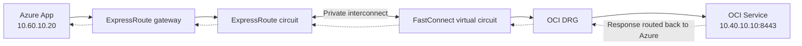

# Connecting OCI to Azure and Other Clouds

## Objectives and Context

In the **Migration and Multicloud** chapter of the Oracle Cloud Infrastructure (OCI) module (`CLOUD_PROVIDERS_ORACLE`), this lesson explains how to connect OCI private networks to Azure, Google Cloud, AWS, and other platforms. The focus is carrying workloads across cloud boundaries while maintaining control over routing, access rights, observability, costs, and incidents.

A common scenario is a Java application continuing to run on Azure while the Oracle database moves to OCI. The project team must maintain connectivity during migration, evaluate performance, and keep a fallback path if the switch fails to meet requirements. Creating a new circuit solves only part of the problem.

After this lesson, learners will be able to:

- Choose between direct private interconnect, partner interconnect, and Site-to-Site VPN.
- Plan CIDRs, forward paths, and return paths between a VCN and a VNet/VPC.
- Explain the roles of DRG, BGP, DNS, and security layers.
- Practice testing a private service from Azure to OCI.
- Identify evidence needed before moving production traffic.

## 1. Defining Application Flows Before Choosing Connectivity

Start with a communication table. Each row must specify source, target, protocol, data volume, and outage impact.

| Illustrative Flow | Source | Target | What Must Be Verified |
| --- | --- | --- | --- |
| Online transactions | Java app on Azure | Oracle Database on OCI | Query latency, connection pools, endpoint in connect descriptor |
| Data replication | Migration tool at source | Target service on OCI | Transfer speed, sync lag, resume capability after interruption |
| Name resolution | Resolver of one cloud | Resolver managing namespace in the other cloud | Domain forwarding, actual source IP, UDP/TCP 53 |
| Operations | Bastion or management network | Servers and network appliances | User scope, management ports, access logs |

Do not assume all traffic needs to cross clouds. If one request executes many sequential dependent queries, co-locating the application and data may be far more effective than upgrading bandwidth.

For a hypothetical example, a request makes 40 sequential round trips to the database. When RTT rises from 2 ms to 6 ms, network wait time alone increases by roughly:

```text
40 × (6 - 2) = 160 ms/request
```

This is an estimate to surface design risk, not a performance forecast or latency commitment from Oracle and Microsoft. Measuring real workloads with production-like transaction mixes, connection counts, and datasets yields valid results.

Also distinguish two architectural decisions:

- **Networking two clouds:** workloads remain in separate networks communicating over established connectivity.
- **Using Oracle Database@cloud services:** selecting a specific database service deployment model with its own provisioning and operational workflows.

The scope of this lesson is network connectivity. Do not infer how a Database@cloud service works from a VCN–VNet diagram.

## 2. Connectivity Options

| Option | Transport | Best Fit When | Details to Confirm |
| --- | --- | --- | --- |
| Oracle Interconnect for supported clouds | Dedicated private connection between providers | Workloads need frequent exchange and steady performance | Region, interconnect location, features, throughput limits |
| FastConnect via partner or cloud exchange | Partner network bridging private connectivity services | Need multiple clouds or locations outside direct interconnect | BGP design, physical redundancy, operational responsibility |
| Site-to-Site VPN | IPsec over the Internet in typical models | Labs, migration transition, moderate traffic, or backup | Peer compatibility, encryption, tunnels, MTU, routing |
| Public API over HTTPS | Public endpoints | Only integrating a few published APIs | Auth, access limits, endpoint exposure, data transfer cost |

API connectivity does not create private routing between two networks. Conversely, having a private link does not make every management API or PaaS service automatically traverse that path.

OCI provides multicloud VPN documentation for Azure, AWS, and Google Cloud. Depending on the model, the peer may be a managed gateway or customer-operated VPN appliance/software; follow compatibility guidance for both ends. [Oracle: Multicloud VPN Connections](https://docs.oracle.com/en-us/iaas/Content/Network/Tasks/multicloud_vpn_connections.htm)

### Three Quick Selection Criteria

1. **Is the link offered at the exact locations?** Similar region names do not prove direct interconnect exists.
2. **What does the workload need?** Latency-sensitive transactions, bulk replication, and batch API integrations have different demands.
3. **What can operations manage?** An option cheaper in circuit fees can demand heavy effort if you must maintain routers yourself and troubleshoot across multiple vendors.

Do not hardcode a static region list or price sheet into long-term designs. Check availability, quotas, and pricing at deployment time.

## 3. Network Components and Responsibility Boundaries

| Purpose | OCI | Azure | Other Clouds |
| --- | --- | --- | --- |
| Workload private network | VCN | VNet | VPC or equivalent concept |
| External egress routing point | DRG | ExpressRoute gateway or VPN gateway per option | Gateway and corresponding attachments |
| Private interconnect | FastConnect virtual circuit | ExpressRoute circuit | Interconnect, Direct Connect, or partner service |
| Traffic control | NSGs, security lists, firewalls | NSGs, firewalls | Target cloud firewalls and security mechanisms |
| Name resolution | Private DNS resolver | DNS Private Resolver or self-managed DNS | Resolver capable of serving external networks |

This table compares roles; it does not assert identical architectures or limits across services.

The **DRG** is the routing hub between VCNs and connected networks. An **attachment** represents a connection into the DRG. **BGP** exchanges prefix information between sides; an active BGP session does not prove the application can already reach data.

Separate three acceptance layers:

- **Connectivity:** circuit or tunnel is provisioned and up.
- **Routing:** right prefixes appear in the right tables with return paths.
- **Service:** DNS, firewalls, TLS, and application authentication work.

An “UP” status at the first layer does not replace verifying the next two layers.

## 4. Addressing and Bidirectional Routing Design

### 4.1. Illustrative Addressing Plan

Use the following addresses throughout the lesson. These are hypothetical lab addresses; check against organizational IPAM before applying.

| Component | CIDR or IP |
| --- | --- |
| OCI VCN | `10.40.0.0/16` |
| OCI service subnet | `10.40.10.0/24` |
| OCI test HTTPS host | `10.40.10.10` |
| OCI resolver subnet | `10.40.53.0/24` |
| Planned OCI listening endpoint | `10.40.53.10` |
| Azure VNet | `10.60.0.0/16` |
| Azure application subnet | `10.60.10.0/24` |
| Azure GatewaySubnet | `10.60.255.0/27` |
| Azure inbound DNS subnet | `10.60.53.0/28` |
| Azure outbound DNS subnet | `10.60.53.16/28` |
| Primary BGP, if configuring Azure interconnect later | `10.255.0.0/30` |
| Secondary BGP | `10.255.0.4/30` |

Azure DNS subnets are dedicated per endpoint and contain no app VMs. Gateway/subnet sizes and rules must match chosen services and SKUs.

Check for address overlaps across all participating networks, including management networks, Kubernetes pod/service CIDRs, and on-premises networks. Two subnets in two clouds both using `10.0.1.0/24` create destination ambiguity; adding bandwidth will not fix this.

Re-addressing is easier to manage long-term. NAT or proxies can assist transitional phases, though they add post-translation IP tracking, logs, allowlists, and issues with protocols embedding IPs in payloads.

### 4.2. Tracing a Request and Response

Suppose an Azure app VM at `10.60.10.20` calls `10.40.10.10:8443`:



The diagram shows the logical path, not all physical devices or provider redundancy mechanisms.

On the return path, the OCI subnet must route traffic destined for `10.60.10.0/24` toward the DRG. On the DRG, the route table applied to traffic entering from the VCN must have a route to Azure via the appropriate attachment. When packets enter the DRG from Azure, the interconnect attachment's route table must have a route to the OCI subnet.

Two easily confused concepts:

- **VCN subnet route table:** directs packets leaving a subnet toward which gateway.
- **DRG route table:** selects the next attachment for packets entering the DRG from an attachment.

Routes learned at the DRG do not automatically inject into VCN subnet route tables. You must configure subnet routes with the DRG as next hop for external networks needing reachability. [Oracle: VCN FAQ — DRG route propagation](https://www.oracle.com/cloud/networking/virtual-cloud-network/faq/)

In current DRGs, use import route distributions to learn routes from virtual circuit or IPsec attachments; do not create static DRG routes pointing to these attachments as next hops. [Oracle: DRG Management](https://docs.oracle.com/en-us/iaas/Content/Network/Tasks/manage-drg.htm)

### 4.3. Defining Explicit Routing Scope

An intent table for the example:

| Inspection Point | Destination Prefix | Required Outcome |
| --- | --- | --- |
| OCI service subnet | `10.60.10.0/24` | Route to DRG |
| OCI resolver subnet | Azure DNS subnets needing communication | Route to DRG |
| DRG, ingress from VCN | Permitted Azure prefixes | Route to Azure-connected attachment |
| DRG, ingress from interconnect | OCI service and DNS subnets to advertise | Route to VCN attachment |
| Azure app NIC/subnet | `10.40.10.0/24` and needed OCI DNS prefixes | Effective routes match interconnect |
| Azure outbound DNS subnet | `10.40.53.0/24` | Path exists to OCI resolver |

The table states end-state requirements rather than claiming every cloud advertises per-subnet with identical actions.

Never use `0.0.0.0/0` routes as a “quick fix” for missing prefixes. That can pull unintended cross-cloud traffic, alter Internet paths, and increase costs. Meanwhile, narrow routes do not replace firewalls: a host with a route to another network still needs protocol and port restrictions.

## 5. Setting Up Oracle Interconnect for Azure

### 5.1. Conditions and Limitations

Oracle Interconnect for Azure pairs a FastConnect private virtual circuit with an ExpressRoute circuit to link a VCN and VNet using private addresses. Both networks must belong to the same enterprise, have non-overlapping CIDRs, and lie within supported availability scopes. The service has built-in circuit redundancy, though that does not automatically provide recovery if an entire region fails. [Oracle: Interconnect for Azure](https://docs.oracle.com/en-us/iaas/Content/multicloud/interconnect-azure.htm)

Prepare tenancy/subscription, compartments and resource groups, quotas, network permissions, and allowed-flow lists. Assign owners in both clouds so troubleshooting never stalls at “our side is UP.”

### 5.2. Provisioning Sequence

Core provisioning workflow per Microsoft guidance:

1. Create an ExpressRoute circuit, selecting provider **Oracle Cloud FastConnect** and the appropriate peering location.
2. Retrieve the **service key** and align bandwidth on both sides.
3. Create the DRG, attach the VCN; create FastConnect with partner **Microsoft Azure: ExpressRoute**, entering the key and BGP details.
4. Wait for circuit provisioning and confirm Azure private peering.
5. Create or reuse an ExpressRoute virtual network gateway; create a connection linking the gateway to the circuit.
6. Finalize routing and security, then test private endpoints.

The circuit and the gateway-to-circuit connection are two distinct resources requiring separate verification. [Microsoft: Connect Azure ExpressRoute with OCI](https://learn.microsoft.com/en-us/azure/virtual-machines/workloads/oracle/configure-azure-oci-networking)

The service key coordinates provisioning; it is not a database password. Manage this value in controlled configuration workflows and avoid placing it in public docs alongside sensitive details.

### 5.3. Example BGP Pair

Using the two `/30` ranges from the addressing table:

| Session | Range | Oracle BGP IP | Customer BGP IP in OCI (Azure Side) |
| --- | --- | --- | --- |
| Primary | `10.255.0.0/30` | `10.255.0.1/30` | `10.255.0.2/30` |
| Secondary | `10.255.0.4/30` | `10.255.0.5/30` | `10.255.0.6/30` |

BGP IPs are addresses for routing exchange between both ends; never assign them to app VMs. This addressing pattern belongs to the Azure interconnect example, not a template for all VPN services. [Oracle: BGP prerequisites for Azure](https://docs.oracle.com/en-us/iaas/Content/multicloud/interconnect-azure.htm)

### 5.4. Extending Across Hub and Spoke

If apps sit in an Azure spoke VNet while the gateway sits in a hub, check gateway transit and use-remote-gateway settings on the peering. Hub–spoke peering alone does not prove the spoke can use ExpressRoute. [Microsoft: Virtual network peering and gateway transit](https://learn.microsoft.com/en-us/azure/architecture/reference-architectures/hybrid-networking/virtual-network-peering)

Do not assume you can use the interconnect as transit from on-premises through one cloud to the other: that traffic type is unsupported on the OCI–Azure interconnect described here. Hybrid designs require a separately supported path. [Oracle: Supported traffic](https://docs.oracle.com/en-us/iaas/Content/multicloud/interconnect-azure.htm)

## 6. Connecting Google Cloud, AWS, and Other Clouds

### 6.1. Google Cloud

Oracle Interconnect for Google Cloud uses FastConnect on the OCI side and **Partner Interconnect** on the Google Cloud side. Components to align include VPC/subnets, Cloud Router, VLAN attachments, VCN, and DRG. Verify supported location pairs before provisioning. [Oracle: Interconnect for Google Cloud](https://docs.oracle.com/en-us/iaas/Content/multicloud/interconnect-gcp.htm)

Apply the same request/response analysis: check learned routes, advertisement scopes, firewalls, and name resolution. Do not copy Azure NSG configurations verbatim to Google Cloud merely because both use private addresses.

In particular, Cloud Router handles routing exchange; when drawing architectures, do not treat it like a VM firewall that every application packet passes through inline. Service access controls and network firewalls must be evaluated according to each service's actual role.

### 6.2. AWS

Oracle now documents **Oracle Interconnect for AWS**, a managed private interconnect in supported regions. The model uses interconnect virtual circuits attaching OCI DRGs and AWS Direct Connect gateways, with provisioning approval steps in both clouds. [Oracle: Interconnect for AWS](https://docs.oracle.com/en-us/iaas/Content/multicloud/interconnect-aws.htm)

Therefore, when designing OCI–AWS, check this service first rather than assuming VPN or an intermediary partner is always required. If locations or requirements do not fit, evaluate VPN or a mutually supported partner architecture.

A connection to a gateway does not prove every VPC can reach OCI. Complete associations/attachments and route propagation per the chosen AWS architecture, then verify return paths and security.

### 6.3. Connecting via Cloud Exchange

Common logical model:

```text
OCI VCN
  → DRG
  → FastConnect
  → partner network / cloud exchange
  → target cloud's private connectivity service
  → gateway
  → workload network
```

Technical agreements must answer:

- Who supplies VLANs, BGP IPs, ASNs, and who manages intermediate routers?
- Do redundant links traverse the same facility, hardware, or fiber path?
- Does the partner perform NAT, route filtering, or prefix-count limits?
- Which cloud receives the first ticket and who can inspect each segment?
- Which fees are billed per port, committed bandwidth, duration, or data volume?

Two logical links sharing the same physical infrastructure can fail simultaneously in a single outage.

## 7. Site-to-Site VPN for Labs or Redundancy

VPNs generally have shorter lead times than dedicated interconnects, though quality depends on the Internet path, encryption appliances, and real load.

Before deploying, align parameters:

| Group | Details |
| --- | --- |
| Tunnel endpoints | Peer public IPs, CPE/gateway setup |
| IPsec/IKE | Versions, compatible algorithms, pre-shared keys, lifetimes |
| Routing | BGP or static per supported setup, prefixes to exchange |
| Keepalive | Dead peer detection, rekeying, NAT traversal if applicable |
| Performance | Gateway/VM throughput, MTU, and TCP MSS |
| Recovery | Redundant tunnels/peers and traffic failover method |

Store pre-shared keys in an appropriately scoped secrets system. Never place keys in repositories or automation logs.

When placing VPN as backup for an interconnect, design both directions. If OCI shifts responses onto the VPN while Azure still sends requests over the primary link, connections can break due to asymmetric routing or stateful firewalls.

Backup paths must also sustain minimum post-incident load. A VPN passing a few test commands does not prove it can absorb full production traffic.

## 8. Cross-Cloud Private DNS

IP connectivity does not share namespaces automatically. Applications use hostnames in JDBC URLs, certificates, and failover configs, so DNS must be designed alongside networking.

Suppose:

- OCI manages zone `oci.example.com`, with record `api.oci.example.com → 10.40.10.10`.
- Azure manages zone `azure.example.com`.
- An OCI listening endpoint is created with IP `10.40.53.10`.

Azure → OCI direction: configure an Azure DNS Private Resolver outbound endpoint and a forwarding ruleset for `oci.example.com.` pointing to `10.40.53.10:53`; link the ruleset to the VNet containing client workloads. [Microsoft: DNS Private Resolver endpoints and rulesets](https://learn.microsoft.com/en-us/azure/dns/private-resolver-endpoints-rulesets)

OCI → Azure direction, if workloads require it: create an OCI forwarding endpoint and rule for `azure.example.com` pointing to a routable Azure inbound endpoint. Listening endpoints receive queries; forwarding endpoints send queries to another DNS system. [Oracle: Resolver Endpoints](https://docs.oracle.com/en-us/iaas/Content/Network/Concepts/dns-topic-resolver_endpoints.htm)

Name-lookup flows and application flows can originate from different sources:

```text
Azure VM
  → Azure DNS system
  → Azure outbound endpoint
  → OCI DNS listening endpoint
  → private IP response

Azure VM
  → direct HTTPS connection to OCI service IP
```

Consequently, the OCI resolver firewall must permit traffic from the Azure outbound DNS subnet; allowing only the app VM subnet can still break DNS. The reverse direction must use the actual allocated source address of the OCI forwarding endpoint.

Permit UDP and TCP 53 per DNS needs, and configure return traffic properly for stateful/stateless rules. Avoid forwarding the same zone in a loop between both clouds. If using self-managed DNS instead of managed resolvers, still guarantee transport paths, query permissions, and redundancy.

Never configure an external cloud resolver to query OCI's link-local DNS address directly. Use a listening endpoint with a private IP in a routable subnet.

## 9. Security: Network, Identity, and Encryption

### 9.1. Administrative Rights Differ from Service Access Rights

OCI IAM governs who can create/edit networks in a tenancy and compartment. Azure RBAC controls operations in subscriptions/resource groups. Permission to create a circuit does not grant OS login or database read rights.

Divide responsibilities by function:

| Role | Typical Scope |
| --- | --- |
| Network admin | Assigned DRGs, circuits, routes, gateways, and network configs |
| DNS admin | Assigned zones, records, and forwarding |
| Application team | Client configs, workload identities, connection pools |
| Database team | Listeners, users/services, data privileges, proper encryption |
| Operations | Reading metrics/logs and executing defined recovery steps |

Never use tenancy admin accounts as application runtime identities. Private networking and SSO are also two separate topics: linking a VCN and VNet does not establish identity federation between organizations.

### 9.2. Opening Exact Flows

In the lab exercise, the permitted flow is the Azure app subnet to the OCI test VM over TCP 8443. For real Oracle Databases, use the endpoint/port from service configuration; do not assume every database uses the same port or TLS method.

Layers to inspect simultaneously include Azure NSGs/firewalls, OCI NSGs/security lists, OS firewalls, and listening process configs.

OCI NSGs and security lists hold allow rules that can apply to a VNIC together. A narrow rule in an NSG does not revoke access granted by a broad rule in a security list. When tightening access, inspect the entire effective rule set, including default rules.

### 9.3. Private Links and Encryption

ExpressRoute provides private connectivity, yet traffic is not encrypted by default. Choose application-layer TLS and suitable network encryption solutions if mandated; verify the exact capabilities of the active connection type. Never extrapolate encryption features of one interconnect product to another. [Microsoft: About encryption for ExpressRoute](https://learn.microsoft.com/en-us/azure/expressroute/expressroute-about-encryption)

For TLS, check trust chains, hostnames, expiration, and certificate rotation procedures. Succeeding with certificate verification disabled does not prove security requirements are met.

## 10. Hands-On: Azure Calling a Private HTTPS Service on OCI

### 10.1. Inputs and Scope

The lab uses two provisioned Linux VMs:

- Client VM in the Azure app subnet, e.g., `10.60.10.20`.
- Service VM on OCI with actual private IP `10.40.10.10`.
- Access to both hosts via bastion or approved management paths.
- Interconnect or VPN already active; both sides have matching routes.
- Hosts have OpenSSL, curl, and DNS tools installed.

This is a network and TLS test without installing Oracle Database. Monitor costs for resources created in the lab environment.

### 10.2. Minimum Lab Rules

| Communication Path | Rule to Verify |
| --- | --- |
| Azure app → OCI test VM | Azure allows egress and OCI allows ingress TCP 8443, source/dest scoped |
| Azure DNS outbound → OCI listening endpoint | Allows DNS queries to UDP/TCP 53 and appropriate responses |
| Admin → VMs | Restricted to designated management sources |
| Responses back to source | Return routes exist; security rules match stateful/stateless behavior |

Stateful rules may be used for the HTTPS test. If choosing stateless, explicitly define return traffic and client ephemeral ports. Never replace an entire security list with a sample template.

### 10.3. Creating the Test Endpoint

Run the following commands **on the OCI VM**, inside a dedicated lab working directory. Adjust the IP if your VM received a different address.

```bash
openssl req -x509 -newkey rsa:2048 -sha256 -nodes \
  -keyout lesson-server.key \
  -out lesson-server.crt \
  -days 2 \
  -subj "/CN=api.oci.example.com" \
  -addext "subjectAltName=DNS:api.oci.example.com"

chmod 600 lesson-server.key

openssl s_server \
  -accept 10.40.10.10:8443 \
  -cert lesson-server.crt \
  -key lesson-server.key \
  -www
```

The process runs in the foreground; keep the session open while testing from Azure. Self-signed certificates for the lab have short validity. Transfer only **`lesson-server.crt`** to the Azure VM over a trusted management channel; keep the private key on the OCI machine. Production environments use organizational certificate issuance and rotation mechanisms.

### 10.4. Testing Transport Before Testing DNS

On the Azure VM, run:

```bash
curl --noproxy '*' \
  --connect-timeout 5 \
  --max-time 15 \
  --cacert ./lesson-server.crt \
  --resolve api.oci.example.com:8443:10.40.10.10 \
  https://api.oci.example.com:8443/
```

`--resolve` keeps the hostname for TLS while binding the target IP for this invocation only. Receiving the OpenSSL status page with zero certificate errors confirms the service path and TLS work for the specified IP. This command does not yet prove DNS forwarding works.

`--noproxy '*'` forces direct connection testing, preventing an HTTP proxy in the client environment from altering the path.

If isolating TCP issues is needed, use:

```bash
nc -vz -w 5 10.40.10.10 8443
```

An open TCP port only proves the handshake succeeded. TLS and application auth must still be verified separately.

### 10.5. Testing DNS and Calling by Hostname

After configuring private zones/records and forwarding:

```bash
# Query OCI listening endpoint directly to isolate resolver issues.
dig @10.40.53.10 api.oci.example.com A

# Query via the active DNS client on the Azure VM.
dig api.oci.example.com A

# Call by hostname, without forcing IP via --resolve.
curl --noproxy '*' \
  --connect-timeout 5 \
  --max-time 15 \
  --cacert ./lesson-server.crt \
  https://api.oci.example.com:8443/
```

The expected result is the OCI VM's private IP and a valid HTTPS response. If the Azure VM uses custom DNS, default queries follow that config; complete forwarding on the exact DNS servers used by clients.

Record timestamp, source, target, hostname, DNS result, and error codes if any. Never include private keys or credentials in evidence.

### 10.6. Lab Completion Criteria

- Bidirectional routing verified via route tables and live connections.
- DNS queries through client resolution return the right private IP.
- HTTPS by hostname succeeds with certificate validation.
- Unauthorized flows from a separate test machine are blocked as designed.
- Temporary rules and lab resources have assigned cleanup owners.

The negative-test machine must sit outside permitted sources; re-testing from the same authorized host does not prove network isolation.

## 11. Availability, Failover, and Observability

### 11.1. Defining Failure Scopes

| Failure | Items to Design |
| --- | --- |
| Loss of one BGP session or component link | Product redundancy mechanism and remaining routes |
| Total loss of primary interconnect | Sufficiently sized alternate path and bidirectional policies |
| Resolver failure or misconfiguration | Redundant DNS endpoints/architecture, change control |
| Loss of target service | App/database HA, endpoint failover |
| Region outage | Recovery plan in another region, data, and execution capacity |

Network path redundancy does not replicate data. RTO/RPO must be determined by the application and database—never take BGP convergence time as the entire system's RTO.

### 11.2. Measuring from the Service Consumer's Perspective

Monitor both infrastructure and transactions:

- Circuit/tunnel/BGP: status, flap counts, and timestamps.
- Routing: prefixes appearing or disappearing, next-hop shifts.
- Network: throughput, drops, RTT, and large-packet handling.
- DNS: query latency, timeouts, NXDOMAIN/SERVFAIL.
- Application: error rate, p95/p99, connection acquisition timeouts, query latency.
- Data: replication lag, backlog, and sync recovery time.

A synthetic probe should run the sequence **DNS → connect → TLS → controlled lightweight read**. Ping-only probes miss expired certificates or database login rejections.

Use metrics, flow logs, and audit logs from OCI alongside partner-cloud monitoring tools. Flow logs capture packet metadata; they do not replace application transaction logs. Synchronize timezones/clocks when correlating incidents across two teams.

### 11.3. Testing Failover

In an environment authorized for fault testing:

1. Record baseline using a safe read transaction.
2. Disrupt one component of the primary path using a supported method.
3. Record detection time, route switch time, connection disruption, and app recovery.
4. Verify forward and return paths, DNS, and alternate path capacity.
5. Restore, monitor failback, and watch for route flapping.

If individual sessions cannot be controlled separately on managed products, use vendor-supported test scenarios. Never delete a circuit merely to simulate losing one component link.

## 12. Performance and Cost

### 12.1. Estimating Data Transfer Time

Suppose 2 TiB must move and steady effective speed measures 600 Mbit/s:

```text
Time ≈ 2 × 2^40 × 8 / (600 × 10^6)
     ≈ 29,320 seconds
     ≈ 8.1 hours
```

This is transfer time under the assumptions, excluding data checks, source/target processing, retries, or other migration phases. For continuous sync, also require target processing speed to exceed new data generation rate, or backlog never shrinks.

Never estimate application speed from circuit bandwidth alone. Bottlenecks can lie in disk, encryption CPU, single TCP connections, gateways, or sequential call counts.

If small requests succeed while large transfers hang, inspect MTU/PMTUD and path behavior, especially over IPsec. Raise MTU only after verifying the entire path; never blindly apply one jumbo-frame value across every cloud.

### 12.2. Total Cost Model

```text
Monthly total cost =
  circuits/ports on each side
  + gateways and related network services
  + partner/cloud exchange fees if any
  + directional and route-based data transfer fees
  + DNS, firewalls, logging, monitoring
  + backup path costs
  + operational labor
```

Check pricing policies per product. Never assume data-transfer pricing terms of one interconnect apply to every path, region, or service.

Tag resources with owner, environment, project, and expiration date. Budgets and alerts surface spend; notification mechanisms do not stop billing automatically. Deleting test VMs also does not mean circuits or gateways stopped incurring charges.

## 13. Automation and Change Control

A reproducible design requires unified management of CIDRs, resource names, compartments/resource groups, connections, routes, DNS, security, and monitoring outputs.

When using Terraform or equivalent IaC tools:

1. Separate test and production environments with proper configs/states.
2. Protect state and secrets; never print secrets in public outputs.
3. Model dependencies across gateways, circuits, attachments, and connections.
4. Inspect plans, especially replacements or deletions of active links.
5. Apply incrementally in a verifiable order.
6. Check drift and run service probes after changes.

Include these checks in review workflows:

| Change | Evidence to Review |
| --- | --- |
| Add prefix | Zero address overlap; advertised in right scope |
| Add rule | Source, target, protocol, and business rationale |
| Change route preference | Expected outcome in both directions and rollback path |
| Change DNS | Records, TTL, forwarding, and cache impact |
| Change circuit/gateway | Expected outage, dependencies, cost |

An API returning success only confirms the config request was accepted/processed per resource state. You still need final state readbacks and probes from the workload network.

## 14. Using Connectivity in a Migration Plan

Multicloud connectivity serves each phase with different criteria:

1. **Assessment:** measure RTT, inventory dependencies, CIDRs, and DNS needs.
2. **Initial data load:** measure effective speed, verify checksums or proper reconciliation.
3. **Delta sync:** monitor backlog and impact on source transactions.
4. **App testing:** verify JDBC, identities, timeouts, pools, and representative load.
5. **Cutover:** follow the data-consistency plan; switch endpoints/configs under control.
6. **Post-move monitoring:** check errors, p95/p99, costs, and stability.
7. **Decommission:** remove temporary links and rules once conditions pass.

Rollback must answer where the authoritative write source lives. Pointing DNS back to old addresses while new data exists at the new target creates inconsistency; a working network link cannot solve this.

For Java apps, test reconnection after link drops too. A connection pool holding dead connections can prolong errors after the network recovers. Choose timeouts, retries, and transaction handling based on operation safety; never auto-retry every write command.

## 15. Evidence-Based Fault Isolation

| Symptom | Check First | Possible Interpretation |
| --- | --- | --- |
| Circuit UP, TCP fails to open | Effective routes, DRG tables, return path, NSGs/firewalls | Infra link exists, but data path is incomplete |
| Works in one direction only | Return route, NATed source, stateful firewall | Asymmetric routing or missing prefix |
| IP works, hostname fails | Client's active DNS, forwarding, listening endpoint | Fault lies in name resolution path |
| TCP opens, HTTPS fails | Hostname, SAN, truststore, system clock | Invalid or incompatible TLS |
| Ping fails, HTTPS works | ICMP rules | ICMP blocked; no evidence service is broken |
| Small packets work, bulk hangs | MTU/PMTUD, drops, gateway capacity | Likely packet size issue or processing limit |
| Failover fails despite UP tunnel | Backup prefixes, route preference, return path, load | Tunnel up is insufficient to carry traffic |
| Only spoke fails | Gateway transit, propagation, UDRs | Hub and spoke networks have differing gateway settings |
| Network healthy, DB queries slow | RTT, round-trip count, pool, DB load | Bottleneck may lie in app/data layer |

During troubleshooting, test one verifiable hypothesis at a time. Avoid opening all ports, adding default routes, and disabling TLS checks simultaneously; when it succeeds, you will not know which change actually fixed it.

## 16. Tearing Down Connectivity and Lab Resources

When the lab concludes, stop `openssl s_server` with Ctrl+C, remove temporary rules, and delete lab certificate/private key files when no longer needed. Retain required evidence per team procedures.

For Azure interconnect, teardown order must respect dependencies: delete the ExpressRoute gateway-to-circuit connection, delete the OCI FastConnect virtual circuit, wait for Azure to reflect deprovisioned status, then delete the ExpressRoute circuit. [Microsoft: Delete the interconnect link](https://learn.microsoft.com/en-us/azure/virtual-machines/workloads/oracle/configure-azure-oci-networking)

Delete gateways, resolvers, DRGs, or routes only after confirming no other workloads share them. Re-verify inventories and billable resources in both clouds after teardown.

## 17. Deliverables for Operations Handover

Production-ready connectivity requires concrete outputs:

- Logical diagrams and addressing plan, including DNS and backup paths.
- Prefix list and allowed source–target–port matrix.
- Evidence of bidirectional routes, DNS, and TLS/service tests.
- Load test results along with tested failure scopes.
- Failover, troubleshooting runbooks, and owner contacts on both sides.
- Cost estimates, alerts, and temporary resource reclamation plans.
- Cutover/rollback conditions tied to data consistency.

With these deliverables, operations has the foundation to distinguish link failures, routing errors, DNS issues, and service faults when workloads actually run across clouds.
