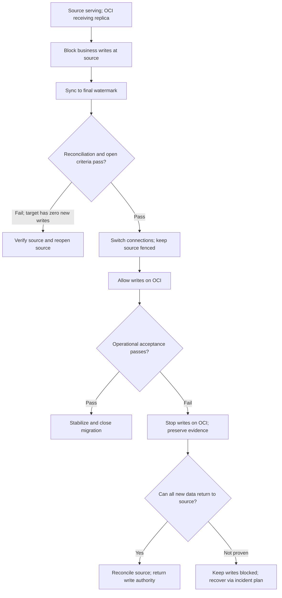

# Cutover, Rollback, and Post-Migration Data Verification

## 1. Objectives and Context

In the **Migration and Multicloud** chapter of the **CLOUD_PROVIDERS_ORACLE** module, this lesson addresses the moment a system serving in a data center or another cloud transitions to Oracle Cloud Infrastructure (OCI). The focus is transferring data write authority under control, restoring service when transition fails, and proving post-migration data remains accurate.

A successful copy alone is not enough to put a system into production. The application might connect yet miss final transactions, run two schedulers concurrently, or issue duplicate invoices when re-receiving messages. Therefore, completion decisions must rely on infrastructure state, data integrity, and business outcomes together.

After this lesson, learners will be able to:

- Define go/no-go criteria, outage budgets, and decision milestones.
- Execute cutover under the principle that only one location holds authority to create business transactions.
- Distinguish rollback before the target accepts writes from fallback after data has been created on OCI.
- Reconcile structure, records, contents, relationships, and business invariants.
- Compile acceptance evidence, monitor the stabilization phase, and close the legacy retention period.

The end-to-end example is an order management application using Oracle Database at the source, moving the app to OCI Compute and data to an OCI Oracle Database service suited to the chosen method. The same reasoning applies to multicloud flows; tool capabilities must be verified for the exact source type, target type, and actual version.

## 2. Terms to Align Before Transitioning

| Concept | Meaning in the Runbook |
| --- | --- |
| Cutover | Sequence of actions stopping or limiting legacy activity, syncing final delta, switching connections, and enabling the target system to serve |
| Database switchover | Planned primary/standby role reversal when supported by technology; this is only one piece of full application cutover |
| Application rollback | Reverting code or configuration to a prior version; must still remain compatible with the database holding the newest data |
| Data fallback/failback | Returning write authority to the source system after the target has accepted transactions, while preserving newly created data |
| Fencing | Blocking the side no longer holding authority from creating transactions, including via old connections, workers, or direct access paths |
| Watermark | Marker identifying the set of source transactions that must exist at the target before opening writes |
| Point of commitment | Operational milestone after which falling back requires handling changes at the target; must at minimum consider the first transaction committed at the target |

RPO is the maximum acceptable data loss; RTO is the maximum time to restore agreed service levels after an incident. Planned maintenance windows and RTO are related yet must be recorded separately in the runbook.

If setting **zero RPO for successfully committed transactions**, you must prove every commit in that scope is preserved when moving forward or falling back. Looking solely at a zero lag metric does not prove this.

A transaction confirmed to a user may also involve payment gateways, queues, and object stores. RPO scope must explicitly cover these components; restoring a database does not automatically undo external transactions.

### 2.1. Calculating the Time Budget

For a short write-stop approach:

```text
Projected outage time
  = block writes and handle in-flight transactions
  + final sync
  + mandatory pre-open verification
  + switch connections and refresh connection pools
  + mandatory smoke tests

Time needed to fall back
  = block writes at target
  + preserve/bring back new data if any
  + verify source
  + switch connections back
  + test and reopen service
```

Parallel tasks follow the critical path to avoid double-counting. For example, with a 30-minute maintenance window, a 10-minute rehearsed fallback time, and a 5-minute buffer, you cannot keep troubleshooting until minute 29. The decision milestone must leave 15 minutes for fallback.

Once the target accepts writes, fallback duration can grow with the volume of data needing reverse sync. Decision points must be recalculated from actual state rather than keeping pre-cutover estimates unchanged.

## 3. Choosing Migration Methods Together with Fallback Paths

The cutover workflow depends on the data transfer method. Never infer rollback capability solely from a product name or from keeping source machines running.

| Method | Must Complete Before Opening Target Writes | Fallback Path to Prepare |
| --- | --- | --- |
| Offline, export/import or backup restore | Source stops writes during consistent copy creation and finishes final sync if any | Before new writes, can return to source; after new writes, must move delta or run reconciled recovery |
| Online, unidirectional logical replication | Capture/apply cover full scope, catch up to final watermark, zero unresolved errors | No automatic reverse direction; requires custom design and compatibility verification |
| Online, physical replication with role switch | Primary/standby ready for switchover; all required redo processed | Requires old source able to receive data from new primary and eligible for reverse switchover |
| Migration with schema or engine change | Data mappings, types, encodings, and business rules verified | Needs inverse transforms or another strategy; many transforms are not automatically reversible |

In OCI Database Migration, online migration uses GoldenGate to replicate from source to target. This service flow does not provide bidirectional sync; once apps switch to target, migration replication ends. Therefore, never treat a completed job as proof you can automatically fall back to source after new writes. See [Online migration](https://docs.oracle.com/en-us/iaas/database-migration/doc/online-migration.html).

With Zero Downtime Migration (ZDM) physical online using Data Guard, after switchover, the old source becomes a standby. Fallback capability depends on the new primary continuing to ship redo to that standby and role-switch prerequisites. Oracle explicitly notes fallback operations must be performed separately; ZDM does not handle reverse role switches automatically. See [Introduction to Zero Downtime Migration](https://docs.oracle.com/en/database/oracle/zero-downtime-migration/26.1/zdmug/introduction-to-zero-downtime-migration.html).

Separately verify reversibility against the active version, topology, platform, licensing, and target service. For instance, do not apply a Data Guard role-switch procedure to a logical import into another service.

## 4. State Design: Always Define Who May Write



The single-writer principle applies to **business transactions**. Replication processes may need write rights on the system receiving copies; those rights must remain separate from application accounts.

Fencing should use appropriate layers for the system: disabling write features in the app, stopping workers and schedulers, revoking or restricting old app account rights, closing unnecessary access paths, and handling lingering sessions. Changing passwords or updating secrets does not automatically invalidate already-open sessions.

Database read-only settings should only be used if compatible with the replication method and data role. Never mechanically flip an entire database to read-only if apply processes still must write.

Canarying by splitting users across two app deployments pointing to two independent databases creates two write locations. A safer approach has canary app versions share the authoritative database, or keeps all pre-cutover test paths strictly read-only. If partitioning write authority by tenant or data domain is needed, design and prove that boundary upfront.

## 5. Preparing the Runbook and Go/No-Go Criteria

### 5.1. Recording Enough Detail for On-Call Execution

Every runbook step needs an executor, entry condition, exact action, expected outcome, time limit, evidence, and failure action. Avoid vague instructions like “wait for sync to finish” or “check data looks fine.”

A minimum migration wave record includes:

- Migration wave ID; timestamps in UTC alongside local display timezone.
- Source/target identifiers: region, tenancy, compartment, resource OCIDs, database services, and schemas in scope.
- Endpoint list, app configs, wallets/TLS, secrets, and deployment versions.
- List of all writers: APIs, batches, cron jobs, consumers, DB jobs, ETL, webhooks, and operational users.
- Replication method, excluded tables, checkpoints, watermarks, and log retention windows.
- RPO/RTO targets, maintenance budget, abort milestones, and rollback conditions.
- Storage location for reconciliation reports, decision logs, and pre-change config backups.

Never put passwords, private keys, or wallet contents into the record.

### 5.2. Assigning Decision Authority

| Role | Primary Responsibility |
| --- | --- |
| Cutover coordinator | Tracks time, verifies decision gates, makes go/no-go calls within delegated authority |
| DBA or data lead | Blocks writes properly, verifies checkpoints, reconciles, and executes role switches if any |
| Application lead | Switches configs, handles pools, caches, background tasks, and tests business journeys |
| OCI and network lead | Verifies IAM, VCN, routing, DNS, load balancing, and cross-cloud connectivity |
| Business representative | Confirms business invariants, test outcomes, and approves exceptions within scope |
| Scribe / evidence keeper | Saves per-step outcomes, actual timestamps, errors, and decisions |

One person can hold multiple roles in smaller systems, yet decision accountability must remain explicit.

### 5.3. Readiness Conditions on OCI

Before the cutover window, verify:

1. **Connectivity:** paths from OCI apps to target database and dependent services; private/public DNS, routes, NSGs, security lists, VPN, or FastConnect per architecture.
2. **Identity:** operator accounts hold needed rights in the right compartments; runtime accounts read required secrets or wallets; temporary grants have revocation schedules.
3. **Capacity:** quotas, actual allocatable capacity, connection limits, storage space, and load handling of target config verified.
4. **Data safety:** valid backups, restore test evidence, encryption keys, and logs needed for fallback remain usable.
5. **Observability:** OCI Monitoring, Logging, and app observability show test signals; alert thresholds verified.
6. **Dependencies:** queues, object buckets, email, payments, partners, and network allowlists checked.
7. **Automation:** cutover tasks enforce preconditions, halt on error, read back state, and resume cleanly from confirmed steps.

Use Terraform or configuration tooling to prepare and version infrastructure before the cutover window. An infrastructure apply run does not replace orchestrating transaction state, watermarks, and write authority.

### 5.4. Quantitative Acceptance Criteria Examples

The thresholds below are illustrative; align them with your system's SLOs and rehearsal results.

| Gate | Example Condition | If Unmet |
| --- | --- | --- |
| Before blocking writes | Backup restore test passes; fallback path rehearsed; staff and time sufficient | Postpone cutover |
| Before switching connections | Zero source writers remain; final watermark applied; zero unresolved replication errors | Keep writes closed; fix within limit or revert to source |
| Before opening OCI writes | Critical datasets reconciled; read-only smoke tests pass; old connections controlled | Do not open writes |
| After opening writes | Test order create/read/update pass; no duplicate payments; latency and errors within limits | Block writes if integrity suspected; evaluate fix-forward or fallback |
| End of hypercare | Required business cycles passed; evidence complete; system owner approves | Keep fallback option active |

A performance threshold might require p95 not exceeding 120% of measured baseline at equivalent load while still meeting SLOs. Never accept a material data discrepancy merely because infrastructure dashboards look green.

## 6. Step-by-Step Cutover Execution

### Step 1: Confirm Scope and Freeze Changes

Before cutover day, rehearse in a suitable environment and time every step. Approaching the cutover window, freeze schema changes, app deployments, and network edits outside the runbook. Never combine major upgrades, data model overhauls, and platform moves simultaneously without rehearsing that combination.

Save baselines for traffic, error rates, p95/p99, batch durations, connection counts, and business totals. Check clock skew; log in UTC to correlate events across clouds.

If cutting over via DNS, lower TTL early enough for old TTL values to expire. Changing DNS does not migrate existing TCP connections. Resolvers, JVMs, and client libraries may maintain separate caches; runbooks must include recreating connection pools or restarting appropriate components.

### Step 2: Block New Transaction Inputs

Put the system into maintenance or read-only mode per tested design. API gateways, consumers, schedulers, batches, and operational access paths must all fall within blocking scope.

Handle in-flight transactions explicitly:

- Allow transactions to complete within a time limit or cancel via agreed procedure.
- Distinguish failed requests from transactions that committed without the client receiving a response.
- Never automatically resend payments or order creations without checking idempotency keys and business state.
- For queues, record offsets/checkpoints, in-flight messages, and dead-letter queues; do not infer an empty queue from one approximate metric.

Confirm no agent authorized to commit business transactions remains at the source. A web maintenance page does not stop a worker running under another account.

### Step 3: Lock the Watermark and Sync the Tail

Once all in-scope source transactions have committed or rolled back and writers are fenced, record the final marker per migration method mechanics.

With CDC streams, the point can be proven via checkpoint/commit position and a marker record inside capture scope. A marker is only supplemental evidence: with parallel or multi-stream apply, seeing a marker at target does not prove every prior transaction across all tables applied. Verify completeness and ordering across every relevant stream.

With Oracle Database, you can record the source SCN where appropriate. However, in logical migration, target commit SCNs do not share the same meaning as source SCNs. Never compare two SCNs as if they lie on a shared timeline. Tools must map capture/apply progress to the corresponding source point.

At this gate, verify simultaneously:

1. Source has zero unexpected business commits.
2. Capture has covered the final point.
3. Apply has processed all needed changes, including inserts, updates, and deletes.
4. Zero hanging large transactions, halted apply, errors, or unresolved discarded records remain.
5. Tables, partitions, and special objects match the migration catalog.

In OCI Database Migration, the lag monitoring phase relies on checkpoints and heartbeats; switchover stops capture and waits for apply to finish once the source is quiet. This does not replace stopping application writers. See [Oracle migration phases](https://docs.oracle.com/en-us/iaas/database-migration/doc/oracle-migration-phases.html).

Zero displayed lag when capture stopped earlier is dangerous: the latest transactions may never have been read. Always cross-check process state, metric freshness, and watermarks.

### Step 4: Mandatory Data Reconciliation While Both Sides Are Stable

Execute the service-opening gate checks:

- Object structures and statuses needed by the application.
- Row counts, key ranges, and digests of critical data.
- Business totals, referential integrity, and transactions near the watermark.
- Sequence/identity states, app privileges, and background tasks at the target.

Prepare historical reconciliation before the cutover window. Inside the window, run only the remaining delta checks per a plan proven to provide full coverage. For less critical data, post-cutover verification can continue if risks and acceptance criteria are approved.

Never exclude a table from verification merely because it is huge. Split by key ranges, partitions, or use suitable comparison tools to reduce impact.

### Step 5: Switch Connections While the Source Remains Fenced

Update app configs, secrets, or database services per chosen plan; switch load balancers or DNS if in scope. Verify from **the application process itself** that connections reach the right environment and database service. Testing connectivity from an operator's workstation is insufficient.

Flush stale connection pools, long-lived sessions, read caches, and clients holding old addresses. Keep source write paths locked throughout connection convergence. For lingering old connections unable to move immediately, the system must safely reject writes rather than silently accepting them at the source.

Run read-only smoke tests first. Checks that write data—even test data—must be treated as target writes and accounted for in the fallback plan.

### Step 6: Open Writes Under Control and Track Commitment Point

The coordinator confirms the write-open gate, timestamp, and accountable owner. Execute minimum business journeys: create an order with an idempotency key, read back, update status, and verify related events.

Test tasks may use dedicated test tenants or order IDs. Avoid calling live payments without a business reconciliation and compensation plan. Deleting a committed test transaction does not return the system to “never received writes”: sequences, audits, outboxes, or external services may have mutated.

Enable consumers and schedulers in dependency order. Verify only one authoritative set of jobs runs. Ramp traffic incrementally if architecture permits, with all write paths directed to the same authoritative data system.

### Step 7: Hypercare Monitoring and Operations Handover

Monitor errors by type, p95/p99, connection counts, queues, locks, timeouts, throughput, and OCI resources. Correlate these with business signals such as successful orders, orphaned payments, negative balances, or duplicated events.

Size the observation period to cover real cycles: end-of-day batches, payment reconciliations, or periodic jobs may not run in the first 15 minutes. Keep on-call contacts and fallback evidence intact until exit criteria are met.

## 7. Rollback Based on Data State

Rollback is a pre-built procedure with defined inputs and completion criteria. Backups, running source machines, and the ability to return new data to the source are three different things.

### 7.1. Decision Matrix

| State When Fault Is Detected | Handling Direction | What Must Be Proven |
| --- | --- | --- |
| Connections not switched; target has zero new writes | Abort cutover, verify, and reopen source | Source remains complete; target app/workers caused zero side effects |
| Connections switched but target has zero new writes | Keep writes blocked, revert connections to source, then reopen | All target write paths remained locked; configs and pools reverted cleanly |
| Target committed; verified path exists to return changes | Stop target writes, sync delta back, verify, then switch write authority | Source received up to target's final commit point with zero unresolved conflicts |
| Target committed; no reliable path to return data | Block writes if needed; prioritize fixing forward at target or controlled recovery | Never claim RPO = 0 without data preservation proof |
| Both source and target accepted business writes | Stop conflicting writers, preserve both sides, investigate, and reconcile | Account for every transaction and external side effect before merging |

If the fault lies only in an application release and the prior version remains compatible with the current schema, rolling back application code while keeping the OCI database may be far simpler than moving data back to the source. Decisions must rest on root cause, data preservation, and recovery time.

### 7.2. Fallback Procedure Before Target Accepts Writes

1. Lock writer activation at the target and verify zero new commits or business side effects occurred.
2. Confirm source data remains intact, source state is valid, and nothing changed unexpectedly.
3. Revert app endpoints/configs to the source, recreate pools, and verify target connection endpoints.
4. Run read-only checks, open writes at source, then re-enable background jobs in order.
5. Confirm traffic stability; record fallback timestamp and abort rationale.

Never immediately delete the OCI environment after falling back. Retain logs, checkpoints, and reports for investigation.

### 7.3. Fallback Procedure After Target Accepts Writes

1. **Block new writes on OCI.** Stop write APIs, schedulers, workers, and resolve in-flight transactions.
2. **Record final checkpoint on OCI.** Save commit position/checkpoint, app logs, queue offsets, and indeterminate requests.
3. **Preserve newly created data.** Retain redo/trails, backups, or exports; prevent cleanup from destroying recovery sources.
4. **Return new data to source.** Use designed role switch or reverse replication, or controlled delta export/import. Must cover updates, deletes, LOBs, and relationships—not just newly created IDs.
5. **Reconcile source to target's final point.** Verify digests, business invariants, sequences, outboxes, and external effects.
6. **Fence OCI against business writers.** Only then switch endpoints, verify sessions, and open writes at source.
7. **Monitor post-fallback.** Check retries, duplicate messages, background tasks, and all requests that timed out during transition.

If you cannot prove new data was preserved and returned completely, do not reopen the source as full production. Trigger incident procedures; any decision to accept data loss must be properly authorized and explicitly documented.

In reverse logical replication, handle loop prevention, schema mapping, DDL changes, and conflicts per design. A product supporting bidirectional sync does not mean the current migration flow was configured with all those safeguards.

### 7.4. Operations Not Reversible by Switching Endpoints

- Partner-confirmed payments require business reconciliation or refunds.
- Sent emails and notifications cannot be “unsent”; prevent re-sending during event replay.
- Events already processed downstream need idempotency keys, deduplication, or compensating actions.
- Data subjected to lossy type conversions cannot be restored accurately by simple inverse transforms.
- Pre-cutover backups do not contain transactions created after the backup timestamp.

These factors must be included in rollback rehearsals. Simulations that merely swap connection strings do not reflect true fallback capability.

## 8. Multi-Layer Data Verification

A good report answers four questions: which dataset was checked, at what point, by what method, and what remains unverified. A line saying “migration success” or “row counts match” cannot replace this report.

### 8.1. Locking a Comparable Logical Snapshot

Before comparing, define:

- Schemas, tables, columns, and partitions in scope.
- Final point of source changes already applied.
- Permitted data transformation rules, if any.
- How source and target snapshots stay stable during checks.

Inside a write-block window, once tail apply finishes and no out-of-scope changes occur, two stable datasets can be reconciled directly. If checking while systems keep changing, use snapshots or comparison mechanisms accounting for lag and re-verification.

Never treat matching wall-clock times as proof two databases hold the exact same commit set. Also never use a source SCN as a historical read SCN on a logically migrated target database. Each side needs its own snapshot marker linked via the migration stream's watermark.

### 8.2. Verification Layers

| Layer | Checks | Faults Caught |
| --- | --- | --- |
| Scope and structure | Object list, column types, precision/scale, nullability, indexes, partitions, constraints, grants | Missing tables, truncated columns, disabled constraints |
| Counts and key ranges | Row counts per table/key range, missing or extra keys | Skipped partitions, missed deletes, duplicate loads |
| Content | Value comparison or canonicalized digests per contract | Matching row counts with corrupted values |
| Relationships | Parent/child keys, uniqueness, constraint states | Orphaned rows or broken uniqueness |
| Business | Totals by currency, payment reconciliation, inventory balance | Type-valid data with wrong business meaning |
| App behavior | Reads/writes, transactions, idempotency, batches, timeouts | Bad privileges, service errors, wrong sequences or configs |

Do not demand every physical attribute match the source. Tablespaces, file paths, internal IDs, or data distribution may intentionally differ. Reports must distinguish accepted differences from content discrepancies.

### 8.3. SQL for Count and Business Total Reconciliation

Assume the app schema contains:

- `customers(customer_id)`.
- `orders(order_id, customer_id, status, currency, total_amount)`.
- `order_items(order_item_id, order_id, quantity, unit_price)`.

In this example, ID columns are corresponding keys, every order requires a customer, and every order item requires an order. Monetary columns use appropriate decimal types; SQL snippets illustrate read queries only and must be adapted to actual schema names and rules.

Run the identical query on source and target at the agreed snapshot:

```sql
SELECT 'CUSTOMERS' AS entity_name, COUNT(*) AS row_count
FROM customers
UNION ALL
SELECT 'ORDERS', COUNT(*)
FROM orders
UNION ALL
SELECT 'ORDER_ITEMS', COUNT(*)
FROM order_items;
```

Reconcile totals by currency and status:

```sql
SELECT
    currency,
    status,
    COUNT(*) AS order_count,
    COUNT(total_amount) AS amount_present_count,
    SUM(total_amount) AS total_amount,
    MIN(order_id) AS min_order_id,
    MAX(order_id) AS max_order_id
FROM orders
GROUP BY currency, status
ORDER BY currency, status;
```

Compare the full set of groups on both sides, including groups appearing on only one side. Never sum VND, USD, and other currencies into one total. `amount_present_count` catches NULL differences that sums alone can hide.

Both sides can show equal sums while one order increased by 100 and another decreased by 100. Thus aggregation is only one verification layer; key-level or digest comparison is still required.

For large tables, split into fixed key ranges and run:

```sql
SELECT
    COUNT(*) AS row_count,
    COUNT(total_amount) AS amount_present_count,
    SUM(total_amount) AS total_amount,
    MIN(order_id) AS min_order_id,
    MAX(order_id) AS max_order_id
FROM orders
WHERE order_id >= :key_from
  AND order_id <  :key_to;
```

Use identical `:key_from` and `:key_to` bounds on both sides. The key-range catalog must cover all in-scope data, including ranges with keys only at the target; do not iterate solely over chunks from a source manifest and miss extras at the target.

Filtering by `created_at` does not cover updates and deletes on older rows. If reconciling by date, explain how those changes are captured.

### 8.4. Checking Relationships and Oracle Objects

Find orders missing customers under the mandatory assumption above:

```sql
SELECT COUNT(*) AS invalid_customer_reference_count
FROM orders o
WHERE o.customer_id IS NULL
   OR NOT EXISTS (
       SELECT 1
       FROM customers c
       WHERE c.customer_id = o.customer_id
   );
```

Find order items without orders:

```sql
SELECT COUNT(*) AS invalid_order_reference_count
FROM order_items i
WHERE i.order_id IS NULL
   OR NOT EXISTS (
       SELECT 1
       FROM orders o
       WHERE o.order_id = i.order_id
   );
```

If relationships permit NULLs by business rules, adjust conditions; never assume NULL is always an error. Compare results against baseline and pre-existing bad-data handling policies.

When connected as the schema owning the Oracle tables, inspect constraint states:

```sql
SELECT
    table_name,
    constraint_name,
    constraint_type,
    status,
    validated
FROM user_constraints
WHERE table_name IN ('CUSTOMERS', 'ORDERS', 'ORDER_ITEMS')
ORDER BY table_name, constraint_name;
```

A constraint marked ENABLED yet not VALIDATED does not prove existing rows were checked. Enabling or validating constraints can consume resources and hold locks, so schedule it as a planned step.

Check invalid objects in the schema:

```sql
SELECT object_name, object_type, status
FROM user_objects
WHERE status <> 'VALID'
ORDER BY object_type, object_name;
```

`USER_*` views reflect only the connected schema's scope. Checking multiple schemas requires appropriately privileged accounts and views filtered to exact application scope.

Do not check tables alone: packages, triggers, synonyms, database links, grants, and scheduler jobs can dictate whether the app runs properly. Privileges and endpoints may differ from the source, provided differences match the approved OCI design.

### 8.5. Sequences and Identities

Logical data migration should never be assumed to have positioned every key generator accurately. A table with max ID 9,000,000 can still fail if the app's sequence generates keys overlapping existing values.

For sequences in an Oracle schema, the following query aids investigation:

```sql
SELECT
    sequence_name,
    increment_by,
    cache_size,
    last_number
FROM user_sequences
ORDER BY sequence_name;
```

Never treat `LAST_NUMBER` as a guarantee of the exact next `NEXTVAL`, especially with caching. Also never call `NEXTVAL` repeatedly just to “test” because doing so mutates generator state.

The goal is proving every authorized writer using sequences/identities will not collide under the design, including RAC or range-allocation schemes if used. DBAs must prepare adjustments for the exact version and object type. Gaps in sequence numbers alone are not proof of lost records.

### 8.6. Key-Range Digests and Canonicalization Contracts

To catch content discrepancies on huge tables, build manifests over fixed key ranges. Each manifest row should hold:

```text
migration_run_id
logical_snapshot_or_watermark
schema_name, table_name
key_from_inclusive, key_to_exclusive
row_count
canonicalization_contract_version
digest_algorithm, digest
source_or_target
verification_time_utc
```

Illustrative algorithm:

```text
for each fixed key range in the complete comparison domain:
    hash_state = SHA256.init()
    hash_state.update(encode_contract_header())

    for each row ordered by the complete primary key:
        encoded_row = canonical_encode(primary_key_and_compared_columns)
        hash_state.update(encode_byte_length(encoded_row))
        hash_state.update(encoded_row)

    emit(range, row_count, SHA256.final(hash_state))
```

This is pseudocode describing the algorithm, not an OCI command or directly runnable program.

The canonicalization contract must specify:

- Column list and order; complete primary key ordering, including composite keys.
- Encoding NULL distinctly from non-null values and delimiting fields via byte lengths or unambiguous framing.
- Decimal number representation independent of NLS and locale while preserving business precision.
- Timestamp rules, fractional-second precision, and timezones; convert to UTC only when column semantics are known.
- String encoding and Unicode handling; never auto-trim, change case, or normalize away unapproved differences.
- Reading full BLOB/CLOB contents, handling binary data and intentionally transformed columns.

Oracle treats empty strings as NULL in standard character types. When the source uses another database engine, this difference belongs in the mapping contract. Conflating empty strings and NULL without a business decision can hide differences.

Never hash via naive string concatenation: `("ab", "c")` and `("a", "bc")` produce identical input without framing. Also never rely on natural row order of a SELECT lacking ORDER BY.

Matching digests provide strong evidence for the chosen data and rules, yet do not prove excluded columns are right or business rules hold. For mismatched chunks, narrow by key and compare column-by-column to pinpoint missing rows, extra rows, or bad values.

For tables without stable keys, design row identification and preserve duplicate row multiplicities. Never generate arbitrary sequence numbers independently on each side and treat them as matching keys.

### 8.7. Sampling, Full Verification, and Performance Impact

Payment, ledger, inventory, or critical state-machine tables usually demand high verification coverage. Sampling helps explore and test edge cases, yet reflects only the selected sample.

If sampling, specify a reproducible selection method: hashing keys with a fixed seed, stratified sampling, and adding edge rows such as Vietnamese strings, NULLs, day-boundary timestamps, large LOBs, and near-watermark transactions. Never state “all data verified” when only a fraction of rows was read.

Limit concurrency, monitor I/O, and track query durations so reconciliation does not overload the target. Heavy checks need rehearsal; a massive full scan right as production opens can cause a performance incident.

## 9. Reconciliation After the Target Opens for Writes

Once OCI accepts new transactions, the fenced source and live target legitimately diverge. Re-running `COUNT(*)` on both sides and expecting equality checks the wrong condition.

Split evidence into two parts:

1. **Data at cutover:** manifests or snapshots proving source state up to the final watermark matched target state before opening writes.
2. **Post-cutover changes:** new transactions tracked via prepared logs/audits/change logs, outboxes, business IDs, and linked system reconciliations.

If historical comparison is needed post-cutover, use supported snapshot or historical-read features subject to privileges, retention windows, and each side's markers. Oracle's ability to query as of an SCN depends on actual conditions including available undo/history; never treat it as infinite storage.

With change logs, prove the log captures all inserts, updates, and deletes, ties accurately to commits, and misses zero writers. A table logging only new order IDs cannot reconstruct all OCI changes.

For example, the cutover manifest records 8,400,000 orders; 20 minutes later OCI has 1,200 more orders. A count of 8,401,200 is not a migration error if those 1,200 new orders reconcile completely. Still, matching total counts does not rule out an older order being corrupted; content and change evidence remain necessary.

Post-write-open reconciliation should cover:

- Timed-out requests whose transactions may still have committed.
- Retried messages, dead-letter queues, and duplicate-processing side effects.
- Links across orders, payments, and emitted events.
- Stale caches or un-updated search indexes.
- Periodic jobs and reports crossing day/timezone boundaries.
- Data access rights from actual application processes.

## 10. Non-Database Data Also Falls Within Cutover Scope

### 10.1. OCI Object Storage

If the app stores documents or attachments in Object Storage, build a manifest containing at least object key, source version, corresponding target version if versioning is enabled, size, and content checksum. Version IDs assigned by two systems need not match; verify the mapping.

Compare the same object set at the same milestone. Allowing uploads while locking a copy can leave DB records pointing to uncopied files or stale versions. Stop uploads or use a tail-capture flow covering both DB and objects.

ETag is not a content checksum you can compare blindly across all services. With OCI multipart uploads, the returned MD5 is derived from part checksums rather than a plain whole-file MD5 hash. Pick compatible checksum algorithms and encodings, or recompute whole-content digests when needed. See [Securing Object Storage — Checksums in Data Security](https://docs.oracle.com/en-us/iaas/Content/Security/Reference/objectstorage_security.htm).

Beyond content bytes, verify content types, business metadata, delete markers if in scope, and runtime read rights. Never copy public access grants mechanically to work around permission errors.

### 10.2. Files, Volumes, and Application State

File checksums prove file bytes as read within scope; they do not prove a database running inside those files is transactionally consistent. Volume or data-file copies must be created and restored via application-appropriate mechanisms, then tested at the application layer.

Separate persistent data from rebuildable caches. For caches, search indexes, and derived reports, define invalidation/refresh methods, authoritative source, and convergence times. Never treat stale cache data as proof the target DB lost data before checking the actual read source.

## 11. Rehearsing Failure Branches

Practice in a test environment with synthetic data. Keep both source and target without using real payment data. Prepare a load generator with unique request IDs and an outcome ledger to know which operations succeeded.

Execute in sequence:

1. Generate data with parent/child relations, multiple order statuses, multiple currencies, Vietnamese strings, and edge cases.
2. Run load with inserts, updates, deletes, and retried requests carrying identical idempotency keys; set up migration per chosen method.
3. Rehearse a clean cutover, capture watermarks and manifests, and measure actual write-stop duration.
4. Repeat with a pre-write-open fault: e.g., target fails to read secrets or lacks app rights. Prove the source reopens with zero lost committed transactions.
5. Repeat with a fault after the target commits several transactions. Prove the path returning new data to source, or prove the runbook blocks reopening the source when criteria fail.
6. Simulate an overlooked source writer and a lingering old-connection session. Verify fencing blocks commits in the wrong place.
7. Simulate a chunk missing rows, an altered monetary value, and an object missing permissions. Record which verification layer catches each fault.

Lab deliverables are a timed runbook, writer status table, source/target evidence, and reconciliation results. Never judge success solely by logging into a UI.

With a hypothetical 30-minute window, if rehearsal shows post-write fallback takes 25 minutes, a plan reserving 10 minutes for rollback is unviable. Either expand the window, speed up fallback, narrow scope, or select a target recovery option approved prior to cutover.

## 12. Common Errors and Remedies

| Symptom or Practice | Problem | Appropriate Action |
| --- | --- | --- |
| Migration job green yet final transactions missing | Source writer still active or apply point unproven | Keep writes blocked; check checkpoints and final commits |
| DNS switched yet source still receives writes | Sessions, caches, or alternate access paths still active | Fence source writers; flush pools and audit writer list |
| Row counts match so declared accurate | Values, relationships, or key sets can still differ | Add content, key-range, and business invariant checks |
| Zero lag yet metrics stopped updating | Capture/apply may have halted | Verify process state, metric freshness, and progress marker |
| OCI has new orders yet immediately swung back to old source | Source lacks newly created data | Block writes and preserve data; reopen source only after sync and reconciliation |
| Restoring pre-cutover backup for rollback | Backup lacks new commits | Recover additional logs/deltas per plan; establish actual RPO |
| Batches running on both source and OCI | Risk of double-executing business side effects | Stop unauthorized instance, reconcile, and resolve duplicates |
| Comparing only post-cutover newly created rows | Misses updates/deletes on older rows | Use full change evidence or suitable snapshots |
| Shutting down source right after smoke tests | Loses fallback path before verifying business cycles | Retain source per approved rollback policy |
| Keeping all resources running in parallel indefinitely | Costs climb and extra infrastructure demands ops | Set review dates, retention limits, and decommissioning approver |

When discrepancies appear, preserve evidence before fixing. Identify affected chunks/keys, determine when drift occurred, and select the authoritative data source. Re-importing partial data into a live updating production database requires guards against overwriting newer transactions; never hotfix via ad-hoc copies.

## 13. Acceptance and Closing the Rollback Window

### 13.1. Acceptance Report

A report can follow this template:

```text
Migration wave ID:
Source / target / schema and non-DB data scope:
Migration method and config version:
Write-block start / OCI write-open / hypercare end:
Source watermark and apply evidence:
Snapshot or manifest milestone used for reconciliation:
Structure / count / digest / relation / business results:
Unchecked scope, exceptions, and approver:
Post-cutover transactions and reconciliation method:
Actual outage / observed SLOs:
Fallback path status and retention deadline:
Acceptance approver / timestamp:
Evidence and handover documentation location:
```

Distinguish three states: data movement complete, app serving on OCI, and post-migration acceptance complete. Each state carries distinct evidence.

Reports should minimize sensitive data: use aggregates or protected identifiers, enforce proper read access, and set retention periods. Oracle logs, app logs, and OCI Audit play complementary roles; never treat cloud resource change logs as a full record of every SQL transaction.

### 13.2. Close the Fallback Path Only When Conditions Are Met

Before retiring the old source or stopping prepared standby replication, confirm:

- Mandatory business cycles have run and reconciled.
- Zero unresolved or unapproved material data errors remain.
- OCI environment backups work with valid restore evidence.
- Monitoring, alerts, permissions, and on-call duties are handed over.
- Post-migration availability plans are verified; a source kept temporarily for rollback does not automatically become a long-term DR plan.
- System owner approves closing rollback capability per plan.

Only then revoke temporary privileges, migration accounts, unused secrets, and cutover-dedicated network paths. Delete dumps, trails, or copies only after retention windows and recovery requirements expire.

Track costs for both environments running in parallel, backup/object storage, GoldenGate or equivalent tooling, and source-provider egress traffic. Use migration tags, budgets, and review dates to avoid orphaned billable resources. Never cut costs by deleting logs or copies still needed for rollback.

A cutover is accepted when you can point to which system holds write authority, which transaction set was preserved, which data was reconciled, and who owns ongoing recovery.
