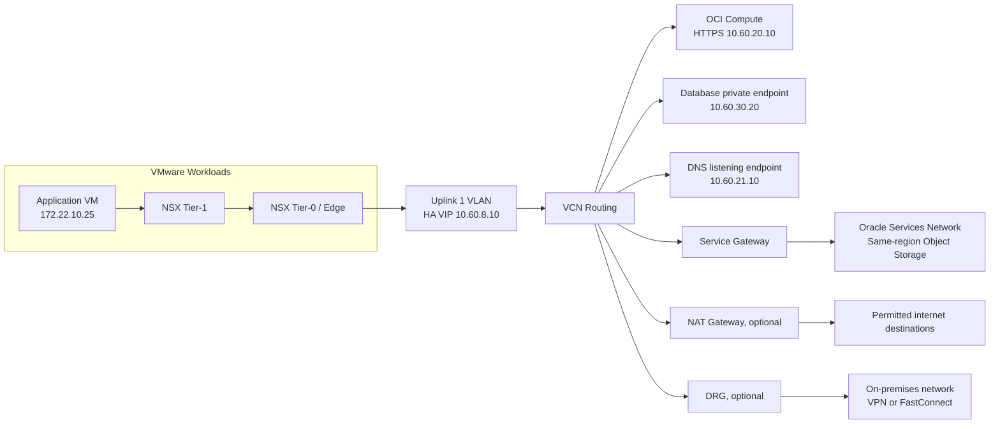

# Connecting VMware Workloads to VCNs and OCI Services

In the **Specialized Workloads and Deployments** chapter of the Oracle Cloud Infrastructure (OCI) module, this lesson addresses a specific requirement: keeping the application tier on VMware while enabling applications to consume OCI resources and services. For example, an order-management application continues running inside VMware virtual machines, calls APIs on OCI Compute, connects to an Oracle database via a private address, and reads configuration files from Object Storage.

Oracle Cloud VMware Solution (OCVS) provides a software-defined data center (SDDC) environment on OCI. VMware workloads use NSX virtual networking; the underlying infrastructure integrates with a Virtual Cloud Network (VCN). Therefore, placing the SDDC and services in the same VCN is not enough to prove VMs can reach those services. You must determine the path through NSX Edge, the return path, filtering layers, and application authentication mechanisms. [OCVS Overview](https://docs.oracle.com/en-us/iaas/Content/VMware/Concepts/ocvsoverview.htm).

After this lesson, learners can:

- Distinguish NSX overlay workload networks from OCI subnets, VLANs, and route tables.
- Design bidirectional routing between VMware virtual machines and private endpoints in a VCN.
- Choose the right path to Oracle Services Network, the internet, or on-premises networks.
- Combine OCI IAM, NSX security, NSGs, and database privileges.
- Perform layer-by-layer connectivity testing, collect evidence, and create an operational plan.

## 1. Defining the Boundary Between VMware and OCI Networks

### 1.1. Workload Overlay and Underlying Infrastructure

Application virtual machines typically attach to an **NSX segment**. A VM's IP address belongs to the workload overlay range; it does not automatically become the address of an OCI VNIC in an application subnet. When traffic needs to leave the overlay, packets traverse NSX routing components matching the SDDC design, typically Tier-1, Tier-0, and NSX Edge.

On the OCI side, VLANs support connectivity for VMware components. The **NSX Edge Uplink 1 VLAN** is the point to inspect in workflows connecting the SDDC to VCN resources and gateways. Oracle provides dedicated workflows per target type; they can create or update gateways, route tables, and security rules. [Configure SDDC Connectivity](https://docs.oracle.com/en-us/iaas/Content/VMware/Tasks/ocvsconfigconnectivity.htm).

| Component | Role in connectivity | Primary management plane |
| --- | --- | --- |
| NSX segment | Network for workload virtual machines | NSX |
| Tier-1/Tier-0 | Routing within and out of the overlay | NSX |
| NSX Edge | Handles traffic crossing the NSX network perimeter | NSX, coordinated with OCI infrastructure |
| Uplink VLAN | External connection from Edge to the OCI network | OCI Networking and NSX |
| OCI subnet | Hosts OCI resources such as Compute or private endpoints | OCI Networking |
| OCI route table | Selects next hop when traffic crosses a route table attachment point | OCI Networking |

Oracle's reference architecture for multi-tier applications also places application VMs in the NSX overlay while databases use a dedicated VCN subnet. This is a phased modernization approach that preserves VMware operations for the application tier. [VMware Application Architecture Connecting to Autonomous Database](https://docs.oracle.com/en/solutions/ocvs-oci/).

### 1.2. Private IP as the Routing Target Back to the Overlay

An OCI resource needs a next hop to send packets back to the workload range. In the model used in this lesson, the next hop is the **private IP registered as a route target on the Uplink 1 VLAN**, corresponding to the NSX Edge HA VIP inside the SDDC.

You must match the OCI-side private IP object to the actual VIP on the NSX side. Do not mistakenly choose the IP of an application VM, ESXi host, Edge management interface, or an individual Edge node. Nor should you assign an arbitrary IP and assume NSX uses it. Oracle supports the **Route target only** external access type for a VLAN to provide a private IP as the target toward the VMware overlay. [Add External Access to a VLAN](https://docs.oracle.com/en-us/iaas/Content/VMware/Tasks/vlan-add-external-access.htm).

A key design point to remember: **the workload CIDR is the destination network; the Edge private IP is the next hop**. These two values serve two different roles in a route rule.

## 2. Architecture and Address Plan for the Example

### 2.1. Lab Scope

Assume the organization already has an active SDDC, a private management path to vCenter/NSX, and authorization to use a lab environment. This lab adds connectivity to an existing SDDC; creating a new SDDC is not required.

The following addresses are illustrative only. When applying them, substitute addresses and OCIDs verified in the actual environment. Do not change the CIDR or VIP of a running SDDC just to match this table.

| Item | Illustrative value | Notes |
| --- | --- | --- |
| VCN | `10.60.0.0/16` | Contains SDDC infrastructure and service subnets |
| Reserved range for SDDC infrastructure | `10.60.0.0/20` | Covers multiple infrastructure networks; not a single subnet |
| Uplink 1 VLAN | `10.60.8.0/27` | Part of the infrastructure range above |
| Edge Uplink 1 HA VIP | `10.60.8.10` | Must exist and match the private IP route target |
| Application NSX segment | `172.22.10.0/24` | Workload range routed to OCI |
| Application VM | `172.22.10.25` | Host used to run probes |
| Compute subnet | `10.60.20.0/24` | Test HTTPS server: `10.60.20.10` |
| DNS subnet | `10.60.21.0/24` | Illustrative listening endpoint: `10.60.21.10` |
| Database subnet | `10.60.30.0/24` | Illustrative private endpoint: `10.60.30.20` |
| On-premises network | `10.80.0.0/16` | Used only if extending via DRG |

Before connecting, check for overlaps across all VCN CIDRs, overlay CIDRs, on-premises networks, and peered VCNs. If the overlay overlaps with a destination subnet, routers may treat the destination as local or choose the wrong path. Resolve addressing or design intentional NAT before adding routes.

### 2.2. Expected Traffic Flows



The diagram shows traffic initiated from the application. Each connection also requires a valid return path. The paths through the NAT gateway and DRG are extensions; there is no need to enable them if the lab goal only covers private resources and in-region Object Storage.

## 3. Choosing the Right Path to OCI Services

One gateway cannot substitute for every type of connection. Classify targets by **the endpoint the application actually uses**, rather than solely by product name.

| Target type | Expected path | What to verify |
| --- | --- | --- |
| Private IP of Compute or database in VCN | NSX Edge → VCN routing → target subnet | Return route to overlay, firewalls, and listening service |
| Supported Oracle Services Network endpoint, same region | NSX Edge → service gateway → Oracle Services Network | Service CIDR label, return path to workload, and API permissions |
| Websites or software repositories on the internet | NSX Edge → designed egress path → NAT gateway/internet | Where NAT occurs, post-NAT source IP, and allowed targets |
| Servers in the data center | NSX Edge → DRG → VPN/FastConnect | Bidirectional routes, prefix advertisements, security, and MTU |
| Private endpoint in another VCN | VCN/DRG connectivity designed for that case | Routes on all attachments and relevant DNS |

A service gateway enables private access to supported Oracle services in the **same region**, even if the service endpoint may still resolve to a public IP. Routing uses a **service CIDR label**, avoiding manually copying service public IP lists. Thus, seeing a public IP in DNS resolution is not enough to conclude traffic goes over the internet. [Service Gateway and Service CIDR Labels](https://docs.oracle.com/en-us/iaas/Content/Network/Tasks/servicegateway.htm).

Conversely, when the application uses a database private endpoint in `10.60.30.0/24`, the target is a private IP inside the VCN. Adding a route to the service gateway does not replace the return route to the NSX overlay for that connection.

## 4. Bidirectional Routing for Private Endpoints

### 4.1. Tracing an HTTPS Connection

VM `172.22.10.25` opens a connection to `10.60.20.10:443`. In a private model without SNAT, this session can be described as follows:

```text
Outbound:
172.22.10.25:<ephemeral-port>
  -> NSX segment gateway
  -> Tier-1 / Tier-0 / NSX Edge
  -> Uplink 1 VLAN
  -> 10.60.20.10:443

Return:
10.60.20.10:443
  -> effective route table at the service subnet/VNIC
  -> destination 172.22.10.0/24, next hop private IP 10.60.8.10
  -> NSX Edge / Tier-0 / Tier-1
  -> 172.22.10.25:<ephemeral-port>
```

If the SYN packet reaches Compute but the SYN-ACK cannot find a route back to `172.22.10.25`, the application still experiences a timeout. This case is often mistaken for a service port issue or a security rule issue.

### 4.2. Where Routes Must Exist

The following table describes configuration intent for the example. Platform-provided local connectivity routes do not necessarily appear as user-created rules.

| Application point | Destination to reach | Next hop or mechanism |
| --- | --- | --- |
| NSX segment/Tier-1 | Networks outside the overlay | Tier-0 per configured topology |
| Tier-0/Edge | OCI service subnets | Uplink matching the SDDC design |
| Tier-0/Tier-1, return path | `172.22.10.0/24` | Properly attached segment and effective routes across tiers |
| Compute subnet route table | `172.22.10.0/24` | Edge private IP route target: `10.60.8.10` |
| Database subnet route table | `172.22.10.0/24` | Same Edge private IP route target |
| DNS subnet route table | `172.22.10.0/24` | Same Edge private IP route target |

Oracle directly illustrates creating a route on the database subnet: destination is the application-tier overlay CIDR, target type is private IP, and target is the NSX Edge VIP. [Connecting OCVS to Autonomous Database Using a Private Endpoint](https://blogs.oracle.com/cloud-infrastructure/connect-oracle-cloud-vmware-solution-to-oracle-autonomous-database-using-private-endpoint-private-ip).

Check the route table **association**. Creating the right rule in a table not attached to the subnet/VNIC handling the traffic does not change the path. If the environment has resource-level routing or firewall insertion, inspect the effective configuration rather than looking only at the default route table. OCI distinguishes VCN route tables from DRG route tables. [VCN Route Tables](https://docs.oracle.com/en-us/iaas/Content/Network/Tasks/managingroutetables.htm).

### 4.3. Using the OCVS Workflow

On the SDDC details page, the **Configure connectivity to VCN resources** workflow lets you enter the workload CIDR and select target subnets. Before applying, review the planned updates to Uplink 1 VLAN and the selected subnets. The workflow can add or modify route tables, rules, and NSGs; hitting rule limits or lacking permissions can leave configuration incomplete. [Configure Connectivity to VCN Resources Workflow](https://docs.oracle.com/en-us/iaas/Content/VMware/Tasks/ocvsconfigconnectivity_topic-Configuring_Connectivity_to_Other_Resources_in_the_VCN.htm).

In the example, enter `172.22.10.0/24` and select the Compute, DNS, and database subnets. This expresses connectivity intent for those three specific subnets; there is no need to select every subnet in the VCN. After applying, record the modified resources and verify them against the path matrix above.

The workflow assists with OCI-side configuration. Operators must still verify the VM is attached to the correct segment, guest gateway settings, NSX routes, and relevant NSX policies.

## 5. Connecting to Oracle Services Network

### 5.1. Non-SNAT Path for Workloads

For in-region Object Storage, this lesson uses a routing model that preserves the workload source IP. Configuration intent includes:

```text
Uplink 1 VLAN side:
  destination: selected regional service CIDR label
  target: VCN service gateway

Service gateway side, for return traffic:
  destination: 172.22.10.0/24
  target: NSX Edge private IP route target

NSX side:
  VM has a route to Edge;
  Edge has a route to the service destination via uplink;
  no unintended SNAT rule alters the source of the tested flow.
```

The return path from the service gateway must be configured because the overlay lies outside the VCN CIDR in this example. OCI supports attaching a route table to a service gateway and using a private IP as a target; this is the basis for routing return traffic through Edge. Do not create only an outbound rule and assume the VCN already knows every NSX segment. [Private Routing via Service Gateway](https://docs.oracle.com/en-us/iaas/Content/Network/Tasks/transitroutingoracleservices.htm).

### 5.2. Applying the Workflow and Verifying Results

The **Configure connectivity to Oracle Services Network** workflow accepts the workload CIDR, checks the service gateway, and plans required network resource updates between the gateway and Uplink 1 VLAN. After applying, verify changes on both the VLAN side and the service gateway side. [Configure Connectivity to Oracle Services Network Workflow](https://docs.oracle.com/en-us/iaas/Content/VMware/Tasks/ocvsconfigconnectivity_topic-Configuring_Connectivity_to_the_Oracle_Services_Network.htm).

In the lab, select the service label according to identified needs. If only Object Storage is needed, verify the label covering Object Storage; if additional supported services are required, verify label scope and egress rules. Do not enter a service label into NSX as if it were an IPv4 CIDR: the label is an OCI Networking construct.

The expected result is that the VM reads a test object using an authorized identity. An HTTP response from the endpoint only proves part of the transport path; it does not prove the application is authorized to read the required object.

### 5.3. Distinguishing NSX SNAT from NAT Gateway

In an alternative egress design, NSX may SNAT the overlay source to an uplink address before traffic reaches the OCI gateway. In that case, the destination sees the translated address, and return-path checks must be based on that address and NAT state. Oracle provides guidance on configuring SNAT to the HA VIP so workloads can access public/internet DNS; the DNS forwarder's source may also need separate handling. [DNS and SNAT Example on NSX](https://docs.oracle.com/en/learn/configure_dns_vmware_nxstoverlay/).

**SNAT at NSX and the OCI NAT gateway are two separate processing points.** If a design uses both, document source translation at each point. Do not add a blanket SNAT for all destinations just to make a test pass, as that can mask VM source IPs in logs and alter policies for private paths.

OCI provides an internet egress workflow via NAT gateway, adding a default route to the Uplink 1 VLAN. However, a `0.0.0.0/0 -> NAT gateway` rule is only part of the configuration; you must still verify source, return path, NSX, and filtering layers of the actual design. [Connecting SDDC to the Internet via NAT Gateway](https://docs.oracle.com/en-us/iaas/Content/VMware/Tasks/ocvsconfigconnectivity_topic-Configuring_Connectivity_to_the_Internet_Through_a_NAT_Gateway.htm).

## 6. Layer-by-Layer Access Control and Permissions

### 6.1. Separating Operational Permissions from Application Identity

Distinguish three questions:

1. **Who can modify OCI infrastructure?** OCI IAM governs reading the SDDC, modifying routes, creating gateways, or updating NSGs.
2. **Who can modify VMware?** vCenter/NSX permissions govern segment attachment, gateway edits, and VMware policies.
3. **What can the application do with data?** OCI API permissions or database privileges govern read, write, and query operations.

Permission to edit networks does not mean permission to read objects in a bucket. Similarly, a TCP connection to a database does not grant `SELECT`. OCVS permissions also do not automatically include all Networking permissions needed for related actions; Oracle's IAM reference lists API dependencies separately. [Permissions for OCVS](https://docs.oracle.com/en-us/iaas/Content/Identity/policyreference/ocvspolicyreference.htm).

In multi-compartment environments, build a permissions matrix by the **compartment containing the actual resource**. For example, the SDDC might live in the VMware compartment, the VCN in the Network compartment, and the bucket in the Data compartment. Policy placement and granted scope must allow the corresponding operations on each resource.

### 6.2. Do Not Assume VMware Guests Have Instance Principals

A guest VM running on ESXi does not automatically possess an OCI Compute instance identity. The fact that ESXi runs on OCI bare metal infrastructure does not mean applications inside the guest inherit the host's instance principal. The instance principal mechanism uses the identity and certificates of an OCI Compute instance. [Calling Services from an OCI Compute Instance](https://docs.oracle.com/en-us/iaas/Content/Identity/callresources/callingservicesfrominstances.htm).

Therefore, before choosing an SDK authentication provider for a guest, identify a mechanism that is supported and deployed by the organization. In a lab, you can use an OCI CLI profile with a valid security token and limited permissions. For long-lived systems, design credential issuance, protection, rotation, and revocation for workloads; never copy infrastructure admin credentials onto application VMs.

For example, a lab user group only needs to read objects in a known bucket:

```text
Allow group OCVSLabReaders to read objects in compartment AppData where target.bucket.name='ocvs-connectivity-lab'
```

Replace the group and compartment names with valid tenancy identifiers; add the identity domain prefix if required by your environment. The policy above illustrates permissions for objects in one bucket, not permissions to create buckets or administer Object Storage. If tooling also calls resource discovery APIs, evaluate the permissions needed for those APIs separately. [Policy to Read Objects in a Specific Bucket](https://docs.oracle.com/en-us/iaas/Content/Identity/Concepts/commonpolicies.htm).

### 6.3. Filtering Layers Along the Path

A network path may pass through the guest firewall, NSX Distributed Firewall, NSX Gateway Firewall, VLAN/endpoint NSGs, and target subnet security lists. Every enforced layer must permit the flow using the exact addresses visible at that layer.

| Example flow | Pre-NAT source | Destination | Destination port |
| --- | --- | --- | --- |
| VM calls test API | `172.22.10.25/32` or approved app group | `10.60.20.10` | TCP 443 |
| VM connects to lab mTLS database | Approved app CIDR/group | Database private endpoint | TCP 1522 |
| VM queries DNS directly | Approved client CIDR/group | `10.60.21.10` | UDP and TCP 53 |
| VM reads Object Storage | Approved app CIDR/group | In-region service endpoint | TCP 443 |

This table states business intent; when writing rules, specify ingress/egress direction and exact attachment points. For example, the database NSG needs ingress from the actual application source, while NSX policies must allow the application to reach the database endpoint.

In OCI, allow rules in NSGs and security lists applied to the same VNIC are combined by **union**—an NSG does not automatically override a broad security list rule. Thus, narrowing an NSG is insufficient if a security list still allows all sources. Stateful rules can permit return traffic for tracked connections; stateless rules must be designed in both directions. Statefulness does not create missing routes. [OCI Security Rules](https://docs.oracle.com/en-us/iaas/Content/Network/Concepts/securityrules.htm).

If using a DNS forwarder or SNAT, the source IP seen by the endpoint may differ from the original client IP. Use packet captures or logs to confirm before choosing CIDRs for rules; do not change every rule to `0.0.0.0/0` to skip identifying the source.

## 7. DNS for Overlay Workloads

### 7.1. Providing a Resolver Endpoint Reachable by Guests

The lab model uses an OCI DNS resolver **listening endpoint** in the DNS subnet. VMs have a route to `10.60.21.10`, the DNS subnet has a return route to the overlay, and security rules allow queries from approved sources. A listening endpoint provides an IP in the subnet to receive queries; a forwarding endpoint handles outbound queries to other DNS servers. [Resolver Endpoint Types](https://docs.oracle.com/en-us/iaas/Content/Network/Concepts/dns-topic-resolver_endpoints.htm).

Do not mechanically copy OCI Compute's link-local DNS address `169.254.169.254` into VMware guests. First choose a supported model for the overlay: send queries directly to a routable listening endpoint, or use an internal DNS / NSX DNS forwarder with an appropriate upstream.

In the example, clients are configured to use `10.60.21.10`. If the organization uses Active Directory DNS, you can keep that DNS as the client resolver and configure conditional forwarding for relevant OCI domains. Forward only the needed domains, check private views/zones attached to the resolver, and avoid forwarding loops between on-premises DNS and OCI. [Private DNS and Forwarding](https://docs.oracle.com/en-us/iaas/Content/DNS/Tasks/privatedns.htm).

### 7.2. Testing DNS Independently of Application Connections

The following Bash commands run on a test Linux VM once DNS tools and actual endpoint values are available:

```bash
DNS_LISTENER_IP='10.60.21.10'
DB_FQDN='REPLACE_WITH_DATABASE_PRIVATE_FQDN'

# Query the intended resolver directly.
dig @"$DNS_LISTENER_IP" "$DB_FQDN" A
dig +tcp @"$DNS_LISTENER_IP" "$DB_FQDN" A

# Check the resolution path used by applications on the OS.
getent ahostsv4 "$DB_FQDN"
```

In a private endpoint lab, results should point to the database's expected private IP. If `dig` to the listener succeeds but `getent` fails, inspect the guest's resolver configuration and client-side cache. If both return a different endpoint's address, inspect zones, views, forwarding, and the connection string before modifying firewalls.

Do not use static entries in the `hosts` file as a system-wide default solution. It can help in a controlled test, but remove it afterward to avoid masking DNS issues or keeping stale addresses.

## 8. Integrating Oracle Databases and Object Storage

### 8.1. Connecting to a Database via Private Endpoint

For an Autonomous Database private endpoint, retrieve the FQDN, connection string, and TLS settings directly from the target database. In the example, mTLS is selected, so check TCP 1522; TLS setups may use 1521 or 1522 depending on service configuration. If the application needs Database Actions, APEX, or ORDS, evaluate HTTPS 443 separately. Do not open those ports when the application only needs SQL sessions. [Autonomous Database Private Endpoint Configuration](https://docs.oracle.com/en-us/iaas/autonomous-database-serverless/doc/private-endpoints-autonomous.html).

The verification order for a SQL connection is:

1. The FQDN resolves to the correct private endpoint.
2. TCP connects to the right port and receives a response.
3. Driver, trust store/wallet, and TLS requirements match the connection string.
4. The application account logs in to the right service.
5. An authorized query returns results.

Example with SQL*Plus installed, wallet securely provisioned, and alias configured in Oracle Net:

```text
sqlplus /nolog

SQL> CONNECT app_user@LABDB_LOW
Enter password:

SQL> SELECT sys_context('USERENV', 'SERVICE_NAME') AS service_name FROM dual;
```

`LABDB_LOW` is only an illustrative alias. Use your lab database's alias and enter the password at the prompt; never store real passwords in commands, screenshots, or shell history.

A login failure or insufficient privilege error after reaching the database is a reason to inspect identity, service name, and privileges. It is not evidence that more network ports should be opened.

### 8.2. Reading an Object with an Authenticated Request

Prepare a small, non-sensitive object such as `health/marker.txt`. The practitioner knows the namespace, bucket, and object name, and has an `OCVS_LAB` profile containing a valid security token. Install tooling and provision credentials via organization-approved procedures before running probes.

```bash
OCI_REGION='REPLACE_WITH_LAB_REGION'
OS_NAMESPACE='REPLACE_WITH_OBJECT_STORAGE_NAMESPACE'

oci os object get \
  --namespace "$OS_NAMESPACE" \
  --bucket-name 'ocvs-connectivity-lab' \
  --name 'health/marker.txt' \
  --file '/tmp/ocvs-connectivity-marker.txt' \
  --region "$OCI_REGION" \
  --profile 'OCVS_LAB' \
  --auth security_token
```

The object download syntax with a profile and `--auth security_token` is also used by Oracle in agent distribution guides. The token/profile must be protected and valid; issuing or renewing tokens has its own connectivity requirements depending on the authentication mechanism. [OCI CLI Example Downloading an Object with a Security Token](https://docs.oracle.com/en-us/iaas/Content/Logging/Task/installing_the_agent.htm).

To separately verify DNS/TCP/TLS to the confirmed Object Storage endpoint, run:

```bash
OS_ENDPOINT_HOST='REPLACE_WITH_REGION_OBJECT_STORAGE_HOSTNAME'

getent ahostsv4 "$OS_ENDPOINT_HOST"
curl --verbose --connect-timeout 5 --max-time 15 \
  "https://${OS_ENDPOINT_HOST}/" -o /dev/null
```

This `curl` request is unsigned for reading objects. An HTTP response, even an auth or path error, helps confirm the endpoint responded over TCP/TLS; it does not replace an authenticated `GetObject` test. Do not use `-k` to turn certificate errors into passing results.

At the same time, a successful object download does not by itself prove traffic traversed the service gateway if a fallback internet route still exists. Verify the endpoint, effective routes, gateway configuration, and corresponding network evidence.

## 9. Repeatable Lab Runbook

### Step 1: Record Baseline State

Create a change record in the organization's operations tool including region, compartment, SDDC/VCN, workload CIDR, Uplink 1 VLAN, Edge VIP, and target subnets. Save the state of relevant route tables, associations, NSGs, and NSX policies as a rollback baseline.

Confirm VM `172.22.10.25` has the correct IP, prefix, default gateway, and DNS. In the example, proceed only when CIDRs do not overlap and the VIP matches between OCI and NSX.

### Step 2: Configure the Private Path

Run the VCN connectivity workflow or equivalent approved changes. Verify each service subnet has a return route to `172.22.10.0/24` via the correct private IP route target. Cross-check NSX-side routes and segments.

If a route table is shared across multiple subnets, assess blast radius before changing associations. Prefer small, targeted changes where rollback scope can be clearly identified.

### Step 3: Apply Minimal Security Rules

Permit the VM/application group to reach the exact endpoints and ports in the connectivity matrix. Check NSX, OCI, and host firewalls. On the test HTTPS server, confirm the service is listening on its private IP and port 443; on the database, confirm private access and TLS match the lab selection.

### Step 4: Configure and Verify DNS

Create or reuse an existing listening endpoint. Separately test UDP/TCP 53, database FQDN resolution, and OS-level name resolution. Proceed to SQL testing only after the FQDN returns the expected endpoint.

### Step 5: Configure Oracle Services Network

Apply the OSN workflow for the workload CIDR. Verify the service gateway, label, outbound route on Uplink 1 VLAN, and return route to the workload on the gateway side. With the lab's non-SNAT model, confirm no legacy NAT rule unexpectedly translates the source IP.

### Step 6: Run Probes in Order

Basic verification commands on the Linux VM:

```bash
# Check guest configuration and the next hop selected by the guest.
ip -br address
ip route
ip route get 10.60.20.10
ip route get 10.60.30.20

# Probe TCP to the actual prepared services.
nc -vz -w 5 10.60.20.10 443
nc -vz -w 5 10.60.30.20 1522

# Use the hostname present in the lab HTTPS server's certificate.
LAB_HTTPS_FQDN='REPLACE_WITH_LAB_HTTPS_FQDN'
curl --resolve "${LAB_HTTPS_FQDN}:443:10.60.20.10" \
  --connect-timeout 5 --max-time 15 \
  "https://${LAB_HTTPS_FQDN}/health"
```

The HTTPS server needs a `/health` endpoint and a certificate trusted by the client; if using an internal CA, distribute that CA per lab procedure. `--resolve` preserves the hostname for TLS verification while pinning the test's destination IP.

`ip route get` only shows the guest's routing decision, not the full NSX/OCI path. A successful `nc` only confirms TCP at the time of testing. After these probes, run the SQL login, test query, and authenticated object download from earlier sections.

### Step 7: Verify Results and Test Denied Cases

| Check | Passing criteria | Evidence to retain |
| --- | --- | --- |
| Database DNS | Returns correct private IP; OS uses the result | FQDN, resolver, output, and timestamp |
| VM → private HTTPS | `/health` returns expected response with valid TLS | Status code and service-side logs |
| VM → database | Logs in to right service and test query succeeds | Service name, timestamp; do not record passwords |
| VM → Object Storage | Reads small object in lab bucket | Object name, request ID if available, and result |
| Object permission check | Restricted identity cannot read buckets outside lab scope | Authorization error matched to policy |
| Source-based network check | Test source outside approved group cannot connect when blocked by design | Active rule and appropriate logs/captures |

Use only authorized test resources for negative tests. Do not treat every timeout as a passing security result: prove the service still works for valid sources and that the block reason matches the design.

## 10. Evidence-Based Troubleshooting

### 10.1. Tracing from Guest to Service

When a probe fails, record the full tuple: source IP, destination IP, protocol, source/destination ports, timestamp, and application action. Then inspect sequentially:

1. **Guest:** NIC, IP address, gateway, resolver, and local firewall.
2. **NSX:** segment attachment, inter-tier routes, Edge/uplink, firewall, and NAT rules matching the flow.
3. **OCI:** route table association, private IP route target, NSG/security list, and gateways.
4. **Return path:** whether the target subnet/gateway has a return route to the exact source IP it sees.
5. **Service:** listener, TLS, connection string, credentials, and operation privileges.

If authorized and tools are installed on the guest, a brief packet capture can determine whether SYN leaves the VM and SYN-ACK returns:

```bash
sudo tcpdump -ni any -c 30 'host 10.60.30.20 and tcp port 1522'
```

This is a guest-side observation; to locate where packets are dropped, correlate with captures at Edge or the destination. Do not blame a network layer from a single capture point.

### 10.2. Using the Right Tool for Each Scope

VCN Flow Logs help inspect traffic accepted or rejected at logged VNICs, making it easier to check security lists/NSGs and correlate addresses, ports, and timestamps. However, flow logs do not record every packet; certain traffic types are excluded and incomplete capture can occur. [VCN Flow Logs Scope and Limitations](https://docs.oracle.com/en-us/iaas/Content/Logging/Reference/details_for_vcn_flow_logs.htm).

Therefore, an `ACCEPT` log on the OCI side does not prove NSX Distributed Firewall allowed the flow, the guest received the packet, or SQL login succeeded. Likewise, missing log records are not enough to prove zero traffic occurred. Supplement with NSX logs/captures, guest logs, and application responses.

Network Visualizer and Network Path Analyzer can help inspect topology, routes, and policies within the scope of OCI resources modeled by those tools. Use them alongside VCN Flow Logs to validate hypotheses before changing configuration. [OCI Network Troubleshooting Tools](https://docs.oracle.com/en/learn/oci-ntw-troubleshoot-1/index.html).

### 10.3. Common Symptoms

| Symptom | Where to check first |
| --- | --- |
| Right IP but all connections time out | Guest gateway, NSX routes/uplink, filters, and return route to overlay |
| SYN reaches service but no SYN-ACK returns to VM | Effective route table on service side, Edge target, and NSX return path |
| TCP rejected immediately | Service not listening, wrong IP/port, or device actively sending reject |
| IP works, FQDN fails | Guest resolver, listening endpoint, DNS rules, and private zones/views |
| TCP succeeds but TLS fails | Hostname, CA, wallet, system clock, and TLS/mTLS mode |
| HTTP/API returns auth or permission error | Credentials, expired token, request signature, policy, and target resource |
| Object Storage works but private database does not | Different endpoint paths; inspect database subnet/NSG/return route |
| Small connections work but large transfers hang | MTU, fragmentation/PMTUD, and tunnels along the path |
| Endpoint logs show unexpected source IP | NAT rules, rule ordering, or DNS forwarder/proxy initiating a new connection |

For MTU issues, compare actual path characteristics across every layer and run controlled measurements. Do not apply one blanket jumbo frame value across overlay, uplink, and VPN without verifying end-to-end support.

## 11. Extending to On-Premises Networks and Other VCNs

When VMware workloads need to call on-premises services, add a DRG and appropriate VPN/FastConnect attachments. The OCVS workflow accepts the workload CIDR and on-premises CIDR, then previews updates related to Uplink 1 VLAN and the DRG. [Connecting SDDC to an On-Premises Network](https://docs.oracle.com/en-us/iaas/Content/VMware/Tasks/ocvsconfigconnectivity_topic-Configuring_Connectivity_to_Your_Onpremises_Network.htm).

Beyond the workflow, designers must verify the following end-to-end:

- The uplink routes `10.80.0.0/16` toward the DRG, and NSX has the corresponding outbound route.
- The DRG selects the right attachment for the on-premises network; effective route tables and route distributions include the required prefixes.
- The on-premises network has a route to `172.22.10.0/24`, not only the VCN CIDR `10.60.0.0/16`.
- Traffic entering the VCN from the DRG is directed to the Edge private IP route target when destined for the workload overlay.
- DNS, firewalls, and redundant paths all support the chosen flow.

An overlay prefix outside the VCN CIDR must not be assumed advertised solely because a VCN attachment exists. Inspect actually received routes at both the DRG and on-premises routers.

For services in another VCN, build a new path matrix covering both ends and intermediate attachments. Do not assume connecting two VCNs automatically makes every overlay prefix or network service in one VCN usable from the other.

## 12. Availability, Automation, and Cost Control

### 12.1. Testing Resilience on the Real Application Path

Using an HA VIP as a route target is only one element of the design. You must consider Edge HA status, DNS sources, databases, hybrid connectivity, and the application's session recovery capability.

A failover test plan can simultaneously monitor HTTPS probes, short SQL queries, and Object Storage requests. During an approved maintenance window, execute a platform-supported failover scenario, measure outage duration, and confirm return paths remain valid. Distinguish new connections from existing sessions: applications need bounded, appropriate timeouts and retries to avoid amplifying load while services recover.

In particular, write operations should be retried only when business idempotency has been handled. Network reconnection alone does not indicate whether an earlier transaction committed.

### 12.2. Automating Along OCI and VMware Boundaries

OCI resources can be managed via Terraform/Resource Manager or APIs, while NSX configuration can be managed using organization-approved tooling. Before automating, document dependencies among segments, Edge VIPs, private IP objects, route table associations, and security policies.

Inputs should include workload CIDRs, target subnets, route target OCIDs, endpoint/port lists, and regional service labels. Deployment outputs should include post-change probes and rollback information. Avoid copying an IP/OCID from another SDDC or assuming VIPs match across environments.

If a Console workflow created resources, bring them into your existing configuration management workflow before creating duplicates. When updating via API/IaC, verify whether the tool appends individual rules or replaces the entire rule set, so you do not accidentally remove paths for other workloads.

### 12.3. Keeping Lab Scope and Costs Under Control

Reuse existing lab SDDCs and set expiration dates for supplementary resources. Separately track VMware resources, test Compute instances, databases, hybrid links, data transfer, and log volume. Use tenancy-standard owner/purpose tags and configure budget alerts for the assigned scope.

Do not assume powering off guest VMs eliminates SDDC infrastructure costs. Before modifying or deleting VMware resources, check usage terms, active commitments, and actual dependencies with the environment owner.

After the lab, remove test credentials/profiles, objects, and temporary rules created by the lab per the documented plan. Delete gateways, DNS endpoints, or route tables only after confirming they belong to the lab and are no longer used by other resources. For shared resources, revert only the lab's changes and keep evidence of the result.

## 13. Connectivity Implementation Acceptance Criteria

A configuration satisfies this lesson's objectives when all of the following can be explained and proven:

- Workload ranges, service subnets, and related networks have no unresolved overlaps.
- VMs traverse the intended segment/gateway; NSX and OCI routes form bidirectional paths to private endpoints.
- The private IP route target matches the Edge VIP; route tables are attached at the right enforcement points.
- DNS resolves the intended endpoint, and TLS verifies server identity properly.
- Security rules permit the exact source/destination/port; both NSX and OCI layers are accounted for.
- The application identity performs authorized actions and is denied outside that scope.
- The path to Object Storage aligns with the service gateway design and has supporting evidence.
- Observability data, a rollback plan, recovery checks, and resource ownership are documented.

The value of this model is that VMware applications can adopt OCI services incrementally as needed, while network paths, data permissions, and operational responsibilities remain clearly defined for every connection.
