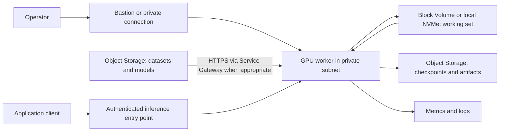

# GPU Compute and Infrastructure Selection for AI

In the **Specialized Workloads and Deployments** chapter of the `CLOUD_PROVIDERS_ORACLE` module, GPU Compute is the infrastructure choice when AI applications require parallel compute, device memory, or control beyond what managed services provide. Deployment decisions must align with the tenancy, compartments, IAM, VCN, storage, monitoring, and the team's operational capabilities.

An appropriate configuration must simultaneously fit the workload, meet quality and performance targets, have capacity where needed, recover from failures, and remain cost-effective. GPU count or peak compute specs describe only part of the problem.

## Objectives and Background Knowledge

After this lesson, learners can:

- Distinguish infrastructure requirements for training, fine-tuning, online inference, and batch inference.
- Estimate VRAM and choose between GPU VMs, bare metal, and multi-node clusters.
- Design data paths, permissions, and networking for GPU workloads on OCI.
- Run a smoke test, collect measurements, and evaluate an option before scaling out.
- Plan checkpointing, recovery, capacity management, and resource reclamation.

Required background knowledge: Compute instances and images, regions and availability domains (ADs), VCNs and subnets, compartments and IAM policies, Object Storage and Block Volume. Learners should be able to read Linux commands and basic Python examples; an existing GPU cluster is not required.

## 1. Start from Workload Characteristics

GPUs excel at matrix operations and parallel processing in deep learning. However, completion time also depends on data loading, preprocessing, data transfer, and synchronization. A pipeline spending most of its time decompressing on CPU may see little benefit from switching to a faster GPU.

| Workload | What to measure first | Typically dominant infrastructure factors |
| --- | --- | --- |
| Training from scratch | Step time, time to target quality, data throughput per second | VRAM, compute throughput, storage, and inter-GPU synchronization |
| Full-parameter fine-tuning | Optimizer, gradient, activation memory, and sample length | VRAM and model state sharding strategy |
| Adapter fine-tuning, e.g., LoRA | Actual memory usage and post-tuning quality | Base weights, activations, and remaining trainable states |
| Online inference | p95/p99 latency, throughput, concurrent requests | VRAM, KV cache, model load time, and keeping replicas warm |
| Batch inference, embedding generation | Total processing time, records per second, restartability | Throughput, batching, data reads, and output writes |
| Data preprocessing | CPU, RAM, decoding speed, and I/O | CPU or host memory may be the primary bottleneck |

For LLMs, separate **time to first token** from **subsequent token generation rate**. A system with high total tokens/second can still cause long user waits when queues fill up or prompts are long.

### Choose the Management Level Before Choosing a Shape

Consider the following options:

| Option | When worth considering | Responsibilities to prepare |
| --- | --- | --- |
| CPU Compute | Small models, low load, or algorithms that do not benefit significantly from GPUs | Measure baseline to verify whether a GPU is needed |
| OCI Generative AI or appropriate AI service | Provided capabilities and interfaces meet application needs | Evaluate models, service limits, data, and integration |
| OCI Data Science Jobs | ML jobs with clear inputs, outputs, and run lifecycles | Artifacts, environments, IAM, logging, and service-supported shapes |
| Direct GPU Compute | Need control over OS, framework, containers, or scheduler | Images, drivers, runtime, patching, recovery, and resource reclamation |
| Oracle Kubernetes Engine (OKE) with GPU nodes | Team already operates Kubernetes and needs multi-workload orchestration | Node pools, GPU allocation, scheduling, images, and monitoring |

Data Science Jobs can manage infrastructure provisioning and teardown for a job run. This is useful for batch training or batch inference, though supported shapes and configurations must still be verified. See [OCI Data Science Jobs](https://docs.oracle.com/en-us/iaas/Content/data-science/using/jobs-about.htm).

A **Dedicated AI cluster** in OCI Generative AI is a resource for fine-tuning or hosting within that service. Do not equate it with a self-managed Compute cluster where you install frameworks yourself. See [Managing Dedicated AI Clusters](https://docs.oracle.com/en-us/iaas/Content/generative-ai/ai-cluster.htm).

## 2. Sizing VRAM Before Counting GPUs

### 2.1. Memory During Inference

Initial estimate for weights:

```text
M_weights_bytes ≈ parameter_count × bytes_per_parameter

M_inference ≈ M_weights + M_KV_cache + M_temp_activations
              + M_workspace + M_runtime
```

Calculation example, not a guarantee for any specific model:

- An 8-billion-parameter model stored at 2 bytes per parameter needs roughly 16 decimal GB, equivalent to 14.9 GiB for weights alone.
- With nominal 4-bit quantization per parameter, raw weights are roughly 4 GB. Quantization metadata, layers kept in higher precision, and runtime increase the actual total.
- A GPU with 24 GB nominal capacity cannot automatically serve every configuration of an 8B model. Context length, concurrency, and how the engine manages memory can exhaust VRAM.

For standard attention architectures, a KV cache estimate is:

```text
M_KV_bytes ≈ 2 × L × H_kv × D_head × T_resident × B_cache
```

Where:

- `2` represents key and value.
- `L` is the number of attention layers.
- `H_kv` is the number of KV heads per layer, which can differ from query heads.
- `D_head` is the dimension per head.
- `T_resident` is the total number of token positions cached across active sequences.
- `B_cache` is bytes per cache element.

This formula highlights trends: increasing context length or concurrency increases VRAM usage even without changing the model. It omits fragmentation, metadata, prefix sharing mechanisms, cache quantization, or engine-specific behavior. Use engine measurements with representative prompt and output distributions to finalize sizing.

### 2.2. Memory During Training

An estimate must also account for gradients and optimizer states:

```text
M_training ≈ M_weights + M_gradients + M_optimizer_states
             + M_master_weights_if_any + M_activations
             + M_workspace + M_runtime
```

For example, a mixed-precision Adam implementation might use 2 bytes for weights, 2 bytes for gradients, 4 bytes for master weights, and 8 bytes for two optimizer states: totaling around 16 bytes per parameter before activations. For 8 billion parameters, that part alone is around 128 decimal GB. Frameworks, dtypes, optimizers, and sharding strategies can change these numbers substantially.

LoRA reduces the number of updated parameters and thus significantly reduces certain training states. It must still handle base weights and activations. Nor does LoRA automatically imply the base weights are quantized.

Techniques to reduce memory pressure have trade-offs:

| Technique | Can reduce | Trade-offs to measure |
| --- | --- | --- |
| Reduce micro-batch or sequence length | Activations and temporary memory | Throughput or data characteristics change |
| Gradient accumulation | Micro-batch held per step | More accumulation steps and update time |
| Activation checkpointing | Stored activations | Partial recomputation during backward pass |
| Appropriate quantization | Supported weights or states | Quality, kernels, and compatibility |
| Sharding, tensor/pipeline parallelism | Memory held per GPU | More complex communication, config, and recovery |
| CPU offload | Portion of VRAM | Host RAM and transfer bandwidth can become bottlenecks |

### 2.3. Multiple GPUs Do Not Merge Into One Large GPU

Two 24 GB GPUs do not automatically form one device with 48 GB of contiguous memory. If an application loads the entire model onto one device, it remains bounded by that single device's VRAM.

- **Data parallelism** typically keeps a copy of the model on each GPU and splits data; it does not solve cases where one model copy exceeds VRAM.
- **Tensor/pipeline parallelism or sharding** can distribute the model or states if supported by the framework and architecture.
- Inter-GPU interconnect configuration governs communication overhead for these strategies.

Therefore, determine **what each GPU must hold** before using node-total VRAM in a capacity spreadsheet.

## 3. Reading OCI Shapes by Actual Configuration

OCI offers GPU VMs and GPU bare metal shapes. Examples for practicing how to read shape tables:

| Example shape | GPU count | Nominal VRAM per GPU | Evaluation significance |
| --- | --- | --- | --- |
| `VM.GPU.A10.1` | 1 NVIDIA A10 | 24 GB | Candidate for workloads fitting one GPU |
| `VM.GPU.A10.2` | 2 NVIDIA A10 | 24 GB | Must check how the app uses two devices |
| `BM.GPU.H100.8` | 8 NVIDIA H100 | 80 GB | Multi-GPU node; needs workloads that utilize the resources |

These are lookup examples, not an exhaustive list or a capacity guarantee. Check shapes, images, CPU architecture, RAM, disks, and networking in [Compute Shapes](https://docs.oracle.com/en-us/iaas/Content/Compute/References/computeshapes.htm) before deployment.

Choosing between VM and bare metal should be based on the required number of devices and workload characteristics. A large node running only a single-GPU job leaves most resources idle. Conversely, workloads needing GPU interconnects and scalability beyond what a VM configuration provides must be evaluated on a more suitable shape.

Host CPU and RAM remain essential for tokenizers, image decoding, dataloaders, orchestration, and offload. Do not treat host RAM as if it had the latency and bandwidth of VRAM.

The smoke test commands in this lesson apply to NVIDIA and CUDA. If selecting AMD GPUs, evaluate ROCm, frameworks, kernels, and corresponding monitoring tools; do not assume a CUDA image will run as-is.

## 4. Networking and Multi-GPU Scalability

Distinguish three communication paths:

1. **Intra-node:** CPU to GPU and GPU to GPU over the actual topology, such as PCIe or dedicated interconnects if present.
2. **Inter-node:** exchanging gradients, tensors, or states across nodes.
3. **To data and clients:** reading datasets, writing checkpoints, pulling images, and serving inference requests.

A VCN satisfies application IP connectivity. Placing instances in the same subnet does not automatically create an RDMA fabric or the desired synchronization performance.

OCI provides **compute clusters** to connect supported nodes with RDMA networking. Compute clusters let you manage individual instances; **cluster networks with instance pools** manage a group of instances. Separately verify supported combinations of shape, region, and AD in [Compute Clusters](https://docs.oracle.com/en-us/iaas/Content/Compute/Tasks/compute-clusters.htm).

Do not spread a synchronous training job across multiple ADs just to increase availability. Network distance and topology can degrade performance. A practical approach is running the job within an appropriate topology while keeping checkpoints and configuration ready to recover on evaluated backup infrastructure.

### Measuring Scaling on the Same Problem

For the same amount of work:

```text
Speedup(N) = T_baseline / T_N
Efficiency(N) = Speedup(N) / N
```

Here the baseline uses one GPU and `N` is the number of GPUs. If the baseline already uses multiple GPUs, normalize by the ratio of added devices.

Hypothetical example: the same job takes 10 hours on one GPU and 3.5 hours on four GPUs:

```text
Speedup(4) ≈ 2.86
Efficiency(4) ≈ 71.4%
GPU-hours: 1 × 10 = 10; 4 × 3.5 = 14
```

The four-GPU option finishes faster but consumes more GPU-hours. The choice depends on deadlines and total cost. If a model cannot run on one GPU, pick the smallest feasible baseline instead of producing meaningless speedup numbers.

When benchmarking, hold data, target quality, and comparison step counts constant. If global batch size changes, re-verify convergence; faster step times do not guarantee reaching target quality sooner.

## 5. Designing Storage to Keep GPUs Fed

A reference data path:



This diagram illustrates components and data flows; paths to each service require corresponding routes, DNS, and network rules.

| Storage type | Role in design | What to verify |
| --- | --- | --- |
| Object Storage | Source datasets, weights, finalized checkpoints, batch outputs | Actual throughput, object partitioning, IAM, and request costs |
| Block Volume | Working sets, application data requiring a filesystem or block device | Volume performance, instance limits, and attachment type |
| File Storage or suitable shared filesystem | Shared file namespace across workers when needed | NFS, metadata, concurrent access, and throughput |
| Local NVMe if included with shape | Cache, staging, and regenerable scratch space | Host loss or instance replacement can wipe local data |

Never keep the sole checkpoint copy on a GPU node's local disk. Treat a checkpoint as recoverable only after required data and metadata are durably written, verified, and marked complete.

You can calculate a pipeline's minimum read rate:

```text
Effective_read_rate ≈ samples_per_second × bytes_read_per_sample
```

Self-constructed example: 2,000 samples/second, each requiring an average 0.5 MB read, corresponds to roughly 1,000 MB/second of useful data. Also factor in re-reads, metadata, and overhead. Compressed sizes on Object Storage can differ from decoded sizes.

If GPUs wait on data, profile CPU decoding, dataloader worker counts, prefetching, caching, and file packaging before adding GPUs. Millions of small files behave very differently from a few large objects even with the same total bytes.

## 6. Permissions and Networking for GPU Workloads

### 6.1. Separating Deployment Permissions from Workload Permissions

A compartment design might dedicate `AiLab` for practice and isolate production resources for real deployments. Users launching instances need appropriate Compute, network, and volume permissions; an application reading datasets does not need to inherit all those permissions.

For Compute, use instance principals and dynamic groups so applications call OCI services without embedding user API signing keys into images. Anyone with access to the host can use the instance's permissions, so host access scope is also a security boundary. See [Calling Services from an Instance](https://docs.oracle.com/en-us/iaas/Content/Identity/Tasks/callingservicesfrominstances.htm).

Example matching rule for one specific lab instance—replace the illustrative OCID:

```text
instance.id = 'ocid1.instance.oc1..REPLACE_WITH_INSTANCE_OCID'
```

Suppose the dynamic group is `ai-gpu-workers`, and buckets `ai-datasets` and `ai-checkpoints` exist in compartment `AiLab`. Illustrative policy:

```text
Allow dynamic-group ai-gpu-workers to read objects in compartment AiLab where target.bucket.name = 'ai-datasets'

Allow dynamic-group ai-gpu-workers to read objects in compartment AiLab where target.bucket.name = 'ai-checkpoints'

Allow dynamic-group ai-gpu-workers to manage objects in compartment AiLab where all {target.bucket.name = 'ai-checkpoints', any {request.permission = 'OBJECT_CREATE', request.permission = 'OBJECT_OVERWRITE'}}
```

The first two lines grant read access to datasets and checkpoints; the last line allows only creating or overwriting objects in the output bucket. This policy does not grant permission to create buckets or delete objects. Verify permission names and conditions in [Object Storage Policy Reference](https://docs.oracle.com/en-us/iaas/Content/Identity/Reference/objectstoragepolicyreference.htm).

If checkpoints must be immutable, include run IDs in object names and omit overwrite permissions when unneeded. Separate permissions may be required for Monitoring, Logging, Vault, or registries depending on the pipeline. For Data Science or OKE, use each service's native principal mechanism instead of blindly copying Compute host policies.

### 6.2. Designing Network Paths

A reference configuration for labs and internal environments:

- GPU workers in a private subnet; administered via OCI Bastion or an established private connection.
- NSGs allow only management and application ports from required sources.
- Use a Service Gateway for supported OCI services; use a NAT Gateway or controlled proxy if fetching packages from the internet.
- Inference endpoints enforce authentication, rate limits, and context limits; do not expose notebooks or framework control ports publicly.
- Secrets are retrieved through a secrets management mechanism; logs avoid recording sensitive data unnecessarily.

IAM authorizes API calls; routes, DNS, NSGs, and OS firewalls enable network connectivity. Getting one layer right does not substitute for the other.

## 7. Checking Capacity, Limits, and Quotas

Before selecting a GPU for a formal schedule, distinguish:

| Concept | Question to answer |
| --- | --- |
| IAM | Is this principal authorized to create or use the resource? |
| Service limit | What is the tenancy's limit for the corresponding resource? |
| Compartment quota | How much does internal policy allow this compartment to consume? |
| Actual capacity | Is the shape available to provision in the selected region and AD? |
| Compatibility | Do the image, CPU architecture, and orchestration service support the configuration? |

Raising a service limit does not instantly create physical hardware. Conversely, seeing a shape name does not guarantee an instance launch request will succeed. Limit units must also be read carefully: GPU counts, OCPUs, and instance counts are not interchangeable.

For schedules needing guaranteed resources, evaluate **capacity reservations** where supported. Verify the actual reserved count and how instances consume the reservation. Unused reserved capacity still incurs its own billing; terminating an instance does not automatically delete the reservation. See [Capacity Reservations](https://docs.oracle.com/en-us/iaas/Content/Compute/Tasks/reserve-capacity.htm).

**Preemptible capacity** is suitable only when instance preemption is acceptable and restart procedures exist. Check the list of currently supported shapes; do not assume every GPU, bare metal, or instance pool shape qualifies. See [Preemptible Instances](https://docs.oracle.com/en-us/iaas/Content/Compute/Concepts/preemptible.htm).

For deadline-driven jobs, selection records should include fallback options if provisioning fails: benchmarked alternate shapes, regions near data, alternate schedules, or verified reservations. Switching regions also entails re-evaluating data, networking, artifacts, and transfer costs.

## 8. Lab: Validating a GPU Worker on OCI

### 8.1. Scope and Prerequisites

The goal is to confirm a worker can use its GPU and read/write artifacts under the designed IAM policies. This is a smoke test; it does not prove AI application quality or production SLOs.

Prerequisites:

1. Lab compartment, subnet, NSG, and working private management path.
2. Operator permissions to create resources; service limits, quotas, and capacity verified.
3. Image supporting the chosen NVIDIA shape, compatible driver, and a Python environment with CUDA-enabled PyTorch.
4. The two illustrative buckets and policies from earlier; Object Storage namespace available.
5. Small object `samples/hello.txt` in `ai-datasets` for read testing, containing no sensitive data.
6. OCI CLI on the admin workstation and on the worker for the Object Storage step.

Creating Compute resources can incur charges. Define the shape, lab duration, owner, and teardown plan beforehand. The commands below run in Bash; replace placeholder values before running.

### 8.2. Looking Up Shapes from the Admin Workstation

This command uses operator credentials configured on the admin workstation:

```bash
export OCI_CLI_REGION='REPLACE_WITH_REGION'
export COMPARTMENT_OCID='REPLACE_WITH_COMPARTMENT_OCID'
export AVAILABILITY_DOMAIN='REPLACE_WITH_EXACT_AD_NAME'

oci compute shape list \
  --compartment-id "$COMPARTMENT_OCID" \
  --availability-domain "$AVAILABILITY_DOMAIN" \
  --all \
  --query "data[?contains(shape, 'GPU')].{Shape:shape,GPUs:gpus}" \
  --output table
```

Output confirms shapes returned by the API in the selected context; it does not reserve capacity. Continue checking compatible images and limits before launching an instance.

In the Console, launch exactly one GPU instance for the smoke test in the selected compartment, AD, shape, image, and private subnet. Attach appropriate NSGs, SSH public key, and boot/block volumes. Once you have the instance OCID, configure the dynamic group and policies for the workload. Do not scale out to a cluster in this step.

Record the region, AD, instance OCID, image OCID, shape, and created volumes for accurate auditing and cleanup.

### 8.3. Checking the GPU on the Worker

Connect to the worker via the prepared management path and run:

```bash
nvidia-smi -L

nvidia-smi \
  --query-gpu=index,name,memory.total \
  --format=csv

nvidia-smi topo -m
```

The GPU count must match the configuration with no driver communication errors. Topology helps inspect interconnects, especially on multi-GPU nodes; it does not prove inter-node communication meets required performance.

The CUDA version displayed by `nvidia-smi` reflects driver capability, not the exact runtime version used by PyTorch. See [NVIDIA System Management Interface](https://docs.nvidia.com/deploy/nvidia-smi/index.html).

If the host sees the GPU but containers do not, inspect the GPU container runtime configuration and device allocation to containers. Do not arbitrarily overwrite drivers on a standardized image; first consult the image, driver, and framework compatibility matrix.

### 8.4. Running an Actual Operation on the GPU

Run in the prepared PyTorch environment. This command uses only the first GPU and saves stdout to a small artifact:

```bash
set -euo pipefail

python - <<'PY' | tee gpu-smoke-output.txt
import torch

print("torch_version:", torch.__version__)
print("torch_cuda_build:", torch.version.cuda)
assert torch.cuda.is_available(), "PyTorch cannot use CUDA yet"
print("visible_gpu_count:", torch.cuda.device_count())
print("gpu_0:", torch.cuda.get_device_name(0))

with torch.inference_mode():
    torch.cuda.reset_peak_memory_stats(0)
    x = torch.randn((1024, 1024), device="cuda:0", dtype=torch.float32)
    y = x @ x
    torch.cuda.synchronize(0)
    assert torch.isfinite(y).all().item(), "Result contains NaN or Inf"
    print("result_device:", y.device)
    print("result_shape:", tuple(y.shape))
    print("peak_allocated_bytes:", torch.cuda.max_memory_allocated(0))

print("GPU_SMOKE_TEST=PASS")
PY
```

Passing criteria: CUDA is available, the GPU is recognized, matrix multiplication completes on `cuda:0`, results are finite, and the process exits cleanly. Peak memory measured here is tensor memory tracked by PyTorch during the test, not total VRAM consumed by all components.

This result does not test multi-GPU execution, distributed training, model loading, or real throughput. Representative workloads are needed in the subsequent benchmark step.

### 8.5. Verifying Object Storage Access via Instance Principal

On the worker, export the real region and namespace again. This is a different shell environment from the admin workstation:

```bash
export OCI_CLI_REGION='REPLACE_WITH_REGION'
export OBJECT_NAMESPACE='REPLACE_WITH_OBJECT_STORAGE_NAMESPACE'
export RUN_ID="gpu-smoke-$(date -u +%Y%m%dT%H%M%SZ)"

oci os object get \
  --auth instance_principal \
  --namespace-name "$OBJECT_NAMESPACE" \
  --bucket-name ai-datasets \
  --name samples/hello.txt \
  --file dataset-sample.txt

oci os object put \
  --auth instance_principal \
  --namespace-name "$OBJECT_NAMESPACE" \
  --bucket-name ai-checkpoints \
  --name "runs/$RUN_ID/gpu-smoke-output.txt" \
  --file gpu-smoke-output.txt

oci os object get \
  --auth instance_principal \
  --namespace-name "$OBJECT_NAMESPACE" \
  --bucket-name ai-checkpoints \
  --name "runs/$RUN_ID/gpu-smoke-output.txt" \
  --file gpu-smoke-readback.txt

sha256sum gpu-smoke-output.txt gpu-smoke-readback.txt
```

The last two SHA-256 digests must match. This verifies the artifact read/write path; the stdout file is not a resumable training checkpoint. For real training, test saving and reloading full training state.

If the CLI reports authorization or resource-not-found errors, verify region, namespace, bucket, compartment scope, dynamic group membership, and policies. If connections time out, inspect DNS, routes, gateways, and network rules first.

## 9. When Deploying via OKE

OKE requires a GPU shape and compatible image for worker nodes. There must also be a mechanism to advertise and allocate devices, such as the NVIDIA device plugin or an appropriate add-on. Seeing the GPU in the host OS alone is not enough for Kubernetes to schedule Pods onto it. See [Running Applications on GPU-based Nodes](https://docs.oracle.com/en-us/iaas/Content/ContEng/Tasks/contengrunninggpunodes.htm) and [Managing Specialized Hardware Devices](https://docs.oracle.com/en-us/iaas/Content/ContEng/Tasks/contengmanagingspecializedhardwaredevices.htm).

Example Pod using one NVIDIA GPU, assuming the node pool is labeled `workload=ai-gpu` and GPUs are advertised via `nvidia.com/gpu`:

```yaml
apiVersion: v1
kind: Pod
metadata:
  name: gpu-smoke
spec:
  restartPolicy: Never
  nodeSelector:
    workload: ai-gpu
  containers:
    - name: smoke
      image: REPLACE_WITH_GPU_IMAGE_PINNED_BY_DIGEST
      command: ["python", "-c"]
      args:
        - |
          import torch
          assert torch.cuda.is_available()
          x = torch.ones((256, 256), device="cuda")
          y = x @ x
          torch.cuda.synchronize()
          assert torch.isfinite(y).all().item()
          print("GPU_SMOKE_TEST=PASS", torch.cuda.get_device_name(0))
      resources:
        requests:
          cpu: "1"
          memory: "2Gi"
        limits:
          cpu: "2"
          memory: "4Gi"
          nvidia.com/gpu: 1
```

Replace the image with a verified container containing compatible PyTorch/CUDA. If the node pool has taints, add matching tolerations. Requesting one GPU does not automatically provision extra nodes or guarantee free capacity.

When a Pod stays `Pending`, inspect scheduling events, allocatable GPU counts, resources already assigned to other Pods, node labels, taints, and device plugin status. For GPU sharing, deploy only after understanding isolation boundaries. MIG requires supported GPUs and software; time-slicing does not provide memory or fault isolation like MIG. See [Sharing GPUs on Worker Nodes](https://docs.oracle.com/en-us/iaas/Content/ContEng/Tasks/contengsharinggpusonworkernodes.htm).

## 10. Benchmarking, Monitoring, and Identifying Bottlenecks

### 10.1. Minimum Benchmark Record

Every result should record:

- Shape, node/GPU count, region, AD, and topology.
- Image OCID, driver, framework, communication library, and container digest.
- Model revision, dtype, quantization, and parallelism configuration.
- Dataset version, batch size, sequence length, concurrency, and quality criteria.
- Time for environment startup, model loading, warm-up, steady-state run, and checkpoint writes.
- Total duration, errors, throughput, latency, and estimated cost.

Measure cold starts separately from warmed-up states. For inference, use realistic prompt/output length distributions; for training, compare time-to-quality rather than just single-iteration time.

### 10.2. Monitoring Both Resources and Applications

| Signal | Diagnostic question |
| --- | --- |
| GPU utilization | Is the GPU fed continuously or waiting? |
| GPU memory usage | Are the model, cache, or activations near the limit? |
| GPU errors and temperature | Are there hardware errors or thermal throttling to investigate? |
| Host CPU/RAM | Are preprocessing, offload, or memory pressure stalling the GPU? |
| Disk/network throughput and latency | Are dataset reads, checkpoint writes, or communication congested? |
| Queue depth, p95/p99, tokens/second | Does the system meet real serving targets? |
| Age of last successful checkpoint | How much progress is lost on failure? |

OCI publishes GPU metrics such as `GpuUtilization`, `GpuMemoryUtilization`, and health metrics within supported scopes. Verify agents/plugins, permissions, metric export paths, and that data actually appears before relying on alarms. See [Compute Instance Metrics](https://docs.oracle.com/en-us/iaas/Content/Compute/References/computemetrics.htm).

Framework telemetry or appropriate exporters can supplement these. Set alarms around operational intent: prolonged idle GPUs during active jobs, growing queues, inference errors, or stale checkpoints. Thresholds should reflect workload baselines rather than a single utilization percentage across all applications.

### 10.3. Common Symptoms

| Symptom | Possibilities to check | Initial remediation direction |
| --- | --- | --- |
| Out of VRAM during model load | Weights and runtime do not fit on one device | Measure memory, evaluate dtype/quantization or appropriate parallelism |
| Single request works, fails under higher load | KV cache, activations, or workspace grow | Cap concurrency/context and re-measure batching |
| Low GPU utilization, high CPU | Dataloader or decoding bottleneck | Profile CPU, optimize pipeline and caching |
| Multiple GPUs without proportional speedup | Synchronization, topology, batch size, or work distribution | Measure communication time and per-GPU workload |
| Some GPUs sit idle | Application uses one device or rank config is wrong | Inspect launcher, device mapping, and distribution strategy |
| Instance creation fails | IAM, limits, quotas, image, or capacity | Classify error before retrying or changing configuration |
| GPU metrics missing | Plugin, supporting software, permissions, or network path | Verify telemetry collection and export pipeline |

High GPU utilization alone does not prove cost efficiency or good latency. Conclusions must be tied to useful work completed and quality targets.

## 11. Availability and Recoverability

### Training and Batch

Checkpoint design must recover not only weights, but also optimizer, scheduler, current step, and RNG state where needed. With multiple ranks, have a way to verify checkpoints are complete and consistent; never resume from partially written shards.

A reference procedure:

1. Write checkpoints to a run- and step-specific directory or prefix.
2. Finalize all shards and metadata, then validate them.
3. Persist required data to durable storage and write a completion marker.
4. Update the latest-checkpoint pointer only after the previous step succeeds.
5. Perform a test resume in a clean environment and compare recovered state.

Checkpoint frequency balances write overhead against acceptable lost work. A job's **RPO** can be expressed in steps or compute time lost since the last valid checkpoint. **RTO** also includes waiting for capacity, provisioning the environment, downloading artifacts, and restoring state.

### Online Inference

One GPU node serving a model does not automatically form a highly available system. Depending on SLOs, you may need multiple replicas across appropriate failure domains, health checks, readiness gating until the model is loaded, queue limits, and rollout/drain procedures.

If a model replica spans multiple GPUs or nodes, losing one component can take down the entire replica. Plan redundancy in complete replica units and test failover load absorption when one replica is lost.

Independent replicas can be placed across fault domains or ADs where supported, while verifying capacity in each location. A synchronization-optimized training cluster and a fault-tolerant inference system may require two different layouts.

## 12. Controlling Costs per Unit of Completed Work

A cost estimation model:

```text
Total_cost ≈ compute + storage + network
             + supporting_services + unused_reservation_if_any
             + operational_effort_allocated_to_project
```

Read pricing units carefully: GPU-hour, instance-hour, OCPU-hour, and add-on charges are not interchangeable. If using whole-instance pricing, do not multiply by GPU count again. Pull current pricing and terms at estimation time; never treat example numbers as OCI quotes.

Useful efficiency metrics:

```text
Cost_per_qualified_job = total_cost / qualified_completed_jobs

Cost_per_million_useful_tokens = total_cost
                                 / qualified_output_tokens × 1,000,000
```

For training, you can track cost to reach a quality milestone. For inference, pair costs with SLOs and quality so you avoid comparing cheap configurations that fail requirements.

Hypothetical numerical example using normalized cost units:

| Option | Hourly price for full config | Time for same qualified job | Compute cost |
| --- | --- | --- | --- |
| A | 4 | 10 hours | 40 |
| B | 10 | 3 hours | 30 |

B has a higher hourly rate but completes the job at a lower compute cost. Factor in startup time, storage, failed jobs, and other expenses before deciding.

### Stopping Does Not Automatically Stop GPU Charges

According to OCI documentation, stopping a `VM.GPU.A10` family VM may pause Compute billing; other GPU shapes continue incurring charges while stopped because resources remain reserved. Shutting down from inside the OS is also not equivalent to an OCI stop action. Verify shape rules and applicable terms at [Resource Billing for Stopped Instances](https://docs.oracle.com/en-us/iaas/Content/Compute/Tasks/resource-billing-stopped-instances.htm).

Decommissioning procedures must check the full resource lifecycle:

- Save and verify readback of retained artifacts before terminating.
- Terminate workers when the schedule does not require holding resources and re-provisioning time is acceptable.
- Check remaining boot/block volumes, backups, billable IP addresses, endpoints, or supporting services.
- Check whether capacity reservations remain active after instances are terminated.
- Retain datasets and checkpoints per chosen retention policies; do not delete them solely because a worker finished.

Tag owner, project, environment, and run to track costs. Budget alerts detect threshold breaches but do not enforce hard spending caps. If automated teardown is needed, build a dedicated workflow with safeguards protecting active jobs and data.

## 13. Decision Example for an Internal Application

Suppose a team needs to serve an ~8B-parameter LLM on internal data, with bounded context and low initial load. The following parameters are self-constructed requirements to illustrate the process, not a benchmark of a specific model.

1. **Lock targets:** minimum quality, p95 latency, prompt/output distributions, and concurrency.
2. **Estimate:** 16-bit weights around 16 decimal GB; add KV cache, workspace, and runtime to form a VRAM hypothesis.
3. **Select candidates:** consider a 24 GB GPU if the engine and expected workload fit; keep larger-VRAM or quantized candidates ready if measurements fail.
4. **Check OCI:** shape/image, region/AD, IAM, limits, quotas, and capacity must all be valid before deploying.
5. **Design data:** versioned weights and artifacts in Object Storage; private workers; bucket-scoped permissions; no secrets inside images.
6. **Measure in practice:** model load time, VRAM at target concurrency, time to first token, decode speed, and error rate.
7. **Choose operational tier:** direct Compute for controlled validation; consider OKE or managed services based on operational capability and supportability.
8. **Prepare for production:** complete replicas, appropriate spare capacity, readiness probes, observability, and worker replacement drills.

If a single request succeeds but target load exhausts VRAM, check caching, context length, concurrency, and batching first. Adding GPUs helps only when the engine is configured to use them with an appropriate strategy. If GPUs sit idle waiting on tokenizers or data reads, improving the pipeline may yield greater gains than upgrading devices.

## 14. Criteria for Completing an Infrastructure Evaluation

An AI infrastructure option can be considered ready for deployment once the following evidence exists:

- The model and target load configuration fit in VRAM with measured numbers and explainable headroom.
- Shape, image, framework, and topology are compatible; capacity has a concrete plan.
- Datasets, artifacts, model revisions, and environments are uniquely identified for reproducibility.
- Network paths and IAM have been tested using the workload's real identity.
- Benchmarks meet quality, latency/throughput, and cost per completed unit of work.
- Checkpoints have been tested for resume, or inference replicas have been tested for replacement and traffic failover.
- Metrics, logs, and alarms produce real data usable by operators.
- Decommissioning procedures clearly identify which Compute, volumes, reservations, and data to retain.

The artifact to retain is a conditional decision backed by measured evidence: which workload, which configuration, which targets were met, and which constraints remain. That forms the basis for scaling GPU Compute on OCI in a controlled manner.
