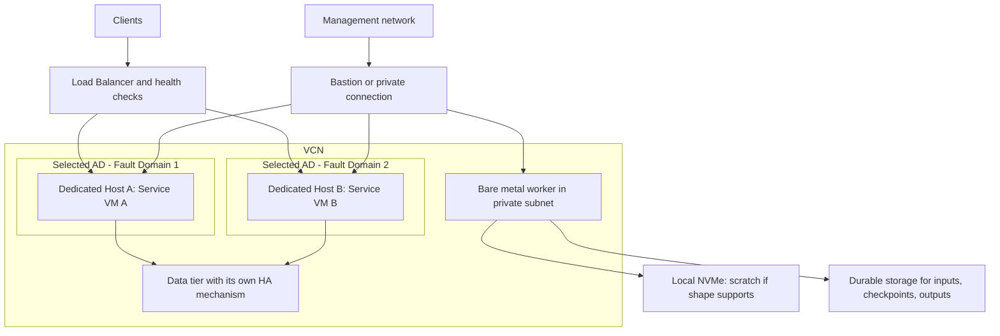

# Bare Metal and Dedicated Infrastructure for Specialized Workloads

In Oracle Cloud Infrastructure (OCI), server selection should start from workload requirements: hardware access, isolation level, performance, recoverability, and operational cost. An application that runs well on standard VMs may not benefit from moving to bare metal; conversely, workloads requiring an entire physical machine or dedicated cluster networking can be constrained by simply scaling VM sizes.

This lesson belongs to the **Specialized Workloads and Deployments** chapter, focusing on two OCI Compute options: **bare metal instances** and **Dedicated Virtual Machine Hosts (DVH)**. Decisions are framed within an architecture featuring compartments, IAM, VCNs, storage, monitoring, and automation, while also distinguishing DVH from dedicated Oracle database infrastructure.

## 1. Learning Outcomes and Prerequisites

After this lesson, learners can:

- Distinguish leasing a bare metal instance from placing multiple VMs on a dedicated host.
- Choose options based on actual requirements rather than just CPU count or a "dedicated" label.
- Verify shape compatibility, available resources, and deployment placement before creating instances.
- Design access controls, private networking, data protection, and redundancy for host-level failures.
- Read a Terraform configuration that explicitly expresses the relationship between a dedicated host and a VM.
- Evaluate efficiency by cost per unit of completed work and responsiveness during maintenance.

Recommended prior knowledge: tenancy, compartments, availability domains (ADs), fault domains (FDs), VCNs, subnets, NSGs, boot volumes, and block volumes. The command sections use an authenticated OCI CLI; in-host commands use Linux.

## 2. Three Execution Models to Distinguish

### 2.1. Standard VMs, Bare Metal, and Dedicated VM Hosts

| Criterion | Standard VM on shared host | Bare metal instance | VM on Dedicated VM Host |
| --- | --- | --- | --- |
| Primary resource unit | One virtual machine | One dedicated physical server | One dedicated host containing compatible VMs |
| Environment seen by application | OS inside the VM | OS on the physical machine | OS inside each VM |
| Sharing resources across applications | Multiple independent VMs | Self-manage processes, containers, or an appropriate virtualization layer | Create multiple OCI VMs on the host |
| Control points to manage | Guest OS configuration | Guest OS and hardware capabilities supported by the shape | Guest OS and choice of host placing the VM |
| Failure domain to design for | Instance and underlying host | Entire physical machine | Host along with all VMs placed on it |
| Best suited when | Per-VM flexibility is needed | Workload needs resources or access to an entire machine | Multiple VMs are needed, but the host must serve only this tenancy |

OCI describes bare metal as dedicated physical server access, and VMs as virtualized execution environments on hardware. Both still use OCI primitives such as VNICs, VCNs, and volumes. [OCI Compute Overview](https://docs.oracle.com/en-us/iaas/Content/Compute/Concepts/computeoverview.htm).

With DVH, what is dedicated is the server running your tenancy's VMs. You continue managing OCI VMs; selecting DVH does not grant administrative access to the underlying hypervisor. If you want to manage your own virtualization layer on bare metal, verify platform support, supported configurations, and applicable software terms. [Oracle Compute FAQ](https://www.oracle.com/cloud/compute/faq/).

### 2.2. Dedicated Does Not Mean Isolated at Every Layer

Separate four questions:

1. **Compute isolation:** is the physical host dedicated to the tenancy?
2. **Network isolation:** which flows do subnets, routes, and NSGs permit?
3. **Administrative isolation:** who can create, place, modify, or delete resources?
4. **Failure isolation:** does one hardware failure take down all application replicas?

A dedicated host addresses only part of the design. Two VMs on the same DVH can still affect each other if operations allocates resources improperly; both are also affected if the host fails. Placing them in different compartments organizes permissions and governance, but does not add physical servers.

### 2.3. DVH and Exadata Dedicated Infrastructure Are Different Objects

**Oracle Exadata Database Service on Dedicated Infrastructure** provides a specialized database platform consisting of database servers and Exadata storage servers with dedicated internal interconnects. It is not another name for Dedicated VM Host in OCI Compute. [Exadata Dedicated Infrastructure Architecture](https://docs.oracle.com/en/engineered-systems/exadata-cloud-service/ecsid/all_diagrams.html).

When the requirement is operating Oracle Database, compare an appropriate managed database service against self-installing on Compute. Clarify which team is responsible for the OS, database configuration, patching, backups, and recovery according to the chosen service.

## 3. Selecting Infrastructure Based on Workload Requirements

### 3.1. Defining Constraints Before Choosing a Shape

A useful intake specification should cover:

| Requirement group | Information to record |
| --- | --- |
| Compute | CPU architecture, parallelism level, working RAM, GPUs if needed |
| Performance | Throughput, p95/p99 latency, batch completion time |
| Data | Capacity, growth rate, read/write profile, acceptable data loss |
| Connectivity | Inter-node bandwidth, RDMA requirements, on-premises access |
| Isolation | Physical host dedication requirement or proof of VM placement |
| Software | OS version, drivers, native libraries, and supported configurations |
| Operations | RTO, RPO, maintenance windows, host rebuild approach |
| Cost | Periodic budget, actual utilization, and spare capacity overhead |

**RTO** is the target time to restore service. **RPO** is the maximum acceptable data loss measured in time. These two values govern data replication and redundancy, and cannot be derived solely from Compute type.

### 3.2. Selection Matrix

| Scenario | Option to evaluate first | What must be proven |
| --- | --- | --- |
| Standard APIs, variable traffic, no dedicated host requirement | Standard VM | VMs meet SLOs at reasonable cost |
| Multiple apps needing separate VMs, host must serve only this tenancy | DVH | Compatible shapes, enough placement fit, and spare host redundancy |
| Single process or job group using most of an entire machine's resources | Bare metal | Efficiency gains outweigh renting the whole server |
| Parallel simulations, dense inter-node data exchange | Bare metal with appropriate HPC architecture | Supported shape, region, image, and cluster networking |
| Intermediate processing needing fast local I/O | Shape with appropriate NVMe | Data can be regenerated or is protected off-host |
| Oracle Database system needing specialized platform | Suitable database service, potentially including Exadata | Service architecture and operational responsibilities meet requirements |

This is an evaluation sequence, not a rule that every workload in a row must use that option. Benchmark results and software support requirements determine the final configuration.

For multi-node HPC, OCI offers **Cluster Networks with Instance Pools** and **Compute Clusters** for RDMA networking on supported configurations. Simply launching several bare metal instances in the same subnet does not form an RDMA network. [HPC on OCI](https://docs.oracle.com/en-us/iaas/Content/Compute/References/high-performance-compute.htm).

For software licensed per host, socket, or core, record resource scope, deployment placement, and host movement procedures to verify against applicable terms. Choosing a dedicated host does not by itself validate software entitlements or create a licensing conversion ratio.

## 4. Reading Capacity and Placement Boundaries Accurately

### 4.1. Shapes, OCPUs, and Usable Resources

In OCI, a shape defines resource configuration. During sizing, distinguish:

- **OCPUs vs. vCPUs:** read the convention for the exact CPU architecture and shape generation; do not apply one generic conversion across all CPUs.
- **Billed resources vs. usable resources:** DVH reserves resources for the virtualization management layer.
- **Host shape vs. VM shape:** a host does not accept every VM shape with the same total CPU count.
- **RAM, networking, and local disks:** free CPUs alone are not enough to conclude a new VM will fit.

Check the host shape table, usable OCPUs, usable memory, and supported VM shapes before calculating maximum VM counts. [Compute Shapes](https://docs.oracle.com/en-us/iaas/Content/Compute/References/computeshapes.htm).

### 4.2. Total Free Capacity Does Not Guarantee VM Placement

The example below uses hypothetical numbers to illustrate a configuration constrained by per-domain VM placement:

| Resource domain | Initial available CPU | Placed VM | Remaining CPU |
| --- | --- | --- | --- |
| A | 24 units | One VM using 16 | 8 |
| B | 24 units | One VM using 16 | 8 |

Total remaining CPU is 16 units. If a new VM needs 16 units in one contiguous domain, it cannot be placed because each domain has only 8 left. Memory can produce the exact same situation.

Therefore, VM placement planning must consider **resource distribution**, not just summing OCPUs and RAM. When deploying mixed VM sizes, plan placement for the largest VMs first and re-check capacity after every change wave.

OCI provides detailed capacity information via `dedicated-vm-host get`; when selecting a host in the Console, the list also depends on the VM shape you intend to create. [Placing a VM on a Dedicated VM Host](https://docs.oracle.com/en-us/iaas/Content/Compute/Concepts/dedicatedvmhosts_topic-Placing_an_Instance_on_a_Dedicated_Virtual_Machine_Host.htm).

### 4.3. Account for Capacity When One Host Is Lost

Suppose two identical hosts each run at 70% capacity. If one host stops working, the surviving host cannot absorb the entire load unmodified simply because you started with two hosts.

A necessary condition for tolerating the loss of one host is:

```text
Demand of workloads required to keep running
    <= available capacity of surviving hosts
```

Check this inequality separately for CPU, RAM, and any other constrained resources. Then still verify shape compatibility, placement fragmentation, and the application's ability to fail over load.

You may choose to maintain spare capacity, shed non-critical load, or pause batch work during an outage. Define this policy upfront so on-call operators do not have to invent priorities mid-incident.

## 5. Reference Architecture for Services and Batch

Consider a system with two parts:

- A business service required to run on VMs placed on dedicated hosts.
- A periodic analytics job needing a large bare metal worker, with regenerable intermediate data.



This diagram illustrates responsibility boundaries; it does not guarantee every region has identical capacity or every shape supports the same features.

Key design decisions:

1. Two VMs serving the same function are placed on two different hosts.
2. In this single-AD example, the two hosts use two FDs; to survive an AD outage, add cross-AD or cross-region architecture matching available services.
3. NSGs permit only exact flows from the load balancer, management, and data tier; VMs and workers need no public IPs to operate.
4. Workers write finalized outputs and checkpoints off-host; scratch holds only regenerable data.
5. The data tier has its own HA and backup policies, because two healthy frontends do not guarantee the database is healthy.

When creating a DVH, the host's AD and FD also determine the AD and FD of VMs placed on it. Hosts and VMs can reside in different compartments; reflect this in IAM policies. [Creating a Dedicated VM Host](https://docs.oracle.com/en-us/iaas/Content/Compute/Concepts/dedicatedvmhosts_topic-Creating_a_Dedicated_Virtual_Machine_Host.htm).

## 6. Access Control and Permissions

### 6.1. Separating Host Management from Application Deployment

One organizational structure is:

- Compartment `DedicatedInfra`: holds dedicated hosts, managed by the infrastructure team.
- Compartment `SpecializedApps`: holds application VMs or bare metal instances.
- Shared network compartment: holds VCNs, subnets, and NSGs per organizational model.

The following policy snippet illustrates only the Compute permissions related to DVH:

```text
Allow group HostAdmins to manage dedicated-vm-hosts in compartment DedicatedInfra
Allow group WorkloadOperators to use dedicated-vm-hosts in compartment DedicatedInfra
Allow group WorkloadOperators to manage instances in compartment SpecializedApps
```

Replace group and compartment names with real objects; with identity domains, use group identifiers matching the tenancy. This is not yet a complete policy set to launch instances: permissions are also required for images, VNICs, subnets, NSGs, volumes, and encryption keys if used. When hosts and VMs are in different compartments, grant permissions in both respective scopes. [IAM Reference for Core Services](https://docs.oracle.com/en-us/iaas/Content/Identity/Reference/corepolicyreference.htm).

Application deployment teams typically only need permission to use existing hosts. Permission to create or delete hosts should sit with capacity, budget, and maintenance schedule owners.

### 6.2. Designing OS-Level Access

Controls to include in deployment design:

- Use private subnets for components that do not need direct inbound internet connections.
- Provide administrative access via Bastion or a controlled private connection.
- Restrict SSH by NSG and identity; avoid opening management ports to the entire internet.
- Store private keys and application secrets outside source code; include only SSH public keys in launch metadata.
- Use an appropriate workload identity when applications call OCI APIs; scope permissions to required compartments and resources.
- Record OCIDs, owners, purpose, and expiration dates in inventory.

Check both network paths and IAM permissions. Permission to call the instance-creation API does not imply SSH reachability; having SSH reachability does not imply permission to modify OCI resources.

## 7. Storage: Identifying Data That Must Outlive the Host

### 7.1. Classifying Data Before Choosing Devices

| Data type | Placement to evaluate | Recovery plan to prepare |
| --- | --- | --- |
| OS and base software | Boot volume, standard image, and automated config | Rebuild environment from managed sources |
| Business data | Data tier or volumes with appropriate protection policies | Restore or fail over per RPO/RTO |
| Recomputable intermediate data | Local NVMe if supported by shape | Rerun from inputs or checkpoints |
| Batch inputs, checkpoints, and outputs | Durable storage external to worker | Reload and verify integrity |
| Diagnostic logs | Ship to centralized logging system | Queryable after the host is gone |

Block Volume decouples data from instance lifecycles. When attaching block volumes to bare metal, handle iSCSI connections and proper mount configuration. Volumes still carry location constraints: a single volume cannot be treated as direct shared storage across ADs. [Block Volume Overview](https://docs.oracle.com/en-us/iaas/Content/Block/Concepts/overview.htm).

If multiple nodes write to one volume, the design requires an appropriate coordination mechanism at the filesystem or application layer. Never mount a standard filesystem for multi-node concurrent writes simply because the API permits multi-attach.

### 7.2. Local NVMe Requires Its Own Protection Plan

Not all bare metal shapes include NVMe. For shapes with local drives, OCI does not automatically image, back up, or protect NVMe data the way Block Volume does. Operations is responsible for durability and appropriate encryption. [Protecting Data on NVMe](https://docs.oracle.com/en-us/iaas/Content/Compute/References/nvmedeviceinformation.htm).

Example of a batch job processing a large dataset:

1. Read version-tagged inputs.
2. Stage the slice to process into local scratch.
3. Write recoverable checkpoints off-host.
4. Write final outputs and verify checksums.
5. Mark the job complete only once outputs exist on durable storage.

On-host RAID can help against certain drive failures, but remains inside the same host failure domain. Distinguish protection against drive failure, host loss, AD loss, and accidental deletion.

### 7.3. Images and Backups Serve Different Purposes

A custom image primarily captures the boot disk to recreate similar environments; it does not include data on attached block volumes. Thus, having an image does not mean the entire application is backed up. [Managing Custom Images](https://docs.oracle.com/en-us/iaas/Content/Compute/Tasks/managingcustomimages.htm).

For active write data, determine backup consistency levels. You may need to quiesce the application, flush buffers, or use a database-native backup mechanism. Crash-consistent and application-consistent copies must be evaluated against real recovery procedures. [Block Volume Backups](https://docs.oracle.com/en-us/iaas/Content/Block/Concepts/blockvolumebackups.htm).

A restore drill must answer: where to find the right copy, who can decrypt it, which resource to restore onto, how long it takes, and what criteria validate the data.

## 8. Controlled Deployment Lab

This section is a workflow for learners in an authorized tenancy. Creating bare metal or DVH resources can incur significant charges; never assume resources fall under Always Free. Create them only with an approved configuration, budget, and teardown plan.

You can run the two branches sequentially to observe differences; there is no need to keep both running simultaneously once learning goals are met.

### 8.1. Preparing Inputs

Before creating resources, record:

- Target region, AD, FD, and compartment.
- Permissions for hosts, instances, images, networking, and storage.
- Service limits, quotas, and shape availability at the chosen location.
- Private subnet, NSG, management path, and paths to required services.
- Image compatible with the CPU architecture and shape.
- SSH public key, owner tags, and usage purpose.
- Data to retain on teardown and the person responsible for cleanup.

Service limits, compartment quotas, and physical capacity are distinct issues. Having limit headroom does not guarantee immediate host availability in a desired AD; classify resource creation failures by root cause.

### 8.2. Looking Up Compatible Host Shapes and VM Shapes

The commands below use **Bash**, such as in OCI Cloud Shell. Replace all placeholder values; do not pass literal `...` inside OCIDs in real commands.

```bash
COMPARTMENT_ID='ocid1.compartment...REPLACE_WITH_REAL_OCID'
AD='REPLACE_WITH_FULL_AD_NAME'
REGION='REPLACE_WITH_REGION_IDENTIFIER'

# List dedicated host shapes in the target deployment scope.
oci compute dedicated-vm-host host-shape list \
  --region "$REGION" \
  --compartment-id "$COMPARTMENT_ID" \
  --availability-domain "$AD" \
  --all

# Assign the shape selected from the results above.
HOST_SHAPE='REPLACE_WITH_REAL_HOST_SHAPE'

# List only VM shapes compatible with this host shape.
oci compute dedicated-vm-host instance-shape list \
  --region "$REGION" \
  --compartment-id "$COMPARTMENT_ID" \
  --availability-domain "$AD" \
  --dedicated-vm-host-shape "$HOST_SHAPE" \
  --all
```

Do not guess a host shape by replacing a `VM.` prefix with `DVH.`. Use the list returned by the service and inspect resources for the selected configuration. [CLI List Host Shapes](https://docs.oracle.com/en-us/iaas/tools/oci-cli/latest/oci_cli_docs/cmdref/compute/dedicated-vm-host/host-shape/list.html), [CLI List Compatible VM Shapes](https://docs.oracle.com/en-us/iaas/tools/oci-cli/latest/oci_cli_docs/cmdref/compute/dedicated-vm-host/instance-shape/list.html).

### 8.3. Branch A: Creating a Dedicated Host and Placing a VM

In the Dedicated VM Hosts section of the OCI Console:

1. Select the infrastructure compartment.
2. Create the host with the identified AD, FD, and host shape.
3. Wait for the host to become available; record its OCID and available capacity.
4. Open the Compute instance creation flow in the application compartment.
5. Choose a compatible image and VM shape in the same AD and FD as the host.
6. Under placement/capacity, select **Dedicated host**, then choose the host just created.
7. Choose the private subnet, NSG, SSH public key, and required volume configuration.
8. Create the VM, confirm the OS boots, and verify the host relationship.

UI label names or locations can change. What must be verified is the host OCID, AD, FD, shape, networking, and volumes, rather than memorizing UI click sequences.

Example CLI verification after resources exist:

```bash
DVH_ID='ocid1.dedicatedvmhost...REPLACE_WITH_REAL_OCID'
INSTANCE_ID='ocid1.instance...REPLACE_WITH_REAL_OCID'

oci compute dedicated-vm-host get \
  --region "$REGION" \
  --dedicated-vm-host-id "$DVH_ID"

oci compute instance get \
  --region "$REGION" \
  --instance-id "$INSTANCE_ID" \
  --query 'data.{id:id,shape:shape,host:"dedicated-vm-host-id",ad:"availability-domain",fd:"fault-domain"}'
```

The VM output must contain `dedicated-vm-host-id` matching the intended host. Cross-check host capacity and actual placement. A `RUNNING` state confirms only part of instance health, not that the application serves users.

### 8.4. Branch B: Creating a Bare Metal Instance

In the Compute instance creation workflow:

1. Select a bare metal shape matching CPU, RAM, network, and local disk requirements.
2. Select a compatible image, AD/FD, private subnet, and NSG.
3. Configure the boot volume; prepare data block volumes if required by the workload.
4. Add the SSH public key and reviewed startup metadata.
5. Launch the instance, verify management access, and finish OS configuration.
6. If NVMe drives are present, clearly classify what data goes on them and how it recovers.

After connecting over Linux, inspect hardware without modifying data:

```bash
lscpu
lsblk -o NAME,TYPE,SIZE,FSTYPE,MOUNTPOINTS
ip -br address

# Run only if the numactl package is installed.
numactl --hardware
```

Compare CPU counts visible in the OS against the OCPU convention for that exact shape. Verify devices by identity and mountpoint before partitioning or creating filesystems; the read-only commands above do not configure volumes or networking.

If using block volumes with bare metal, complete both OCI-side attachment and guest-side iSCSI connection per the guide for that image. Test remounting across a reboot before placing critical data on them.

### 8.5. Deployment Completion Evidence

Lab results should include:

| Evidence | Purpose |
| --- | --- |
| Instance OCID, shape, AD, and FD | Confirm exact resource and placement |
| Dedicated host OCID for Branch A | Prove the VM resides on the intended host |
| Post-placement host capacity | Catch resource shortfalls or poor placement |
| Admin path and NSG check | Prove access matches design |
| Volume, mountpoint, and data-placement list | Avoid overlooking host-dependent data |
| Application health check and boot logs | Verify service can operate |
| Teardown resource list | Avoid leaving stray hosts or volumes |

## 9. Automating with Terraform

The key point of automation is expressing resource relationships explicitly in configuration. Never create a VM and merely write a manual note that it "belongs to host A."

The following HCL snippet illustrates **one dedicated host and one compatible Flex VM** using an existing subnet and NSG. This is a resource block to place inside a Terraform configuration that already declares providers, authentication, and variables; it does not provision the entire network or HA architecture.

```hcl
resource "oci_core_dedicated_vm_host" "workload" {
  availability_domain   = var.availability_domain
  fault_domain          = var.fault_domain
  compartment_id        = var.host_compartment_id
  dedicated_vm_host_shape = var.host_shape
  display_name          = "specialized-host"

  freeform_tags = {
    owner   = var.owner
    purpose = "specialized-workload"
  }
}

resource "oci_core_instance" "app" {
  availability_domain = oci_core_dedicated_vm_host.workload.availability_domain
  fault_domain        = oci_core_dedicated_vm_host.workload.fault_domain
  compartment_id      = var.instance_compartment_id
  dedicated_vm_host_id = oci_core_dedicated_vm_host.workload.id
  display_name        = "specialized-app"
  shape               = var.vm_shape

  shape_config {
    ocpus         = var.vm_ocpus
    memory_in_gbs = var.vm_memory_in_gbs
  }

  source_details {
    source_type = "image"
    source_id   = var.image_id
  }

  create_vnic_details {
    subnet_id        = var.private_subnet_id
    assign_public_ip = false
    nsg_ids          = [var.app_nsg_id]
  }

  metadata = {
    ssh_authorized_keys = var.ssh_public_key
  }

  freeform_tags = {
    owner   = var.owner
    purpose = "specialized-workload"
  }
}
```

Variable groups that must be declared and supplied:

| Group | Variables |
| --- | --- |
| Placement | `availability_domain`, `fault_domain` |
| Governance scope | `host_compartment_id`, `instance_compartment_id`, `owner` |
| Capacity | `host_shape`, `vm_shape`, `vm_ocpus`, `vm_memory_in_gbs` |
| Image and access | `image_id`, `ssh_public_key` |
| Existing network | `private_subnet_id`, `app_nsg_id` |

Use `shape_config` only with shapes that support flexible configuration; for fixed shapes, adjust the resource per documentation. The `dedicated_vm_host_id` attribute designates the VM's target host. These resources and attributes are documented in [Terraform Dedicated VM Host](https://docs.oracle.com/en-us/iaas/tools/terraform-provider-oci/latest/docs/r/core_dedicated_vm_host.html) and [Terraform Compute Instance](https://docs.oracle.com/en-us/iaas/tools/terraform-provider-oci/latest/docs/r/core_instance.html).

In real deployment pipelines:

- Pin tested provider versions, protect state, and restrict who can apply.
- Review plans to spot host or instance replacement operations before execution.
- Never place private keys, database passwords, or tokens into tags or standard metadata.
- Version images and OS configurations alongside application versions for reproducibility.
- When two hosts are required for HA, declare two distinct resources and control each replica's placement.
- After apply, verify host–VM association, networking, and health checks; successful state alone does not prove SLO compliance.

DVH has specific feature limitations, including no support for instance pools, autoscaling, capacity reservations, burstable instances, and live migration per current documentation. Therefore, do not attach a standard VM instance-pool autoscaling model directly to DVH. [Dedicated VM Hosts Limitations](https://docs.oracle.com/en-us/iaas/Content/Compute/Concepts/dedicatedvmhosts.htm).

## 10. Measuring Performance to Decide Whether Dedicated Infrastructure Is Needed

### 10.1. Keeping Comparisons Meaningful

To compare standard VMs, DVH, and bare metal, define clearly what is being measured:

- **Comparing configurations meeting the same SLO:** each option is sized to satisfy the same requirements.
- **Comparing cost efficiency:** cost to complete the same number of transactions or the same workload set.
- **Comparing stability:** latency and completion-time variance across multiple runs.

Do not extrapolate efficiency from a single run or theoretical CPU sums. If you change CPU architecture, image, disk, JDK, and database simultaneously, document that it is a comparison of the whole new stack; you cannot attribute every change to bare metal.

### 10.2. Metrics Tied to Real Workloads

| Workload | Primary metric | Explanatory metrics |
| --- | --- | --- |
| Transactional API | Throughput at target p99 and error rate | CPU, queues, connection pools, database latency |
| Analytics batch | Completion time and successful job count | CPU, RAM, scratch read/write, data load time |
| Large-heap Java | Throughput, p99, and GC pause time | Heap/RSS, allocation rate, GC logs, memory pressure |
| Multi-node HPC | Problem solve time at fixed node count | Communication time, CPU/GPU utilization, networking |
| I/O-heavy service | Throughput at required I/O latency | Queue depth, I/O size, filesystem, network path |

A realistic test plan should include warm-up, steady load, peak load, and a representative operational cycle. Record application configs, software versions, data sizes, and iteration counts.

Hypothetical example: a batch processing identical data takes 90 minutes on a VM configuration and 60 minutes on bare metal. Before choosing bare metal, factor in provisioning time, data staging, output writes, utilization during the rest of the day, and the option of running multiple jobs on VMs. Shaving 30 minutes off processing time does not automatically lower total cost.

For Java, also verify whether compute is truly the bottleneck. An application waiting on a connection pool or slow database queries may not improve when given an entire physical server.

### 10.3. Acceptance Criteria Must Be Written First

You can use the following illustrative criteria, with system-defined thresholds:

```text
- Meet required throughput within p99 and error rate limits.
- No continuous memory growth over a representative run duration.
- Batch outputs are durably stored and verifiable.
- Service continues meeting minimum levels upon losing one host.
- Data recovery and restart complete within defined RPO/RTO.
- Total periodic cost stays within budget.
```

These are design criteria for the system, not a performance guarantee for any specific shape.

## 11. Monitoring, Maintenance, and Host-Level Failures

### 11.1. Monitoring Infrastructure and Applications Together

A dashboard should answer three questions:

1. **Is the host or instance healthy?** Track infrastructure health, maintenance schedules, and lifecycle changes.
2. **Is the application serving?** Track health checks, p95/p99, error rate, queues, and job progress.
3. **Is there headroom to keep operating?** Track available host CPU/RAM, data capacity, spare failover capacity, and latest backups.

OCI provides infrastructure metrics such as `maintenance_status`, `health_status` for bare metal, and `instance_status` within supported scopes. Check applicable resource types and namespaces before configuring alarms. [Compute Maintenance and Health](https://docs.oracle.com/en-us/iaas/Content/Compute/References/infrastructure-maintenance.htm).

Not all in-guest metrics appear without an agent or collection configuration. When building dashboards, verify real data, last update timestamps, and alert routing to on-call teams.

Add impact-driven alerts:

| Signal | Operational action |
| --- | --- |
| Host scheduled for maintenance | Plan migration, verify target host and deadline |
| VM fails health checks | Stop routing new requests to backend and investigate |
| Stale checkpoints | Verify batch RPO is still met |
| Insufficient failover capacity | Shed low-priority load or add capacity |
| Backup failed | Remediate before proceeding with risky changes |
| Cost variance from forecast | Check idle hosts, shapes, volumes, and retained resources |

### 11.2. Dedicated Hosts Need Proactive Migration Procedures

DVH does not support live migration. For maintenance, OCI provides reboot migration or manual migration subject to resource constraints. DVH reboot migration incurs downtime and does not cross ADs; local NVMe drives on Dense I/O are wiped during migration per documentation. Missing maintenance deadlines can result in VMs and hosts being disabled and terminated. [Dedicated VM Hosts Maintenance](https://docs.oracle.com/en-us/iaas/Content/Compute/Concepts/dedicatedvmhosts_topic-infrastructure-maintenance.htm).

Therefore, runbooks must cover:

1. Read the actual notice to identify affected hosts, VMs, action type, and deadline.
2. Select a target host with sufficient capacity, matching AD, and VM shape compatibility.
3. Verify backups/checkpoints, network dependencies, and data recoverability.
4. Shift traffic or drain the application; stop accepting new batch jobs if needed.
5. Execute migration using the supported method and monitor the work request.
6. Re-verify target host OCID, volumes, network addresses, agents, and applications.
7. Restore full load only after service checks pass.

Successful infrastructure migration alone does not prove the application recovered properly. Re-verify connectivity, API permissions, data, and backend registration status.

### 11.3. Bare Metal Also Needs Shape-Specific Maintenance Plans

Bare metal does not use VM live migration. Some configurations support reboot migration or other maintenance methods; determine exact behavior from shape, image, and OCI notifications. Prepare rebuild paths from images/boot volumes, data restoration, and dependency reconfiguration. [Moving a Compute Instance to a New Host](https://docs.oracle.com/en-us/iaas/Content/Compute/Tasks/movinganinstance.htm).

If applications depend on hardware identifiers, test the impact of host replacement. For instance, OCI documents hardware reclamation for certain Linux bare metal shapes, including `BM.Standard.E4.128`, when stopped for more than 48 hours; the next start may change host MAC addresses and serial numbers. Do not generalize this timeframe to every shape by default. [Hardware Reclamation for Stopped Bare Metal Instances](https://docs.oracle.com/en-us/iaas/Content/Compute/Tasks/hardware-reclamation-stopped-instances.htm).

For critical workloads, practicing rebuilds onto another host helps catch hidden dependencies on MAC addresses, device names, disk paths, or manual configuration early.

## 12. Cost: Accounting for Idle and Spare Capacity

### 12.1. Choosing the Right Comparison Unit

With DVH, host compute billing begins when the host is created; VMs placed on the host do not incur separate standalone VM compute charges, though image licensing fees may still apply. Add non-host resources and services separately. [DVH Billing Model](https://docs.oracle.com/en-us/iaas/Content/Compute/Concepts/dedicatedvmhosts.htm).

You can use an estimation model:

```text
Periodic cost =
    compute for hosts or bare metal instances
  + storage and backups
  + networking and supporting services
  + applicable software or licenses
  + operations and required failover headroom
```

Do not double-count host cost plus standalone VM compute cost for VMs on that host. Conversely, do not assume volumes, backups, image licenses, or logging are free simply because you leased an entire host.

Hypothetical numerical example using normalized cost units, not Oracle pricing:

- One host has a hypothetical compute price of 12 units/hour.
- A 720-hour billing period totals 8,640 compute units for the host.
- If allocated across 12 equal workloads, average compute is 720 units/workload.
- If only 6 workloads remain, average rises to 1,440 units/workload.
- If an identical standby host is kept for redundancy, total compute becomes 17,280 units before other charges.

This shows how utilization and HA requirements strongly affect unit efficiency. Equal allocation is illustrative only; for differently sized workloads, allocate using appropriate rules.

### 12.2. Measuring Cost per Unit of Completed Work

Meaningful metrics include:

```text
Cost per successful batch =
    total cost serving the processing run / number of successful batches

Cost per million SLO-compliant transactions =
    total periodic cost / millions of SLO-compliant transactions
```

Include failed jobs and reruns. A high-performance host that frequently stalls waiting on data or sits idle can be less cost-effective than a smaller, well-utilized configuration.

### 12.3. Stopping Machines, Keeping Hardware, and Stopping Billing Are Separate Matters

Stop-state billing policies depend on shape. Do not extrapolate from a Standard VM to bare metal, Dense I/O, GPU, or HPC shapes. Before scheduling shutdowns to save money, check the exact shape and retained resources; shutting down inside the OS also does not automatically stop billing. [Billing for Stopped Resources](https://docs.oracle.com/en-us/iaas/Content/Compute/Tasks/resource-billing-stopped-instances.htm).

With DVH, stopping or deleting VMs does not delete the leased host resource. When auditing costs, track empty hosts alongside remaining boot volumes, data volumes, backups, and networking resources.

Budgets and alerts detect spending needing attention; to stop provisioning or reclaim automatically, build dedicated workflows with appropriate execution permissions. Tag owner, environment, and purpose so every resource has an accountable owner.

## 13. Diagnosing Common Issues

The table below provides investigation paths aligned with this lesson's design; always cross-check actual error messages.

| Symptom | Hypothesis to check | Next step |
| --- | --- | --- |
| Host missing from list during VM creation | Wrong region/AD/FD, missing permissions, shape incompatibility, or lack of capacity | Check location, permissions in host compartment, and capacity details |
| Total OCPUs sufficient but VM creation fails | Insufficient RAM or resource fragmentation across placement domains | Inspect detailed capacity, adjust placement plan, or change VM size |
| Quota exists but bare metal creation fails | Missing physical capacity, incompatible image, or another limit | Read error and request ID; check each constraint separately |
| Both app replicas go down during maintenance | Placed on the same host or share an unprotected dependency | Cross-check host IDs and failure-domain diagram |
| Worker rebuilt but outputs are missing | Data lived only on local drive or checkpoint wasn't verified | Verify durable storage target and completion-marker workflow |
| Instance running but SSH fails | Missing network path, rule, SSH daemon, or wrong key | Check routes, NSGs, guest firewall, and authentication in order |
| Low CPU yet batch remains slow | Bottleneck in I/O, network, input data, or worker sync | Observe per-stage timings and queues |
| VM deleted yet compute charges continue | Dedicated host was not terminated | Check host inventory and retained standalone resources |

Do not fix capacity errors by indiscriminately granting tenancy-wide admin permissions. Nor should you weaken isolation constraints, attach public IPs, or drop data protection just to make resource creation succeed.

## 14. Reclaiming Resources After Labs or End of Need

Teardown must start with data and dependencies before Compute:

1. Stop accepting new work and wait for required tasks to finish.
2. Confirm outputs, checkpoints, and backups reside in retained storage.
3. Remove instances from serving pools or schedulers.
4. Terminate unneeded instances; explicitly decide which boot and data volumes to keep.
5. Once a DVH has no VMs remaining on it, delete the host if no longer needed.
6. Audit volumes, backups, images, and network resources created specifically for the lab.
7. Verify inventory and cost reports after system updates complete.

Deleting a DVH normally requires terminating instances on the host first. [Deleting a Dedicated VM Host](https://docs.oracle.com/en-us/iaas/Content/Compute/Concepts/dedicatedvmhosts_topic-Deleting_a_Dedicated_Virtual_Machine_Host.htm).

If an instance has NVMe drives, terminating wipes data on those NVMe drives and it cannot be recovered from the wiped drives. Termination must follow confirmation of retained data. [Terminating a Compute Instance](https://docs.oracle.com/en-us/iaas/Content/Compute/Tasks/terminatinginstance.htm).

In shared environments, reclaim only resources owned by that deployment. VCNs, subnets, NSGs, keys, and backups still serving other workloads must be identified through inventory and dependency mapping.

## 15. Decision Record for Production Environments

Before placing workloads on bare metal or DVH, a deployment record should answer:

- Which requirement led to choosing bare metal or a dedicated host?
- Which shape, image, and software configuration have been verified?
- Which host carries which VMs; what are the AD, FD, and compartment?
- Who manages hosts, who uses hosts, and who restores data?
- Which data can be lost with a host; which data must survive?
- When one host is lost, where does the service continue running and is capacity sufficient?
- Who receives maintenance notices, executes migrations, and validates recovery?
- Which benchmark proves SLO compliance; what is the cost per completed unit of work?
- When are resources reclaimed and who verifies residual charges?

These answers turn a "dedicated server" choice into an OCI infrastructure plan that can be deployed, operated, and recovered intentionally.
