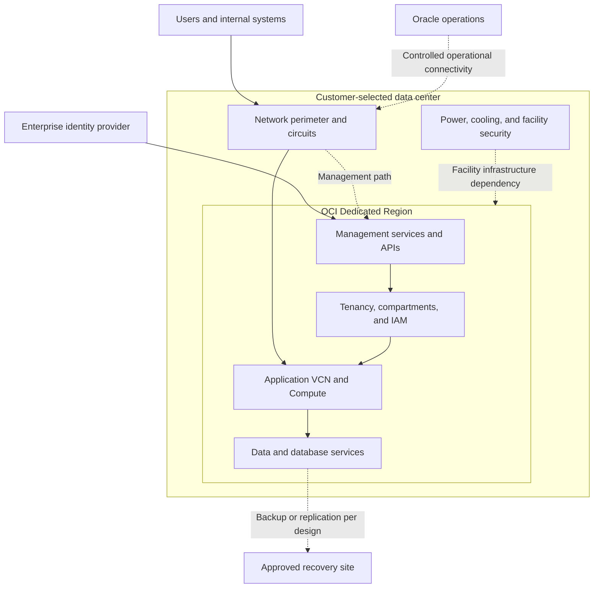

# Dedicated Region and Private Cloud Deployment Models

In the **Specialized Workloads and Deployments** chapter of the Oracle Cloud Infrastructure (OCI) module, deployment location choices directly affect permissions, networking, storage, database operations, monitoring, and cost. A system with private IP addresses in a public cloud, a cloud rack in an enterprise data center, and a Dedicated Region carry different administrative boundaries.

This lesson focuses on evaluating **OCI Dedicated Region** alongside related options: Compute Cloud@Customer, Exadata Cloud@Customer, Private Cloud Appliance, and Oracle Alloy. The goal is to select a model suited to workload requirements and build a deployment plan that can be operated, scaled, and recovered.

## 1. Learning Outcomes

After this lesson, learners can:

- Distinguish data location, infrastructure dedication level, administrative authority, and operating entity.
- Explain what Dedicated Region provides and what must be confirmed before deployment.
- Compare an OCI region with Cloud@Customer systems that have a narrower service catalog.
- Outline an initial design for tenancy, compartments, IAM, VCN, connectivity, and data flows for a cloud environment placed at a chosen facility.
- Define responsibilities for the enterprise, Oracle, or partners; plan capacity, recovery, and cost control.

Useful background includes tenancy, compartments, IAM policies, VCN, subnets, DRG, Compute, storage, and Oracle databases. Key terms are still explained where used.

## 2. Which Boundaries Must Clarify "Private Cloud"?

The phrase "private cloud" can describe many different requirements. Before picking a product, translate broad requests into verifiable questions.

| Boundary | Question to answer | Example requirement |
| --- | --- | --- |
| Location | Where does the system process and store data? | Databases must reside in an enterprise-approved facility |
| Resources | Which resources are dedicated, and at server, cluster, or region level? | Do not share physical servers for specific workloads |
| Governance | Who administers identities, cloud services, OS, and databases? | Application teams may manage only their own resources |
| Operations | Who patches, replaces hardware, handles incidents, and coordinates maintenance? | Provider operates the platform; enterprise operates applications |
| Connectivity | Which functions require links to external systems? | Internal transactions must continue if one WAN link drops |
| Economics | Who bears the cost of unused capacity and expansion? | Budget covers spare headroom and recovery site capacity |

Distinguish the following concepts:

- **Tenancy** is an organization's administrative and resource boundary in OCI. Having a separate tenancy does not mean the organization owns a separate physical region.
- **Compartments** organize resources and IAM policy scope. They do not automatically create physical or network isolation.
- **A VCN** provides virtual networking for workloads. Using private subnets controls access paths, but does not turn a public region into infrastructure located at enterprise premises.
- **Dedicated servers** solve requirements at the host level. That scope differs from deploying an entire region's service platform.
- **A region** is a geographic deployment scope for OCI services; **a realm** is an isolation boundary containing one or more OCI regions. A tenancy exists within one realm and accesses regions inside that realm. Therefore, verify the target environment's realm, identity, endpoints, and connectivity. [OCI Physical Architecture Concepts](https://docs.oracle.com/en-us/iaas/Content/GSG/Concepts/concepts-physical.htm).

Three data concepts must also be separated. **Data residency** refers to where data is stored or processed within required boundaries. **Data sovereignty** adds jurisdictional and control requirements. **Operational control** addresses who can operate the system, via which processes, and with what evidence. Knowing only the rack's street address is insufficient to answer all three.

## 3. How Does OCI Dedicated Region Operate?

### 3.1. An OCI Region at a Customer-Selected Data Center

OCI Dedicated Region is an OCI region installed and operated by Oracle in a data center selected by the customer. Customers use OCI services and tooling; the service catalog must be confirmed for the specific region. [Oracle Dedicated Region Overview](https://docs.oracle.com/en-us/iaas/Content/dedicated/dedicated-region/dedicated-region-overview.htm).

The key feature of this model is bringing a region's capabilities to the location needed to serve workloads. It fits when an organization needs a broad service catalog, has sufficient demand scale, and has concrete reasons why existing public regions cannot meet location or latency requirements.

Deployment includes facility surveys, aligning network and operational models, installation, testing, and service activation. Creating a VCN or running Terraform cannot substitute for those physical region deployment steps.

### 3.2. Three Layers Visible in the Architecture

1. **Data plane** executing workloads: application traffic, virtual machines, stored data, and database transactions.
2. **Control plane** handling administrative actions: authentication, resource creation APIs, configuration, and service lifecycle management.
3. **Provider operations** including infrastructure monitoring, support, maintenance, incident handling, and patch supply chains.

With Dedicated Region, the service platform and regional control plane are placed inside the deployment environment. This still comes with links serving Oracle remote operations. Dedicated Cloud architecture documentation requires internet transit connectivity for operations and appropriate links for customer access, inter-region traffic, and management recovery. Therefore, never assume Dedicated Region is air-gapped—completely isolated from external networks—by default. [Oracle Dedicated Cloud Architecture](https://docs.oracle.com/en-us/iaas/Content/dedicated/dedicated-cloud-architecture.htm).

The diagram below shows logical boundaries; physical design and circuits must be confirmed with Oracle:



The backup arrow in the diagram represents a design requirement, not an automatically enabled replication mechanism. Similarly, identity integration must be configured and tested.

### 3.3. Confirming the Service Catalog Before Designing Workloads

List required services and capabilities, then confirm each item for the target region:

| Group | Details to confirm |
| --- | --- |
| Compute | Shapes, CPU architectures, images, RAM capacity, and GPU requirements if any |
| Storage | Block, file, object; throughput, IOPS, encryption, and backup capabilities |
| Databases | Required Oracle Database services, configurations, versions, and HA/DR mechanisms |
| Networking | Load balancers, DRG, private connectivity, DNS, endpoints, and admin paths |
| Security, monitoring | IAM, key management, audit, logs, metrics, alerts, and SIEM integration |
| Automation | APIs, SDK/CLI/provider versions, endpoints, and pipeline permissions |

"Service available" is not enough: verify features, installed capacity, quotas, and expansion lead times. Avoid designing an application dependent on shapes or features not yet committed in the target region.

### 3.4. Dedicated Region and Internal Multi-Tenancy Models

An organization may need to separate internal units using an appropriate tenancy structure. Oracle offers single-tenancy Dedicated Region and multitenancy models for approved needs. In an internal multitenancy model, the organization takes on additional responsibilities such as tenant lifecycle management, consumption limits, and tier-1 support; Oracle continues operating the OCI infrastructure. Selection is subject to product eligibility and must be agreed upon during commercial scoping. [Tenancy Operating Model](https://docs.oracle.com/en-us/iaas/Content/dedicated/dedicated-region/tenancy-operating-model.htm).

For an enterprise, start by asking what isolation and responsibilities are required. The number of departments alone does not justify multiple tenancies, much less operating as a cloud provider.

## 4. Comparing Related Deployment Models

The following table compares at an architectural level. Exact service scope, connectivity, and responsibilities must still be checked against documentation for the ordered configuration.

| Model | Primary scope | Location and operations | When to evaluate |
| --- | --- | --- | --- |
| OCI public region with private connectivity | OCI services in a public region | Oracle operates region; enterprise manages tenancy and workloads | Location rules allow existing regions and apps need private network access |
| OCI Dedicated Region | An OCI region with a broad service catalog | At chosen facility; Oracle operates the cloud platform | Multiple workload groups need cloud capabilities at a specific site |
| Compute Cloud@Customer | On-premises compute, networking, and storage infrastructure | Rack at customer site; Oracle manages platform, connected to OCI | Need IaaS close to existing applications or data |
| Exadata Cloud@Customer | Oracle Database services on Exadata | Exadata infrastructure at customer site; service management linked to OCI | Core requirement centers on Oracle Database |
| Oracle Private Cloud Appliance | IaaS platform with its own control plane | Enterprise purchases and administers the appliance | Want to self-operate a private cloud with needed compatible services |
| Oracle Alloy | Platform for partners to offer cloud services | Partner manages end-customer relationship; Oracle and partner share duties | Organization's business goal is delivering cloud services to end customers |

### 4.1. Compute Cloud@Customer: On-Premises IaaS with OCI Management Linkage

Compute Cloud@Customer delivers infrastructure inside a customer data center, managed by Oracle and connected to an OCI tenancy. IAM is managed on OCI and synchronized down to the on-premises system. [IAM on Compute Cloud@Customer](https://docs.oracle.com/en-us/iaas/compute-cloud-at-customer/cmn/iam-oci/identify-learn.htm). Product scope focuses on on-premises infrastructure.

During OCI connectivity loss, current documentation notes many local resource functions continue operating, while IAM changes and certain Oracle infrastructure management, monitoring, and automation functions are interrupted. Temporary disconnection tolerance must be distinguished from long-term isolated operation goals. [Compute Cloud@Customer Overview](https://docs.oracle.com/en-us/iaas/compute-cloud-at-customer/ccc/overview-of-compute-cloud-at-customer.htm).

In design, separately test login, local resource creation, permission updates, image loading, and alert delivery when the link drops. Do not collapse all those behaviors into a single "the cloud still works" claim.

### 4.2. Exadata Cloud@Customer: Optimized for Database Workloads

Exadata Cloud@Customer places Exadata hardware at the customer facility and uses the OCI control plane for service management. An OCI tenancy and IAM policies are still required prerequisites. [OCI Requirements for Exadata Cloud@Customer](https://docs.oracle.com/en/engineered-systems/exadata-cloud-at-customer/ecccm/ecc-oci-requirements.html).

This option belongs under review when the primary need is modernizing an Oracle Database platform, keeping data processing near existing apps, or running Exadata on-premises. It does not automatically deliver a multi-service application platform equivalent to an OCI region.

Oracle manages infrastructure within service scope; customers remain responsible for VMs and databases under their administration. The DBA team must clarify access, maintenance windows, configuration, backups, and recovery rather than assuming all database duties are offloaded. [Exadata Cloud@Customer Security Guide](https://docs.oracle.com/en-us/iaas/exadata/doc/ecc-secguide.html).

### 4.3. Private Cloud Appliance: Separate Control Plane and Self-Operation

Oracle Private Cloud Appliance is an on-premises IaaS system providing a set of OCI-compatible services and APIs. It runs its own control plane separate from OCI; compatibility does not mean having every public cloud service or feature. [Private Cloud Appliance Introduction](https://docs.oracle.com/en/engineered-systems/private-cloud-appliance/3.0-latest/concept/concept-arch-product-intro.html).

When purchasing and administering an appliance, the enterprise assumes more platform operations work than with Compute Cloud@Customer. Staffing skills, upgrade procedures, and lifecycle management must factor into the decision. Oracle distinguishes these two models by ownership, management, and infrastructure consumption model. [Oracle Edge Cloud Portfolio Overview](https://www.oracle.com/a/ocom/docs/cloud/edgecloud-portfolio-overview.pdf).

A local control plane also does not prove applications operate independently: applications may still depend on external IdPs, DNS, artifact repositories, or monitoring systems.

### 4.4. Oracle Alloy: Adding the Service Provider Role

With Oracle Alloy, a partner directly manages the end-customer relationship, including contracts, onboarding, pricing, billing, and tier-1 support. Oracle supplies the platform, tooling, and support tiers per a defined responsibility model. This is a cloud service provider model, not merely a rebranding option for internal infrastructure. [Oracle Alloy Roles and Responsibilities](https://docs.oracle.com/en-us/iaas/Content/dedicated/alloy/roles-and-responsibilities.htm).

Alloy also does not automatically imply single-end-customer infrastructure. When evaluating a partner-operated service, inspect tenant isolation, operational access scope, data storage locations, support processes, and that provider's service terms.

### 4.5. Sovereign Cloud, Hybrid Cloud, and Isolation Models

**Sovereign cloud** emphasizes sovereignty and governance requirements. **Hybrid cloud** describes combining environments. Neither term replaces product names, service scopes, or operating models.

If zero external connectivity is a hard requirement, treat it as a disqualifying check to verify upfront. Evaluate solutions and configurations specifically engineered for that requirement; do not assume complete isolation for every product carrying a Cloud@Customer or Dedicated Region label.

## 5. Choosing a Model via Verifiable Requirements

A practical evaluation sequence:

1. **Define permitted locations.** List where each data type may be stored and processed, including copies, logs, and support data. If a suitable public region satisfies requirements, include it in the comparison.
2. **Define service scope.** Separate database-only problems, IaaS problems, and multi-service cloud platform problems.
3. **Define connectivity constraints.** Document permitted links, required links, and tolerable disconnection windows.
4. **Define the operating model.** Assess appetite and readiness to self-operate a platform versus consuming an Oracle- or partner-operated service.
5. **Assess scale and growth.** Compare actual demand against capacity, redundancy, expansion lead time, and full lifecycle cost.
6. **Verify recovery and exit plans.** Identify alternate sites, data recovery methods, and how workloads migrate at contract end.

For instance, an enterprise only needing to move large Oracle databases onto on-premises Exadata should evaluate Exadata Cloud@Customer before concluding it needs an entire Dedicated Region. Conversely, a platform serving multiple business units with applications, object storage, networking, and diverse data services may have grounds to evaluate Dedicated Region.

This is a narrowing method, not an automatic decision rule. Final selection must rest on verified requirements and confirmed capabilities.

## 6. Designing Tenancy, Compartments, and IAM

### 6.1. Separating Platform Responsibilities from Workload Responsibilities

The following illustrates a compartment hierarchy in an enterprise tenancy as a reference design:

```text
Enterprise Tenancy
├── SharedServices
│   ├── Network
│   ├── Security
│   └── Observability
├── Production
│   ├── PaymentsApp
│   └── PaymentsData
└── NonProduction
    ├── Integration
    └── Development
```

The structure should support specific goals:

- The network team manages connectivity and routing within its assigned scope.
- The security team manages security policies or systems, separated from application operators.
- Application teams deploy workloads only within their assigned scope.
- Data teams administer data services under granted permissions.
- Auditors can inspect required evidence without permissions to modify resources.

If multiple tenancies are used, additionally design cross-tenancy permissions, log flows, network connectivity, and consolidated reporting. Never treat a policy in one tenancy as automatically granting permissions across all other tenancies.

### 6.2. IAM Decisions to Finalize

| Decision | What to codify in configuration or process |
| --- | --- |
| User identity | Identity source, MFA, sign-in conditions, and account lifecycle |
| Application permissions | Workload identity and least-privilege policies for required resources |
| Emergency accounts | Custody location, invocation conditions, audit logging, and revocation |
| Pipeline permissions | Deployment scope, approvers, and credential storage |
| Provider operational access | Scope, control mechanisms, and provided access evidence |
| Permission revocation | Propagation time, any caching layers, and behavior when disconnected |

Distinguish tenancy user permissions from the provider's infrastructure operational permissions. Reviewing only application IAM policies does not cover all administrative access paths.

Test failure scenarios: staff departures, IdP unavailability, administrator MFA device loss, pipeline permission revocation, and emergency support requests. Tests must confirm both continued operability and blocking unauthorized access.

## 7. Designing Networking and External Dependencies

### 7.1. Separating Traffic Types

For an internal workload, classify traffic as follows:

| Flow | Purpose | Controls to design |
| --- | --- | --- |
| Users to applications | Business service access | Entry points, routing, TLS, load balancing, and authentication |
| Applications to data | Database or storage transactions | Specific targets and ports, access control, encryption |
| Customer administration | VM, app config, and resource management | Management network, time-bound access, and auditing |
| Provider operations | Platform support, monitoring, and maintenance | Approved circuits and bilateral responsibilities |
| Backup, replication | Data protection and disaster recovery | Bandwidth, encryption keys, target storage, replication lag |
| Monitoring, integrations | Logs, metrics, DNS, time, IdP, and software | Destinations, exported payload, disconnected behavior |

For workloads, use non-overlapping CIDRs such as VCN `10.80.0.0/16`, application subnet `10.80.10.0/24`, and data subnet `10.80.20.0/24`. These are illustrative ranges only. Check for conflicts against data centers, VPNs, other VCNs, and recovery environments before use.

Private subnets, route tables, NSGs, and application policies must be configured per flow. Housing infrastructure in the same building does not replace inter-tier access controls.

### 7.2. Distinguishing Workload Connectivity from Operational Connectivity

In Dedicated Cloud designs, FastConnect and DRG connect workload networks, while operational and management links carry separate requirements. Maintain them per the approved design. An application circuit does not automatically substitute for Oracle's operational links. [Dedicated Cloud Connectivity Architecture](https://docs.oracle.com/en-us/iaas/Content/dedicated/dedicated-cloud-architecture.htm).

The network plan should specify:

- Who orders, monitors, and troubleshoots each circuit.
- Whether dual paths are truly independent across fiber, gear, carriers, and power.
- Which DNS resolves service endpoints and application names in each environment.
- How certificates are issued and renewed if links to external systems drop.
- Required encryption scope across each link.
- Coordination sequence when changing firewalls, routes, or perimeter devices.

Private links alone do not fulfill all encryption requirements. Define supported and appropriate TLS, IPsec, or transport encryption per flow.

### 7.3. Designing Behavior When a Dependency Fails

An application might continue processing transactions yet fail to sign in new users because the IdP sits in another environment. Likewise, Compute keeps running, but new deployments halt if pipelines cannot reach the image registry.

Therefore, operational documentation must answer each question separately:

- Do in-flight transactions continue?
- Can new users sign in?
- Can permissions be modified or revoked?
- Can new resources be provisioned and required software fetched?
- Do alerts still reach on-call staff?
- Can the provider diagnose and remediate infrastructure?

This is why disconnection testing must be functional, rather than pinging one IP and concluding the system works.

## 8. Controlling Data Location and Access

### 8.1. Building a Complete Data Map

A data map must encompass more than business tables:

| Data category | Details to confirm |
| --- | --- |
| Primary data | Storage location, processing location, read and export permissions |
| Backups, snapshots | Storage destination, retention period, delete rights, recovery method |
| Recovery replicas | Location, lag, role-switch permissions, and consistency |
| Audit, logs, traces | Sensitive fields, aggregation target, retention period, and viewers |
| Management metadata | Configuration data, identities, and resource metadata |
| Support data | Diagnostics, logs attached to tickets, and support access scope |
| Keys and secrets | Custody location, usage workflow, rotation, and recovery |

An internal rule stating "data must stay in Facility A" must translate into controls for every row above. If application logs record personal data and ship to a SIEM outside the allowed scope, keeping the primary database inside does not solve compliance.

For Dedicated Region, security controls must span physical facility, management networking, tenant isolation, IAM, endpoints, encryption, monitoring, and incident coordination. [Dedicated Region Security Guide](https://docs.oracle.com/en-us/iaas/Content/dedicated/dedicated-region/dedicated-region-security.htm).

### 8.2. Key Management for Both Protection and Recovery

Key design must clarify who creates, uses, disables, or deletes keys; where recovery replicas obtain keys; and which actions are audited. Support for Vault or alternative key management models must be verified per service and configuration.

One pitfall to avoid is replicating data to Site B when the decryption key is reachable only at Site A. Recovery testing must validate data, keys, permissions, and decryption dependencies together.

Key control is part of overall security design. It works alongside identity governance, transport encryption, data exfiltration controls, and access evidence.

### 8.3. Evidence Matters More Than Deployment Labels

For a concrete governance requirement, documentation needs data-flow diagrams, configurations, permission matrices, logs, test results, and an agreed responsibility document. Labels like "Dedicated," "private," or "sovereign" do not by themselves prove a workload meets every organizational requirement.

## 9. Dividing Operational Responsibilities

In Dedicated Region, Oracle manages the cloud stack and equipment within Oracle's scope. The customer manages facility infrastructure such as space, power, cooling, physical security, and specified connectivity duties. Both parties collaborate on capacity planning. [Dedicated Region Roles and Responsibilities](https://docs.oracle.com/en-us/iaas/Content/dedicated/dedicated-region/roles-and-responsibilities.htm).

From that boundary, the enterprise should build a responsibility matrix for actual operations:

| Activity | Designated lead | Evidence or process |
| --- | --- | --- |
| Facility infrastructure | Customer facilities team | Environmental monitoring, emergency response, maintenance |
| Hardware, cloud platform | Oracle within service scope | Agreed support and maintenance procedures |
| IAM and customer accounts | Platform and security teams | Policies, approvals, reviews, and revocation |
| OS, applications | Workload teams per service model | Patches, standard images, pipelines, runbooks |
| Databases | DBAs and provider per service | Split of configuration, patching, and backups |
| Customer networking | Network team and carriers | Per-party boundaries, monitoring, escalation |
| Business recovery | Service owners and engineering teams | RPO/RTO, recovery order, drill records |

An internal matrix should designate **R** (Responsible), **A** (Accountable) for each decision scope, **C** (Consulted), and **I** (Informed). For cross-organization operations, break tasks down finely enough to avoid both sides assuming the other will act.

An application error can originate from capacity exhaustion, circuit loss, or cooling failures. Runbooks need triage signals and an end-to-end incident coordinator, rather than merely listing multiple support phone numbers.

## 10. Automation and Monitoring Once the Platform Is Ready

### 10.1. Layering Automation

For Dedicated Region, organize infrastructure code in layers with clear owners:

```text
Customer platform configuration layer
    compartments, IAM, tags, shared networking, audit
                ↓
Shared services layer
    DNS, logs, monitoring, administrative access mechanism
                ↓
Workload layer
    Compute, storage, databases, load balancing
                ↓
Application deployment and recovery layer
    application versions, configuration, health checks
```

Before reusing code from public OCI, review environment-dependent values: region identifiers, realms, service endpoints, OCIDs, shapes, images, service names, and provider support.

Pipelines must have proper API access paths and least-privilege authentication. Terraform state needs access controls and concurrency locking when multiple people collaborate. Avoid storing secrets directly in source code, and remember pipeline state and logs can contain sensitive information.

A change process should produce a plan, enforce impact-based approvals, execute under an identified principal, log results, and support configuration rollback. Across multiple regions, clearly manage which configs are shared and which must differ.

### 10.2. Monitoring from Transactions Down to Facility Infrastructure

Oracle monitors infrastructure within service scope, but the enterprise still needs visibility into business experience. A monitoring system should answer these layers of questions:

| Layer | Example signals |
| --- | --- |
| Business | Successful transactions, duplicate transactions, completion time |
| Application | p95/p99 latency, error rate, queue depth, connection counts |
| Data | Capacity, IOPS, lock waits, backup results, replication lag |
| Cloud resources | Remaining available capacity by shape, quotas, creation errors |
| Network | Packet loss, route loss, BGP/routing sessions, DNS resolution |
| Facility infrastructure | Power, temperature, cooling, physical security events |

Self-defined alert thresholds might include replication lag exceeding target, projected capacity exhaustion sooner than expansion lead time, or consecutive synthetic transaction failures. Thresholds must map to concrete actions and accountable owners.

If log sinks or paging systems live outside the facility, define how outages are detected when external links drop. Log buffering mechanisms must also have capacity caps and replay rules once connectivity returns.

## 11. High Availability and Disaster Recovery

### 11.1. In-Region HA Differs from Cross-Site DR

**High availability (HA)** mitigates component failures within the design scope. **Disaster recovery (DR)** restores service when an incident exceeds local protection.

For Dedicated Region, Oracle advises using fault domains and service availability features for in-region protection, and recommends establishing DR between a pair of Dedicated Regions in separate geographic locations. Do not assume a commercial public region is an equivalent DR target, due to constraints synchronizing identities, storage, and databases across those boundaries. [DR Design for Dedicated Region](https://docs.oracle.com/en-us/iaas/Content/dedicated/dedicated-region/disaster-recovery.htm).

Availability domain counts, fault domain layouts, and individual service capabilities must be verified for the specific environment. Two VMs on different physical hosts can still share power or facility outage risk.

### 11.2. Designing Recovery Across the Full Dependency Chain

A DR plan must return business systems to a servable state, covering:

- Application code, configuration, and required software packages.
- Consistent data, restoration mechanism, and decryption keys.
- Identity, access permissions, and emergency administration controls.
- DNS, certificates, access paths, and external integrations.
- Compute, storage, and database capacity at the recovery site.
- Failover procedures, write fencing on the old site, and failback to primary.

**RPO** is maximum acceptable data loss, typically expressed as time. **RTO** is the target time to restore service after an outage. Both targets must be approved by service owners and tested under realistic load, capacity, and procedures.

Internal targets like a 15-minute RPO and 2-hour RTO do not prove compliance on their own. Measure time to detect, decide failover, restore data, launch apps, switch routing, and validate business functions. These numbers are study examples, not OCI SLAs.

Replication and backups address different risks. Replication can propagate accidental deletions to the target system; backups and point-in-time recovery still need proper design.

### 11.3. Never Assume Capacity Will Exist During a Disaster

Infrastructure at the recovery site must be sufficient to run protected workloads. A plan saying only "we will launch extra VMs during an incident" is incomplete without proving available capacity, quotas, images, permissions, and access paths.

If the standby site also runs test environments, establish a rehearsed capacity reclamation mechanism, execution time, and priority order. Capacity used for testing cannot count as immediately available failover headroom if reclamation has never been proven.

## 12. Capacity and Cost Management

### 12.1. Distinguishing Quotas, Allocatable Capacity, and Utilization

These three metrics answer three different questions:

- **Quota or service limit:** maximum allowed usage within the corresponding administrative scope.
- **Available capacity:** suitable resources currently available to provision.
- **Workload utilization:** how busy allocated resources actually are.

Increasing a quota does not add physical hardware. Low CPU usage on existing VMs also does not prove a large new shape can be launched, due to RAM, placement, shape, or reservation constraints.

The planning example below uses **equivalent OCPUs of a homogeneous resource pool**, solely to illustrate the math:

```text
Confirmed capacity:                     800
Reserved for operational planning:      200
Normal allocation budget:               600
Already allocated to workloads:         480

Allocation budget utilization = 480 / 600 = 80%
Remaining available to allocate = 600 - 480 = 120

New request: 160
Total after request = 480 + 160 = 640 > 600
```

Even if quotas permit more than 640, the new request exceeds the designed allocation budget. The platform team must adjust workloads, review use of reserved headroom, or execute an approved expansion plan.

In practice, calculate CPU, RAM, block/file/object storage, IOPS, network throughput, and database capacity separately. A single CPU ratio does not represent an entire region's capacity.

### 12.2. Setting Expansion Thresholds by Supply Lead Time

Forecast when limits will be reached and compare against:

```text
Lead time required for expansion
= approval time
+ procurement/supply lead time
+ site space, power, and network preparation time
+ installation and testing time
+ forecast variance buffer
```

If capacity exhaustion is projected sooner than this lead time, act immediately even if current consumption sits below a typical percentage threshold. Capacity plans must cover load during maintenance, component failures, and failover from another site.

### 12.3. Calculating Full Lifecycle Costs

When comparing models, use identical cost and time boundaries:

```text
Full lifecycle cost
= contracted service or commitment
+ physical facility, power, and cooling
+ connectivity links
+ operations staff and tooling
+ software licenses and support outside included scope
+ backups and recovery site
+ migration, expansion, and exit
```

For Private Cloud Appliance, include procurement amortization and hardware lifecycle management per your organization's accounting model. For consumption-based services, confirm billing rules, commitments, unused capacity charges, and included items to avoid double-counting.

Do not rely solely on promotional pricing or ideal utilization rates. Cost per transaction rises if actual usage falls below forecast while fixed cost obligations remain.

Tags such as `CostCenter`, `Environment`, `Owner`, and `Application` can support reporting. **Showback** reports how much a unit consumed; **chargeback** allocates costs according to organizationally agreed rules.

OCI Budgets track spending thresholds and send alerts; they are soft limits. Having a budget does not automatically block new resource creation or guarantee stopping charges when thresholds are crossed. [OCI Budgets Documentation](https://docs.oracle.com/en-us/iaas/Content/Billing/Concepts/budgetsoverview.htm).

## 13. Roadmap to Bring Workloads Into Operations

| Phase | Core activities | Exit criteria before proceeding |
| --- | --- | --- |
| 1. Define requirements | Classify data, latency, services, RPO/RTO, and operating model | Approved requirements list and acceptance criteria |
| 2. Choose model | Compare options, confirm catalogs and commercial terms | Evidence-based architectural decision and clear scope |
| 3. Prepare facility | Survey power, cooling, space, networking, and security | Deployment conditions signed off by all parties |
| 4. Build customer platform | Tenancy, IAM, compartments, networking, logging, pipelines | Controlled config and test evidence |
| 5. Pilot workloads | Test functionality, load, disconnection, and recovery | Business and operational criteria met |
| 6. Production operations | Hand over runbooks, on-call, capacity, and cost tracking | Assigned owners, change processes, and drill schedule |

For each onboarded service, record confirmed versions or configurations, external dependencies, and known limits. After major application, identity, or network changes, re-evaluate impact on prior test results.

Exit planning should start upfront: data export formats, migration duration, copy retention, account/key revocation procedures, and data erasure evidence per agreed scope. These factors directly influence future model portability.

## 14. Architecture Documentation Lab

This lab can be completed as a design exercise without ordering or deploying a Dedicated Region.

### 14.1. Illustrative Scenario

An organization runs internal applications and multiple Oracle databases. Internal policy mandates business data and sensitive copies remain inside approved facilities. The organization wants team-based access control, infrastructure-as-code management, and an independent recovery site.

These requirements are educational assumptions, not legal regulations or product guarantees.

### 14.2. Artifacts to Produce

1. **Requirements table:** data scope, location, latency, required services, dependencies, and RPO/RTO.
2. **Comparison table:** at least public OCI with private connectivity, Exadata Cloud@Customer paired with existing app infrastructure, and Dedicated Region.
3. **Boundary diagram:** users, IdP, tenancy, compartments, VCN, control plane, operational paths, and recovery site.
4. **Data map:** primary data, backups, logs, metadata, keys, and support diagnostics.
5. **Responsibility matrix:** responders, decision makers, and coordination channels for each incident type.
6. **Capacity and cost plan:** resource pools, redundancy headroom, expansion thresholds, and calculation assumptions.

A brief decision record can follow this template. This is descriptive architectural data, not a payload to send to OCI APIs:

```yaml
decision:
  workload: internal-business-platform
  candidate_model: OCI Dedicated Region
  state: pending-confirmation
  reasons:
    - broad-service-requirements
    - approved-facility-placement
  confirmations_required:
    - target-service-and-shape-availability
    - region-and-realm-design
    - operations-connectivity
    - recovery-region-and-capacity
    - responsibility-and-commercial-terms
  acceptance:
    rpo_minutes: 15
    rto_minutes: 120
    data_locations: approved-sites-only
```

### 14.3. Validating the Design with Failure Scenarios

For the proposed design, describe expected behavior when:

- One circuit fails.
- The enterprise identity system becomes unreachable.
- A new workload exceeds allocatable capacity.
- Logs containing sensitive data are routed to the wrong destination.
- The primary site becomes unavailable.
- A component requires maintenance during loaded hours.

Each scenario needs detection signals, an owner, service continuity or recovery steps, and completion evidence. If product details are missing, mark them for confirmation rather than substituting optimistic assumptions.

## 15. Common Pitfalls

| Pitfall | Consequence | How to address |
| --- | --- | --- |
| Equating private subnets with on-premises private cloud | Picking the wrong model for location or physical rules | Separate network, resource, and location boundaries |
| Treating every Cloud@Customer as a full OCI region | Designing dependencies on unavailable services | Confirm catalog and features per product |
| Calling Dedicated Region air-gapped | Designing blocks on required operational paths | Verify connectivity requirements before locking design |
| Checking only primary data location | Overlooking logs, backups, keys, and support data | Build an end-to-end data map |
| Assuming managed platform means fully managed apps | Gaps in patching, security, or recovery | Divide responsibilities by service layer |
| Confusing quotas with physical capacity | Unable to provision resources when needed | Track each capacity pool and expansion lead time |
| Treating single-facility HA as DR | Unable to recover from a site-wide loss | Design a secondary site and drill end-to-end |
| Copying public region configs verbatim to a dedicated realm | Wrong identities, endpoints, or service dependencies | Parameterize and validate environment compatibility |
| Choosing Alloy solely to serve one internal application | Unnecessary service-provider roles and overhead | Clarify end customers and business obligations |
| Comparing only unit resource prices | Omitting facilities, staffing, headroom, and exit costs | Compare full lifecycle costs across equal scopes |

A sound design connects workload requirements to a specific deployment model, service catalog, access permissions, connectivity, and operational duties. Dedicated Region delivers value when an organization needs OCI region capabilities at a chosen location and can satisfy the accompanying facility, connectivity, capacity, and governance conditions.
