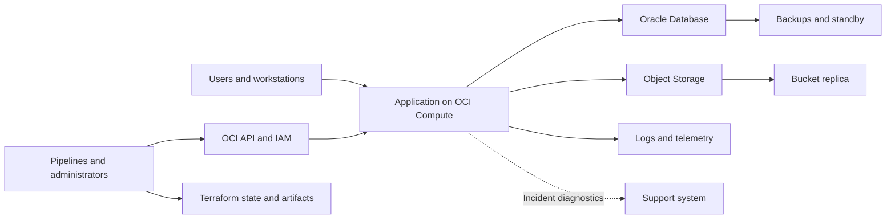

# Evaluating Data Sovereignty Requirements and Infrastructure Location

An application deployed on Oracle Cloud Infrastructure (OCI) might place its database in one region while shipping logs to a monitoring system elsewhere, storing backups in a second region, and allowing support personnel to access it from multiple countries. Therefore, infrastructure location decisions must cover the entire data lifecycle and all parties involved in operations.

In the Specialized Workloads and Deployments chapter, this lesson shows how to turn data sovereignty requirements into verifiable criteria for choosing OCI models, regions, redundancy architectures, and controls. Tenancy, compartments, IAM, VCN, Compute, storage, and Oracle database services are treated as interconnected parts of a single system.

## 1. Learning Outcomes

After this lesson, learners can:

- Distinguish data storage location, processing location, legal jurisdiction, and operational control.
- Catalog data, copies, and data flows for an OCI workload.
- Identify the impact of realms, home regions, identity domains, and region subscriptions.
- Screen public cloud, sovereign cloud, Dedicated Region, and Cloud@Customer options against real requirements.
- Evaluate data sovereignty, RPO/RTO, latency, operational capability, and cost simultaneously.
- Produce a deployment decision complete with evidence, open gaps, and accountable owners.

A sound evaluation record must answer: **what data exists, where it is stored and processed, who can access it, under what circumstances, via which mechanisms, and how it is verified**.

## 2. Clarifying Requirements Before Selecting a Region

### 2.1. Concepts Easily Conflated

| Concept | What must be clarified | Evaluation question |
| --- | --- | --- |
| Data residency | Geographic location where data is stored within defined boundaries | In which country are databases, backups, and logs stored? |
| Data localization | Obligation to store or process a data category within a specific geography | Does the rule cover primary copies, all replicas, or processing as well? |
| Data sovereignty | Legal jurisdiction and control requirements over data | Which entity controls the data, bears which obligations, and holds decision rights? |
| Operational sovereignty | Conditions on operating organizations, personnel, and processes | Who operates the infrastructure, handles incidents, and approves privileged access? |
| Cryptographic control | Authority to manage key lifecycles and perform decryption | Who manages keys, who uses them, and where are backup keys stored? |
| Cross-border data transfer | Activity requiring review when data leaves or is accessed outside permitted bounds | Are there exports, syncs, downloads, or remote support access? |
| Portability and exitability | Ability to retrieve data, restore elsewhere, and terminate the service | How can data, configs, and erasure evidence be exported? |

Encryption is a protective control. It does not by itself turn an out-of-scope storage location into a compliant one. Similarly, pseudonymized data replaced with identifier codes must still be evaluated for re-identification risk against individuals or source records.

In this lesson, these terms are used for architectural analysis. Specific legal obligations must be determined by legal or compliance leads for the exact organization, data type, industry, and deployment date.

### 2.2. Turning Vague Statements into Verifiable Requirements

The requirement "data must stay in-country" lacks at least five details:

1. **Geographic scope:** one country, a group of countries, or a legal jurisdiction?
2. **Data scope:** business data only, or also identities, logs, keys, telemetry, and support data?
3. **Constrained activities:** storage, processing, replication, remote access, or all of them?
4. **Applicable scenarios:** normal operations, maintenance, incidents, DR, and contract exit?
5. **Exceptions:** can a specific flow exit the boundary, who approves it, and for how long?

Example of a requirement ready for evaluation:

> Business records, file attachments, and all recovery copies must be stored and processed within the approved set of countries. Logs containing record contents are subject to the same constraint. All privileged access must be tied to an identity, purpose, duration, and session audit record. The DR plan must meet a 15-minute RPO and 2-hour RTO within that same geographic scope.

These numbers are design assumptions, not OCI defaults or guarantees.

### 2.3. Distinguishing Requirement Sources

Each requirement should carry an ID and clear reference source:

| Source | Information to record | Appropriate approver |
| --- | --- | --- |
| Legal regulations or regulatory mandates | Document, version, effective date, scope, approved interpretation | Legal or compliance |
| Customer contracts | Location clauses, access, sub-processors, breach notice, data return | Contract owner and legal |
| Internal policies | Data classification, approved country list, access rules, retention | Data owner and information security |
| Business continuity requirements | Disaster scope, RPO, RTO, minimum post-recovery capacity | Service owner and operations |
| Technical requirements | Latency, database version, shapes, connectivity, capacity | Architects and platform team |

Do not infer obligations solely from user language or corporate headquarters address. For workloads operating in Vietnam, determine specific data categories, subjects, and transactions before concluding where infrastructure may sit; a region near Vietnam satisfies only geographic proximity.

## 3. Understanding OCI Boundaries Correctly

### 3.1. Realm, Region, Availability Domain, and Fault Domain

| OCI component | Role in evaluation | What cannot be inferred from that component alone |
| --- | --- | --- |
| Realm | Group of regions in an OCI environment isolated from other realms | Applications and users will not automatically send data outside |
| Region | Geographic area deploying regional resources and services | Every metadata store, support team, and integration shares that location |
| Availability domain — AD | Independent infrastructure domain within a region | Can survive an outage of the entire region |
| Fault domain — FD | Hardware grouping isolating faults inside an AD | Equivalent to an independent DR site |
| Tenancy | Organizational account and resource governance scope | Every resource in the tenancy resides in one country |
| Compartment | Resource grouping for permissions, organization, and governance | A geographic boundary or a mechanism blocking data transfers |

Check the AD count and service catalog of the exact target region. OCI documentation distinguishes cross-region, regional, and AD-specific resources; some specialized services exist only in certain regions. [Source: Regions and Availability Domains](https://docs.oracle.com/en-us/iaas/Content/General/Concepts/regions.htm).

Compartment names like `vn-only` or tags like `Residency=EU` express governance intent. They enforce compliance only when backed by IAM policies, deployment checks, and monitoring processes.

### 3.2. Home Region and Identity Data

A tenancy's home region holds account metadata and core IAM definitions; the home region cannot be changed after the tenancy is provisioned. IAM spans regions, so a database's location does not represent the location of all governance resources. When evaluating an existing tenancy, verify its home region before deciding to reuse it. [Source: Managing Regions](https://docs.oracle.com/en-us/iaas/Content/Identity/Tasks/managingregions.htm).

With IAM Identity Domains, inspect the default domain and secondary domains separately:

- The default domain's home region is the tenancy's home region and automatically replicates to regions the tenancy subscribes to.
- Secondary domains have their own home regions within subscribed regions and their own replication settings per domain type capabilities.
- Subscribing to an extra region for a test workload can affect the default domain's replication footprint.

Thus, "no database outside Country X" does not yet answer requirements covering identity data. Inspect domains, federated identity providers, and account provisioning flows as well. [Source: IAM Security Structure](https://docs.oracle.com/en-us/iaas/Content/cloud-adoption-framework/iam-security-structure.htm).

When identity rules differ across workloads, evaluate secondary domains or separate tenancies. Accompany that choice with operational, governance cost, and service-sharing analysis.

### 3.3. Region Identifier, Region Key, and Endpoints

A region identifier and a region key are not the same value. For example, in Oracle EU Sovereign Cloud:

| Location | Region identifier | Region key | Realm |
| --- | --- | --- | --- |
| Frankfurt, Germany | `eu-frankfurt-2` | `STR` | `OC19` |
| Madrid, Spain | `eu-madrid-2` | `VLL` | `OC19` |

These regions belong to a dedicated sovereign realm, distinct from commercial regions in the same cities. Documentation for that environment also specifies dedicated endpoints. When configuring Console, CLI, SDKs, or Terraform, verify the exact realm and endpoint instead of picking by city name or guessing endpoint suffixes. [Source: Oracle EU Sovereign Cloud](https://docs.oracle.com/en-us/iaas/Content/sovereign-cloud/eu-sovereign-cloud.htm).

The identifiers above are used as examples from reference documentation checked on November 21, 2026. Before actual deployment, re-verify services, versions, and provisioning availability in the exact target tenancy.

## 4. Mapping Data and Copies

### 4.1. Cataloging by Data Type

| Data group | Examples in an OCI workload | Commonly overlooked items |
| --- | --- | --- |
| Business data | Oracle Database tables, document objects, File Storage files | Temporary tables, caches, exported reports |
| Recovery copies | Database backups, volume backups, standbys, object replicas | DR targets preconfigured from a shared template |
| Operational data | Application logs, traces, labeled metrics, crash dumps | Payloads, tokens, SQL queries, or user data inside logs |
| Identity and governance | Accounts, groups, policies, federation info | Out-of-scope IdPs and HR provisioning systems |
| Keys and secrets | Encryption keys, secrets, wallets, certificates | Key replicas, wallet backups, secrets in pipelines |
| Deployment data | Terraform state, plans, artifacts, cloud-init configs | State or outputs sitting in an external CI system |
| Support data | Diagnostic bundles, screenshots, support ticket attachments | Staff downloading data to personal laptops before uploading |
| Exit data | Export files, migration copies, erasure evidence | Old object versions and backups still within retention |

For each group, record at least: data owner, classification, creation point, processing point, storage point, copies, read permissions, retention period, deletion method, and evidence.

Terraform state can contain passwords, private keys, or sensitive attributes. Therefore, state storage location and download permissions must be evaluated even when business infrastructure sits in the right region. [Source: Storing Sensitive Data](https://docs.oracle.com/en-us/iaas/Content/dev/terraform/storing-sensitive-data.htm).

### 4.2. Separating Business Flows from Administrative Flows

The diagram below is an analysis template, not an approved architecture:



Annotate geographic location and operating entity on **every node and every arrow**. Server placement is an attribute of a node; path, purpose, and recipient are attributes of a flow.

For each flow, answer:

1. Does the payload contain protected content or enough detail to infer it?
2. Is it processed in memory, written to temp files, cached, or persisted at the recipient?
3. Does it traverse a CDN, proxy, WAF, malware scanner, or external analytics service?
4. Who can proactively change endpoints, create copies, or download data?
5. Do debug mode, application errors, or failover alter the path?
6. Which contractual and technical controls cover this flow?

A database kept in place yet copied onto a laptop for debugging still introduces a point requiring evaluation.

### 4.3. Separating Three Inspection Layers

- **Data plane:** business content, queries, files, backups, and replication.
- **Control plane:** resource configurations, policies, identities, metadata, and admin actions.
- **Support operations:** privileged staff, diagnostic tools, support channels, and data shared during incident handling.

These three layers may carry different contractual terms and control mechanisms. Never substitute a conclusion from one layer for the other two.

## 5. Building a Requirements and Evidence Matrix

A matrix turns discussions about "sovereignty" into concrete decisions. The example below uses hypothetical internal requirements:

| ID | Requirement | Scope | Required evidence | Accountable owner |
| --- | --- | --- | --- | --- |
| GEO-01 | Business data stored and processed only in country set A | Database, Compute, storage, cache | Resource inventory, flow diagrams, endpoint configs | Architect |
| GEO-02 | All recovery copies must reside in A | Backups, standby, replicas, exports | Target config, replication schedule, restore test results | DBA and operations |
| ID-01 | Identity data must follow approved boundaries | Domains, federation, provisioning | Home region, replication, and IdP documentation | IAM team |
| OPS-01 | Privileged access must be approved, time-bound, and logged | Internal staff, provider, partners | Support terms and session access logs | InfoSec |
| KEY-01 | Keys have clear owners and support recovery in A | Source keys, target keys, wallets | Key locations, usage policies, decryption tests | Key management team |
| OBS-01 | Logs containing protected data must stay in A | Logging, SIEM, alerts, tickets | Collection, filtering, and sink configs | SRE |
| BCP-01 | 15-min RPO, 2-hour RTO upon primary region loss | Full service | Timestamped drill records | Service owner |
| EXIT-01 | Data can be exported and residual copies disposed within agreed terms | Primary data and all copies | Exit plan, retention, post-deletion verification | Data owner |

"A" must be an explicit list, such as approved countries, never a vague label like "near the customer."

Each row can be marked:

- **Pass:** current evidence satisfies the exact scope.
- **Fail:** evidence shows the option violates the requirement.
- **Unverified:** missing information, inspection access, or contractual confirmation.
- **Not applicable:** backed by rationale and an approver.

"Unverified" must never automatically flip to "Pass." For mandatory requirements, close gaps before approval or obtain a valid exception through organizational governance.

## 6. Comparing Oracle Deployment Models

### 6.1. Options to Evaluate

| Model | When to include in evaluation | What must be verified |
| --- | --- | --- |
| OCI commercial public cloud | Commercial regions meet location and service needs | Data scope, support, IAM, supporting services, contracts |
| Oracle EU Sovereign Cloud | Location and operational rules require EU boundaries | Realm, operating terms, allowed countries, services, integrations |
| Appropriate Government Cloud | Organization qualifies and has specialized mandates | Eligibility, legal scope, services, certifications, access |
| OCI Dedicated Region | Need to evaluate a dedicated region at a customer-specified site | Site, bilateral duties, links, capacity, DR, terms |
| Product-specific Cloud@Customer | Need to bring select Oracle Cloud capabilities to enterprise DC | Product scope, data plane, control plane, telemetry, support |
| Oracle Alloy | Evaluating consumption via a partner-operated platform | Contracting entity, operator, locations, support chain |
| Appropriate isolated model | Requirements include specialized isolated operations | Availability, connectivity, updates, operations, DR method |

Oracle describes multiple sovereign and distributed cloud models with varying deployment characteristics. The table above is a screening framework; a model name alone does not prove a workload meets every requirement. [Source: Oracle Sovereign Cloud](https://www.oracle.com/cloud/sovereign-cloud/).

### 6.2. EU Sovereign Cloud: Matching Exact Scope

Oracle describes EU Sovereign Cloud as physically and logically separated from commercial cloud in the EU, with mechanisms restricting support and operations personnel to EU residents employed by dedicated EU legal entities. When citing this as evidence, verify exact service coverage and applicable terms. [Source: Oracle EU Sovereign Cloud](https://docs.oracle.com/en-us/iaas/Content/sovereign-cloud/eu-sovereign-cloud.htm).

This raises two independent questions:

- If the rule is "within the EU," two sites in different EU countries may be evaluation candidates.
- If the rule is "Germany only," a replica in Spain fails that geographic restriction.

Customers remain responsible for access control and connectivity at the tenancy, network, and application layers. A configuration exporting logs or data externally can defeat the architecture's purpose. [Source: Learn About the Oracle European Union Sovereign Cloud](https://docs.oracle.com/en/solutions/learn-about-eusc/index.html).

### 6.3. Cloud@Customer: Track Administrative Links Too

With Exadata Cloud@Customer, databases run on hardware in the customer's data center, while the architecture connects to OCI for automation and management. Architecture documentation also shows links to telemetry, identity, and logging services. Therefore, evaluate every flow alongside its destination location. [Source: Exadata Cloud@Customer Technical Architecture](https://docs.oracle.com/en/engineered-systems/exadata-cloud-at-customer/eccid/all_diagrams.html).

Verify:

- Which data stays inside the customer's data center?
- Which metadata, logs, and diagnostic files travel to OCI or support systems?
- Where are backups stored, who can change targets, and where can restores happen?
- Which privileges belong to the customer versus the infrastructure operations team?
- When management connectivity drops, which functions continue and which are impacted?
- Do operator access approval mechanisms meet internal policies?

Answers must reflect the exact product, configuration, and contract; do not generalize verbatim across every Cloud@Customer offering.

## 7. Selecting Location by Mandatory Gates First, Scoring Second

### 7.1. Step 1 — Eliminate Ineligible Options

Check sequentially:

1. Are storage, processing, and all copies inside permitted boundaries?
2. Is the organization eligible for that realm or model?
3. Are required services, database versions, shapes, and features available?
4. Do home region, identity domains, and governance integrations meet requirements?
5. Do support access, operations, and contract terms align?
6. Is a viable recovery plan available within approved boundaries?
7. Do quotas, capacity, and connectivity exist to execute the plan?

If only one region qualifies, explicitly document the fault-tolerance limitation. If no option simultaneously meets location and RTO/RPO rules, the evaluation output is a conflict requiring resolution at the requirement or deployment-model level.

### 7.2. Step 2 — Compare Remaining Eligible Options

Example weighted criteria proposed by a project team:

| Criterion | Illustrative weight | How to gather evidence |
| --- | --- | --- |
| Recoverability and site independence | 25% | Failure architecture, drills, restore results |
| Performance and latency | 25% | Business flow tests and representative queries |
| Total cost of ownership | 20% | Estimates for compute, storage, backups, network, operations |
| Operational capability | 20% | Staffing, on-call coverage, support workflows, drills |
| Scalability and lifecycle | 10% | Capacity, service roadmap, and exit plan |

Score each criterion from 1 to 5 and compute:

```text
Option score = sum(criterion score × corresponding weight)
```

Scores only compare options that already passed mandatory gates. Never let high performance or low price offset a failed geographic requirement.

### 7.3. Step 3 — Record the Decision and Validity Conditions

The decision record should document:

- Workload, data classification, data owner, and requirement sources.
- Realm, tenancy, home region, primary/standby regions, and relevant domains.
- Service catalog and permitted data flows.
- Selected option, rejected options, and rationales.
- Evidence, approvers, exceptions, and expiration dates.
- Review date and changes that trigger re-evaluation.

This is a scoped decision with a verification shelf life. When requirements or architecture shift, revisit past conclusions.

## 8. Assessing Availability Within Geographic Limits

### 8.1. Local HA and DR Address Different Failure Scopes

Spreading Compute across FDs or ADs mitigates hardware faults and certain localized outages. However, when an entire region goes down, resources inside that region can all be affected together.

Evaluate at least three scenarios:

| Scenario | What to verify |
| --- | --- |
| Loss of one instance or hardware group | Workload distribution, load balancing, session state, app recovery |
| Loss of one AD, in multi-AD architectures | Remaining resources, networking, storage, serving capacity |
| Loss of an entire region | Data, keys, identities, configs, and capacity at recovery site |

A region with multiple FDs does not by itself provide an out-of-region DR site.

### 8.2. Checking Each Replication Mechanism Individually

**Object Storage:** replication policies specify destination bucket and region; objects replicate asynchronously. Objects existing prior to policy creation are not automatically copied by that mechanism, and source deletes can propagate to the destination. Verify both replicated data scope and accidental-deletion recovery needs. [Source: Object Storage Replication](https://docs.oracle.com/en-us/iaas/Content/Object/Tasks/usingreplication.htm).

**Block Volume:** backups can be copied to another region; user-defined backup policies can configure automatic cross-region copy targets. Inspect the actual policy attached to each relevant volume or volume group rather than relying solely on policy names. [Source: Enabling Cross-region Copy for a User-defined Backup Policy](https://docs.oracle.com/en-us/iaas/Content/Block/Tasks/create-destinationregion-bv-volume-backup-policy.htm).

**Oracle Database:** for Base Database Service, Exadata, or Autonomous Database, follow documentation for the exact service and deployment type to determine backup location, standby placement, redo protection, restore targets, and support limits. Never extrapolate one database service's behavior to another.

**Keys:** if using Vault replication, record replica regions and vault capabilities. OCI documentation describes replicating vaults and keys to a second region within the same realm; review vault-type limitations as well. [Source: Replicating Vaults and Keys](https://docs.oracle.com/en-us/iaas/Content/KeyManagement/Tasks/replicatingvaults.htm).

**Application tier:** caches, queues, search indices, and export files may also hold data needing recovery. Include them in recovery plans and approved geographic boundaries.

### 8.3. Measuring End-to-End Service RPO and RTO

- **RPO** is maximum acceptable data loss, typically expressed as time between recovered data and failure onset.
- **RTO** is maximum acceptable outage duration to restore service to agreed levels.

Hypothetical drill example:

| Phase | Measured duration |
| --- | --- |
| Detection, decision, and procedure invocation | 15 minutes |
| Provisioning required infrastructure, networking, and permissions | 25 minutes |
| Database restore and recovery | 70 minutes |
| Application switchover, verification, and reopening service | 20 minutes |
| Total duration | 130 minutes |

Against a 2-hour RTO target, 130 minutes fails, even if backups sit in the right country.

Similarly, daily backups do not prove a 15-minute RPO. With replication, monitor lag and verify data usability during failure tests. Drills must also test login, key access, DNS resolution, and target capacity provisioning.

## 9. Translating Requirements Into Enforced Controls

### 9.1. Tenancy and IAM Governance

Controls to build into the design:

- Select the right tenancy and home region from the start.
- Restrict permissions to subscribe regions, alter IAM, create replicas, and change backup targets.
- Separate duties across workload administration, key administration, identity administration, and auditing.
- Review group policies, dynamic groups, service principals, and cross-tenancy permissions.
- Design time-bound emergency access with approvers and post-use review.

OCI provides the `request.region` condition variable indicating the three-letter region key where a request lands. When writing IAM conditions, distinguish it from the region identifier used in many CLI/API parameters. [Source: IAM Policy Reference](https://docs.oracle.com/en-us/iaas/Content/Identity/Reference/policyreference.htm).

A policy statement with a region condition does not prove a principal is fully restricted if broader grants exist elsewhere. Audit effective permissions and APIs with explicit replication targets. In particular, avoid mechanically applying regional conditions to global IAM operations.

### 9.2. VCN, Connectivity, and Data Egress Paths

Evaluate routes, gateways, firewalls, proxies, NSGs, and endpoints against documented data flows.

Private endpoints or private links control transport paths. They do not replace verifying the location of receiving services or who holds permission to change configurations.

Verify:

- Destinations applications may reach and outbound traffic controls.
- Paths to OCI services, on-premises systems, partners, and SaaS providers.
- Whether administrators or pipelines can create new network paths.
- Contents sent via DNS queries, error messages, alerts, and support tickets.
- Path changes during DR activation or carrier failover.

If specific transit-country rules apply, obtain verification and evidence from connectivity providers. Never infer physical transit paths solely from two endpoints.

### 9.3. Encryption, Keys, and Recovery

The key model must specify:

1. Which data uses service-managed keys versus customer-managed keys.
2. Who administers keys and who uses them for encryption or decryption.
3. Where keys, replicas, key backups, and wallets reside.
4. How applications in DR obtain permissions and reach cryptographic functions.
5. Impact of key disablement, rotation, or deletion.

An existing backup without usable keys does not form a complete recovery plan.

Customer-managed keys give organizations partial control over the cryptographic lifecycle. Separately verify service or application decryption rights during processing alongside operator access controls.

### 9.4. Monitoring and Access Evidence

Combine administrative, service, and application logs for verification goals. OCI Audit records supported API calls, but does not replace all data-access logging; documentation explicitly distinguishes bucket-level from object-level events in Object Storage. [Source: Overview of Audit](https://docs.oracle.com/en-us/iaas/Content/Audit/Concepts/auditoverview.htm).

Observability design should include:

- Detecting resources or copy targets outside the approved list.
- Tracking changes to region subscriptions, IAM, backups, replication, and privileged roles.
- Tracking data exports and support channel usage per service capabilities.
- Protecting the evidence store against unauthorized tampering.
- Filtering or redacting sensitive data before shipping logs.
- Placing log sinks, SIEMs, and alerting channels inside policy-compliant locations.

Never send sensitive payloads to a notification channel merely because it handles incident paging.

### 9.5. IaC and Pipelines

In Terraform or OCI Resource Manager workflows, enforce approved realm/region lists and review plans before apply. Check primary providers, provider aliases, child modules, and backup/replication destination parameters.

A Resource Manager stack lives in one region but can manage resources deployed across multiple regions. Stack location does not prove all managed resources reside in the same place. [Source: Overview of Resource Manager](https://docs.oracle.com/en-us/iaas/Content/ResourceManager/Concepts/resourcemanager.htm).

Also restrict permissions to download state, configurations, and job logs. In Resource Manager, job read permissions relate to accessing Terraform state and configs, so evaluate permissions carefully per group. [Source: Securing Resource Manager](https://docs.oracle.com/en-us/iaas/Content/Security/Reference/resourcemanager_security.htm).

Pipeline checks form one control layer. Combine them with IAM and drift detection to cover Console, CLI, and external tools.

## 10. Lab: Gathering Evidence on OCI

### 10.1. Scope and Prerequisites

This lab uses read-only commands. Run it in a tenancy you are authorized to inspect, from a workstation in a compliant location with appropriate data handling. Outputs may contain OCIDs and internal metadata; handle per organizational policy.

PowerShell examples use a profile configured for the exact realm. Replace profile names, OCIDs, and bucket names with actual authorized resources.

### 10.2. Listing Region Subscriptions

```powershell
$ociProfile = "SOVEREIGN_LAB"
$tenancyOcid = "<tenancy-ocid>"
$ociHomeRegion = "eu-frankfurt-2"

oci --profile $ociProfile --region $ociHomeRegion iam region-subscription list --tenancy-id $tenancyOcid --all
```

Record the home region, region list, subscription statuses, and inspection timestamp. This feeds into evaluating both identity scope and usable deployment scope. [Source: OCI CLI — iam region-subscription list](https://docs.oracle.com/en-us/iaas/tools/oci-cli/latest/oci_cli_docs/cmdref/iam/region-subscription/list.html).

If the tenancy belongs to a commercial realm, the sovereign example above cannot be used directly. Substitute the real environment's region and profile after confirming they fit requirements.

### 10.3. Inventorying Compute and Buckets by Region

```powershell
$workloadCompartmentOcid = "<workload-compartment-ocid>"
$approvedRegions = @("eu-frankfurt-2", "eu-madrid-2")

foreach ($targetRegion in $approvedRegions) {
    Write-Output "Region: $targetRegion"

    oci --profile $ociProfile --region $targetRegion compute instance list --compartment-id $workloadCompartmentOcid --all

    $objectNamespace = oci --profile $ociProfile --region $targetRegion os ns get --query data --raw-output
    if ($LASTEXITCODE -ne 0) {
        throw "Failed to read Object Storage namespace in $targetRegion"
    }

    oci --profile $ociProfile --region $targetRegion os bucket list --namespace-name $objectNamespace --compartment-id $workloadCompartmentOcid --all
}
```

These commands inspect only the specified resource types, compartment, and regions. They do not automatically recurse child compartments or inventory databases, volumes, logs, or other services.

Cross-check subscribed regions against the approved region list. If an unapproved region appears, record and inspect it within granted audit permissions; never ignore it simply because the loop iterates only over an allowlist.

Empty output also does not prove zero resources exist. Confirm exact tenancy, region, compartment, read permissions, and pagination. When the API errors or lacks permissions, mark that check as unverified.

### 10.4. Inspecting a Bucket's Replication Targets

```powershell
$sourceRegion = "eu-frankfurt-2"
$sourceBucketName = "<source-bucket-name>"

$objectNamespace = oci --profile $ociProfile --region $sourceRegion os ns get --query data --raw-output
if ($LASTEXITCODE -ne 0) {
    throw "Failed to read Object Storage namespace"
}

oci --profile $ociProfile --region $sourceRegion os replication list-replication-policies --namespace-name $objectNamespace --bucket-name $sourceBucketName
```

Cross-check destination region, destination bucket, and policy status fields against the requirements matrix. [Source: OCI CLI — list-replication-policies](https://docs.oracle.com/en-us/iaas/tools/oci-cli/latest/oci_cli_docs/cmdref/os/replication/list-replication-policies.html).

Having no replication policy reflects only that specific mechanism. Still inspect manual copies, scheduled tasks, app exports, backup tools, and copies outside OCI.

### 10.5. Supplementing Evidence Beyond the CLI

Complete the record using appropriate Console/API views or verified documentation:

| Item | What to collect |
| --- | --- |
| Database | Service, primary/standby config, backup destination, retention policy |
| Volumes | Attached policies, copy targets, replicas, and keys used |
| IAM | Domain home regions, replication, federation, and effective permissions |
| Vault | Source/replica regions, key usage rights, and recovery test results |
| Logging | Log group locations, connectors, receiving systems, retention |
| Pipelines | Runner locations, state backends, artifacts, read permissions |
| Support | Contract scope, access workflows, and diagnostic handling |
| DR | Drill records, recovered data, and measured timings |

Each evidence item needs a collection date, resource scope, and collector. Point-in-time inventory must be supplemented with change monitoring.

## 11. Decision Example with Specific Geographic Requirements

A hypothetical organization operating a records-management portal has approved internal rules:

- Record data and copies must be stored and processed only within the EU.
- Logs containing record details share the same constraint.
- The organization requires specific EU-based operations and support staffing conditions.
- Target RPO is 15 minutes; target RTO is 2 hours.
- Services include Compute, Oracle Database, Object Storage, and observability systems.

The project team shortlists the two Oracle EU Sovereign Cloud regions in Frankfurt and Madrid for evaluation. They are candidates matching the EU boundary and requested operating model, not yet proof that the entire workload complies.

### 11.1. Items to Close Before Approval

1. Confirm the chosen database service and version exist in both regions.
2. Verify primary, standby, or backup mechanisms meet the target RPO.
3. Confirm destinations for logs, state, artifacts, and support data.
4. Check home region, domain replication, and IdP placement.
5. Check access controls, keys, and capacity in the standby region.
6. Drill primary region loss and measure time to restore service.
7. Cross-check operational and support terms against approved requirements.

If the current SIEM ingests verbatim record logs at a site outside the EU, that flow fails. The project team must change the sink, redact data per approved patterns, or redesign the integration.

### 11.2. Changing One Constraint Can Change the Decision

Suppose the data owner tightens the rule to "all records and copies in Germany only." Madrid is no longer a valid DR target for that data.

Paths to re-evaluate include another independent site in Germany meeting the same rules, a different infrastructure model, or revising business continuity targets through proper governance. Never place a standby in another country just to hit RTO and treat it as an automatic technical exception.

If no option satisfies location, services, and RPO/RTO simultaneously, the record must surface that conflict clearly for authorized decision makers.

## 12. Cost, Performance, and Data Lifecycle

### 12.1. Costing the Full Option

Estimates should include:

- Primary Compute and standby capacity, including idle/warm resources.
- Storage for primary data, backups, replicas, logs, and exports.
- Replication traffic, private links, and applicable data transfer fees.
- Vault, observability services, and supplementary protection mechanisms.
- Minimum infrastructure or commitment terms of the chosen deployment model.
- Operations staff, on-call rotations, drills, and access approval workflows.
- Lifecycle costs for migration, audits, exit, and data erasure.

Never use a single storage unit rate to represent total cost for a DR-enabled option.

Illustrative capacity estimate without compression or service-specific behavior: 4 TB of initial data with 20% weekly change rate, assuming no extra deduplication, yields roughly 0.8 TB of weekly delta. Factor in initial sync, actual growth rate, and corresponding transfer costs when budgeting.

For databases or block-level replication, transmitted bytes can differ from business change rates. Use measurements or representative tests to finalize estimates.

### 12.2. Testing Real-Flow Performance

Measure from users and integrated systems to applications, from applications to databases, and from primary to standby sites. Latency affects user experience, transaction times, and recovery speed.

If approved locations sit far from users, evaluate query optimization, reducing chatty network calls, or separating data eligible for broader distribution. Any cache/CDN additions must still undergo classification and location review before use.

### 12.3. Reviewing Retention, Deletion, and Exit

List residual data remaining when a record is deleted or a service terminates:

- Primary data, prior versions, temp files, and caches.
- Backups still within retention and manual copies.
- Standbys, replicas, and recovery test environments.
- Logs, diagnostic bundles, artifacts, and support tickets.
- Keys, wallets, and migration export files.

Determine which data is deleted directly, which ages out by retention, and which must be kept under verified obligations. Never destroy keys merely to render data unreadable if doing so breaks retention mandates or needed recoverability.

Exit plans must cover retrieving usable data, transferring to a valid target, verifying integrity, and disposing of remaining copies.

## 13. Common Wrong Conclusions

| Wrong conclusion | Sound assessment approach |
| --- | --- |
| "The region is in-country, so the whole workload meets data sovereignty." | Inspect IAM, backups, logs, processing, support, and integrations too |
| "Country-named compartments prevent creating resources elsewhere." | Pair governance structure with IAM, deployment checks, and drift detection |
| "Private subnets mean data cannot leave." | Inspect routes, endpoints, change permissions, and application flows |
| "Encrypted copies can sit in any country." | Check scope rules applying to both data and copies |
| "Sovereign cloud satisfies all obligations automatically." | Review terms alongside customer configuration and responsibilities |
| "Multiple fault domains cover losing an entire region." | Separate local fault isolation from cross-region DR |
| "Having backups guarantees meeting RTO." | Drill the full sequence from decision to restored serving |
| "No object replication policy means no out-of-region copies." | Check manual copies, exports, backup tools, and support flows |
| "IaC lives in the right region, so every resource does too." | Inspect provider aliases, target parameters, and actual resources |
| "Provider certifications prove the application is compliant." | Review certification scope alongside customer-implemented controls |

## 14. Applied Exercise and Handover Criteria

Pick an OCI workload using Compute, Oracle Database, Object Storage, backups, and logging. You can use a paper simulation if no tenancy is available; state all assumptions clearly.

Execute in order:

1. Identify data owner, classification level, and permitted countries.
2. Catalog data categories and draw business, admin, and support flows.
3. Record realm, tenancy home region, identity domains, and region subscriptions.
4. Build a requirements matrix with at least one row each for backups, identity, keys, and logs.
5. Compare two deployment options against mandatory gates.
6. Score eligible options using explained weights.
7. Build a primary-region loss scenario; list dependencies and how RPO/RTO are measured.
8. Estimate costs along with retention, deletion, and exit handling.
9. Document the decision, open evidence gaps, owners, and due dates.

A package can be recommended for approval when:

- Every mandatory requirement has passing evidence or an exception approved by proper authority.
- Locations of primary data, copies, keys, identities, and operational data are verified against scope.
- Actual configuration and data-flow diagrams match.
- Recovery plans carry RPO/RTO evidence or explicitly list remaining tests required before production launch.
- Operational owners understand their permissions, evidence collection, and changes requiring re-evaluation.

Changes that must trigger re-evaluation include subscribing to a new region, changing backup destinations, adding managed services, changing IdP, switching SIEMs, altering support workflows, or revising contract terms. Re-check each change against the requirements matrix before it becomes part of the approved design.
