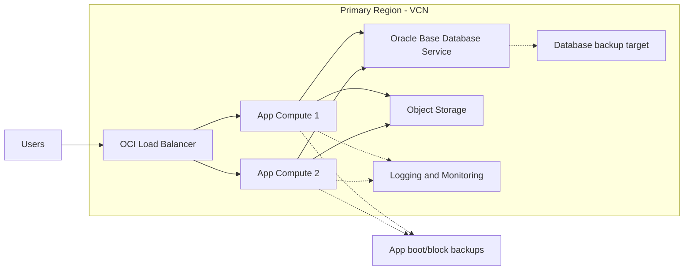

# Estimating Architecture Costs Before Deployment

An OCI diagram with two virtual machines, one load balancer, and one database is not enough to answer "how much will this cost per month?" Cost also depends on resource lifetime, allocated memory, disk performance, retained data volume, Oracle Database licensing, network traffic, and recovery options.

In the **Cost and Capacity Management** chapter of the **CLOUD_PROVIDERS_ORACLE** module, this lesson shows how to turn application requirements into an explainable and updatable cost estimate. The scope covers Compute, VCN and data flows, storage, Oracle database services, monitoring, and shared infrastructure within the tenancy. Compartments, IAM, and automation are examined from the perspective of identifying owners, limiting deployment scope, and reconciling costs.

The deliverable needed before deployment is a set of assumptions, a resource inventory, unit-based calculation formulas, usage scenarios, and the conditions that require updating the estimate.

> All unit prices and amounts in the calculation examples of this lesson are **hypothetical figures for learning purposes**, not list prices or Oracle quotes. When preparing a real estimate, replace them with prices for the exact SKUs, currency, and commercial terms in effect.

## 1. Identify Which Question the Estimate Answers

Three figures are commonly confused with one another:

| Figure | Question answered | Key contents |
| --- | --- | --- |
| Expected OCI cost | How much service cost does this usage model generate? | Resources, duration, capacity, and billing meters |
| Proposed budget | How much money must be allocated to absorb identified variance? | Expected cost plus risk-based contingency |
| Total Cost of Ownership, TCO | How many resources are needed to build and operate the solution? | Cloud costs, off-cloud licenses, staffing, connectivity, migration, and operations |

Additionally, the payable amount in a period can be affected by usage commitments, credits, discounts, taxes, and exchange rates. Therefore, explicitly state whether you are comparing service consumption cost or cash outlay.

Oracle provides Cost Estimator to calculate based on configuration and expected usage. The output is a planning tool, not an official quote. See [Oracle's guide to estimating monthly costs](https://docs.oracle.com/en-us/iaas/Content/Billing/Tasks/signingup_topic-Estimating_Costs.htm).

A useful estimate must answer:

- Why is that resource quantity needed?
- Where were the unit prices taken from, on what date, and for which service type?
- Which portion is guaranteed to occur just to keep the system running?
- Which portion changes with load, data, or retention duration?
- If fault tolerance must increase, which line items need to be added?
- What remains unconfirmed and who is responsible for confirming it?

## 2. Lock Input Assumptions Before Selecting Services

Do not start by picking the cheapest virtual machine. First, describe requirements to establish a basis for sizing configurations.

| Assumption group | Details to record | Impact on the estimate |
| --- | --- | --- |
| Organizational scope | Tenancy, compartment, environment, cost owner | Separates direct costs from shared costs |
| Geography | Primary region, recovery region if any, user locations | Service availability, data transfer flows, and data residency requirements |
| Application load | Requests/month, peak requests/second, batch jobs, seasonality | Instance count and scaling duration |
| Performance | p95/p99 latency, throughput, connection limits | Compute size, database, and storage performance |
| Memory | Heap, off-heap, cache, OS, agents | RAM capacity to allocate per node |
| Data | Initial volume, growth, daily change rate | Primary storage, backups, replicas, and recovery capacity |
| Operations | Continuous or scheduled runtime, maintenance windows | Billable hours and resources persisting after hours |
| Availability | Components needing redundancy, failure scope to survive | Replica counts and redundant capacity |
| Recovery | RPO, RTO, backup retention, drill frequency | DR approach, data copies, and recovery infrastructure |
| Commercial | Currency, PAYG/commitment, License Included/BYOL | Effective unit price and cash flow |
| Cost scope | Whether taxes, support, staffing, or non-OCI connectivity are in the total | Prevents comparing two totals with different scopes |

**RPO** is the maximum acceptable data loss, measured in time. **RTO** is the target time to restore service. These targets must map to a verifiable plan; writing "has backups" does not prove RPO or RTO is met.

Each major assumption should carry a confidence level and an owner. For example: current data volume measured from the source system has high confidence; growth rate during a new campaign is an assumption that requires tracking.

For systems lacking measurements, publish a variance range. "500 GB to 1,000 GB over six months" is more useful than an unfounded 637 GB figure.

## 3. Turn an Architecture Diagram into a Billable Inventory

Consider a web application using Oracle Database:



The diagram shows component relationships; it does not assert that the architecture achieves a specific SLA. Two application nodes can still depend on a database without a standby or lack capacity when one node fails.

For each component, create one or more cost lines:

| Component | Items to include in the inventory |
| --- | --- |
| Application Compute | Shape, instance count, OCPU, RAM, runtime hours, paid OS or images |
| Application disks | Boot volumes, additional block volumes, capacity, VPU, and lifetime |
| Load Balancer | Base instance fee, billable bandwidth, and active hours |
| Oracle Database | Service, edition, license model, compute, storage, backups, standby/clones if used |
| Object Storage | Tier, time-weighted capacity, requests, and applicable retrieval fees |
| Network | Source, destination, link type, and volume per flow |
| System observability | Actual log/metric/trace services used and corresponding meters |
| Shared platform | Allocated share of DNS, connectivity, security, and paid operational tools |

Not every object on a diagram has its own fixed fee. The inventory should distinguish "has billable SKU," "no separate charge under checked policy," and "unconfirmed." Do not copy gateway or network pricing rules from another cloud provider into OCI.

One resource can generate multiple meters; conversely, one service configuration may already bundle dependent components. Inspect configuration contents so you do not double-count storage or compute already included in a service line.

## 4. Derive Capacity to Purchase from Application Demand

### 4.1. Monthly Requests and Peak Load Serve Two Different Purposes

Monthly request count helps estimate billable requests, traffic, and generated data. Peak load helps determine processing capacity.

Hypothetical example:

- Peak load to serve: 180 requests/second.
- Benchmark shows one node handles 120 requests/second at target latency within chosen operational limits.
- Nodes can balance load relatively evenly; no database bottleneck yet.

Then:

```text
N_normal_load = ceil(180 / 120) = 2 nodes

If capacity must be preserved when losing 1 node:
N_required = 2 + 1 = 3 nodes
```

This is derived from a hypothetical benchmark, not a default capacity of an OCI shape. If only two nodes are provisioned, losing one node leaves insufficient capacity for 180 requests/second. The estimate must explicitly state that choice.

For Java applications, benchmarks must represent the expected JDK version, garbage collector, heap, database connection count, and background tasks. VM RAM must accommodate heap plus off-heap memory, OS, and agents. Using only the configured heap size as total RAM often leads to resizing after deployment.

### 4.2. Calculate Runtime Hours per Resource Group

```text
Instance_hours = Instance_count × Runtime_hours_per_instance

If configuration changes over time:
Cost = Sum_of_costs_for_each_configuration_interval
```

A dev environment running 10 hours/day, 22 days/month has 220 expected active hours per VM. This does not mean every resource in that environment is billed for only 220 hours: volumes, backups, objects, and some other services still exist outside VM running hours.

In long-term estimates, **730 hours/month** can be used as an average convention from a 365-day year. Any specific calendar month has a different hour count; when reconciling bills, use the actual period and each service's rounding rules.

### 4.3. Forecast Capacity Over Time

Suppose data grows linearly from 500 GB to 800 GB over a month:

```text
Month_end_capacity = 800 GB
Average_capacity   = (500 + 800) / 2 = 650 GB
```

650 GB can be used for a storage model billed on actual stored data if linear growth is a valid assumption. For a volume provisioned at 1,000 GB for the entire month, the estimate must use 1,000 GB provisioned rather than substituting 650 GB of used data.

Backups require their own model: protected capacity, data change rate, full/incremental schedule, retention period, compression, and additional copies. Do not assume "500 GB of data retained 30 days" always equals 15,000 GB of backups.

## 5. Standardize Units Before Multiplying by Prices

A correct formula still gives the wrong result if given the wrong unit.

| Unit | Meaning in the estimate | Pitfalls to avoid |
| --- | --- | --- |
| OCPU-hours | Provisioned OCPUs multiplied by corresponding duration | Using a per-vCPU price and multiplying by OCPU count |
| GB RAM-hours | RAM allocated to VM multiplied by duration | Omitting RAM for Flex shapes |
| GB-months | Equivalent capacity existing across a full month | Using period-end size for all days or using only written data on a volume |
| VPU/GB | Volume performance tier | Forgetting or double-multiplying the VPU factor |
| Mbps and Mbps-hours | Transfer rate, and billable rate multiplied by duration | Confusing with total GB transferred |
| GB/GiB, TB/TiB | Decimal and binary units | Implicitly converting between monitoring metrics and billing meters |
| Request batch | A block of requests per listed pricing unit | Multiplying a whole-block price directly by each individual request |

With OCI x86 Compute, one OCPU corresponds to two vCPUs. Ampere A1 uses a one-OCPU-to-one-vCPU relationship; other Arm families may have different ratios. Always verify the exact shape instead of applying one ratio to all Arm shapes. See [Compute Shapes and OCPU/vCPU definitions](https://docs.oracle.com/en-us/iaas/Content/Compute/References/computeshapes.htm).

If each request returns an average of 100 kB to the Internet, 10 million requests generate roughly:

```text
10,000,000 × 100,000 bytes = 1,000,000,000,000 bytes
                           = 1,000 decimal GB
```

This is only the assumed response portion. Add file downloads, static assets, other APIs, and related flows; account for compression, caching, retries, and overhead not included in the average size.

## 6. Build Formulas for Each Service Group

### 6.1. Compute Flex

For identical VMs keeping the same configuration within one interval:

```text
C_compute = N × H × (O × P_ocpu + M × P_ram)

N       : number of instances
H       : runtime hours per instance
O       : OCPUs per instance
M       : GB RAM per instance
P_ocpu  : unit price / OCPU-hour
P_ram   : unit price / GB RAM-hour
```

CPU utilization percentage is not a discount multiplier for provisioned Standard Flex VMs. A VM allocated 2 OCPUs that usually runs at 10% CPU must still be estimated for its allocated resources while running.

If autoscaling is present, separate the minimum baseline and the scaled portion:

```text
C_compute =
    Cost_of_always_on_minimum_group
  + Sum(Additional_nodes × Active_hours × Hourly_rate_per_node)
```

Include startup time, scale-in cooldown time, and temporary nodes during rollouts. Do not multiply the maximum instance count by the full month as an average usage forecast unless modeling that scenario running continuously.

Whether stopping an instance pauses compute charges depends on the shape. Standard shapes and special cases are specified separately by OCI; storage must still be evaluated independently. Perform the proper instance management action rather than assuming an OS shutdown command ensures every meter stops. Refer to [Resource Billing for Stopped Instances](https://docs.oracle.com/en-us/iaas/Content/Compute/Tasks/resource-billing-stopped-instances.htm).

### 6.2. Boot Volumes and Block Volumes

A volume kept constant all month can be modeled as:

```text
C_volume = G × (P_capacity + V × P_vpu)

G          : provisioned volume capacity, GB
V          : selected VPU/GB
P_capacity : unit price / GB-month
P_vpu      : unit price / VPU-GB-month
```

If the price list or tool already gives a combined performance price for the selected VPU tier, use that amount directly without multiplying by VPU again. When capacity, VPU tier, or lifetime changes, split into corresponding intervals.

OCI lets you select volume performance levels based on VPUs. Increasing VPUs can help meet IOPS/throughput targets, but you must also consider instance and I/O path limits. See [Block Volume Performance](https://docs.oracle.com/en-us/iaas/Content/Block/Concepts/blockvolumeperformance.htm) and [storage billing units](https://www.oracle.com/cloud/price-list/).

In the inventory, separate boot volumes, application data disks, and database disks. Stopping or replacing a VM does not automatically prove all old volumes and backups were removed.

### 6.3. Object Storage and Retained Data

General model:

```text
C_object =
    Sum(Average_capacity_per_tier × Tier_unit_price)
  + Applicable_request_fees
  + Applicable_retrieval_fees
  + Minimum_retention_early_deletion_charges
  + Data_transfer_costs_not_counted_elsewhere
```

Old object versions, replicas, and policy-retained data also occupy space. Distinguish between user-visible data and total data billed for storage.

Cheaper tiers can carry other conditions. Infrequent Access has retrieval fees and a minimum retention period; Archive has a minimum retention requirement and requires restoring objects before reading. When restoring from Archive, the restored copy can create additional Standard storage charges. See [Object Storage Storage Tiers](https://docs.oracle.com/en-us/iaas/Content/Object/Concepts/understandingstoragetiers.htm).

Lifecycle policies must be evaluated alongside read frequency and RTO. Moving frequently read data to cold storage tiers can increase total cost or recovery time.

### 6.4. Load Balancer

For Flexible Load Balancer, consider base fees and bandwidth. According to OCI documentation, below the configured minimum, bandwidth is billed at the minimum; above the minimum, it is billed at the corresponding per-minute usage. See [Creating a Load Balancer](https://docs.oracle.com/en-us/iaas/Content/Balance/Tasks/managingloadbalancer_topic-Creating_Load_Balancers.htm).

Interval-based model:

```text
C_lb = H × P_base
     + Sum(Billable_bandwidth_in_interval × Interval_hours × P_mbps)
```

If minimum equals maximum and stays constant all month, a fixed bandwidth can be used in the formula. For elastic configurations, model low, typical, and peak intervals; do not assume maximum is billed for every minute.

Load balancer bandwidth charges and Internet data egress charges are different meters. Counting one does not automatically eliminate the other. Choosing between Load Balancer and Network Load Balancer must satisfy protocol, traffic processing, and application feature requirements before comparing prices.

### 6.5. Logging, Monitoring, and Supporting Components

List the exact products used. Logging, Log Analytics, Monitoring, and database management services can use different meters. Do not use a single flat price for all observability activities.

For logs, you can start from:

```text
Daily_logs_generated =
    Requests_per_day × Average_log_size_per_request
  + System_and_background_task_logs
```

Then apply retention, the service's capacity billing rules, exports to Object Storage, and any remaining eligible free allowance. The OCI price list separates observability meters; see [Cloud Price List](https://www.oracle.com/cloud/price-list/).

Early after launch, enabling verbose logging briefly can aid diagnostics yet invalidate storage assumptions. The estimate should note expected log verbosity and who approves retention changes.

## 7. Estimate Oracle Database by Exact Service and License

"Oracle Database on OCI" is not yet a clear enough configuration to price. Identify whether you are using a self-managed database on Compute, Oracle Base Database Service, Autonomous Database, or another service.

| Decision | Details to finalize in the estimate |
| --- | --- |
| Service type | Operational responsibility and billing components |
| Edition and features | Features actually needed, configurations supported by the service |
| Compute unit | Whether the SKU uses ECPU or OCPU and corresponding sizing |
| License | License Included or eligible BYOL |
| Primary data | Provisioned capacity, related system/recovery overhead, performance |
| Backups | Storage target, retention, billable size, and included portions |
| Fault tolerance and recovery | Standby, cross-region replica, clone, or recovery infrastructure |
| Scaling | Base configuration, scaling limits, and expected scaling duration |

Base Database Service has License Included and BYOL options; pricing depends on service configuration, edition, compute, and storage. Estimates must check the exact DB system type to avoid adding a regular Compute VM for compute already billed by the service. See [Base Database Service FAQ](https://www.oracle.com/database/base-database-service/faq/).

With BYOL, confirm existing license entitlements, feature scope, support terms, and applicable conversion ratios. A lower BYOL service rate does not mean off-cloud license ownership cost is zero. When entitlements are not yet confirmed, present both options and flag the condition rather than locking in BYOL unilaterally.

For Autonomous Database with autoscaling, scaled compute can incur charges beyond the base configuration. Standby, clones, and DR also have separate billing rules; do not apply a generic 2x multiplier across all options. See [Autonomous Database Serverless Features Billing](https://docs.oracle.com/en-us/iaas/autonomous-database-serverless/doc/autonomous-features-billing.html).

An auditable database model takes the form:

```text
C_database =
    C_service_compute_and_license
  + C_primary_storage
  + C_non_included_backups
  + C_standby_or_DR
  + C_clones_and_temporary_tasks
```

Each term must note what is already included. For example, add standalone backup charges only when the chosen backup type and service tier actually generate that charge.

## 8. Build a Network Flow Table Instead of One Generic Bandwidth Number

Create a table following the data paths:

| Flow | Source → destination | Quantities to forecast |
| --- | --- | --- |
| Application access | OCI → Internet users | Responses, file downloads, static content, retries |
| Service access | Application → database/Object Storage | Region, access path, and volume |
| DR | Primary region → recovery region | Initial seed, changes, and drill traffic |
| Enterprise internal connectivity | OCI ↔ data center | VPN/FastConnect, ports, and carrier fees |
| External integrations | OCI → other services or clouds | Outbound data and partner-side fees if any |

Current OCI policy specifies no intra-region data transfer fee, includes a free allowance for Internet egress, and has separate pricing for dedicated connectivity. FastConnect can also incur charges from connectivity partners. Verify the exact path and terms when building the estimate. See [Virtual Cloud Network Pricing](https://www.oracle.com/cloud/networking/virtual-cloud-network/pricing/).

The following formula only fits after identifying a single egress group sharing a free allowance and a single paid tier:

```text
E_billable = max(0, E_eligible - F_remaining)
C_egress = E_billable × P_egress
```

With multiple price tiers, origin groups, or transfer types, calculate each group separately then sum. Do not apply a single-tier formula across the entire network when conditions differ.

**F_remaining** must be the remaining allowance legitimately applicable to this estimate after considering the actual sharing scope. Do not re-grant the full allowance to each compartment and then sum the estimates.

You can present simultaneously:

- Incremental cost of the project while the tenancy still has unused allowance.
- Allocated cost to the project under governance rules.
- Cost level once the allowance is exhausted by other systems.

These three perspectives serve different decisions and must be labeled clearly.

## 9. Use OCI Cost Estimator to Cross-Check the Inventory

You can use [OCI Cost Estimator](https://www.oracle.com/cloud/costestimator.html) after assembling the inventory and assumptions. Recommended workflow:

1. Name the estimate by system, environment, option, and creation date.
2. Confirm currency, pricing basis, and applicable region/service scope.
3. Add Compute with the exact shape, quantity, OCPU, RAM, and usage schedule.
4. Check boot/block volumes inserted by the tool; add missing items, remove duplicate lines.
5. Add databases with the finalized license model, storage, backups, and redundancy plan.
6. Add load balancers, object storage, network meters, and relevant observability services.
7. Cross-check every tool line against the architecture inventory; note any items that cannot be represented separately.
8. Save the output alongside assumptions so calculations are reproducible.

Oracle documentation describes exporting XLS, CSV, or JSON; JSON can be re-imported into the tool. If the UI changes, prioritize preserving complete configuration and price sources over relying on a specific button location. Refer to [Oracle's guide to saving and sharing Cost Estimator results](https://docs.oracle.com/en-us/iaas/Content/Billing/Tasks/signingup_topic-Estimating_Costs.htm).

In practice, you do not need to deploy resources just to verify addition. The purpose of this step is to verify units, dependencies, and cost scope before creating resources.

A real estimate line should record: service/SKU, applicable region, configuration, quantity, unit, duration, unit price, source, verification date, free allowance/discount, and assumption owner.

## 10. Complete Calculation Example with Hypothetical Figures

### 10.1. Scope and Configuration

Consider an estimate for an application environment with:

- Two x86 Flex application VMs, each with 2 OCPU and 16 GB RAM, running 730 hours/month.
- Two boot volumes, 50 GB each; plus 200 GB total block volumes for the application.
- One Flexible Load Balancer fixed at 20 Mbps for the whole month.
- One single-node Oracle Base Database Service instance under License Included; no standby yet.
- Object Storage for application data and a separate set of application backups.
- Logging and a shared services allocation assigned to the project.
- Billable egress determined after accounting for the free allowance and other projects sharing that scope.

This is a mechanical calculation example. A real database configuration must map to a valid edition, shape, compute, and storage in Cost Estimator; the database figures below are hypothetical inputs. Nor does the example prove full compliance with availability or recovery targets.

To avoid ambiguity, the table uses hypothetical USD, decimal points, no taxes, and no contract discounts. The 0.05 volume price in the example is a hypothetical composite price covering both capacity and the chosen performance level.

### 10.2. Inventory and Calculations

| Line item | Calculation under assumptions | USD/month |
| --- | --- | ---: |
| Application Compute | 2 × 730 × (2 × 0.03 + 16 × 0.002) | 134.32 |
| Application boot volumes | 100 GB × 0.05/GB-month | 5.00 |
| Application block volumes | 200 GB × 0.05/GB-month | 10.00 |
| Load Balancer | 730 × (0.01 + 20 × 0.0001) | 8.76 |
| Database: compute and License Included | Hypothetical monthly compute/license line total | 240.00 |
| Database: storage and performance | Hypothetical separate item, not in compute line | 60.00 |
| Database: backups | Hypothetical separate backup item, not counted elsewhere | 30.00 |
| Object Storage application data | Average 500 GB × 0.02/GB-month | 10.00 |
| Application backups | Average 150 billable GB × 0.02/GB-month | 3.00 |
| Logging | 40 billable GB-months × 0.50/GB-month | 20.00 |
| Shared platform services | Hypothetical allocated cost share | 25.00 |
| Paid egress | 1,000 billable GB × 0.01/GB | 10.00 |
| **Total expected** | **Sum of the items above** | **556.08** |

In the load balancer formula, 0.01 is the hypothetical rate per instance-hour; 0.0001 is the hypothetical rate per Mbps-hour. These numbers illustrate the two meters, not OCI quotes.

Scope conditions of the table:

- 1,000 GB egress is the **already-billable** volume, not raw outbound data before allowances.
- 40 GB-months of Logging is the billable portion after allowance processing in the model, not a fresh allowance deduction per compartment.
- Application backups, database backups, and object data are three separate sets.
- Storage unit price is the composite rate used in this lesson; do not add VPUs again.
- Object requests, metrics, and notifications are assumed not to incur incremental fees after policy check; a real estimate must substantiate that assumption.
- The 25 USD shared item is an allocation from platform costs; do not add it again when totaling the entire tenancy.
- Excludes cross-region DR, migration resources, off-OCI costs, taxes, or additional support fees.

Thus, 556.08 USD is the conditional result of a specific scope.

### 10.3. Separate Contingency from Service Cost

Suppose the team applies a 15% contingency for load, data, and schedule variance:

```text
Expected_cost    = 556.08
Contingency      = 556.08 × 15% = 83.412
Proposed_budget  = 556.08 + 83.412 = 639.492
Display_rounded  = 639.49 USD/month
```

15% is a hypothetical team policy, not an OCI requirement. Contingency funds do not create extra CPUs, standby instances, or reserved capacity. If architectural requirements mandate those resources, add them to the cost inventory before applying contingency.

## 11. Build Low, Baseline, and High Scenarios

A single total conceals load and growth risk. Keep the same calculation method and substitute justified assumptions.

From the example above, use three scenarios:

| Scenario | Changes vs. baseline | Expected cost, USD | With 15% contingency, USD |
| --- | --- | ---: | ---: |
| Low | Object 200 GB; billable logs 20 GB-months; paid egress 0; other items unchanged | 530.08 | 609.59 |
| Baseline | Full configuration and usage from the previous table | 556.08 | 639.49 |
| High | Increased resources and usage per the list below | 945.59 | 1087.43 |

The high scenario assumes the configuration persists for the entire month:

- Four identical application VMs, 200 GB boot volumes, and 400 GB block volumes.
- Load balancer fixed at 50 Mbps.
- Database compute/license 360 USD, storage/performance 90 USD, backups 45 USD.
- Average object storage 1,000 GB; average application backups 300 GB.
- Billable logs 80 GB-months; billable egress 5,000 GB.
- Shared services allocation remains 25 USD.

The database figures in the high scenario are independent assumptions, not derived linearly from request growth. In a real sheet, provide service configurations and measurements sufficient to explain the change.

The low scenario does not reduce VM or database costs because baseline capacity is retained. This shows lower traffic does not automatically reduce bills proportionally.

The high scenario is not an absolute upper bound either: it still does not model every incident, every DR choice, or every data surge. Only call a figure "maximum" when resource caps, durations, and billing terms have been bounded accordingly.

## 12. Sensitivity Analysis to Know What to Measure First

Sensitivity answers: if one assumption changes, how much does the total estimate change?

Using the lesson's hypothetical prices:

| Independent change | Expected cost increase | Meaning |
| --- | ---: | --- |
| Add 1 application VM full-month and 50 GB boot volume | 69.66 USD/month | Excludes data disks, logs, or extra traffic |
| Add 8 GB RAM to both existing VMs | 23.36 USD/month | 2 × 730 × 8 × 0.002 |
| Add 500 GB average object storage | 10.00 USD/month | Storage portion only in the hypothetical tier |
| Add 1,000 GB already-billable egress | 10.00 USD/month | Valid only within the same hypothetical price tier |

In the example, deciding to add an always-on node has a larger impact than a small change in object storage. However, when data grows to hundreds of TBs or egress crosses into another tier, priorities can flip.

Prioritize verifying assumptions that have both large uncertainty and large impact. For example:

- Benchmark the database if required compute is unknown.
- Measure response size if the system serves many files.
- Measure data change rate if backups represent a large share.
- Confirm environment shutdown schedules if relying on off-hours savings.

Do not double-count the same uncertainty without explanation. If the high scenario already includes heavy traffic growth, added contingency should cover remaining risks.

## 13. Compare Options at Equal Availability and Recovery Requirements

A cheaper option may simply provide a lower service level. Before comparing totals, place options on equal footing.

| Option | Items that may need to be added | Conditions to verify |
| --- | --- | --- |
| One application node, one database | Minimal baseline resources | How downtime and maintenance are tolerated |
| Multiple application nodes | Compute, boot volumes, rollout, and monitoring | Whether remaining nodes handle load when one fails |
| Database with standby | Redundant compute/storage and related service charges | Failover mechanism, edition, features, and recovery targets |
| DR via backups | Backup copies, transfer, drills, and recovery resources | Time to provision infra, restore, and reopen service |
| DR with standby environment | Standby resources, replication, operations, and drills | Capacity at failover and scaling capability |

For regions with multiple Availability Domains, evaluate spreading across ADs if supported by the service. For single-AD regions, examine Fault Domains and other redundancy mechanisms. Do not design multi-AD topologies assuming every region shares the same topology.

Also consider timely resource availability. Sufficient service limits or quotas do not guarantee physical capacity is available to scale. If requirements demand capacity reservations, create a separate line item and include unused capacity per applicable terms. OCI documentation states reservations can incur charges even when unused. See [Capacity Reservations](https://docs.oracle.com/en-us/iaas/Content/Compute/Tasks/reserve-capacity.htm).

For a DR plan that spins up Compute only during an incident, the estimate must explicitly state assumptions for capacity, provisioning time, and restore duration. Lower cost from not holding pre-provisioned resources must be evaluated alongside those conditions.

## 14. Separate Steady-State Operations Months from the Deployment Month

The first month often exceeds steady-state operating cost due to:

- Old and new resources running in parallel.
- Migration environments, load testing, or restore drills.
- Initial data transfer and subsequent sync traffic.
- Temporary database clones.
- Retaining legacy system backups after cutover.
- Deployment work, training, and operational tuning.

Continuing the example with hypothetical numbers:

```text
Steady_state_operations/month      = 556.08 USD
One_time_deployment_and_drills     = 120.00 USD
One_time_data_migration            =  60.00 USD
One_time_load_testing              =  30.00 USD

Deployment_month_before_contingency = 766.08 USD
```

For year one, assuming configuration and hypothetical unit prices stay constant across 12 months:

```text
Year_one_service_cost =
    12 × 556.08 + 120 + 60 + 30
  = 6882.96 USD
```

Do not multiply the first month's total by 12, as that repeats one-time costs. If data grows or quarterly scaling is needed, calculate month by month using expected configuration and capacity instead of multiplying a fixed rate.

When calculating TCO, add items outside the OCI sheet: OS/database administration staff, on-call operations, deployment automation, commercial support, external licenses, and connectivity from other providers. Use the same time horizon when comparing self-managed options against managed services.

With commitment models, evaluate both unused commitment portions and overage terms. Lower consumption does not automatically reduce committed payment obligations.

## 15. Link the Estimate to Deployment and Tracking

An estimate easily becomes invalid if deployed configuration differs from assumptions. Establish traceability between the inventory and infrastructure parameters:

| Deployment parameter | Details to cross-check in the estimate |
| --- | --- |
| Instance count, OCPU, RAM | Minimum count, run schedule, scaling bounds |
| Shape/image | CPU architecture, bundled software, and SKU |
| Boot/block size, VPU | Calculated capacity and performance |
| Database edition/license | Configuration with verified entitlements |
| Backup retention | Capacity and recovery requirements |
| LB minimum/maximum | Billable bandwidth assumptions |
| Object lifecycle, log retention | Forecast of retained data over time |
| Region, replicas, DR | Data flows and standby infrastructure |

The estimate should be versioned alongside IaC configurations or approved design docs. Changes that add instances, enable standby, or lengthen retention should surface a cost delta for owners to review.

Inside the tenancy, choose appropriate compartments and tags to identify application, environment, owner, and cost center. Cost-tracking tags must be configured using the corresponding OCI mechanism; attaching arbitrary labels alone does not guarantee they work across all cost reports.

Users reading cost reports and users allowed to modify resources should have permissions aligned with responsibilities. IAM governs allowed actions, while the estimate describes the financial impact of planned actions.

OCI Budgets alerts on actual or forecasted spend; a budget does not automatically block all resources upon exceeding thresholds. Quotas can restrict certain resource counts but do not replace monetary spend caps. See [Track and Manage Usage and Cost](https://docs.oracle.com/en/solutions/oci-best-practices/track-and-manage-usage-and-cost1.html).

After deployment, reconcile actual costs against the estimate once usage data is fully recorded. Categorize variances by cause: wrong unit price, different configuration, different runtime, different load/data, shared allocation, or omitted line items. Do not extrapolate from a single migration day that every remaining day will look the same.

## 16. Common Mistakes That Cause Under- or Mis-Estimation

| Mistake | Consequence | Fix |
| --- | --- | --- |
| Counting only application VMs | Omits database, volumes, and operations | Walk every component and data flow on the diagram |
| Confusing OCPU with vCPU | Wrong CPU multiplier or unit price | Record units of the exact shape and SKU |
| Sizing Flex by CPU only | Missing RAM cost | Separate OCPU-hours and GB RAM-hours |
| Using CPU utilization as a billing ratio | Underestimates provisioned VM cost | Calculate by resource meters and applicable state |
| Counting only written data on a volume | Misses provisioned capacity | Distinguish provisioned vs. used |
| Using composite storage price then adding VPUs again | Double-counts performance | State clearly what each unit price includes |
| Stopping VMs and removing all other items | Misses storage and persisting resources | Model lifecycle separately per resource type |
| Multiplying the same free allowance across all compartments | Unrealistically low tenancy total | Allocate allowances strictly within their actual scope |
| Assuming BYOL is always valid | Compares prices on unverified terms | Confirm license entitlements before selecting an option |
| Adding a VM beneath a DB service that already bills compute | Double counting | Inspect service components |
| Listing backups while omitting restore/DR | Insufficient budget for recovery targets | Model both recovery execution and drills |
| Treating two nodes as proof of HA | Ignores database and post-failure capacity | Evaluate each dependency and failure scenario |
| Using autoscaling maximum for the whole month | Overstates average expected usage | Separate baseline, spikes, and continuous-peak scenarios |
| Using trial credits as long-term operating prices | Underestimates once credits expire | Separate temporary promotions from operating costs |
| Mixing one-time and recurring costs | Wrong monthly or annual total | Keep separate lines and formulas for each type |

## 17. Practice: Build an Estimate Before Creating Resources

The goal of this exercise is to produce a reproducible estimate without deploying billable services yet.

1. Describe a web application using Oracle Database, stating environment, region, runtime schedule, and data scope.
2. Write assumptions for monthly load, peak load, latency, data growth, retention, RPO, and RTO.
3. Diagram components and data flows; mark shared items, redundant items, and temporary items.
4. Build an inventory for Compute, storage, load balancer, database, network, and observability.
5. Enter the configuration into Cost Estimator; record unit price sources and verification dates.
6. Reconcile every line against the diagram, especially boot volumes, VPUs, backups, licenses, and egress.
7. Calculate low, baseline, and high scenarios; state the exact assumptions that change between scenarios.
8. Calculate the impact of adding one node for fault tolerance and switching to another recovery option.
9. Separate deployment-month costs, steady-state monthly costs, contingency, and off-OCI TCO items.
10. Write the conditions requiring an estimate update before approving deployment of a modified configuration.

The output package should include the assumptions table, diagram, unit-based inventory, estimator export, and decision notes. Any item lacking numbers should have an assigned owner and data-collection plan rather than quietly being treated as zero.

## 18. Criteria for Using an Estimate

Before using the total figure for a deployment decision, confirm:

- Environment scope, region, currency, taxes, and pricing basis are clear.
- The inventory covers all components, dependencies, and data flows.
- Node counts and resource sizes are grounded in load, benchmarks, or published assumptions.
- OCPU/vCPU, RAM, capacity, VPUs, and durations use exact units.
- Databases have clear service type, configuration, license model, and backup scope.
- Allowances, credits, discounts, and shared costs are not double-counted.
- Fault-tolerance and recovery scenarios have matching resources, costs, and verification conditions.
- Recurring costs, one-time costs, contingency budget, and TCO are separated.
- Variance ranges, assumption owners, and triggers forcing an estimate update are defined.
- A method exists to reconcile deployed configuration and actual costs afterward.

A good estimate lets you trace backward from the total amount to technical assumptions. When traffic, data, licenses, or recovery targets change, operators know which lines to edit and which decisions to re-evaluate.
