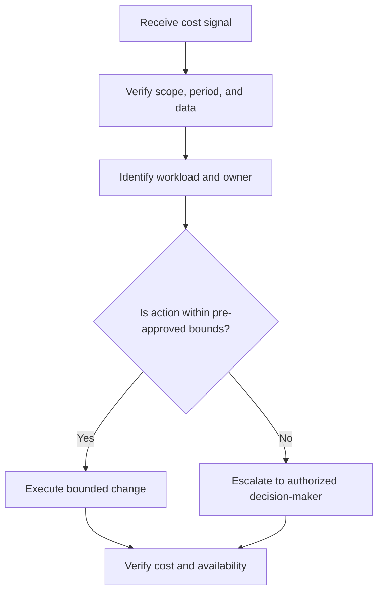

# Budgets, Spend Alerts, and the Limits of Alerting

In Oracle Cloud Infrastructure (OCI)'s **Cost and Capacity Management** chapter, budgets help operations teams tie deployment activity to an approved spending level. For a system consisting of VCNs, Compute, storage, and Oracle databases, a small change in capacity or runtime can push costs off plan.

A budget is useful only when monitoring scope, alert recipients, and follow-up actions are defined. This lesson guides how to configure those components, read actual/forecast figures accurately, and design a response buffer.

## 1. What Problem Does a Budget Solve?

Suppose a development team runs a Java application in the `AppDev` compartment. The team plans to spend 300 currency units for a period covering Compute, storage, and databases. Three questions need answers:

- What percentage of the budget does recorded spend currently represent?
- If the current trend continues, will period-end spend exceed plan?
- Who must inspect and adjust when overrun risk arises?

OCI Budgets provides **soft spending thresholds** and alert rules to support tracking. Exceeding a budget does not automatically stop resources or reject requests to create new resources. This is an important property when using budgets to protect both cost and availability. [Source: Oracle — Budgets](https://docs.oracle.com/en-us/iaas/Content/Billing/Concepts/budgetsoverview.htm).

In this example, the number 300 is a hypothetical learning figure, not an OCI quote. When deploying, use the currency and billing terms of the actual account.

## 2. Define the Exact Scope and Tracking Period

### 2.1. Target Differs from Where the Budget Is Managed

A compartment budget includes spend from child compartments. The budget resource itself is managed in the tenancy's root compartment, even when the target is a business compartment below it. [Source: Oracle — Budgets](https://docs.oracle.com/en-us/iaas/Content/Billing/Concepts/budgetsoverview.htm).

Example resource hierarchy:

```text
Tenancy
├── AppDev
│   ├── Backend
│   └── Database
├── AppProd
└── SharedNetwork
```

With target `AppDev`, include `Backend` and `Database`. If shared network resources live in `SharedNetwork`, the project team must decide how to track that cost share; selecting only the application compartment will not capture shared costs.

You can organize two perspectives:

| Perspective | Purpose | What to avoid |
| --- | --- | --- |
| Parent compartment budget | Track aggregate spend across an environment group | Forgetting workloads inside child compartments |
| Child compartment budget | Identify the environment needing owner action | Summing parent and child figures into a new cost total |
| Project tag budget | Track resources sharing a business identifier | Assuming every resource already has the right tag |

Operational deduction from this structure: the same charge can appear in multiple monitoring views. Overlapping views help assign accountability, but they are not independent expenses to sum together.

### 2.2. Target Tags Differ from Tags Attached to the Budget

OCI expanded Budgets to support **all defined tags**, no longer limiting them to defined tags marked as cost-tracking. An example project identifier is `Finance.Project=java-learning`. [Source: Oracle — Budgets now support all defined tags](https://docs.oracle.com/en-us/iaas/releasenotes/changes/04a707f1-e63f-4808-8662-d61a54f3a4ca/index.htm).

Distinguish between:

- **Selecting a tag as the target**: using the tag to define the spend set being tracked.
- **Tagging the budget resource**: describing the budget itself, such as its owner or purpose.

A budget tagged `Owner=TeamA` does not automatically track all of TeamA's resources. When using a tag target, verify that application resources, databases, and related storage all carry the intended identifier.

### 2.3. Budget Periods Must Match Operations

In the Console, choose **Monthly** for a recurring budget or **Custom** for a one-time budget. Custom uses a UTC date range up to one year. Monthly lets you pick the processing start day of the month; if choosing day 29–31 in a shorter month, processing starts on the last day of the month. [Source: Oracle — Creating a Budget](https://docs.oracle.com/en-us/iaas/Content/Billing/Tasks/create-budget.htm).

Application examples:

- Continuously running development environment: track on a monthly cycle.
- Time-bounded test run: choose Custom to align with the test window.
- Team reconciling on an internal cycle: agree on the start day before interpreting spent amounts.

"80% spent" only makes sense when you know what day of the period it is. Reaching 80% early in the period must be evaluated differently from 80% near period end.

## 3. Actual, Forecast, and Two Ways to Set Thresholds

### 3.1. Actual and Forecast Answer Two Different Questions

An alert rule selects:

| Property | Choice | Meaning |
| --- | --- | --- |
| Threshold Metric | Actual Spend | Compares already recorded spend |
| Threshold Metric | Forecast Spend | Compares forecasted period-end spend |
| Threshold Type | Percentage of Budget | Expresses threshold as a share of budget |
| Threshold Type | Absolute Amount | Expresses threshold as a fixed monetary amount |

These four attributes combine into independent rules, such as Actual 80% or Forecast 300 units. [Source: Oracle — Managing Budget Alert Rules](https://docs.oracle.com/en-us/iaas/Content/Billing/Tasks/managingalertrules.htm).

Let:

- `B`: period budget.
- `A`: recorded actual spend.
- `p`: percentage threshold.

Then:

```text
Percent spent = A / B × 100%
Amount at p% threshold = B × p / 100
```

With `B = 300`, an Actual 80% threshold equals 240. An Absolute 240 threshold represents the same amount at configuration time, yet the two rules diverge if the budget later changes to 400: 80% becomes 320, while the absolute threshold stays 240.

### 3.2. Reading Budgets Forecast

The alert rule documentation describes Budgets forecasting via linear extrapolation:

```text
Forecast = (Actual spend / Days processed since period start) × Days in period
```

The algorithm requires at least three days of consumption to activate; forecast spend is evaluated hourly. This describes Budgets forecasting specifically, not a universal formula for every cost forecasting tool. [Source: Oracle — Creating a Budget Alert Rule](https://docs.oracle.com/en-us/iaas/Content/Billing/Tasks/create-alert-rule.htm).

Illustrative example for a 30-day period:

```text
Budget                         = 300
Actual after 10 processed days = 120
Average daily cost             = 120 / 10 = 12 per day
Period-end forecast            = 12 × 30 = 360
Actual / Budget                = 40%
Forecast / Budget              = 120%
```

Actual spend is only at 40%, yet the forecast already exceeds plan. A rule watching only a high actual threshold can miss the chance to adjust early.

Conversely, linear extrapolation can raise false alarm if early days contain one-time data-import jobs. If the team just scaled up Compute after several quiet days, the average may also understate the new spend rate. Recipients must therefore check forecasts against deployment schedules and capacity changes.

## 4. Design Alert Levels Tied to Specific Actions

The following ruleset is a **suggestion for a learning example**, not an Oracle default configuration:

| Rule | Threshold on 300 budget | Accountable owner | Suggested action |
| --- | --- | --- | --- |
| Actual 50% | 150 | Workload owner | Compare period progress against usage plan |
| Actual 80% | 240 | Workload owner and ops | Identify growth source, decide on adjustments |
| Actual 100% | 300 | Budget owner | Address plan overrun and record decision |
| Forecast 100% | Forecast 300 | Workload owner and FinOps | Evaluate trend before actual spend hits the plan ceiling |

Recipients may overlap; what matters is that each level has a primary accountable owner. The 50%, 80%, and 100% milestones must be tuned to the organization's burn rate and response time.

Two practical principles:

1. **Set thresholds before hitting the plan ceiling.** Waiting until Actual 100% leaves almost no buffer for action.
2. **Use both actual and forecast where appropriate.** Actual confirms recorded spend; forecast detects trends.

Email content should be brief and tell the recipient what to do:

```text
Workload: AppDev / java-learning
Owner: platform-team
When receiving this alert:
1. Check the budget period and most recent evaluation timestamp.
2. Reconcile costs by service and compartment.
3. Record the growth source, remediation option, and approver.
Do not automatically stop production databases.
```

This is a suggested template. Replace team info and procedures with real data before configuring.

## 5. Grant IAM Permissions to Budget Managers

Sample policies for illustrative group names:

```text
Allow group FinOpsBudgetViewers to read usage-budgets in tenancy
Allow group FinOpsBudgetEditors to use usage-budgets in tenancy
Allow group FinOpsBudgetAdmins to manage usage-budgets in tenancy
```

For `usage-budgets`, `use` allows creating and editing budgets/alert rules; `manage` adds deletion permissions. Permissions must be at tenancy scope because budgets are managed at the root. [Source: Oracle — Required IAM Policy for Budgets](https://docs.oracle.com/en-us/iaas/Content/Billing/Concepts/budgetsoverview.htm#Required).

When applying, use exact group names or identifiers from the tenancy. If the organization uses identity domains, select the exact group belonging to the corresponding domain when writing policies.

Separate view-only users, threshold editors, and users permitted to delete configurations. Budget management permissions do not represent all permissions needed to investigate costs or modify workloads. Define report-reading and resource-operations permissions separately for responders.

Example split of duties: FinOps updates budget amounts after approval; the platform team adjusts application capacity; database owners decide database-related changes.

## 6. Configure via the Console

Before creating, agree on target, budget amount, processing period, and recipient list. In a shared tenancy, check existing budgets: the budget creation guide notes not creating another budget for a compartment that already has one; multiple alert rules can be added to an existing budget. [Source: Oracle — Creating a Budget](https://docs.oracle.com/en-us/iaas/Content/Billing/Tasks/create-budget.htm).

### 6.1. Create or Select a Budget

Navigate to **Budgets** under **Billing & Cost Management**. If creating a new one for the `AppDev` example, enter:

| Configuration field | Illustrative value |
| --- | --- |
| Name | `AppDev_Monthly` |
| Budget Scope | Compartment |
| Target Compartment | `AppDev` |
| Schedule | Monthly |
| Budget Amount | `300` |
| Period start day | Day aligned with reconciliation process |

Double-check displayed currency and date range before saving. Scope, schedule, and processing day options are described in [Oracle's Creating a Budget guide](https://docs.oracle.com/en-us/iaas/Content/Billing/Tasks/create-budget.htm).

### 6.2. Add Alert Rules

Inside budget details, open **Budget Alert Rules** and choose **Create Budget Alert Rule**. Enter metric, threshold type, threshold, recipients, and email message. The Email Message field has a 1,000-character limit. [Source: Oracle — Creating a Budget Alert Rule](https://docs.oracle.com/en-us/iaas/Content/Billing/Tasks/create-alert-rule.htm).

Start with the Actual 80% rule:

```text
Threshold Metric: Actual Spend
Threshold Type: Percentage of Budget
Threshold %: 80
Email Recipients: actual ops team email address
Email Message: brief remediation instructions
```

Then add the remaining rules per the design table. Successfully creating a budget and seeing alert rules in the list only proves the configuration exists; observe the evaluation process and email delivery separately.

## 7. Illustrate Configuration Automation with OCI CLI

The commands below are for **Bash**, such as an OCI Cloud Shell session with CLI and appropriate authentication ready. These are configuration examples; they are not PowerShell commands and do not create Compute or database workloads.

Run budget creation only if the target does not already have a budget. If one exists, use that budget's OCID and inspect existing rules to avoid duplicates.

### 7.1. Create a Compartment Budget

Replace tenancy OCID, target OCID, and recipient addresses with real values:

```bash
TENANCY_OCID='ocid1.tenancy.oc1..replace_me'
TARGET_COMPARTMENT_OCID='ocid1.compartment.oc1..replace_me'
RECIPIENTS='workload-owner@example.com,finops@example.com'

BUDGET_OCID=$(
  oci budgets budget budget create \
    --compartment-id "$TENANCY_OCID" \
    --display-name AppDev_Monthly \
    --amount 300 \
    --reset-period MONTHLY \
    --processing-period-type MONTH \
    --target-type COMPARTMENT \
    --targets "[\"$TARGET_COMPARTMENT_OCID\"]" \
    --query data.id \
    --raw-output
) || exit 1

if [ -z "$BUDGET_OCID" ]; then
  printf '%s\n' 'Failed to retrieve budget OCID; stopping before creating rules.' >&2
  exit 1
fi
```

`--compartment-id` is where the budget resource is managed; `--targets` is the tracked scope. `--amount` uses the account rate card's currency. The target parameter accepts a JSON array; this example includes exactly one OCID. [Source: Oracle — CLI budget create](https://docs.oracle.com/en-us/iaas/tools/oci-cli/latest/oci_cli_docs/cmdref/budgets/budget/budget/create.html).

### 7.2. Create the Example Rules

```bash
for THRESHOLD in 50 80 100; do
  oci budgets budget alert-rule create \
    --budget-id "$BUDGET_OCID" \
    --display-name "Actual_$THRESHOLD" \
    --type ACTUAL \
    --threshold-type PERCENTAGE \
    --threshold "$THRESHOLD" \
    --recipients "$RECIPIENTS" \
    --message 'Check Cost Analysis, identify the growth source, and record an action plan.' \
    || exit 1
done

oci budgets budget alert-rule create \
  --budget-id "$BUDGET_OCID" \
  --display-name Forecast_100 \
  --type FORECAST \
  --threshold-type PERCENTAGE \
  --threshold 100 \
  --recipients "$RECIPIENTS" \
  --message 'Forecast indicates risk of exceeding plan; reconcile against workload schedule.' \
  || exit 1
```

API/CLI values are `ACTUAL` or `FORECAST`, combined with `PERCENTAGE` or `ABSOLUTE`. To illustrate a fixed threshold of 240, replace the threshold portion with `--threshold-type ABSOLUTE --threshold 240`. [Source: Oracle — CLI alert-rule create](https://docs.oracle.com/en-us/iaas/tools/oci-cli/latest/oci_cli_docs/cmdref/budgets/budget/alert-rule/create.html).

The rules share recipients in the snippet to keep the example short. When implementing a tiered escalation workflow, configure separate recipient lists by role for each level.

### 7.3. Read Back the Configuration

```bash
oci budgets budget budget get --budget-id "$BUDGET_OCID"
oci budgets budget alert-rule list --budget-id "$BUDGET_OCID" --all
```

Verify target, amount, processing period, rule type, threshold, and recipients against the design. The two corresponding read operations are described in [CLI budget get](https://docs.oracle.com/en-us/iaas/tools/oci-cli/latest/oci_cli_docs/cmdref/budgets/budget/budget/get.html) and [CLI alert-rule list](https://docs.oracle.com/en-us/iaas/tools/oci-cli/latest/oci_cli_docs/cmdref/budgets/budget/alert-rule/list.html).

If a rule-creation command fails after earlier rules succeeded, the configuration may be in a partial state. Re-list and add only missing items rather than blindly re-running everything.

## 8. Limits of the Alerting Mechanism

### 8.1. Not a Real-Time Signal

The Budgets overview page describes the alert evaluation cycle as **24 hours** and lets you view the last evaluation timestamp inside budget details. [Source: Oracle — How Budgets Work](https://docs.oracle.com/en-us/iaas/Content/Billing/Concepts/budgetsoverview.htm).

Distinguish three moments: when cost is incurred, when metrics are recorded, and when alerts are evaluated. Forecast being evaluated hourly does not mean an email arrives immediately after a deployment action.

Even reconciliation tools have latency: Oracle notes data can take up to 48 hours to appear in Cost Analysis. That figure describes Cost Analysis, not a delivery SLA for budget alert emails. [Source: Oracle — Cost Analysis](https://docs.oracle.com/en-us/iaas/Content/Billing/Concepts/costanalysisoverview.htm).

Practical consequence: a short but high-consumption job can finish before responders receive a clear enough signal to intervene.

### 8.2. Both Actual and Forecast Need Context

Actual is the figure already recorded by the system for the viewed scope and period; when investigating, verify data freshness. Forecast is a projection dependent on existing history and trend assumptions.

For example, a two-hour benchmark can be very expensive yet barely shift the daily average before metrics update. Conversely, an early-period data import job can spike the forecast even when subsequent days are expected to add almost no usage.

Do not conclude from a single forecast number alone that an application is misbehaving. Combine it with batch schedules, load-testing schedules, resource counts, and deployment changes.

### 8.3. Email Does Not Replace Action Tracking

An alert being sent does not mean someone has taken ownership. Mailboxes can filter messages, recipients may be away, and teams may lack an agreed response.

Do not design workflows assuming every evaluation cycle sends a reminder email. Oracle states that if threshold criteria are changed after an email has been sent, another email may be sent when the new criteria are exceeded in the same period. [Source: Oracle — About Budget Alert Emails](https://docs.oracle.com/en-us/iaas/Content/Billing/Tasks/managingalertrules.htm).

After an alert, maintain an incident record with owner, deadline, and next check time. Closing the record must rely on verified resolution, not merely on emails stopping.

### 8.4. Wrong Scope Creates a False Sense of Security

If a budget tracks only the development environment, spend spikes in production go undetected by that budget. When using tags, resources missing project identifiers must be caught through tag governance and total-cost reconciliation.

One organizational approach is tracking total tenancy spend alongside accountability budgets on key compartments or tags. This helps uncover spend not yet clearly assigned to an owner.

### 8.5. A Budget Does Not Guarantee a Maximum Bill

A budget is a comparison benchmark. With the exact same budget, overrun size can vary based on burn rate, data latency, and response speed.

Additionally, when reconciling against billing documents, align scope, time period, and currency. Do not assume a project budget figure equals total payable invoice charges for the whole tenancy.

## 9. Size the Response Buffer Based on Reaction Time

Instead of picking 80% out of habit, an operations team can build its own planning model:

```text
H = R × (L + T) + U
Early alert threshold C <= B - H
```

Where:

| Symbol | Meaning |
| --- | --- |
| B | Target budget for the period |
| R | High burn rate used for planning |
| L | Assumed total lag from spend occurrence to alert visibility |
| T | Time team needs to decide and execute action |
| U | Reserve for variance or continuing run-off costs |
| H | Budget headroom to reserve when firing the alert |

This is an **illustrative model**, not an OCI formula or a spend-blocking guarantee.

Hypothetical example:

```text
B = 300
R = 20 per day
L = 2 days
T = 1 day
U = 10

H = 20 × (2 + 1) + 10 = 70
C <= 300 - 70 = 230
```

Using Actual 80% gives `C = 240`, higher than 230 in the model. The team may need an earlier threshold plus preventive controls. Lag and response values must be chosen by the team from observations and risk scenarios; they are not Oracle SLAs.

If `H >= B`, lowering thresholds alone will not create enough buffer. You must lower potential burn rate or shorten response time.

## 10. Coordinate with Other Control Mechanisms

| Mechanism | Role | Limitation for monetary control |
| --- | --- | --- |
| Budgets | Detects actual or forecast drift from plan | Does not directly force-stop resources |
| IAM | Controls who may deploy or modify resources | Permissions do not calculate a monetary cap |
| Compartment quotas | Allocates resource limits per compartment | Must select exact resource types and scope |
| Service limits | Resource limits set by Oracle | Not a currency-denominated budget commitment |
| Workload limits | Caps workers, scaling limits, or batch duration by app design | Effective only within deployed scope |
| Operational process | Connects signals to responders and decisions | Depends on intake and response execution |

Oracle distinguishes service limits set by Oracle from compartment quotas set by administrators. Limits carry scopes such as availability domain, region, or tenancy, so inspect the right scope during design. [Source: Oracle — Service Limits](https://docs.oracle.com/en-us/iaas/Content/General/service-limits/overview.htm), [Overview of Compartment Quotas](https://docs.oracle.com/en-us/iaas/Content/Quotas/Concepts/resourcequotas.htm).

It follows that capping CPU counts does not automatically cap all storage, data transfer, and duration charges. A cost-control design must examine every component that can continue accruing fees.

If building automated responses, design them as a separate flow:



The diagram depicts a proposed workflow; it does not claim a prebuilt budget event type or native automation integration exists out of the box.

For dev environments, the action might stop creating new test resources. For production, evaluate serving capacity before scaling down or stopping databases. Automated tasks should verify target identity, log actions, tolerate duplicate signals, and enforce blast-radius limits.

## 11. Respond When an Alert Fires

A recommended sequence for operations teams:

1. **Verify the alert.** Record budget name, rule, actual/forecast metric, threshold, and processing period.
2. **Check the data.** Inspect evaluation timestamp, current actual spend, and target scope.
3. **Isolate the increase.** In Cost Analysis, match the time range and filter or group by relevant service, compartment, or tag.
4. **Correlate technical changes.** Look for shape upsizes, extra instances, batch runs, database changes, or added data retention.
5. **Select action.** Cut unnecessary usage, adjust plans, or request budget increase approval per process.
6. **Confirm outcome.** Verify the workload still meets requirements and monitor cost metrics as data refreshes.

Cost Analysis supports filtering and slicing costs along investigative dimensions; match period and scope with the budget before comparing. [Source: Oracle — Cost Analysis](https://docs.oracle.com/en-us/iaas/Content/Billing/Concepts/costanalysisoverview.htm).

Example incident record:

```text
Budget: AppDev_Monthly
Rule: Actual_80
Period: active processing period in Console
Observed actual: 246 / 300
Growth source: unscheduled benchmark job
Owner: app-team
Action: stopped test job after saving results
Service check: application and database remain responsive
Follow-up: reconcile cost once refreshed data arrives
```

Raising a budget only shifts the planning threshold. That decision needs business justification and proper approval; editing the number merely to silence alerts does not address underlying consumption.

## 12. Practice Configuration and Verification

### 12.1. Prerequisites and Scope

Use an authorized compartment and an account with appropriate permissions. There is no need to spin up extra Compute, databases, or data solely to generate test charges.

If the compartment already has a budget managed by another team, inspect the configuration and coordinate with the owner before making edits. Only use test rules authorized within the exercise scope.

### 12.2. Execution Steps

1. Pick the target and define period, currency, budget amount, and accountable owner.
2. Create a budget or select an existing one per granted permissions.
3. Configure at least one actual rule and one forecast rule; document what each threshold means.
4. Read back target, amount, schedule, recipients, and rule list.
5. Check the budget evaluation timestamp, distinguishing saved configuration from processed cost data.
6. If suitable actual spend already exists and testing is permitted, temporarily set a threshold below recorded spend to observe the next evaluation cycle.
7. Monitor email delivery in both primary inbox and filtered folders; record the observation timestamp.
8. Revert test thresholds or delete only the test rule you created when permitted; keep agreed operational thresholds intact.

The email test step applies only when real spend data and proper evaluation conditions exist. Without spend or minimum forecast history, explicitly document that the case could not be verified.

### 12.3. Evidence to Record

| Item | Appropriate evidence |
| --- | --- |
| Configuration exists | Budget details and alert rule list after read-back |
| Scope is accurate | Target compartment OCID or defined tag matches design |
| Thresholds understood | Percentage converted to amount and actual/forecast distinguished |
| Evaluation observed | Evaluation timestamp and corresponding spend data |
| Email path observed | Actual email received when test condition was met |
| Workflow has owner | Owner and action clearly recorded |

No immediate email after creating a rule is insufficient to conclude failure. Nor can you declare the whole flow successful merely because rule creation returned an OCID.

## 13. Diagnose Common Misconceptions

| Symptom or claim | What to check |
| --- | --- |
| Set a 300 budget yet spend kept rising | Budgets are monitoring thresholds; check resource controls and response workflows |
| Can manage Compute but budget creation is denied | Check `usage-budgets` permissions specifically at tenancy scope |
| Actual is low yet forecast is high | Compare processed days and workload schedule; check for one-off jobs or burn-rate shifts |
| Project budget is lower than expected total cost | Check shared resources, missing tags, and uncovered targets |
| Forecast gives no useful signal early in the period | Check minimum consumption history and data freshness |
| Rule exists but no email arrived | Check threshold type, breach condition, last evaluation, and recipient address |
| Sum of budgets exceeds total tenancy cost | Check for overlapping parent–child or compartment–tag scopes being summed |
| Cost does not drop immediately after stopping a job | Check reporting latency and related resources still active |
| Trying to use quotas to guarantee an exact monetary cap | Check resource type, scope, and cost components not covered by that quota |

A workable operational setup must connect the full chain: **clear scope → meaningful thresholds → right recipients → timely action → verified outcome**. A budget starts this chain; operational accountability determines whether alerts actually keep spending on plan.
