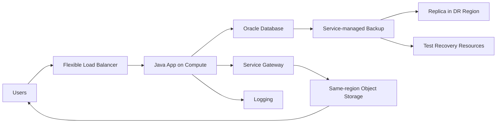

# Analyzing Data Transfer, Backup, and Supporting Resource Costs

## 1. View Costs Along the Entire Data Path

In Oracle Cloud Infrastructure (OCI), an application's cost does not stop at running OCPUs, memory, and databases. Data also travels to users, gets backed up, replicates to a disaster recovery region, and appears in logs. Load balancers, volumes, machine images, and connectivity to data centers also have their own lifecycles, measurement units, and owners.

A system with steady Compute can still see rising costs when report download volume grows, data change rate increases, or test recovery environments are never reclaimed. Therefore, in the **Cost and Capacity Management** chapter, this lesson focuses on three groups:

- **Data transfer:** costs tied to transfer direction, destination, connectivity type, and free allowance scope.
- **Backup:** costs of retaining recovery points, replication, retrieval, and recovery resources.
- **Supporting resources:** components serving the application that are easily overlooked in estimates.

After this lesson, learners should be able to build a cost breakdown by data flow, explain variances between estimates and measurements, and propose adjustments that weigh recoverability and availability.

### Running Scenario

A Java application runs on Compute in a private subnet, receives requests via a Flexible Load Balancer, stores transactions in Oracle Database, and stores files in Object Storage. The system has backups, a data replica in another region, and operational logs.



The diagram shows data relationships, not a billing map. Every arrow must be verified against the actual transfer path and SKU. An arrow between two services does not automatically correspond to a network charge.

## 2. Normalize Data Before Summing Money

### 2.1. Distinguish Resource, Usage, and SKU

A **resource** is an operational object, such as a volume or load balancer. **Usage** is a measurable quantity, such as GB-months or hours. A **SKU** is the commercial item code used for billing. One resource can generate multiple SKUs; a shared expense may not map cleanly to a single application.

A minimal analysis table should have this structure:

| Field | Meaning | Example |
|---|---|---|
| Usage period | Time window over which the resource is measured | One UTC day or full billing cycle |
| Subscription and currency | Commercial scope to reconcile | Organization contract, USD |
| Region, compartment | Location and governance scope | Primary region, production compartment |
| Resource OCID or allocation key | Cost-bearing entity | Volume OCID, shared backup group |
| Service, SKU, meter description | Nature of the charge | Outbound transfer, backup capacity |
| Quantity, unit | Usage amount and native unit | GB, GB-month, Mbps-hour |
| Price and price source | List price or contract price | Unit price with effective date |
| Cost and cost type | Value to reconcile | Pre-tax cost, adjustments included |
| Owner and purpose | Person explaining the charge | Billing team, DR copy |

Do not directly add quantities of rows with different units. `500 GB` transferred out, `500 GB-months` of storage, and `500 Mbps-hours` of load balancer bandwidth are three distinct physical quantities.

### 2.2. General Formula

For a linear SKU within one pricing tier:

```text
SKU cost = Billable usage × Unit price in matching unit

Group cost = Sum of costs of SKUs in the group
```

If tiers, free allowances, or commitments apply, separate each part before summing. Use a single pricing basis throughout: do not compare a list-price estimate against discounted actuals and attribute the entire difference to technical optimization.

For fluctuating storage, a simple estimation model is:

```text
Average capacity = Sum(capacity in interval i × hours in interval i)
                   / Total hours in period

Expected storage cost = Average capacity × Price per GB-month
```

This is a normalized model for analysis. When reconciling, prioritize the actual meter's quantity, unit, and time conversion; do not blindly replace every month with 730 hours.

For example, 600 GB existing for half a month equals roughly 300 GB-months in a time-prorated model. Using month-end capacity for the whole month can distort the estimate badly.

### 2.3. Align GB, GiB, and Time Boundaries

- `1 GB = 10^9 bytes`; `1 GiB = 2^30 bytes`. Convert to the SKU's unit before multiplying by price.
- State the timezone clearly when comparing operational logs with cost reports. A transfer early in the day in Vietnam may fall on the previous day in UTC.
- Separate recurring costs, one-time tasks, and spikes from data recovery or migration.
- Keep accounting-meaningful adjustment rows; do not drop them merely because quantity or cost is negative.

## 3. Analyze Data Transfer with a Source-and-Destination Matrix

### 3.1. Identify Each Flow Before Assigning Prices

For each flow, answer in sequence:

1. Which resource and region emits the data?
2. Is the destination same-region, another region, the Internet, on-premises, or another cloud?
3. Which connection does the actual traffic traverse?
4. Does the meter measure unidirectional bytes, bandwidth, or port-hours?
5. Is there a free allowance applying to this exact SKU and scope?
6. Does the destination side or connectivity provider have separate fees?

| Flow in sample application | Data to collect | How to analyze |
|---|---|---|
| Browser downloads file from OCI | Response bytes, source region, download count | Check Internet egress and remaining free allowance |
| Compute calls same-region database | Path and exchange volume | Separate transfer fees from Compute, database, and processing fees |
| Compute accesses Object Storage via Service Gateway | Bucket region, route, and operation count | Check storage and request fees; do not add Internet fees |
| Replicate backups to another region | Bytes actually replicated, run schedule | Check transfer at source and storage at destination |
| Export data to on-premises system | Virtual circuit or VPN type, bytes, duration | Separate OCI fees from carrier and hardware fees |
| Ship logs to external platform | Filtered volume, retries, destination | Check both egress and log-receiver platform fees |

Oracle states there is no charge for intra-region data movement and provides a free allowance for Internet egress, currently listed as 10 TB per month. When applying it, verify SKU, contract terms, and aggregation scope; do not grant the full allowance independently to every VM or compartment. Source: [OCI Virtual Cloud Network Pricing](https://www.oracle.com/cloud/networking/virtual-cloud-network/pricing/).

**A compartment is a governance boundary, not a basis for deciding whether a flow incurs transfer fees.** Two resources in different compartments can still be in the same region. Conversely, two resources in the same application group can still communicate across regions.

### 3.2. Free Transfer Does Not Mean the Transaction Is Free

A same-region flow with zero transfer cost can still consume:

- Compute resources for compression, decompression, or encryption.
- Read and write requests on storage services.
- Capacity of the new copy at the destination.
- Bandwidth billed to the load balancer.
- Analytics or data processing services.

Conversely, a port-hour charge should not be converted into a per-GB fee merely to make a spreadsheet look uniform.

With FastConnect, distinguish private virtual circuits from public virtual circuits. Oracle's price list notes private virtual circuits have no separate data transfer charge for inbound/outbound traffic, whereas public virtual circuits must be checked against Networking; port-hours and partner charges must still be reviewed separately. Source: [Oracle Cloud Price List — FastConnect](https://www.oracle.com/cloud/price-list/).

### 3.3. Calculate Cost with Free Allowances and Marginal Price

Suppose a group of meters is confirmed to share one free allowance:

```text
Q_billable = max(0, Q_eligible - F_applicable)
C_transfer = Q_billable × p
```

Where `F_applicable` must fall within the exact commercial scope. Do not sum GB across every connectivity type and subtract one single quota if the meters do not share the same terms.

These two questions require two different calculations:

- **Full-scope reconciliation:** how much total cost do eligible transfers and the actual allowance produce?
- **Application delta estimation:** if the application adds 1 GB, how much does the overall system cost increase?

If ample allowance remains, 1 extra GB may not increase network charges yet. If the allowance is already exhausted, the increment is billed at the corresponding marginal price. Therefore, a low average cost last month does not guarantee growth cost will also be low.

When allocating across teams, you can split costs proportionally by eligible bytes or by another internal rule. Document the rule clearly and ensure allocated totals match total spend, avoiding giving every team the full allowance.

### 3.4. Derive Transfer Volume from Application Behavior

Forecasting from request counts helps pinpoint growth drivers:

```text
Expected response bytes = Download count × Average response size

Actual transferred bytes ≈ Expected response bytes
                         + Retransmissions
                         + Protocol overhead and generated flows
```

For Java applications, watch CSV export endpoints, PDF downloads, large JSON payloads, or unbounded pagination. A feature consuming little CPU can still generate heavy outbound traffic.

Optimization levers must have measurable impact:

- Compress suitable payloads while measuring added CPU and latency.
- Trim redundant fields, paginate, and avoid re-downloading entire datasets.
- Cache where data semantics allow; include cache, CDN, or intermediary service costs.
- Move processing closer to where data lives if it does not conflict with DR and data residency requirements.
- Control retries so network glitches do not transmit the same payload repeatedly.

Caching only reduces data volume on the segments it actually replaces. If users still receive the same bytes from the same billable origin, reducing database queries will not necessarily lower Internet egress.

### 3.5. Do Not Double-Count Observations of the Same Flow

The same response can appear in instance VNIC metrics, load balancer metrics, and access logs. Adding all three figures can turn one download into three transfers in an estimate.

Use operational telemetry to explain flows and use billing meters to verify money. Add multiple items only when they represent different billable services. For example, load balancer fees and Internet egress can coexist; two byte counters along the same network leg do not turn into two egress charges.

## 4. Analyze Backups by Recovery Lifecycle

### 4.1. Separate Protected Data Types

Inside an OCI system, the following may coexist:

- Boot volume and block volume backups.
- Volume clones or volumes restored for testing.
- Oracle Database backups managed by the database service in use.
- Logical exports such as Data Pump dumps stored in customer-managed buckets.
- Cross-region replicas and disaster recovery data.

These objects do not share the same pricing model or recovery capability. An existing clone may be an active storage resource. A logical export file does not by itself guarantee point-in-time database recovery.

Oracle notes that Block Volume backups are billed by the Object Storage capacity they consume; cross-region backup replication also involves outbound transfer. This is a rule specific to volume backups, not a universal formula for every database service. Source: [Block Volumes FAQ — Billing](https://www.oracle.com/cloud/storage/block-volumes/faq/).

### 4.2. Volume Size, Used Data, and Backup Size Are Three Different Numbers

Suppose a volume is provisioned at 2,000 GB and the OS reports 700 GB in use. You cannot automatically conclude backups are 700 GB or that every backup is 2,000 GB.

For OCI volume backups, previously written blocks and metadata can make backup size differ from filesystem usage. Incremental and full backups also reflect retained data differently. Source: [OCI Block Volume Backups](https://docs.oracle.com/en-us/iaas/Content/Block/Concepts/blockvolumebackups.htm).

For analysis, collect separately:

| Quantity | What question does it answer? |
|---|---|
| Provisioned volume capacity | How much storage capacity is allocated? |
| Used filesystem capacity | How much data does the application see? |
| Service-recorded backup capacity | How much data are recovery points holding? |
| Time-averaged backup capacity | What is the basis for estimating period storage cost? |
| Actual replicated volume | How much data travels to the DR region? |

Net business data growth does not equal changed block volume. A database growing by 10 GB net per day can still modify many existing blocks due to transactional updates, indexes, or maintenance jobs.

### 4.3. Retained Capacity Model for Estimation

A simple model for a chain of recovery points:

```text
Estimated capacity ≈ Baseline data to retain
                   + Total deltas retained for active recovery points
```

Purely illustrative model example: 800 GB baseline data, 15 recovery points consisting of one initial point and 14 incremental deltas, each retaining 40 GB:

```text
S_estimated = 800 + 14 × 40 = 1,360 GB
```

This number only illustrates the impact of recovery point count and change volume. It does not simulate block management algorithms, compression, or service billing mechanics. To forecast month one and steady state, plot the capacity curve over time and take the average rather than using 1,360 GB at every point.

If short-term and long-term retention schedules coexist, determine how they share data under service mechanics. Do not assume two schedules always double capacity, nor assume they always share blocks completely.

### 4.4. Retention Drives Cost and Recoverability

Three factors must be evaluated together:

- **RPO:** maximum acceptable data loss, usually expressed in time.
- **RTO:** maximum acceptable time to restore service.
- **Retention:** historical window kept so you can roll back to earlier points.

Daily backups do not by themselves satisfy a 15-minute RPO. Cutting retention from 30 days to 7 days can remove the ability to recover from a late-discovered bug. Moving data to a storage tier requiring a restore step can lengthen RTO.

Therefore, any proposal to cut backup spend must state which recovery points remain, how restore works, measured restore time, and the business requirements the option satisfies.

For OCI-managed volume backup chains, deleting an old backup does not guarantee capacity drops by its displayed size: data needed to restore remaining points is still retained and may be reflected in other backups. Do not try to build underlying block deletion mechanics below the service. Source: [OCI Block Volume Backups — Incremental Backups](https://docs.oracle.com/en-us/iaas/Content/Block/Concepts/blockvolumebackups.htm).

### 4.5. Include DR Replicas and Test Restores

A lifecycle estimate can be structured as:

```text
C_backup = C_source_backup_retention
         + C_destination_replica_retention
         + C_cross_region_transfer
         + C_operations_and_retrieval_if_any
         + C_recovery_test_resources
```

These are categories to check, not an assertion that every service charges all five items. If cross-region transfer is already included in the network cost group, merely reference it in the backup table and do not add it a second time in the system-wide total.

Test recovery costs typically include restored volumes or databases, verification Compute, required storage performance, and test logs. Record reclamation timing and the accountable owner; a test resource left running for extra weeks can cost more than the restore itself.

Recoverability also requires execution capacity: quotas, service limits, Compute shapes, and storage capacity available in the destination region. Having budget for DR does not guarantee resources can be provisioned on time.

### 4.6. Object Storage Tiers and Service-Managed Backups

For backup or export files stored in customer-managed buckets, evaluate tiers based on retention duration and read demand:

| Tier | Factors to include in analysis |
|---|---|
| Standard | Immediate access; weigh storage cost against frequent reads |
| Infrequent Access | 31-day minimum retention and retrieval fees |
| Archive | 90-day minimum retention; requires restore before reading and bills Standard capacity during access |

Deleting or overwriting data before the minimum retention expires can trigger early-deletion charges for the remaining days. Do not lump all fees into one generic "Archive read fee": Infrequent Access and Archive work differently. Source: [Object Storage Storage Tiers](https://docs.oracle.com/en-us/iaas/Content/Object/Concepts/understandingstoragetiers.htm).

Do not infer from the table above that user-bucket lifecycle rules can be attached to Block Volume backups or used to arbitrarily change tiers on managed database backups. Use only operations supported by the backup service itself.

For versioned buckets, older object versions and incomplete multipart uploads must also be inventoried. Cost-saving lifecycle rules must remain compatible with data retention rules and immutability requirements if enforced by the organization.

### 4.7. Distinguish Oracle Database Backups by Service Type

When analyzing an Oracle Database, explicitly state whether it uses Base Database Service, Exadata Database Service, Autonomous Database, or a self-managed backup mechanism. If using Recovery Service, also identify the corresponding data protection item in the contract and reports.

Each case must answer:

1. Which backup storage portion is already included in the service price or entitlements?
2. Under which meter do overages or extra copies appear?
3. How do redo logs, archive logs, and retention schedules affect protected data volume?
4. Does restoring require provisioning extra database, Compute, or storage resources?
5. Who pays if a restored clone keeps running after testing?

Do not multiply datafile size by retention days and treat it as an accurate backup bill. Nor should you apply volume backup rates to a database protection service merely because both contain the word "backup."

## 5. Find Costs in Supporting Resources

### 5.1. Flexible Load Balancer: Distinguish Bytes from Bandwidth

Flexible Load Balancer has a base component and a bandwidth component. OCI specifies billing the configured minimum bandwidth when usage falls below minimum; above minimum, actual per-minute usage applies. Thus, setting a high minimum can keep costs high even during idle periods. Source: [Creating a Load Balancer — Bandwidth](https://docs.oracle.com/en-us/iaas/Content/Balance/Tasks/managingloadbalancer_topic-Creating_Load_Balancers.htm).

Conversion model for estimation:

```text
C_LB ≈ H × p_base
       + Sum(max(B_min, B_actual_i) × duration_i × p_bandwidth)
```

Time intervals must be converted to match the price unit. Do not use `GB passed through × egress price` as a substitute for load balancer bandwidth.

Also inspect load balancers in retired environments, load balancers auto-created for Kubernetes workloads, and minimum settings per environment. Lowering maximum bandwidth can cap serving capacity; do not treat it as a safe cost cut without checking peak load.

### 5.2. Volumes, Performance Tiers, and Machine Images

Easily overlooked resources include retained boot volumes, unattached block volumes, test recovery volumes, and custom deployment images.

Volume costs require checking both provisioned capacity and performance settings where applicable meters apply. Low active data usage does not shrink provisioned capacity. An unattached volume is also not automatically free or safe to delete.

Oracle notes that boot volumes are retained by default when an instance is terminated. During inventory checks, confirm whether the volume still serves any reuse or recovery purpose. Source: [Terminating an Instance](https://docs.oracle.com/en-us/iaas/Content/Compute/Tasks/terminatinginstance.htm).

Stopping Compute does not mean every related charge stops either; Compute billing behavior depends on the shape. Source: [Resource Billing for Stopped Instances](https://docs.oracle.com/en-us/iaas/Content/Compute/Tasks/resource-billing-stopped-instances.htm).

One signal worth investigating is storage costs remaining flat after instance counts drop sharply. Check OCID, attachment state, creation timestamp, and owner before reclaiming.

### 5.3. Logging and Observability Pipelines

For OCI Logging, Oracle describes pricing based on log storage, with no separate charge for ingestion or search. Logging Analytics is a separate service requiring its own cost model. Source: [Oracle Logging](https://www.oracle.com/application-development/logging/).

To explain log spend, know:

- Daily generated volume and retention duration.
- Verbosity of application logs, access logs, and flow logs.
- Whether the same event is duplicated across multiple agents or sources.
- Whether logs are also exported to Object Storage or external systems.
- Where exported copies reside and for how long.

With a steady generation rate of `g GB/day` and retention `R days`, steady-state capacity can be roughly estimated as `g × R`. Month one without full history must be modeled separately. If logs are kept simultaneously in Logging and a storage bucket, those are two copies that can incur two cost lines.

Log reduction must be selective: strip unnecessary debug output, avoid logging large payloads, and keep correlation IDs for tracing. Logs mandated for investigation and audit must be retained per defined requirements.

### 5.4. DNS, Connectivity, Requests, and Shared Components

Small per-unit charges become significant when summed across multiple environments:

| Component | Why it is easily missed | Data to reconcile |
|---|---|---|
| DNS and health checks | Query or check volume scales with traffic | Meter, counts, environment, and purpose |
| Object Storage requests | Many small objects, repeated scans, retries | Request type, operation counts, pricing unit |
| Dedicated connectivity | Ports and partner links kept active during low traffic | Port count, speed, active hours, carrier bills |
| Automated jobs | Export or sync schedules running too frequently | Run count, data volume per run |
| Images and staging files | Many old versions, build outputs, or exports | Capacity and lifecycle per group |
| External observability tools | Additional ingest, storage, or processing fees | Receiver contract and data exported from OCI |

Do not copy NAT gateway, service gateway, or IP address pricing models verbatim from another cloud into OCI. Add a line item only after confirming its SKU and applicability.

Service Gateway provides private access from a VCN to supported Oracle services within the same region. This clarifies the data path, though destination service operations and resources still require separate analysis. Source: [Access to Oracle Services: Service Gateway](https://docs.oracle.com/en-us/iaas/Content/Network/Tasks/servicegateway.htm).

## 6. Reconcilable Cost Calculation Example

### 6.1. Example Assumptions

All unit prices below are **hypothetical numbers for learning calculation mechanics, not OCI quotes**. The example uses USD, a 30-day period equal to 720 hours, pre-tax, with no discounts or other adjustments.

Quantities have been normalized to the table's assumed units. Storage capacities are period averages. Storage rows represent distinct datasets; the cross-region transfer row is added only once.

- Workload Internet egress: 12,000 GB.
- Remaining free allowance allocated to this workload within the exact meter group: 4,000 GB.
- Identified billable cross-region transfer: 1,500 GB; no free allowance left for this line.
- Source backups average 2,500 GB; destination replicas average 1,800 GB.
- Load balancer has 20 Mbps billable bandwidth across all 720 hours of the example.

These free allowances are inputs to the calculation after accounting for aggregation scope, not an entitlement each workload claims independently.

### 6.2. Detailed Calculation Table

| Line item | Billable quantity | Hypothetical unit price | Subtotal USD |
|---|---:|---:|---:|
| Internet egress | 12,000 − 4,000 = 8,000 GB | 0.020/GB | 160.00 |
| Cross-region transfer | 1,500 GB | 0.020/GB | 30.00 |
| Source backup storage | 2,500 GB-months | 0.025/GB-month | 62.50 |
| Destination backup replica storage | 1,800 GB-months | 0.025/GB-month | 45.00 |
| Requests for self-managed backup files | 300,000 requests | 0.005/10,000 requests | 0.15 |
| Load balancer base | 720 hours | 0.010/hour | 7.20 |
| Load balancer bandwidth | 20 × 720 Mbps-hours | 0.0001/Mbps-hour | 1.44 |
| Billable log storage | 300 GB-months | 0.050/GB-month | 15.00 |
| Supporting volumes | 400 GB-months | 0.030/GB-month | 12.00 |
| Supporting volume performance | 400 × 10 VPU-GB-months | 0.001/VPU-GB-month | 4.00 |
| Old machine images | 200 GB-months | 0.025/GB-month | 5.00 |
| DNS | 8 million queries | 0.500/million queries | 4.00 |
| **Total in analysis scope** | | | **346.29** |

`VPU-GB-month` in the example represents GB capacity multiplied by VPU/GB level and time fraction. When working with real reports, preserve the unit supplied by the SKU and avoid multiplying by performance tier again if the quantity already includes it.

Reconciliation by three groups:

```text
Data transfer = 160.00 + 30.00
              = 190.00 USD

Backup storage and requests = 62.50 + 45.00 + 0.15
                            = 107.65 USD

Supporting = 7.20 + 1.44 + 15.00 + 12.00 + 4.00 + 5.00 + 4.00
           = 48.64 USD

Total = 190.00 + 107.65 + 48.64 = 346.29 USD
```

This is not total application cost yet, as it excludes application Compute, primary database, and out-of-scope items. Transfer for backups is already in the network group; if presenting total data protection cost, you may reference that 30 USD line, but do not add it again into the 346.29 USD total.

### 6.3. Sensitivity Analysis

Holding other assumptions constant:

| Change | Calculation | Expected impact |
|---|---|---:|
| Egress rises 25%, free allowance unchanged | (15,000 − 4,000) × 0.020 − 160 | Increases by 60.00 USD |
| Average source backups rise 20% | 2,500 × 20% × 0.025 | Increases by 12.50 USD |
| Reclaim all supporting volumes at start of period | 12 + 4 | Decreases by 16.00 USD over a full period |
| Billable LB bandwidth drops from 20 to 10 Mbps full period | 10 × 720 × 0.0001 | Decreases by 0.72 USD |

The table shows prioritization should follow measured impact. Under these assumptions, addressing the large egress flow has a bigger impact than reducing load balancer bandwidth. Still, a smaller saving may be worthwhile if it is simple and does not affect serving capacity.

Savings above are before implementation costs of making the change. Reclaiming a resource mid-period only reduces the remaining duration and may still involve commercial terms to check.

## 7. Use OCI Data to Find Root Causes

### 7.1. Start from Total Cost, Then Drill Down to SKUs

In Cost Analysis, choose the time range and subscription scope to analyze. Start by service, then use supported dimensions such as region, compartment, product/SKU description, and tags to narrow down. Switch between cost and usage when separating rate changes from usage growth. Source: [OCI Cost Analysis](https://docs.oracle.com/en-us/iaas/Content/Billing/Concepts/costanalysisoverview.htm).

A helpful investigation chain:

```text
On which day did total cost rise?
    → Which service increased?
    → Which SKU and unit increased?
    → Which region or resource group is involved?
    → Did quantity rise, price change, or was there an adjustment?
    → Which operational event explains that increase?
```

Do not infer from a service name that every line inside shares the same cause. Within one storage group, distinct capacity, performance, or operation meters can coexist.

### 7.2. Use Cost Reports for Granular Reconciliation

OCI offers native-format and FOCUS Cost Reports to analyze usage, cost, metadata, and tags. Reports can contain late-arriving data; therefore, a very recent window is not enough to conclude a change had no impact. Oracle deprecated legacy Usage Reports, so new pipelines should rely on Cost Reports. Source: [OCI Cost Reports](https://docs.oracle.com/en-us/iaas/Content/Billing/Concepts/costusagereportsoverview.htm).

When processing reports:

1. Select one format as the primary source for the analysis period; do not ingest the same usage from both OCI native and FOCUS formats and sum them.
2. Keep column names, units, and cost types true to the chosen schema.
3. Filter cleanly by subscription, currency, time window, and data status.
4. Aggregate by SKU and unit before deriving effective rates.
5. Handle late-arriving data or adjustment rows per the format's specification.
6. Reconcile totals against Cost Analysis and invoices on an equal pre/post-tax, credit, and adjustment basis.

Do not use a single billing row as sole proof of a resource's current state. A deleted resource still has legitimate charges for the period during which it existed.

### 7.3. Tie Costs to Owners

Useful tags for analysis include environment, application, owner team, cost center, and purpose such as `dr`, `restore-test`, or `backup-export`. These are example organizational conventions, not mandatory OCI tag names.

Tag-based costs in Cost Analysis are not retroactively applied to times before the tag was attached to a resource. Therefore, adding a tag today does not automatically fix historical attribution. Source: [OCI Cost Analysis — Tags](https://docs.oracle.com/en-us/iaas/Content/Billing/Concepts/costanalysisoverview.htm).

For charges lacking a convenient OCID or tag, use an alternative allocation key such as subscription + region + SKU + usage period. Do not assign it arbitrarily to the nearest-named resource.

An allocation policy should state clearly:

- Application-dedicated resources are assigned directly when evidence suffices.
- Shared costs are split by an agreed metric.
- Unclassified items are held separately with an owner assigned to investigate.
- Post-allocation total must equal pre-allocation total.

## 8. Practical Workflow to Analyze a Cost Period

This workflow can be performed on exported reports; there is no need to create extra resources just to learn how to analyze.

### Step 1: Lock Scope and Comparison Baseline

Select one application, relevant compartments, source/destination regions, and a period with complete data. Record currency, hours in the period, pricing basis, and included items. If billing permissions are missing or a target compartment is inaccessible, note the data gap explicitly instead of treating cost as 0.

### Step 2: Build Two Inventories

The **data flow inventory** records source, destination, route/connection, bytes, meter, and owner. The **retained data inventory** records backups, replicas, volumes, buckets, images, creation time, retention period, and recovery purpose.

For Java applications, correlate endpoint access logs with response payload sizes to find data-heavy features. For databases, correlate backup schedules, change volumes, and clone or restore events with storage growth dates.

### Step 3: Map Meters to the Inventories

Assign each cost line to exactly one summary group. Flag cross-referenced lines so they are not double-counted. Inspect cases where quantity is nonzero but cost is 0, cost is nonzero without a mapped resource, or a service uses multiple measurement units.

### Step 4: Forecast by Growth Drivers

Do not simply multiply last month's bill by a flat percentage. Forecast separately:

- Download counts and bytes per response for Internet egress.
- Change rate and replication schedule for cross-region transfer.
- Baseline data, churn, and retention for backups.
- Daily log volume and retention for Logging.
- Resource counts, configurations, and lifetimes for supporting items.

Separate a one-time initial full copy from steady-state traffic. If the system can trigger a full resync after failure, add a separate spike scenario for that event.

### Step 5: Select Changes with Measurable Targets

Each proposal should take this form:

> Reduce response payload size on the report-export endpoint from A to B, expected to save X GB of egress per period after allowances. Monitor latency and CPU; verify users still receive all required data.

Or:

> Reclaim test recovery volumes confirmed by owners as no longer needed, expected to save Y GB-months and corresponding performance charges. Keep required recovery points and evidence of successful restore testing.

Actions that remove recovery points must be checked against data policies before execution. A backup with no recent restore may still be mandatory to retain.

### Step 6: Re-Measure on the Same Baseline

Wait until cost data for the comparison window is sufficiently updated, then re-measure quantities, configurations, and totals. Normalize by day count and business volume so a drop in user traffic is not mistaken for optimization success.

Useful metrics include:

```text
Transfer cost per 1,000 downloads
Data protection cost per GB of source data
Average backup capacity / Source data capacity
Supporting cost / Total cost in application scope
Cost of one successful recovery drill
```

Each metric must specify numerator components, denominator, and time window. The backup-to-source ratio must be explained through churn and retention rather than applying a single threshold to every workload.

## 9. Faulty Conclusions to Avoid

| Hasty conclusion | Proper check |
|---|---|
| "VM count didn't grow, so cost must stay flat" | Check outbound bytes, backups, logs, and resources with independent lifecycles |
| "Different availability domains mean transfer fees must apply" | Check OCI's intra-region policy; do not extrapolate from other clouds |
| "Each compartment gets its own free egress allowance" | Verify aggregation scope by SKU and contract |
| "Incremental daily backups have a fixed daily price" | Measure data change rate and retained historical blocks |
| "Deleting the largest backup reduces storage by its exact displayed size" | Check block retention mechanics for remaining recovery points |
| "Archive is always cheaper than Standard" | Factor minimum retention, restore demand, and temporary Standard storage during access |
| "Stopping or terminating Compute stops all charges" | Check shape, boot/block volumes, backups, images, and supporting items |
| "Bytes through the load balancer are egress GB to add on top" | Distinguish LB bandwidth meters from transfer meters |
| "Lower bill after a config change proves optimization worked" | Normalize by traffic, duration, price, and late-arriving data |
| "The cheapest backup is the best backup" | Check RPO, RTO, retention, and actual restore test results |

A valuable analysis output is a cost breakdown traceable back to usage quantities, data paths, and operational purpose. From there, OCI administrators know which transfer flow, backup policy, and supporting resource to adjust to control costs while still meeting availability and recovery requirements.
