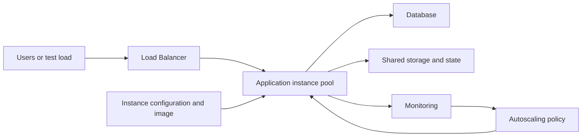

# Rightsizing, Autoscaling, and Non-Production Shutdown Schedules

A testing environment used only during business hours can still incur Compute charges overnight and on weekends. Conversely, downsizing solely because average CPU is low can cause load tests to fail, starve the JVM of memory, or make end-of-day batch jobs miss deadlines. Cost optimization therefore requires answering three questions together: how much resource each machine needs, how many machines are needed, and when they need to run.

In Oracle Cloud Infrastructure (OCI)'s **Cost and Capacity Management** chapter, this lesson combines three mechanisms: rightsizing to pick appropriate configurations, autoscaling to adjust instance counts with load, and start/stop schedules to limit runtime of non-production environments. Decisions remain tied to compartments, IAM, provisioning capacity, monitoring, and application readiness deadlines.

## 1. Expected Outcomes

After this lesson, you can:

- Distinguish downsizing configuration, reducing machine count, and scheduled stopping.
- Read CPU, memory, I/O, and service-quality metrics to draft a rightsizing proposal.
- Design autoscaling policies with limits, response lag accounted for, and handling when instances fail to provision.
- Choose between Compute Autoscaling, Resource Scheduler, or a custom orchestrator for start/stop schedules.
- Design schedules in Vietnam time, handle application dependencies, and verify readiness before user hours.
- Measure actual cost reduction after changes while detecting performance degradation.

Examples assume you already know how to create Compute instances, instance configurations, instance pools, VCNs, and basic IAM policies. All numeric configurations in this lesson are hypothetical learning scenarios; calibrate them with real workload measurements.

## 2. Three Mechanisms Addressing Three Different Dimensions

| Mechanism | What does it adjust? | Example on OCI | What must be verified |
| --- | --- | --- | --- |
| Rightsizing | Capacity per resource | Shrink Flex VM from 4 OCPU, 32 GB to 2 OCPU, 24 GB | Memory, latency, bandwidth, shape resize support, and downtime during change |
| Metric-based autoscaling | Instance count by utilization | App pool scales from 2 to 4 machines as load rises | Whether app distributes load, startup time, upper bound |
| Schedule-based autoscaling | Pool size or state at fixed times | Start pool in the morning, stop pool in the evening | Valid cron, correct UTC time, no conflict with other controllers |
| Resource start/stop schedule | Active duration of resource groups | Stop dev VMs off-hours using Resource Scheduler | Exact resource selection, execution permissions, exceptions, and post-start readiness |

Rightsizing can also mean increasing resources for an under-provisioned node. The goal is meeting requirements at an appropriate total cost, not making every machine smaller.

One cost model to keep in mind is:

```text
Total environment cost
  = sum over time [billable machine count × cost per machine]
  + storage + backups + network services + databases
  + licenses and other related items
```

Rightsizing affects cost per machine. Autoscaling affects machine count over time. Start/stop schedules affect active hours. Their outcomes interact, so re-measure after each change.

## 3. Set Boundaries Before Optimizing

### 3.1. Classify by Usage Requirements

Labels like `dev`, `test`, or `staging` are not enough to conclude an environment can be shut down. A staging environment may serve partners in another timezone; test machines may run overnight batches.

| Resource group | Initial approach | Additional conditions |
| --- | --- | --- |
| Personal dev VMs | Rightsize and schedule off-hours | Has owner, data persisted, way to start on demand |
| Shared test API | Small pool during hours, stop off-hours as agreed | Sessions and data do not depend on machines about to be removed |
| Job-triggered CI runners | Scale on demand or spin up per job | Do not kill active jobs; include timeout and work recovery |
| Performance test environment | Versioned config and dedicated schedule | Preserve comparability across test runs |
| Test databases | Evaluate scale/stop mechanics of that exact service | Has stop sequence, backups, and restore time |
| Shared DNS, access tools, and orchestrators | Treat as infra with its own uptime requirement | Do not let the orchestrator shut itself down before finishing work |

If staging must mirror production sizing for testing, keep the configuration intact during test windows and reduce the environment's **active lifetime**. Shrinking shapes in that scenario can defeat the purpose of testing.

### 3.2. State Operational Commitments Explicitly

Example agreement for a development environment:

```text
Scope: order team sandbox compartment
Available to users: 08:00–18:00, Monday through Friday
Start booting infrastructure: 07:45
Start stopping after work completes: 18:45
Business timezone: Asia/Ho_Chi_Minh
Exceptions: overtime session with accountable owner and expiration time
Startup completion criteria: health check, DB query, and smoke test all pass
On startup failure: alert on-call, log failed resource, and run recovery runbook
```

The 15-minute buffer is an assumption in this example. If the database takes 20 minutes and the application needs 10 more minutes, the schedule must start earlier. The deadline to manage is when the application becomes usable.

## 4. Rightsizing: Start from Meaningful Data

### 4.1. Observe a Full Operating Cycle

Measure across a window containing peak hours, batches, backups, deployments, and key test runs. One to two weeks can be a starting point for weekly-cycle environments; workloads running month-end reconciliation must also include that cycle.

| Metric group | What to inspect | Why it impacts the decision |
| --- | --- | --- |
| CPU | Average, p95/p99, sustained peaks, run queue | Average CPU hides brief yet critical saturation bursts |
| Memory | Absolute usage, working set, swap, OOM | Cutting RAM can trigger failures even when CPU is low |
| JVM | Post-GC heap, pauses, allocation rate, native memory, thread count | Heap is only part of a Java process's memory |
| Storage | IOPS, throughput, latency, I/O queue | Disk wait can produce low CPU while the app stays slow |
| Network | Bandwidth, retransmissions, connection count | Changing shape can alter network bandwidth limits |
| Application | p95/p99 latency, error rate, throughput, queue lag | Direct evidence of service quality |
| Operations | Boot time, warm-up, batch and backup windows | Determines buffers for scale-out and startup schedules |

Compute metrics such as `CpuUtilization` and `MemoryUtilization` live in the `oci_computeagent` namespace. Verify Oracle Cloud Agent, the Compute Instance Monitoring plugin, and that Monitoring actually receives data. Do not treat metric gaps as zero utilization. [Compute Instance Metrics documentation](https://docs.oracle.com/en-us/iaas/Content/Compute/References/computemetrics.htm).

When computing percentiles, state which sample series and aggregation interval are used. The p95 of 5-minute averages can hide spikes shorter than 5 minutes. For pools, pool-wide averages can also hide one hot instance caused by skewed load balancing.

### 4.2. Compare Only Equivalent Time Windows

A VM powered off 13 hours per day has fewer metric samples than a VM running 24/7. Mixing non-serving hours into averages can mislead you into thinking further downsizing is needed.

Separate:

- In-hours metrics vs. off-hours metrics.
- Load-test days vs. typical workdays.
- Periods before vs. after configuration or application version changes.
- Valid samples, missing-data gaps, and system boot windows.

For memory, track both actual GB/GiB used and percentage. After reducing RAM, utilization percentage is expected to rise; evaluate whether enough headroom remains and requirements are still met. Keep units consistent across telemetry tools and service configs.

### 4.3. Use Cloud Advisor to Build a Candidate List

Cloud Advisor provides recommendations on underutilized instances. Downsizing recommendation logic evaluates CPU, memory, network, and constraints such as the number of VNICs supported by the smaller configuration; profiles can tune evaluation behavior. Recommendations identify candidates to review, while change decisions must be checked against workloads and operational needs. [Cost Management Recommendations documentation](https://docs.oracle.com/en-us/iaas/Content/CloudAdvisor/Concepts/recommendations-costmanagement.htm).

A rightsizing ticket should record:

```text
Instance/pool, compartment, region, and owner
Current shape, OCPU, RAM, and candidate configuration
Observation window and peak periods covered
CPU p95/p99, memory peak, latency, error rate, batch duration
Missing assumptions and required benchmark tests
Acceptable interruption window
Rollback threshold, restore config, and executor
```

### 4.4. Estimate CPU Sizing Before Testing

Suppose a VM currently has 4 OCPUs and p95 CPU during active hours is 22%. Assuming workload and per-OCPU performance stay comparable, observed CPU demand at this level is roughly:

```text
CPU demand at p95 ≈ 4 × 0.22 = 0.88 OCPU

If targeting roughly 60% p95 CPU:
Candidate OCPU ≈ 0.88 / 0.60 = 1.47
Candidate to test: 2 OCPU

Expected p95 CPU after change ≈ 22% × 4 / 2 = 44%
```

This is a linear estimate for picking a candidate. It does not prove performance: changes in processor, cache, concurrency, I/O speed, or network limits can invalidate the linear ratio. If old p99 CPU was 38%, the same projection for 2 OCPUs is around 76%; test those peaks rather than looking only at p95.

Do not use this formula to assume OCPU and vCPU always mean the same thing across all processor families. When switching CPU architectures, verify images, binaries, native libraries, and separate benchmarks.

### 4.5. Rightsize RAM Independently of CPU

For example, a 4 OCPU, 32 GB VM running Java has an observed memory peak around 14 GB in matching units. You can test 2 OCPU, 24 GB if the shape supports it; dropping straight to 8 GB contradicts observed data.

RAM sizing must include:

```text
Required RAM
  = Java heap
  + metaspace, code cache, and direct buffers
  + thread stacks and native libraries
  + OS, agents, and sidecar processes
  + headroom for load spikes and variance
```

Check `-Xmx`, container limits, and how the JVM detects resources after resizing. A fixed `-Xmx` suited to the old machine may no longer fit the new one. Memory leaks must be fixed; adding RAM only delays recurrence.

### 4.6. Change Incrementally and Prepare Rollback

OCI lets you change shapes on supported VMs, though target configurations depend on the current shape and compatible images. Resizing can alter OCPU, RAM, bandwidth, and maximum VNIC count; changing while running can reboot the instance. Check limits, attached resources, and exact procedures beforehand. [Changing the Shape of an Instance documentation](https://docs.oracle.com/en-us/iaas/Content/Compute/Tasks/resizinginstances.htm).

Recommended procedure:

1. Record the prior configuration and confirm the data recovery path if the change fails.
2. Pick one representative instance or a recoverable test pool.
3. Keep application version and test load constant for a valid baseline comparison.
4. Resize within an appropriate maintenance window after draining active work.
5. Verify boot, network, volumes, agents, application, and business smoke tests.
6. Observe through peak hours; expand rollout only after passing defined criteria.
7. Revert to the prior configuration if defined thresholds are breached.

For instance pools, distinguish editing existing VMs from updating the template for new VMs. Plan instance configuration updates and rolling instance replacements; verify each machine's actual configuration so the pool does not unintentionally mix multiple shapes.

Configuration rollback also requires provisioning capacity. Do not assume reverting to the larger shape will always succeed instantly merely because the machine used that shape before.

## 5. Autoscaling: Adjust Count Based on Load

### 5.1. Architecture Must Support Adding and Removing Machines

A pool scales safely when each machine can be recreated from a deterministic template, accept traffic once ready, and leave the group without losing required data.



An instance configuration is the template for creating machines in the pool. The pool can attach to a load balancer so new instances join the backend set; traffic delivery depends on health checks. Health checks must therefore reflect genuine serving readiness, not just whether a process opened a port. [Creating Instance Pools documentation](https://docs.oracle.com/en-us/iaas/Content/Compute/Tasks/creatinginstancepool.htm).

Application-tier requirements to address:

- Move retained session state out of local memory or design sessions to tolerate machine replacement.
- Ship critical logs centrally; do not leave test results only on a machine that may be deleted.
- Stop workers from accepting new jobs and finish/checkpoint active jobs before termination.
- Make tasks safely idempotent to tolerate retries and lost instances.
- Bound total connections to DBs, downstream APIs, and shared systems.

If each VM opens up to 40 DB connections, 2 VMs open up to 80, while 6 VMs open up to 240. Application-tier autoscaling can overload the DB if connection pools and downstream limits are not sized together.

### 5.2. Set Minimum, Initial, and Maximum Limits

Example configuration for a shared test pool:

| Parameter | Test value | Rationale |
| --- | --- | --- |
| Minimum | 2 instances | Keep two backends during serving hours per environment requirement |
| Initial | 2 instances | Starting point for the test |
| Maximum | 6 instances | Caps cost and downstream connections for this scenario |
| Metric | CPU utilization | Workload assumed primarily CPU-bound |
| Scale-out | CPU > 65%, add 1 instance | Add capacity before reaching measured saturation zone |
| Scale-in | CPU < 25%, remove 1 instance | Leave gap between scale-out and scale-in thresholds |
| Cooldown | 600 seconds | Test value after measuring application stabilization time |

The gap between thresholds provides hysteresis: small load ripples do not cause constant flapping. If a workload is memory- or I/O-bound, pick appropriate signals and mechanisms rather than mechanically keeping CPU as a proxy.

In metric-based configurations, OCI provides minimum/maximum/initial limits, step counts, and cooldown; documentation currently specifies a 300-second minimum cooldown. Values in the table are illustrative choices, not Oracle default recommendations. [Creating a Metric-based Autoscaling Configuration documentation](https://docs.oracle.com/en-us/iaas/Content/Compute/Tasks/autoscaling-create-metric-based_tabs.htm).

### 5.3. Account for Detection and Warm-Up Time

Under Oracle's basic metric-based mechanics, metrics are aggregated per minute and averaged across instances; three consecutive values meeting the condition trigger an event. Cooldown starts once the pool returns to Running state. The response path therefore spans several stages before users receive new capacity. [Autoscaling documentation](https://docs.oracle.com/en-us/iaas/Content/Compute/Tasks/autoscalinginstancepools.htm).

```text
From load increase to available serving capacity
  ≈ metric collection and evaluation time
  + provisioning, boot, and configuration time
  + application startup, warm-up, and readiness time
```

For example, measurements show detection takes ~3 minutes, provisioning and boot 4 minutes, and warm-up 2 minutes. The application must absorb roughly 9 minutes before the new backend relieves load. This is an estimate for designing headroom, not an OCI response-time SLA.

If test load is known to jump sharply at 09:00, pre-provision capacity ahead of that time using an appropriate orchestrator. Raising `maximum` does not shorten boot time. When cold starts are slow, review images, boot-time installs, and warm-up behavior.

### 5.4. Scale-In Can Terminate Machines

With a Compute instance pool, scale-in terminates instances. That differs from stopping a pool and starting it again. Do not use pool downsizing as a substitute for power-off if data or workflows rely on preserving instances. [OCI Autoscaling scale-in mechanics](https://docs.oracle.com/en-us/iaas/Content/Compute/Tasks/autoscalinginstancepools.htm).

Design for scale-in from day one:

- Load balancer stops sending new requests to the leaving backend.
- In-flight requests drain within a defined timeout.
- Workers return or checkpoint unfinished work.
- Required logs, artifacts, and data already live in durable storage.
- Tests verify shrinking machines does not spike errors or lose work.

Do not assume the autoscaler understands business transactions and waits for them to finish. Verify draining, timeouts, and application integration actually take effect in your architecture.

### 5.5. Maximum Does Not Guarantee Provisioning Success

Before setting `maximum = 6`, check:

| Constraint | Question to answer |
| --- | --- |
| Service limits | Does the tenancy have enough limit for the shape and resources to create? |
| Compartment quotas | Is the compartment permitted that resource level? |
| Physical capacity | Can the shape be allocated in the chosen AD/FD? |
| Subnets and networking | Are enough IP addresses, VNICs, and network resources left? |
| Bootstrap | Can new machines reach images, packages, secrets, and dependencies? |
| Downstream | Can DBs, caches, and other APIs handle added connections/load? |
| Cost | Does the full pool running at maximum fit within expected spend? |

An `Out of host capacity` error relates to physical capacity at the requested placement; raising service limits does not resolve that root cause on its own. Check capacity reports and prepare tested alternative shapes/placements. [Known Issues for Compute documentation](https://docs.oracle.com/en-us/iaas/Content/Compute/known-issues.htm).

If capacity must be guaranteed for a critical window, evaluate capacity reservations along with their terms and costs. Reservations are a separate decision to weigh against off-hours savings goals. [Capacity Reservation for instances documentation](https://docs.oracle.com/en-us/iaas/Content/Compute/Tasks/editingcapacityreservation.htm).

## 6. Choose a Tool for Start/Stop Schedules

### 6.1. Three Primary Options

| Option | Best fit when | What must be designed explicitly |
| --- | --- | --- |
| Schedule-based Compute Autoscaling | Compute is organized into an instance pool with a predictable schedule | Start and stop policies, lifecycle vs. resize actions |
| OCI Resource Scheduler | Need scheduling for supported services, static or dynamic targets | Target lists, filters, schedule permissions, and execution results |
| Custom orchestrator via API/CLI/SDK | Need dependency ordering, expiring exceptions, health gates, or multi-service coordination | State store, retries, idempotency, security, and orchestrator operations |

Resource Scheduler allows selecting resources via a static list or runtime search filters, including compartment and tag filters. Check supported resource types and actions in the target deployment location. [Creating a Resource Scheduler Schedule documentation](https://docs.oracle.com/en-us/iaas/Content/resource-scheduler/tasks/create-manage.htm).

For simple schedules, prefer built-in services if they meet requirements. A custom-built system requires an owner, monitoring, and maintenance like any other production service.

### 6.2. Each Resource Needs One Unified Control Mechanism

Each instance pool has only one autoscaling configuration. That configuration holds either one metric-based policy or multiple schedule-based policies; do not treat it as a place where both policy types can be attached independently. [Compute Autoscaling configuration limits](https://docs.oracle.com/en-us/iaas/Content/Compute/Tasks/autoscalinginstancepools.htm).

If a pool must autoscale during the day yet stop at night, choose a controlled coordination design, such as an orchestrator switching modes per a tested runbook. When switching modes, save and restore configurations, manage enabled/disabled states, handle mid-flight failures, and monitor pool-size impact.

Avoid multiple systems concurrently writing conflicting desired states:

```text
18:45  Evening schedule requests stopping the pool
18:46  Another tool requests keeping the pool at active size
18:47  An operator starts one machine to investigate
```

Desired outcomes require priority rules and an accountable owner. Adding an external schedule does not automatically stop other controllers from acting.

A schedule is a point-in-time event. A machine manually started after a stop event may keep running until the next scheduled trigger. To enforce off-hours state continuously, add drift detection and exception checks; do not assume a daily stop schedule forms a continuous control loop.

### 6.3. Tagging and Selecting Safe Scopes

Example team-defined metadata convention:

```text
Environment = dev
Owner = team-order
Schedule = office-hours-vn
AutoStop = enabled
```

These keys are only a convention. OCI does not automatically interpret `Schedule=office-hours-vn` as an active schedule unless you configure a service or script that reads it.

Scopes should be layered: explicit non-production compartments, clear resource types, and verified tag filters. For tags governing permissions or critical automation, consider defined tags and restrict who may edit values.

For pool-managed resources, operate at the pool level via the chosen mechanism rather than having one run target both the pool and individual member instances simultaneously. Resources with unknown owners or missing environment tags should go to a review list rather than being guessed safe to turn off.

## 7. Design Schedules with Exact Timezone and Cron Syntax

Suppose environments must start at **07:45** and stop at **18:45**, Monday through Friday, Vietnam time. At UTC+7:

| Event | Vietnam time | UTC time |
| --- | --- | --- |
| Start boot | 07:45 Mon–Fri | 00:45 Mon–Fri |
| Start stop | 18:45 Mon–Fri | 11:45 Mon–Fri |

### 7.1. Compute Autoscaling Uses Quartz Cron

Schedule-based Compute Autoscaling uses UTC and six- or seven-field Quartz cron. Seven-field example:

```text
Seconds Minutes Hours Day-of-month Month Day-of-week Year

Start pool: 0 45 0  ? * MON-FRI *
Stop pool:  0 45 11 ? * MON-FRI *
```

Create two separate lifecycle policies for start and stop actions, then inspect projected run times. Do not pick a pool resize action if the goal is keeping instances and merely stopping them off-hours. [Creating Schedule-based Autoscaling Configuration documentation](https://docs.oracle.com/en-us/iaas/Content/Compute/Tasks/autoscaling-create-schedule-based_tabs.htm).

### 7.2. Resource Scheduler Uses Five-Field Cron

With Resource Scheduler's cron mode, the equivalent UTC example is:

```text
Minutes Hours Day-of-month Month Day-of-week

Start resources: 45 0  * * 1-5
Stop resources:  45 11 * * 1-5
```

This is the service's five-field syntax, where 1–5 denotes Monday through Friday per Resource Scheduler documentation. Do not copy a Quartz expression verbatim into this cron field. Verify UTC and previewed run times inside the service before enabling. [Resource Scheduler cron rules](https://docs.oracle.com/en-us/iaas/Content/resource-scheduler/tasks/create-manage.htm).

If local time falls before 07:00, the UTC day shifts to the previous day. For example, 00:30 Monday in Vietnam is 17:30 Sunday UTC. Environments serving teams in Daylight Saving Time regions also need explicit schedule-shift policies.

A Monday–Friday schedule does not automatically know public holidays, special test windows, or overtime shifts. Those cases must be encoded in operational policies.

## 8. Stop Safely and Start in Dependency Order

### 8.1. Stop Sequence

A reference sequence for an application environment with a DB:

1. Check exceptions, active test sessions, and ongoing deployments.
2. Stop accepting new jobs or place the system into appropriate maintenance mode.
3. Drain requests and wait for running work to complete within a set timeout.
4. Flush logs, write checkpoints, and verify required data is persisted.
5. Stop workers, application tier, and upper dependent components.
6. Stop the database using that exact service's procedure if it is within authorized stop scope.
7. Verify final state per resource and log outcomes.

If drain timeout occurs, policy must define whether to defer shutdown, notify the owner, or handle jobs under a recovery mechanism. Do not fall back to forced power-off merely to hit saved-hour targets.

For Compute instances, OCI CLI distinguishes `SOFTSTOP` and `STOP`. `SOFTSTOP` sends an OS shutdown request, but after an Oracle-defined wait window the machine may be powered off; it cannot be treated as waiting indefinitely for the application. `STOP` powers off immediately. Finish stopping the application before actions that risk cutting data mid-write. [OCI CLI instance action documentation](https://docs.oracle.com/en-us/iaas/tools/oci-cli/latest/oci_cli_docs/cmdref/compute/instance/action.html).

### 8.2. Start Sequence

Startup order typically progresses from foundational dependencies up to the application:

```text
Verify network, DNS, and always-on dependencies
  → start DB or managed data services within scope
  → wait for connections and test query success
  → start application and workers
  → wait for readiness, warm-up, and healthy backends
  → run business smoke test
  → announce environment ready
```

An instance in `RUNNING` state only proves the VM reached that lifecycle state; it does not prove DB connectivity, migrations, caches, and the application are ready. Run a check such as calling a business test endpoint with non-sensitive data and verifying expected output.

Do not use the same Compute command to control every database service. Autonomous Database, Base Database, and other options have distinct lifecycles, startup durations, and billing rules. Use APIs or integrations supported by that exact service; if a safe procedure is unverified, keep the DB outside initial automation scope.

### 8.3. Do Not Shut Down the Control Tool Before Its Work

The orchestrator and recovery access path must stay alive while the environment is stopped. If cron runs on the very VM being shut down, it cannot wake itself up the next morning.

Check indirect dependencies as well: runners executing startup, secret stores, internal DNS paths, bastions, and notification channels. Place the orchestrator somewhere with matching uptime that can still reach OCI APIs while target machines are stopped.

## 9. IAM and an Operable Orchestrator

### 9.1. Separate Schedule Creation Permissions from Resource Action Permissions

With Resource Scheduler, permissions for the user managing schedules and permissions allowing the schedule to act on resources are two distinct parts. Being able to create a schedule does not grant that schedule permission to stop machines. Grant execution permissions scoped to the schedule/principal and target compartment appropriately. [Resource Scheduler IAM Policies documentation](https://docs.oracle.com/en-us/iaas/Content/resource-scheduler/tasks/listing-schedules.htm).

For custom orchestrators, use authentication appropriate to the host, such as instance principal or resource principal where supported. Grant only the metadata read permissions and chosen actions within non-production scope; avoid placing personal API keys in scripts or logs.

A tag filter in code does not replace an IAM boundary. If credentials still hold permission to stop production, a targeting bug can exceed intended scope.

### 9.2. Exceptions Need Expiration Dates

An overtime exception should include:

```text
Target resource or resource group
Reason and accountable owner
Start time and expiration time with timezone
Desired state to preserve during the exception
```

If defining a custom `KeepRunningUntil` tag, write and test logic to parse it or translate exceptions into matching schedule edits. Resource Scheduler does not automatically interpret custom tag semantics.

Malformed timestamps should trigger an alert and fail safe per agreed policy. A `DoNotStop=true` tag without an expiration date easily turns into lingering spend nobody remembers.

### 9.3. The Orchestrator Must Converge to Final State Safely

The pseudocode below illustrates design requirements, not a complete API:

```text
receive desired_state, current_timestamp, and run_id
load authorized scope and schedule/exception policy
list resources in selected compartment and region
deduplicate between pools and member instances

for each resource:
    re-read environment, tags, owner, and current lifecycle
    if ineligible: log reason and skip
    if active exception exists: log exception and skip
    if already in desired state: log no change needed
    if transitioning: wait bounded time or schedule recheck
    if dry_run: log plan without sending commands
    if desired state is stop: verify drain/data safety checks
    execute action via the exact resource type's API
    wait for result; bounded retries on genuinely retryable errors
    if just started: verify dependency and application readiness
    record independent outcome for that resource

summarize succeeded, skipped, failed, and completion time
alert if any resource failed or missed readiness deadline
```

Idempotency here means re-running the workflow does not trigger unintended actions. For example, a machine already `STOPPED` is recorded as satisfied; a machine in `STOPPING` is waited on or rechecked rather than sent conflicting commands concurrently.

Do not report the entire run successful merely because the API accepted the initial request. An environment may start 5 VMs cleanly and fail 1 DB; that outcome must be surfaced as not ready.

## 10. Practice on a Standalone VM with OCI CLI

The PowerShell example below demonstrates acting on **one preselected standalone VM** after confirming the application can stop safely. Do not use it to manipulate individual members of an instance pool, and do not treat it as a DB orchestrator.

Prepare authenticated OCI CLI, select the right region, set real OCIDs, and attach free-form tags `Environment=dev` and `AutoStop=enabled`. The example restricts the shape specifically to `VM.Standard.E4.Flex`; broaden the allowlist only after verifying shapes and billing rules for your environment.

The script defaults to printing a plan only. The snippet below is for learners to study and run in an isolated lab once prerequisites are met, not a command to execute on the documentation workspace.

```powershell
# Specify only a confirmed standalone lab VM.
$InstanceOcid = 'ocid1.instance.oc1..REPLACE_ME'
$ExpectedCompartmentOcid = 'ocid1.compartment.oc1..REPLACE_ME'
$Region = 'ap-singapore-1' # Replace with the region hosting the lab VM.
$DesiredState = 'STOPPED' # Accepts only STOPPED or RUNNING.
$Apply = $false           # Set to $true after reviewing the plan.

if ($DesiredState -notin @('STOPPED', 'RUNNING')) {
    throw 'DesiredState must be STOPPED or RUNNING.'
}

$raw = & oci compute instance get `
    --instance-id $InstanceOcid `
    --region $Region `
    --output json
if ($LASTEXITCODE -ne 0) {
    throw 'Failed to read instance; stopping without sending power action.'
}
$instance = (($raw -join "`n") | ConvertFrom-Json).data

if ($instance.'compartment-id' -ne $ExpectedCompartmentOcid) {
    throw 'Instance does not belong to the selected compartment.'
}
if ($instance.'freeform-tags'.Environment -ne 'dev' -or
    $instance.'freeform-tags'.AutoStop -ne 'enabled') {
    throw 'Instance does not meet lab tag requirements.'
}
if ($instance.shape -ne 'VM.Standard.E4.Flex') {
    throw 'Shape is outside the verified scope of this example.'
}

$currentState = $instance.'lifecycle-state'
if ($currentState -eq $DesiredState) {
    Write-Output "Already in $DesiredState state; no change needed."
} else {
    if ($currentState -notin @('RUNNING', 'STOPPED')) {
        throw "State $currentState requires inspection before acting."
    }
    $action = if ($DesiredState -eq 'STOPPED') { 'SOFTSTOP' } else { 'START' }
    if (-not $Apply) {
        Write-Output "DRY_RUN: $InstanceOcid | $currentState -> $DesiredState | $action"
    } else {
        & oci compute instance action `
            --instance-id $InstanceOcid `
            --region $Region `
            --action $action `
            --wait-for-state $DesiredState `
            --max-wait-seconds 1800
        if ($LASTEXITCODE -ne 0) {
            throw 'Power action failed or timed out; re-read instance state.'
        }
        Write-Output "VM reached $DesiredState."
        if ($DesiredState -eq 'RUNNING') {
            Write-Output 'Proceed with readiness checks and application smoke test.'
        }
    }
}
```

`--wait-for-state` waits for the instance lifecycle and can time out. On timeout, re-read state before retrying; the submitted request may still be completing. Actions and wait options are documented in [OCI CLI Command Reference](https://docs.oracle.com/en-us/iaas/tools/oci-cli/latest/oci_cli_docs/cmdref/compute/instance/action.html).

The example does not yet implement schedules, exception handling, concurrency locks against overlapping runs, or application draining. When moving to automation, add those pieces per the requirements defined in earlier sections.

## 11. Calculate Savings Without Omitting Residual Costs

### 11.1. Stopping VMs Does Not Drop Total Cost to Zero

Oracle specifies stop billing rules by shape. For Standard shapes, stopping via OCI mechanisms pauses the corresponding Compute charges; stopped instances still count toward service limits. Some families such as Dense I/O, HPC, or GPU follow different rules. Shutting down inside the OS alone is insufficient to assume billing stopped; verify state via OCI and rules for the exact shape. [Resource Billing for Stopped Instances documentation](https://docs.oracle.com/en-us/iaas/Content/Compute/Tasks/resource-billing-stopped-instances.htm).

Beyond Compute reductions, still account for persisting items: boot/block volumes, backups, Object Storage, load balancers, data services, and any license or reservation terms. Stopping an application does not delete these resources. Do not terminate instances or delete volumes just to hit a savings number without decisions on data and recovery paths.

### 11.2. Example Combining Rightsizing and Run Schedule

Suppose there are 6 standalone Standard Flex VMs with identical schedules. To illustrate the math, set **hypothetical unit prices**, completely unrelated to Oracle's price list:

```text
1 OCPU running 1 hour: 1 cost unit
1 GB RAM running 1 hour: 0.1 cost units
```

Initial state: each VM has 4 OCPUs, 32 GB, running 168 hours/week.

```text
Hourly cost per VM = 4 × 1 + 32 × 0.1 = 7.2
Weekly Compute cost = 6 × 168 × 7.2 = 7,257.6 units
```

After successful testing, move each VM to 2 OCPUs, 24 GB and run 07:45–18:45, Mon–Fri:

```text
Active hours per week = 11 × 5 = 55 hours
Hourly cost per VM = 2 × 1 + 24 × 0.1 = 4.4
New Compute cost = 6 × 55 × 4.4 = 1,452 units/week

Compute reduction = 1 - 1,452 / 7,257.6 ≈ 80.0%
```

The calculation assumes all 6 VMs can stop, no overtime runs occur, and the Compute charges under review pause when stopped. With autoscaling, sum each interval's actual machine count instead of a fixed 6.

The separate effects of downsizing and schedule reduction combine via remaining cost ratios:

```text
Remaining Compute cost ratio
  = (4.4 / 7.2) × (55 / 168)
```

Do not add the two savings percentages directly, because reduced hours apply to the already-rightsized cost.

If other services still cost 3,000 units/week:

```text
Old total = 7,257.6 + 3,000 = 10,257.6
New total = 1,452 + 3,000 = 4,452
Environment-wide reduction ≈ 56.6%
```

This is why Compute savings and environment-wide savings should be reported separately. For an actual month, use real workdays, holidays, exceptions, and actual transition durations.

### 11.3. Track Cost per Work Output

Lower spend can simply come from running fewer tests. To evaluate effectiveness, also track:

- Cost per successful build or test run.
- Cost per hour the environment is ready for users.
- Wait time for environments or runners and manual wake-up counts.
- Job failure rate, application errors, and batch duration.

Reconcile tags, compartments, execution timestamps, and cost data once usage is recorded. Do not treat an estimated figure right after one stop command as sole proof of savings.

## 12. Operational Observability and Recovery Conditions

Maintain a dashboard or report combining resource state, service quality, and cost:

| Signal | Potential issue | Initial action |
| --- | --- | --- |
| Pool hits maximum yet latency/queue keeps climbing | Insufficient capacity, downstream bottleneck, or cap too low | Inspect bottlenecks, limits, and provisioning errors |
| Scale-in/out frequency spikes | Thresholds too tight or stabilization window too short | Review load distribution, hysteresis, and cooldown |
| Missing metrics | Agent, permissions, network, or telemetry source issue | Restore telemetry; hold resource-reduction decisions pending checks |
| Machine stays RUNNING after stop time | Schedule failure, exception, manual start, or controller conflict | Inspect per-target logs and action history |
| VM RUNNING yet app unusable | Dependency failure, bootstrap error, or misconfiguration | Check readiness, logs, and smoke tests |
| Environment not ready before 08:00 | Insufficient time buffer or startup step failed | Recover manually and adjust schedule using measured timings |
| Cost does not drop as estimated | Shape billing differs from assumption or residual costs dominate | Reconcile line by line and active hours |

Each automation run log should record run ID, schedule, UTC timestamp, region, compartment, OCID, before/after state, action, outcome, skip reason, and API request/work request IDs if provided. Never write secrets or sensitive payloads to logs.

Define rollback criteria before changing anything, for example:

```text
Rightsizing:
  restore known-good configuration if OOM occurs,
  or latency/batch breaches agreed threshold within observation window.

Autoscaling:
  pause automated scaling if repeated failures occur,
  return pool to stable configuration within provisionable capacity limits.

Start/stop schedule:
  disable offending schedule, restore startup order via runbook,
  fix filters or schedules before re-enabling.
```

When disabling a schedule or controller, record the remaining system state clearly. Disabling automation does not automatically revert resources to their prior configuration.

## 13. Lab Exercise: Optimize a Java Test Environment on OCI

### 13.1. Scenario

Team `team-order` operates a test environment used during business hours. Two Java application VMs sit behind a load balancer; one standalone VM runs test tooling. Shared databases and storage follow separate policies. Compute machines currently run 24/7.

Goal: reduce idle costs, keep the application ready by 08:00 Monday through Friday, and preserve test results. Do not touch production.

### 13.2. Implementation Steps

1. **Define scope:** record OCIDs, region, compartment, owner, and dependencies; mark the standalone VM vs. pool instances.
2. **Measure baseline:** collect metrics across a representative work cycle; record CPU, memory peak, GC, latency, test duration, and boot/warm-up times.
3. **Pick rightsizing candidate:** use metrics and Cloud Advisor if available; select one candidate configuration with rollback thresholds.
4. **Test configuration:** hold load and app version constant; check test results, completion time, and memory headroom.
5. **Choose pool mode:** if daytime load is fairly steady, test schedule-based lifecycle first. If daytime metric-based scaling is needed, document mode-switching mechanics and test coordination separately before enabling.
6. **Schedule standalone VM:** use Resource Scheduler or an appropriate orchestrator; test with a small verified static target list before moving to dynamic filters.
7. **Rehearse stop/start:** verify draining, artifact persistence, dependency order, and smoke tests; measure time to readiness.
8. **Enable active schedule:** configure matching UTC hours, start and stop schedules; verify expiring overtime exceptions and manual start path.
9. **Reconcile results:** compare usage, cost, and successful test runs once sufficient data accumulates; tune configurations using measured evidence.

Do not simultaneously change shapes, increase load, upgrade Java, and alter run schedules in a single test. Keep changes separated in batches so root causes remain identifiable when performance shifts.

### 13.3. Acceptance Criteria

| Criterion | Required evidence |
| --- | --- |
| Accurate target selection | Run plan shows exact OCIDs/compartment; out-of-scope resources skipped |
| No required data loss | Artifacts and logs remain readable across stop/start or instance replacement |
| Ready on schedule | Smoke test passes before 08:00 in representative rehearsals |
| Downsized resources still meet requirements | Latency, errors, GC, and test duration remain within set thresholds |
| Valid autoscaling behavior | Evidence of scale-out/in when enabled without exceeding bounds |
| Failure handling works | Simulate permission loss or one target failing to start in lab; report flags failure accurately |
| Exceptions expire automatically | Time-bounded exceptions enforce via chosen mechanism and revert to normal schedule |
| Verified actual savings | Compare hours, sizing, and cost alongside residual costs |

After rehearsal, restore the chosen final schedule and configuration; clean up unneeded test resources per lab data policy. The exercise succeeds when the environment meets capacity during serving hours, recovers verifiably, and reduces identified idle resources.
