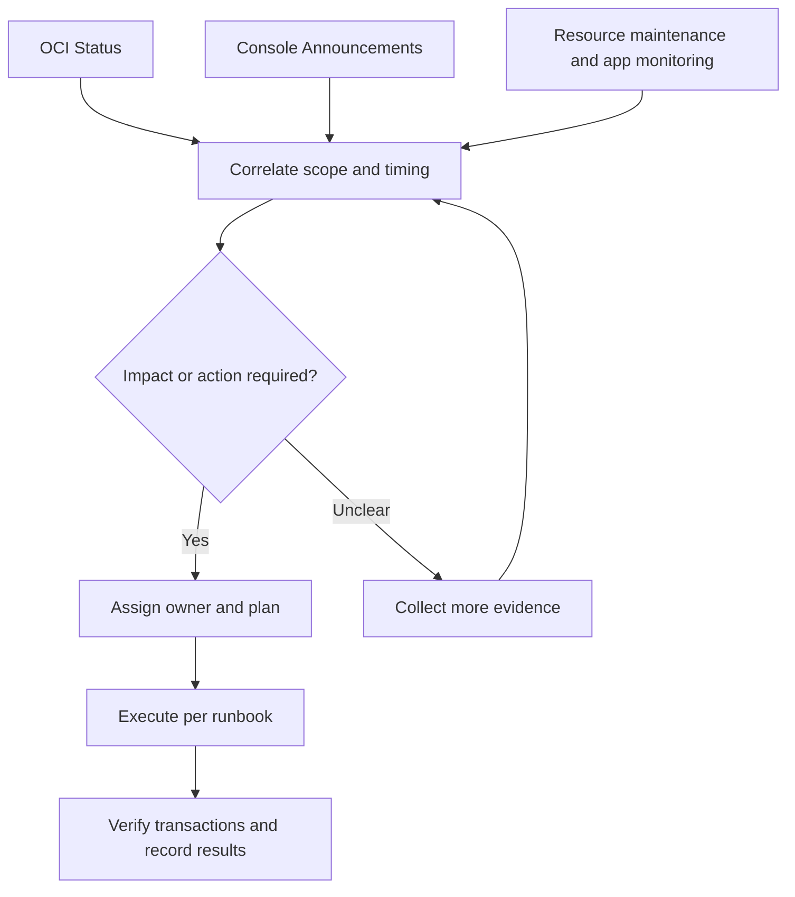
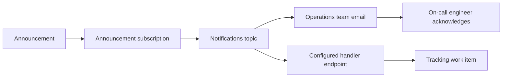

# Monitoring Service Health and Maintenance Notices

In Oracle Cloud Infrastructure (OCI) operations, learning about a maintenance event early is only valuable when the information reaches the right person, is correlated with actual resources, and leads to verifiable action. An email sitting in an administrator's inbox does not constitute an operational process.

This lesson belongs to the **Operations and Troubleshooting** chapter of the **CLOUD_PROVIDERS_ORACLE** module. It connects tenancy, compartment, and IAM with monitoring VCN networking, Compute, storage, and Oracle database services. The goal is to build an approach to receiving information, assessing impact, and preparing for maintenance that aligns with availability, automation, and cost requirements.

## 1. Learning Outcomes

After this lesson, you can:

- Distinguish between public service status, tenancy-specific notices, and actual application health.
- Read an announcement to identify impact scope, timing, responsible owners, and required actions.
- Design the Announcements → Notifications topic → recipient pipeline with appropriate IAM permissions.
- Prepare for and monitor Compute or database maintenance while still verifying user-facing service capability.
- Troubleshoot scenarios where notices are not received and store evidence for handovers or working with Oracle Support.

The illustrative operations use the OCI Console and OCI CLI. The commands are examples for learners to run in an authorized environment; replace all placeholder values before running.

## 2. Monitor Multiple Signal Sources

An application can fail while the public dashboard remains normal. Conversely, a service incident in the same region might not affect your application.

| Signal Source | Observation Scope | Operational Question |
| --- | --- | --- |
| OCI Status, typically accessed when checking Service Health | Service status by region | What issues has Oracle announced that might be relevant? |
| Console Announcements | Notices sent to the account scope | Are there changes, maintenance, or actions to review? |
| Resource maintenance page | Events tied to specific resources | Which resources have scheduled or active maintenance to handle? |
| Metrics, logs, and application checks | Behavior of the system you operate | Can users still complete transactions? |

Oracle distinguishes between the service/region-level status dashboard and customer-specific incidents communicated via Console Announcements. Therefore, always cross-check both channels when isolating issues. [Source: System Status](https://docs.oracle.com/en-us/iaas/Content/General/Concepts/status-service.htm)

For example, the order creation API returns many database connection errors. The on-call engineer should check database service status, tenancy announcements, database maintenance schedules, and application connection counts. Looking only at the CPU chart of the Java host will miss many possibilities.

The workflow can be organized as follows:



## 3. Read Service Health with Focus

For commercial regions, open [OCI Status](https://ocistatus.oraclecloud.com/), and select the right region and service. The dashboard uses statuses such as **Normal Performance**, **Informational**, **Service Disruption**, and **Service Down**. The History section provides event progression; the status page also provides RSS and JSON feeds for integration. [Source: System Status](https://docs.oracle.com/en-us/iaas/Content/General/Concepts/status-service.htm)

Instead of just writing "Oracle is down", cross-check three factors:

1. **Service:** an error creating a Compute instance differs from an error accessing a business API on a running instance.
2. **Location:** an incident in another region is only relevant if the application has dependencies there.
3. **Timing:** compare your detection timestamp with the published timeline, noting the time zone clearly.

For systems with many dependencies, maintain a short list such as:

| Business Component | Dependencies to Check |
| --- | --- |
| Sales API | Load Balancer, Compute, VCN networking, DNS, and actual database in use |
| Document upload | Application API, Object Storage, network path, and access permissions |
| Batch processing | Compute, input data storage, database, and scheduler |
| Admin login | Console/API access channel and relevant identity system |

This list must reflect the real architecture. Subscribing to every service and routing everything into an urgent paging channel makes it hard for on-call engineers to spot actionable signals.

When automating public status retrieval, also log collector failures. Being unable to reach the status page only proves that check failed; it is not enough to conclude all of OCI is having an outage. Also record the fetch timestamp to avoid displaying a stale report as current status.

## 4. Read Announcements by Operational Responsibility

### 4.1. Identify Notice Types

Announcements include types such as **Required action**, **Recommended action**, **Scheduled maintenance**, **Planned change**, **Emergency change**, along with corresponding update, reschedule, or completion notices. The notice type guides initial handling; internal priority also depends on business impact. [Source: Console Announcements](https://docs.oracle.com/en-us/iaas/Content/General/Concepts/announcements.htm)

| Notice Category | Recommended Handling |
| --- | --- |
| Required action | Assign owner, record deadline, and require completion evidence |
| Scheduled maintenance or planned change | Assess disruption, dependencies, and execution window |
| Emergency change | Route into on-call workflow, check impact immediately |
| Recommended action | Assess risk of delay, put on a planned schedule with an owner |
| Rescheduled or extended | Update existing plan and inform relevant teams |
| Completed | Re-verify system before closing the task |

Do not assume a uniform advance-notice period for all services. Execution dates, action deadlines, and rescheduling options must be verified from the specific announcement and resource. An internal plan based on habits from a previous maintenance event can easily miss a new deadline.

### 4.2. Open the Full Announcement

In the Console, open **Announcements**, select the relevant announcement, and read the full details. Key data points include reference ID, service, region, timestamps, action deadline, impacted resources, and update history. [Source: Viewing the Details of an Announcement](https://docs.oracle.com/en-us/iaas/Content/General/Concepts/announcements_topic-To_view_the_details_of_an_announcement.htm)

Turn that information into an actionable record:

```text
Source: Console Announcements
Announcement ID / reference ID:
Timestamp received by operations team:
Service and region:
Listed resource OCIDs:
Related application and environment:
Expected impact:
Expected start / end / action deadline:
Original time zone and Vietnam time:
Primary owner / backup owner:
Agreed actions:
Post-execution verification evidence:
Next review timestamp:
```

Distinguish between **notice received**, **event start**, and **action completion deadline**. These three milestones serve three different purposes: measuring intake speed, correlating impact, and controlling progress.

Hypothetical example: a window starting at `2026-12-10T18:00:00Z` corresponds to **01:00 on 11/12/2026 in Vietnam**. Adding seven hours can also shift the calendar date. In tickets, store both the original UTC string and local time.

### 4.3. "Read" Does Not Mean "Handled"

Marking as read only tracks viewing the notice. The operations team still needs a work item with an owner, due date, and explicit closure criteria.

Oracle states a 90-day retention period for Announcements. If long-term investigation is needed, save the reference ID, key content, and handling results in the organization's operational record repository. [Source: Viewing a List of All Announcements](https://docs.oracle.com/en-us/iaas/Content/General/Concepts/announcements_topic-To_view_a_list_of_all_announcements.htm)

When receiving an update, reopen the existing work item before creating a new one. A maintenance time change often requires updating on-call schedules, batch pause windows, and communications to application owners simultaneously.

## 5. Prepare IAM for Viewers and Configurators

On-call engineers need to read the full content. The `inspect announcements` permission allows viewing summaries; `read announcements` allows reading details. Announcement read policies are scoped at the tenancy level. [Source: Common Policies — Announcements](https://docs.oracle.com/en-us/iaas/Content/Identity/Concepts/commonpolicies.htm)

Example for a read-only group:

```text
Allow group 'Default'/'OciOpsReaders' to read announcements in tenancy
```

In the example, `Default` is the identity domain name, `OciOpsReaders` is the group, and `Operations` below is an existing compartment. Replace them with actual names.

The group configuring subscriptions may need the following permissions, depending on assigned duties:

```text
Allow group 'Default'/'OciNoticeAdmins' to read announcements in tenancy
Allow group 'Default'/'OciNoticeAdmins' to manage announcement-subscriptions in compartment Operations
Allow group 'Default'/'OciNoticeAdmins' to manage ons-topics in compartment Operations
Allow group 'Default'/'OciNoticeAdmins' to inspect ons-subscriptions in compartment Operations
```

`announcement-subscriptions` controls resources configuring announcement delivery; it is a separate resource type from `announcements`. [Source: Details for the Announcements Service](https://docs.oracle.com/en-us/iaas/Content/Identity/policyreference/announcementspolicyreference.htm)

For Notifications, `ons-topics` management covers topic operations, publishing messages, and registering endpoints; listing subscriptions requires checking `ons-subscriptions`. [Source: Details for Notifications](https://docs.oracle.com/en-us/iaas/Content/Identity/Reference/notificationpolicyreference.htm)

This is an example role split for building policies, not a requirement that every on-call engineer have admin rights. If someone only attaches endpoints to an existing topic, narrow the permissions to that task rather than copying the entire example.

Announcement read permissions also do not automatically grant permissions to view metrics, modify instances, adjust databases, or create Events rules. When someone sees a notice but cannot open the resource, identify the missing permission at that step. Avoid solving it by granting tenancy-wide admin rights.

## 6. Design the Notification Delivery Pipeline

### 6.1. Understand the Two Subscription Types

Two concepts are easily confused:

- **Announcement subscription:** decides which announcements are forwarded to a Notifications topic.
- **Notifications subscription:** defines the endpoint receiving messages from that topic, such as the operations team email.

Filtering and routing announcements to a topic are described in [Subscribing to Announcements](https://docs.oracle.com/en-us/iaas/Content/General/Concepts/announcements_topic-Subscribing.htm).



Topic names should express ownership, such as `oci-ops-notices`. Both the topic owner and application owner need to know who updates recipient lists when team members change roles.

### 6.2. Configure in Order

1. Choose the region and compartment for the Notifications configuration.
2. Create a topic serving the operations group.
3. Create an email subscription for the agreed address.
4. The mailbox administrator confirms the subscription and verifies subscription status.
5. In Announcements → Subscriptions, create an announcement subscription and select the target topic.
6. Record the OCID, owner, and purpose of each configuration in the operations register.

Notifications sends a confirmation URL when an email subscription is created. The subscription remains pending until confirmed; the URL is valid for three days. The email can be a distribution group address. [Source: Creating an Email Subscription](https://docs.oracle.com/en-us/iaas/Content/Notification/Tasks/create-subscription-email.htm)

When creating an announcement subscription, you can choose **All announcements** or **Selected announcements only**. [Source: Creating an Announcement Subscription](https://docs.oracle.com/en-us/iaas/Content/General/Concepts/announcements_topic-To_create_a_subscription.htm)

A sensible starting design is a consolidated mailbox so accountable reviewers see the broad scope. Specialized channels can filter more narrowly for Compute, network, or database teams. As the system grows, review noise levels based on actual received notices.

### 6.3. Control Filters to Avoid Gaps

Within a filter group, all filter conditions must match; multiple values for a single condition allow matching any one of those values. Compartment filters match exact compartments and do not automatically include child compartments. Resource OCID filters cannot be combined with other filter types in the same group. [Source: Adding a Filter Group to an Existing Subscription](https://docs.oracle.com/en-us/iaas/Content/General/Concepts/announcements_topic-To_add_filters_to_a_subscription.htm)

Hypothetical example: you want the Compute team to monitor all active regions. If a filter restricts both the Compute service and a single region, the team will need to verify whether that scope still meets goals when deploying into additional regions.

Useful review steps:

- List the types of information the team needs to know, including updates and reschedules.
- Write example notices expected to pass through each configuration.
- Compare filter scope against the list of running applications and resources.
- Review filters after adding regions, moving resources, or changing owners.

Choosing a compartment to **store the subscription resource** and setting an **announcement compartment filter condition** are two separate decisions. Clear naming and descriptions prevent future maintainers from confusing configuration placement with the scope of received notices.

Do not infer the impacted region from the sender email address: Oracle notes that the region of the Notifications sender address is not necessarily the impacted region. [Source: Subscribing to Announcements](https://docs.oracle.com/en-us/iaas/Content/General/Concepts/announcements_topic-Subscribing.htm)

## 7. Read via CLI and Test Delivery Paths

The examples below use **PowerShell** with an authenticated OCI CLI. Do not place private keys, passwords, or tokens in notification payloads.

### 7.1. List and Open Announcements

```powershell
$tenancyId = '<TENANCY_OCID>'
$cliRegion = '<REGION_IDENTIFIER>'

oci announce announcements list --compartment-id $tenancyId --region $cliRegion --all
```

The list command and filtering options for Announcements are documented by Oracle at [Filtering Announcements](https://docs.oracle.com/en-us/iaas/Content/General/Concepts/announcements_topic-To_filter_a_list_of_announcements.htm).

Take the OCID from the output and read the full details:

```powershell
$announcementId = '<ANNOUNCEMENT_OCID>'

oci announce announcements get --announcement-id $announcementId --region $cliRegion
```

The detail query syntax uses `--announcement-id`. [Source: OCI CLI — announcements get](https://docs.oracle.com/en-us/iaas/tools/oci-cli/latest/oci_cli_docs/cmdref/announce/announcements/get.html)

If the result is empty, check the tenancy, permissions, query scope, and filters before concluding there are no announcements. A single list result also does not imply all past notices have been handled.

### 7.2. Publish a Test Message to a Topic

Use a test topic with recipients who know about the test. If the topic is connected to a paging system or automated ticketing, agree on how test messages are handled before sending.

```powershell
$topicId = '<NOTIFICATIONS_TOPIC_OCID>'
$topicRegion = '<TOPIC_REGION>'

oci ons message publish --topic-id $topicId --region $topicRegion --title '[TEST] OCI notice delivery' --body 'Test only. Verify receipt and record the delivery time.'
```

Notifications supports publishing messages directly to a topic; for email, title is used as the message subject. [Source: Publishing a Message to a Topic](https://docs.oracle.com/en-us/iaas/Content/Notification/Tasks/publishingmessages.htm)

The tester should record:

| Evidence | What Is Confirmed |
| --- | --- |
| Publish command succeeds | Delivery request accepted by the service |
| Endpoint receives the exact message | Path from topic to endpoint worked in this test |
| On-call responder acknowledges receipt | Human workflow has an active responder |
| Real announcement passes through config | Filters and source emitter verified for that scenario |

**Publishing a test message to a topic only tests the downstream half of the pipeline.** It does not prove the announcement subscription selects the right notices. If no matching real announcement has occurred yet, clearly record that this part has not yet been verified with a live event.

There is no need to cause an outage or restart resources just to test notification delivery.

## 8. Connect Compute Maintenance to Applications

### 8.1. Read the Exact Resource Action

Compute maintenance may use live migration, reboot migration, rebuild in place, or require manual migration depending on the resource. Disruption levels and local data preservation differ; live migration is also not available for every instance. [Source: Instance Maintenance](https://docs.oracle.com/en-us/iaas/Content/Compute/References/infrastructure-maintenance.htm)

In the Console, open **Compute → Instance Maintenance**, select the right compartment, and open the relevant event. The detail page provides information such as type, impacted service, and action timestamp. [Source: Managing Maintenance Events](https://docs.oracle.com/en-us/iaas/Content/Compute/Tasks/managing-maintenance-events.htm)

Before scheduling operations, answer:

- What component does the instance host: frontend, worker, cluster member, or a standalone service?
- Can traffic be drained and in-flight requests allowed to finish?
- Which jobs need to be checkpointed or paused?
- Which data resides on the boot volume, block volume, and local drives?
- Has the standby component been tested under sufficient load?
- Does recovery depend on IP, VNIC, OS configuration, or application state?

An OS-level reboot command should not be treated as proof that a migration requirement is complete. Execute the prescribed action and re-check the maintenance event status.

If considering rescheduling, check the options available on the resource and the notice content. Do not put a new date into an internal plan before the OCI-side schedule is confirmed.

### 8.2. Add Maintenance Metrics

The `oci_compute_infrastructure_health` namespace includes the `maintenance_status` metric: a value of `1` indicates scheduled infrastructure maintenance, and `0` indicates none scheduled. Related dimensions may provide maintenance deadlines and actions. The `instance_status` metric reflects VM availability at the infrastructure layer; it does not replace application checks. [Source: Infrastructure Health Metrics](https://docs.oracle.com/en-us/iaas/Content/Compute/References/infrastructurehealthmetrics.htm)

Example MQL query for an instance:

```text
maintenance_status[5m]{resourceId = "<INSTANCE_OCID>"}.max() > 0
```

Select the corresponding namespace and compartment in Monitoring. When creating an alarm, define trigger delay, severity, and destination according to the team's operational rhythm.

This metric is suited for reminding teams to check schedules or create preparation tasks. If it fires repeatedly as an urgent page for several days, on-call engineers will struggle to distinguish future maintenance schedules from active service loss.

Queries returning no data must be investigated separately: check time range, region, compartment, dimensions, and permissions. Do not interpret missing data as `0`.

## 9. Oracle Database Maintenance Needs Dedicated Tracking

Do not infer database maintenance schedules from the schedule of the VM running the Java application. The responsible team must identify the exact database service type and configuration in use.

For example, Autonomous AI Database Serverless emits Information events for maintenance via OCI Events, filterable by the maintenance category. This is an additional source for tracking schedules, start times, and completion times. [Source: Manage Patch Levels and Maintenance Window](https://docs.oracle.com/en-us/iaas/autonomous-database-serverless/doc/maintenance-windows-patching.html)

For Exadata Database Service on Dedicated Infrastructure, documentation describes both notifications to infrastructure maintenance contacts and receiving updates via maintenance events. [Source: Configure Oracle-Managed Infrastructure Maintenance](https://docs.oracle.com/en-us/iaas/exadatacloud/doc/exa-conf-oracle-man-infra.html)

When applying Events, select event types and filter conditions according to the documentation for the exact service. Do not use guessed event names or categories across all databases.

For Java applications, the pre-maintenance plan should include:

- Testing acquiring a fresh connection from the connection pool and executing a simple query.
- How stale/broken connections are detected and evicted.
- Timeout and retry policies suited to each operation type.
- How batch jobs or long-running transactions are handled.
- A write-and-read-back test using a properly scoped test account.

Retrying a payment or order-creation operation can cause side effects if idempotency is not controlled. Therefore, the application's ability to reconnect after maintenance must be tested at the transaction level, not just by pinging the database.

## 10. Runbook for Before, During, and After Maintenance

The milestones below are an internal way to organize work. They are not Oracle notification timing commitments or SLAs.

### 10.1. Upon Intake

1. Validate the information by opening the Console or official source.
2. Link the reference ID to the tracking work item.
3. Identify affected resources, environments, and applications.
4. Assign a primary owner and a backup owner.
5. Distinguish Oracle's required deadline from internal preparation deadlines.
6. Check whether newer updates exist for the same event.

If impact is unclear, the work item must remain in an assessing state. Avoid closing notices simply because no errors are visible yet.

### 10.2. Before the Window

- Verify valid backups and the most recent restore evidence.
- Confirm standby components, load capacity, and traffic shifting methods.
- Choose when to pause relevant batch jobs or deployments.
- Prepare before-and-after tests using the same evaluation criteria.
- Agree on stop conditions, fallback plans, or when to open a Support request.
- Re-check the maintenance schedule immediately before execution.

Distinguish between **rolling back changes made by your own team** and **reverting provider infrastructure state prior to maintenance**. Application rollback capability does not grant the ability to reverse an infrastructure maintenance operation.

### 10.3. During the Window

Monitor resource progress and application experience in parallel:

| Verification Layer | Example Evidence |
| --- | --- |
| Resource | Event, instance, or database status |
| Network | Connectivity over the actual access path |
| Application | Error rate, latency, readiness endpoint |
| Transaction | Controlled creation and read-back of a test record |
| Background processing | Queue depth, job progress, and checkpoints |

If the application encounters errors, record the timestamp before intervening further. Mass-restarting components during investigation can destroy evidence and introduce additional causes.

### 10.4. After the Window

1. Read the latest update on the event.
2. Re-run the selected application tests.
3. Check backlogs, interrupted jobs, and post-switchover connections.
4. Restore traffic or batch schedules in the agreed order.
5. Monitor for an additional period defined by the team based on workload.
6. Record outcomes, variances, and temporary resource costs before closing.

A provider "completed" notice and business-serving verification are two distinct pieces of evidence that must be cross-checked. If the system still shows errors, continue handling according to actual impact.

## 11. Choose Response by Scenario

| Scenario | Appropriate Initial Response |
| --- | --- |
| Public service incident, internal transactions remain healthy | Monitor dependencies and prepare fallback; continue measuring user experience |
| Application failing, no public incident | Investigate immediately while checking announcements and recent changes |
| Future maintenance with required action | Create deadline-bound work item and confirm staffing |
| Maintenance window extended | Re-evaluate on-call coverage, batch jobs, impact, and communication needs |
| Oracle reports completed, app still failing | Keep work item open, gather evidence, and continue recovery |
| Impacted resources unclear | Cross-check OCIDs and dependencies; keep status in assessment |

Priority should be based on current impact, user scope, and remaining time before the deadline. A general informational notice does not need to wake the entire team; a required action on critical resources needs an owner even if the system is not currently failing.

When working with Oracle Support, prepare the reference ID, region, relevant OCIDs, UTC timestamps, error symptoms, request IDs if any, and steps already attempted. Separate **observed facts** from **suspected causes**; for example, "connections failed starting at 01:05" is evidence, whereas "caused by maintenance" may still be a hypothesis.

## 12. Troubleshoot Missing or Incorrect Notices

| Symptom | Investigation Path |
| --- | --- |
| Announcement not visible in Console | Logged-in tenancy, IAM permissions, and viewing scope |
| Can view list but cannot open details | User's detail-read permissions |
| Email subscription stuck pending | Confirmation inbox, URL expiration, and resend procedure |
| Test publish succeeds but no email arrives | Endpoint status, address, spam/quarantine, and group mailbox rules |
| Receives test message but misses announcements | Announcement subscription, target topic, and filter conditions |
| Receives many out-of-scope notices | Subscription scope, duplicate configs, and internal forwarding rules |
| Inconsistent times | Original time zone, post-conversion date, and latest update |
| Notice arrives but nobody handles it | On-call schedule, owner, backup, and acknowledgment step |

An effective investigation walks stage by stage: **source has notice → config selects notice → target topic → endpoint → recipient → handling work item**. At each stage, record concrete evidence.

Do not modify all filters, endpoints, and permissions at once and retry. Changing one factor at a time helps pinpoint root cause and avoids accidentally creating duplicate subscriptions.

## 13. Lab: Set Up and Prove Notification Intake

This lab focuses on the notification channel. You need an authorized tenancy, a compartment for configuration, OCI CLI or Console, and a managed test mailbox.

### Step 1: Define Scope

Select a hypothetical application or existing test app. Record the region, dependent services, on-call engineer, and application owner. Even without running resources, you can still practice setting up the notification delivery path without creating extra VMs or databases.

### Step 2: Check Permissions

Sign in with an operations account, try opening Announcements and a detailed notice if present. Note missing permissions according to the exact failed operation. Use the configuration admin group for creating topics and subscriptions.

### Step 3: Build the Delivery Path

Create a test topic, an email subscription, and complete confirmation. Create an announcement subscription pointing to the topic. Document the purpose of choosing All announcements or the filters used.

### Step 4: Send a Test Message

Publish a message prefixed with `[TEST]`, recording send time and receipt time. Verify whether the backup owner can access the mailbox or intake workflow.

### Step 5: Rehearse Handling a Maintenance Schedule

Use the hypothetical data below, clearly marking it as a drill and not an active Oracle schedule:

```text
Application: Test Order API
Resource: one Compute instance in the test environment
Hypothetical window: 2026-12-10 18:00–20:00 UTC
Drill requirement: prepare disruption handling plan
Data to protect: order records and background job progress
```

Convert to Vietnam time, assign owners, and choose before/after checks. Describe the sequence for draining traffic, handling jobs, verifying data, and restoring service. Do not perform a migration or reboot just to complete a notification drill.

### Step 6: Record Verification Limits

Lab results must distinguish:

- Configuration creation confirmed.
- Test message received from topic.
- Owner assignment rehearsed.
- Real announcement observed end-to-end (or not yet).
- Maintenance action verified on actual resources (or not yet).

If no matching announcement has occurred yet, keep that note intact. Honest evidence of tested scope is more useful than claiming "complete" for an unobserved end-to-end flow.

### Step 7: Control Configuration and Cost

After the lab, delete unused test configurations or clearly hand over ownership if keeping them. Check whether a topic is serving alarms or other sources before deleting it. If standby resources were created to test application workflows, record their expiration date and cleanup owner.

In real operations, manageable configurations should be automated through the team's deployment workflow with duplicate-prevention mechanisms. Start with automated ticket creation and deadline reminders; only automate resource intervention once conditions, permissions, and verification methods have been tested.

## 14. Completion Criteria for a Monitoring Process

A process is ready for handover when the recipient can locate status sources, read full announcements, receive messages through the configured channel, and know who is responsible for each type of impact.

Required stored evidence includes subscription scope, configuration OCIDs, delivery test results, on-call schedule, and a sample handling record. For each real maintenance event, add transaction test results, job statuses, and temporary resource cleanup records. This evidence helps operations teams maintain continuity across shifts and improve the next maintenance cycle.
