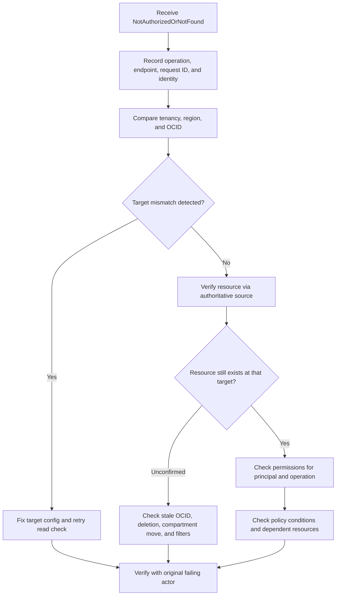

# Investigating NotAuthorizedOrNotFound and Region Scope Mismatches

In the **Operations and Troubleshooting** chapter of Oracle Cloud Infrastructure (OCI), a common scenario is that a resource appears in the Console while the CLI, SDK, or pipeline reports `NotAuthorizedOrNotFound`. Another cause with a similar symptom is an application sending requests to the wrong region. If operators rush to add permissions or recreate resources, they risk expanding access unnecessarily, incurring extra cost, and extending recovery time.

This lesson builds an investigation workflow moving from request evidence and resource scope to IAM policies. Compute is used as the primary example; the same reasoning applies when working with VCN, storage, and Oracle database services, provided you check the APIs and permissions specific to each service.

After this lesson, you can:

- Distinguish among authentication errors, authorization errors, and cases where a resource is not found in the queried scope.
- Identify the exact identity, tenancy, region, compartment, and OCID used by a request.
- Perform read-only checks to separate endpoint mismatches from IAM issues.
- Document fixes and verify them using the exact principal that originally failed.

## 1. Understand the Error Message Before Fixing

`NotAuthorizedOrNotFound` typically accompanies HTTP `404`. OCI returns this code either when the specified resource is not found or when the caller is not authorized to access it. Therefore, **this error code alone cannot uniquely identify the cause**. You must check both the resource target and access permissions. [See Oracle API error descriptions](https://docs.oracle.com/en-us/iaas/Content/API/References/apierrors.htm).

The error example below is shortened to illustrate evidence structure; actual values depend on the tool and API:

```json
{
  "status": 404,
  "code": "NotAuthorizedOrNotFound",
  "message": "Authorization failed or requested resource not found.",
  "operation_name": "get_instance",
  "request_endpoint": "GET https://iaas.us-phoenix-1.oraclecloud.com/20160918/instances/<instance_ocid>",
  "opc-request-id": "<request_id>"
}
```

From this example, you know the client is calling Compute in `us-phoenix-1`. You do not yet know whether the instance exists there or whether the identity has permission to read it.

Several symptoms to distinguish:

| Symptom | Initial Investigation Direction |
| --- | --- |
| `401 NotAuthenticated` | Credentials, signature, token, key pair, and system clock |
| `404 NotAuthorizedOrNotFound` | Resource target, region/tenancy scope, and caller permissions |
| `403 NotAllowed` with a message requiring the home region | Endpoint dedicated to the corresponding IAM operation |
| Timeout, DNS error, or TLS error | Path from client to API, proxy, and certificates |
| SSH failure to VM or SQL connection failure to database | Data plane path, network configuration, and OS/database authentication |

Do not apply a single generic HTTP meaning across all services. Read `status`, `code`, message, and operation name together; specific codes are listed in [API Errors](https://docs.oracle.com/en-us/iaas/Content/API/References/apierrors.htm).

## 2. Determine the Full Request Context

An OCI API call must be described by a complete set of facts:

```text
Who called + which tenancy + which endpoint/region
           + which API + which resource + which compartment scope
```

| Component | Questions to Answer | Common Mismatch |
| --- | --- | --- |
| Principal (the caller) | User, instance principal, resource principal, or which login session? | Console uses a personal user, pipeline uses a different identity |
| Tenancy | Which tenancy do the credentials and resource belong to? | Profile points to a test environment |
| Region and endpoint | Which hostname did the request go to? Is an endpoint overridden? | Environment variable holds an old region or endpoint |
| Compartment | Which compartment does the resource currently belong to? | Listing in parent compartment while resource is in a child compartment |
| Resource identifier | Are you using the OCID of the right resource type and environment? | Copied OCID from an old deployment |
| Operation | Which API was denied, and does it reference other resources? | Reading instances succeeds, but creating a new one fails on the subnet |

### 2.1. Compartment Does Not Replace Region

A compartment is an organizational and authorization scope. Most resources such as instances, VCNs, and buckets belong to a specific region. Selecting the same compartment in another region does not make those resources appear. IAM resources such as compartments and policies have a different scope from Compute; do not infer an instance's location merely from being able to see the compartment. [Oracle: Managing Regions](https://docs.oracle.com/en-us/iaas/Content/Identity/Tasks/managingregions.htm).

Illustrative example:

```text
Tenancy A
└── Compartment AppProd
    ├── Region ap-singapore-1: instance order-api
    └── Region us-phoenix-1: that instance order-api does not exist
```

This illustrates placement for investigation, not two separate `AppProd` compartments. Switching regions only changes where requests are sent; it does not move or copy instances.

### 2.2. Workload Region and Home Region Have Different Roles

The home region manages the tenancy's relevant IAM definitions. IAM operations requiring the home region must use the corresponding endpoint; Compute workloads are still called in the region where they exist. IAM changes also require propagation time. Do not use the home region as the default for all APIs simply because IAM resources are managed there. [Oracle: The Home Region](https://docs.oracle.com/en-us/iaas/Content/Identity/Tasks/managingregions.htm).

For identity domains and other specialized APIs, check the endpoint rules of that specific service; do not assume all identity endpoints behave identically to Compute APIs.

## 3. Collect Minimum Evidence

Before changing configuration or requesting permissions, compile the following record. Recording both expected and actual values helps catch cases where a pipeline receives different config from a personal workstation.

| Evidence | Content to Save |
| --- | --- |
| Timestamp | Time with time zone, preferring UTC for log correlation |
| Request | Operation, HTTP method, actual endpoint, and full error code |
| Request identifier | `opc-request-id` if returned in the response |
| Identity | Auth type, active profile/config, verified principal, and tenancy |
| Resource | OCID, confirmed region, current compartment |
| Environment | Workstation, CI runner, VM, or Function; CLI/SDK version |
| Recent changes | Group, policy, or dynamic group edits, compartment moves, or deployment variable changes |

Do not attach private keys, tokens, passwords, or full `Authorization` headers. If `--debug` is needed to reveal the actual endpoint, collect it only in an authorized environment and redact sensitive data before sharing. An investigative record should contain enough evidence to reproduce, without containing credentials.

In applications or pipelines, prefer logging selected fields instead of printing the entire environment or config. A field like `profile=OPS` is not enough to prove the principal: the same profile name on two machines can hold different details.

## 4. Isolation Workflow



### Step 1: Confirm the Calling Principal

Specify the actual authentication mechanism:

- **API key:** verify `tenancy`, `user`, fingerprint, and selected config file. Do not print private key contents.
- **Security token:** check the active session and token profile in use; do not infer from a Console session.
- **Instance principal:** check which instance is running the command and which dynamic group applies.
- **Resource principal:** check the exact executing resource, such as a Function, and the policy for that resource.

The CLI can receive settings from parameters, environment variables, and config files. For the same option, command-line values take precedence over environment variables, which take precedence over the config file. Therefore, reading only the config file is not enough to determine effective configuration. [Oracle: CLI Environment Variables](https://docs.oracle.com/en-us/iaas/Content/API/SDKDocs/clienvironmentvariables.htm).

If a user can read the resource in the Console but the pipeline cannot, those are two separate requests to compare. You cannot yet conclude OCI enforces permissions inconsistently.

### Step 2: Confirm the Actual Endpoint

Compare the intended region with the hostname in the error, client config, or request logs. Check `--endpoint`, `OCI_CLI_ENDPOINT`, aliases/wrappers, and endpoint settings in the tool being used.

**Changing `--region` may not change the target if the client still has an explicit endpoint configured.** Endpoint is a separate address configuration, not an alias for the region option. Run region-based checks only after clearing related endpoint overrides. Oracle recommends using `--region` when selecting a region for the CLI. [Oracle: CLI Environment Variables](https://docs.oracle.com/en-us/iaas/Content/API/SDKDocs/clienvironmentvariables.htm).

For SDKs or automation tools, inspect the client/provider actually issuing the request; an outer configuration does not guarantee every child client uses the same region.

### Step 3: Verify the Resource by OCID

Use an authoritative source such as the resource detail page opened by an authorized user, a managed inventory, or a successful read API call to confirm:

1. This is the exact OCID and correct resource type.
2. The resource belongs to the expected tenancy and region.
3. The current compartment matches the query and policy scope.
4. The resource was not deleted, replaced, or recreated with a different OCID.

An identical display name does not prove it is the same resource. A new deployment can keep the name while getting a new OCID; editing characters or assembling an OCID from a name is not a way to restore references.

OCIDs for some resource types contain location hints, but do not treat parsing an OCID string as the sole source of truth. Use verified resource metadata and endpoints.

### Step 4: Cross-Check Permissions by Operation

Evaluate policies based on the actual principal, resource type, required API permissions, target compartment, and attached conditions. Check policies in parent compartments as well because permissions can inherit downward. Do not look only for policies located directly in the compartment containing the instance. [Oracle: Policy Inheritance](https://docs.oracle.com/en-us/iaas/Content/Identity/policieshow/Policy_Inheritance.htm).

Do not infer permissions mechanically from verb names. For example, listing instances requires `read instances`; a policy with only `inspect all-resources` is not enough to allow listing instances as many people expect. [Oracle: Common Policies, permissions for auditors](https://docs.oracle.com/en-us/iaas/Content/Identity/Concepts/commonpolicies.htm).

When using identity domains, verify the exact group and domain referenced by the policy. For dynamic groups, check whether the matching rule actually matches the resource's current OCID, compartment, or tags. [Oracle: Writing Matching Rules](https://docs.oracle.com/en-us/iaas/Content/Identity/dynamicgroups/Writing_Matching_Rules_to_Define_Dynamic_Groups.htm).

### Step 5: Check Dependent Resources

A single request may use multiple resources across different compartments. If creating an instance fails, being able to read existing instances does not prove sufficient permissions on the referenced image, subnet, VNIC, volume, or encryption key.

Break the request into a list of references and check each permission against the operation's documentation. Some APIs require multiple permissions simultaneously across different resource types; permissions on the primary resource do not automatically cover all related resources. [Oracle: Permissions](https://docs.oracle.com/iaas/Content/Identity/policies/permissions.htm).

In database operations, also distinguish between permissions to call OCI management APIs and permissions to log in to the database. Being able to read database metadata does not prove a valid SQL account, and an SQL error does not prove missing IAM permissions.

## 5. Practice with OCI CLI on PowerShell

The following examples are read-only. You need a configured OCI CLI and an identity with appropriate permissions. Replace all values in `<...>` before running. This lesson uses an API key to keep the example context consistent; do not copy `--auth api_key` into workloads that require instance principal or resource principal.

### 5.1. Pin the Test Context

```powershell
$ociConfigPath = Join-Path $env:USERPROFILE '.oci\config'
$ociProfile = 'OPS'
$targetRegion = 'ap-singapore-1'
$tenancyOcid = '<tenancy_ocid>'
$compartmentOcid = '<compartment_ocid>'
$instanceOcid = '<instance_ocid>'

# Inspect only variables related to configuration and endpoint selection.
Get-Item Env:OCI_CLI_REGION, Env:OCI_CLI_ENDPOINT, Env:OCI_CLI_PROFILE, Env:OCI_CLI_CONFIG_FILE, Env:OCI_CLI_AUTH -ErrorAction SilentlyContinue |
    Select-Object Name, Value

$ociContext = @(
    '--config-file', $ociConfigPath,
    '--profile', $ociProfile,
    '--auth', 'api_key',
    '--region', $targetRegion
)
```

The `$ociContext` array is passed to commands via PowerShell's `@ociContext` splatting syntax. Check beforehand that the selected profile belongs to the right tenancy and user and has no endpoint override conflicting with the test. Printing the variables above does not detect every alias, wrapper, or defaults file; the actual endpoint of the request remains decisive evidence. See also [configuring the OCI CLI](https://docs.oracle.com/en-us/iaas/Content/API/SDKDocs/cliconfigure.htm).

### 5.2. Check Region Subscriptions

```powershell
oci @ociContext iam region-subscription list --tenancy-id $tenancyOcid --all --output json
```

In a successful response, verify `region-name`, `status`, and `is-home-region`. Confirm the intended region is in ready status. `oci iam region list` lists offered regions and does not replace checking tenancy subscriptions. [Reference: `region-subscription list`](https://docs.oracle.com/en-us/iaas/tools/oci-cli/latest/oci_cli_docs/cmdref/iam/region-subscription/list.html).

If the command is denied, ask someone with permission to confirm the subscription; do not interpret that error as proof the tenancy is not subscribed to the region. Subscribing to a new region is a separate infrastructure change decision, not a troubleshooting step for finding a missing instance.

### 5.3. Read the Instance Directly by OCID

```powershell
oci @ociContext compute instance get --instance-id $instanceOcid --output json
```

If successful, check `id`, `compartment-id`, `availability-domain`, and `lifecycle-state`. This result confirms that the active principal can read **the specific instance at the called endpoint**. It does not prove permissions to create, update, stop, or terminate instances. [Reference: `compute instance get`](https://docs.oracle.com/en-us/iaas/tools/oci-cli/latest/oci_cli_docs/cmdref/compute/instance/get.html).

This `get` command does not take `--compartment-id`: the API identifies the instance by OCID. Therefore, changing a compartment variable used only for `list` will not fix a `get` request sent to the wrong region.

### 5.4. List the Right Scope When Searching for Bad References

```powershell
oci @ociContext compute instance list --compartment-id $compartmentOcid --all --output json
```

`--all` fetches all pages of results. On the initial check, avoid filters on name, state, or availability domain to reduce the chance of filtering out the target resource. This command lists within the specified compartment; it does not automatically traverse the entire compartment tree. [Reference: `compute instance list`](https://docs.oracle.com/en-us/iaas/tools/oci-cli/latest/oci_cli_docs/cmdref/compute/instance/list.html).

An empty list only states that the current listing returned no resources within that scope and filter set. Before concluding a resource was deleted, check region, child compartments, permissions, and any filters coming from wrappers or defaults.

### 5.5. Retry the Confirmed Region

Suppose the initial error went to Phoenix, while an authoritative source confirms the instance is in Singapore. Keep the same profile, auth mechanism, and OCID; change only the region after ruling out endpoint overrides:

```powershell
oci --config-file $ociConfigPath --profile $ociProfile --auth api_key --region ap-singapore-1 compute instance get --instance-id $instanceOcid --output json
```

If the request succeeds, you have strong evidence of a wrong region target in the original request. Fix the configuration source causing the mismatch in the application or pipeline, then re-run the exact call path that failed. A successful test from a personal workstation is not enough to prove the CI runner is fixed.

Do not scan all regions blindly when a reliable inventory already exists. Targeted checks are easier to correlate and reduce unnecessary requests.

## 6. When Evidence Points to IAM

Suppose an authorized person confirms the instance exists in the right tenancy, region, and compartment, yet the operations principal still cannot call `GetInstance`. At this point, inspect policies and group memberships rather than continuing to switch regions.

Example policy for an operations group to read instances in the exact compartment, using OCIDs to avoid name ambiguity:

```text
Allow group id <group_ocid> to read instances in compartment id <compartment_ocid>
```

This is an illustrative template for read needs. Administrators should place policies at the appropriate scope, substitute real OCIDs, and consider any access conditions enforced in the environment. `read instances` covers corresponding read APIs; it does not grant full Compute management rights. Always cross-check operations and permissions in [Details for the Core Services](https://docs.oracle.com/en-us/iaas/Content/Identity/Reference/corepolicyreference.htm).

Points to verify during remediation:

- Does the group referenced by the policy contain the user signing the request?
- For instance/resource principals, do the dynamic group matching rule and policy match the executing resource?
- Does the policy target the current compartment, including after any compartment move?
- Are conditions on region, time, request source, tags, or specific resources satisfied?
- Does the operation require permissions on dependent resources in another compartment?

After updating IAM, record the change timestamp and retry after a reasonable pause to allow propagation. If errors persist, return to the evidence; do not keep adding broader policies. If the auth workflow requires refreshing a session or token, follow the active mechanism's procedure.

Granting `manage all-resources in tenancy` just to see if the error disappears introduces too many changes at once. Even if the request succeeds, such a test does not identify the minimal missing permission and can expose unnecessary data.

## 7. Three Typical Operational Scenarios

### 7.1. Same Profile but Wrong Region on Runner

A pipeline reading an instance hits `404`, while the same operation succeeds from an operator's workstation. Both use the same user and same OCID. The failing endpoint contains `us-phoenix-1`; inventory confirms the instance is in `ap-singapore-1`.

The fix is to trace where the runner gets its region: CI variables, command arguments, config, or wrapper. Pin the right region on the actual call path, check the endpoint, and re-run the read from the runner. No policy change is needed if evidence shows read permissions are already sufficient when calling the right target.

### 7.2. Console Works but Function Is Denied

A developer can see the resource using their personal user, while a Function uses a resource principal. Success in the Console only confirms permissions for that personal user.

Verify the executing resource of the Function, the dynamic group matching rule, the policy for the resource principal, and the target compartment. Do not embed a personal API key into a Function just to make it behave like a Console session.

### 7.3. Can Read Instances but Cannot Create a New Instance

The operations team has permission to read or manage instances in `AppProd`, but the create request references a subnet in `SharedNetwork` and an image managed by another group. A dependent reference may not exist in the selected region or may lack required permissions.

Break out the OCIDs in the request, verify each resource's location, and check the operation's required permissions. If the issue is on the shared subnet, expanding Compute permissions in `AppProd` will not grant access to that subnet.

These scenarios are examples of reasoning; not every service returns the exact same error code for the same type of mismatch. Actual API error codes and request evidence remain the decisive basis.

## 8. Cross-Check Audit and Prepare Escalation

Audit records activity on supported OCI APIs. When accessible, use time range, identity, operation, resource, and request details to locate the failing call. Verify region and compartment when searching events, and account for log ingestion delay. [Oracle: Overview of Audit](https://docs.oracle.com/en-us/iaas/Content/Audit/Concepts/auditoverview.htm).

Do not treat not finding an Audit event as proof the resource does not exist. You might be searching the wrong scope, lack log-read permissions, or the request may not have reached the audited point. Audit also has its own coverage scope: for instance, documentation notes Object Storage logs bucket-related events, not object-level events in Audit. When investigating object access, use the appropriate service log source. [Oracle: Overview of Audit](https://docs.oracle.com/en-us/iaas/Content/Audit/Concepts/auditoverview.htm).

If you need an administrator or Oracle Support to investigate further, prepare a bundle with sensitive data redacted:

```text
UTC Timestamp:
Environment and CLI/SDK version:
Auth type and verified principal:
Tenancy / region / compartment / resource OCID:
Actual operation and endpoint:
HTTP status / error code / message:
opc-request-id:
Source confirming resource still exists:
Read check result with explicit context:
Most recent change and execution time:
```

Do not ask a team member to send their private key so someone else can reproduce the issue. Share commands with credentials replaced by references and let each person use their own authorized identity.

## 9. Closure Criteria and Preventing Recurrence

An incident can be closed when three pieces of evidence are complete:

1. **Evidence-backed root cause:** the specific mismatch is identified, such as calling the Phoenix endpoint when the instance is in Singapore, or a dynamic group missing permissions on the target compartment.
2. **Original call path works:** the exact application, runner, or resource principal that failed has successfully executed the required operation on the right resource.
3. **Configuration and permission scope verified:** no overrides causing target drift or overly broad test permissions remain; changes are saved in managed configuration sources.

Preventive actions should match the proven root cause:

| Root Cause | Appropriate Preventive Measure |
| --- | --- |
| Default region varies across machines | Declare region explicitly in deployment config and log effective region at startup |
| Forgotten endpoint override | Manage endpoints centrally and verify client endpoint after configuration |
| Wrong profile or tenancy | Separate configurations by environment and verify identity before deployment actions |
| Stale OCID after resource recreation | Pass identifiers from deployment outputs or managed inventory |
| Compartment move breaks permission scope | Assess IAM and reference impact before moving resources |
| Policy missing permissions on dependent resources | Explicitly document dependencies and verify operations with the operational identity |
| Error detected too late | Add a target read check at the start of the pipeline with appropriate permissions |

This error typically sits at the management API call step. Once you have proven the request reached the right OCI API and returned a resource-or-permission error, prioritize investigating request context and IAM. Restarting VMs, opening database ports, or recreating infrastructure provides no evidence for those two root-cause categories, and can increase outage duration and cost.
