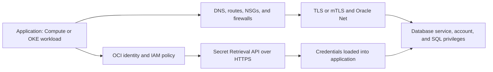

# Investigating Database Connection, TLS, and Expired Secret Failures

## 1. Objectives and Operational Scope

An application on Oracle Cloud Infrastructure (OCI) may report "cannot connect to database" when DNS is wrong, packets are blocked, the listener does not know the service, a certificate is untrusted, or credentials have changed. The same HTTP-layer message can mask many root causes. Effective investigation starts by identifying the **first step that fails**, then testing one hypothesis with one focused check.

This lesson belongs to the **Operations and Troubleshooting** chapter in the scope of Oracle Cloud Infrastructure. After this lesson, learners can:

- Distinguish among network path, Oracle Net, TLS/mTLS, database account, and secret retrieval failures.
- Collect evidence from the exact failing Compute instance, container, or workload.
- Restore connectivity using clearly scoped changes while preserving least privilege and server identity verification.
- Verify that the application actually uses the new wallet or secret, even when connection pools still hold old sessions.
- Design expiration tracking, rotation procedures, and recovery evidence.

The running scenario is an ordering service running on Compute or OKE, accessing an Oracle Database via a private endpoint and retrieving passwords from OCI Secret Management, typically managed via Vault. The database may be Autonomous Database, Base Database Service, or self-managed Oracle Database on Compute.

Responsibility boundaries differ:

| Deployment Model | Scope Typically Inspected by Operators |
| --- | --- |
| Autonomous Database | Service status, endpoint, ACL/NSG where applicable, connect descriptor, TLS/mTLS mode, wallet, accounts, and SQL privileges |
| Base Database Service | The above plus OS, listener, and database components that the service allows customers to administer |
| Self-managed Oracle Database on Compute | The full stack within system scope, including host firewall, listener, and server-side TLS configuration |

The commands below are examples to run in an authorized diagnostic environment. Appropriate tools are required, and illustrative names must be replaced with real configurations. This lesson does not require creating a new database, opening endpoints to the Internet, or running listener admin commands on Autonomous Database.

## 2. Investigation Model: Two Connectivity Paths and Three Identity Layers

### 2.1. Two Independent Dependency Paths

An application using secrets has at least two dependency paths:



The arrows show dependency relationships, not the exact protocol sequence for every client type.

The path to the database and the path to the Secret Retrieval API have separate hostnames, ports, routes, access rules, and authentication mechanisms. If the database is reachable yet the application cannot fetch secrets at startup, the failure may occur before any database socket is ever opened. Conversely, reading a secret successfully does not prove the database endpoint is reachable.

### 2.2. Three Identity Questions

| Layer | Question to Answer | Useful Evidence |
| --- | --- | --- |
| OCI IAM | Which workload is permitted to call which API and read which secret? | Principal, dynamic group or workload identity, policy, compartment, request ID |
| TLS/mTLS | Does the client verify the right server and present the right client certificate when required? | Trust store, server name, CA chain, certificate validity dates, active loaded wallet |
| Database | Are the credentials or token accepted by the database and do they hold required privileges? | Oracle error code, target user/PDB/service, account status, minimal SQL result |

In a standard username/password model, OCI secret-read permissions do not create a database account. A wallet used for mTLS also does not automatically grant all SQL privileges. If the system uses IAM database authentication or another federation mechanism, add checks for tokens, lifetimes, and database user mappings according to the configured mechanism.

Do not use a tenancy admin account to conclude the workload has enough permissions. Operators and applications normally use different principals.

## 3. Collect Evidence and Perform Initial Triage

### 3.1. Minimum Record Before Making Changes

Record:

1. First failure timestamp, last known success time, and time zone; convert to UTC when correlating logs.
2. Region, compartment, database OCID, endpoint, port, service/PDB, and TLS/mTLS mode.
3. Specific Compute instance or pod; image, app version, JDK, and Oracle client/JDBC driver.
4. Root error code in the exception chain; API request ID or Oracle Net `CONNECTION_ID` when available.
5. Whether all replicas fail or only a subset; whether failures occur when creating new connections or using existing ones.
6. Most recent changes: rollout, DNS, NSG, ACL, IAM policy, password rotation, wallet or trust store change.
7. Secret OCID, version/stage used by the app, last refresh time; wallet/certificate fingerprint and expiration date if available.

Record only necessary metadata. Never put passwords, private keys, tokens, full secret bundles, or wallet ZIPs into logs and tickets. Redact sensitive portions of connection strings before sharing. When detailed tracing is needed, bound duration, read permissions, and size.

For Java, messages like `SQLTransientConnectionException` or "pool timeout" are starting points. Read `cause`, `SQLException.getErrorCode()`, `getSQLState()`, and chained exceptions when available. A pool can exhaust connections because sessions are held too long, even while the database accepts new connections normally.

### 3.2. Triage Orientation Table

| Symptom | Prioritized Hypothesis | Next Check |
| --- | --- | --- |
| Hostname cannot be resolved | DNS or private DNS scope | Resolve directly from the workload and verify endpoint |
| `ORA-12154` | Could not resolve connect identifier/alias | Alias, naming method, `tnsnames.ora`, client config directory |
| TCP timeout or `ORA-12170` | Setup/communication did not finish within timeout | Timeout type, bidirectional network path, firewall, system load |
| Connection refused or `ORA-12541` | Wrong target/port or no listener at target | Connect descriptor and listener via authorized admin access |
| `ORA-12514` | Listener does not know the requested database service | Service name, PDB, service registration status |
| `ORA-28759` | Failed to open required file, often wallet-related | Actual path, mount, and read permissions |
| `ORA-29024`, `PKIX path building failed` | Cannot verify certificate or trust chain | CA, cert expiration, trust store, and endpoint |
| Hostname/DN mismatch or handshake failure | Wrong server identity or protocol config | Hostname/DN, TLS version, ciphers, and client support |
| `ORA-01017` | Invalid credentials or logon denied | User, target database, secret version, and auth mechanism |
| `ORA-28000` | Account is locked | Account status and clients continuously failing auth |
| `ORA-28001` | Password/account expired, password change required | Profile, expiry, and credential change workflow |
| Error calling Secret Retrieval API | IAM, endpoint, network, lifecycle, or secret expiry rule | HTTP/service error, request ID, principal, and secret metadata |

Error codes help select an investigative branch and are not enough to prove a single root cause. `ORA-12154` is a connect identifier resolution error that can happen before DNS hostname lookup; `ORA-12170` can involve several kinds of timeouts. See official explanations for [ORA-12154](https://docs.oracle.com/en/error-help/db/ora-12154/) and [ORA-12170](https://docs.oracle.com/en/error-help/db/ora-12170/).

For listener and logon errors, check [ORA-12541](https://docs.oracle.com/en/error-help/db/ora-12541/), [ORA-12514](https://docs.oracle.com/en/error-help/db/ora-12514/), [ORA-01017](https://docs.oracle.com/en/error-help/db/ora-01017/), [ORA-28000](https://docs.oracle.com/en/error-help/db/ora-28000/), and [ORA-28001](https://docs.oracle.com/en/error-help/db/ora-28001/) for the exact version in use.

## 4. Check DNS and Network Path from the Exact Failure Origin

### 4.1. Right Hostname, Right Port, Right Source

Take the hostname, port, protocol, and service name from the database's active connect descriptor. Never assume every Oracle Database listens on the same port, nor infer TLS mode from the port number.

If the application runs in a pod, test from that pod or a diagnostic tool placed in the exact matching network context. Results from a laptop, Cloud Shell, or bastion only describe the path from that location. Even the same subnet is not equivalent if NSGs, proxies, network policies, or DNS differ.

PowerShell example on a Windows machine sharing the access path to test:

```powershell
$dbHostName = 'db-private.example.internal'
$dbListenerPort = 1522 # Illustrative; replace with PORT from connect descriptor

Get-Date -AsUTC
Resolve-DnsName -Name $dbHostName
Test-NetConnection -ComputerName $dbHostName -Port $dbListenerPort -InformationLevel Detailed
```

`Get-Date -AsUTC` is available in PowerShell 7; on Windows PowerShell 5.1 you can use `[DateTime]::UtcNow.ToString('o')`.

Bash example on Linux, if `getent` and `nc` are present:

```bash
db_host='db-private.example.internal'
db_port='1522' # Illustrative; replace with PORT from connect descriptor

date -u
getent ahosts "$db_host"
nc -vz -w 5 "$db_host" "$db_port"
```

The five-second limit is only an illustrative timeout for the TCP check. Check `nc` syntax on your installed version since variants differ.

Interpret in order:

- Fails to resolve: check private DNS zone/view, resolver, DNS forwarding, and on-premises resolution if applicable.
- Resolves but wrong IP/scope: check public/private endpoints and DNS cache. When multiple valid addresses exist, determine which address the client actually picks.
- TCP fails to complete: continue inspecting routes and access controls.
- TCP succeeds: proves only that TCP can reach that target; does not prove TLS, service name, credentials, or SQL work.

Do not use `ping` results to substitute for testing the database port. ICMP and TCP can be governed by different rules. Do not hardcode IPs in the application to bypass DNS, as that can break TLS identity verification and cause outages when endpoints change addresses.

### 4.2. Inspection Path Inside OCI

Check the actual path:

1. Source VNIC/subnet and NSGs attached to the workload.
2. Source, destination, and return routes; DRG, peering, VPN, or FastConnect if traffic traverses them.
3. Source egress, destination ingress, and intermediate firewalls.
4. Autonomous Database public endpoint ACL if the configuration uses ACLs.
5. OS firewalls or network appliances managed by the customer.
6. ZPR policies if the endpoint carries Zero Trust Packet Routing security attributes.

Security lists apply per subnet; NSGs apply to attached VNICs/resources. Effective allow rules from security lists and NSGs are evaluated together as a union, rather than requiring identical rules in both places. If an endpoint is governed by ZPR, matching ZPR policies must also be satisfied. With stateful rules, return traffic for tracked connections is permitted; with stateless rules, both the return path and matching ephemeral source ports must be explicitly permitted. See [Security Rules](https://docs.oracle.com/en-us/iaas/Content/Network/Concepts/securityrules.htm).

A targeted fix might be permitting TCP from the application NSG to the database NSG in the same VCN on the exact listener port. If using CIDRs, identify the exact source address seen by the target after NAT or proxies. Never open database ports to the entire Internet just to test.

For the secret retrieval path, separately verify HTTPS to the Secret Retrieval endpoint of the active region/realm. Private subnets require a path to the corresponding service endpoint, such as a Service Gateway for supported services in Oracle Services Network or a designed egress path. Having a Service Gateway does not create a path to a private database IP.

### 4.3. Use Observability Tools Within Their Limits

- **Network Path Analyzer:** models route and security configuration from source to destination. It does not send real traffic, so a reachable result does not verify DNS, listener processes, TLS, or passwords. Check support limits for the path type being analyzed. See [Network Path Analyzer](https://docs.oracle.com/en-us/iaas/Content/Network/Concepts/path_analyzer.htm).
- **VCN Flow Logs:** if enabled for the appropriate scope, filter by exact time range, source/destination IPs, protocol, and port to look for accept/reject entries. An accepted flow does not prove database login succeeded; seeing no flows does not prove no traffic occurred if logging was disabled or not yet ingested.
- **Application and client logs:** identify the exact failing socket/endpoint, timeout type, and connection-open duration.

The guide [Troubleshoot Basic Network Issues in OCI](https://docs.oracle.com/en/learn/oci-ntw-troubleshoot-1/index.html) illustrates combining network checks and Flow Logs. When enabling logs during an incident, set scope, retention, and access controls appropriately to control costs and operational data exposure.

## 5. Check Connect Descriptor, Listener, and Database Service

A connect descriptor has multiple non-interchangeable values:

| Component | Meaning |
| --- | --- |
| Alias, e.g., `orders_tp` | Client-side name used to look up the connect descriptor |
| `HOST`, `PORT`, `PROTOCOL` | Network target and connection protocol |
| `SERVICE_NAME` | Database service the listener routes to |
| PDB | Target pluggable/container database for the account and data |
| Wallet/trust configuration | Material and settings used for TLS/mTLS |

OCI resource display names, schema names, SIDs, and service names are not necessarily identical. After cloning, restoring, or switching endpoints, an old descriptor may still resolve and open TCP yet point to the wrong service.

### 5.1. Test with an Appropriate Client

With an Oracle client configured with the right alias, TLS, and wallet if needed:

```bash
export TNS_ADMIN='/opt/app/oracle-net'
tnsping orders_tp
sqlplus -L app_user@orders_tp
```

`sqlplus` will prompt for the password; never put passwords on the command line. `tnsping` is only helpful if installed and using the exact naming config under test. It does not authenticate accounts or prove SQL execution. JDBC Thin may read different configuration from SQL*Plus, so testing with SQL*Plus is only a cross-check; you must still test with the application's driver.

After signing in, run:

```sql
SELECT 1 AS connection_ok FROM dual;

SELECT
    SYS_CONTEXT('USERENV', 'SESSION_USER') AS session_user,
    SYS_CONTEXT('USERENV', 'SERVICE_NAME') AS service_name,
    SYS_CONTEXT('USERENV', 'CON_NAME') AS container_name
FROM dual;
```

Results must match the expected user, service, and container. Then test a small, read-only business operation requiring actual application privileges. `SELECT 1 FROM dual` succeeding does not prove the application can access required tables.

### 5.2. If the Listener Accepts Connections but Does Not Know the Service

For `ORA-12514`, check the descriptor and database/PDB status first. On systems where listener administration is permitted, a DBA can run:

```bash
lsnrctl status
lsnrctl services
```

Use the right listener name and Oracle Home/Grid Home environment per the system runbook. Compare services advertised by the listener, the corresponding database/PDB, and logs around the error time. For Autonomous Database, inspect service status and OCI-provided connection details; do not try to SSH to modify a managed service's listener.

Do not edit `listener.ora`, restart the listener, or open PDBs merely upon seeing an error code. First determine the intended service, component owner, and impact of the change.

## 6. Investigate TLS, mTLS, and Wallets

### 6.1. Identify the Active TLS Model

In server-authenticated TLS, the client must verify the server certificate and endpoint identity. In mTLS, the client must also present a client certificate and private key so the server authenticates the client.

For Autonomous Database, walletless TLS support depends on client type, version, and service configuration; mTLS connections normally use a client credentials wallet. Use the connect string for the exact mode and check the client support matrix in [Connect to Autonomous Database](https://docs.oracle.com/en-us/iaas/autonomous-database-serverless/doc/connect-autonomous-database.html). Do not apply one client type's configuration to every runtime.

A wallet can hold private keys and client certificates; a trust store holds trusted CA certificates. Wallet password, database password, and private key password are distinct artifacts. Changing one does not fix errors in another.

### 6.2. Inspect Actual Files and Configuration at Runtime

Check from the exact user and filesystem used by the running process:

- Does the wallet/trust store path exist inside the container after rollout?
- Does the UID/GID or service account have read permission on the files and execute/traverse permission on parent directories?
- Does the mount point to the expected version, or is it shadowed by another mount?
- Is the client reading config from environment variables, URLs, system properties, or driver-specific settings?
- Has the process reloaded configuration, or were only files on disk replaced?
- Did the client receive the complete set of files shipped with the wallet and matching TLS settings?

For Java, identify the exact JDK/JRE and JDBC driver used by the image. Check the selected trust store, Oracle wallet settings, and driver TNS parameters. Do not assume setting `TNS_ADMIN` alone causes every Java library to automatically load all TLS material.

Example inspection of wallet contents and public certificates, if tools are available:

```bash
orapki wallet display -wallet /run/secrets/adb-wallet -summary

openssl x509 -in /opt/diagnostics/server-cert.pem -noout -subject -issuer -dates -fingerprint -sha256

keytool -list -v -keystore /opt/app/security/truststore.p12 -storetype PKCS12
```

`server-cert.pem` in the example is a public certificate collected per diagnostic workflow, not a private key. `openssl x509` only reads a local file; its output does not prove the listener presents that exact certificate. `keytool` may prompt for the keystore password interactively. Never pass passwords as exposed command-line flags.

The expiration date on one certificate does not describe the whole CA chain. Check applicable leaf, intermediate, and root certificates. Also check system clocks, `notBefore`, `notAfter`, and whether the host displays UTC or local time.

### 6.3. Interpret Error Groups

| Error Group | Key Inspection Point | Evidence-Based Remediation |
| --- | --- | --- |
| Cannot open wallet, such as `ORA-28759` | Path, filename, read permissions, mount, and how client selects wallet | Fix path/permissions or redeploy the right files |
| Certificate validation failure, such as `ORA-29024` | CA chain, cert expiration, actual active trust store | Add valid trust chain or replace cert/wallet from right source |
| Hostname or server DN mismatch | Endpoint in descriptor vs expected certificate identity | Fix endpoint or matching config per client documentation |
| TLS protocol/cipher mismatch | Shared protocols and ciphers between client and server | Update client or config within supported bounds |
| Client certificate rejected | Whether mTLS is required, wallet matches database, cert still valid | Provision and deploy valid client credentials |
| Only new pods fail | Wallet mount, image/JDK, trust store, or new config differs from old pods | Compare active versions and loaded config across pods |

Oracle documents wallet file errors, protocol errors, and certificate validation failures in [Troubleshooting the Transport Layer Security Configuration](https://docs.oracle.com/en/database/oracle/oracle-database/26/dbseg/troubleshooting-transport-layer-security-configuration.html). Follow guidance matching your running client/server versions.

Never disable hostname/server DN verification or install a trust-all manager to "fix" an error. That strips server verification evidence and hides the root cause. Nor should you switch from TCPS to TCP as a default recovery workaround.

A generic TLS test like `openssl s_client`, when appropriate for the endpoint, can help gather certificates and handshake details. It does not replace testing with an Oracle client: a listener may require mTLS, SNI, or custom session setup. A handshake failure from a generic tool does not prove the database is broken.

### 6.4. Expired Wallets and Wallet Rotation

For Autonomous Database, when a wallet is nearing expiration or has expired, download/issue a new wallet from an authorized management source and deploy it to consumers. See [Download Database Connection Information](https://docs.oracle.com/en-us/iaas/autonomous-database-serverless/doc/connect-download-wallet.html).

Distinguish two operations:

- **Download a new wallet:** obtains a client credentials bundle for use; does not automatically revoke all older wallets.
- **Rotate wallet:** changes validity of client certification keys according to the chosen scope and rotation mode.

Wallet replacement should use versioned directories, deploy the complete file set, test on one replica, and roll out gradually. Avoid overwriting files one by one in a directory actively read by running processes, as that can leave a mismatched wallet/config set.

Autonomous Database offers instant rotation or rotation with a grace period in supported configurations; instance and regional scopes differ. Behavior of existing sessions also differs across modes. Read the impact before acting, especially for regional wallets that may affect multiple databases. See [Rotate Wallets for Autonomous Database](https://docs.oracle.com/en-us/iaas/autonomous-database-serverless/doc/wallet-rotate.html). Do not use broad rotation as the first diagnostic attempt for a single pod's failure.

## 7. Distinguish Types of "Expiration"

The phrase "expired secret" must be translated into the specific object, timestamp, and enforcement mechanism.

| Artifact | Who Determines Validity? | Observable Symptom | Correct Layer Action |
| --- | --- | --- | --- |
| Secret or secret version in OCI | Secret Management expiry rule | Warning or blocked content retrieval, depending on config | Inspect rule and rotate per procedure |
| Database password | User profile/status inside the database | `ORA-28001`, or impending expiry warning like `ORA-28002` | Change password at database and sync consumers |
| Client certificate in wallet | Certificate lifetime and server-side key state | mTLS fails to establish new sessions | Issue and deploy a valid wallet |
| Server/CA certificate | Presented certificate chain and client trust store | Certificate validation failure | Replace cert/CA chain or update trust from right source |
| Authentication token | Token issuer and validator mechanism | Errors refreshing token or authenticating | Refresh via right principal and supported mechanism |
| Cached credential in process | Application cache/refresh logic | Vault has new version while replica still uses old one | Refresh config and recreate connections cleanly |

OCI Secret Expiry Rules can configure version expiry, absolute secret expiry, and whether to block retrieval after expiry. Thus **expiration does not always mean content cannot be read**. Conversely, a retrieval-blocking rule can stop new pods from starting even while old pods holding cached credentials keep running. See [Secret Rules](https://docs.oracle.com/en-us/iaas/Content/secret-management/Concepts/secret-rules.htm) and [Updating a Secret’s Rules](https://docs.oracle.com/en-us/iaas/Content/secret-management/Tasks/update-secret_rules.htm).

An expiry rule by itself does not change the password inside the database. Secret auto-generation and auto-rotation are separate configurable capabilities. If using automatic rotation, check the target system, rotation schedule, and most recent successful run; do not infer from "enabled" that the database and all consumers are synchronized. See [Creating a Secret](https://docs.oracle.com/en-us/iaas/Content/secret-management/Tasks/create-secret.htm).

Track at least four distinct dates: secret/version expiry, database password expiry, certificate expiry, and last successful app refresh time. Using a single timestamp to represent all four will miss failure windows.

## 8. Investigate Secret Retrieval and Version Mismatches

### 8.1. Verify the Right Principal and Right Resource

If the application fails at the secret-retrieval step, check in order:

1. Exact **secret** OCID, region/realm, and retrieval endpoint.
2. Actual workload principal; on Compute this may be instance principal, on OKE depending on workload identity or configured identity.
3. Dynamic group/mapping and IAM policy in the exact compartment.
4. Secret lifecycle state and any related resources cited in service errors.
5. Expiry rule, expiration timestamp, and retrieval-blocking setting.
6. Version/stage requested by the call vs version cached by the process.
7. DNS, proxy, HTTPS, and route to the Secret Retrieval API if requests do not reach the service.

A "not authorized or not found" error requires checking both permissions and OCID/region; do not conclude the secret was deleted solely from that message. An API auth error is also not `ORA-01017`: those two errors occur in two different systems.

Example policy scoping one secret to the application's dynamic group:

```text
Allow dynamic-group dg-orders-runtime to read secret-bundles in compartment app-secrets where target.secret.id = '<secret_ocid>'
```

Replace all placeholders, using your environment's dynamic group/identity domain names and policy scope. This is a template for reading secret content, not managing secrets. The `target.secret.id` restriction pattern is illustrated in [IAM policy for secret bundle access](https://docs.oracle.com/en-us/iaas/Content/APIGateway/Tasks/apigatewaytroubleshooting_topic-gateway_create_or_update_fails.htm).

Do not grant `manage all-resources` to try fixing secret-read failures. If compartments or principals changed, verify policies and new ownership rather than repeatedly changing the database password.

### 8.2. Distinguish Stage and Version

| Value | Operational Meaning |
| --- | --- |
| `CURRENT` | Version designated for active current use |
| `LATEST` | Most recently created/uploaded version, may not yet be ready for use |
| `PENDING` | Version being prepared or verified |
| `PREVIOUS` | Version that was formerly current, useful for recovery workflows |
| `DEPRECATED` | Version no longer marked current, pending, or previous |

A single version can hold multiple stages; an initial sole version can be both current and latest. An application reading `LATEST` can pick up a new credential before the database is updated. An application pinned to a specific version number will not switch automatically just because `CURRENT` moves. States are described in [Managing Vault Secrets](https://docs.cloud.oracle.com/en-us/Content/KeyManagement/Tasks/managingsecrets.htm).

The following example is for a Compute instance using an authorized instance principal, run in Bash with OCI CLI installed:

```bash
oci_region='ap-singapore-1' # Illustrative; replace with the secret's region
secret_id='<secret_ocid>'

oci secrets secret-bundle get --auth instance_principal --region "$oci_region" --secret-id "$secret_id" --stage CURRENT --query 'data.{version:"version-number",stages:stages,expires:"time-of-expiry"}' --output json
```

The command selects only the version, stages, and expiration fields for display. **The API still retrieves the secret bundle into the CLI process**; the query filter does not turn the call into a metadata-only API. Do not enable debug, do not remove the filter to print the full response, and do not write raw responses to logs. If retrieval is blocked, read rules/metadata via the Console or management API with appropriate permissions; management metadata read permissions and bundle-read permissions are two scopes to keep separate.

`GetSecretBundle` defaults to returning the current version when no selector is specified; the example specifies `--stage CURRENT` for clarity. See [OCI CLI: secret-bundle get](https://docs.oracle.com/en-us/iaas/tools/oci-cli/latest/oci_cli_docs/cmdref/secrets/secret-bundle/get.html). Bundle version/stage/expiry fields are described in [Secrets SDK models](https://docs.oracle.com/en-us/iaas/tools/go/latest/secrets/index.html).

### 8.3. Secret Is Readable, but Database Still Rejects It

Inspect the application's processing chain:

- Did it read the right version, or is it still using startup cache?
- Is the payload a plain password string or JSON containing `username`/`password`?
- Does the app Base64-decode exactly once per API/SDK contract?
- Were trailing newlines added when creating the secret, or did a parser strip special characters?
- Do the username and password belong to the exact database/PDB/service being connected to?
- Have all replicas loaded the same credential version?

Do not automatically `trim()` passwords to "clean" data; whitespace can be a valid part of a credential. Do not log password hashes as comparison labels. Tracking secret OCID/version, load timestamp, and validation status suffices for most investigations.

Strong evidence is when a new connection to the exact service succeeds with the new credential version, while one replica still reports the old version and `ORA-01017`. In that case, prioritize investigating refresh/caching on that replica.

## 9. Recover Passwords, Secrets, and Connection Pools

### 9.1. Verify Database Account Status

A DBA with appropriate dictionary read privileges in the right PDB/container can check:

```sql
SELECT username, account_status, lock_date, expiry_date, profile
FROM dba_users
WHERE username = 'APP_USER';
```

`APP_USER` is an example unquoted identifier; substitute the exact real name. Do not grant broad dictionary privileges to applications just to run this check.

`EXPIRED`, `EXPIRED(GRACE)`, `LOCKED`, and `LOCKED(TIMED)` require handling specific to their status. `EXPIRY_DATE` may be null in some cases; do not rely on that field alone to conclude all auth methods remain valid. See [DBA_USERS](https://docs.oracle.com/en/database/oracle/oracle-database/19/refrn/DBA_USERS.html).

If an account is locked due to repeated failed attempts, first identify and reduce/stop the failing caller. Unlocking while replicas still send the old password can lock the account again. For expired passwords, rotate per profile and approved governance mechanisms, then sync secrets/consumers. Do not disable system-wide password policies to work around a single account.

### 9.2. Rotation Workflow with Verification Checkpoints

Rotation must synchronize **target database → selected secret version → in-process configuration → new physical connections**. Seeing a new version in Vault alone is not enough.

The sequence below is a template for manual rotation. Adapt it to database type and password rollover/dual-credential support. If only one password is valid at a time, there will be a window where old clients and the database are out of sync; plan for brief disruption or an appropriate cutover mechanism.

1. **Inventory consumers.** Include APIs, background jobs, batch runners, migration tools, and paused replicas. Record active version/wallet and owner.
2. **Prepare new credentials.** Create a version in pending state through a secure admin channel; do not promote immediately. For auto-rotation, follow the service's workflow without running manual steps concurrently.
3. **Update credentials at the database.** Execute via supported mechanisms. If valid rollover is available, record the overlap window; if not, coordinate cutover and stale retry sources.
4. **Verify the pending version.** Using an authorized test consumer on the right network and driver, open a new session with the new credential and run minimal SQL. Never assume creating a secret updated the target database password.
5. **Promote current and refresh applications.** Once tests pass, promote the right version and trigger reload; avoid leaving apps unintentionally pinned to old versions.
6. **Roll consumers in batches.** Watch connection-open errors, auth errors, pool wait times, and business impact before expanding rollout.
7. **Close the transition.** Confirm every consumer uses the new credential before ending the overlap window or retiring old versions per retention policy.

This is not an atomic transaction between Vault and the database. The runbook must describe intermediate states—such as "database updated, pending verified, current not yet promoted"—along with concrete recovery actions.

### 9.3. Old Pools Can Mask Failures or Prolong Incidents

Authenticated database sessions usually do not re-authenticate on every SQL statement. Thus `SELECT 1` succeeding on an existing pooled connection does not prove new credentials work.

Distinguish between:

- Timeout waiting to borrow a connection from the pool.
- Timeout opening TCP or establishing a session.
- TLS/authentication failure when opening a physical connection.
- Timeout or error executing SQL on an established session.

After refresh, depending on pool capabilities, update the datasource/credentials and drain or replace the pool in a controlled manner. Do not assume updating environment variables or secret files automatically updates already-instantiated datasource objects. Avoid closing every connection across all replicas simultaneously; a synchronized reconnect storm can overload the database and disrupt transactions.

Track at least new connection successes/failures, connection acquisition time, active/idle/pending counts, loaded credential version, and root error codes. If TLS or credentials fail deterministically, endless retries only add load or lock the account. Use bounded retries with backoff and jitter for appropriate transient errors; never blindly replay write transactions when commit outcomes are unknown.

### 9.4. Rollback Must Account for Both Sides

Simply reverting `current` to `previous` in the secret will not recover if the database no longer accepts the previous password. Conversely, reverting the database password while consumers still use the new version also causes errors.

Before rolling back, verify which credentials remain valid on the database, whether password reuse is allowed, and where consumers can revert. Password-reuse rules, compromise, or revoked wallet keys can make rollback impossible. In that case, complete the cutover forward to the new credentials instead of forcing the old ones.

## 10. Timeline-Based Investigation Examples

The scenarios below are hypothetical examples to practice reasoning, not real incident records.

### 10.1. Only New Replicas Fail After a Secret Expires

Context: an API has four replicas using a database password from secret version 12. The app loads credentials at startup without periodic refresh.

| UTC Time | Observation |
| --- | --- |
| 08:00 | Secret/version reaches expiry; expiry rule is configured to block retrieval |
| 08:05 | One replica is replaced during rollout |
| 08:06 | New replica fails at secret retrieval; three older replicas still serve requests |
| 08:10 | DNS and TCP to database succeed from the new replica |

Reasoning:

1. Root failure sits at the retrieval API call, prior to database login.
2. Older replicas continuing to run do not rule out expiry because they cached credentials.
3. Database reachability lowers the priority of an NSG blocking the database port; still check the API path separately.
4. Metadata/rules confirm expiration and blocking; printing the password is unnecessary to prove it.

Recovery follows the secret lifecycle runbook: issue/rotate valid content, sync with the database if credentials changed, verify retrieval, and open a new database session from a test replica. Do not disable expiry-blocking rules as a long-term fix. If emergency plans allow temporarily adjusting a rule, record exact scope, deadline, and follow-up rotation task.

Prevention: monitor expiration ahead of rollouts, verify retrieval with the exact principal, and implement observable refresh mechanisms. Caching can help maintain availability during some outages, provided cache lifetime and credential revocation handling are explicitly designed.

### 10.2. New Secret Promoted Before Database Password Was Changed

Context: version 23 containing a new password was marked current at 09:00, while the database still accepts the old password.

Symptoms: newly started replicas report `ORA-01017`; replicas holding old pools still serve. TCP and TLS pass; no evidence of account expiration.

Verify by aligning the secret change timeline with database operations and loaded application versions. Use a test consumer to verify the exact version via a secure channel; do not brute-force test passwords from version history.

If the old password remains valid, uncompromised, and policy permits, you can revert current to the matching version while completing rotation cleanly. If the database was updated mid-investigation, re-verify before choosing a recovery path. After fixing, open new connections and check all replicas rather than watching traffic on old pools alone.

### 10.3. JDBC PKIX Errors After Image Update

Context: the database endpoint is unchanged, but a new image uses a different JRE/trust store. Old replicas connect fine; new replicas fail building the trust chain.

Isolation: DNS and TCP behave identically across both groups; failure occurs during TLS handshake. Compare actual JREs, selected trust stores, required CAs, and datasource config between the two images.

Remediate with a trust store from the right source or an image configured with the complete CA chain, keeping server identity checks intact. To mitigate impact quickly, roll back the image via the established release process. Changing database passwords or rotating all wallets will not fix an image's trust store issue.

## 11. Controlled Lab Practice

### 11.1. Preparation

Use a sandbox environment with an existing database, dedicated app user, and dedicated secret in a test compartment. Give the user only login and minimal read privileges. Do not scale up the database or enable tenancy-wide logging.

Prepare beforehand:

- Active connect descriptor and TLS/mTLS mode.
- A test workload retrieving credentials the same way as the application.
- Permissions to view network config, read the test secret, and coordinate with a DBA for account checks.
- A way to restore baseline config; an independent admin connection if changing passwords.
- A place to record results containing only metadata, errors, and timestamps.

### 11.2. Establish a Baseline

1. Resolve the hostname and test the port from the workload.
2. Confirm the workload reads the right secret version using the expected principal.
3. Open a new physical connection and run the two check SQL queries from Section 5.
4. Record service, container, credential version, wallet fingerprint if applicable, driver version, and session creation time.
5. Record pool state to know whether tests reuse existing connections.

The baseline must succeed before injecting faults. If it does not succeed, troubleshoot the baseline configuration first.

### 11.3. Exercise A: Wrong Service Name

Create a dedicated connection config for the test consumer, changing only the service name to a nonexistent value. Keep host, port, and TLS config identical.

Observe the root error and compare with TCP test results. Expected behavior is typically a reachable listener that does not know the service, such as `ORA-12514`; exact messages depend on stack and config. If a different error appears, record the evidence rather than forcing conclusions to match expectations.

Restore the right service name, open a new session, and confirm user/service/container. Do not modify the listener to serve a typoed exercise service name.

### 11.4. Exercise B: Secret Version Mismatch

1. Record the valid current version and baseline.
2. In the sandbox secret, create a pending version holding a test password that does not match the database.
3. Configure only the test consumer to read the pending version via an explicit selector; do not alter other consumers.
4. Attempt one new connection and capture the error code; stop testing if account lockout triggers.
5. Switch the consumer back to the valid version and verify a new session.

This exercise simulates **out-of-sync credentials**, not an expired secret. To verify expiry behavior, use a dedicated test resource with intentional rules and expiration schedule, observing both allowed and blocked retrieval. Never alter host clocks to force expiration, as that breaks TLS and authentication.

Do not let the consumer automatically retry wrong passwords. After the exercise, handle the test version per retention policy and return config to baseline; never delete shared secrets.

### 11.5. Exercise C: Wrong Wallet Path or Missing Trust Store

For mTLS, point only the test consumer to a nonexistent wallet path. Observe file/path errors and distinguish them from expired certificate errors.

For TLS, use a test trust store missing the required CA, per client instructions. Observe chain validation errors and then restore the valid trust store. Do not edit system-wide trust stores or disable certificate verification.

Both tests require opening a new physical session. Clearly note that the exercise simulates inaccessible files or missing trust, not proof of an expired wallet.

### 11.6. Lab Completion Evidence

| Evidence | What It Demonstrates |
| --- | --- |
| Intentional fault injected | Single isolated change on sandbox consumer and timestamp |
| Layer-by-layer results | DNS, TCP, TLS/Oracle Net, authentication, or retrieval |
| Root-cause assessment | Explains why evidence points to that exact layer |
| Recovery | Restored valid config and opened a new connection successfully |
| Post-recovery metadata | Expected user/service/container, version/wallet |
| Test scope cleanup | No leftover broken config, failing retry sources, or unmanaged pending versions |

## 12. Verify Recovery and Prevent Recurrence

### 12.1. Incident Closure Criteria

Declare recovery only with evidence covering:

- Workloads on relevant access paths resolve and connect to the exact endpoint.
- New physical connections succeed using the expected credentials/wallet.
- Queries confirm the right database service, container, and account.
- Representative business operations succeed with actual application privileges.
- All replicas and background jobs loaded the new version; failing retry sources are resolved.
- Auth/TLS errors and pool wait times return to acceptable levels over an appropriate observation window.
- Emergency changes, test configs, and temporary logging are cleaned up per plan.

Do not infer high availability from a single successful login. If the system uses failover or multiple connection paths, verify standby paths per system procedure and confirm consumers there received the new configuration.

### 12.2. Track Expirations, Refreshes, and Session Creation

Establish scheduled checks with clear owners for each artifact type:

| Item Tracked | Signal and Action |
| --- | --- |
| Secret/version expiry | Warn ahead of expiry per rules; create rotation task and test retrieval |
| Database password | Track status/expiry via authorized admin channel; coordinate change window |
| Certificates/wallets | Track expiry and blast radius; issue replacements before emergency rollout is needed |
| Most recent rotation | Detect failed workflows, stuck pending versions, or un-updated targets |
| App refresh | Active loaded version, cache age, and last successful refresh timestamp |
| New session capability | Low-frequency probe from real network path, using matching driver and identity |
| Connection pool | Connection-open errors, pending counts, and abnormal wait-time spikes |

An illustrative schedule might alert at 30, 14, and 7 days before certificate expiry; systems using short-lived credentials require tighter thresholds. These are operational examples, not default OCI lifetimes.

Periodic probes should open a new session at a bounded frequency, run a lightweight query, and close the session. Never open a new database connection on every HTTP request just as a health check. Distinguish process liveness from business readiness to avoid cascading mass restarts when a dependency has an issue.

### 12.3. Automation and Cost Control

Rotation workflows should log per-step state: pending created, target updated, verified, promoted, consumers refreshed, and post-cutover verified. Tag metadata logs with request IDs or rotation IDs so timelines can be stitched together. When a step fails, stop at a defined state and notify the owner via configured operational channels.

Never trigger automatic rotation solely because a probe timed out. Timeouts can stem from networking or load, whereas rotating adds an unnecessary credential change. Similarly, scaling the database or raising connection limits will not fix CA, locked-account, or IAM errors.

Keep investigation costs proportional by reusing sandbox environments, bounding probe rates, time-boxing traces, and scoping logs tightly. Set appropriate retention on Flow Logs and traces; strip passwords and private keys from collected data.

### 12.4. Incident Handover Template

```text
Time window and impact scope:
Workload / region / compartment:
Database endpoint / port / service / container:
First failing step:
Root error code / request ID / connection ID:
Evidence for DNS / TCP / TLS / authentication / secret retrieval:
Secret version and wallet/certificate metadata:
Most recent changes and time correlation:
Verified root cause:
Remediation change and execution timestamps:
New physical connection and business check results:
Migrated consumers / remaining consumers:
Remaining risks, owner, and due date:
```

The handover template contains no credentials. Root-cause statements must tie to evidence: for instance, "new pods could not fetch the bundle because an expiry rule blocked retrieval, while older pods used cached credentials", rather than simply writing "Vault error" or "database disconnected".
