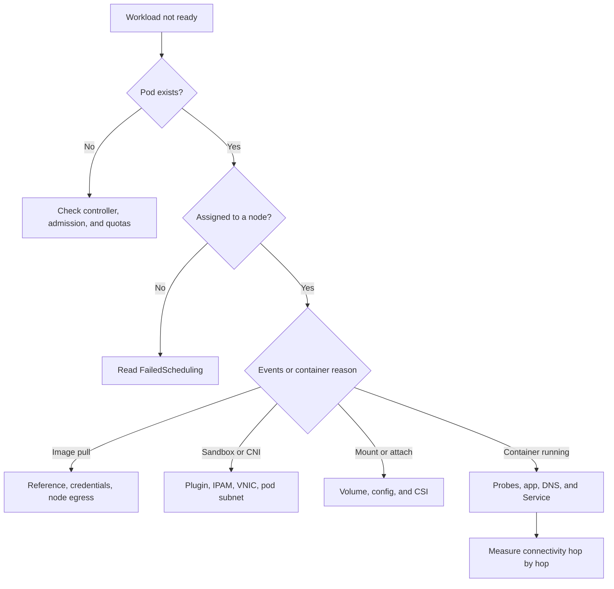

# Troubleshooting Pending Pods, Image Pulls, and OKE Networking Errors

In the **Operations and Troubleshooting** chapter of the **CLOUD_PROVIDERS_ORACLE** module, this lesson builds a diagnostic workflow for workloads on Oracle Kubernetes Engine (OKE). The focus is connecting Kubernetes evidence with Oracle Cloud Infrastructure (OCI): worker nodes running on Compute, addressing in the VCN, IAM permissions for registries and network resources, and application storage dependencies.

A Deployment with zero ready replicas may be caused by insufficient CPU, a wrong image tag, pod subnet IP exhaustion, or a Service pointing to the wrong port. These faults require different fixes. Operators must identify the first failing step, collect evidence at that step, modify the right component, and re-verify the request path.

After this lesson, learners can:

- Distinguish between a pod not yet scheduled to a node and a pod assigned a node whose container has not started.
- Read Events to isolate scheduler, image registry, volume, and CNI issues.
- Troubleshoot image pulls from OCI Container Registry (OCIR) across three layers: image reference, access permissions, and connectivity from the worker node.
- Distinguish between VCN-native pod networking, Flannel, DNS, Service, and NetworkPolicy issues.
- Verify recovery via workload status and live connectivity, while controlling the impact of node scaling or network changes.

## 1. Understand Pending and Where the Pod Stops

### 1.1. Pod Phase Differs from the STATUS Column

`Pending` in `.status.phase` covers both time waiting to be scheduled and time preparing containers, such as pulling images. The `STATUS` column in `kubectl get pods` is a summarized display field; it may show `ContainerCreating`, `ErrImagePull`, `ImagePullBackOff`, or an init container state. Therefore, you cannot conclude that every pod in `Pending` phase lacks scheduler resources. See definitions in [Kubernetes Pod Lifecycle](https://kubernetes.io/docs/concepts/workloads/pods/pod-lifecycle/).

Three questions to answer first:

1. Does `.spec.nodeName` have a value yet, and what is the `PodScheduled` condition?
2. Which reason is a regular container or init container waiting on?
3. Which operation do the most recent Events report as failing?

| Evidence | Branch to Inspect First | What Cannot Yet Be Concluded |
| --- | --- | --- |
| No node yet, `PodScheduled=False`, `FailedScheduling` | Resources, taints, affinity, topology, volume binding | Do not assume image or DNS error |
| Node assigned, `FailedCreatePodSandBox`, message names CNI/IPAM | Pod network setup, IP allocation, CNI on node | Do not assume every sandbox error is network-related |
| `ErrImagePull` or `ImagePullBackOff` | Image reference, credentials, node-to-registry connectivity | Do not assume missing auth token |
| `FailedMount` or `FailedAttachVolume` | Volumes, mounted Secrets/ConfigMaps, CSI, topology | Do not automatically blame VCN |
| Container running but `Ready=False` | Readiness probe, application, dependency connectivity | `Running` does not prove request serving |
| Expected pod not found | Deployment/ReplicaSet, admission, quotas, policies | No pod exists yet to diagnose Pending |

`ImagePullBackOff` is the waiting state before the next image pull retry. The backoff delay is a consequence of failed pulls; the underlying error in Events reveals the cause.

### 1.2. Initial Decision Tree



This is a triage routing tree, not a guarantee of strict ordering among all kubelet operations. Always use actual Events and conditions to select the branch.

## 2. Prepare Investigation Scope

The command examples use **Bash**, `kubectl` configured with kubeconfig, and the practice namespace `demo-oke`. Pod names, nodes, registries, and IPs must be replaced with your environment's resources. Commands like `create`, `apply`, `rollout`, or config edits modify the system; run them only after confirming the right target and rollback plan.

```bash
NS=demo-oke
POD=orders-api-7c8f5c9f6b-abcde

kubectl config current-context
kubectl get namespace "$NS"
kubectl auth can-i get pods -n "$NS"
kubectl auth can-i list events -n "$NS"
kubectl get pods -n "$NS" -o wide
```

A Kubernetes namespace and an OCI compartment are two different governance scopes. Someone with permission to view pods may not have rights to inspect subnets or modify node pools. IAM permissions to manage a cluster also do not prove the account has enough Kubernetes RBAC to read resources in every namespace.

Record the cluster, region, relevant compartments, namespace, UTC start time, and recent changes. If the cluster, network, and registry sit in different compartments, note each scope separately. That helps distinguish missing read permissions from real workload faults.

For managed node pools, you can map a Kubernetes node to its Compute instance via `providerID` and look it up in the Console:

```bash
kubectl get nodes -o custom-columns='NAME:.metadata.name,PROVIDER_ID:.spec.providerID'
```

This lesson prioritizes managed node pools for direct OS-level troubleshooting. Virtual node pools have different limits and operational tools; do not mechanically apply SSH, `journalctl`, or Node Doctor to virtual nodes.

## 3. Collect Evidence Before Changing Configuration

### 3.1. Command Set for a Single Pod

```bash
kubectl get pod "$POD" -n "$NS" -o wide
kubectl describe pod "$POD" -n "$NS"

kubectl get pod "$POD" -n "$NS" \
  -o jsonpath='{.status.phase}{"\n"}{.spec.nodeName}{"\n"}'

kubectl get pod "$POD" -n "$NS" \
  -o jsonpath='{range .status.conditions[*]}{.type}{"="}{.status}{" reason="}{.reason}{" message="}{.message}{"\n"}{end}'

kubectl get pod "$POD" -n "$NS" \
  -o jsonpath='{range .status.initContainerStatuses[*]}init/{.name}{": "}{.state}{"\n"}{end}{range .status.containerStatuses[*]}container/{.name}{": "}{.state}{"\n"}{end}'

POD_UID="$(kubectl get pod "$POD" -n "$NS" -o jsonpath='{.metadata.uid}')"
kubectl get events -n "$NS" \
  --field-selector "involvedObject.uid=$POD_UID" \
  --sort-by=.metadata.creationTimestamp
```

Filtering by UID prevents mixing Events from an old pod and a new pod with the same name. Events have finite retention and may be aggregated with repeat counts; compare last seen time, count, and rollout time. An empty list does not prove no errors occurred earlier.

If the container has not run yet, `kubectl logs` may have no output. Read Events, init container statuses, and relevant node/plugin logs instead. For a container that ran and exited:

```bash
kubectl logs "$POD" -n "$NS" -c orders-api --tail=100
kubectl logs "$POD" -n "$NS" -c orders-api --previous --tail=100
```

Replace `orders-api` with the actual container name. `--previous` is useful only when logs from the previous run remain inside the same pod; it does not recover logs from deleted pods.

### 3.2. Identify Blast Radius

```bash
kubectl get nodes -o wide
kubectl get deployment,replicaset -n "$NS"
kubectl get events -n "$NS" --sort-by=.metadata.creationTimestamp
kubectl get pods -n kube-system -o wide
```

| Observed Scope | Hypothesis to Prioritize |
| --- | --- |
| One new pod fails, old pods stay healthy | Manifest, new image, credentials, volume, or node difference |
| All new pods on one node fail | Kubelet/runtime, CNI on node, disk, VNIC/IPAM |
| One node pool fails, other pools stay healthy | Shape, CPU architecture, subnet, NSG, node image, or pool config |
| New pods across multiple namespaces fail together | Shared DNS, egress, CNI, registry, or capacity |
| Only traffic through Service fails | Selector, readiness, EndpointSlice, ports, or Service forwarding |

Save evidence with sensitive data removed. `describe`, application logs, and manifests can contain internal details or plaintext environment variables; never paste raw Secrets or auth tokens into tickets.

## 4. Branch A: Pod Not Yet Scheduled

### 4.1. Read Each FailedScheduling Reason

```bash
kubectl get pod "$POD" -n "$NS" -o yaml
kubectl get nodes --show-labels
```

If the pod has no node yet, pick a candidate node from the list to inspect:

```bash
NODE=candidate-node-name
kubectl describe node "$NODE"
kubectl get node "$NODE" \
  -o jsonpath='{.status.allocatable}{"\n"}{.spec.taints}{"\n"}{.spec.unschedulable}{"\n"}'
```

| Signal in Events or Config | How to Verify | Evidence-Based Action |
| --- | --- | --- |
| `Insufficient cpu` / `Insufficient memory` | Compare requests against allocatable and existing requests per node | Tune requests based on metrics or add suitable nodes |
| `Too many pods` | Check `allocatable.pods`, pod count, and pool config | Add pod capacity; check IP budget simultaneously |
| Node selector/affinity mismatch | Compare real node labels against required constraints in pod spec | Fix labels or constraints to match design |
| Untolerated taint | Compare node taints with pod tolerations | Add toleration when workload is permitted on that pool |
| Node NotReady or cordoned | Conditions, `SchedulingDisabled`, `spec.unschedulable` | Recover node or use healthy nodes per plan |
| Anti-affinity/topology unsatisfied | Count eligible nodes/zones after all filters | Add failure domains or relax overly strict constraints |
| PVC unbound / volume node affinity conflict | Pod Events, PVC, and PV/StorageClass topology | Fix provisioning, topology, or storage config |

Required constraints can eliminate every node even when the cluster still has resources. Preferred constraints guide the scheduler when viable choices exist. Refer to [Assigning Pods to Nodes](https://kubernetes.io/docs/concepts/scheduling-eviction/assign-pod-node/).

### 4.2. Requests, Allocatable, and Resource Fragmentation

The scheduler evaluates requested resources, not just instantaneous CPU/memory usage on a dashboard. `kubectl top nodes` helps investigation when Metrics Server is present, but does not replace checking requests and allocatable. See [Resource Management for Pods and Containers](https://kubernetes.io/docs/concepts/configuration/manage-resources-containers/).

Example calculation: three nodes each have 600 millicpu free in their request budget, while one pod requires 1000 millicpu. Total remaining capacity is 1800 millicpu, yet no single node can fit that pod. Summing cluster-wide totals hides this fragmentation.

When calculating demand, sum application containers, sidecars, init containers, and Pod overhead if enabled. Never look only at the main container. For Java, lowering memory requests/limits must include evaluating heap, native memory, thread stacks, and traffic; lowering numbers just to fit on a node can turn scheduling failures into runtime OOM kills.

If autoscaling is enabled yet pods still wait, check why the pool is not scaling: min/max bounds, OCI quotas/service limits, shape capacity at the chosen placement, subnet IP exhaustion, or constraints that even a new node would still fail. A larger pool will not fix a selector pointing to a nonexistent label.

### 4.3. Separate PVC Issues from Pod Creation Issues

```bash
kubectl get pvc -n "$NS"
kubectl describe pvc pvc-name -n "$NS"
kubectl get storageclass
```

`WaitForFirstConsumer` delays binding until a suitable placement is chosen; a `Pending` PVC at that stage is not enough to conclude storage is broken. If actual provisioning or attach errors occur, continue through CSI, OCI Block Volume, and relevant availability domain/topology. Do not delete PVCs/PVs just to retry starting a pod, as that can affect data.

If a Deployment desires three replicas yet only creates two pods and the ReplicaSet reports `FailedCreate`, check quotas, LimitRanges, and admission controllers. That is the object-creation branch; do not classify a nonexistent pod as held up by the scheduler.

## 5. Branch B: ErrImagePull and ImagePullBackOff

### 5.1. Read the Underlying Pull Error

```bash
kubectl get pod "$POD" -n "$NS" \
  -o jsonpath='{range .spec.initContainers[*]}init/{.name}{" -> "}{.image}{"\n"}{end}{range .spec.containers[*]}{.name}{" -> "}{.image}{"\n"}{end}'

kubectl describe pod "$POD" -n "$NS"
```

| Typical Message | Initial Hypothesis | Next Check |
| --- | --- | --- |
| `manifest unknown`, `not found` | Wrong registry, namespace, repository, tag, or digest | Verify image pushed to the right region; registries may mask permission errors as not found |
| `unauthorized`, `authentication required` | Invalid or unused credentials | Secret, registry host, username, and auth token |
| `denied`, `pull access denied` | Private repo, wrong reference, or missing permissions | Pull permissions on exact repo/compartment for the identity in the Secret |
| `FailedToRetrieveImagePullSecret` | Secret missing or unreadable | Secret name, namespace, type, and pod reference |
| `no such host` | Node cannot resolve registry hostname | Node resolver and path to DNS |
| `i/o timeout`, `context deadline exceeded` | Egress, DNS, proxy, firewall, or slow upstream | Separate DNS, TCP, TLS, and HTTP from the failing node |
| `x509: certificate signed by unknown authority` | Trust store, TLS interception, or wrong certificate chain | Node/runtime CAs and proxy; never disable TLS verification |
| `no matching manifest` | Image does not support node OS/architecture | Multi-arch manifest and node architecture labels |
| `429`, `toomanyrequests` | Registry rate-limiting requests | Registry policy, authentication, and concurrent pull rate |
| `no space left on device` during unpack | Insufficient node disk/inodes | DiskPressure, filesystem holding images, and image garbage collection |

These are hypothesis mappings, not conclusions from a single error string. A registry may return the exact same error code for a nonexistent repository and an unauthorized repository.

### 5.2. Verify the OCIR Image Reference

Illustrative example:

```text
sin.ocir.io/<tenancy-namespace>/platform/orders-api:1.4.2
```

Verify registry hostname, tenancy namespace, full repository name, and tag/digest against the pushed image. The tenancy namespace in the registry path is not a compartment name. If the registry is in another region, evaluate connectivity to that endpoint instead of assuming intra-region routes apply.

For private OCIR, the common model is a Docker registry Secret containing an OCIR-formatted username and an **OCI auth token** as the password. Accounts using identity domains may require the domain name in the username; obtain the exact format matching your tenancy's identity model. Never substitute a Console password for an auth token. See [Pulling Images from Registry during Deployment](https://docs.oracle.com/en-us/iaas/Content/ContEng/Tasks/contengpullingimagesfromocir.htm).

```bash
kubectl get nodes -L kubernetes.io/arch,kubernetes.io/os
```

When moving from x86 nodes to Arm, the application image plus every init container and sidecar need compatible variants. A multi-platform image lacking the exact OS/architecture combination still fails on that node.

### 5.3. Inspect imagePullSecrets Without Printing Credentials

```bash
kubectl get pod "$POD" -n "$NS" \
  -o jsonpath='{.spec.serviceAccountName}{"\n"}{.spec.imagePullSecrets}{"\n"}'

kubectl get secret ocir-pull -n "$NS" \
  -o custom-columns='NAME:.metadata.name,TYPE:.type'

kubectl get serviceaccount default -n "$NS" \
  -o jsonpath='{.imagePullSecrets}{"\n"}'
```

Replace ServiceAccount `default` with the name actually used by the pod. The Secret must reside in the same namespace as the pod; referencing a Secret of the same name in another namespace is invalid. After updating `imagePullSecrets` on a ServiceAccount, test with a newly created pod since existing pods do not automatically pick up all ServiceAccount changes. See [Kubernetes Secrets — Using imagePullSecrets](https://kubernetes.io/docs/concepts/configuration/secret/#using-imagepullsecrets).

In a secured credential-provisioning workflow, you can create a Secret from a prepared Docker config file:

```bash
kubectl create secret generic ocir-pull -n "$NS" \
  --type=kubernetes.io/dockerconfigjson \
  --from-file=.dockerconfigjson=/secure-path/config.json
```

Use this command when the Secret does not yet exist. The file must contain valid credentials for the exact registry host; a file pointing only to a laptop credential helper will not let kubelet use that helper. Protect the source file and manage rotation of existing Secrets through your secrets management tooling. Never put real tokens in documentation, committed manifests, logged command arguments, or CI logs.

Example snippet inside a pod template:

```yaml
spec:
  template:
    spec:
      imagePullSecrets:
        - name: ocir-pull
      containers:
        - name: orders-api
          image: sin.ocir.io/tenancy_namespace/platform/orders-api:1.4.2
          imagePullPolicy: IfNotPresent
```

This is a Deployment **snippet**, not a complete manifest. Replace `tenancy_namespace` and the image with real values.

`IfNotPresent` can let older pods run from cached images while a new node must pull and exposes credential failures. Verify on a node without the image via a controlled rollout or clearly identified test pod; do not purge caches across entire nodes just to test. When reproducibility is needed, manage explicit image versions or digests.

### 5.4. The Pull Path Starts from the Worker Node

In the standard managed node model, kubelet/container runtime on the node performs the pull. A successful `docker pull` on a laptop only tests the laptop and its credentials; it does not verify the failing node can reach the registry.

From the failing worker node, in a managed access session:

```bash
REGISTRY=sin.ocir.io
getent hosts "$REGISTRY"
curl -sS -D - -o /dev/null --connect-timeout 5 --max-time 15 \
  "https://$REGISTRY/v2/"
```

If the registry returns `401` with an authentication challenge, this unauthenticated probe has already proven DNS, TCP, TLS, and HTTP to the endpoint work. It does not prove repository pull permissions. If it times out, inspect routes and security; if certificate errors appear, inspect TLS and system clocks. Never send auth tokens in this connectivity check.

The node's resolver and pod CoreDNS serve different contexts. Pods resolving internal names does not guarantee the node can resolve the registry; an image pull error is not automatically a CoreDNS error.

IAM for the application calling OCI, repository read rights of the identity inside the Secret, and RBAC to create Secrets are separate checks. Having workload identity for the app does not automatically replace registry credentials configured for the pod.

## 6. Identify the OKE Network Model Before Checking Routes

| Characteristic | OCI VCN-Native Pod Networking | Flannel Overlay |
| --- | --- | --- |
| Pod addressing | Uses VCN address space | Uses dedicated overlay CIDR |
| Infrastructure hops to check | Pod subnet, VNIC/IPAM, NSGs/security lists, and related routes | Inter-node network and overlay configuration |
| Direct reachability from outside cluster | Routable to pods when routes/security allow | Overlay IPs are not directly reachable by default |
| Capacity pressures to watch | Subnet IPs, IP allocation settings, VNIC/shape limits, and pods per node | Pod CIDR/overlay and node capacity |

The two models have different inspection points. Oracle describes VCN addressing and VNIC roles in [OCI VCN-Native Pod Networking CNI plugin](https://docs.oracle.com/en-us/iaas/Content/ContEng/Concepts/contengpodnetworking_topic-OCI_CNI_plugin.htm); overlay scope is described in [Using the flannel CNI plugin](https://docs.oracle.com/en-us/iaas/Content/ContEng/Concepts/contengpodnetworking_topic-flannel_CNI_plugin.htm).

Read the network type from the cluster config in Console/API and cross-check deployed add-ons. Do not infer CNI type merely because pods receive private-looking IPs.

```bash
kubectl get daemonsets -n kube-system -o wide
kubectl get pods -n kube-system -o wide
```

Add-on names, labels, and containers can vary by version/configuration. Identify the exact object from command output before picking names for log reading. If Multus or multiple network interfaces exist, separate primary-network faults from secondary-attachment faults.

## 7. Branch C: Sandbox, CNI, and IP Allocation

### 7.1. Start on the Node Assigned to the Pod

```bash
NODE="$(kubectl get pod "$POD" -n "$NS" -o jsonpath='{.spec.nodeName}')"

# Run the section below only when NODE has a value.
kubectl describe node "$NODE"
kubectl get pods -n kube-system \
  --field-selector "spec.nodeName=$NODE" -o wide
```

Read the entire `FailedCreatePodSandBox` message. If it explicitly indicates network setup/CNI/IPAM failed, verify:

1. Is the corresponding network add-on pod on that node running and ready?
2. Did the failure occur when invoking the plugin, allocating an IP, configuring interfaces, or calling OCI services?
3. Does the pod subnet still have available addresses and does the node still have capacity per actual config?
4. Did IAM, VNICs, routes, NSGs, OS, or add-ons change near the failure time?
5. How does a healthy node in the same pool differ from the failing node?

Read logs once you have identified the real names:

```bash
CNI_POD=identified-cni-pod-name
CNI_CONTAINER=identified-cni-container-name

kubectl logs "$CNI_POD" -n kube-system -c "$CNI_CONTAINER" \
  --since=15m --tail=200
```

If the CNI container restarted, also inspect `--previous` when logs remain available. Do not delete the DaemonSet or restart every networking pod based on a single application pod failure; blast radius can spread to healthy workloads.

### 7.2. IP Exhaustion Differs from CPU Shortage

A node can have free CPU/memory yet still be unable to create pod networking. With VCN-native networking, check available IPs in the pod subnet, pre-allocated/assigned addresses, per-node pod caps, shape/VNIC limits, and node pool configuration. Do not apply a single fixed max-pods constant across all shapes and versions.

Reasoning example: the pod already has a `nodeName`, Events report IP allocation failure, and multiple new pods in the same pool fail similarly. Investigate IPAM/subnet before increasing CPU requests or changing images. When a subnet is exhausted, adding nodes in that exact subnet can worsen the issue because new nodes also consume addresses.

To recover, select a configuration with sufficient IP budget, add an appropriate pool/subnet per OKE capabilities, or reduce over-allocation under a change plan. Afterward, create a controlled new pod to prove IP allocation works. Never manually reclaim private IPs or detach VNICs without verifying which resources own them.

### 7.3. Inspect the Node When OS Access Is Permitted

On a managed worker node:

```bash
sudo journalctl -u kubelet --since '15 minutes ago' --no-pager
sudo journalctl -u containerd --since '15 minutes ago' --no-pager
ip -brief address
ip route
sudo /usr/local/bin/node-doctor.sh --check
```

Runtime service names depend on the node image; use `containerd` when that is the active runtime. Node Doctor may reside in `/usr/bin` on some nodes. This tool is for managed node pools and does not apply to virtual node pools. See [Troubleshooting Node Issues Using the Node Doctor Script](https://docs.oracle.com/en-us/iaas/Content/ContEng/Tasks/contengtroubleshooting_topic-node_troubleshooting.htm).

`forbidden` or `not authorized` entries in OCI operations must be checked against the exact principal, action, and compartment of the accessed resource. Do not replace every IP-allocation failure with a tenancy-wide `manage all-resources` policy.

If CNI needs updating, read the procedure for the exact add-on version and plan a rollout. Do not assume updating add-on metadata or rebooting nodes always applies cleanly across every plugin version.

## 8. Branch D: Pod Is Running but Cannot Connect

### 8.1. Choose the Right Source Point for Probes

Start from the failing workload or a diagnostic pod matching the network conditions under test: namespace, labels selected by policies, node/pool, and DNS settings. A debug pod with different labels may not match the same NetworkPolicy; its success does not rule out a policy block on the application.

The following example assumes a `netcheck` pod containing `sh`, `curl`, `nslookup`, and `nc` is already Running in the practice namespace:

```bash
CLIENT=netcheck
kubectl exec "$CLIENT" -n "$NS" -- cat /etc/resolv.conf
```

If the app uses a minimal image, select an approved utility pod or ephemeral container compliant with permissions and Pod Security. Launching a utility pod also requires pulling an image; when the registry is broken, prefer pre-existing tools to avoid adding a pull dependency.

### 8.2. Trace from Application to Service and DNS

Assume the API listens on HTTP port `8080`, exposes `/healthz`, and the `orders-api` Service exposes port `80`. Substitute real ports and protocols.

| Test | What It Isolates |
| --- | --- |
| App calls itself on `127.0.0.1:8080` | Whether the process is listening and serving |
| Client calls each PodIP:8080 | Path to backend and target port |
| Same node vs cross-node | Inter-node networking differences |
| Client calls ClusterIP:80 | Service forwarding layer |
| Client calls Service name:80 | DNS plus Service path |
| Calling dependencies outside cluster | Egress, routes, TLS, and dependencies |

```bash
kubectl get pods -n "$NS" -o wide --show-labels
kubectl get service orders-api -n "$NS" -o yaml
kubectl get endpointslices -n "$NS" \
  -l kubernetes.io/service-name=orders-api -o yaml

BACKEND_IP=10.20.1.25
SERVICE_IP="$(kubectl get svc orders-api -n "$NS" -o jsonpath='{.spec.clusterIP}')"

kubectl exec "$CLIENT" -n "$NS" -- \
  curl -sS --connect-timeout 3 --max-time 8 \
  "http://$BACKEND_IP:8080/healthz"

kubectl exec "$CLIENT" -n "$NS" -- \
  curl -sS --connect-timeout 3 --max-time 8 \
  "http://$SERVICE_IP:80/healthz"

kubectl exec "$CLIENT" -n "$NS" -- \
  curl -sS --connect-timeout 3 --max-time 8 \
  http://orders-api.demo-oke.svc.cluster.local/healthz
```

`BACKEND_IP` must be taken from an active pod; do not copy the example IP. The full name assumes the cluster domain is `cluster.local`; check the real domain in pod DNS config. For headless Services (`clusterIP: None`), test the backend addresses returned by DNS instead of running a ClusterIP test like a standard Service.

If direct endpoint calls work while ClusterIP fails, check Service `port`/`targetPort` and the active Service forwarding mechanism, typically kube-proxy. If only the hostname fails while ClusterIP succeeds, prioritize DNS. See the selector, endpoint, and port checklist in [Kubernetes Debug Services](https://kubernetes.io/docs/tasks/debug/debug-application/debug-service/).

### 8.3. Interpret Timeouts, Refusals, and HTTP Errors

- **Timeout:** no reply within the deadline; can be packet filtering, routing, return path, overloaded upstream, or a hung process. More evidence is needed to locate where.
- **Connection refused:** active TCP-layer rejection; check listener, port, and how the Service handles missing backends.
- **HTTP 404/503:** an HTTP component replied; identify whether it was the app, ingress, or proxy before concluding which backend is healthy.
- **TLS error:** check hostname/SNI, CA, system time, and certificate chain. Calling HTTPS by IP instead of hostname can trigger a new certificate mismatch error that skews the test.

An app listening only on `127.0.0.1` can call localhost successfully yet reject connections via PodIP. Fix the listener per container design rather than widening NSGs to compensate for a bind address.

## 9. DNS: Separate Internal Names, External Names, and Resolver Paths

```bash
kubectl exec "$CLIENT" -n "$NS" -- nslookup kubernetes.default.svc.cluster.local
kubectl exec "$CLIENT" -n "$NS" -- nslookup orders-api.demo-oke.svc.cluster.local
kubectl exec "$CLIENT" -n "$NS" -- nslookup sin.ocir.io

kubectl get pods -n kube-system -l k8s-app=kube-dns -o wide
kubectl get service kube-dns -n kube-system
kubectl get endpointslices -n kube-system \
  -l kubernetes.io/service-name=kube-dns
kubectl logs -n kube-system -l k8s-app=kube-dns --since=10m --tail=100
```

The `k8s-app=kube-dns` label is commonly used by CoreDNS for compatibility; if your cluster is configured differently, locate the actual objects. Never deploy an extra DNS deployment simply because a query using one label returns nothing. See [Debugging DNS Resolution](https://kubernetes.io/docs/tasks/administer-cluster/dns-debugging-resolution/).

| Outcome | Investigation Direction |
| --- | --- |
| Both internal and external names time out | Path from pod to DNS Service/backends, CoreDNS, and policies |
| Internal succeeds, external fails | Upstream resolver, forwarding, VCN DNS, and path to upstream |
| Only one Service name returns NXDOMAIN | Spelling, namespace, Service existence, and cluster domain |
| Only one node fails | CNI, Service forwarding, node resolver/config, or node-related policies |
| DNS returns right IP but app cannot connect | Continue to TCP/TLS/HTTP; healthy DNS is not sufficient |

Inspect `dnsPolicy`, `dnsConfig`, search domains, and `/etc/resolv.conf`. DNS requires both UDP and TCP port 53 along the actual path; opening only UDP can break queries needing TCP. If NodeLocal DNSCache is present, include both the pod-to-cache hop and the cache-to-CoreDNS/upstream hop.

## 10. OCI Routing, Security, and NetworkPolicy

### 10.1. Diagram the Path from the Actual Source

A connection path must clearly note:

```text
actual source -> subnet/VNIC -> route -> appliance or gateway
              -> destination:port -> return path back to source
```

Do not use one diagram for both image pulls and application requests. Image pulls normally originate from the node; application requests originate from the pod and may undergo SNAT depending on the path. With VCN-native networking, the pod subnet may differ from the worker subnet, so fixing a node route does not prove pod egress is fixed.

| Connection Target | Components to Verify |
| --- | --- |
| Public registry/service from private subnet | DNS, route to NAT gateway or designed egress, security, and proxy |
| Supported OCI service via Oracle Services Network | Service gateway, matching service CIDR/region, route tables, and security |
| Pod in another subnet in the VCN | Actual VNIC/IP, active security rules, and routing |
| Oracle Database via private endpoint | Endpoint name, real port, both-side NSGs, peering/DRG if cross-network |
| Cluster API endpoint | Permitted sources, API port, and path from corresponding client/node/pod |

A NAT gateway provides one-way outbound egress from private subnets to the Internet per configuration; a service gateway serves supported Oracle services. A service gateway is not a universal egress path to every public registry. Check [OKE Network Resource Configuration](https://docs.oracle.com/en-us/iaas/Content/ContEng/Concepts/contengnetworkconfig.htm) and [Access to Oracle Services: Service Gateway](https://docs.oracle.com/en-us/iaas/Content/Network/Tasks/servicegateway.htm).

### 10.2. Inspect Each Control Layer

**NSGs and security lists:** verify real post-NAT source/destination, protocol, port, and the VNIC/subnet where rules attach. Allow rules from NSGs and security lists combine additively; missing a rule in one NSG does not prove traffic is blocked if another rule allows it. For stateless rules, check both forward and return paths; do not assume replies are tracked like stateful rules.

**NetworkPolicy:** check selected pods, namespace selectors, pod selectors, ingress, and egress. Allow policies are additive; when both pods are isolated in their respective directions, both source egress and destination ingress must be permitted. The cluster must run a compatible NetworkPolicy enforcement component for policy objects to filter traffic. See [Kubernetes Network Policies](https://kubernetes.io/docs/concepts/services-networking/network-policies/).

```bash
kubectl get networkpolicy -n "$NS"
kubectl describe networkpolicy -n "$NS"
kubectl get namespace --show-labels
kubectl get pods -n "$NS" --show-labels
```

Default-deny egress can break DNS before external API errors even surface. Add the exact required DNS and dependency flows; never delete all NetworkPolicies just to test.

**OS, proxy, and extra layers:** check host firewalls, service meshes, or ZPR if present. Inspecting NSGs alone misses these layers. With Flannel, verify inter-node overlay paths matching the real backend and configuration; do not apply VCN-native pod subnet rules to overlay traffic.

### 10.3. Combine Config Analysis with Traffic Observation

OKE offers Network Path Analysis to validate routes and security across OCI topology. The tool analyzes configuration without sending live traffic; a reachable result does not prove a process is listening or an app returns HTTP 200. See [Troubleshooting Network Configuration Using Network Path Analysis Tests](https://docs.oracle.com/en-us/iaas/Content/ContEng/Tasks/contengtroubleshooting_topic-network_troubleshooting.htm).

Combine results with VCN Flow Logs enabled on the exact source and timestamped test attempts. Match source, destination, protocol, port, and time range; seeing no logs is inconclusive until you verify enablement point, filters, and ingestion delay.

If TCP handshakes succeed while large requests or TLS transfers stall, add MTU/Path MTU Discovery to your hypotheses, especially with overlays, VPN, or FastConnect. Collect evidence before tuning MTU; opening extra app ports will not fix fragmentation errors.

## 11. Services, Readiness, and External Ingress

A Service without ready backends commonly starts with mismatched selectors or pods not yet Ready. Inspect EndpointSlices and readiness rather than merely checking that pods are Running.

```bash
kubectl describe service orders-api -n "$NS"
kubectl get deployment orders-api -n "$NS"
kubectl describe pod "$POD" -n "$NS"
```

Compare `Service.spec.ports[].port`, `targetPort`, and the port the process actually listens on. `containerPort` in YAML does not cause an application to open a port. A misconfigured probe path/port can mark a running process unready; a genuinely broken dependency can also legitimately fail readiness by design.

If errors occur only from outside the cluster, inspect ingress/controller, OCI Load Balancer or Network Load Balancer, backend health, listeners, NSGs, and paths to backends. Distinguish:

- **Pod Pending:** the pod is waiting at a lifecycle stage.
- **LoadBalancer Service address pending:** load balancer provisioning or Service update is incomplete; read Service/controller Events, IAM, and related OCI work requests.

Do not tweak the scheduler to fix a Service still waiting for a load balancer IP. When only the Load Balancer reports unhealthy backends, compare health check port/path against the app listener before modifying CNI.

## 12. Examples of Interpreting Evidence and Choosing Fixes

### 12.1. New Node Cannot Pull While Old Replicas Still Serve

Observation: after scaling a node pool, new pods receive a node and Events report OCIR `unauthorized`. Two older replicas remain Ready and have been running previously.

Reasoning:

1. `nodeName` is set, so the observed error is not at node scheduling.
2. Registry returned an auth error; prioritize credentials and repository permissions before opening routes.
3. Old replicas may be using cached images; healthy status does not prove current credentials remain valid.
4. New pods reference `ocir-pull`, but the Secret was changed to a token belonging to a user without read rights on the required repository.

Restore credentials authorized to pull the exact repository or fix permissions on the intended identity per design, then verify with a controlled new pod. Confirm Events progress to successful pull, container start, passing probes, and restored Available replicas. Keep serving replicas intact during investigation to minimize disruption.

### 12.2. Pod Has a Node, but Sandbox Fails After Increasing Replicas

Observation: nodes are Ready, image reference is unchanged, pod has a `nodeName`, and Events state CNI cannot allocate an address. Available IP counts and config confirm the pod subnet exhausted its address budget.

Reasoning:

1. `Pending` here does not mean `FailedScheduling`.
2. Low CPU usage does not refute the IP exhaustion hypothesis.
3. Adding nodes in the same subnet can consume even more IPs without solving the root cause.
4. Inspect pre-allocated IPs and pool settings rather than merely counting Running pods.

You can use prepared network capacity in another pool/subnet or adjust IP allocation design under a change plan. After changing, verify new pods receive IPs, run, and communicate both intra-node and cross-node. Keep before/after numbers to tune alert thresholds.

## 13. Recovery, Monitoring, and Recurrence Prevention

### 13.1. Small Changes with Verifiable Conditions

Every change needs a hypothesis, evidence, target object, expected outcome, and rollback path. Edit templates in the manifests/GitOps repo managing the workload so desired state does not later overwrite manual fixes.

| Change | Verification Criterion |
| --- | --- |
| Adjust requests or add nodes | PodScheduled succeeds on nodes meeting constraints without creating new resource shortages |
| Fix image reference/Secret | New pod pulls the required image and starts cleanly |
| Fix IP allocation/CNI | New pod receives an IP; no new sandbox errors in the fixed scope |
| Fix selector/targetPort/readiness | EndpointSlice has matching backends; requests via Service succeed |
| Fix route/NSG/NetworkPolicy | Test from exact source to target/port succeeds per policy |

Monitor after updating the Deployment:

```bash
kubectl rollout status deployment/orders-api -n "$NS" --timeout=180s
kubectl get deployment orders-api -n "$NS"
kubectl get pods -n "$NS" -o wide
kubectl get endpointslices -n "$NS" \
  -l kubernetes.io/service-name=orders-api
kubectl get events -n "$NS" --sort-by=.metadata.creationTimestamp
```

Old Events may linger after recovery. Compare timestamps and recent failure counts rather than expecting a completely empty history. A successful `rollout status` still requires real requests across the user-serving path and checks on critical dependencies.

If isolating a node with `cordon`, running pods stay on that node; cordon does not evict them. Before draining/replacing a node, evaluate PodDisruptionBudgets, healthy replicas, local/ephemeral data, and target capacity. Rolling back a template will not fix global issues such as an exhausted subnet or a revoked shared pull credential.

### 13.2. Track Actionable Signals

Alerts should account for duration and scope: pods pending past the app's threshold, rising pull errors after rollouts, NotReady nodes, abnormal CNI restarts, insufficient Ready backends, or pod subnet IPs approaching reserve thresholds. Centralize Events history if investigations must look past default retention.

Combine Kubernetes metrics with OCI Monitoring/Logging, Audit, and infrastructure change logs. Audit helps locate OCI resource admin actions, not replace flow logs or app connection logs. For Oracle Databases, separate network timeouts from authentication, TLS, or database-side connection limit errors before editing security rules.

Automation should focus on gathering evidence and catching misconfigurations: verify images exist with matching architectures before rollout, validate Secret references, check manifests against policies, and monitor Pending age and IP headroom. Do not automatically restart all CNI pods or broaden tenancy permissions whenever a pod goes Pending.

Scaling Compute, provisioning load balancers, extending log retention, or altering egress all require tracking within operational budgets. Set intentional autoscaler min/max bounds, apply tags, and clean up diagnostic resources afterward. Never mark an issue resolved merely because adding capacity temporarily masked the symptom.

### 13.3. Incident Handover Record

Verifiable investigation outcomes should record:

- Cluster/region, namespace, pod UID, node/pool, and related OCI resources.
- Start time, impact scope, and most recent changes.
- Representative sanitized Events/logs and the evidence-backed hypothesis.
- Configuration changed, rollback procedure, and proof of restored service.
- Recurrence prevention items, owners, and early-warning signals.

Closure criteria are workload recovery on the real serving path, evidence-backed root cause, and changes persisted into managed configuration. A pod reaching Running is only one milestone in that verification.
