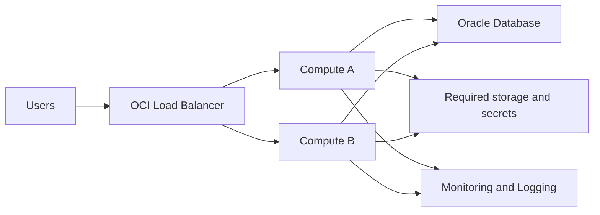

# Managing Changes, Maintenance Schedules, and Infrastructure Rollbacks

## 1. Objectives and OCI Operational Context

An infrastructure change is only complete when the service works properly, data is preserved, and the operations team remains in control of system state. An API returning success or Terraform reporting apply complete only confirms part of the work.

Within Oracle Cloud Infrastructure (OCI), this lesson connects tenancy, compartment, and IAM governance with operating VCN, Compute, storage, and Oracle Database services. The focus is organizing changes that are traceable, bounded in blast radius, and recoverable within allowed time windows.

After this lesson, learners can:

- Build a change record with resource scope, owners, schedule, and decision criteria.
- Coordinate Oracle maintenance windows with application maintenance schedules.
- Choose in-place, rolling, canary, or blue/green deployment strategies according to fault tolerance.
- Distinguish among configuration rollback, traffic shifting, data restoration, and roll-forward fixes.
- Run a runbook with explicit stop points, evidence, and post-change reconciliation steps.
- Control IAM permissions, temporary resource costs, and drift between infrastructure code and live resources.

### Running Scenario

An ordering service runs in a production compartment. Traffic flows through an OCI Load Balancer to two Compute instances in different fault domains of the same availability domain. Both connect to an Oracle database managed under a separate procedure.

The operations team needs to update the OS image and application configuration. At the same time, one instance receives an infrastructure maintenance notice from OCI.

Assumptions used in the example:

| Component | Lesson Assumption |
| --- | --- |
| Application | Stateless; user sessions are stored outside application hosts |
| Compute | Either remaining host can handle expected load when one leaves the pool |
| Database | No schema changes during this image update wave |
| Observability | Health checks, app logs, latency metrics, and error rates are available |
| Goal | Keep service available; maintain a path back to the old image |
| Limitation | Two hosts in the same AD do not provide full-AD outage resilience |

These are design assumptions for the exercise, not automatic properties of every OCI system.

## 2. Identify the Right Change Type and Responsibilities

### 2.1. Distinguish Customer Changes from Provider Maintenance

| Work Group | Examples | Primary Coordination Owner |
| --- | --- | --- |
| Application changes | New image, config variables, certificates, connection pools | Application and operations teams |
| Customer-managed infrastructure changes | Compute shape, NSGs, route tables, Load Balancer backends | Platform team or resource owner |
| OCI physical infrastructure maintenance | VM migration due to host maintenance | Oracle notifies or executes per service mechanism; customer prepares app |
| Data service maintenance | DB system, DB home, or service maintenance updates | Coordinate by exact product, version, and service model |

A VM successfully migrated by OCI does not prove the application reconnected to the database. A database patch may also require the application to re-verify drivers, retries, and in-flight transactions. Each layer requires its own verifier.

### 2.2. Classify Changes by Risk

An internal process can use three categories:

- **Standard change:** repeatable, small scope, rehearsed, with a pre-approved procedure—such as rotating a certificate in a test environment per runbook.
- **Normal change:** requires impact assessment and approval—such as updating the image across a production fleet.
- **Emergency change:** requires immediate execution to restore service or reduce an active risk; record decisions at execution time and complete formal review afterward.

Category names are organizational governance conventions. They do not map to a universal toggle inside OCI.

Assess risk based on blast radius, complexity, reversibility, and fault detectability. Editing a tenancy-wide shared policy can be higher risk than updating a test VM, even if fewer lines change.

### 2.3. Execution Permissions and Decision Authority

A change should identify at least four roles, even if one person wears multiple hats in a learning environment:

| Role | Responsibility |
| --- | --- |
| Change owner | Prepares scope, dependencies, schedule, and record |
| Executor | Runs steps per runbook, records timestamps and results |
| Decision maker | Authorizes proceeding, halting, or rolling back at checkpoints |
| Business verifier | Verifies user flows and data after the change |

Grant IAM permissions by exact compartment and resource type needed. Verify both deployment permissions and recovery permissions: whether the person changing backends can restore old backends, and whether the person restoring volumes can use the associated encryption keys.

For automation, use an appropriate execution identity such as instance principal or resource principal when supported by the tool and environment. Manage that identity's permissions separately from observers' dashboard-read rights. Never place API keys or database passwords in change records.

Maintain a verified administrative access path before modifying IAM, NSGs, or routes. If the change itself could sever SSH, know the recovery path via OCI Console, Bastion, or console connections suited to the resource and granted permissions.

## 3. Change Record: From Resource List to Stop Conditions

### 3.1. Document Resource Identities Explicitly

Display names can collide or change. The record must link OCIDs with tenancy, region, compartment, and each resource's role. Call out shared resources such as subnets, route tables, NSGs, backend sets, and encryption keys.

For example, editing a subnet's security list can affect many VNICs in that subnet; editing an NSG shared across multiple application groups can reach well beyond the hosts under maintenance. Compartments organize governance, but do not isolate network or data dependencies between applications.

Dependency diagram for the sample scenario:



If both A and B rely on the same NSG to reach the database, changing that NSG alters the serving path for both hosts simultaneously. Rolling VMs one by one does not mitigate the risk of a shared change applied all at once.

### 3.2. Sample Change Record

The YAML snippet below is an internal record template, not an OCI configuration to apply directly:

```yaml
change_id: CHG-OCI-042
title: "Update OS image for ordering application fleet"
environment: production
scope:
  region: "ap-singapore-1"
  compartment_ocid: "<prod-compartment-ocid>"
  compute_ocids:
    - "<compute-a-ocid>"
    - "<compute-b-ocid>"
  shared_resources:
    - "<load-balancer-ocid>"
  excluded_changes:
    - "No database schema changes in this wave"
schedule:
  start: "2026-12-05T15:00:00Z"
  finish_by: "2026-12-05T16:00:00Z"
  decision_deadline: "2026-12-05T15:25:00Z"
strategy: rolling
baseline:
  image_release: "orders-os-r17"
  application_release: "orders-3.8.2"
  infrastructure_revision: "<pre-change-commit>"
rollback:
  method: "Return instances running the verified old image to backend pool"
  estimated_minutes: 20
  verification_minutes: 10
  reserve_minutes: 5
owners:
  executor: "platform-oncall"
  decision_maker: "change-owner"
  verifier: "orders-owner"
```

In real systems, replace illustrative values with verified data and add links to runbooks, dashboards, backups, and approval records. Never put customer data in descriptions or tags.

### 3.3. Set Criteria Before Deploying

A good criterion includes a measurement, an observation window, and an associated action:

| Signal | Example Condition for Practice | Decision |
| --- | --- | --- |
| HTTP 5xx errors | Above 1% across two consecutive one-minute intervals with sufficient sample size | Halt expansion; evaluate rollback |
| p95 latency | Above 800 ms for five minutes under baseline-equivalent load | Pause and inspect new node |
| Serving backends | Zero healthy backends remain | Restore serving path immediately per runbook |
| Data integrity | Duplicate orders or confirmed write corruption detected | Stop change and related write flows; escalate to data incident handling |
| Time | Reached final decision deadline without meeting go-forward criteria | Initiate chosen recovery plan |

These thresholds are rehearsal examples, not universal Oracle recommendations. Low traffic requires supplementing with synthetic checks and minimum sample counts; a zero error rate over a handful of requests is not reliable evidence.

## 4. Build an Actionable Maintenance Schedule

### 4.1. Intake Notices and Turn Them into Work Items

The operations team must receive OCI notices through a channel with an accountable owner. An announcement subscription can filter notices and forward them to a Notifications topic and configured endpoints. Verify filters and confirm endpoint subscriptions to ensure on-call personnel receive messages. Refer to [Subscribing to Announcements](https://docs.oracle.com/en-us/iaas/Content/General/Concepts/announcements_topic-Subscribing.htm).

A sound practice is creating an internal work item containing:

1. Notice source and event ID if present.
2. Impacted resources, region, and service.
3. Expected timestamp, action deadline, and time zone.
4. Expected disruption mode per notice.
5. Person responsible for verifying the application post-maintenance.
6. Preparation actions and support contacts if needed.

Do not assume every maintenance event arrives in advance via the exact same channel. Combine notices with resource-level maintenance details and live health signals.

### 4.2. Understand Compute Maintenance Behavior

OCI uses approaches such as live migration, reboot migration, rebuild in place, or manual migration depending on the resource and support conditions. Live migration minimizes disruption, though the application must still tolerate a brief pause. Reboot migration stops and restarts; rebuild in place can take longer. Check the instance's exact Maintenance event rather than inferring from another host's deployment type. See [Instance Maintenance](https://docs.oracle.com/en-us/iaas/Content/Compute/References/infrastructure-maintenance.htm).

For VMs requiring reboot migration, rebooting from inside the OS does not substitute for triggering migration through the OCI UI or API. Rescheduling eligibility and related limits depend on event type, resource, and service support. DenseIO requires separate consideration of local NVMe data during migration. See [Moving a Compute Instance to a New Host](https://docs.oracle.com/en-us/iaas/Content/Compute/Tasks/movinganinstance.htm).

In the runbook, separate two goals:

- **Complete the OCI-required action:** such as executing the appropriate migration before the deadline.
- **Restore service health:** processes running, database connectivity restored, business requests succeeding.

Application rollback does not revert a physical host to Oracle's pre-maintenance state. If provider infrastructure remains faulty, use other healthy resources or your prepared service recovery plan.

### 4.3. Coordinate Across Different Schedules

Maintain a unified calendar covering:

- Oracle-announced maintenance for Compute and related services.
- OS updates performed by the operations team.
- Database maintenance and backup schedules.
- Financial close, batch runs, data syncs, and high-traffic campaigns.
- Change freeze windows and on-call schedules for personnel with recovery authority.

Avoid bundling image updates, route changes, and database upgrades into the same window just to reuse on-call time. If bundling is unavoidable, model the sequence, verification checkpoints, and rollback capability of each piece.

Database maintenance needs its own runbook tailored to Base Database Service, Exadata Database Service, or Autonomous Database and the active configuration. Never assume every patch is rolling, every service allows rescheduling, or every version supports direct downgrades. The database team must confirm supported options before locking the schedule.

### 4.4. Normalize Time Zones and Calculate Rollback Deadlines

Record timestamps in ISO 8601 with offsets; keep UTC alongside when coordinating across teams.

Example:

- Window in Vietnam: 22:00–23:00 on 05/12/2026, UTC+07:00.
- Equivalent UTC: 15:00–16:00 on 05/12/2026.

The final decision deadline must subtract recovery, verification, and buffer time:

```text
Final decision deadline = End limit
                        - Rollback duration
                        - Verification duration
                        - Buffer

Example: 23:00 - 20 min - 10 min - 5 min = 22:25
```

If go-forward criteria are not proven by 22:25, operations must pivot to the planned recovery path. Waiting until 22:55 to begin a 20-minute rollback will blow the window even if the rollback itself executes cleanly.

Durations must come from drills or historical data. Include VM boot, volume attach, connection recovery, health check convergence, DNS updates if any, and data reconciliation.

## 5. Choose Deployment Strategy and Preserve Serving Capacity

| Strategy | Execution | Favorable Conditions | Trade-offs to Account For |
| --- | --- | --- | --- |
| In-place | Update the active resource directly | Small environment, downtime acceptable, tested recovery path | Hard to revert if patches alter extensive host state |
| Rolling | Drain subset of hosts, update, return to pool | Remaining hosts handle full load; sessions/data not pinned to one host | Mixed-version coexistence phase |
| Canary | Route a slice of traffic to new version | Per-version routing and observability available | Small sample can miss rare defects |
| Blue/green | Maintain two environments, switch serving path | Quota, capacity, and budget exist to run both in parallel | Both environments may contend on data or run background jobs simultaneously |

### 5.1. Rolling Must Verify Remaining Capacity

Suppose expected peak load is 700 requests/second and one host tested stable at 900 requests/second in an equivalent configuration. Draining one of two hosts may be viable if enough margin remains for spikes and dependencies.

If each host handles only 450 requests/second, two healthy hosts do not mean you can remove one under a 700 requests/second load. Add capacity, shed load, or pick a quieter window.

Use measured capacity under the same request mix, payload sizes, and database limits. Low CPU alone does not prove sufficient connection pools or IOPS.

### 5.2. Drain Traffic Before Stopping Hosts

For OCI Load Balancer, drain state stops sending new TCP connections and non-sticky HTTP requests to the backend; existing sticky sessions may continue routing to that backend. Offline blocks traffic to the backend via its own mechanism. Therefore, draining requires monitoring active connections and setting a clear wait timeout. See [Monitor OCI Load Balancer backend operations](https://docs.oracle.com/en/learn/oci-load-balancer/).

The runbook should execute:

1. Confirm remaining backends are healthy and have capacity headroom.
2. Place the target backend into drain state appropriately.
3. Monitor in-flight requests, long-lived connections, and background jobs.
4. Wait for transactions to finish or hit the agreed wait timeout.
5. If full isolation is required, set offline or remove from rotation per design.
6. Stop or replace the host only after understanding impact on remaining connections.

WebSockets, long-lived requests, and session persistence require separate testing. A health endpoint returning HTTP 200 does not prove all in-flight transactions have completed.

### 5.3. Blue/Green Must Control Non-Load-Balanced Tasks

Two environments connected to the same database might both run schedulers, send emails, or consume queues simultaneously. Before standing up green, decide which environment owns background jobs, leader election, and consumer idempotency.

A rollback path to blue is only valid while blue remains compatible with current schema and data. Keeping old VMs around while letting credentials expire or deleting required network paths destroys the rollback option.

With canary, lowering backend weight does not guarantee an exact request percentage under all conditions. Distribution algorithms, persistent connections, and session stickiness can skew results. Measure actual traffic reaching the new version and select an appropriate splitting mechanism.

### 5.4. Plan Quotas, Capacity, and Cost

Before starting, check service limits, compartment quotas, and resource creation availability in the target region/AD. Having allowance does not guarantee physical capacity at the exact moment needed.

Estimate costs for two environments running concurrently, boot/block volumes, backups, Load Balancers, extra logs, and data transfer. Tag resources with owner and cleanup deadlines per internal standards.

Clean up old resources only after the defined observation window and after the Service Owner approves closing the rollback path. For retired resources, check whether orphaned volumes, backups, IPs, and dependencies still incur charges. Budget alerts are monitoring signals; cleanup procedures must still be executed.

## 6. Execute Changes with Infrastructure as Code

### 6.1. Separate Desired Config, State, and Business Data

These three components serve three different purposes:

| Component | Content | Role During Recovery |
| --- | --- | --- |
| Terraform code and input vars | Describes desired resources | Defines the target configuration |
| Terraform state | Maps config to managed resources | Helps the tool track and compute diffs |
| Data backups | Database, volume, or object contents backed up | Restores data via each service's mechanism |

Restoring an old state file does not restore a VM or database data. Editing state incorrectly can sever the tool's link to live resources; state recovery requires its own procedure. Refer to [Update Terraform state manually](https://developer.hashicorp.com/terraform/cli/state).

A change baseline should record the infrastructure commit, per-environment variable set, Terraform/provider versions, application image or artifact, backup status, and any unsynchronized Console changes.

### 6.2. Plan-Then-Apply Workflow

The example below uses Bash in Cloud Shell or an admin workstation with Terraform installed. It assumes you are in the right OCI config directory, backend state is configured, inputs exist, and execution permissions are granted. Commands are instructional reference and need not be run while reading.

```bash
set -euo pipefail

terraform init -input=false
terraform validate
terraform plan -input=false -lock-timeout=60s -out=change.tfplan
terraform show -no-color change.tfplan
```

Plan lets you inspect changes before execution. When reading, focus on replacements, deletions, shared networking edits, and stateful data resources. Saved plans can contain plaintext secrets; protect them as sensitive artifacts. See [terraform plan](https://developer.hashicorp.com/terraform/cli/commands/plan).

After the final plan is reviewed and the authorized window opens:

```bash
terraform apply -input=false -lock-timeout=60s change.tfplan
```

Applying a saved plan executes that exact plan without further interactive prompts. Place the pipeline approval gate before this command; bind the approval to the exact reviewed artifact. See [terraform apply](https://developer.hashicorp.com/terraform/cli/commands/apply).

Each stack or state needs a single writer during changes. If the backend supports locking, keep locking enabled; simultaneously prevent others from editing in the Console or launching competing deployment jobs.

If the environment or inputs changed noticeably since planning, generate and review a fresh plan. A previously valid plan is not guaranteed to reflect out-of-band changes made afterward. Refer to [Create a Terraform plan](https://developer.hashicorp.com/terraform/tutorials/cli/plan).

### 6.3. Revert to Prior Config via a New Plan

A controlled revert workflow:

1. Halt new deployment jobs and confirm no competing runs remain.
2. Identify the target commit, image, and variable values to revert to.
3. Record which changes actually completed.
4. Create an intentional revert commit or select the target config in version control.
5. Generate a fresh plan from current live state using the same backend/state managing the resources.
6. Review replacements, deletions, and dependencies before applying.
7. Verify the serving path, data, and state sync after execution.

Example planning step after code and variables are set back to the desired target:

```bash
terraform plan -input=false -lock-timeout=60s -out=rollback.tfplan
terraform show -no-color rollback.tfplan
```

Apply only after reviewing the rollback plan:

```bash
terraform apply -input=false -lock-timeout=60s rollback.tfplan
```

Reverting code can create new replacement resources rather than reviving deleted ones; it cannot guarantee restoring lost OCIDs, IP addresses, volume contents, or data. Prefer shifting traffic back to healthy old instances first if that recovers faster and remains compatible.

### 6.4. Using OCI Resource Manager Rollback Jobs

If the stack is managed by OCI Resource Manager, use job history to select **the successful apply job representing the configuration you want to return to**. Do not accidentally pick the failed job you are trying to undo.

Execution flow:

1. Select the target job.
2. Create a plan rollback job for that target.
3. Confirm the plan job succeeds and review the execution plan.
4. Assess the scope of changes against current live state.

This flow is described by Oracle in [Creating a Plan Rollback Job](https://docs.oracle.com/en-us/iaas/Content/ResourceManager/Tasks/create-job-plan-rollback.htm).

Next, create an apply rollback job using the reviewed execution plan, and monitor job results, logs, and live resources. See [Creating an Apply Rollback Job](https://docs.oracle.com/en-us/iaas/Content/ResourceManager/Tasks/create-job-apply-rollback.htm).

From a recovery design standpoint, a rollback job must be treated as a resource change that can fail mid-flight. Operations must still verify application behavior and data correctness; never substitute job status for business verification.

## 7. Design Rollback Layer by Layer

### 7.1. Choose the Right Recovery Mechanism

| Changed Component | Prepared Rollback Path | Conditions to Verify |
| --- | --- | --- |
| Backend or app version | Shift traffic back to old instance group | Old hosts healthy, sufficient capacity, compatible with current data |
| NSG, route, or listener config | Restore prior config via controlled change | Shared blast radius understood, management path intact |
| VM or image | Rebuild from old image, boot volume backup, or standby host | Sufficient capacity, network config, and data decoupled from VM |
| Block/boot volume | Restore from backup per service procedure | Data point-in-time, attach, mount, permissions, and consistency |
| Object Storage | Restore via pre-configured versioning/backup | Required version exists, access rights, and retention policy align |
| Database | Restore or switch over via supported, rehearsed DB plan | RPO, RTO, app compatibility, handling of post-change transactions |
| IAM or credentials | Restore policy/permissions or switch to valid credentials | Does not lock out the recovery channel currently needed |

This table is a planning framework. Each option must be made concrete for the specific resources in use; there is no single universal rollback button across all OCI services.

### 7.2. The Hardest Problem Is Data Written After the Change

Suppose a database backup was taken at 21:50, the new version accepted orders from 22:00 to 22:10, and then a defect surfaced. Restoring to 21:50 may discard valid orders placed in between.

Before choosing restore, determine:

- The recovery point and how much data could be lost.
- Which transactions were already confirmed to users.
- Whether the current database can continue serving the old application version.
- Where writes must pause, events must replay, or manual reconciliation is needed.
- Who holds authority to accept data impact.

**RPO** represents acceptable data loss over time. **RTO** represents the target time to restore operations. Both targets must appear in the runbook and be validated through drills.

A volume backup of a host with a running database writing data does not automatically guarantee transaction-level consistency. Backup and restore methods must align with database mechanisms, application state, and supported tooling.

### 7.3. Maintain Compatibility to Stay Reversible

For schema changes, a common pattern is expand-and-contract:

1. Add the new structure while keeping the old structure usable.
2. Deploy application versions compatible with the transition phase.
3. Migrate or backfill data, monitor, and reconcile.
4. Confirm old versions no longer rely on the old path.
5. Remove the old structure in a separate change wave.

If you drop a column as soon as the new app starts running, shifting traffic back to the old image will likely keep failing. Once past the point of no return, practical options are rolling forward via a prepared fix or recovering data under a coordinated incident.

For IAM and secrets, maintain a time-bound overlap window when organizational policy allows. Revoking old credentials too early can leave standby environments unable to serve.

## 8. Milestone-Based Maintenance Runbook

A runbook must be usable under operational pressure. Every step needs an action, expected result, and fallback when it fails.

### 8.1. Before the Maintenance Window

| Step | Task | Evidence or Pass Condition |
| --- | --- | --- |
| 1 | Verify tenancy, region, compartment, OCIDs, and scope | Resource list matches service profile |
| 2 | Confirm executor, decision maker, and communication channels | Roles available throughout window |
| 3 | Check OCI schedules and dependent jobs | No unresolved conflicts |
| 4 | Record baseline under representative load | Error rate, latency, throughput, and resource metrics captured |
| 5 | Verify backups and recovery paths | Valid backup point plus recent relevant drill evidence |
| 6 | Check quotas, capacity, permissions, and encryption keys | Both change and recovery can execute |
| 7 | Review final plan and stage old artifacts | Scope accurate; old images and configs accessible |
| 8 | Lock stop thresholds and final decision deadline | Decision maker understands and agrees |

If a mandatory pre-check fails, postpone normal changes. For emergency changes, document missing conditions, accepted risks, and the authorizing decision maker.

### 8.2. During the Maintenance Window

For a 22:00–23:00 window with a 22:25 final decision deadline:

| Illustrative Time | Action |
| --- | --- |
| 22:00 | Confirm window open, capture final baseline, verify no competing jobs |
| 22:03 | Remove A from traffic using drain procedure |
| 22:08 | Replace or maintain A per runbook; B continues serving |
| 22:15 | Verify A standalone, reintroduce to pool gradually if healthy |
| 22:20 | Evaluate errors, latency, load on B, and business checks |
| Before 22:25 | Decide whether enough time and recovery budget remain to proceed with B |
| From 22:25 | If criteria unmet, execute defined recovery plan |

Times are purely illustrative. If maintaining A actually takes 40 minutes, redesign the window rather than forcing the work into this table.

Do not start on host B merely because A reached RUNNING state. Wait for healthy backend status, app readiness, stable dependency connections, and passing business checks. Before each wave, recalculate remaining time, completion time, and recovery time.

### 8.3. When Triggering Rollback

1. Announce the decision and log the trigger timestamp.
2. Stop expanding the change, block new jobs, and identify in-flight operations.
3. If data corruption is suspected, isolate the write source and coordinate with the data owner.
4. Restore the serving path per the selected runbook.
5. Verify user-facing health and perform required data reconciliation.
6. Record the actual state of every resource, including any not yet recovered.
7. Update infrastructure code or schedule drift remediation with an assigned owner.

An in-flight operation may not cancel immediately or may have partially applied changes. Before issuing reverse commands, inspect resource state and related work requests/jobs to avoid running two conflicting changes at once.

### 8.4. After the Maintenance Window

Monitor long enough to observe representative traffic and critical background flows. Re-verify log ingestion, alarms, backups, administrative access, and scheduled jobs.

Close the change only after recording:

- Results compared against success criteria.
- Actual application version, image, and configuration.
- Which waves succeeded, which reverted, and which resources remain.
- Any open data incidents or reconciliation items.
- When the rollback path retires and the resource cleanup plan.
- Both technical verifier and business verifier sign-offs.

## 9. Lab: Rolling Backend Update and Rollback Drill

### 9.1. Prerequisites

Use a learning compartment isolated from production, with an appropriate budget for spawned resources:

- One OCI Load Balancer and two backends A/B already serving through the same listener.
- A test application with a readiness endpoint and an endpoint returning version or host name.
- Functioning networking, IAM, and admin tooling.
- An old artifact/image plus a new version deployable repeatably.
- Light synthetic load, using no real customer data and running no jobs with external side effects.
- Dashboards or logs showing requests, errors, and response times per backend.

Use test business endpoints that do not trigger real payments, real emails, or hard-to-reverse actions. If the exercise writes data, tag records with dedicated IDs for reconciliation and cleanup.

### 9.2. Verify the Right Host and Region

The Bash example below only reads Compute details. Replace profile, region, and OCID with values from your learning environment:

```bash
set -euo pipefail

OCI_PROFILE="LEARNING"
OCI_REGION="ap-singapore-1"
INSTANCE_OCID="<backend-a-ocid>"

oci compute instance get --instance-id "$INSTANCE_OCID" --profile "$OCI_PROFILE" --region "$OCI_REGION" --query 'data.{id:id,state:"lifecycle-state",shape:shape}' --output json
```

Cross-check output against your records before making changes. Instance retrieval syntax is documented in [OCI CLI: compute instance get](https://docs.oracle.com/en-us/iaas/tools/oci-cli/latest/oci_cli_docs/cmdref/compute/instance/get.html).

RUNNING is only the Compute resource's lifecycle state. Continue verifying readiness, backend health, and requests through the Load Balancer.

### 9.3. Execute Wave A

1. Record initial state of A/B and run a batch of requests through the listener.
2. Confirm B can serve solo under test load.
3. In the backend set, drain A appropriately; monitor remaining connections.
4. Fully isolate A from traffic when ready to stop or replace the host.
5. Deploy the new image/artifact onto A using the lab environment's workflow.
6. Test A via an authorized internal path: readiness, version, logs, and dependencies.
7. Return A to the pool once criteria pass; monitor live traffic reaching A.
8. Run checks through the listener, verifying both read paths and test write paths if present.

Example HTTP checks after substituting your lab's real domain and paths:

```bash
curl --fail --silent --show-error --max-time 10 "https://orders.example.com/health"
curl --fail --silent --show-error --max-time 10 "https://orders.example.com/version"
```

One successful call does not prove the update succeeded. Repeat across the chosen sample count and duration, combining application metrics and Load Balancer metrics. A version endpoint in the lab should identify the backend for request tracing; in production, consider what information is safe to expose.

### 9.4. Rehearse a Controlled Fault

In the lab environment, make the new version of A fail readiness via a reversible test configuration. Keep B healthy, cap load, and halt the exercise if B's serving path is impacted.

Execute the runbook:

1. Observe which signal detects the failure first.
2. Record time from fault injection to responder recognition.
3. Pull failing A out of rotation.
4. Restore the old artifact on A or switch to a prepared healthy old host.
5. Verify readiness and synthetic business requests.
6. Return A to the pool if passing, then verify the entire pool.
7. Update managed configuration to reflect final state.

Measure detection time, decision time, recovery time, and verification time separately. If actual times exceed budgeted limits, revise the design or schedule before applying the procedure to production.

### 9.5. Required Lab Artifacts

A successful drill produces before/after records, a timestamped action log, service metrics during the fault window, proof of reverting to the old version, and a list of remaining resources.

Do not record hypothetical outcomes as measured results. If database restore was not rehearsed, clearly document that scope covered application-layer rollback only. Clean up lab resources upon completion according to the recorded ownership and dependency list.

## 10. Handle Common Scenarios

| Symptom | What to Check First | Handling Approach |
| --- | --- | --- |
| Compute RUNNING but backend unhealthy | Process, listening port, health check path, NSG, and OS firewall | Keep host out of pool; fix or revert to old artifact per decision deadline |
| Drain takes too long to clear requests | Long-lived connections, session persistence, background tasks | Apply agreed wait timeout and connection termination policy |
| Remaining host overloaded | Real capacity, connection pools, queues, and database | Stop rollout; restore capacity or shed load per plan |
| Cannot launch replacement host | Quotas, limits, capacity, image, and permissions | Keep old host if safe; use tested standby option |
| Terraform apply fails mid-way | Error logs, jobs/work requests, created or modified resources | Record live state, create a new plan for the chosen recovery path |
| Rollback to old image still fails | Changed schema, secrets, certificates, routes, and dependencies | Restore compatibility or pivot to data/roll-forward plan |
| Notifications not received | Filters, endpoints, subscription confirmation, read permissions | Fix intake channel and re-test delivery |
| Intermittent errors persist post-maintenance | Stale connection pools, DNS caches, retries, un-drained hosts | Inspect per backend/version and recover each component |
| Lost administrative access | Recently edited policies, groups/identities, management network path | Use tested recovery path; do not keep guessing policy edits |

If rollback also fails, switch to incident coordination: protect remaining healthy serving paths, preserve evidence and data, assign owners to check each layer, set update intervals, and engage support based on actual impact.

Avoid letting multiple people edit the same resource concurrently due to time pressure. A single scribe logging actions and results keeps the team aware of the system's true state.

## 11. Evaluate Effectiveness and Improve the Process

Track several metrics with consistent definitions:

| Metric | How It Is Used |
| --- | --- |
| Change failure rate | Identifies change categories frequently causing outages, rollbacks, or hotfixes |
| Service recovery time | Evaluates whether runbooks meet operational targets |
| Fault detection time | Checks monitoring and post-deployment verification coverage |
| Recovery drill pass rate | Assesses whether plans actually work in practice |
| Cost of resources kept for rollback | Balances safety windows against budget |
| Duration of configuration drift | Tracks bringing emergency changes back into managed workflows |

After any change-related incident, review which signals arrived late, which steps took longer than estimated, which dependencies were undocumented, and which permissions were missing. Update the runbook with evidence from that execution.

A solid process connects four things: knowing exactly what you are changing, preserving enough serving capacity while working, detecting bad outcomes early, and executing a recovery plan within the allotted window.
