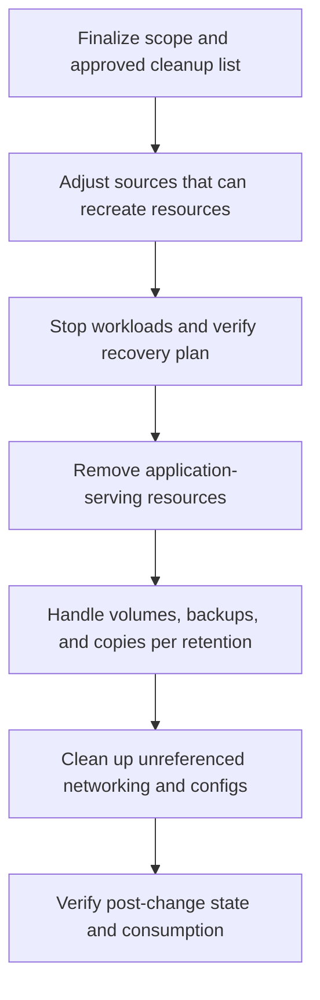

# Cleaning Up Orphaned Resources and Auditing Billable Resources

In the **Operations and Troubleshooting** chapter of the **Oracle Cloud Infrastructure (OCI)** module, resource cleanup is an operational discipline spanning tenancy, compartments, IAM, networking, Compute, storage, and databases. An environment that has stopped serving users can still retain resources storing data, reserving capacity, or generating traffic.

The goal of this lesson is to help you locate forgotten resources, decide which resources are permitted to be removed, and prove that associated consumption has stopped. The process must simultaneously protect data, availability, and recoverability.

## 1. Distinguish Orphaned, Idle, and Billable Resources

An **orphaned resource** is a resource that no longer has a valid usage relationship with an intended workload or owner. For example: a boot volume retained after a test machine was terminated, with no recovery plan or accountable owner left.

An **idle resource** still belongs to a valid design but is lightly used or unused. Disaster recovery standby hosts, databases awaiting switchover, and volumes staged for a data migration may fall into this group.

A **billable resource** is a resource or consumption item still generating charges under active SKUs, configurations, and service terms. This group overlaps with the two groups above, but is not identical to them.

| Observation | Conclusion That Can Be Drawn | Next Step |
| --- | --- | --- |
| Volume shows no attachments in current view scope | Potential candidate for review | Check all attachments, data owner, and retention purpose |
| Instance has low CPU | Workload had low activity during measured window | Check run schedule, standby role, and metric completeness |
| Load balancer has no active backends | Backends are empty or failing | Distinguish abandoned environment from production incident |
| Resource lacks an Owner tag | Missing governance metadata | Trace owner via IaC, Audit, and deployment records |
| Cost Analysis still lists a deleted OCID | Usage was recorded during the queried range | Compare usage timestamps against deletion timestamp |
| Resource not found | Resource not observed within current scope | Check region, compartment, permissions, and supported resource types |

A resource should only enter a deletion list once sufficient evidence exists for **usage need, dependencies, data, and removal authority**. Never turn a single signal into an automatic deletion rule.

## 2. Why Do Charges Persist After Deleting a Machine?

Picture a lab environment structured like this:

```text
Test application
├── Compute instance
│   ├── Boot volume
│   └── Data block volume
├── Load balancer
├── Database
├── Bucket storing data exports
└── Backups, replicas, logs, and copies in another region
```

Components have independent lifecycles. Removing one component does not garbage-collect the entire resource tree.

### 2.1. Stop, Shutdown, and Terminate Mean Different Things

For Compute, billing rules when stopped depend on the shape. Standard shapes generally pause Compute billing when stopped; Dense I/O, HPC, and many GPU shapes continue billing. Exceptions exist across VM or bare metal families, so check the exact shape. Shutting down from inside the OS also does not replace stopping via the OCI Console or API. See [Resource Billing for Stopped Instances](https://docs.oracle.com/en-us/iaas/Content/Compute/Tasks/resource-billing-stopped-instances.htm).

When terminating an instance, read the boot volume handling option carefully. OCI allows retaining the boot volume for recovery; current documentation notes it is retained by default. Never assume the disk was deleted just because the instance was terminated. See [Terminating an Instance](https://docs.oracle.com/en-us/iaas/Content/Compute/Tasks/terminatinginstance.htm).

For Autonomous Database, stopping halts CPU billing, but you must check storage and enabled features separately. Do not apply that rule to every DB System type or all Exadata infrastructure. Refer to [Stop Autonomous AI Database](https://docs.oracle.com/en-us/iaas/autonomous-database-serverless/doc/autonomous-stop.html) and [Autonomous AI Database Billing Summary](https://docs.oracle.com/en-us/iaas/autonomous-database-serverless/doc/autonomous-database-billing-overview.html).

### 2.2. Categories Requiring Independent Inventory

The table below is a review checklist, not a claim that every row incurs charges in every tenancy.

| Category | Items Easily Overlooked | How to Identify Consumption |
| --- | --- | --- |
| Compute | STOPPED instances, dedicated hosts, capacity reserved for ended needs | Check shape, resource type, state, and SKU |
| Boot/Block Volume | Detached volumes, test clones, volumes left after migration | Check provisioned capacity, performance config, and copies |
| Backups and replicas | Boot volume backups, block volume backups, volume group backups, cross-region copies | Inventory each type separately and check size and retention |
| Object Storage | Noncurrent versions, Archive data, uncommitted multipart uploads | Check versioning, storage tiers, requests, and data transfer |
| File Storage | Old environment file systems and snapshots needing review | Identify size, policies, and remaining mounted workloads |
| Networking | Load balancers, reserved IPs, gateways, dedicated connections, traffic-generating configs | Check exact service type, SKU, and actual traffic |
| Database | Stopped databases, clones, standbys, backups, and underlying infrastructure | Separate Compute, storage, backups, and add-on features |
| Observability and auxiliary data | Logs, analytics storage, log buckets, still-running pipelines | Inspect data emitters, ingestion volume, and retention |
| Kubernetes and automation | Worker nodes, volumes, load balancers managed by controllers | Trace back to controllers or configs that may recreate resources |

Do not copy pricing assumptions from another cloud provider onto OCI. For example, an existing NAT gateway or reserved public IP is a reason to inspect governance and dependencies, not automatic proof of a fixed charge. For services with multiple variants, use exact product names and SKUs. Billing units also vary: Compute by time, storage by capacity, and load balancers by service components published in the [OCI Price List](https://www.oracle.com/cloud/price-list/).

## 3. Prepare Scope and Permissions Before Auditing

### 3.1. Lock Scope with Identifiers

Establish an inventory scope covering:

- Tenancy OCID and the account or CLI profile used.
- All regions holding related resources, including DR regions and replication targets.
- Target compartment, child compartments, and compartments holding shared components.
- Availability domains when required by the resource type or command.
- Workload observation window and cost comparison window.
- Resources exempt from cleanup, along with accountable owners and review dates.

Display names help humans read, whereas **OCID is the reconciliation key**. Two resources can share a name; names can also change during migrations or handovers.

Do not inventory only the instance's compartment. A volume and the instance using it may sit in different compartments; backup locations and data source locations must also be verified.

### 3.2. Separate Resource-Read Permissions from Cost-Read Permissions

An account that can read instances cannot automatically read tenancy billing data. A separate cost-review group may be required. Example policy an administrator can grant to an existing group:

```text
Allow group CostReviewers to read usage-report in tenancy
```

This policy serves report reading; it does not grant permission to delete resources. Syntax source: [Cost Analysis — Required IAM Policy](https://docs.oracle.com/en-us/iaas/Content/Billing/Concepts/costanalysisoverview.htm#Required).

For actual cleanup, use permissions scoped to assigned service types and compartments. An inventory account may need only read permissions; the person executing deletions must hold appropriate permissions for each resource type. If access is denied, record that inventory portion as incomplete rather than treating an empty result as proof no resources exist.

### 3.3. Prepare Evidence Before Making Changes

A minimal inventory ledger can use the following columns:

| Field | Purpose |
| --- | --- |
| Resource OCID, type, name | Unambiguously identify the object |
| Region, compartment, AD if applicable | Record the exact observed scope |
| Owner, application, environment, change ID | Confirm accountability and authority |
| Status, creation time, UTC check time | Understand lifecycle and age of evidence |
| Attachments, controllers, dependencies | Detect active usage relationships |
| Capacity, configuration, relevant SKU | Explain source of consumption |
| Retention, backups, recovery needs | Protect data that must be kept |
| Decision, rationale, approver | Separate review candidates from deletion-approved resources |
| Deletion completion time, post-delete check | Reconcile against subsequent billing |

Never copy passwords, private keys, wallets, or business data contents into an inventory ledger.

## 4. Combine Resource Inventory with Cost Tracing

Two complementary investigation directions exist:

1. **From resources to costs:** find forgotten volumes, identify their SKUs, and measure associated consumption.
2. **From costs to resources:** start from a service generating charges and trace the OCID or config producing that line item.

Following only the first direction can miss unknown services that still exist. Following only the second direction can miss resources currently covered by credits, not yet billed, or generating zero usage in the selected window.

### 4.1. Use Search and Tenancy Explorer to Locate Items

In Search, you can query a specific compartment:

```text
query all resources where compartmentId = 'ocid1.compartment.oc1..REPLACE_ME'
```

Matching a single compartment OCID does not automatically traverse the entire child compartment tree. List child compartments explicitly or use subcompartment visibility in tools that support it.

Search depends on supported resource types, indexed data, regions, and user permissions. Therefore, cross-check dedicated per-service lists. Tenancy Explorer supports cross-region viewing yet still has scope and resource-support limits. See [Overview of Search](https://docs.oracle.com/en-us/iaas/Content/Search/Concepts/queryoverview.htm) and [Finding Resources](https://docs.oracle.com/en-us/iaas/Content/GSG/Concepts/finding-resources.htm).

### 4.2. Break Down a Suspicious Usage Line

A practical investigation sequence:

1. Select a date range covering both active workload time and post-shutdown time.
2. Check which services still generate consumption, then split by product or SKU.
3. When data includes a Resource OCID, join that OCID back to the inventory.
4. For lines without an OCID, preserve service, region, unit, and usage period details for further investigation.
5. Compare actual resource configuration against the observed charge type.

Cost Analysis supports grouping by Resource OCID or Service/SKU to pinpoint cost drivers; data can take up to 48 hours to appear. See [Cost Analysis](https://docs.oracle.com/en-us/iaas/Content/Billing/Concepts/costanalysisoverview.htm).

One workload can produce multiple cost lines. For example, seeing storage capacity charges drop does not prove related backups or performance tiers were addressed. Track every meaningful component in the change record.

## 5. Read-Only Inventory Example Using OCI CLI on PowerShell

The commands below are for learners running in an environment with OCI CLI configured. They only read metadata and do not stop or delete resources. Replace all sample values with your lab environment's details.

The example is scoped to **one region, one compartment, and one selected AD**. To draw conclusions for an entire environment, repeat across every relevant scope.

```powershell
$ProfileName = 'DEFAULT'
$RegionId = 'ap-singapore-1'
$CompartmentId = 'ocid1.compartment.oc1..REPLACE_ME'
$AdName = 'REPLACE_WITH_EXACT_AD_NAME'

function Invoke-OciRead {
    param(
        [Parameter(Mandatory = $true)]
        [string[]]$CliArguments
    )

    $jsonText = & oci @CliArguments
    if ($LASTEXITCODE -ne 0) {
        throw 'OCI command failed. Do not treat this result as an empty list.'
    }

    ($jsonText -join [Environment]::NewLine) | ConvertFrom-Json
}

$scopeArguments = @(
    '--profile', $ProfileName,
    '--region', $RegionId,
    '--compartment-id', $CompartmentId,
    '--all',
    '--output', 'json'
)

$volumeArguments = @('bv', 'volume', 'list') + $scopeArguments
$volumes = Invoke-OciRead -CliArguments $volumeArguments

$attachmentArguments = @('compute', 'volume-attachment', 'list') + $scopeArguments
$attachments = Invoke-OciRead -CliArguments $attachmentArguments

$bootArguments = @('bv', 'boot-volume', 'list') + $scopeArguments +
    @('--availability-domain', $AdName)
$bootVolumes = Invoke-OciRead -CliArguments $bootArguments

$bootAttachmentArguments = @(
    'compute', 'boot-volume-attachment', 'list'
) + $scopeArguments + @('--availability-domain', $AdName)
$bootAttachments = Invoke-OciRead -CliArguments $bootAttachmentArguments

$volumes.data |
    Select-Object id, 'display-name', 'lifecycle-state', 'size-in-gbs'

$attachments.data |
    Select-Object 'volume-id', 'instance-id', 'lifecycle-state'

$bootVolumes.data |
    Select-Object id, 'display-name', 'lifecycle-state', 'size-in-gbs'

$bootAttachments.data |
    Select-Object 'boot-volume-id', 'instance-id', 'lifecycle-state'
```

The AD name must be taken verbatim from the tenancy in the corresponding region. Sample names from other tenancies may not work.

Here, `--all` retrieves all pages for **each list command that supports that flag**; it does not expand across regions or compartments. Do not blindly append `--all` to every OCI CLI command. If writing tools against paginated APIs, continue processing page tokens until exhausted.

Command and parameter references are in [Volume List](https://docs.oracle.com/en-us/iaas/tools/oci-cli/latest/oci_cli_docs/cmdref/bv/volume/list.html), [Volume Attachment List](https://docs.oracle.com/en-us/iaas/tools/oci-cli/latest/oci_cli_docs/cmdref/compute/volume-attachment/list.html), [Boot Volume List](https://docs.oracle.com/en-us/iaas/tools/oci-cli/latest/oci_cli_docs/cmdref/bv/boot-volume/list.html), and [Boot Volume Attachment List](https://docs.oracle.com/en-us/iaas/tools/oci-cli/latest/oci_cli_docs/cmdref/compute/boot-volume-attachment/list.html).

### 5.1. Interpret Results Without Jumping to Conclusions

For block volumes, join `volume.id` with `attachment.volume-id`. For boot volumes, join `bootVolume.id` with `bootAttachment.boot-volume-id`.

Keep in mind:

- `AVAILABLE` is a volume lifecycle state, not certification that the volume is orphaned.
- Do not look only for `ATTACHED` attachments; attaching or detaching transitions also require investigation.
- A `DETACHED` attachment is historical record, not automatic proof the volume has no remaining purpose.
- If the instance and volume sit in different compartments, inspect both the instance's scope and attachment scope.
- Missing permissions, CLI errors, or missing pages make the result **indeterminate**, not "no dependencies".

A candidate generation rule can be described in pseudocode:

```text
For each volume in the inventoried scope:
    If permission errors or incomplete inventory data remain:
        Mark UNKNOWN, do not propose deletion
    If no active attachment is found across all relevant scopes:
        Place into CANDIDATE_REVIEW
    If an attachment is transitioning state:
        Wait and re-check
    Transition to APPROVED only when:
        Resource owner confirms no remaining need
        No operational dependencies remain
        Data and retention are handled
        Change authority is clear
```

`CANDIDATE_REVIEW`, `UNKNOWN`, and `APPROVED` are operational workflow labels defined by the team, not OCI lifecycle states.

### 5.2. Expand Inventory by Resource Type

After volumes, inspect dedicated Console lists for:

- Compute instances, boot volume backups, block volume backups, and volume group backups.
- Load balancers, network load balancers if any, reserved public IPs, and related connections.
- Object Storage buckets, object versions, uncommitted multipart uploads, and replication.
- File Storage, databases, clones, standbys, and backups of the active database service.
- Copies or auxiliary resources in other regions.

Do not use a general Search result as a substitute for these lists. Nor should you lump similarly named products under a single pricing assumption or deletion command.

## 6. Confirm Ownership, Data, and Dependencies

Before every deletion decision, answer the following questions.

| Question | Appropriate Evidence |
| --- | --- |
| Who does the resource serve? | Owner, deployment record, change ID, repository, or point of contact |
| Does any workload still use it? | Attachments, endpoints, mounts, app configs, batch schedules |
| Does it serve a standby role? | HA/DR design, failover test schedule, Service Owner confirmation |
| Must the data still be retained? | Retention, business requirements, audit needs, and legal holds if any |
| What is the recovery plan? | Suitable backup or export, retention period, and restore verification |
| Will a system recreate it automatically? | Terraform state, Resource Manager stack, instance pool, controller, pipeline |
| Who has authority to remove it? | Resource owner and the environment's change process |

A backup completing successfully does not prove the application can restore from it. For valuable data, the recovery plan must include decryption keys, configurations, software versions, and required access permissions.

Never delete encryption keys merely to tidy up an old environment. If retained volumes, buckets, or backups depend on that key, losing decryption capability can break the entire recovery plan.

If no owner can be identified, mark pending and escalate to the governance contact. Never interpret "nobody replied" as "nobody needs the data".

## 7. Clean Up by Dependency Order and Control Recreation Sources

A reference sequence:



Specific order must follow the workload's dependency graph. A system sharing a load balancer, VCN, or database requires different cleanup boundaries from an isolated lab.

### 7.1. Adjust IaC and Controllers First

If resources are managed by Terraform or OCI Resource Manager, identify the exact stack, state, and source configuration. Review the change plan to see which resources will be deleted and which components remain.

Never run destroy on an entire stack just to remove one suspect volume. Never delete state to make a resource "disappear" from management; that operation does not delete the resource in OCI.

For Kubernetes, instance pools, or deployment pipelines, locate the corresponding controlling configuration. Manually deleting a load balancer or worker node can cause the controller to recreate it. Adjust resource-creating sources only after the workload owner confirms retirement scope.

### 7.2. Compute and Volumes

A sound sequence for an unneeded instance:

1. Confirm exact OCID, region, and compartment.
2. Stop incoming work and flush active data writes.
3. Verify the recovery plan if any data must be kept.
4. Terminate the instance with an explicit boot volume handling choice.
5. Wait for completion and re-check actual boot volumes and block volumes.
6. Keep or delete individual volumes per the confirmed list.
7. Inventory backups, clones, and replicas using separate lists.

Do not equate detaching with deleting. For a volume still in use, never force detach merely to reduce charges; complete retirement cleanly in the application and OS first.

The example below **actually deletes data** and is solely for an approved boot volume in a lab. Enter your specific OCID and verify the target right before running:

```powershell
$ApprovedBootVolumeId = 'ocid1.bootvolume.oc1..REPLACE_WITH_APPROVED_OCID'

oci bv boot-volume get --boot-volume-id $ApprovedBootVolumeId --profile $ProfileName --region $RegionId
# Cross-check the details just read against the approved record before running the next line.
oci bv boot-volume delete --boot-volume-id $ApprovedBootVolumeId --profile $ProfileName --region $RegionId
```

The command preserves the CLI's confirmation prompt; there is no need to add `--force` for manual operations. After submitting, monitor until completion and re-check the volume list. Refer to [Boot Volume Delete](https://docs.oracle.com/en-us/iaas/tools/oci-cli/latest/oci_cli_docs/cmdref/bv/boot-volume/delete.html).

For block volumes, deletion is not directly reversible. Backups have separate lifecycles and require separate decisions rather than inferring from source volume state. See [Deleting a Block Volume](https://docs.oracle.com/en-us/iaas/Content/Block/Tasks/deletingavolume.htm) and [Block Volume Backups](https://docs.oracle.com/en-us/iaas/Content/Block/Concepts/blockvolumebackups.htm).

### 7.3. Backups, Clones, and Replicas

For each copy, document whether it serves operational recovery, DR, testing, or compliance retention. Remove only copies past their purpose with no remaining retention obligations.

Also check:

- Is any backup policy or automated schedule still creating new copies?
- Are there copies in another region or compartment?
- Are there volume group backups managed as a group?
- Is deletion protection, retention lock, or a hold active?
- Would deletion remove the last required recovery point?

Never attempt to bypass retention locks just to cut costs. Backup protection mechanisms can legitimately block deletion; place such resources on a retention list with projected cost and review dates. [Creating a Block Volume Backup](https://docs.oracle.com/en-us/iaas/Content/Block/Tasks/create-bv-backup.htm) describes backup protection options to check.

### 7.4. Object Storage

Do not look only at the current object listing. In a versioned bucket, ordinary object deletion can create a delete marker while older object versions remain retained. Check both object versions and lifecycle policies. See [Object Storage Versioning](https://docs.oracle.com/en-us/iaas/Content/Object/Tasks/usingversioning.htm).

Inventory uncommitted multipart uploads separately. These can be remnants of failed uploads or interrupted applications. Confirm no valid upload is actively running before aborting. OCI provides abort operations and lifecycle rules for these objects in [Deleting a Multipart Upload](https://docs.oracle.com/en-us/iaas/Content/Object/Tasks/To_delete_uncommitted_multipart_uploads.htm).

If a bucket cannot be deleted, read the error message and inspect object versions, pre-authenticated requests, replication policies, and multipart uploads. Active retention rules must also be respected. Refer to [Troubleshooting Object Storage Versioning](https://docs.oracle.com/en-us/iaas/Content/Object/Troubleshooting/usingversioning_topic-Troubleshooting_Versioning.htm) and [Object Storage Data Retention Rules](https://docs.oracle.com/en-us/iaas/Content/Object/Tasks/usingretentionrules.htm).

Changing storage tiers, retrieving data, or early deletion can carry separate billing terms. Before a large data cleanup, check storage tiers and active contracts rather than estimating only reduced gigabytes.

### 7.5. Databases and Shared Infrastructure

For databases, identify the exact product before planning retirement: Autonomous Database, Base Database Service, Exadata systems, or self-managed databases on Compute have different lifecycles and cost components.

The review order should move from applications to databases, then to backups and underlying infrastructure:

1. Confirm no applications, batch jobs, integration accounts, or replication still need connections.
2. Decide which data must be exported or retained for recovery.
3. Inspect clones, standbys, DR peers, and backups for the exact service.
4. Execute stop or terminate matching the selected goal.
5. Check which resources still exist and which consumption items are kept intentionally.

Do not assume terminate immediately deletes all backups or that every product supports undelete. For instance, Autonomous Database Serverless offers undelete under certain conditions; upon undelete, billing rules for the terminated interval must also be considered. This is not a substitute for a backup plan. See [Terminate an Autonomous AI Database Instance](https://docs.oracle.com/en-us/iaas/autonomous-database-serverless/doc/autonomous-terminate.html) and [Undelete a Terminated Autonomous AI Database Instance](https://docs.oracle.com/en-us/iaas/autonomous-database-serverless/doc/autonomous-undelete.html).

Never delete a standby database merely because it lacks direct application connections. Cost of HA/DR components must be weighed alongside RTO, RPO, and service availability targets.

### 7.6. Load Balancers, Networking, and Compartments

Before deleting a load balancer, inspect listeners, backend sets, DNS, certificates, health checks, and referencing workloads. A failing backend should be repaired if the service remains active; never put it on a cleanup list merely because health checks fail.

For reserved IPs and network components, verify relationships with endpoints, partner allowlists, routes, subnets, and shared connections. Low or zero cost does not make a forgotten endpoint harmless from a governance perspective, yet cleanup must still respect dependencies.

Delete subnets, gateways, or VCNs only after confirming no valid resources or routes depend on them. Keep required IAM policies, keys, and recovery details intact until dependent steps complete.

Deleting a compartment does not cascade-delete all resources inside it. If compartment deletion fails, check resources remaining across regions, policies inside the compartment, and current permission limits. See [Managing Compartments](https://docs.oracle.com/en-us/iaas/Content/Identity/Tasks/managingcompartments.htm).

## 8. Post-Cleanup Verification: Status and Costs

### 8.1. Immediate Operational Verification After Changes

For every processed OCID:

- Record completion timestamp in UTC, not just when the button was clicked.
- Check the service's lifecycle state or work request result.
- Refresh listings and re-query via dedicated APIs when needed.
- Confirm controllers or pipelines did not spawn replacement resources.
- Confirm retained dependent resources match the planned list.
- If the environment has shared components, confirm remaining services operate normally.

A deletion request being accepted does not mean the operation completed. If a work request fails, keep that item in an unresolved state and preserve error codes.

Cases where an API no longer returns a resource also require analysis: was it deleted, moved in scope, or did the account lose permissions? Combine successful operation evidence, Audit logs, and query scope to conclude.

### 8.2. Separate Historical Costs from New Consumption

Suppose cleanup completed at:

```text
t0 = 2026-11-21T03:00:00Z
   = 2026-11-21 10:00:00 in Vietnam (UTC+7)
```

A billing line appearing after `t0` that records usage prior to `t0` does not prove the resource kept running. Nor should you expect month-to-date total spend to drop to 0 after deletion: prior consumption still belongs to that billing period.

Distinguish three timestamps:

| Timestamp | Meaning |
| --- | --- |
| Usage time | When the resource actually incurred consumption |
| Operation completion time | When the system executed the change |
| Report appearance time | When you observe the recorded line item |

If viewing daily reports, the day containing `t0` mixes before and after cleanup. Include measurement windows fully closed after `t0`, avoiding conclusions from a partial day's data.

### 8.3. Repeatable Reconciliation Method

A useful reconciliation record includes:

1. Pre-change snapshot or data export with date range and filters.
2. List of processed OCIDs, operation outcomes, and corresponding `t0`.
3. List of retained resources with rationale and expected consumption.
4. Post-change data after sufficient reporting lag.
5. Component-by-component conclusions rather than a single grand total.

When comparing, hold scope, currency, units, and cost basis constant. If credits or free tiers apply, check usage quantities as well: zero dollar spend does not prove a resource was removed.

Do not treat forecasts as proof of incurred consumption. Do not sum quantities with incompatible units—such as OCPU-hours and GB-months—into a fabricated "total usage".

If new consumption still appears, check in order:

- Are you reading the right usage period strictly after `t0`?
- Does the charge belong to an intentionally retained resource or a different SKU?
- Is there a copy, replica, or backup in another region?
- Is there a new resource sharing the same display name with a different OCID?
- Did a pipeline, schedule, or controller recreate the environment?
- Does the charge belong to a shared service or contract term requiring separate review?

When still unexplained, prepare details for cost governance or Oracle Support: tenancy, region, service/SKU, OCID if any, UTC usage range, deletion timestamp, work request result, and reconciliation data. Never send access keys or unnecessary sensitive data.

### 8.4. Estimate Savings Without Double Counting

You can estimate cost reduction for a future period:

```text
Estimated reduction
    = Sum of costs for each component genuinely removed in that period
      - New costs incurred for replacements, retention, or recovery plans
```

This is an estimate, not a refund figure. Document unit price, unit, time conversion, and usage assumptions. Never multiply an in-progress month's total by a factor and claim it as confirmed savings.

For instance, keeping a necessary backup after deleting a volume can still be the right cost-saving decision. The expected outcome then is stopping volume consumption while continuing backup consumption within an agreed retention window.

## 9. Handle Common Scenarios

| Symptom | Causes to Check | Handling Approach |
| --- | --- | --- |
| Instance stopped yet Compute charges remain | Shape keeps billing when stopped; OS shutdown only; prior-period data | Verify shape, OCI action, and usage timestamps |
| Instance gone yet storage charges remain | Retained boot volume, block volumes, backups, clones, or copies | List each group separately and match OCIDs |
| Volume AVAILABLE yet cannot be deleted | Active attachment, transitioning state, running backup, or missing permissions | Read error, check relationships, and wait for pending ops |
| Search returns nothing yet report shows charges | Wrong scope, missing permissions, unsupported Search type, or historical usage | Use service-specific lists and check usage period |
| Similar resource reappears after deletion | IaC, instance pool, controller, or pipeline recreated it | Adjust assigned controlling source and track new OCID |
| Bucket appears empty yet cannot be deleted | Noncurrent versions, multipart uploads, replication, pre-authenticated requests, or retention | Inspect each condition and respect retention policies |
| Backup refuses deletion | Permissions, lock, hold, or retention | Retain with documentation; handle per policy and authority |
| Compartment refuses deletion | Remaining resources, policies, or permission-limited inventory gaps | Sweep regions and compartment tree, inspect exact error |
| Cost is 0 yet resource still exists | Promotions, credits, or reporting lag | Check both usage quantities and resource state |
| Lab consumption gone yet tenancy total grows | Other environments, shared services, or contract items | Narrow scope accurately; explain remainder separately |

For operational errors, save request IDs or work request IDs for investigation. Avoid repeating bulk deletion commands before understanding why the first attempt failed.

## 10. Prevent Orphaned Resources

### 10.1. Embed Lifecycle Metadata at Creation Time

Operations teams can standardize metadata such as:

```text
Owner       = platform-team
Environment = sandbox
Application = oci-learning
ExpiresAt   = 2026-12-01T00:00:00Z
ManagedBy   = terraform
ChangeId    = LAB-123
```

These are illustrative organizational conventions. An expiration tag does not make a resource vanish automatically; a process or tool must read and act on that value.

Prefer tagging ownership at creation time. When analyzing historical costs, do not assume adding tags today retroactively re-attributes all past consumption.

### 10.2. Separate Automated Detection from Deletion Decisions

An automated workflow should include stages:

```text
Collect metadata and usage
    -> Identify candidates
    -> Exclude protected resources and incomplete data
    -> Generate list for owner confirmation
    -> Re-read state right before change
    -> Clean up strictly the confirmed list
    -> Verify outcomes and reconcile costs
```

A waiting period between detection and deletion helps catch low-activity but still essential resources. Wait durations are set by operations per workload type; no single "unused for 7 days = delete" threshold fits every service.

If automation is permitted to delete, restrict compartments and resource types, enforce exclusion lists, cap batch size per run, log actions, and halt on permission errors or unexpected dependencies. Dry-run mechanisms are only valid when they issue no mutating commands.

### 10.3. Tie Cleanup to Environment Lifecycle

When closing a lab or project, include the following in completion criteria:

- Cancel or adjust resource-creation schedules.
- Review IaC change plans and confirm retained resources.
- Clean up Compute, databases, storage, and networking in dependency order.
- Check backups, replicas, buckets, and separately stored observability data.
- Assign an owner to every exception.
- Reconcile post-change consumption and archive results.

Use Budgets and cost alerts to detect anomalies early; alert handling must still specify who investigates and which actions run. Never treat having an alert configured as proof that excess resources were cleaned up.

## 11. Practice in a Lab Compartment

The exercise can use existing lab resources; there is no need to create extra paid services just to practice the workflow.

**Inputs:** an assigned lab compartment, list of relevant regions, resource-read permissions, and appropriate cost data. If the lab holds data that must be kept, an accountable owner must confirm before any deletion.

1. Record tenancy, compartment, region, and UTC start time.
2. Use the Console and CLI examples to list instances, volumes, and attachments.
3. Separately inventory backups, load balancers, buckets, and databases present in the lab.
4. Pick one candidate and explain why that resource warrants review.
5. Trace owner, dependencies, data constraints, and any source that could recreate the resource.
6. Propose one of three decisions: KEEP, PENDING VERIFICATION, or DELETE.
7. Execute deletion only when the resource sits within approved scope.
8. Record operation outcomes and verify post-change state.
9. Reconcile consumption over an appropriate period once reporting data lands.
10. Complete the record, even when the right conclusion is keeping the resource for recovery.

If no eligible deletion candidate exists or deletion permissions are not granted, still complete the inventory and recommendation portions. Never invent a fake deletion justification just to satisfy lab steps.

A minimal record template:

```text
Scope: tenancy / region / compartment / AD if applicable
Resource: type, OCID, name
Review rationale:
Owner and confirmation basis:
Checked dependencies:
Data, retention, and recovery plan:
Decision: KEEP / PENDING VERIFICATION / DELETE
Operation and UTC completion time:
Status or work request outcome:
Retained resources and rationale:
Usage period used for cost reconciliation:
Conclusion: VERIFIED / AWAITING COST DATA / NEEDS INVESTIGATION
```

## 12. Completion Criteria for Resource Cleanup

Work is considered complete within the assigned scope only when all of the following conditions are met:

- Inventory scope has no blind spots from missing permissions, missed regions, or unpaged results.
- Every candidate has an explicit decision and accountable owner.
- Authorized operations completed with no unresolved errors.
- Retained resources have clear purpose, retention, and owner.
- No unexpected controller recreated cleaned-up resources.
- Operational evidence aligns with consumption in post-change measurement windows.
- Any unverified cost items are clearly documented for follow-up investigation.

A good outcome does not necessarily mean zero resources or zero cost. The target outcome is that every remaining resource has a valid usage reason, every remaining charge is explained, and cost savings never cause data loss or unintended availability reduction.
