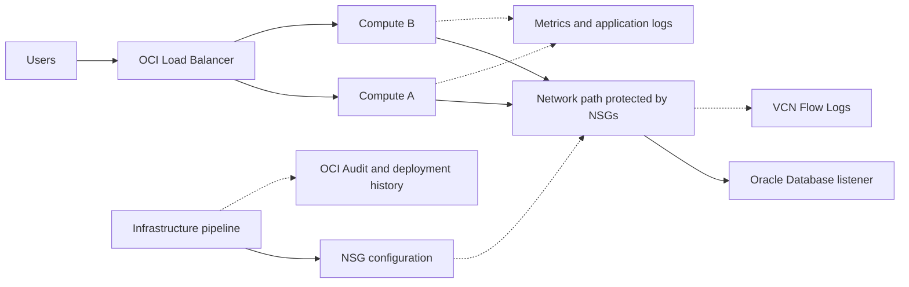
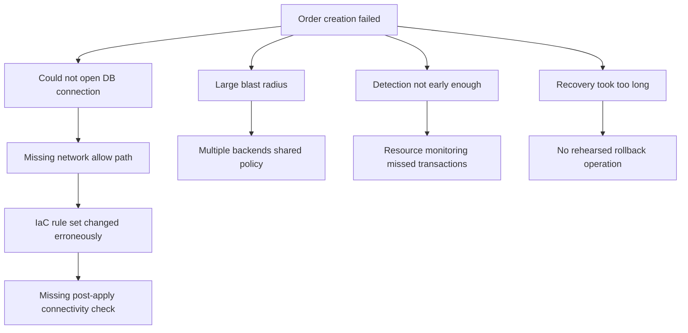

# Root Cause Analysis and Post-Incident Improvements

## 1. Purpose of Post-Incident Analysis

In Oracle Cloud Infrastructure (OCI) operations, restoring service only resolves the immediate disruption. The operations team also needs to understand the failure mechanism, why impact spread, why safeguards failed to stop it, and what must change to reduce risk next time.

Root Cause Analysis (RCA) is the process of building and verifying an evidence-based explanation. A post-incident report, or postmortem, documents impact, timeline, response decisions, RCA conclusions, and improvement actions tracked to completion.

In the **Operations and Troubleshooting** chapter of the **CLOUD_PROVIDERS_ORACLE** scope, this lesson connects RCA with tenancy, compartments, IAM, VCN, Compute, storage, and Oracle Database services. The goal is turning operational data into concrete changes in permissions, monitoring, automation, cost, and availability.

After this lesson, learners can:

- Separate symptoms, triggers, failure mechanisms, and contributing conditions.
- Build a consistent timeline from application data, OCI Audit, Monitoring, Logging, and deployment history.
- Test competing hypotheses instead of picking the most recent change as the cause.
- Write conclusions reflecting confidence levels and evidence limitations.
- Turn conclusions into actions with owners, due dates, validation tests, and evaluation metrics.

## 2. Concepts to Keep Separate

### 2.1. Symptoms Are Not Explanations

Users may see HTTP 5xx errors, slow checkout, or login failures. Operations may see unhealthy backends, exhausted connection pools, or CPU spikes. These phenomena describe how the incident manifests; they do not explain why it happened.

| Concept | Question to Answer | Example in OCI |
| --- | --- | --- |
| Symptom | What is behaving abnormally? | Order creation API returns many 5xx errors |
| Impact | Who is affected, and to what extent? | A portion of order creation requests failed over 19 minutes |
| Trigger | What event initiated the failure chain? | Pipeline applied an NSG change |
| Failure mechanism | How did that change cause the error? | New connections from the app to the database listener were blocked |
| Contributing condition | What made the fault more likely or severe? | All backends shared the broken network configuration |
| Safeguard gap | Why did the fault pass through controls? | Pipeline checked only syntax and apply status |
| Improvement action | What change reduces the identified risk? | Verify live connectivity post-deploy and prepare rollback |

"High CPU" can be the direct cause of latency in one scenario, yet be a consequence of retry storms in another. A phenomenon's place in the causal chain must be established by evidence.

### 2.2. Do Not Force a Complex Incident into a Single Root Cause

An incident normally requires multiple conditions coexisting:

```text
Faulty network change
  + deployment checks missing app -> database path
  + multiple backends sharing a single point of failure
  + alerts tracking resources only
  -> prolonged outage and wide blast radius
```

You can identify a primary failure mechanism while recording multiple contributing conditions. Do not keep asking "why" until you reach an overly generic sentence like "process wasn't good enough".

A useful stopping point is when the team has a testable explanation and clear intervention points. Statements like "human error", "OCI fault", or "misconfiguration" are too broad to drive effective action.

### 2.3. Blameless Still Means Accountable

A blameless postmortem focuses on the conditions that made a decision seem reasonable at the time. The team must still assign action owners and due dates.

Replace:

> Engineer forgot to open the database port.

With a more specific description:

> The post-deployment rule set lacked an allow path from the application group to the database listener. The pipeline lacked a connectivity check for this path, so the change was marked successful before verifying real transactions.

Audit can trace which principal executed the operation. If the principal was a pipeline account, trace further to the pipeline run and approved change; never infer an individual's intent directly from a principal name.

## 3. Restore Service and Investigate Root Cause

### 3.1. Prioritize Mitigating Ongoing Impact

While the service is failing, priority goes to restoring critical functionality using an option with appropriate risk: rolling back a change, shedding traffic, disabling a feature, restoring a connection path, or failing over to a tested standby.

Do not delay recovery just to capture perfect evidence. When quick to do, preserve volatile data before changing state:

- OCIDs, region, compartment, and relevant topology.
- Timestamps, representative errors, and request IDs.
- Pre-change and post-change configuration versions.
- Application logs, process state, and short-term metrics.
- Connectivity check results or operation error messages.

A restart may bring the service back, yet simultaneously wipe process state needed for investigation. The coordinator must balance evidence value against ongoing impact and record that decision.

### 3.2. Distinguish Status Milestones

| Milestone | Meaning | Illustrative Condition |
| --- | --- | --- |
| Responding | Impact is ongoing | Transaction errors remain above acceptable thresholds |
| Impact mitigated | Temporary measure improved the situation | Secondary feature disabled so primary flow works |
| Recovered | Service metrics return to agreed levels | Success rate and latency meet thresholds over a monitoring window |
| RCA complete | Conclusions and unknowns are documented | Timeline, evidence, failure mechanism, and action owners exist |
| Improvements verified | Actions implemented and tested effective | Reproducing scenario is blocked or detected on time |

An incident may recover today while follow-up improvement actions span many days. Closing the response session does not mean closing all post-incident work.

If there are signs of intrusion, data exfiltration, or sabotage, engage security incident response workflows and preserve forensic evidence. Fixing configuration to restore service does not by itself prove the system is clean or data was untouched.

## 4. Define Scope and Prepare Evidence on OCI

### 4.1. Identify Exact Resources and Blast Radius Boundaries

Display names are insufficient to identify resources in a tenancy with multiple environments. An investigation record should include at least:

| Info Group | Required Content |
| --- | --- |
| Location | Tenancy, region, compartment of each resource |
| Identifiers | OCIDs of relevant load balancers, instances, VNICs, NSGs, volumes, or databases |
| Architecture | Request path and shared dependencies |
| User scope | Impacted functions, customer segments, or locations |
| Time window | Impact start, detection, recovery, and monitoring end |
| Changes | Related commits, app versions, pipeline runs, or Resource Manager jobs |
| Confidence | What is confirmed, what is inferred, and what remains unknown |

In systems spanning multiple compartments, investigative data may also live in multiple places. The compartment holding the application does not necessarily hold NSGs, log groups, or databases. Not finding logs in one compartment does not prove an operation never occurred.

### 4.2. Pick Sources by Investigative Question

| Evidence Source | Answers | Limitations to Remember |
| --- | --- | --- |
| OCI Audit | Which API calls occurred, involving which principal and resource? | Does not replace OS-level or in-application operation logs |
| OCI Monitoring | When did behavior and load change, on which dimensions? | Averages or aggregations can hide failing subsets |
| OCI Logging | What common patterns appear in specific errors and events? | Requires the right log source, search scope, and retention window |
| VCN Flow Logs | Was observed network traffic accepted or rejected? | Must check log enablement point and capture filters |
| APM or app traces | Where was time spent along call paths? | Depends on instrumentation and sampling rate |
| OS and application logs | What did processes, pools, disks, DNS, or configs show? | Logs can be lost if instances are replaced or files rotate |
| Database telemetry | Were sessions, waits, connections, or queries abnormal? | Visibility and access vary by product and service tier |
| Deployment and IaC history | What desired configuration was pushed into the system? | Must compare against live state and manual edits |
| OCI Status, Announcements, Support | Any provider info matching incident scope? | Public status does not replace in-tenancy investigation |

VCN Flow Logs record traffic accepted or rejected by security lists and NSGs; captured data also depends on filters and sampling rates. Thus missing matching records does not automatically mean zero traffic. See [Oracle's VCN Flow Logs overview](https://docs.oracle.com/en-us/iaas/Content/Network/Concepts/vcn-flow-logs.htm).

### 4.3. Gather Sufficient Permissions and Keep Scope Tight

Investigators need appropriate permissions for Audit, metrics, logs, and target resources. Permission to view Compute does not automatically include all logs or database telemetry.

Preparing an investigator role before incidents avoids requesting overly broad rights in emergencies. For tools or actions needing extra privileges, record purpose, scope, and accountable owner. Never use tenancy-wide admin grants as the default fix for every investigative data access error.

If a screen does not show a resource, check permissions, region, and compartment before inferring the resource was deleted.

### 4.4. Catalog Evidence

Each piece of evidence should have an ID and metadata enabling others to trace it back:

```text
ID: E-04
Type: Application logs
Source: app-instance-A / order-api service
Data window: 2026-10-14T02:55:00Z to 2026-10-14T03:35:00Z
Scope: Order creation requests, both successes and failures
How retrieved: Queried by service, time range, and request ID
Collection time: 2026-10-14T04:10:00Z
Collector: Assigned investigator
Limitations: Some requests lack traces due to sampling
Original link: Access-controlled evidence repository
```

Keep both originals and sanitized copies when sharing is required. Record filters and aggregations used; a chart screenshot missing region, dimensions, or time zone is very hard to re-verify.

OCI Audit currently has a 365-day retention period per Oracle documentation. Do not apply that retention assumption to every other log type. If longer retention is needed for investigation, prepare appropriate storage and access controls before data expires. See [Audit Log Retention Period](https://docs.oracle.com/en-us/iaas/Content/Audit/Tasks/settingretentionperiod.htm).

## 5. Build a Verifiable Timeline

### 5.1. Normalize Timestamps

Use UTC in the main timeline, formatted like `2026-10-14T03:07:00Z`. You can also note Vietnam time for ease of discussion; UTC+7 corresponds to 10:07 the same day in this example.

Distinguish between:

1. When the activity actually occurred.
2. When the emitter recorded the event.
3. When the data was processed or indexed for search.
4. When responders observed it and acted.

Audit events can appear with a lag relative to API calls, so searching immediately after a change and seeing nothing is not enough to rule out that change. Oracle notes typical latency around 15 minutes and variable processing times. When needed, widen the query window and compare timestamp fields on the records. See [Viewing Audit Log Events](https://docs.oracle.com/en-us/iaas/Content/Audit/Tasks/viewinglogevents.htm).

For client or OS logs, verify clock synchronization. When skew is unverified, mark timestamps as approximate; do not order events separated by seconds and assert definite causality.

### 5.2. Separate Events, Assessments, and Decisions

A good timeline row answers: when, what happened, how we know, and with what certainty.

| UTC Time | Observed Event | Source | Notes |
| --- | --- | --- | --- |
| 03:02 | Pipeline applied new network rule set | E-01: pipeline log; E-02: Audit | Time of change |
| 03:03 | New connection timeouts to database appeared | E-03: application logs | First observed impact |
| 03:07 | App error rate alarm fired notification | E-04: alarm history | Detection milestone per team definition |
| 03:09 | On-call engineer acknowledged and began triage | E-05: response log | Acknowledgment milestone |
| 03:15 | Team retrieved Audit event for the 03:02 change | E-02; E-05 | Evidence discovery time, not change time |
| 03:18 | Re-applied verified allow rule | E-01; E-02 | Mitigation started |
| 03:22 | Transactions returned to normal operating range | E-03; E-04 | Recovery milestone confirmed after observation |
| 03:32 | Completed 10 minutes of stability per response criteria | E-04; E-05 | Elevated monitoring ended |

These are simulated data for this lesson. The 03:03–03:22 interval is the observed impact window; do not label the entire window a total outage if some requests still succeeded.

"Team suspected NSG at 03:12" is an investigative assessment or decision. It does not replace the factual event "NSG rules changed at 03:02".

## 6. Test Hypotheses Rather Than Chasing Correlations

### 6.1. Start from What Needs Explaining

A sufficiently concrete problem statement might be:

> Between 03:03 and 03:22 UTC, order creation timed out opening database connections. Static pages remained accessible. Errors occurred across multiple backends sharing one network connection path.

From that statement, list hypotheses distinguishable by evidence:

| Hypothesis | Expected Signal If True | Useful Verification Test |
| --- | --- | --- |
| App-side DNS failure | Wrong or failed resolution on impacted backends | Compare DNS results, caches, and change timestamps |
| Network blocking new connections | TCP fails to establish on app-to-DB path | Check flow logs, effective rules, and connectivity probes |
| DB listener or service issue | Network path open yet DB connections still fail | Check listener status, service, and DB-side logs |
| Database saturation | Slow connections/queries with abnormal waits, sessions, or load | Check DB performance data in exact window |
| App exhausting pool | Active pool maxed, pending rising, or connections leaked | Inspect pool metrics, thread dumps, and app logs |
| Credential change | Matching auth errors, unlike pure TCP timeouts | Check DB errors, secret rotation logs, and client config |

Multiple hypotheses can be true simultaneously. For instance, network errors trigger retry storms, which then exhaust the pool; here pool exhaustion is an amplifying link, not necessarily the initial trigger.

### 6.2. Apply Four Causal Tests

**Temporal order.** The proposed cause must precede the effect it explains, accounting for logging lag.

**Technical mechanism.** You must trace step-by-step from the change to the observed failure. "Two graphs spiked at the same time" is not enough.

**Scope fit.** The mechanism must explain both what failed and what kept working. If only one subnet failed, explain what differed from the control subnet.

**Intervention evidence.** Reverting a condition and watching the system recover supports the hypothesis. However, if you simultaneously restart apps, edit networking, and rotate passwords, it is hard to tell which change fixed it.

Never leave a broken production service down just to test one variable at a time. During response, parallel actions may be needed; afterward, note inference limits in the report and use test environments to gather cleaner evidence.

### 6.3. Record What Could Disprove the Hypothesis

For the hypothesis "missing NSG rule blocked connections", the following observations would need explaining:

- Why did some new connections still succeed over the same network path?
- Does another security list or NSG allow that flow?
- Did actual source IPs traverse a proxy or NAT device?
- Which port, listener, or service did traffic use?
- Did errors exist before the network change?
- Did backends not using this rule experience similar errors?

A strong hypothesis withstands searches for disconfirming evidence, rather than cherry-picking supporting data.

### 6.4. Assign Confidence Levels

| Label | Usage |
| --- | --- |
| Confirmed | Direct evidence and key cross-checks align |
| High likelihood | Multiple supporting facts exist, though a decisive check is missing |
| Indeterminate | Insufficient data or plausible competing explanations remain |
| Ruled out within tested scope | Test results contradict hypothesis, noting scope and limits |

If logs already expired, a complete conclusion may be impossible. An RCA remains valuable if it clearly states unknowns and fixes the observability gap; never fabricate certainty just to close a report.

## 7. End-to-End Example: NSG Change and Oracle Database Connectivity

### 7.1. Architectural Context

Suppose a system in one region consists of:

- An OCI Load Balancer receiving HTTPS requests.
- Two Compute instances running the order creation API in different fault domains.
- An Oracle Base Database Service DB System in a private subnet; the exercise listener uses TCP 1521.
- An application NSG and a database NSG controlling the access path.
- Pre-configured Monitoring, application logs, and VCN Flow Logs.

Port 1521 is only an example assumption. When applying to other systems, use the actual endpoint, protocol, and port of the database service, including TLS configuration if any.



Separate fault domains reduce some shared physical risks. They do not protect against a faulty change applied to an NSG that both backends depend on.

### 7.2. Change and Manifestation

An IaC module edit accidentally dropped the ingress rule allowing traffic from the application NSG to the DB port. In this scenario, no other security list or NSG compensated for that path.

New connections from the application to the DB began timing out. Some requests reusing still-open connections did not fail immediately; error rates climbed as the app needed to open or recreate connections. Exact behavior must be checked against rule type, connection states, and live data.

In the example, remaining safeguards failed to stop the fault:

- The pipeline verified apply succeeded without running post-deploy transaction checks.
- Backend health checks only hit an endpoint confirming the HTTP process was alive.
- CPU alerts stayed normal, while app error-rate alerts fired only after an evaluation window.
- Both backends depended on the exact DB access path that changed.

Do not hastily turn every health check into a heavy DB query. Design separate checks for process liveness, serving readiness, and synthetic transactions; avoid generating heavy load or ejecting all backends simultaneously over a shared dependency.

### 7.3. Required Evidence Chain

| ID | Simulated Evidence | Conclusion Supported |
| --- | --- | --- |
| E-01 | IaC diff and run showing allow rule dropped from config | Establishes intended change entered the pipeline |
| E-02 | Audit showing action on exact NSG by pipeline principal in change window | Binds API activity to resource and timestamp |
| E-03 | App logs showing DB connection-open timeouts post-change | Links symptoms to DB dependency |
| E-04 | Metrics showing error rate climbing while CPU stayed unsaturated | Explains why CPU alerts alone were insufficient |
| E-06 | Flow logs with REJECT entries matching source, destination, protocol, and port | Supports concluding network path rejected observed traffic |
| E-07 | Restoring exact rule followed by successful new connections and test transactions | Supports effectiveness of the recovery action |
| E-08 | Test environment reproducing errors when rule removed and clearing when restored | Adds mechanistic confirmation |

A single REJECT record does not identify which exact rule caused it. Inspect all relevant allow configs, VNIC placements, and traffic paths.

Similarly, a successful API event does not guarantee business transactions succeed. It reflects only the API operation outcome within that service's scope.

### 7.4. Sample RCA Conclusion

> The NSG rule set after the 03:02 UTC deployment lacked an ingress path from the application group to the DB listener. Along the investigated connection path, no other rule permitted matching traffic, blocking new connections and causing order creation requests to time out. This conclusion is supported by infrastructure diffs, Audit, app logs, flow logs, and recovery results; a test environment reproduced the same mechanism.
>
> The fault impacted multiple backends because they shared the same network policy. The pipeline did not verify business connectivity post-apply, and health checks confirmed only the HTTP process. These gaps allowed a faulty change into operations and prolonged detection time.

This conclusion holds only when the cited evidence actually exists. Without E-08 or verification of alternate allow paths, lower the confidence level or state the corresponding limitation clearly.

## 8. Collection and Correlation Operations on OCI

The commands below are examples for learners to run within authorized scope; they are not commands to alter infrastructure. Prepare OCI CLI, an authenticated profile, and the right region. Never place private keys, tokens, or passwords in reports.

### 8.1. Query Audit Within the Investigation Window

PowerShell example:

```powershell
$incidentRegion = 'ap-singapore-1'
$incidentCompartmentId = '<COMPARTMENT_OCID>'
$incidentStartUtc = '2026-10-14T02:55:00Z'
$incidentEndUtc = '2026-10-14T03:35:00Z'

oci audit event list --region $incidentRegion --compartment-id $incidentCompartmentId --start-time $incidentStartUtc --end-time $incidentEndUtc --all --output json
```

Replace the placeholder with the compartment of the resource under inspection. If the path spans resources across multiple compartments, query each relevant scope and note the source; never assume one query on the app compartment automatically returns all events in the tenancy.

The command retrieves all result pages via `--all`. For this API, start time is inclusive and end time is exclusive; seconds and fractional seconds must be 0. Use a window sized appropriately for the investigation, with a buffer before and after the incident. Refer to [OCI CLI: audit event list](https://docs.oracle.com/en-us/iaas/tools/oci-cli/latest/oci_cli_docs/cmdref/audit/event/list.html).

Once matching records are found, cross-check:

| Field | What to Examine |
| --- | --- |
| `eventTime` | When was the event recorded? |
| `data.eventName` | What was the specific API operation? |
| `data.resourceId`, `data.compartmentId` | Are resource and scope exact? |
| `data.identity` | Which principal or caller was involved? |
| `data.request`, `data.response` | What were the request, response, and status code? |
| `data.stateChange` | Are before/after state payloads present to compare? |

Payloads vary by service and event type; not every record is guaranteed to include full before/after configuration. Supplement with IaC diffs or saved config snapshots when state fields are insufficient. See [Audit log event structure](https://docs.oracle.com/en-us/iaas/Content/Audit/Reference/logeventreference.htm).

### 8.2. Use Monitoring and Logging at the Right Granularity

For metrics:

1. Identify metrics reflecting user experience: success rate, latency, or queue age.
2. Check exact namespace, dimensions, interval, and aggregation statistic.
3. Compare impacted groups against control groups over the same window.
4. Align change, detection, and recovery timestamps.
5. Check for missing data before interpreting a flat or zeroed line.

Success p95 latency can still look clean while many other requests fail fast. Always read latency alongside error rates and request volume.

For logs, start by time and resource, then narrow by error type or request ID. Keep a sample successful request for comparison. Searching only for the keyword "error" can miss timeouts logged at warning level or failures appearing only in structured fields.

Alarms must be tuned to resource criticality and alert noise. Evaluation windows and trigger conditions also affect detection time; lowering thresholds mechanically can create unhelpful noise. Refer to [Best Practices for Your Alarms](https://docs.oracle.com/en-us/iaas/Content/Monitoring/Concepts/alarmsbestpractices.htm).

### 8.3. Check Network Paths and Tool Limitations

Network Path Analyzer analyzes network reachability based on configuration. It does not send real test traffic; results must be combined with application checks and traffic evidence. Verify limits and required permissions for the active topology. See [Network Path Analyzer](https://docs.oracle.com/en-us/iaas/Content/Network/Concepts/path_analyzer.htm).

If run after a rollback, the tool reflects configuration at the time of analysis. It does not reconstruct the path at incident time. To draw conclusions about past state, use diffs, saved configs, and corresponding timelines.

For the app-to-DB path, distinguish:

- Resolving a name does not mean TCP can establish.
- Establishing TCP does not mean DB authentication succeeds.
- Authenticating does not mean queries complete on time.
- A simple query succeeding does not mean full business transactions succeed.

Separating these layers lets the team pick exact tests instead of labeling every failure "lost DB connection".

### 8.4. Cross-Check Information from Oracle

When suspecting an OCI service issue, check the exact region, service, and time window. The OCI Status dashboard shows service-level or region-level status; customer-specific incidents may be communicated via Console Announcements. Therefore, normal public status does not rule out an incident affecting only your tenancy. See [OCI System Status](https://docs.oracle.com/en-us/iaas/Content/General/Concepts/status-service.htm).

Support tickets should include impact, UTC timestamps, region, relevant OCIDs, representative errors, checks already performed, and request IDs. Oracle instructs capturing the response `opc-request-id` and `date` values for tracing. See [Locating Oracle Cloud Infrastructure IDs](https://docs.oracle.com/en-us/iaas/Content/GSG/Tasks/contactingsupport_topic-Locating_Oracle_Cloud_Infrastructure_IDs.htm).

Do not conflate a business transaction request ID, an application trace ID, and the `opc-request-id` of an OCI API call. Record the mapping between them when your system correlates them.

If Oracle is investigating, keep the provider-side conclusion in a pending-confirmation state. The team can still complete analysis within its own control: detection, retries, timeouts, failover, and recoverability.

## 9. Use Five Whys and Causal Trees

### 9.1. Five Whys Is a Questioning Framework

Using the NSG example:

| Question | Answer Requiring Proof |
| --- | --- |
| Why did order creation requests time out? | The app could not open DB connections within the allowed timeout |
| Why could it not open connections? | The network path lacked a rule permitting that traffic |
| Why was the allow path missing? | The rule set generated by the IaC change omitted required access |
| Why was the deployment still treated as successful? | Pipeline checked apply and process liveness, not DB-dependent transactions |
| Why did impact hit multiple backends? | They shared the network policy modified in a single deployment |

You do not have to stop at exactly five questions. Nor is the final answer necessarily a single root cause. When two branches emerge—such as "slow detection" and "slow recovery"—analyze each separately.

### 9.2. Expand into Causal Branches



Trees help locate intervention points. Every link on the diagram must match evidence or be marked as a hypothesis; a neat diagram does not replace verification.

A useful question when evaluating actions is: "If a similar trigger happens again, will this change prevent the fault, detect it earlier, or only speed up fixing it?"

## 10. Write a Postmortem Actionable by Others

A strong report lets someone who was not involved understand the impact, failure mechanism, and follow-up work. Avoid pasting entire response chat transcripts into the main report.

### 10.1. Applicable Structural Template

```markdown
# Postmortem: <Incident Name>

## Metadata
- Incident ID:
- Service and environment:
- Related tenancy / region / compartment:
- Report owner:
- Internal severity classification:
- Conclusion status: preliminary / confirmed / open unknowns

## Impact
- Impacted functions and user groups:
- UTC impact window:
- Eligible requests, failed requests, latency:
- Data at risk of loss, duplication, or pending reconciliation:
- Measurement method and limitations:

## Timeline
| UTC | Event or Decision | Evidence ID |
| --- | --- | --- |

## Analysis
- Symptom:
- Trigger:
- Failure mechanism:
- Contributing conditions:
- Detection and recovery gaps:
- Ruled-out hypotheses and tested scope:
- Unknowns and owner continuing verification:

## Response
- Mitigation and rollback actions:
- What went well:
- What caused delays or added risk:
- Recovery verification criteria:
- Data reconciliation results:

## Action Items
| ID | Mechanism Addressed | Change | Owner | Due Date | Acceptance Criteria |
| --- | --- | --- | --- | --- | --- |

## Evidence and Review
- Link to raw evidence:
- Reviewer and date:
- Revisions to conclusions:
```

Severity levels must follow internal conventions; do not assume every organization uses the exact same SEV1 or SEV2 definitions.

### 10.2. Measure Impact in the Right Units

In the example, suppose 12,000 eligible order creation requests occurred in the impact window, of which 1,800 failed:

```text
Failure rate in window = 1,800 / 12,000 = 15%
Success rate in window = 85%
```

This is a rate over defined requests, and does not automatically convert into affected user percentage or unique failed orders. Retries can generate multiple requests for a single transaction. To measure business impact, reconcile transaction IDs and final states.

For ordering or payment systems, confirming the app responds again is not enough. Check whether timed-out requests committed before responses were lost, whether duplicate transactions occurred, and whether backlogs need processing. Claim zero data loss only with supporting evidence.

### 10.3. Define Time Intervals Explicitly

From the simulated timeline:

| Metric for This Incident | Calculation | Result |
| --- | --- | --- |
| Time to detect | 03:07 minus 03:03 | 4 minutes |
| Time to acknowledge | 03:09 minus 03:07 | 2 minutes |
| Time to recover from impact start | 03:22 minus 03:03 | 19 minutes |
| Additional stability monitoring | 03:32 minus 03:22 | 10 minutes |

Acronyms like MTTR can carry different meanings. Clearly state start marks, end marks, and definitions. A single incident provides only one observed duration; the word "mean" applies only when averaging across a defined set of incidents.

If using a 99.9% SLO by **request count** and an evaluation window has 1,000,000 eligible requests:

```text
Error budget = 1,000,000 × (1 - 0.999) = 1,000 requests
This incident alone had 1,800 failed requests -> consumes 180% of that budget
```

The example assumes all 1,800 failures belong to the same request set and SLO window. Do not divide 19 minutes directly by a request-based budget. Time-based SLOs require their own corresponding definition and math.

## 11. Turn RCA into Acceptable Improvements

### 11.1. Every Action Must Tie to a Mechanism or Gap

"Be more careful", "add more monitoring", or "more training" do not adequately describe desired outcomes. Actions must state what will change and how you will know the change works.

The table below uses illustrative due dates matching the simulated incident of 14/10/2026:

| ID | Goal | Action | Owner | Due Date | Acceptance Criteria |
| --- | --- | --- | --- | --- | --- |
| A-01 | Prevent recurring config faults | Add validation on rule sets generated by IaC module | Network module owner | 16/10/2026 | Config missing app-to-DB path is blocked before deployment |
| A-02 | Catch faulty deployments | Add synthetic transaction check after network changes | Pipeline owner | 19/10/2026 | In test env, missing rule fails verification and halts next stage |
| A-03 | Shorten operational detection | Alert on error rate and synthetic transaction failures | Service on-call team | 20/10/2026 | Reproducing fault pages the right responder within agreed target |
| A-04 | Shorten recovery | Prepare and rehearse network config rollback | Operations owner | 21/10/2026 | Recovers within target time and re-verifies transactions and access |
| A-05 | Reduce out-of-band edits | Tune NSG edit permissions, keep logged emergency access | IAM owner | 23/10/2026 | Pipeline completes required work; regular accounts cannot edit out of scope |
| A-06 | Ensure business accuracy | Automate reconciliation of timed-out transactions by business ID | Application owner | 26/10/2026 | Test dataset with post-commit timeouts is detected without duplicate processing |

Role labels in the lesson describe accountability. In a real tracking system, each action needs a clear named person or contact point rather than a group list where no one picks it up.

You do not have to implement every action simultaneously. Balance remaining risk, implementation effort, and verifiability.

### 11.2. Distinguish Implementation Complete from Effectiveness Verified

Track actions through four states:

```text
Planned
  -> In progress
  -> Deployed
  -> Effectiveness verified
```

For example, "created alarm" only confirms a configuration exists. To verify effectiveness, prove that the fault condition fires the alarm accurately, notifications reach the right destination, and on-call responders know the next action.

Similarly, a rollback document is only useful if the on-call engineer can execute it with real permissions and conditions. A drill should test permission boundaries, time to fetch prior configs, verification steps, and handling if rollback fails.

### 11.3. Choose Appropriate Verification Tests

- **Prevention:** Feed faulty config into a test pipeline and verify it is caught before apply.
- **Detection:** Inject a controlled fault in an isolated environment and measure from impact onset until the on-call responder receives the page.
- **Recovery:** Run the runbook via someone with on-call-equivalent permissions, recording duration and outcome.
- **Blast radius reduction:** Verify test changes on one resource group do not affect outside intended boundaries.
- **Data integrity:** Reconcile indeterminate transactions and verify idempotency protections.
- **Permission control:** Attempt both authorized and out-of-scope operations to confirm least privilege.

Run tests with clear boundaries and stop conditions. Never reproduce incidents in production just to finish an RCA document.

## 12. Prioritize Reliability Alongside Cost and Availability

### 12.1. Avoid Large Actions That Miss the Mechanism

Adding instances will not help when every instance shares a broken NSG configuration. Going multi-region can improve resilience to certain regional events, yet also increases data, networking, operational, and failover-testing requirements.

Prioritize using three questions:

1. Which evidence-backed risk mechanism does the action reduce?
2. What is the expected reduction in impact or recovery time?
3. What are the implementation cost, operational cost, and new change risks?

In the NSG example, validating configs and post-deploy transactions is usually the direct intervention point. Replicating the architecture while still pushing the same faulty change everywhere simultaneously preserves the failure mechanism.

### 12.2. Account for Observability Costs

Detailed logs and flow logs can grow ingested data volume. Improvement designs should specify scope, retention period, filters, sampling, and investigative needs.

| Option | Value | Trade-offs to Balance |
| --- | --- | --- |
| Retain essential logs on primary transaction path | Improves incident reconstruction | Storage volume, access control, sensitive data |
| Periodic synthetic transactions | Detects broken functionality even when resources look healthy | Frequency, call cost, test data, and cleanup |
| Add redundancy | Eliminates some single points of failure | Data sync, standby capacity, and failover testing |
| Temporary resource scaling | Relieves confirmed saturation | Teardown deadline, cost, and risk of masking software bugs |

Every resource scaled temporarily during response needs an owner and teardown condition. Post-recovery, review added instances, volumes, snapshots, log copies, and standby capacity.

### 12.3. When to Consider Architectural Changes

The following conclusions may justify architectural changes rather than just editing runbooks:

- A shared dependency causes impact exceeding acceptable targets.
- Standby options share the same failure modes as the primary system.
- Recovery exceeds targets due to technical limits unsolvable by small automation.
- The system lacks data reconciliation or recovery methods aligned with business needs.

If proposing Data Guard, backups, restore, or cross-region failover, tie the proposal to RTO, RPO, and characteristics of the active DB service. A standby plan is only meaningful when switchover, application reconnection, and data consistency are tested.

## 13. Run the Review Meeting and Follow Up

### 13.1. Prepare Before the Meeting

The report owner circulates a draft with timeline, evidence, confidence levels, and proposed actions beforehand. Appropriate attendees may include application, network, database, IAM owners, and the incident coordinator.

Do not wait for every provider-side conclusion before holding the review. Mark that item as pending and assign someone to update once received.

### 13.2. Topics to Discuss

- Was impact measured from real user experience and transactions?
- Do timeline entries share a consistent time zone and distinguish data discovery times?
- Do conclusions explain both what failed and what stayed healthy?
- Which decisions made sense given the information available during response?
- What enabled fast recovery and should be kept?
- Which actions directly reduce risk, and which still need proof?
- Do open unknowns have an owner and update due date?

The facilitator keeps discussion from turning into personal critique. Helpful questions ask "what information and guardrails did the system provide?" rather than "why didn't that person know what we know now?".

### 13.3. Track Effectiveness Across Multiple Incidents

Beyond recovery time, consider tracking:

- Rate of action items past due without verified effectiveness.
- Recurrence count of the same failure mechanism.
- Rate of incidents detected by monitoring before user reports.
- Success rate of rollbacks or recovery plans during drills.
- SLO impact and post-incident manual toil.
- Incremental operational costs from deployed improvements.

Read numbers with context and severity. Handling a minor incident quickly does not prove disaster recovery readiness; reducing alarm counts does not by itself prove the system is more reliable.

## 14. Exercise: Build an RCA Record

This exercise uses an isolated environment, synthetic data, and reclaimable resources. If you lack permissions to provision infrastructure, complete it using the simulated evidence set described in the lesson.

1. **Describe the transaction path.** Record app, DB, NSG, subnets, and relevant compartments. State assumed ports and protocols clearly.
2. **Capture baseline.** Collect a window of successful requests along with metrics, logs, and pre-change network config.
3. **Inject a controlled fault.** In an isolated environment, remove the identified allow path after preparing recovery. Record UTC timestamp and change ID.
4. **Observe layer by layer.** Distinguish DNS, TCP, DB auth, and transaction execution errors; locate matching logs.
5. **Build the timeline.** Record change time, impact onset, Audit visibility, detection, acknowledgment, and recovery separately.
6. **Test hypotheses.** Compare at least two competing explanations; state what data could disprove the primary conclusion.
7. **Restore and reconcile.** Restore the rule, test new transactions, and reconcile requests with indeterminate outcomes.
8. **Write the postmortem.** Use the template in the lesson, linking every major conclusion to an evidence ID.
9. **Propose improvements.** Pick one prevention action, one detection action, and one recovery-speed action; set owners, due dates, and acceptance criteria.
10. **Verify one improvement.** Re-run in a test environment to prove the pipeline, alarm, or rollback meets its goal.
11. **Clean up lab resources.** Check spawned resources and log data to retain to avoid unexpected costs.

The deliverable is a testable explanation and an acceptable list of changes. RCA quality shows in how well it helps the team make better decisions in the next operational event.
