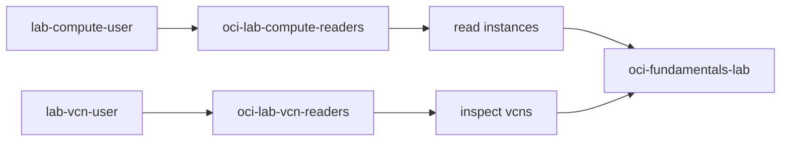

# Lab: Creating a Compartment, Groups, and Minimal IAM Policies

## 1. Objectives and Lab Deliverables

This lab belongs to the **OCI Fundamentals Labs** chapter of the `CLOUD_PROVIDERS_ORACLE` module. You will set up an isolated resource scope in Oracle Cloud Infrastructure, create two user groups, and write a policy that allows each group to view only its assigned resource type. This establishes the authorization foundation before deploying VCNs, Compute, storage, or Oracle databases.

Lab scenario: one person responsible for server inventory needs to view Compute instances; another person responsible for network inventory needs to view VCNs. Both work only within the learning compartment and do not need to create, modify, start, or delete resources.

Upon completion, you should have:

- A compartment `oci-fundamentals-lab` directly under the tenancy root.
- Two groups in the identity domain in use: `oci-lab-compute-readers` and `oci-lab-vcn-readers`.
- Two separate test accounts, each belonging to one corresponding group.
- A policy `oci-lab-minimal-readers` with exactly two core statements.
- Test results verifying granted permissions, denied permissions, and permission revocation when removing membership.

The main lab only creates the IAM structure and does not require provisioning virtual machines, block volumes, databases, or network resources. You can complete the listing tests even when the compartment does not yet contain any instances or VCNs. This design lets you practice access control without using billable infrastructure resources.

## 2. Core Concepts to Use Correctly

### 2.1. Tenancy, compartment, and identity domain

| Component | Role in this lab | Key distinction |
| --- | --- | --- |
| Tenancy | OCI account scope containing the lab structure | The root compartment is the root of the compartment tree |
| Compartment | Groups learning resources and defines the scope where permissions apply | Not a region, subnet, or automatic network connectivity mechanism |
| Identity domain | Where identities and groups are managed | This lab uses an existing domain and does not require creating a new domain |
| User | Identity used for console sign-in or CLI authentication | Test accounts must be separated from administrative accounts |
| Group | Collection of users with the same access requirements | Creating a group or adding members does not automatically grant resource permissions |
| IAM policy | Statements allowing a principal to perform actions within a specific scope | Must specify the correct group, verb, resource-type, and location |

A tenancy has a `Default` identity domain at the root, containing initial identities and administrative groups. Another domain may also be used by the organization; in that case, the actual domain name must be used in the policy. See [The Default Identity Domain](https://docs.oracle.com/en-us/iaas/Content/Identity/domains/the_default_domain.htm) and [Managing Identity Domains](https://docs.oracle.com/en-us/iaas/Content/Identity/domains/overview.htm).

In this design, groups belong to the `Default` identity domain; they do not reside inside the `oci-fundamentals-lab` compartment. The compartment defines the resource scope that groups are allowed to access.

### 2.2. Authentication and authorization

**Authentication** answers "who is this account?". **Authorization** answers "what can this account do with which resources?". Successfully signing in to OCI only proves the first step; a service page reporting insufficient permissions after sign-in can be the expected outcome of the lab.

Basic policy syntax:

```text
Allow <subject> to <verb> <resource-type> in <location>
```

For example, an instance reader has a group as the subject, `read` as the verb, `instances` as the resource-type, and the learning compartment as the location. Standard OCI IAM policies use `Allow` statements; you do not add a `Deny` line to this policy to negate permissions granted elsewhere. See [IAM Policies Overview](https://docs.oracle.com/en-us/iaas/Content/Identity/policieshow/Policy_Basics.htm).

### 2.3. Least privilege must be evaluated against actual APIs

Verbs are generally ordered by increasing capability: `inspect`, `read`, `use`, `manage`. Exact semantics depend on the resource-type, so you cannot assume every listing API only requires `inspect`.

In this lab:

| Verification requirement | API | Permission chosen for lab |
| --- | --- | --- |
| List and view instances | `ListInstances`, `GetInstance` | `read instances` |
| List and view VCNs | `ListVcns`, `GetVcn` | `inspect vcns` |

`ListInstances` requires `INSTANCE_READ`; `inspect instances` alone is not sufficient. For `vcns`, the `inspect` level already includes `VCN_READ`, covering both listing and viewing VCNs. Read access on instances can also expose user-defined metadata; do not store secrets in metadata. This is why you must look up the specific resource-type when designing permissions. See [Details for the Core Services](https://docs.oracle.com/en-us/iaas/Content/Identity/Reference/corepolicyreference.htm).

"Minimal" in this lab means only the two resource types and the compartment scope needed for the read operations above. It does not mean every detail page in the Console will load completely: networking, volume, or related service sections may require separate permissions.

## 3. Design Before Implementation

### 3.1. Object inventory

| Type | Name used in lab | Creation location or scope |
| --- | --- | --- |
| Compartment | `oci-fundamentals-lab` | Direct child of the tenancy root |
| Compute group | `oci-lab-compute-readers` | `Default` domain |
| VCN group | `oci-lab-vcn-readers` | `Default` domain |
| Compute user | `lab-compute-user` | Belongs only to the Compute group in the lab design |
| VCN user | `lab-vcn-user` | Belongs only to the VCN group in the lab design |
| Policy | `oci-lab-minimal-readers` | Attached at root; statements restrict resources to the lab compartment |

The user names are illustrative. If the domain uses email addresses as usernames, use two valid test identities according to your organization's rules and record the corresponding mapping. If an object name already exists, choose a distinct suffix for the entire lab and update all statements consistently; do not reuse objects with unclear ownership.



The two groups serve two independent functions. To verify privilege separation, do not place the same test account in both groups from the start.

### 3.2. Expected results matrix

The following matrix assumes the test accounts are not granted additional related permissions from existing groups, roles, or policies.

| Identity | List instances in lab | List VCNs in lab | Read same resource type at root | Manage tenancy IAM |
| --- | --- | --- | --- | --- |
| Lab setup admin account | Yes | Yes | Per existing admin permissions | Per existing admin permissions |
| `lab-compute-user` | Yes | Denied | Denied | Not granted by the two lab statements |
| `lab-vcn-user` | Denied | Yes | Denied | Not granted by the two lab statements |

Permissions in a parent compartment apply down to child compartments. Therefore, if child compartments are created under the lab compartment later, the scope of these permissions must be reviewed. They do not automatically extend to sibling compartments or upward to the root. See [Policy Inheritance](https://docs.oracle.com/en-us/iaas/Content/Identity/policieshow/Policy_Inheritance.htm).

## 4. Account and Environment Preparation

Prepare a learning tenancy or a scope assigned by your organization for the lab. The account executing the object creation steps needs permissions to create compartments, manage groups and memberships in the chosen domain, create or prepare test users, and create policies at the root. Use an existing administrative account or ask an administrator to complete the preparation; do not attempt to grant yourself those permissions using a learner account.

Record the following values in your lab notes:

| Value | Where to obtain | How it is used |
| --- | --- | --- |
| Tenancy OCID | Tenancy details provided by the administrator | Resource access test at the root |
| Identity domain name | Domains page | Subject in policy statements and sign-in page |
| Home region | Tenancy details | Performing IAM administration and handling propagation delay |
| Test region | A subscribed region of the tenancy | Used consistently across both profiles |
| Lab compartment OCID | Compartment details page after creation | CLI parameter and verifying the right target |
| User OCID of each account | User details in the domain | Cross-checking CLI profiles |

Compartments organize tenancy resources across regions, whereas instances and VCNs are regional resources. The Console displays resources according to the currently selected compartment and region. An empty list may simply mean you are viewing a different region. See [Working with Compartments](https://docs.oracle.com/en-us/iaas/Content/Identity/compartments/Working_with_Compartments.htm).

Use separate browser sessions for the administrator, Compute user, and VCN user—such as different browser profiles. After each account switch, verify the username and domain in the Console. Test accounts must complete activation and domain authentication requirements before evaluating permissions.

## 5. Create the Learning Compartment

Perform these steps using the lab setup administrative account:

1. Open **Identity & Security → Compartments**.
2. Choose to create a compartment directly under the tenancy root.
3. Enter the name `oci-fundamentals-lab`.
4. Enter a description, for example: `Compartment for OCI IAM fundamentals lab`.
5. Verify that **Parent compartment** is indeed the root. This lab uses a direct child compartment name in the policy to avoid nested path mistakes.
6. Create the compartment, open its details page, and copy the OCID.
7. Record the compartment name, parent, and active state.

The compartment name must be valid and unique within the parent compartment; a description is a required field. OCI assigns a unique OCID to the compartment. The corresponding steps are described in [Creating a Compartment](https://docs.oracle.com/en-us/iaas/Content/Identity/compartments/To_create_a_compartment.htm).

Checkpoint after this step: you have exactly one new lab compartment, and you know its exact parent and OCID. Creating the compartment does not by itself grant the two test users permission to work with Compute or VCN resources inside it.

## 6. Create Two Groups and Assign Test Accounts

### 6.1. Create groups in the existing domain

1. Open **Identity & Security → Domains**.
2. Select the compartment containing the domain, then open the `Default` domain used for this lab.
3. Open **Groups**, and create the group `oci-lab-compute-readers`.
4. Enter a description, for example: `Read Compute instances information in the lab compartment`.
5. Create the group `oci-lab-vcn-readers` with the description: `View VCNs in the lab compartment`.

At this step you are managing identities within the domain. Do not switch to creating a new identity domain inside the lab compartment.

### 6.2. Prepare users and membership

In **Users** of that same domain, create two test accounts or use two separately prepared learning accounts. Enter valid details and email addresses as required by the domain, complete activation, and assign memberships:

| Illustrative user | Required group | Groups that must not be added for lab purposes |
| --- | --- | --- |
| `lab-compute-user` | `oci-lab-compute-readers` | `Administrators`, other admin groups, VCN group |
| `lab-vcn-user` | `oci-lab-vcn-readers` | `Administrators`, other admin groups, Compute group |

You can assign groups during user creation or add users from the group's members page. After saving, reopen each group's member list to verify. The Console workflow for creating groups, creating users, and assigning groups is illustrated by Oracle in [Adding Users — Create a Compartment and Add a User with Access to It](https://docs.oracle.com/en-us/iaas/Content/GSG/Tasks/addingusers.htm).

In enterprise tenancies with federation or automated provisioning, also check group mappings from the identity provider. If an account already holds broad permissions from another source, use a different test account so the test remains meaningful.

**Checkpoint:** record the domain, the two group names, the two users, and their actual memberships. Before creating the policy, do not conclude that group membership has granted resource read access.

## 7. Create the Minimal Policy

### 7.1. Choose where to attach the policy

Open **Identity & Security → Policies**, set the compartment filter to the tenancy root, and create a policy:

| Field | Value |
| --- | --- |
| Name | `oci-lab-minimal-readers` |
| Description | `Grant Compute read and VCN view permissions in the lab compartment` |
| Policy attachment compartment | Tenancy root |
| Input method | Manual editor or equivalent statement editor |

Where a policy is attached determines the administrative scope of the policy, including who can modify or delete it. In this lab design, the policy is administered at the root; the resource scope granted to learners is still explicitly specified in each statement. See [Working with Policies](https://docs.oracle.com/en-us/iaas/Content/Identity/policymgmt/managingpolicies_topic-Working_with_Policies.htm).

### 7.2. Enter the exact two statements

If using the `Default` domain and the lab's default names, enter:

```text
Allow group 'Default'/'oci-lab-compute-readers' to read instances in compartment oci-fundamentals-lab
Allow group 'Default'/'oci-lab-vcn-readers' to inspect vcns in compartment oci-fundamentals-lab
```

Then create the policy and reopen it to verify both lines. The groups and compartment must exist before statements reference them.

How to read the first line:

| Component | Value | Meaning |
| --- | --- | --- |
| Subject | `group 'Default'/'oci-lab-compute-readers'` | Members of the Compute group in the specified domain |
| Verb | `read` | Permission level required to read instances |
| Resource-type | `instances` | Only the specified instance resource type |
| Location | `compartment oci-fundamentals-lab` | Lab compartment scope as designed |

The second line grants VCN viewing permission to the VCN group. Neither line grants permission to modify policies, add memberships to oneself, create instances, or create VCNs.

In tenancies using identity domains, the subject syntax can specify `'domain-name'/'group-name'`. If the actual domain differs from `Default`, replace that name in both lines. Do not look only at the group name and omit the domain. See [Subjects](https://docs.oracle.com/en-us/iaas/Content/Identity/policysyntax/subject.htm).

### 7.3. Variant using the compartment OCID

If you want to pin the location by identifier, you can replace the location clause of both statements with:

```text
in compartment id <LAB_COMPARTMENT_OCID>
```

Template example for the Compute line:

```text
Allow group 'Default'/'oci-lab-compute-readers' to read instances in compartment id <LAB_COMPARTMENT_OCID>
```

Replace the entire `<LAB_COMPARTMENT_OCID>` placeholder with the actual OCID, without keeping angle brackets. This is an alternative syntax for name-based location, not a mandatory third statement. If the lab compartment is nested deeper under another compartment, use a valid compartment path or OCID instead of copying the direct-child-of-root assumption as-is. See [Locations](https://docs.oracle.com/en-us/iaas/Content/Identity/policysyntax/location.htm).

### 7.4. Wait for propagation before testing

Changes to users, groups, and policies can take time to take effect across regions. After adding memberships or updating statements, wait a few minutes before concluding the configuration is wrong; if needed, sign back in to the Console session and recheck the same region. Oracle describes IAM propagation from the home region in [Managing Policies — Updates Are Not Immediate Across All Regions](https://docs.oracle.com/en-us/iaas/Content/Identity/Tasks/managingpolicies.htm).

## 8. Verify Permissions with Console and CLI

### 8.1. Initial verification in the Console

Sign in as `lab-compute-user`, select the test region, and navigate to **Compute → Instances**. Select the lab compartment and try loading the list. Then open **Networking → Virtual Cloud Networks** in the same compartment to verify the unauthorized case.

Repeat with `lab-vcn-user`: the VCN list page is the authorized test; the instances list page is the negative test.

The Console may call additional APIs to load selectors, info panels, or related resources. An insufficient-permission message in an auxiliary section is not enough to conclude the primary resource read statement is wrong. Conversely, seeing a create button appear does not prove a create operation will be permitted. Use the CLI to test the APIs in the matrix directly when clear results are needed.

If the compartment selector does not display as expected, verify the user, domain, memberships, and propagation time. Use the OCID provided by the administrator for CLI testing before considering adding any listing visibility permissions.

### 8.2. Prepare two separate CLI profiles

The commands below use **PowerShell** and the OCI CLI on the lab workstation. Install the CLI following [OCI CLI Quickstart](https://docs.oracle.com/en-us/iaas/Content/API/SDKDocs/cliinstall.htm), then prepare two authentication profiles using API signing keys corresponding to the two test users:

- `LAB_COMPUTE`: identity of `lab-compute-user`.
- `LAB_VCN`: identity of `lab-vcn-user`.

In the user details section in the Console, you can generate an API signing key and copy the corresponding config snippet. Place each snippet under its exact profile name in your local OCI CLI config file, using the correct private key path. Each profile must explicitly specify its own `user`, `fingerprint`, `key_file`, `tenancy`, and `region`; do not let a test profile accidentally inherit administrative credentials from another profile. See [SDK and CLI Configuration File](https://docs.oracle.com/en-us/iaas/Content/API/Concepts/sdkconfig.htm).

The two profiles must have **different User OCIDs**, matching the two prepared accounts, while sharing the same tenancy. Do not copy administrative keys into learner profiles; do not include private keys, passwords, or tokens in lab reports.

Initialize the following variables with real values. Choose a subscribed tenancy region; `ap-singapore-1` is only an example:

```powershell
$LabCompartmentOcid = '<LAB_COMPARTMENT_OCID>'
$LabTenancyOcid = '<TENANCY_OCID>'
$LabRegion = 'ap-singapore-1'

oci --version
```

Replace both placeholders before running commands. Each example uses `--limit 10` to check one page of results; the goal is to verify permissions, not to inventory all resources.

### 8.3. Two tests that must succeed

For the Compute user:

```powershell
oci compute instance list --compartment-id $LabCompartmentOcid --limit 10 --profile LAB_COMPUTE --region $LabRegion
$ComputeReadExitCode = $LASTEXITCODE
"Compute read exit code: $ComputeReadExitCode"
```

For the VCN user:

```powershell
oci network vcn list --compartment-id $LabCompartmentOcid --limit 10 --profile LAB_VCN --region $LabRegion
$VcnReadExitCode = $LASTEXITCODE
"VCN read exit code: $VcnReadExitCode"
```

Each command is expected to succeed with exit code `0`. If the compartment has no resources yet, the response may be:

```json
{
  "data": []
}
```

An empty list from a successful call is a valid result for checking list permissions. It does not prove the account is properly restricted in scope; you must proceed with the denial tests. Parameters and behavior of both commands are documented at [compute instance list](https://docs.oracle.com/en-us/iaas/tools/oci-cli/latest/oci_cli_docs/cmdref/compute/instance/list.html) and [network vcn list](https://docs.oracle.com/en-us/iaas/tools/oci-cli/latest/oci_cli_docs/cmdref/network/vcn/list.html).

### 8.4. Two cross-access tests that must be denied

Compute user attempts to list VCNs in the lab:

```powershell
oci network vcn list --compartment-id $LabCompartmentOcid --limit 10 --profile LAB_COMPUTE --region $LabRegion
$ComputeToVcnExitCode = $LASTEXITCODE
"Compute user reading VCN exit code: $ComputeToVcnExitCode"
```

VCN user attempts to list instances in the lab:

```powershell
oci compute instance list --compartment-id $LabCompartmentOcid --limit 10 --profile LAB_VCN --region $LabRegion
$VcnToComputeExitCode = $LASTEXITCODE
"VCN user reading Compute exit code: $VcnToComputeExitCode"
```

Expect an authorization error and a non-zero exit code. You must read the error message: CLI installation issues, connectivity errors, key misconfiguration, or invalid parameters are not evidence that the policy properly blocked access.

OCI may return `NotAuthorizedOrNotFound` with HTTP `404` when permission is missing or when the target does not exist. Therefore, verify the compartment OCID is valid and use the same region as the successful test. A `404` against a fabricated or mistyped OCID does not prove permission boundaries. See [API Errors](https://docs.oracle.com/en-us/iaas/Content/API/References/apierrors.htm).

### 8.5. Verify permissions do not extend upward to the root

Use the Tenancy OCID as the compartment ID to query resources **directly at the root**:

```powershell
oci compute instance list --compartment-id $LabTenancyOcid --limit 10 --profile LAB_COMPUTE --region $LabRegion
$ComputeRootExitCode = $LASTEXITCODE
"Compute user reading root exit code: $ComputeRootExitCode"

oci network vcn list --compartment-id $LabTenancyOcid --limit 10 --profile LAB_VCN --region $LabRegion
$VcnRootExitCode = $LASTEXITCODE
"VCN user reading root exit code: $VcnRootExitCode"
```

By design, both requests must be denied. They query resources at the root, not recursively across all child compartments.

If a cross-access test or root test succeeds, record the unexpected result and check other permission sources. Do not mark the lab as passed simply because the compartment is empty. If a call returns only an empty list and does not distinguish potential result filtering, add a read check on a real resource confirmed by the administrator in the right region and compartment; do not use a fake OCID as a control.

## 9. Verify Cumulative Permissions and Membership Revocation

Perform this section after saving all initial matrix results.

1. The administrator adds `lab-compute-user` to `oci-lab-vcn-readers`.
2. Wait for changes to propagate, then use the same `LAB_COMPUTE` profile to re-run the VCN list command in the lab.
3. Expect the command to succeed: this user now receives permissions from both groups.
4. The administrator removes the **newly added membership** from the VCN group while keeping the original Compute membership.
5. After propagation, re-run the VCN list command with `LAB_COMPUTE`; expect it to be denied. Reading instances in the lab must still succeed.

This tests effective permissions as the union of all grants applied to an identity. A read-only statement does not remove broader permissions granted by another group; to revoke access, you must address the source granting the permission. Policy aggregation is explained in [How Policies Work](https://docs.oracle.com/en-us/iaas/Content/Identity/Concepts/policies.htm).

If the user can still read VCNs after removing the membership, check propagation delay, the actual identity of the profile, remaining memberships, and parent policies. Do not add a `Deny` statement to the lab policy to try to override that permission.

## 10. Troubleshooting Common Issues

| Symptom | What to check | Resolution within lab scope |
| --- | --- | --- |
| Cannot create compartment or policy | Does the setup account have sufficient admin rights at the right level? | Ask an administrator to finish preparation or use the assigned setup account |
| Policy does not recognize group | Domain name, group name, and whether the group already exists | Fix the subject to match the real object; do not create arbitrary extra groups |
| Policy does not recognize compartment | Lab name, parent, or OCID | Use the exact direct-child name per design or replace location with the OCID |
| `inspect instances` fails to list VMs | The verb does not cover the API being called | Restore the lab's exact `read instances` permission |
| Access still fails right after granting | Propagation time and the region under test | Wait a few minutes, then retest with the same identity and region |
| CLI returns `NotAuthenticated` | User OCID, fingerprint, key, auth configuration | Fix authentication before evaluating IAM policies |
| CLI returns `NotAuthorizedOrNotFound` | Does the target exist, and are the region and permissions correct? | Cross-check the OCID against administrator details and the successful test |
| Console shows the list but part of details errors | Is that page reading additional networking or volume data? | Verify the primary API with CLI; only add permissions if a separate learning need is identified |
| Test account can do more than the matrix | Other groups, inherited policies, identity mappings, or wrong CLI key | Identify the permission source and use an appropriate test identity |
| Still able to read after removing membership | Propagation incomplete or another permission source remains | Recheck the identity and all related permission sources |

The two lab statements use `instances` and `vcns` rather than broader resource families. When encountering an error from another API, identify that specific API and the access need before modifying the policy. Granting `manage all-resources in tenancy` defeats the purpose of the least-privilege test.

## 11. Cleanup or Intentional Retention

If you need to keep the compartment for subsequent infrastructure labs, record the owner, purpose, and membership review date. The view-only permissions in this lab are not sufficient to deploy VCNs, Compute, or databases; subsequent deployment labs must determine additional permissions based on actual operations.

If finishing the lab, use the lab setup admin account to clean up in order:

1. Verify the objects belong to this lab session and are not being used by anyone else.
2. Delete the `oci-lab-minimal-readers` policy at the **root**, or remove only the two lab statements if an administrator merged them into a shared policy.
3. Remove the lab memberships from both users. Delete both groups if they are no longer used or referenced by other policies.
4. If dedicated API signing keys were created for this lab, revoke those keys and handle local private keys/profiles according to your environment's policy.
5. Delete or disable accounts created solely for this lab per organizational procedures; keep shared accounts as assigned.
6. Verify the lab compartment contains no remaining resources or child compartments to keep, including resources in other used regions and any policies attached inside the compartment.
7. Submit a delete request for the lab compartment if not retaining it, and monitor the work request to completion.

OCI requires a compartment to be empty before deletion; deletion runs asynchronously and can fail if resources remain. Because the lab policy is attached at the root, it must be cleaned up at the root—do not expect deleting the compartment to clean up the policy automatically. See [Deleting a Compartment](https://docs.oracle.com/en-us/iaas/Content/Identity/compartments/To_delete_a_compartment.htm).

## 12. Completion Evidence

Save lab results using the following template, masking identifying information when sharing outside the learning environment:

| Item | Required evidence |
| --- | --- |
| Compartment | Verified name, parent, and OCID |
| Groups | Domain name, two group names, and final memberships |
| Policy | Attachment at root and verbatim text of both active statements |
| CLI identities | Which profile belongs to which user; both User OCIDs verified |
| Granted permissions | Compute user lists instances successfully; VCN user lists VCNs successfully |
| Denied permissions | Two cross-access tests and two root tests, with actual error types |
| Cumulative and revocation | Compute user can read VCNs when added to the group; denied after removing that membership |
| Wrap-up | Retention or cleanup status of lab objects |

For each test, record the timestamp, region, profile, target compartment, exit code, and relevant response snippet. Record actual observed results; if a step has not been run yet, state clearly that it was not executed rather than substituting expected results.

The lab passes when objects are created according to design, both view permissions work, out-of-scope tests are denied with authorization errors against verified valid targets, and VCN access is revoked after removing the temporary membership. A successfully created policy is only a configuration step; access results executed with the proper identities are what prove the permissions are in effect.
