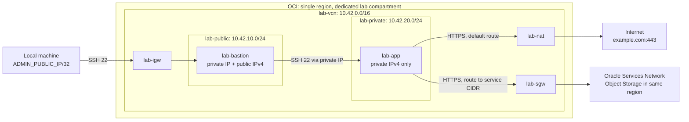

# Lab: Building a Public-Private VCN with NAT and Service Gateways

## 1. Objectives and Lab Scenario

Within the **OCI Fundamentals Labs** chapter of the **CLOUD_PROVIDERS_ORACLE** module, this lab builds a small network for an application running on Oracle Cloud Infrastructure:

- The management host sits in a public subnet and accepts SSH only from an allowed address.
- The application host sits in a private subnet and has no public IPv4 address.
- The application host initiates outbound Internet access via a NAT Gateway.
- The application host accesses the Object Storage endpoint in the same region via a Service Gateway.

You will configure resources in a compartment, verify the difference between IAM permissions and packet-forwarding rules, and perform two reversible changes to prove the role of each gateway. The final steps cover saving evidence, controlling costs, and deleting resources.

**Expected deliverables:** two subnets attached to the proper route tables, three gateways functioning as intended, successful SSH through the jump host, and test results distinguishing the Internet path from the Oracle Services Network path.

This lab uses IPv4, Oracle Linux, and the OCI Console to provision infrastructure. Bash commands executed on virtual machines are listed explicitly; OpenSSH configuration resides on your local machine. You do not need to deploy a database, create a bucket, or install the OCI CLI on the application host to complete the required parts.

## 2. Target Architecture and Traffic Paths



The arrows show initiated connections and primary paths; return traffic is handled accordingly. NAT Gateway and Service Gateway are VCN resources, not virtual machines placed inside a public subnet.

| Requirement | Expected path | Key conditions |
| --- | --- | --- |
| Local machine SSH to bastion | Internet → Internet Gateway → bastion | Bastion has a public IPv4; appropriate route and security rules |
| Bastion SSH to app | Private IP → VCN internal routing → private IP | Security rules for TCP/22 on both sides |
| App HTTPS call to Internet | App → NAT Gateway → Internet | Default route to NAT; TCP/443 egress allowed |
| App call to same-region Object Storage | App → Service Gateway → Object Storage endpoint | Correct regional service CIDR; matching gateway, route, and egress |

A public subnet allows resources to have public IPv4 addresses, but does not automatically make every VNIC public. A private subnet prohibits assigning public IPv4 addresses to VNICs. Actual reachability also depends on routes, security rules, the OS firewall, and listening services.

A NAT Gateway lets hosts without public IPv4 addresses initiate outbound connections to the Internet and receive responses; it does not provide an inbound SSH path from the Internet to those hosts. See [NAT Gateway](https://docs.oracle.com/en-us/iaas/Content/Network/Tasks/NATgateway.htm).

A Service Gateway provides a private path to supported services in the Oracle Services Network within the same region. Service endpoints may still resolve to public IPs; what determines the path is the route to the service CIDR. This gateway does not grant data-read permissions on its own and does not cover arbitrary Oracle websites. See [Service Gateway](https://docs.oracle.com/en-us/iaas/Content/Network/Tasks/servicegateway.htm).

## 3. Tenancy, Compartment, and Permissions Preparation

### 3.1. Choose a dedicated environment for the lab

Prepare:

1. An OCI tenancy and Console sign-in access.
2. A region subscribed by the tenancy.
3. A dedicated compartment for the lab, such as `OCI-Network-Lab`.
4. Permissions to create VCNs, subnets, route tables, gateways, security lists, NSGs, and two Compute instances in that compartment.
5. Sufficient quota, service limits, and capacity for two VMs and their boot volumes.
6. A local machine with an OpenSSH client and Internet connectivity.

Choose an Oracle Linux image and a small shape compatible with the image architecture. Do not assume the account still has free-tier allowances or that a particular shape always has capacity.

Keep the same region and compartment selected as you move through resource creation screens. If the Console does not display a resource you just created, verify both selections before creating it again.

### 3.2. Distinguish IAM from security rules

IAM determines **who can create, modify, delete, or invoke APIs on resources**. NSGs and security lists determine **which traffic is allowed to enter or leave a VNIC**. Having permission to manage an instance does not mean you can SSH into it; opening TCP/443 does not grant permission to read Object Storage.

The administrator must ensure the lab group has the corresponding permissions:

| Scope | Permissions required for the lab |
| --- | --- |
| Networking in the lab compartment | Manage the network resources created in this lab |
| Compute in the lab compartment | Create, view, and terminate two instances |
| Volumes in the lab compartment | Create and clean up boot volumes of both instances |
| Images and placement information | View images, availability domains, and options required to launch |
| Logging, if doing the optional observation part | Create or use a log group, enable and read flow logs |

Example policy statement for **Networking**, when the group resides in an identity domain:

```text
Allow group '<identity-domain>'/'OCI-Lab-NetworkBuilders' to manage virtual-network-family in compartment OCI-Network-Lab
```

Replace the placeholders with actual names. This is fairly broad network management permission within the lab compartment, not a complete policy for launching Compute instances and not a least-privilege template for production. Learners do not need tenancy-wide admin rights for this lab if an administrator grants task-appropriate permissions.

### 3.3. Determine management IP and SSH key

Record the actual public IPv4 address through which your local machine exits to the Internet, accounting for any VPN or corporate NAT. Express it as `ADMIN_PUBLIC_CIDR=<address>/32`.

An address like `203.0.113.25/32` is only a documentation placeholder; replace it with your real address. If your ISP changes your IP during the lab, update the SSH source rule accordingly.

Generate a dedicated key pair for the lab if you do not have one yet:

```bash
ssh-keygen -t ed25519 -f ~/.ssh/oci-vcn-lab -C "oci-vcn-lab"
```

Run this on your local machine, choosing a different filename if the path already exists. When creating Compute instances, supply only the contents of `oci-vcn-lab.pub`. Keep the private key on your local machine with appropriate file permissions.

## 4. Addressing Plan and Resource Inventory

Verify that the CIDR block does not overlap with existing networks you plan to connect later. For an isolated lab VCN, use the following plan:

| Resource | Name in lab | Configuration |
| --- | --- | --- |
| VCN | `lab-vcn` | `10.42.0.0/16`, IPv4 only |
| Public subnet | `lab-public` | Regional, `10.42.10.0/24` |
| Private subnet | `lab-private` | Regional, `10.42.20.0/24`, prohibit public IPv4 |
| Internet Gateway | `lab-igw` | Enabled |
| NAT Gateway | `lab-nat` | Traffic allowed |
| Service Gateway | `lab-sgw` | Traffic allowed, regional service label enabled |
| Public route table | `rt-public` | Default route to `lab-igw` |
| Private route table | `rt-private` | Default route to NAT, service route to SGW |
| Shared security list | `sl-lab-empty` | No ingress/egress rules |
| Bastion NSG | `nsg-bastion` | Attached to bastion primary VNIC |
| App NSG | `nsg-app` | Attached to app primary VNIC |
| Bastion Compute | `lab-bastion` | Public subnet, with public IPv4 |
| App Compute | `lab-app` | Private subnet, no public IPv4 |

OCI reserves several addresses in each subnet; let the system automatically assign private IPs to both hosts. Record the actual assigned addresses rather than assuming specific addresses from the CIDR table.

Apply free-form tags such as `purpose=oci-vcn-lab` and an `owner` value following your organization's rules. Record the names, OCIDs, region, and compartment of the resources in your lab notes.

## 5. Create the VCN and Three Gateways

### 5.1. Create the VCN manually

In the OCI Console, open **Networking → Virtual cloud networks**, select the lab compartment, and create a VCN:

- Name: `lab-vcn`.
- IPv4 CIDR: `10.42.0.0/16`.
- Enable DNS hostnames; set a valid DNS label, such as `labvcn`.
- Do not enable IPv6 for this lab.

Choose manual VCN creation so you control each component yourself. If the interface offers an Internet connectivity wizard, do not use the wizard for this walkthrough.

The VCN may appear with a default route table, default security list, and default DHCP options. Do not attach the default security list to the subnets created in later steps.

### 5.2. Create the Internet Gateway

Inside the VCN, create an Internet Gateway:

- Name: `lab-igw`.
- Compartment: lab compartment.
- State: Enabled.

Having the gateway exist is not enough for the public subnet to reach the Internet. You will add the route and assign a public IPv4 to the bastion in subsequent steps.

### 5.3. Create the NAT Gateway

Create a NAT Gateway in the same VCN:

- Name: `lab-nat`.
- Use an ephemeral/service-assigned public IP for the lab; do not create an extra reserved public IP unless needed.
- Do not enable **Block traffic**.

Record the NAT Gateway's public IP if displayed by the Console. This is the source address that Internet destinations see for NATed traffic, distinct from the bastion's public IP.

Do not create a NAT instance, do not enable IP forwarding on the bastion, and do not route through an extra hop in the public subnet.

### 5.4. Create the Service Gateway

Create a Service Gateway:

- Name: `lab-sgw`.
- VCN: `lab-vcn`.
- Services: select **All <region> Services in Oracle Services Network** for the region in use.
- Leave traffic enabled.

Keep the service label provided by OCI for reuse in the route table. Do not manually convert the label into numeric CIDRs and do not pick a label from another region.

The lab only needs the single **All ... Services** service label. Do not simultaneously add two overlapping routes for this label and the **Object Storage** label in the same route table.

**Checkpoint:** the gateway list of `lab-vcn` includes the IGW, NAT Gateway, and Service Gateway; neither NAT nor SGW has traffic blocked.

## 6. Create Two Route Tables

### 6.1. Public route table

Create `rt-public` with one rule:

| Destination type | Destination | Target type | Target |
| --- | --- | --- | --- |
| CIDR Block | `0.0.0.0/0` | Internet Gateway | `lab-igw` |

Do not add an All Services route to the Service Gateway in this lab's public route table.

### 6.2. Private route table

Create `rt-private` with two rules:

| Destination type | Destination | Target type | Target |
| --- | --- | --- | --- |
| CIDR Block | `0.0.0.0/0` | NAT Gateway | `lab-nat` |
| Service | All <region> Services in Oracle Services Network | Service Gateway | `lab-sgw` |

In the Console, the destination for the second rule is selected from the service dropdown, not typed into a regular CIDR field.

OCI selects the most specific matching route; display order in the table is not a firewall-style priority order. With this configuration, traffic matching the service CIDR uses the SGW, while other Internet traffic uses NAT. Intra-VCN routing between the two subnets is built in as long as no conflicting custom intra-VCN route is created. See [VCN Route Tables](https://docs.oracle.com/en-us/iaas/Content/Network/Tasks/managingroutetables.htm).

In this lab, do not attach separate route tables directly to VNICs, private IPs, or gateways. This ensures all tests rely directly on the subnet route tables.

**Checkpoint:** there are two distinct route tables; the public table has one rule, the private table has two rules; all targets belong to the expected VCN and compartment.

## 7. Create Security List and NSGs

### 7.1. Use an empty security list to control traffic via NSGs

Create `sl-lab-empty` with both ingress rules and egress rules empty. If the Console pre-populates rules, delete the rules inside the **newly created lab security list** before saving.

When creating each subnet in the next section, select only this security list. Do not also select the default security list.

Allow rules from security lists and NSGs are unioned together; an empty security list does not negate allow rules in an NSG. Conversely, another security list that leaves SSH open from anywhere will widen access beyond what was intended. Use **stateful** rules throughout this lab so return connection traffic is permitted via connection tracking. See [Security Rules](https://docs.oracle.com/en-us/iaas/Content/Network/Concepts/securityrules.htm).

### 7.2. Create both NSGs first, then add rules

Create `nsg-bastion` and `nsg-app` in `lab-vcn`. Then configure the tables below. Creating both first allows referencing the other NSG as a source or destination.

When using an NSG as source/destination, choose **Network Security Group** and select the right NSG in the same VCN. This represents a relationship between VNICs attached to those NSGs, not typing an NSG name into a CIDR field. See [Network Security Groups](https://docs.oracle.com/en-us/iaas/Content/Network/Concepts/networksecuritygroups.htm).

### 7.3. Rules for nsg-bastion

| Direction | Source or destination | Protocol | Destination port / ICMP type | Purpose |
| --- | --- | --- | --- | --- |
| Ingress | CIDR: `ADMIN_PUBLIC_CIDR` | TCP | `22` | SSH from local machine |
| Ingress | CIDR: `0.0.0.0/0` | ICMP | Type `3`, code `4` | Support Path MTU Discovery |
| Egress | NSG: `nsg-app` | TCP | `22` | SSH connection to app |
| Egress | CIDR: `0.0.0.0/0` | TCP | `443` | HTTPS checks and HTTPS lab requirements |
| Egress | CIDR: `169.254.169.254/32` | UDP | `53` | Explicitly declare the DNS resolver target used in the lab |
| Egress | CIDR: `169.254.169.254/32` | TCP | `53` | DNS over TCP when needed |

### 7.4. Rules for nsg-app

| Direction | Source or destination | Protocol | Destination port / ICMP type | Purpose |
| --- | --- | --- | --- | --- |
| Ingress | NSG: `nsg-bastion` | TCP | `22` | Accept SSH only from VNICs in the admin group |
| Ingress | CIDR: `0.0.0.0/0` | ICMP | Type `3`, code `4` | Support Path MTU Discovery |
| Egress | CIDR: `0.0.0.0/0` | TCP | `443` | Outbound HTTPS to Internet and OCI services |
| Egress | CIDR: `169.254.169.254/32` | UDP | `53` | Lab DNS resolver target |
| Egress | CIDR: `169.254.169.254/32` | TCP | `53` | DNS over TCP when needed |

For the TCP/UDP rules above, leave **Source port = All** and specify the port listed in the table under **Destination port**. Do not select Stateless.

The two HTTPS rules to `0.0.0.0/0` allow both the Internet and service IP ranges; the route table determines which gateway is used. In production, review egress requirements carefully; NAT by itself does not restrict which websites can be reached.

These ICMP rules do not allow arbitrary ping traffic. The lab uses SSH, DNS, and HTTPS for verification instead of relying on ping as a mandatory criterion.

## 8. Create the Public Subnet and Private Subnet

### 8.1. Public subnet

Create a subnet with:

- Name: `lab-public`.
- Subnet type: Regional.
- IPv4 CIDR: `10.42.10.0/24`.
- Subnet access: Public.
- Route table: `rt-public`.
- Security lists: `sl-lab-empty` only.
- DHCP options: use **Internet and VCN Resolver**.
- DNS label: e.g., `public`.

### 8.2. Private subnet

Create a second subnet with:

- Name: `lab-private`.
- Subnet type: Regional.
- IPv4 CIDR: `10.42.20.0/24`.
- Subnet access: Private; enable the option prohibiting public IPv4 addresses on VNICs if shown as a checkbox.
- Route table: `rt-private`.
- Security lists: `sl-lab-empty` only.
- DHCP options: use **Internet and VCN Resolver**.
- DNS label: e.g., `private`.

Use the default resolver so name resolution does not depend on a public DNS server traversed through NAT. The default resolver serves queries at `169.254.169.254`; you do not need to create a dedicated DNS listening endpoint for the hosts in this lab. See [DNS in Your Virtual Cloud Network](https://docs.oracle.com/en-us/iaas/Content/Network/Concepts/dns.htm) and [Resolver Endpoints](https://docs.oracle.com/en-us/iaas/Content/Network/Concepts/dns-topic-resolver_endpoints.htm).

This is the lab's default resolver setup. If your organization's environment uses custom DNS or forwarding to on-premises, verify the DNS path separately before running the tests in later sections.

**Checkpoint:** open each subnet's details and re-verify access type, route table, security list, and DHCP options. A subnet name containing "private" is no substitute for verifying the actual configuration.

## 9. Create Two Compute Instances and Access via ProxyJump

### 9.1. Launch lab-bastion

Create an Oracle Linux instance:

- Name: `lab-bastion`.
- Compartment: lab compartment.
- Choose a small shape compatible with the image.
- VCN/subnet: `lab-vcn` / `lab-public`.
- Allow assigning a public IPv4 address to the primary VNIC.
- Primary VNIC NSG: `nsg-bastion` only.
- SSH key: the prepared public key.

Once the instance is Running, record:

- `BASTION_PUBLIC_IP`.
- `BASTION_PRIVATE_IP`.
- Instance OCID and VNIC OCID.

### 9.2. Launch lab-app

Create a similar Oracle Linux instance, except:

- Name: `lab-app`.
- VCN/subnet: `lab-vcn` / `lab-private`.
- No public IPv4 address.
- Primary VNIC NSG: `nsg-app` only.
- Use the public key matching the private key on your local machine.

Record `APP_PRIVATE_IP`, the instance OCID, and the VNIC OCID. Open the VNIC's IP addresses section and confirm there is no public IPv4 association. Checking `ip addr` inside the OS alone is not enough to verify this, because OCI public IPv4 addresses are mapped at the network layer.

### 9.3. Configure SSH on your local machine

Add the following to your user OpenSSH configuration file, typically `~/.ssh/config`, replacing all placeholders:

```sshconfig
Host oci-lab-bastion
    HostName <BASTION_PUBLIC_IP>
    User opc
    IdentityFile ~/.ssh/oci-vcn-lab
    IdentitiesOnly yes

Host oci-lab-app
    HostName <APP_PRIVATE_IP>
    User opc
    IdentityFile ~/.ssh/oci-vcn-lab
    IdentitiesOnly yes
    ProxyJump oci-lab-bastion
```

Connect from your local machine:

```bash
ssh oci-lab-bastion
```

Check the hostname, then exit the bastion session:

```bash
hostname
exit
```

Continue from your local machine:

```bash
ssh oci-lab-app
```

Inside the app session:

```bash
hostname
ip -4 addr
ip -4 route
command -v curl
command -v getent
```

ProxyJump uses the bastion to open a TCP connection to the app's private IP, while the SSH client on your local machine handles authentication to the app. There is no need to copy your private key to the bastion or enable agent forwarding.

For images other than Oracle Linux, replace `opc` with the appropriate default user for that image. Keep the OS firewall enabled; inspect the SSH service and specific rules if the connection fails.

## 10. Verify Normal Operating State

All commands in this section run **inside lab-app**, through the SSH session you just opened. Results from your local machine or Cloud Shell do not prove the app's network path.

### 10.1. Prepare the endpoint and test DNS

The example below applies to the OC1 commercial realm. Replace the region with the actual region containing your VCN. If using another realm, use the Object Storage endpoint published by OCI for that realm/region.

```bash
REGION='ap-singapore-1'
OSN_HOST="objectstorage.$REGION.oraclecloud.com"

date -u
getent ahostsv4 example.com
getent ahostsv4 "$OSN_HOST"
```

Both hostnames should resolve to IPv4 addresses. Object Storage resolving to a public IP does not mean traffic must traverse an Internet Gateway or NAT.

HTTP checks use `--noproxy '*'` to avoid environment proxies skewing conclusions about the network path. The `-4` option keeps the tests within the IPv4 scope of this lab.

### 10.2. Test outbound HTTPS to the Internet

```bash
curl -4 --noproxy '*' --connect-timeout 5 --max-time 15 \
  --silent --show-error --fail --output /dev/null \
  --write-out 'internet_http=%{http_code} remote_ip=%{remote_ip}\n' \
  https://example.com/
printf 'curl_exit=%s\n' "$?"
```

Expect the endpoint to return HTTP success and `curl_exit=0`. This is an Internet destination outside the Oracle Services Network, so according to the lab's route table, the connection uses the NAT Gateway.

If the external endpoint is temporarily unavailable, use another public HTTPS endpoint permitted by your organization that is definitely outside OCI's service CIDR. Record the substitute endpoint so you compare the exact same target before and after changes.

### 10.3. Test connectivity to Object Storage

Send an unsigned request to the Object Storage namespace API:

```bash
curl -4 --noproxy '*' --connect-timeout 5 --max-time 15 \
  --silent --show-error \
  --dump-header /tmp/oci-osn-headers.txt \
  --output /tmp/oci-osn-body.json \
  --write-out 'osn_http=%{http_code} remote_ip=%{remote_ip}\n' \
  "https://$OSN_HOST/n/"
printf 'curl_exit=%s\n' "$?"

head -n 20 /tmp/oci-osn-headers.txt
head -c 500 /tmp/oci-osn-body.json
printf '\n'
```

This command intentionally omits `--fail`: an HTTP authentication or authorization error response, such as `401` or `404`, is still evidence that traffic traversed DNS, TCP, and TLS to receive an API response. No single fixed error code is required because the response depends on the API and request handling.

To conclude network connectivity succeeded, you must observe all of the following:

- `curl_exit=0`, with an HTTP status code other than `000`.
- Normal TLS verification without adding `-k`.
- Headers or payload matching an Object Storage response, typically containing a request ID for tracing.

If you observe HTTP `301` or `302`, recheck the regional endpoint rather than blindly adding `-L` and inadvertently testing a different target. If you encounter a certificate or TLS error, do not mark the check as passed.

**Test limitation:** receiving an API response does not mean you can read an object. Reading data requires identity, policies, and data permissions. Those permissions are independent of the Service Gateway; see [Object Storage Objects — Required IAM Policy](https://docs.oracle.com/en-us/iaas/Content/Object/Tasks/managingobjects.htm).

Keep the baseline results. Do not conclude the SGW is working from this step alone, because a misconfiguration could still reach the endpoint through NAT.

## 11. Isolate NAT to Prove the Service Gateway Path

Perform this only on the dedicated lab `rt-private`. Keep the Console open in another window so you can restore the configuration.

### 11.1. Record the configuration and modify one rule

Before making changes:

1. Confirm `lab-private` is using `rt-private`.
2. Record the `0.0.0.0/0 → lab-nat` rule, including the exact target OCID.
3. Confirm the service route still points to `lab-sgw`.
4. Leave NSGs, security lists, resolver, and `rt-public` untouched.

In `rt-private`, delete **only** the `0.0.0.0/0 → lab-nat` rule. Do not delete the NAT Gateway and do not delete the service route.

Save the change and wait for it to take effect. Your SSH session to the app uses internal routing via the bastion and does not depend on the default route to NAT in this architecture.

### 11.2. Initiate fresh test connections

In the `lab-app` session, re-run the commands from section 10:

1. `getent ahostsv4` for both hostnames.
2. HTTPS request to `example.com`.
3. Request to `https://$OSN_HOST/n/`.

Each `curl` invocation starts a new process, avoiding reliance on connections kept alive from before the change.

Expected results:

| Test after removing the default route to NAT | Result |
| --- | --- |
| SSH via bastion | App remains reachable |
| DNS via default VCN resolver | Still resolves |
| HTTPS to chosen Internet target | Fails to connect |
| Object Storage in same region | Still receives API response over TLS |

The Internet check may time out and show HTTP `000`; do not treat a specific OS error code alone as the criterion because timing and error formats may vary.

If both Internet and Object Storage still succeed, verify that you deleted the rule on the right route table, are running on the right VM, and are not traversing a proxy, VPN, or another custom route. If both fail, inspect the service label, service route, SGW state, and DNS before modifying IAM.

**Conclusion from test:** in a lab configuration with the NAT path and alternative paths removed, Object Storage still responding while the Internet target loses connectivity proves traffic flows via the Service Gateway.

### 11.3. Restore immediately after the test

Re-add the exact recorded rule:

```text
Destination type: CIDR Block
Destination:      0.0.0.0/0
Target type:      NAT Gateway
Target:           lab-nat
```

Verify again from the app: both Internet and Object Storage receive responses matching the baseline. Confirm `rt-private` once again has its exact two rules before proceeding to the next section.

## 12. Block SGW to Verify It Does Not Fail Over to NAT

This section verifies another scenario: **the service route still exists, but the target gateway is blocked**.

1. Confirm the default route to NAT is restored and Internet connectivity from the app is working.
2. On `lab-sgw`, enable **Block traffic**.
3. Keep both rules in `rt-private` unchanged.
4. Make fresh `curl` requests to the Internet and Object Storage.
5. Record the results, then disable **Block traffic** immediately after the test.
6. Re-verify both endpoints after re-enabling the SGW.

Expected behavior: Internet via NAT continues working; Object Storage receives no API response while the SGW is blocked. The service route is still selected for destinations matching the service CIDR, so there is no automatic fallback to the default NAT route simply because the SGW is blocked.

Deleting the service route altogether is a different configuration: with the default route still present, traffic to a public endpoint may traverse NAT. Therefore, do not substitute deleting the service route for the gateway-blocking test.

Full lab results table:

| State | Internet outside OSN | Same-region Object Storage | SSH via bastion |
| --- | --- | --- | --- |
| Baseline: both routes present, both gateways allowing traffic | Succeeded | API response received | Succeeded |
| Remove NAT default route, keep service route | Failed | API response received | Succeeded |
| Restore NAT, block SGW while keeping service route | Succeeded | Failed | Succeeded |
| Re-enable SGW, return to baseline | Succeeded | API response received | Succeeded |

Do not introduce two fault changes simultaneously; change only one factor at a time so the outcome remains explainable.

## 13. Evidence-Based Observation and Diagnostics

### 13.1. Use VCN Flow Logs when permitted

You can enable flow logs for `lab-app`'s VNIC or the `lab-private` subnet:

1. Select the resource in the right compartment and create or choose a lab log group.
2. Configure a capture filter covering the test traffic; capture both accepted and rejected traffic if needed.
3. Enable the log and generate a new HTTPS connection.
4. Search records by UTC timestamp, the app's source private IP, destination IP, and TCP/443.

Flow logs show addresses, ports, and `ACCEPT`/`REJECT` outcomes per security rules. `ACCEPT` does not by itself prove the application request succeeded or directly identify whether NAT or SGW was traversed. Logs have delivery latency, filters, and capture limits; missing records do not prove no packets existed. Certain link-local traffic such as default DNS does not appear in flow logs. See [Details for VCN Flow Logs](https://docs.oracle.com/en-us/iaas/Content/Logging/Reference/details_for_vcn_flow_logs.htm).

Combine flow log records with route tables and the isolation experiments in sections 11–12 to explain traffic paths.

### 13.2. Understand diagnostic tool limitations

- `ip route` inside the VM mainly shows OS routing toward the virtual router. It does not display OCI service routes as a separate SGW interface.
- `traceroute` or ping is not guaranteed to show hops across managed gateways; lack of ICMP replies does not mean HTTPS is broken.
- Network Path Analyzer evaluates configuration to infer reachability without sending live traffic. It does not replace testing DNS, TLS, and application responses. See [Network Path Analyzer](https://docs.oracle.com/en-us/iaas/Content/Network/Concepts/path_analyzer.htm).

When documenting results, clearly separate configuration evidence, traffic evidence, and API response results.

## 14. Troubleshooting Common Issues

| Symptom | What to inspect | Concrete action |
| --- | --- | --- |
| Subnet or gateway missing from selectors | Currently in a different region/compartment | Verify region, compartment, and OCID |
| SSH to bastion times out | Public IPv4, IGW, route, or wrong SSH source | Check VNIC public IP, `rt-public`, IGW state, and `ADMIN_PUBLIC_CIDR` |
| SSH returns `Permission denied (publickey)` | Wrong user or wrong key | Use `opc` for Oracle Linux, verify attached public key and local `IdentityFile` |
| Bastion works but app times out | NSG not attached or TCP/22 rule missing | Check VNIC membership, app ingress, and bastion egress |
| Bastion reports forwarding cannot be opened | SSH forwarding restricted on bastion | Check `sshd` config and auth logs per image policy |
| App cannot resolve either hostname | DHCP options or resolver inside VM misconfigured | Check `getent`, actual DNS config, and subnet resolver |
| DNS works but Internet from app fails | Wrong default route/NAT/egress | Check `rt-private`, NAT target, Block traffic, and TCP/443 |
| Object Storage works with NAT, fails without NAT | SGW is not serving the path properly | Check regional service label, service route, gateway, and target endpoint |
| Object Storage returns HTTP permission error | Network reached the API, but request lacks authorization | For network test: record the proper conclusion; for reading data: add appropriate auth/IAM |
| SGW blocked yet Object Storage still responds | Route not applied or traffic taking another path | Verify right VM, right subnet/route table, proxy, and per-resource routing |
| Very narrow NSG rule yet SSH remains widely open | Allow rule exists from another source | Inspect every security list and every NSG attached to the VNIC |
| HTTPS certificate error | Clock skew, CA trust, endpoint, or TLS proxy | Verify each cause; preserve TLS validation, do not bypass with `-k` |
| OS package updater fails | Repository uses ports/endpoints outside lab rules | Check actual URL and port; add only required egress rules |
| Rules are correct yet traffic is still blocked | OS firewall or additional organizational policies | Check service status, firewall, Security Zone/ZPR if enforced |

Prioritize troubleshooting in order: **correct VM and IP → DNS → route → gateway state → security rules → OS firewall → TLS → auth and IAM**. If the Console blocks resource creation due to policies or service limits, resolve that first before attempting route changes.

## 15. Cost, Availability, and Reproducibility

### 15.1. Keep costs small

Use two small VM shapes, minimal sufficient boot volumes, and run them only during lab hours. If enabling flow logs, choose only the needed VNIC/subnet scope and an appropriate retention period.

Before creating resources, check Compute, storage, network, public IPv4, and Logging line items for your account, region, and applicable pricing. Do not assume the entire lab is free just because one gateway or tier is zero-cost. Cross-check with the [OCI Price List](https://www.oracle.com/cloud/price-list/).

You can configure budgets and alerts on the lab compartment. Budget alerts help monitor spend; they do not replace deleting resources and should not be treated as an automatic stop mechanism for all resources.

Merely stopping instances can still retain storage or other billable resources. At the end of the lab, inventory and clean up according to section 16.

### 15.2. Distinguish managed gateways from HA applications

NAT Gateway is a highly available OCI-managed service, yet a single app instance remains a single point of failure for the application. Regional subnets allow placing resources across available availability domains in a region; they do not automatically replicate VMs.

If extending this architecture for production, separately design instance distribution across availability/fault domains, load balancing, management-plane protection, and backup strategies. This lab does not implement those components.

Service Gateway serves supported services within the same region; do not treat it as a cross-region failover mechanism or a connection path to arbitrary private Oracle database endpoints.

### 15.3. Record configuration for post-lab automation

To rebuild this environment with Terraform or OCI Resource Manager, record:

- Compartment and region.
- CIDR, access type, and DHCP options of each subnet.
- Subnet associations with route tables and security lists.
- Destination type, service label, and target of each route.
- NSG rules, stateful flags, and VNIC memberships.
- Image, shape, public IP settings, and SSH public key.
- Tags, logging configuration, and cleanup order.

When translating into code, express dependencies between resources and use resource outputs rather than hardcoding OCIDs. Never commit private keys or credentials into source control.

## 16. Clean Up Resources in Dependency Order

Save test results before deleting. Operate only on resources created specifically for this lab.

1. Confirm testing is complete, SGW is re-enabled, and `rt-private` is restored to baseline if handing off.
2. Terminate `lab-app` and `lab-bastion`. Confirm the option to delete lab boot volumes if data does not need to be retained; check for any additional volumes or backups.
3. Disable and delete flow logs/log groups created solely for the lab once evidence is no longer needed.
4. Remove route rules referencing `lab-igw`, `lab-nat`, and `lab-sgw`. Gateways still referenced as targets in a route table will block deletion.
5. Delete all three gateways; check public IP reservations if you created any outside the walkthrough.
6. After VNICs are released, delete both subnets.
7. Delete both NSGs, the custom route tables, and `sl-lab-empty` once they have no remaining associations.
8. Delete the VCN; allow OCI to handle accompanying default resources per the VCN deletion workflow.
9. Inspect the compartment, boot volumes, logs, and resources carrying lab tags to catch anything left behind.
10. If the compartment was dedicated solely to this lab session, ask an authorized person to handle the policy and compartment per organizational procedures.

Do not delete shared policies, default resources of other VCNs, or resources sharing a name with a different OCID. Do not leave intentionally broken routes behind in a still-active environment.

## 17. Completion Criteria and Evidence to Save

The lab passes when all of the following evidence is captured:

- Two subnets with non-overlapping CIDRs, correct access types, and correct route tables.
- `lab-bastion` has a public IPv4; `lab-app` has no public IPv4 association.
- SSH into the app via ProxyJump succeeds with the private key kept on the local machine.
- Baseline: the app reaches the Internet and receives responses from the same-region Object Storage API.
- With the NAT default route removed: Internet fails while the Object Storage API still responds.
- With NAT restored and SGW blocked: Internet works, Object Storage API fails; after re-enabling SGW, both return to baseline.
- NSGs and security lists do not inadvertently expose SSH to sources outside the chosen scope.
- UTC timestamps, HTTP codes, exit codes, and destination IPs are recorded for tests; network connectivity is clearly distinguished from data-read permissions.
- Resources are cleaned up or have a named owner and scheduled cleanup time.

The minimum evidence bundle includes the configuration of both route tables, subnet associations, VNIC details for both VMs, and the four-state results table from section 12. Mask identifying details per policy when sharing; never include private keys or credentials in reports.
