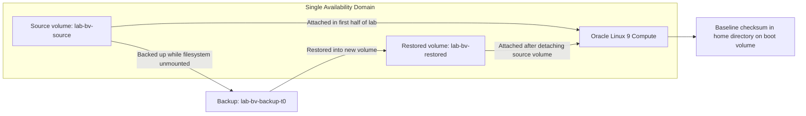

# Lab: Attaching a Block Volume and Restoring from Backup

Within the **OCI Fundamentals Labs** chapter of the Oracle Cloud Infrastructure module, this lab walks learners through a complete storage lifecycle: creating a Block Volume, attaching it to Compute, using it on Linux, creating a backup, and restoring data to a new volume. Compartments and IAM constrain the operational scope; evidence from the OS and OCI confirms the outcome.

Lab scenario: an application stores an order list and configuration on a separate data disk. After a backup is taken, an operator accidentally deletes the order file and corrupts the configuration. You must return the data to the backed-up state while proving with checksums that the restored data matches.

This lab uses the OCI Console for infrastructure actions and Bash on an Oracle Linux 9 VM for disk operations. The CLI section at the end offers an alternative to backup and restore operations for those who want automation. Displayed outputs are **illustrative or expected**, not live runs from your tenancy.

## 1. Expected Outcomes

After this lab, you can:

- Distinguish between a volume, attachment, Linux device, filesystem, and mount point.
- Create a volume in the right compartment and Availability Domain (AD), then attach it to a VM.
- Identify a data disk before formatting, create ext4, and configure mounting by UUID.
- Create a backup after halting writes and track it to a usable state.
- Restore a backup into a new volume and verify both contents and data point-in-time.
- Clean up resources in proper order and identify components that continue incurring charges.

The most critical completion criterion is that checksums of the restored files match the pre-backup baseline. A successful attachment status alone only proves infrastructure connectivity, not that data has been restored.

## 2. Lab Model and Concepts



| Component | Role in this lab |
| --- | --- |
| Boot volume | Holds the OS and evidence directory; do not format or detach this disk. |
| Block Volume | Data disk with a lifecycle independent of the VM. |
| Volume attachment | Association attaching a volume to an instance; has its own OCID. |
| Linux device | OS path used to access the disk, such as a consistent device path. |
| ext4 filesystem | File management structure created on the new data disk. |
| Mount point | The `/mnt/labdata` directory used to access the filesystem. |
| Volume backup | Point-in-time copy of data, managed by the service independently of the source volume. |
| Restored volume | A new volume with its own OCID, containing data restored from the backup. |

**Attach**, **connect**, and **mount** are distinct steps. With a **Paravirtualized** attachment, the OS detects the device connection automatically; you still need to create a filesystem on the new disk and mount it for use. With **iSCSI**, there is an additional step to establish the connection session in the guest or use the appropriate Oracle Cloud Agent plugin. The main flow of this lab chooses Paravirtualized on a VM that supports it. See [Connecting to a Block Volume](https://docs.oracle.com/en-us/iaas/Content/Block/Tasks/connectingtoavolume.htm).

**A volume OCID and a filesystem UUID are not the same thing.** The OCID identifies the OCI resource. The UUID resides inside the filesystem. When restoring a filesystem copy onto a new disk, the UUID can remain identical even though the OCID is different. Therefore, this lab detaches the source volume before attaching the restored volume to the same VM; do not leave two filesystems with the same UUID simultaneously present in the guest. See [Using Disk Partitions on Oracle Linux](https://docs.oracle.com/en/operating-systems/oracle-linux/9/stordev/stordev-UsingDiskPartitions.html).

## 3. Environment Preparation

### 3.1. Resources and access permissions

Prepare in advance:

1. A dedicated lab compartment, such as `OciFundamentalsLab`.
2. A running Oracle Linux 9 VM that supports Paravirtualized attachments and is accessible via SSH with a `sudo`-capable account.
3. Permissions to create, attach, detach, back up, restore, and delete this lab's data volumes in the lab compartment.
4. Sufficient quota for **two data volumes** during the restore phase plus one backup.
5. A machine with a browser for the Console; a Bash terminal on the VM to run Linux commands.

This lab reuses your existing VM, VCN, and SSH path. No additional inbound ports are needed to mount a Paravirtualized volume. Keep the lab environment's existing SSH restrictions intact.

An administrator can grant the following illustrative permission set to an existing lab group:

```text
Allow group Default/OciLabOperators to manage volumes in compartment OciFundamentalsLab
Allow group Default/OciLabOperators to manage volume-attachments in compartment OciFundamentalsLab
Allow group Default/OciLabOperators to manage volume-backups in compartment OciFundamentalsLab
Allow group Default/OciLabOperators to use instances in compartment OciFundamentalsLab
```

Replace the identity domain, group, and compartment names with real values. Attach the policy at a level that can grant permissions for the target compartment. This permission set covers all lab actions including deletion; `use instances` is also broader than disk attachment alone, so keep it scoped to the lab compartment. IAM permissions do not automatically grant a Linux account or `sudo` privileges.

If the volume and instance reside in different compartments, permissions must cover the exact resources in both places. This lab keeps them in the same compartment for easier control. Permission dependencies for attach/detach and restore operations are described in [Details for the Core Services](https://docs.oracle.com/en-us/iaas/Content/Identity/Reference/corepolicyreference.htm).

### 3.2. Standardize names and scope

| Value | Selection in this lab |
| --- | --- |
| Region | Region containing the VM; keep consistent throughout the workflow. |
| Availability Domain | Exact AD of the VM, obtained from the instance details page. |
| Source volume | `lab-bv-source` |
| Backup | `lab-bv-backup-t0` |
| Restored volume | `lab-bv-restored` |
| Size | Explicitly select `50 GB` for each lab data volume. |
| Performance tier | `Balanced` for a small test workload. |
| Attachment | `Paravirtualized`, read/write access, not multi-instance shared. |
| Filesystem | `ext4` directly on the whole data disk, no partitions or LVM. |
| Mount point | `/mnt/labdata` |
| Evidence | `$HOME/oci-block-lab-evidence` on the VM's boot volume. |

Add free-form tags such as `purpose=oci-block-lab` and `owner=<your-name>` to identify resources. Display names can collide, so record OCIDs as well.

At creation time, review cost estimates in the Console and applicable tenancy entitlements. Volume capacity, performance tier, backups, and retention duration all factor in; this lab does not assume free usage. A detached volume is still an existing billable resource.

### 3.3. Distinguish terminals

The `bash` blocks in the main workflow run **on the Oracle Linux VM**, not directly in PowerShell on your local machine. The `text` blocks show configuration, policies, or illustrative outputs.

Run steps in order. If a checkpoint fails, stop at that step. Specifically, never proceed with formatting before confirming the right disk, and never proceed with writing data before confirming the mount succeeded.

## 4. Step 1 — Record Disk State Before Attaching

SSH into the VM and run:

```bash
lsblk -o NAME,PATH,SIZE,TYPE,FSTYPE,UUID,MOUNTPOINTS
findmnt -no SOURCE /
df -hT
```

Record the boot volume layout, partitions, and LVM if present. The disk holding `/` may be presented through a logical volume; inspect the entire `lsblk` tree to identify the underlying physical disk.

Prepare the evidence directory:

```bash
EVIDENCE_DIR="$HOME/oci-block-lab-evidence"
install -d -m 700 "$EVIDENCE_DIR"
lsblk -o NAME,PATH,SIZE,TYPE,FSTYPE,UUID,MOUNTPOINTS \
  > "$EVIDENCE_DIR/lsblk-before.txt"
findmnt -T "$EVIDENCE_DIR"
```

Confirm the evidence directory sits on the boot volume's filesystem, not on the data disk you are about to attach. In this lab, the boot volume stays intact to hold the baseline checksum even when data on the Block Volume changes.

**Checkpoint:** the OS disk is identified and a pre-attach device snapshot is saved.

## 5. Step 2 — Create and Attach the Source Block Volume

### 5.1. Create the volume

In the OCI Console, open **Block Storage**, go to **Block Volumes**, select the lab compartment, and create a volume:

1. Name it `lab-bv-source`.
2. Select the same AD as the VM.
3. Choose custom size configuration and enter `50 GB`; do not accept a default size without checking.
4. Select `Balanced`.
5. For this lab, use Oracle-managed encryption keys.
6. Leave automated backup policies and unused replication options blank.
7. Apply lab tags and create.

Wait for the volume to enter **Available**. Save the source volume OCID, compartment, AD, and size. A volume can only attach directly to an instance in the same AD; backups can be used to restore into another AD in the same region. See [Overview of Block Volume](https://docs.oracle.com/en-us/iaas/Content/Block/Concepts/overview.htm).

Tab names and Console layout may change. Use service and resource names to find the right screen. Volume creation fields are documented at [Creating a Block Volume](https://docs.oracle.com/en-us/iaas/Content/Block/Tasks/creatingavolume.htm).

### 5.2. Attach to the VM

On the VM details page, locate **Attached block volumes** or the corresponding section under the **Storage** tab, then select **Attach block volume**:

1. Select `lab-bv-source` explicitly by name and cross-check its OCID.
2. Select attachment type **Paravirtualized**.
3. Select read/write access for a single instance; do not enable sharing.
4. If the instance supports consistent device paths, pick an available path and record it, e.g., `/dev/oracleoci/oraclevdb`.
5. Enable in-transit encryption if available and compatible with your VM configuration.
6. Attach and wait for the attachment to become **Attached**.

The example path is only meaningful if that is the value you chose during attachment. Do not infer device paths from volume names. See [Attaching a Block Volume to an Instance](https://docs.oracle.com/en-us/iaas/Content/Block/Tasks/attach-compute-volume-attachment.htm).

On the VM, inspect again:

```bash
lsblk -o NAME,PATH,SIZE,TYPE,FSTYPE,UUID,MOUNTPOINTS
ls -l /dev/oracleoci/
```

Compare against `lsblk-before.txt`. A new data disk of the expected capacity and with no filesystem should appear.

**Checkpoint:** the attachment is Attached and the guest sees the exact new device. Both must be verified independently.

## 6. Step 3 — Identify the Disk and Create a Filesystem

### 6.1. Verify before formatting

Set the variable to the **actual path** just recorded. The line below is only an example for an attachment using that consistent device path:

```bash
DATA_DEV='/dev/oracleoci/oraclevdb'
readlink -f -- "$DATA_DEV"
lsblk -o NAME,PATH,SIZE,TYPE,FSTYPE,UUID,MOUNTPOINTS "$DATA_DEV"
sudo wipefs --no-act "$DATA_DEV"
```

`wipefs --no-act` only inspects signatures without erasing anything. Before running `mkfs`, all four conditions must hold:

- The device matches the attachment and the newly appeared disk from step 2.
- The device is not the boot volume and does not contain `/`, `/boot`, swap, or existing data.
- The device is not mounted, has no child partitions, and has no unexpected filesystem/signatures.
- This is the **newly created empty** source volume, not a restored volume.

If you see any unexpected filesystem, partition, or data, stop and investigate. Do not use force flags to bypass this check.

### 6.2. Create ext4 and mount

Only after verification, create ext4 directly on the whole new disk:

```bash
sudo mkfs.ext4 -L oci-lab-data "$DATA_DEV"
sudo mkdir -p /mnt/labdata
sudo mount "$DATA_DEV" /mnt/labdata
findmnt -M /mnt/labdata
df -hT /mnt/labdata
```

Do not add `-F`. Never re-run `mkfs.ext4` on a volume that already holds data or on a restored volume.

This lab uses no intermediate partition, so the filesystem resides directly on `DATA_DEV`. This is a simple choice for a single-disk lab; environments using partitions or LVM must adjust the target device accordingly. Creating and mounting ext4 is described in [Creating and Mounting an Ext File System](https://docs.oracle.com/en/operating-systems/oracle-linux/9/ext/ext-CreatingandMountinganExtFileSystem.html).

Save the filesystem UUID:

```bash
SOURCE_UUID=$(sudo blkid -s UUID -o value "$DATA_DEV")
printf '%s\n' "$SOURCE_UUID" | tee "$EVIDENCE_DIR/source-fs-uuid.txt"
```

**Checkpoint:** `findmnt -M /mnt/labdata` must show the exact mount point, the data disk as source, and `ext4` as filesystem type.

## 7. Step 4 — Configure Persistent Mounting

Back up the current configuration:

```bash
FSTAB_BACKUP="/etc/fstab.before-oci-block-lab.$(date +%Y%m%d%H%M%S)"
sudo cp --preserve=all /etc/fstab "$FSTAB_BACKUP"
printf 'UUID=%s /mnt/labdata ext4 defaults,_netdev,nofail 0 2 # oci-block-lab\n' \
  "$SOURCE_UUID"
```

Open `sudoedit /etc/fstab` and add **one line** matching the printed line, with the real UUID. Do not add duplicates if an entry for `/mnt/labdata` already exists.

Meaning of key components:

| Component | Meaning |
| --- | --- |
| `UUID=...` | Identifies the filesystem by UUID instead of relying on `/dev/sdX` ordering. |
| `/mnt/labdata` | The lab mount point. |
| `ext4` | The created filesystem type. |
| `_netdev` | Declares that the device depends on networking during mount. |
| `nofail` | Allows the system to continue booting if the data disk fails to mount. |
| `0 2` | Do not dump; check this filesystem after the root filesystem when applicable. |
| `# oci-block-lab` | Comment to clearly identify the lab's config line. |

Oracle recommends configuring `_netdev` and `nofail` for automatically mounted Block Volumes; see [Traditional fstab Options](https://docs.oracle.com/en-us/iaas/Content/Block/References/fstaboptions.htm). Updating configuration and reloading systemd is illustrated in [Work with File Systems on Oracle Linux](https://docs.oracle.com/en/learn/ol-file-systems/index.html).

Verify and test mounting from configuration:

```bash
sudo findmnt --verify --verbose
sudo systemctl daemon-reload
cd "$HOME"
sudo umount /mnt/labdata
sudo mount /mnt/labdata
findmnt -M /mnt/labdata
```

If verification reports an error on the newly added line, fix it before continuing. You may reboot the lab VM, SSH back in, and check the mount to confirm boot behavior. After opening a new SSH session, re-set `EVIDENCE_DIR="$HOME/oci-block-lab-evidence"`; Bash variables do not persist across sessions.

`nofail` helps the boot process but does not guarantee the data disk is ready for applications. If mounting fails and an application still writes to `/mnt/labdata`, data may land in a directory on the boot volume. Therefore, all data-writing steps below check the mount first.

## 8. Step 5 — Create Sample Data and Baseline Checksum

Create a data directory owned by your SSH account without changing permissions on the entire filesystem:

```bash
mountpoint /mnt/labdata
sudo install -d -o "$(id -un)" -g "$(id -gn)" /mnt/labdata/demo
```

Continue only if the mount point is active. Create two sample files:

```bash
(
  set -eu
  mountpoint -q /mnt/labdata

  cat > /mnt/labdata/demo/orders.csv <<'EOF'
order_id,customer,total_vnd
1001,An,150000
1002,Binh,275000
1003,Chi,99000
EOF

  cat > /mnt/labdata/demo/app.conf <<'EOF'
environment=lab
schema_version=1
recovery_marker=before-backup
EOF

  cd /mnt/labdata/demo
  sha256sum orders.csv app.conf \
    | tee "$HOME/oci-block-lab-evidence/baseline.sha256"
)
```

In the block above, `set -eu` runs inside a subshell: if the mount does not exist, the block aborts before writing. The checksum file resides outside the data volume, enabling independent comparison after restore.

Verify the baseline:

```bash
(
  set -eu
  mountpoint -q /mnt/labdata
  cd /mnt/labdata/demo
  sha256sum -c "$HOME/oci-block-lab-evidence/baseline.sha256"
)
```

Expected output:

```text
orders.csv: OK
app.conf: OK
```

Save the text or screenshot of this output as initial evidence. Never edit `baseline.sha256` to match corrupted data in later steps.

## 9. Step 6 — Quiesce Writes and Create a Backup

### 9.1. Bring data to a consistent state

This lab only has sample files and no background application processes. If you started any program writing to this directory, stop it first.

```bash
cd "$HOME"
sync
sudo umount /mnt/labdata
mountpoint /mnt/labdata
date -u '+%Y-%m-%dT%H:%M:%SZ' \
  | tee "$EVIDENCE_DIR/data-quiesced-at.txt"
```

After unmounting, `mountpoint` should report that the directory is not a mount point; a non-zero exit code on that check is expected. Do not write to `/mnt/labdata` while the filesystem is unmounted.

If you encounter `target is busy`, find which terminal or process is still using the disk with `sudo fuser -vm /mnt/labdata`. Move terminals outside the mount point and stop the writing process cleanly, then unmount again. Do not use force or lazy unmount to bypass consistency in this lab.

`sync` only flushes OS-buffered writes. It does not complete application transactions or replace Oracle Database backup mechanisms. For real databases, use appropriate application-aware workflows such as RMAN and coordinate across related volumes. Oracle's backup preparation guidance is covered in [Block Volume Backups](https://docs.oracle.com/en-us/iaas/Content/Block/Concepts/blockvolumebackups.htm).

### 9.2. Create the backup in the Console

On volume `lab-bv-source`, open **Backups** and create a backup:

1. Name it `lab-bv-backup-t0`.
2. Choose **Full** type so the first workflow is straightforward to follow.
3. For a lab backup that will be deleted at the end, choose retention until manual deletion if the UI offers it; record the actual retention applied.
4. Do not enable retention lock, prevent deletion, or indefinite hold for a single-use lab.
5. Create the backup, save its OCID, and wait for **Available**.

Keep the filesystem unmounted throughout this step so the baseline data does not change. The backup may transition through `REQUEST_RECEIVED` and `CREATING`; proceed to the incident simulation step only after the backup reaches `AVAILABLE`. If an error or timeout occurs, check the backup's actual state before issuing a new request.

Record the backup timestamp in the Console, backup type, source volume, and completion status. The UI workflow and retention options are described in [Creating a Block Volume Backup](https://docs.oracle.com/en-us/iaas/Content/Block/Tasks/create-bv-backup.htm).

**Checkpoint:** a backup of the right source volume exists in Available state, and the baseline checksum remains in the evidence directory.

## 10. Step 7 — Simulate an Incident After Backup

Remount the source volume and confirm the baseline has not changed:

```bash
sudo mount /mnt/labdata
findmnt -M /mnt/labdata
(
  set -eu
  mountpoint -q /mnt/labdata
  cd /mnt/labdata/demo
  sha256sum -c "$HOME/oci-block-lab-evidence/baseline.sha256"
)
```

Once both files still report `OK`, simulate an incident **strictly on the sample data**:

```bash
(
  set -eu
  mountpoint -q /mnt/labdata
  date -u '+%Y-%m-%dT%H:%M:%SZ' \
    > "$HOME/oci-block-lab-evidence/incident-at.txt"

  rm -- /mnt/labdata/demo/orders.csv
  printf 'recovery_marker=changed-after-backup\n' \
    >> /mnt/labdata/demo/app.conf
  printf 'This file was created after the backup.\n' \
    > /mnt/labdata/demo/after-backup.txt
  sync
)
```

Verify the impact:

```bash
(
  mountpoint -q /mnt/labdata || exit 1
  cd /mnt/labdata/demo || exit 1
  sha256sum -c "$HOME/oci-block-lab-evidence/baseline.sha256"
  ls -l
)
```

Expected result: `orders.csv` is missing, `app.conf` fails checksum verification, and `after-backup.txt` exists. This proves the source volume now differs from the backup point-in-time. Do not take a new backup at this point that would replace the baseline backup.

## 11. Step 8 — Detach the Source Volume

Prepare for detachment at the guest layer:

```bash
cd "$HOME"
sync
sudo umount /mnt/labdata
mountpoint /mnt/labdata
```

Once definitely unmounted, open `sudoedit /etc/fstab` and **comment out the exact line tagged `oci-block-lab`** by prepending `#`. This prevents an active mount entry while no data disk is present.

```bash
sudo systemctl daemon-reload
sudo findmnt --verify --verbose
```

In the VM's attachments page, select the source volume matching its OCID, perform **Detach**, and wait for detachment to complete. On the VM, use `lsblk` to confirm the source disk is no longer visible.

Do not delete the source volume at this step. Keep it detached for comparison if needed. Because the workflow uses Paravirtualized, there is no iSCSI session logout step. If you chose iSCSI from the beginning, you must apply the proper iSCSI disconnect procedure before detaching rather than copying this step verbatim.

**Checkpoint:** the source volume still exists in OCI, but has no active attachment to the VM and is absent in the guest.

## 12. Step 9 — Restore into a New Volume

In the **Block Volume Backups** list, select `lab-bv-backup-t0` and cross-check its OCID. Select **Restore block volume**:

1. Name it `lab-bv-restored`.
2. Select the lab compartment.
3. Select the AD of the existing VM.
4. Keep the size equal to the source volume; do not resize upward on your first run.
5. Review performance tier and tags.
6. Create and wait for the new volume to reach **Available**.

Record the new OCID. Do not confuse the restored volume OCID with the backup OCID or source volume OCID.

In the restore workflow being practiced, OCI creates a new volume from the backup. You must attach and mount that volume to access the data. Restoring to a larger size is a separate scenario requiring filesystem expansion steps; you cannot choose a size smaller than the source backup in this workflow. See [Restoring a Backup to a New Volume](https://docs.oracle.com/en-us/iaas/Content/Block/Tasks/create-restore-to-new-volume-bv-volume-backup.htm).

Attach `lab-bv-restored` to the VM as in step 2, using Paravirtualized and single-instance read/write. You may reuse the previous consistent device path once it has been released. After attaching, identify the device again from attachment details and `lsblk`; do not assume the old `DATA_DEV` variable still points correctly.

Example after verifying the actual path:

```bash
RESTORED_DEV='/dev/oracleoci/oraclevdb'
readlink -f -- "$RESTORED_DEV"
lsblk -o NAME,PATH,SIZE,TYPE,FSTYPE,UUID,MOUNTPOINTS "$RESTORED_DEV"
sudo blkid "$RESTORED_DEV"
cat "$EVIDENCE_DIR/source-fs-uuid.txt"
```

This volume must **already contain ext4**. The filesystem UUID normally matches the saved value because it is a copy from the backup. If the device looks empty or has an unexpected layout, recheck the backup, OCID, and attachment. **Do not run `mkfs` to "fix" a restored volume.**

## 13. Step 10 — Verify Restored Data

### 13.1. Mount read-only first to verify

The lab's fstab line is still commented out. Mount the restored device read-only:

```bash
sudo mount -o ro "$RESTORED_DEV" /mnt/labdata
findmnt -M /mnt/labdata
```

Verify the mount source matches the restored device. Then run verification:

```bash
(
  set -eu
  mountpoint -q /mnt/labdata
  cd /mnt/labdata/demo
  sha256sum -c "$HOME/oci-block-lab-evidence/baseline.sha256"
  test ! -e after-backup.txt
  printf 'AFTER_BACKUP_FILE_ABSENT=PASS\n'
  cat orders.csv
  cat app.conf
)
```

Expected output:

```text
orders.csv: OK
app.conf: OK
AFTER_BACKUP_FILE_ABSENT=PASS
```

Beyond checksums, the contents must show:

- `orders.csv` contains the original three orders.
- `app.conf` contains `recovery_marker=before-backup`.
- No `changed-after-backup` configuration line is present.
- `after-backup.txt` does not exist.

Three pieces of evidence support distinct conclusions: the new OCID proves the restored resource is in use; checksums prove the baseline file contents match; the absence of the post-backup file proves data returned to the backup point-in-time rather than reflecting the corrupted source state.

Save verification output to the boot volume:

```bash
(
  set -eu
  mountpoint -q /mnt/labdata
  cd /mnt/labdata/demo
  sha256sum -c "$HOME/oci-block-lab-evidence/baseline.sha256" \
    > "$HOME/oci-block-lab-evidence/restore-check.txt" 2>&1
  test ! -e after-backup.txt
  printf 'AFTER_BACKUP_FILE_ABSENT=PASS\n' \
    >> "$HOME/oci-block-lab-evidence/restore-check.txt"
  date -u '+%Y-%m-%dT%H:%M:%SZ' \
    > "$HOME/oci-block-lab-evidence/recovery-verified-at.txt"
)
```

If checksum verification fails, the command block stops before writing the recovery verification timestamp. Do not mark the lab as passed just because `restore-check.txt` exists; read its contents and check every condition.

### 13.2. Put the restored volume into active use

Once verification passes:

1. Unmount the read-only filesystem.
2. Check the UUID of the restored volume.
3. Open fstab and uncomment the lab line if the UUID still matches. If the UUID differs, determine why and update the UUID before using it.
4. Reload systemd, mount from fstab, and verify read/write access.

```bash
cd "$HOME"
sudo umount /mnt/labdata
sudo blkid "$RESTORED_DEV"
sudoedit /etc/fstab
sudo findmnt --verify --verbose
sudo systemctl daemon-reload
sudo mount /mnt/labdata
findmnt -M /mnt/labdata
```

Confirm mount options include `rw`, then test writing a new file:

```bash
(
  set -eu
  mountpoint -q /mnt/labdata
  printf 'Recovery write check\n' \
    > /mnt/labdata/demo/recovery-write-check.txt
  sync
  cat /mnt/labdata/demo/recovery-write-check.txt
)
```

The source volume must remain detached. If you need to keep both copies mounted simultaneously for investigation, design a separate filesystem identifier handling procedure or use a different inspection VM. Do not re-attach the source volume to the same VM while both share an identical UUID.

## 14. Interpreting Results via RPO, RTO, and Lab Limitations

**RPO** represents acceptable data loss measured in time. In this lab, data created after the backup point-in-time being absent from the restored volume is the expected behavior. Never treat an older backup as a continuous mirror of a running volume.

**RTO** represents the target time to restore service. When measuring in practice, define exact start and end points. For this lab, you can measure from `incident-at.txt` to `recovery-verified-at.txt`—that is, until data integrity is verified. If the goal is full application restoration, also add time for remounting read-write, starting the application, and running business checks.

Hypothetical example: backup taken at 09:00, incident occurs at 09:17, restored data verified at 09:28. Then the unprotected data window is 17 minutes and observed recovery time is 11 minutes. This illustrates the calculation, not an OCI recovery-time SLA.

This lab proves data-volume recovery on the same VM and AD. It does not prove full application recovery when the VM, boot volume, VCN, or entire region is unavailable. Evaluating those scenarios requires testing the corresponding dependent components.

For OCI backups, both Full and Incremental backups can restore full contents at the chosen backup point-in-time; operators do not manually stitch together full/incremental file chains like some legacy backup tools. Even so, successful backups must still be validated via restore tests. See [Block Volume Backups](https://docs.oracle.com/en-us/iaas/Content/Block/Concepts/blockvolumebackups.htm).

## 15. Monitoring and Troubleshooting Common Issues

Monitor volume, backup, and attachment states in the Console. On the guest, use `lsblk`, `findmnt`, and `df -hT` to confirm actual OS state. These two observation layers complement each other: OCI manages the resource, while the guest shows whether the filesystem is mounted and used properly.

| Symptom | Checks and resolution |
| --- | --- |
| Volume missing from attach list | Check region, compartment, AD, and IAM; use OCIDs to avoid name confusion. |
| Attached yet disk not visible | Verify right instance and attachment type; if iSCSI, check connect step. For Paravirtualized, inspect OS events and attachment details. |
| `mkfs` reports existing filesystem or device busy | Stop formatting. Cross-check source disk, mounts, and partitions; do not use force. |
| Cannot write to `demo` directory | Check active mount, `ro/rw` option, and directory ownership; do not fix with `chmod 777` across the disk. |
| Unmount reports busy | Check terminal current working directories and processes via `fuser`; stop the right process using the filesystem. |
| Backup stuck Creating or Faulty | Wait or inspect error details, permissions, and limits; do not proceed to incident simulation yet. |
| Restored successfully yet checksum mismatches | Check backup OCID, backup timestamp, mount source, and baseline checksum; do not edit the manifest to make it pass. |
| Fails to mount after reboot | Check fstab, UUID, attachment, and network dependencies; use serial console if system fails normal boot. |
| Mount directory exists yet data is missing | Run `findmnt -M /mnt/labdata`. An existing directory does not mean the volume is mounted; check before writing further. |
| CLI times out while creating backup or volume | Check resource list and status by OCID; client wait timeout does not mean the creation job was canceled. |
| Backup deletion denied | Check IAM and active retention/hold settings; do not apply retention locks to lab backups if immediate cleanup is needed. |

If permitted to view OCI Monitoring, inspect read/write charts and volume latency during data creation or verification. The lab's data volume is tiny, so do not extrapolate production application performance from these numbers. Resource monitoring capabilities are introduced in [Working with Block Volumes](https://docs.oracle.com/en-us/iaas/Content/Block/blockvolumes.htm).

## 16. Optional — Replace Backup and Restore Console Steps with OCI CLI

This section runs in **Bash where the OCI CLI is installed with valid authentication**, which may be a separate administrative environment. It replaces the Console actions in steps 6 and 9; do not run it as well to create duplicate resources if you already finished via the Console. Quiescing writes, unmounting, detaching the source, and verifying inside the guest must still be performed as above.

Fill in real values. `AD_NAME` is the full AD name from OCI, which may include a tenancy-specific prefix.

```bash
REGION='<vm-region>'
COMPARTMENT_ID='<lab-compartment-ocid>'
AD_NAME='<full-availability-domain-name>'
SOURCE_VOLUME_ID='<source-volume-ocid>'
```

After unmounting the source filesystem in step 6, create the backup and wait for Available:

```bash
BACKUP_ID=$(oci --region "$REGION" bv backup create \
  --volume-id "$SOURCE_VOLUME_ID" \
  --display-name lab-bv-backup-t0 \
  --type FULL \
  --wait-for-state AVAILABLE \
  --max-wait-seconds 3600 \
  --query 'data.id' \
  --raw-output)
BACKUP_RC=$?
printf 'BACKUP_RC=%s\nBACKUP_ID=%s\n' "$BACKUP_RC" "$BACKUP_ID"
```

Use `BACKUP_ID` only when the exit code is 0 and the ID is valid. If the command fails or times out, inspect created resources before retrying. Wait states and backup types are documented in [OCI CLI: bv backup create](https://docs.oracle.com/en-us/iaas/tools/oci-cli/latest/oci_cli_docs/cmdref/bv/backup/create.html).

At step 9, after simulating the incident and detaching the source volume, create the restored volume:

```bash
RESTORED_VOLUME_ID=$(oci --region "$REGION" bv volume create \
  --compartment-id "$COMPARTMENT_ID" \
  --availability-domain "$AD_NAME" \
  --display-name lab-bv-restored \
  --volume-backup-id "$BACKUP_ID" \
  --vpus-per-gb 10 \
  --wait-for-state AVAILABLE \
  --max-wait-seconds 3600 \
  --query 'data.id' \
  --raw-output)
RESTORE_RC=$?
printf 'RESTORE_RC=%s\nRESTORED_VOLUME_ID=%s\n' \
  "$RESTORE_RC" "$RESTORED_VOLUME_ID"
```

`--vpus-per-gb 10` selects Balanced in this example. Do not pass other clone/replica source flags simultaneously with `--volume-backup-id`. After the command succeeds, attach the volume matching the OCID and continue with guest verification. See [OCI CLI: bv volume create](https://docs.oracle.com/en-us/iaas/tools/oci-cli/latest/oci_cli_docs/cmdref/bv/volume/create.html).

When turning this into regular automation, capture OCIDs from API responses and check return codes and resource states before proceeding to the next step. Use scheduled backup policies with explicit retention instead of unbounded manual backups. OCI supports predefined and custom backup policies; see [Backup Policies](https://docs.oracle.com/en-us/iaas/Content/Block/Tasks/schedulingvolumebackups.htm).

## 17. Completion Evidence

Fill the table below with values from your actual lab run. Do not substitute display names for OCIDs when identifying resources.

| Evidence | Values to record |
| --- | --- |
| Scope | Region, compartment, and AD of the VM. |
| Source volume | OCID, size, attachment type, and guest device. |
| Filesystem UUID | Pre-backup UUID and UUID on the restored volume. |
| Backup | OCID, type, timestamp, and Available status. |
| Post-incident data | Order file missing, config checksum failed, new file present. |
| Restored volume | New OCID and attachment to the right VM. |
| Data verification | Both checksum lines OK and post-backup file confirmed absent. |
| Usability | Mounted read/write and test write succeeded. |
| Timing | Incident timestamp, verification timestamp, and how lab RTO is defined. |
| Resource cleanup | Deleted OCIDs and any intentionally retained resources. |

The lab passes when you can explain why post-backup data does not appear in the restored copy, prove the new volume is mounted, and present passing verification results for both baseline files.

## 18. Clean Up Resources and Control Costs

After saving required evidence, proceed in order:

1. Stop processes and move terminals out of `/mnt/labdata`.
2. Run `sync`, unmount the restored volume, and confirm the mount point is no longer active.
3. Open fstab and remove only the lab line tagged `oci-block-lab`; leave all other lines untouched.
4. Run `sudo systemctl daemon-reload` and recheck `sudo findmnt --verify --verbose`.
5. In the Console, detach the restored volume and confirm detachment completes.
6. Delete `lab-bv-restored` and `lab-bv-source` by exact OCID once certain data is no longer needed.
7. Delete `lab-bv-backup-t0` if no retention requirement applies and policy allows it.
8. Re-check Block Volumes and Block Volume Backups lists in the right compartment, region, and by lab tags.
9. Delete the VM or networking resources only if they were created specifically for this lab session and are no longer used.

Backups have a lifecycle independent of the source volume, so deleting a volume does not automatically clean up its backups. Check backups, copies, and automated schedules separately if you created them. This lifecycle relationship is described in [Creating a Block Volume Backup](https://docs.oracle.com/en-us/iaas/Content/Block/Tasks/create-bv-backup.htm).

If retaining resources for continued study, document the owner, purpose, and planned deletion date. Detached source volumes, restored volumes, and backups all remain within the lab's cost-tracking scope.
