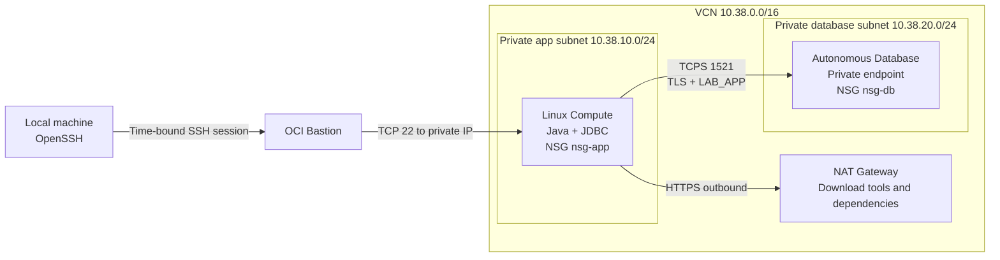

# Lab: Deploying a Private Database and Connecting via JDBC

## 1. Objectives and Scope

Within the **OCI Fundamentals Labs** chapter of the **CLOUD_PROVIDERS_ORACLE** module, this lab guides you through deploying an Oracle database with private-only access and running a Java application that connects over JDBC. You will combine compartments, IAM, VCN, Compute, and database services with access controls, operational observation, and resource cleanup.

Scenario: a note-taking application needs to store data in Oracle Database. The application host is allowed to access the database, while machines on the public Internet must not connect directly to the database. Administrators still need a time-bound SSH path to operate the application host.

This lab uses **Oracle Autonomous Database Serverless, Transaction Processing workload**, with a **private endpoint**, a Linux Compute instance in the same VCN, and **OCI Bastion**. Newer Console UIs and documentation may display the name **Autonomous AI Database**. This is one specific pattern for a private database on OCI; the endpoint and port steps do not apply verbatim to Base Database Service, Exadata, or MySQL HeatWave.

Upon completion, you must be able to prove:

- The database uses a private endpoint with public access disabled.
- Java runs on a Compute instance without a public IP and connects to the private hostname over TCPS.
- The application account has only sign-in privileges and granted table operations.
- A committed transaction is visible from a fresh connection; a rolled-back transaction leaves no row.
- Unauthorized hosts cannot establish a new database connection.
- Resources, costs, and availability limitations of the model are clearly documented.

Completion time depends on resource provisioning duration and familiarity with OCI. This lab may incur charges; do not assume the private endpoint or chosen configuration falls under free-tier allowances.

## 2. Architecture and Three Control Layers



Bastion is an administrative service; Java still runs on Compute and connects directly to the private endpoint inside the VCN. An SSH tunnel to Compute does not by itself create a JDBC path from your laptop to the database. NAT serves outbound connections initiated by Compute to fetch packages and Maven dependencies; the JDBC path between the two subnets does not traverse NAT.

The three control layers answer distinct questions:

| Layer | Question to answer | Configuration in this lab |
| --- | --- | --- |
| OCI IAM | Who is allowed to create, modify, delete resources, or create Bastion sessions? | Deployment group granted permissions in the lab compartment |
| Network | Which hosts can reach the database listener? | Private endpoint, NSGs, security lists, DNS, and routes |
| Oracle Database | After connecting, which SQL statements can the account execute? | User `LAB_APP`, object privileges on `LAB_OWNER`'s table |

Having OCI database management permissions does not automatically make a user a database user with table-read access. Conversely, having a database password does not create a network path to the private endpoint.

In this lab, use **walletless TLS** for JDBC Thin and explicitly allow TLS in the database configuration. Connections remain encrypted with server certificate verification. If your organization mandates client certificates, follow the mTLS extension branch at the end of the lab. Oracle documents walletless TLS prerequisites separately in [Connect Using JDBC Thin Driver with TLS](https://docs.oracle.com/en/cloud/paas/autonomous-database/serverless/adbsb/connect-jdbc-thin-tls.html).

## 3. Preparation Before Provisioning

### 3.1. Permissions and tools

Prepare a tenancy in a region supporting the services, sufficient quota/capacity, and a dedicated compartment such as `OciPrivateDbLab`. An administrator creates the compartment and learner group beforehand; do not use a compartment containing production data.

The deployment group needs permissions matching the resources actually created:

| Task | Permission scope to prepare |
| --- | --- |
| Create, configure, and delete Autonomous Database | Manage Autonomous Database in the lab compartment |
| Create VCN, subnets, NSGs, routes, and gateways | Manage networking in the lab compartment |
| Create Compute and boot volumes | Create/manage instances, use/manage volumes, and read compatible images |
| Create Bastion and port-forwarding sessions | Bastion permissions, instance/network read access, and dependent permissions |
| View Audit, metrics, and create alerts | Log/metric read or monitoring permissions if implementing that section |

The example below shows only the policy portion for database, networking, and Bastion. Replace identity domain, group, and compartment with real values; the administrator adds Compute, image, volume, and observability policies per organizational standards.

```text
Allow group 'Default'/'OciPrivateDbLabOperators' to manage autonomous-database-family in compartment OciPrivateDbLab
Allow group 'Default'/'OciPrivateDbLabOperators' to manage virtual-network-family in compartment OciPrivateDbLab
Allow group 'Default'/'OciPrivateDbLabOperators' to manage bastion-family in compartment OciPrivateDbLab
Allow group 'Default'/'OciPrivateDbLabOperators' to read instance-family in compartment OciPrivateDbLab
Allow group 'Default'/'OciPrivateDbLabOperators' to inspect work-requests in compartment OciPrivateDbLab
```

These are permissions for the lab builder, not permissions for the JDBC program. With username/password database authentication used in this lab, the Java program does not need an OCI API key. Look up operation-specific permissions in [IAM Policies for Autonomous Database](https://docs.oracle.com/en/cloud/paas/autonomous-database/serverless/adbsb/autonomous-database-iam-policies.html) and [Bastion IAM Policies](https://docs.oracle.com/en-us/iaas/Content/Bastion/Reference/bastionpolicyreference.htm).

Your local machine needs OpenSSH and a key pair for Bastion. Compute needs an OS login key pair; you may use a separate pair for easy revocation. Upload only public keys to OCI.

On Compute, prepare:

- Linux, such as Oracle Linux; sample user is `opc`.
- JDK 21, Maven 3.9, or versions compatible with the project.
- Oracle SQLcl compatible with the installed JDK, with the `sql` command in `PATH`.
- `getent`, `nc`, and `openssl` to test each connectivity layer.

You can install tools from organization-approved repositories or transfer installers from your local machine over SSH. Verify before proceeding:

```bash
java -version
mvn -version
sql -version
```

### 3.2. Resource conventions

| Component | Illustrative value |
| --- | --- |
| Compartment | `OciPrivateDbLab` |
| VCN | `vcn-private-db-lab`, CIDR `10.38.0.0/16` |
| App subnet | `subnet-app-private`, CIDR `10.38.10.0/24` |
| Database subnet | `subnet-db-private`, CIDR `10.38.20.0/24` |
| Compute | `vm-jdbc-lab`, private IP obtained from Console |
| Autonomous Database | Display name `adb-private-jdbc-lab`, database name `OCILABDB` if valid and available |
| NSGs | `nsg-app`, `nsg-db` |
| Table-owning schema | `LAB_OWNER` |
| Application user | `LAB_APP` |
| Tracking tags | `purpose=private-db-jdbc-lab`, `owner`, `expires-on` |

CIDRs are illustrative. Choose ranges that do not overlap existing networks if the VCN has peering, VPN, or FastConnect. Never hardcode the private IP, hostname, or service name from this guide's examples; take those values from the actual resources OCI creates.

Before clicking Create, review cost estimates by region, compute model, license, storage, and backup. Choose the smallest configuration suitable for the lab and leave autoscaling disabled unless testing scaling. Record when resources must be cleaned up and configure an appropriate budget alert; a budget alert is a notification mechanism, not an automatic kill switch for services.

## 4. Create the Private Network and Access Rules

### 4.1. VCN, subnets, routes, and DNS

In Networking for the right compartment and region:

1. Create a VCN with the chosen CIDR, enabling VCN DNS resolution.
2. Create two regional subnets and set them to **private**, prohibiting public IPs on VNICs in the subnets.
3. Use DHCP options with the VCN DNS resolver for Compute. If using custom organizational DNS, configure appropriate forwarding to the database domain.
4. Assign a dedicated route table to the app subnet. If Compute needs to download tools directly from the Internet, create a NAT Gateway and add a `0.0.0.0/0` route to the NAT Gateway.
5. No Internet Gateway is needed for the app-to-database flow. In this simple VCN, traffic between the two subnets uses built-in VCN routing.
6. The database subnet does not need an Internet default route just to accept JDBC from the app subnet. If adding features that require outbound connectivity, configure separately per service requirements.

Service Gateway serves supported Oracle services and does not replace an Internet egress path to arbitrary Maven repositories. If an internal proxy or artifact repository already exists, use the organization-provided path. See [NAT Gateway](https://docs.oracle.com/en-us/iaas/Content/Network/Tasks/nat-create.htm) and [OCI Network Security Best Practices](https://docs.oracle.com/en-us/iaas/Content/Security/Reference/networking_security.htm).

### 4.2. NSGs and security lists

Create `nsg-app` for Compute's primary VNIC and `nsg-db` for the database private endpoint. The rules below are **stateful**, with source port set to `All`; numbers in the table are **destination ports**.

| Where configured | Direction | Source or destination | Protocol/port | Purpose |
| --- | --- | --- | --- | --- |
| `nsg-app` | Ingress | Bastion endpoint private IP, `/32` | TCP 22 | Administrative SSH to Compute |
| `nsg-app` | Egress | NSG `nsg-db` | TCP 1521 | JDBC TLS to database |
| `nsg-db` | Ingress | NSG `nsg-app` | TCP 1521 | Accept connections only from app host |
| `nsg-app` | Egress | Internet via NAT per lab policy | TCP 443 | Download artifacts and installers over HTTPS |

The Bastion endpoint's private IP appears after Bastion creation; add the SSH rule at that time. Do not use your laptop's public IP as the source in the SSH rule on the Compute VNIC, because the hop to Compute originates from Bastion's private endpoint.

Add or retain baseline rules needed for DNS, time sync, metadata, and image operation per your network design. With a custom DNS resolver, ensure both UDP and TCP 53 to the resolver are allowed. Do not wipe out all baseline system rules in favor of just the four rows in the table.

Stateful rules track sessions and permit corresponding return traffic; there is no need to open reverse ephemeral port ranges for that connection. If using stateless rules, you must explicitly design both directions.

**Inspect both subnet security lists and all NSGs attached to endpoints.** Allow rules are additive: a security list permitting the entire VCN to reach the database port defeats the source restriction you intend to demonstrate with `nsg-db`. Remove or narrow overly broad rules in the lab resources, such as all-port ingress from the entire VCN. Merely adding a narrow NSG does not create a deny rule to override a broad rule. This behavior is described in [OCI Security Rules](https://docs.oracle.com/en-us/iaas/Content/Network/Concepts/securityrules.htm).

Do not open the database to `0.0.0.0/0`. A private endpoint still needs source control within the private network: a compromised host inside the VCN should not automatically have listener access.

## 5. Create the Database with a Private Endpoint

In the Console's Autonomous Database service:

1. Select the lab compartment and create a Serverless database with the **Transaction Processing** workload.
2. Name it, select lab-appropriate compute/storage settings, and record the license selection. Do not pick dedicated infrastructure simply because the name mentions private.
3. Set the `ADMIN` password meeting Oracle's password policy. Store it in an authorized secret store; never put it in Git or shell scripts.
4. Under Network access, choose the equivalent of **Private endpoint access only**.
5. Select the VCN, database subnet, and `nsg-db`.
6. If an **Allow public access** option appears, leave it disabled. Some configurations allow simultaneous private endpoint and controlled public access; this lab uses the private path only.
7. Under TLS/mTLS settings, allow TLS, typically by disabling mandatory mutual TLS or setting **Require mutual TLS authentication = Not required**. This enables one-way TLS without removing the service's mTLS capability.
8. Create the database and wait for the ready state, typically **Available**.

Labels and option placement may vary. The mandatory outcomes are: a private endpoint exists in the chosen subnet, public access is disabled, and a TLS connection string is available. Oracle documents these options at [Configure Network Access with Private Endpoints](https://docs.oracle.com/en-us/iaas/autonomous-database-serverless/doc/private-endpoints-autonomous.html).

Open **Database connection** and select:

- **TLS**, not the mTLS descriptor for the main branch.
- The **private endpoint** connection string.
- The `low` service level for lightweight JDBC statements in this lab; copy the exact service name provided by the Console.

Record three non-password values separately: private endpoint IP, private hostname, and service name. If the Console lists multiple endpoints or connection types, cross-check them against the Network section before copying.

An illustrative descriptor looks like:

```text
(description=
  (retry_count=0)
  (address=(protocol=tcps)(host=PRIVATE_HOST_FROM_CONSOLE)(port=1521))
  (connect_data=(service_name=SERVICE_NAME_FROM_CONSOLE))
  (security=(ssl_server_dn_match=yes))
)
```

This is a template to understand the components, not real database parameters. Preserve the certificate verification attributes generated by the Console, including the server certificate DN if present. You may set `retry_count=0` while diagnosing to avoid waiting through multiple retry loops; never replace the hostname with an IP or disable certificate verification to bypass errors.

Port `1521` here is paired with `protocol=tcps`, meaning TLS is still used. Do not assume all port 1521 connections are encrypted. Autonomous Database supports the TLS/mTLS options outlined in [About Connecting to an Autonomous Database Instance](https://docs.oracle.com/en-us/iaas/autonomous-database-serverless/doc/connect-introduction.html).

## 6. Create Compute and Access via Bastion

### 6.1. Compute in the application subnet

Create a small Linux Compute instance in the application subnet and attach `nsg-app` to its primary VNIC. Ensure it has no public IP. Supply the OS account's SSH public key and record the instance's private IP.

On the OS, keep SSH running and ensure the host firewall permits the designed administrative path. If outbound OS filtering is enabled, allow DNS, HTTPS for tool downloads, and database connectivity accordingly. An NSG permitting traffic does not mean the OS firewall inside the VM also permits it.

### 6.2. SSH port forwarding session

Create an OCI Bastion attached to the appropriate lab VCN/subnet. Set the client CIDR allowlist to your local machine's current public IP, e.g., a `/32` address; if going through a VPN/proxy, use the actual outbound address permitted by your organization. Obtain the Bastion's **private endpoint IP** and add the SSH rule to `nsg-app` per the network table.

Create an **SSH port forwarding** session targeting Compute's private IP, port **22**, the Bastion key pair's public key, and a sufficient TTL for the lab. This session type forwards a specific port; it does not require the Oracle Cloud Agent Managed SSH plugin. However, Compute's SSH server must still be running to accept SSH connections on port 22. See [Creating a Port Forwarding Session](https://docs.oracle.com/en-us/iaas/Content/Bastion/Tasks/create-session-port-forwarding.htm).

Use **Copy SSH command** from the session in the Console to obtain the exact session OCID and service hostname. Substitute the private key path, pick an available local port such as `2222`, and bind the local port to `127.0.0.1`. The command follows this pattern:

```bash
ssh -i /path/to/bastion_private_key \
  -N -L 127.0.0.1:2222:COMPUTE_PRIVATE_IP:22 \
  -p 22 SESSION_OCID@BASTION_SERVICE_HOST
```

Keep this terminal window open. In another window, sign in to the app host using the Compute key:

```bash
ssh -i /path/to/compute_private_key -p 2222 opc@127.0.0.1
```

Verify the host key against trusted VM information; do not disable host key checking. A port-forwarding session sitting idle after connecting is normal behavior. Oracle describes these two hops in [Connecting to a Port Forwarding Session](https://docs.oracle.com/en-us/iaas/Content/Bastion/Tasks/connect-port-forwarding.htm).

From the next step onward, all Bash commands run **inside Compute**, unless explicitly noted as local machine. Cloud Shell or your laptop by default cannot be assumed to have private connectivity into the VCN.

## 7. Verify DNS, TCP, and TLS Before Running SQL

Take the hostname from the private connection string and set variables:

```bash
export DB_HOST='actual-private-hostname-from-console'
export DB_PORT='1521'

getent ahostsv4 "$DB_HOST"
nc -vz -w 5 "$DB_HOST" "$DB_PORT"
```

DNS output must match the private endpoint IP in the Console within the assigned private range. `nc` succeeding only proves TCP opens; it does not prove login, TLS, or SQL privileges work.

Test the TLS handshake and hostname verification:

```bash
openssl s_client \
  -connect "${DB_HOST}:${DB_PORT}" \
  -servername "$DB_HOST" \
  -verify_hostname "$DB_HOST" \
  -verify_return_error </dev/null
```

Inspect the certificate chain and verification result. `openssl` uses the OS trust store, whereas JDBC uses Java's trust store; one succeeding does not replace the other. Also distinguish a connection-closed notice after handshake completion from a certificate validation error, because `openssl` does not execute a full Oracle SQL session.

If DNS returns the wrong IP, fix DNS first. If TCP times out, check NSG attachments, security lists, app egress, and host firewall. If TLS fails, verify the exact hostname, TLS mode, and trust store; do not switch to a public endpoint just to continue the lab.

## 8. Initialize Schema and Application Account

### 8.1. Declare the connection descriptor

On Compute, copy the **exact private TLS descriptor** from the Console onto a single line. Use single quotes outside so the shell does not interpret characters in the descriptor.

```bash
export DB_CONNECT='PASTE_FULL_PRIVATE_TLS_DESCRIPTOR_FROM_CONSOLE_HERE'
export JDBC_URL="jdbc:oracle:thin:@${DB_CONNECT}"
```

`DB_CONNECT` must begin with `(description=...` from the copied descriptor, without the `jdbc:oracle:thin:@` prefix. `JDBC_URL` includes the JDBC prefix. Never embed usernames or passwords in either variable.

Connect with SQLcl as `ADMIN`; let the tool prompt for the password:

```bash
sql -L "ADMIN@${DB_CONNECT}"
```

Run SQLcl in its JDBC Thin mode rather than switching to an OCI native client mode for this branch. Walletless SQLcl connectivity is documented in [Connect Oracle SQLcl Cloud Without a Wallet](https://docs.oracle.com/en/cloud/paas/autonomous-database/serverless/adbsb/connect-sqlcl-tls.html).

### 8.2. Create two users as ADMIN

Use distinct passwords meeting Autonomous Database password policies. The SQL snippet uses `ACCEPT ... HIDE` to avoid typing passwords directly in commands and disables substitution echo. Do not enable spooling or take screenshots containing secrets. Given substitution handling in this example, choose passwords without double quotes or `&` characters; do not reuse passwords from other environments.

```sql
SET ECHO OFF
SET VERIFY OFF
SET DEFINE ON

ACCEPT owner_password CHAR PROMPT 'LAB_OWNER password: ' HIDE
CREATE USER lab_owner IDENTIFIED BY "&owner_password";
UNDEFINE owner_password

GRANT CREATE SESSION, CREATE TABLE TO lab_owner;
ALTER USER lab_owner QUOTA 20M ON DATA;

ACCEPT app_password CHAR PROMPT 'LAB_APP password: ' HIDE
CREATE USER lab_app IDENTIFIED BY "&app_password";
UNDEFINE app_password

GRANT CREATE SESSION TO lab_app;
EXIT
```

`LAB_OWNER` owns objects and has finite quota to create tables. `LAB_APP` cannot create tables or manage users. Never grant `DBA`, `ADMIN`, or `UNLIMITED TABLESPACE` to the application account. User creation and quota operations follow [Create and Manage Users on Autonomous Database](https://docs.oracle.com/en/cloud/paas/autonomous-database/serverless/adbsb/manage-users-create.html).

Run this script once on the fresh lab database. If a user already exists, check who uses it and its setup state; do not blindly drop users just to rerun.

### 8.3. Create the table as LAB_OWNER

Reconnect as the owner:

```bash
sql -L "LAB_OWNER@${DB_CONNECT}"
```

Create the table and grant only the privileges required by the program:

```sql
CREATE TABLE lab_notes (
    note_id     VARCHAR2(36 CHAR) PRIMARY KEY,
    note_text   VARCHAR2(200 CHAR) NOT NULL,
    created_at  TIMESTAMP DEFAULT SYSTIMESTAMP NOT NULL
);

GRANT SELECT, INSERT ON lab_notes TO lab_app;

SELECT table_name
FROM user_tables
WHERE table_name = 'LAB_NOTES';

EXIT
```

Java will reference the qualified name `LAB_OWNER.LAB_NOTES`. Direct grants make it explicit which objects the application may access; there is no need to alter `CURRENT_SCHEMA` or create synonyms just to run the example.

`created_at` is populated by the database. `note_id` uses a Java-generated UUID, so the lab needs no extra sequence or sequence grants. Oracle DDL triggers implicit commits; the transaction tests in later steps use DML only.

## 9. Build the Java JDBC Program

### 9.1. Maven project

On Compute, create the lab directory in your user account:

```bash
mkdir -p "$HOME/oci-private-db-jdbc/src/main/java/lab"
cd "$HOME/oci-private-db-jdbc"
```

Create `pom.xml` as follows:

```xml
<project xmlns="http://maven.apache.org/POM/4.0.0"
         xmlns:xsi="http://www.w3.org/2001/XMLSchema-instance"
         xsi:schemaLocation="http://maven.apache.org/POM/4.0.0 https://maven.apache.org/xsd/maven-4.0.0.xsd">
    <modelVersion>4.0.0</modelVersion>
    <groupId>vn.learning.oci</groupId>
    <artifactId>private-db-jdbc-lab</artifactId>
    <version>1.0.0</version>

    <properties>
        <maven.compiler.release>21</maven.compiler.release>
        <project.build.sourceEncoding>UTF-8</project.build.sourceEncoding>
        <oracle.jdbc.version>23.26.4.0.0</oracle.jdbc.version>
    </properties>

    <dependencies>
        <dependency>
            <groupId>com.oracle.database.jdbc</groupId>
            <artifactId>ojdbc11</artifactId>
            <version>${oracle.jdbc.version}</version>
        </dependency>
    </dependencies>

    <build>
        <plugins>
            <plugin>
                <groupId>org.apache.maven.plugins</groupId>
                <artifactId>maven-compiler-plugin</artifactId>
                <version>3.13.0</version>
            </plugin>
            <plugin>
                <groupId>org.apache.maven.plugins</groupId>
                <artifactId>maven-dependency-plugin</artifactId>
                <version>3.8.1</version>
            </plugin>
        </plugins>
    </build>
</project>
```

`ojdbc11` is the artifact line name and does not mean the application must run Java 11. This configuration uses JDK 21 and pins a specific JDBC version for reproducible dependencies. Cross-check compatibility when changing JDK/driver versions at [Oracle JDBC and UCP Downloads](https://www.oracle.com/database/technologies/appdev/jdbc-downloads.html); Oracle also uses this version in [Configure Java Applications](https://docs.oracle.com/en/database/oracle/oracle-database/26/ddscg/configure-java-applications.html).

The one-way TLS branch uses no Oracle wallet, so the example declares only the driver. Oracle Instant Client is not needed for this JDBC Thin setup.

### 9.2. Complete source code

Create `src/main/java/lab/PrivateDatabaseLab.java`:

```java
package lab;

import java.io.Console;
import java.sql.Connection;
import java.sql.DriverManager;
import java.sql.PreparedStatement;
import java.sql.ResultSet;
import java.sql.SQLException;
import java.util.Arrays;
import java.util.Properties;
import java.util.UUID;

public final class PrivateDatabaseLab {
    private static final String INSERT_SQL = """
            INSERT INTO lab_owner.lab_notes (note_id, note_text)
            VALUES (?, ?)
            """;

    private static final String COUNT_SQL = """
            SELECT COUNT(*)
            FROM lab_owner.lab_notes
            WHERE note_id = ?
            """;

    public static void main(String[] args) throws Exception {
        String url = requiredEnv("JDBC_URL");
        String user = requiredEnv("DB_USER");
        Console console = System.console();
        if (console == null) {
            throw new IllegalStateException(
                    "Run java directly in an interactive SSH terminal.");
        }

        char[] secret = console.readPassword("Database password for %s: ", user);
        if (secret == null || secret.length == 0) {
            throw new IllegalArgumentException("A database password is required.");
        }
        String password = new String(secret);
        Arrays.fill(secret, '\0');

        try {
            runLab(url, user, password);
        } catch (SQLException e) {
            System.err.printf("JDBC failed: SQLState=%s, vendorCode=%d%n",
                    e.getSQLState(), e.getErrorCode());
            throw new IllegalStateException("Database lab failed.");
        }
    }

    private static void runLab(String url, String user, String password)
            throws SQLException {
        String committedId = UUID.randomUUID().toString();
        String rolledBackId = UUID.randomUUID().toString();

        try (Connection connection = open(url, user, password)) {
            printSession(connection);
            connection.setAutoCommit(false);
            try {
                insert(connection, committedId, "Committed from a private OCI app");
                connection.commit();
            } catch (SQLException e) {
                rollbackPreservingError(connection, e);
                throw e;
            }
        }

        // A fresh connection must see the committed row.
        try (Connection connection = open(url, user, password)) {
            requireCount(connection, committedId, 1);
            System.out.println("COMMIT_VISIBLE_FROM_NEW_CONNECTION=PASS");
        }

        try (Connection connection = open(url, user, password)) {
            connection.setAutoCommit(false);
            try {
                insert(connection, rolledBackId, "This row must be rolled back");
                connection.rollback();
            } catch (SQLException e) {
                rollbackPreservingError(connection, e);
                throw e;
            }
        }

        // A fresh connection must not see the rolled-back row.
        try (Connection connection = open(url, user, password)) {
            requireCount(connection, rolledBackId, 0);
            System.out.println("ROLLBACK_LEAVES_NO_ROW=PASS");
        }

        System.out.println("PRIVATE_DATABASE_JDBC_LAB=PASS");
    }

    private static Connection open(String url, String user, String password)
            throws SQLException {
        Properties properties = new Properties();
        properties.setProperty("user", user);
        properties.setProperty("password", password);
        properties.setProperty("oracle.net.CONNECT_TIMEOUT", "5000");
        properties.setProperty("oracle.jdbc.ReadTimeout", "15000");
        properties.setProperty("oracle.net.ssl_server_dn_match", "true");
        return DriverManager.getConnection(url, properties);
    }

    private static void printSession(Connection connection) throws SQLException {
        String query = """
                SELECT SYS_CONTEXT('USERENV', 'SESSION_USER') AS session_user_name,
                       SYS_CONTEXT('USERENV', 'NETWORK_PROTOCOL') AS protocol_name
                FROM dual
                """;
        try (PreparedStatement statement = connection.prepareStatement(query)) {
            statement.setQueryTimeout(10);
            try (ResultSet rows = statement.executeQuery()) {
                if (!rows.next()) {
                    throw new SQLException("Session information was not returned.");
                }
                String sessionUser = rows.getString("session_user_name");
                String protocol = rows.getString("protocol_name");
                if (!"LAB_APP".equalsIgnoreCase(sessionUser)
                        || !"tcps".equalsIgnoreCase(protocol)) {
                    throw new SQLException("Unexpected database user or protocol.");
                }
                System.out.printf("SESSION_USER=%s; NETWORK_PROTOCOL=%s%n",
                        sessionUser, protocol);
            }
        }
    }

    private static void insert(Connection connection, String id, String text)
            throws SQLException {
        try (PreparedStatement statement = connection.prepareStatement(INSERT_SQL)) {
            statement.setQueryTimeout(10);
            statement.setString(1, id);
            statement.setString(2, text);
            if (statement.executeUpdate() != 1) {
                throw new SQLException("Insert did not affect exactly one row.");
            }
        }
    }

    private static void requireCount(Connection connection, String id, int expected)
            throws SQLException {
        try (PreparedStatement statement = connection.prepareStatement(COUNT_SQL)) {
            statement.setQueryTimeout(10);
            statement.setString(1, id);
            try (ResultSet rows = statement.executeQuery()) {
                if (!rows.next() || rows.getInt(1) != expected) {
                    throw new SQLException("Transaction visibility check failed.");
                }
            }
        }
    }

    private static void rollbackPreservingError(Connection connection,
                                                SQLException original) {
        try {
            connection.rollback();
        } catch (SQLException rollbackError) {
            original.addSuppressed(rollbackError);
        }
    }

    private static String requiredEnv(String name) {
        String value = System.getenv(name);
        if (value == null || value.isBlank()) {
            throw new IllegalArgumentException("Missing environment variable: " + name);
        }
        return value;
    }
}
```

Key design decisions in the code:

- `PreparedStatement` passes values via bind parameters rather than concatenating SQL strings from note content.
- `setAutoCommit(false)` and explicit commit/rollback calls define clear transaction boundaries.
- Each post-transaction check opens a fresh connection to verify the persisted database state.
- `try-with-resources` closes connections, statements, and result sets even when errors occur.
- Connect timeout, read timeout, and query timeout govern distinct phases. Retries in the descriptor can extend total elapsed time; do not treat any single timeout as an exact deadline across all operations.
- Logging prints only the user, protocol, and generic error codes; it never prints passwords, table contents, or the full URL.

Interactive password entry keeps secrets out of shell history and command-line arguments. Zeroing the `char[]` array only reduces the lifetime of that array copy; the password `String` handed to JDBC remains in process memory. For real services, retrieve secrets from an authorized secret manager with restricted read access instead of interactive prompts.

### 9.3. Build and run

In the project directory:

```bash
mvn -q package dependency:copy-dependencies
export DB_USER='LAB_APP'
java -cp 'target/classes:target/dependency/*' lab.PrivateDatabaseLab
```

The `:` character is the classpath separator on Linux. Running Java requires an interactive terminal for the password prompt. If running on Windows over an already-established private network path, use `;` for the classpath; do not switch to running on a laptop that lacks a private network path.

Expected output looks like:

```text
Database password for LAB_APP:
SESSION_USER=LAB_APP; NETWORK_PROTOCOL=tcps
COMMIT_VISIBLE_FROM_NEW_CONNECTION=PASS
ROLLBACK_LEAVES_NO_ROW=PASS
PRIVATE_DATABASE_JDBC_LAB=PASS
```

This is expected output for reference, not proof that resources are provisioned or the program has already been executed. Each successful run retains one committed row; UUIDs allow repeated runs without key collisions. The owner can clean up rows after the lab.

## 10. Prove Permission and Network Boundaries

### 10.1. Test SQL privileges

Open a separate SQLcl session as `LAB_APP`:

```bash
sql -L "LAB_APP@${DB_CONNECT}"
```

Read from the granted table:

```sql
SELECT COUNT(*) FROM lab_owner.lab_notes;
```

Then attempt to create a table and update the owner's table:

```sql
CREATE TABLE should_not_exist (id NUMBER);

UPDATE lab_owner.lab_notes
SET note_text = 'unauthorized update'
WHERE note_id = 'not-a-real-note';
```

Both operations must be denied for insufficient privileges, typically returning `ORA-01031`. The `UPDATE` statement is denied even though no row matches the condition, because the user lacks the UPDATE privilege. If either succeeds, stop verification and inspect system privileges, roles, direct grants, and grants via `PUBLIC`; do not record the lab as passed.

Using a separate session avoids mixing test DDL into the middle of Java transactions. The `LAB_APP` account in this lab has only `SELECT` and `INSERT` on the target table.

### 10.2. Test an unauthorized network source

Budget permitting, spin up a temporary test Compute instance in the same VCN without attaching `nsg-app`, without a public IP, and access it via a separate Bastion session. That host needs egress to run the test; do not grant it database ingress.

From that host:

```bash
nc -vz -w 5 "$DB_HOST" 1521
```

The fresh connection must fail. Inside a new SSH session, re-export `DB_HOST` with the real hostname; variables from the app host do not carry over to the test host. Verify that DNS still resolves properly, the test host has egress, and database ingress is the sole relevant difference.

If you do not launch a second Compute instance, you may temporarily remove the app VNIC from `nsg-app` in a controlled lab after preparing an administrative recovery path, then attempt a fresh JDBC connection. That can affect SSH if the SSH rule also lives in the removed NSG; prepare a separate admin rule first. Never modify an NSG shared with other resources.

With stateful rules, an already-open TCP session may not immediately reflect rule changes. Close old connections and initiate fresh connections when verifying. If an unauthorized source can still connect, look for broad rules in security lists or other NSGs before drawing conclusions about the private endpoint.

### 10.3. Local machine on the public Internet

Keep Java working on Compute. On your local machine without VPN/FastConnect/peering or a tunnel to the database, attempting a direct connection to the private endpoint must fail.

A DNS resolution failure on your laptop alone does not prove the NSG is correct, because the check stops before the network layer. Stronger proof combines all facts: Console confirms private-endpoint-only access, Compute DNS resolves to the private IP, authorized sources connect, and unauthorized sources inside the VCN are blocked on new connections.

## 11. Extension Branch: mTLS with Wallet

If client certificate authentication is required, switch intentionally to **mTLS** instead of merely changing the port number in the URL:

1. In Database connection, copy the private endpoint's mTLS connection string and download the **instance wallet** for that exact database.
2. Transfer the wallet to Compute over a protected administrative channel, extract it into a private directory, and restrict file permissions to the account running Java.
3. Configure NSGs for mTLS on TCP **1522**, aligning app egress and database ingress. Keep port 1521 only if one-way TLS is still separately required.
4. Add the security libraries required for wallets matching your driver version. Oracle provides the `ojdbc11-production` `pom` artifact to pull compatible companion JARs with the driver; do not mix JAR versions manually.
5. Use a TNS alias present in `tnsnames.ora` and pass the wallet directory via `TNS_ADMIN` in the JDBC URL. Keep wallet config files together and preserve certificate verification settings.
6. Re-run the program as `LAB_APP`, re-verifying both allowed and blocked paths before switching the database to enforce mTLS if that is the goal.

Example layout on Compute:

```bash
mkdir -p "$HOME/.oci-wallets/ocilabdb"
chmod 700 "$HOME/.oci-wallets" "$HOME/.oci-wallets/ocilabdb"
# Extract the right database wallet into the directory above using an authorized tool.
chmod 600 "$HOME/.oci-wallets/ocilabdb/"*

export JDBC_URL="jdbc:oracle:thin:@ACTUAL_MTLS_ALIAS?TNS_ADMIN=${HOME}/.oci-wallets/ocilabdb"
```

The password protecting the wallet archive is distinct from the `LAB_APP` password. With the user/password model in this lab, the wallet supplies mTLS authentication material and connection configuration; the program still uses `LAB_APP`'s database credentials. Never include wallets in source code, public container images, or lab submissions.

Consult [Download Database Connection Information](https://docs.oracle.com/en-us/iaas/autonomous-database-serverless/doc/connect-download-wallet.html), [JDBC Thin Connections with a Wallet](https://docs.oracle.com/en/cloud/paas/autonomous-database/serverless/adbsb/connect-jdbc-thin-wallet.html), and [Oracle Maven Central Developers Guide](https://www.oracle.com/database/technologies/maven-central-guide.html) when executing this branch.

## 12. Dependency-Ordered Troubleshooting

Walk from DNS to TCP, TLS, authentication, service, and SQL. Never open the entire firewall to bypass unclear layers.

| Symptom | What to check first | Right direction to fix |
| --- | --- | --- |
| Hostname not found or resolves to wrong IP | Compute DNS, DHCP options, copied hostname | Restore resolution to the real private endpoint |
| `nc` times out | NSG attachment, security list, egress, routes, and OS firewall | Verify source/destination/port, retry a fresh TCP check |
| `Connection refused` | IP/port and listener/service state | Confirm database is Available and descriptor is accurate |
| `PKIX path building failed` | JDK trust store, CA chain, TLS-intercepting proxy | Update trust from a trusted source; do not disable verification |
| Hostname/certificate mismatch error | Private hostname and descriptor security section | Use the exact descriptor; do not substitute the private IP |
| `ORA-12154` | Alias, `TNS_ADMIN`, `tnsnames.ora` if using an alias | Check file and alias; main branch can use the full descriptor |
| `ORA-12514` or similar service error | Database `service_name` and endpoint | Re-copy the exact service name from the Console |
| `ORA-01017` | Actual username/password entered | Check credentials; distinguish DB password from wallet password |
| `ORA-28000` | User account lock status | Ask an admin to check and unlock per procedure |
| `ORA-01031`, `ORA-00942` | Privileges and owner/table name | Verify direct grants and target schema |
| Owner cannot create segments, quota error | Quota on tablespace DATA | Grant finite quota to owner; do not grant extra privileges to runtime arbitrarily |
| `No suitable driver` | Dependencies on runtime classpath | Check `target/dependency` and classpath separator |
| Unreadable wallet or missing security classes | File permissions, wallet folder, companion JARs | Align wallet and dependency versions |
| SSH `Permission denied` | Bastion key, Compute key, username, session TTL | Separate the two auth hops and recreate session if expired |

Avoid jumping to conclusions from a single error code: identical errors can have multiple causes. When submitting evidence, record timestamps, test types, error codes, and relevant resources with sensitive info masked; never send passwords or wallets.

If a connection drops right at commit time, the application may not know whether the transaction succeeded. Do not blindly retry write operations. In real applications, use business keys or idempotency keys and query state before deciding how to proceed.

## 13. Operational Observation, Cost, and Availability

### 13.1. Observational evidence

On a successful run, record start/end timestamps, exit code, and Java's three PASS lines. Cross-check connection sessions against database metrics such as session count and resource utilization available in the Console; a very short lab run may not cause large spikes in aggregated charts.

Inspect Audit for resource, endpoint, or network rule create/modify actions. OCI Audit for control-plane resource operations differs from database auditing for SQL statements. To record logins or queries, configure database auditing per authorized permissions and policies.

You can enable VCN Flow Logs for supported VNICs/subnets to inspect network flows and accept/reject status. Account for log volume, retention, and cost; do not enable unbounded collection just to finish the lab.

Minimum notes should include: resource names, region, timestamps, DNS/TCP/JDBC tests, SQL privilege results, and blocked-source results. Mask OCIDs, specific IPs, or hostnames per organizational sharing rules.

### 13.2. Availability limitations

A managed database does not automatically make the entire application highly available. This model has only one Compute instance, no load balancer, and no failover testing. If Compute stops, the application stops even though the database remains running. Bastion is a time-bound administrative path, not a component for applications to maintain JDBC connections.

For production, design multiple application instances, bounded connection pools, health checks, controlled timeouts/retries, backup/restore, and DR plans matching RTO/RPO. Never treat having backups as proof of successful recovery; practice restores into an isolated environment.

Autonomous Database manages many infrastructure tasks, yet operators must still understand backup scope, retention, and recovery procedures. Review [About Backup and Recovery](https://docs.oracle.com/en/cloud/paas/autonomous-database/serverless/adbsb/backup-intro.html) before choosing a data protection strategy.

### 13.3. Cost control

Track database compute/storage, backups, Compute/boot volumes, and used network/log services separately. Stopping a resource does not mean all associated charges disappear. Billing components vary by model, so check [Autonomous Database Billing Summary](https://docs.oracle.com/en-us/iaas/autonomous-database-serverless/doc/autonomous-database-billing-overview.html) and tenancy estimates rather than relying on a fixed number in this guide.

`owner` and `expires-on` tags help locate forgotten resources. Save deployment choices and dependencies into reproducible configuration later; Terraform/OCI Resource Manager is a natural next step, while passwords and wallets must be supplied through a separate secret channel.

## 14. Clean Up Resources and Confirm Completion

### 14.1. Lab cleanup order

Delete only resources created by this lab, in the right compartment, after confirming data no longer needs to be retained:

1. Stop the Java program; if keeping the database for another lab, have the owner clean up lab rows/tables per agreed scope.
2. If keeping the database while ending this lab, use `ADMIN` to revoke or drop `LAB_APP` and `LAB_OWNER` once certain no applications depend on them. Never drop users merely to hide test errors.
3. Delete the test Compute instance if created; terminate the app Compute instance when finished. Check the option to keep/delete the boot volume and any detached volumes.
4. Delete Bastion sessions, then delete the lab's Bastion; close SSH tunnels on your local machine.
5. Terminate the Autonomous Database if the entire database was created solely for this lab. Read backup/retention options and check for any retained resources.
6. Once endpoints/VNICs have no remaining dependencies, delete the lab's NSGs, routes, gateways, subnets, and then VCN in dependency order. Never delete shared networks.
7. Delete or revoke wallet copies, secret files, and lab-only IAM grants when no longer needed. Retain sanitized source code and required evidence reports.
8. Inspect remaining resource lists and Cost Analysis after billing data updates to catch uncleaned volumes, backups, or logs.

### 14.2. Completion criteria

| Item | Required evidence |
| --- | --- |
| Private database | Console confirms private endpoint, public access disabled |
| Private Compute | VNIC has no public IP, located in the app subnet |
| DNS and listener | Hostname on Compute resolves to private IP; TCP 1521 open from allowed source |
| TLS | Descriptor uses TCPS, cert verification enabled, Java reports `tcps` protocol |
| Application privileges | Java signs in as `LAB_APP`, not `ADMIN` |
| Transactions | Commit check from fresh connection passes; rollback leaves no row passes |
| SQL authorization | SELECT/INSERT allowed; CREATE TABLE and UPDATE denied |
| Source isolation | Fresh connection from unauthorized source fails, with test conditions noted |
| Operations | Test timestamps, error codes if any, HA limits, and cost plan recorded |
| Cleanup | Resources deleted or assigned a clear owner and retention deadline |

The deliverable of this lab is an explainable, verifiable access flow: **administrators reach Compute via Bastion; the application uses a private endpoint and TLS; the database grants only the SQL privileges needed by the application account**. A successful JDBC login is only one part of the outcome, alongside denied-access tests, transaction behavior, and resource lifecycle management.
