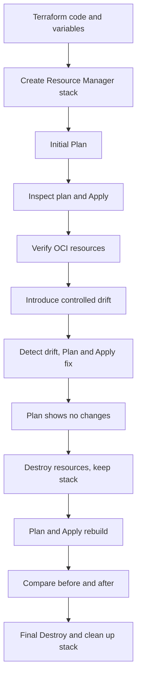

# Lab: Rebuilding an Environment with Terraform Resource Manager

## 1. Context and Expected Outcomes

Within the **OCI Fundamentals Labs** chapter of the **CLOUD_PROVIDERS_ORACLE** module, this lab turns network configuration from isolated Console clicks into redeployable code. The scenario is a team that needs to stand up a learning environment, verify its configuration, release resources, and then rebuild the exact same architecture in the next practice session.

You will use **OCI Resource Manager** to run Terraform as jobs. The environment consists of a VCN, private subnet, route table, and security list inside a dedicated lab compartment. This scope connects tenancy, compartment, IAM, and VCN fundamentals to infrastructure automation, change tracking, and resource control. Compute, storage, and Oracle databases can use this network in a subsequent deployment lab; this lab focuses on rebuilding the network layer.

Upon completion, you must have evidence that:

- A defined set of code and variables creates four resources directly managed by Terraform.
- You can read a plan before applying and cross-check the outcome against live OCI resources.
- A manual change is detected and reconciled back to the configuration in code.
- After a destroy, the same stack can recreate the environment with equivalent CIDRs, names, and network rules.
- New OCIDs are distinguished from configuration attributes that must remain stable.
- Lab resources are cleaned up before deleting the stack.

**Rebuilding infrastructure is not the same as recovering application data.** This lab creates no database or data volumes. When extending to those services, backups, retention policies, and recovery procedures must be designed separately.

## 2. Understanding Configuration, Stack, Jobs, and State

| Component | Role in this lab |
| --- | --- |
| Terraform configuration | `.tf` files describing desired resources and dependencies |
| Variables | Region, compartment, and parameters specific to each deployment |
| Stack | Resource Manager object holding configuration, variables, and state linkage |
| Plan job | Computes the actions Terraform expects to perform |
| Apply job | Executes changes per the chosen plan |
| Terraform state | Maps resource addresses in code to real OCI resources |
| Destroy job | Releases resources managed within the stack's scope |
| Drift detection | Detects discrepancies between live resources and the most recently applied configuration |

For example, the address `oci_core_subnet.app` is a logical name in Terraform. The `ocid1.subnet...` value in state is the identifier of a specific subnet in OCI. After destroying and recreating, the Terraform address stays the same while the OCID changes.

Resource Manager manages job execution and state storage for the stack; access is still governed by IAM. Having permission to create a stack does not automatically grant permission to create every resource declared inside the stack. See [Overview of Resource Manager](https://docs.oracle.com/en-us/iaas/Content/ResourceManager/Concepts/resourcemanager.htm) and [Securing Resource Manager](https://docs.oracle.com/en-us/iaas/Content/Security/Reference/resourcemanager_security.htm).

Main lab flow:



## 3. Lab Architecture and Boundaries

Use an existing compartment, such as `oci-labs`. Both the stack and the network resources reside in that compartment; the entire lab uses a single region.

```text
Authorized tenancy
└── Compartment: oci-labs
    ├── Resource Manager stack: oci-rebuild-lab
    └── VCN: rebuild08-vcn, 10.80.0.0/24
        ├── Dedicated route table: rebuild08-rt
        │   └── No custom route rules
        ├── Dedicated security list: rebuild08-sl
        │   ├── Ingress TCP 443 from 10.80.0.0/26
        │   └── Egress TCP 443 to 10.80.0.0/26
        └── Regional private subnet: rebuild08-app
            └── 10.80.0.0/26, prohibit public IPv4 on VNIC
```

Design decisions:

- **Regional subnet:** the code does not pin the subnet to a specific availability domain.
- **No gateways:** no Internet Gateway, NAT Gateway, Service Gateway, or DRG is created in this lab.
- **Dedicated route table:** explicitly declares the route table attached to the subnet instead of relying implicitly on the default route table.
- **Dedicated security list:** illustrates intra-subnet HTTPS traffic only; the subnet does not attach the default security list.
- **No workloads:** no Compute capacity, SSH keys, image OCIDs, or database credentials are needed to complete the lab.
- **Free-form tags:** help identify resources and ownership within the lab scope.

The VCN still has internal routing provided by OCI. A route table without custom route rules does not mean all packets inside the VCN are dropped. Likewise, a security list allowing TCP 443 only opens the network-layer condition; it does not install an HTTPS application or prove a service is listening.

When creating a VCN, OCI also creates default objects such as default DHCP options, default route table, and default security list. Those are not four separate resource blocks in the code below. Therefore, the object count visible in the Console can exceed the resource count shown in the plan.

## 4. Prepare Compartment, IAM, and Inputs

### 4.1. Prerequisites

You need:

1. An OCI account able to sign in to the learning tenancy.
2. A subscribed region with sufficient quota for the lab's network resources.
3. A dedicated lab compartment where you can view and manage network resources.
4. Permissions to manage stacks, jobs, and network resources in that compartment.
5. A text editor and ZIP tool on your learning workstation.

You do not need Terraform CLI installed to follow the Console workflow of this lab. Code executes inside Resource Manager. The PowerShell commands in the packaging section are solely for creating the ZIP file on your workstation.

Before starting, confirm the compartment holds no shared resources you might accidentally affect. Pick a distinct `lab_prefix` if multiple learners practice concurrently. Verify the IP range does not overlap networks you plan to connect in the future.

### 4.2. Example IAM policies for the learner group

Administrators can use the following policies as a starting point, replacing group and compartment with real values:

```text
Allow group 'Default'/'OciLabOperators' to manage orm-stacks in compartment oci-labs
Allow group 'Default'/'OciLabOperators' to manage orm-jobs in compartment oci-labs
Allow group 'Default'/'OciLabOperators' to manage virtual-network-family in compartment oci-labs
```

`Default` is an illustrative identity domain name. Groups in another domain must use the corresponding domain name. Policies must be attached at a level effective for the target compartment. Listing compartments in the Console may also depend on compartment-tree inspect permissions granted by the administrator.

This permission set is broad enough for the group to create, modify, and delete network components in the lab compartment. It serves this lab and is not a least-privilege template for all production systems. If the stack and resources live in two different compartments, Resource Manager permissions and networking permissions must apply properly in each place.

These policies are prepared beforehand, outside this lab's Terraform; destroying the stack does not delete IAM groups or policies. Stack and job permissions are covered in [Securing Resource Manager](https://docs.oracle.com/en-us/iaas/Content/Security/Reference/resourcemanager_security.htm).

### 4.3. Record variables

| Variable | Illustrative value | How to obtain or choose |
| --- | --- | --- |
| `region` | `ap-singapore-1` | Region identifier of a region you are permitted to use |
| `compartment_ocid` | Actual OCID of `oci-labs` | Copy from the compartment details page |
| `lab_prefix` | `rebuild08` | Distinct name for this lab run |
| `vcn_cidr` | `10.80.0.0/24` | An IPv4 /24 network inside `10.0.0.0/8` suitable for the lab |

Do not substitute the tenancy OCID for `compartment_ocid` just because both are OCIDs. In this lab, the target compartment is the agreed-upon lab compartment.

`region` and `compartment_ocid` variable fields may be pre-populated by Resource Manager when creating the stack. You must still verify the actual values. The provider configuration running in Resource Manager needs only the `region` argument; never put private keys, fingerprints, or personal credential files into the ZIP. See [Terraform Configuration Requirements for Resource Manager](https://docs.oracle.com/en-us/iaas/Content/ResourceManager/Concepts/terraformconfigresourcemanager.htm).

## 5. Create the Complete Terraform Configuration

On your learning workstation, create a new working folder with the following four files. The `.tf` files must sit at the root of the ZIP when uploaded.

```text
oci-rebuild-lab/
├── versions.tf
├── variables.tf
├── main.tf
└── outputs.tf
```

No `schema.yaml` is needed for this example. Standard Terraform variables suffice for Resource Manager to render the input form.

### 5.1. `versions.tf`

```hcl
terraform {
  required_version = "~> 1.5.0"

  required_providers {
    oci = {
      source  = "oracle/oci"
      version = "= 7.0.0"
    }
  }
}

provider "oci" {
  region = var.region
}
```

This lab selects Terraform `1.5.x` and pins the OCI provider at `7.0.0` as a concrete configuration baseline, not claiming it is the latest release. When creating the stack, choose Terraform `1.5.x` matching `required_version`. See [Supported Terraform Versions in Resource Manager](https://docs.oracle.com/en-us/iaas/Content/ResourceManager/Reference/terraformversions.htm) and [OCI provider 7.0.0 release](https://github.com/oracle/terraform-provider-oci/releases/tag/v7.0.0).

Pinning versions ensures both environment creation runs use the same provider version. If your organization requires a different version, update the constraint before the first deployment, inspect the plan, and keep that version fixed across the rebuild test. Do not change architecture and upgrade the provider simultaneously between two runs being compared.

Do not declare another backend in this lab. Stack state is managed by Resource Manager; running a copy of the configuration with local Terraform and its own state creates a separate management track.

### 5.2. `variables.tf`

```hcl
variable "region" {
  description = "OCI region identifier used by this lab."
  type        = string
}

variable "compartment_ocid" {
  description = "OCID of the existing lab compartment."
  type        = string

  validation {
    condition     = can(regex("^ocid1\\.compartment\\.", var.compartment_ocid))
    error_message = "Use the OCID of the lab compartment."
  }
}

variable "lab_prefix" {
  description = "Prefix for lab resource display names."
  type        = string
  default     = "rebuild08"

  validation {
    condition     = can(regex("^[a-z][a-z0-9-]{2,19}$", var.lab_prefix))
    error_message = "Use 3-20 lowercase letters, digits or hyphens; start with a letter."
  }
}

variable "vcn_cidr" {
  description = "IPv4 /24 network within 10.0.0.0/8 for this lab."
  type        = string
  default     = "10.80.0.0/24"

  validation {
    condition = (
      can(cidrnetmask(var.vcn_cidr)) &&
      can(regex("^10\\.[0-9]+\\.[0-9]+\\.0/24$", var.vcn_cidr))
    )
    error_message = "Use a valid network such as 10.80.0.0/24."
  }
}
```

Validations only catch formatting errors and input pattern bounds. They do not verify that the compartment exists, the region is subscribed, quota is sufficient, or the runner holds the required IAM permissions.

### 5.3. `main.tf`

```hcl
locals {
  subnet_cidr = cidrsubnet(var.vcn_cidr, 2, 0)

  common_tags = {
    ManagedBy   = "Terraform"
    Environment = "learning"
    Lab         = var.lab_prefix
  }
}

resource "oci_core_vcn" "lab" {
  compartment_id = var.compartment_ocid
  cidr_blocks    = [var.vcn_cidr]
  display_name   = "${var.lab_prefix}-vcn"
  dns_label      = "labvcn"
  freeform_tags  = local.common_tags
}

resource "oci_core_route_table" "lab" {
  compartment_id = var.compartment_ocid
  vcn_id         = oci_core_vcn.lab.id
  display_name   = "${var.lab_prefix}-rt"
  route_rules    = []
  freeform_tags  = local.common_tags
}

resource "oci_core_security_list" "lab" {
  compartment_id = var.compartment_ocid
  vcn_id         = oci_core_vcn.lab.id
  display_name   = "${var.lab_prefix}-sl"
  freeform_tags  = local.common_tags

  ingress_security_rules {
    description = "Allow HTTPS from the lab subnet only"
    protocol    = "6"
    source      = local.subnet_cidr
    source_type = "CIDR_BLOCK"
    stateless   = false

    tcp_options {
      min = 443
      max = 443
    }
  }

  egress_security_rules {
    description      = "Allow HTTPS to the lab subnet only"
    protocol         = "6"
    destination      = local.subnet_cidr
    destination_type = "CIDR_BLOCK"
    stateless        = false

    tcp_options {
      min = 443
      max = 443
    }
  }
}

resource "oci_core_subnet" "app" {
  compartment_id             = var.compartment_ocid
  vcn_id                     = oci_core_vcn.lab.id
  cidr_block                 = local.subnet_cidr
  display_name               = "${var.lab_prefix}-app"
  dns_label                  = "app"
  prohibit_public_ip_on_vnic  = true
  route_table_id             = oci_core_route_table.lab.id
  security_list_ids          = [oci_core_security_list.lab.id]
  dhcp_options_id            = oci_core_vcn.lab.default_dhcp_options_id
  freeform_tags              = local.common_tags
}
```

`cidrsubnet("10.80.0.0/24", 2, 0)` derives the first subnet range with a `/26` prefix, namely `10.80.0.0/26`. Computing it keeps the subnet directly tied to the VCN rather than requiring two potentially conflicting CIDR inputs.

The `.id` references establish dependencies: the VCN comes first; the route table and security list depend on the VCN; the subnet depends on all three. Terraform can process independent branches in parallel and reverses dependency order during destroy. There is no need to add `depends_on` for relationships already expressed through references.

`protocol = "6"` is TCP, and `stateless = false` selects stateful rules. Both rules allow initiating HTTPS connections strictly within the subnet CIDR; return traffic for permitted stateful connections is tracked automatically. This is not a complete network ruleset for a real application.

Fields for attaching route tables, security lists, DHCP options, and prohibiting public IPv4 are documented in [OCI provider: subnet](https://docs.oracle.com/en-us/iaas/tools/terraform-provider-oci/latest/docs/r/core_subnet.html). Rule structure can be cross-checked at [OCI provider: security list](https://docs.oracle.com/en-us/iaas/tools/terraform-provider-oci/latest/docs/r/core_security_list.html) and route tables at [OCI provider: route table](https://docs.oracle.com/en-us/iaas/tools/terraform-provider-oci/latest/docs/r/core_route_table.html).

### 5.4. `outputs.tf`

```hcl
output "resource_ids" {
  description = "OCI identifiers; these change after destroy and rebuild."

  value = {
    vcn           = oci_core_vcn.lab.id
    subnet        = oci_core_subnet.app.id
    route_table   = oci_core_route_table.lab.id
    security_list = oci_core_security_list.lab.id
  }
}

output "network_contract" {
  description = "Configuration attributes to compare across deployments."

  value = {
    region        = var.region
    vcn_cidrs     = oci_core_vcn.lab.cidr_blocks
    subnet_cidr   = oci_core_subnet.app.cidr_block
    subnet_name   = oci_core_subnet.app.display_name
    subnet_private = oci_core_subnet.app.prohibit_public_ip_on_vnic
  }
}
```

`resource_ids` helps locate specific resources. `network_contract` groups attributes to compare between two deployment runs. Outputs do not replace inspecting actual associations and rules in the Console.

### 5.5. Package the configuration

Run PowerShell inside the folder containing the four `.tf` files if packaging via command line:

```powershell
$labSourceFiles = @(
    '.\versions.tf',
    '.\variables.tf',
    '.\main.tf',
    '.\outputs.tf'
)

Compress-Archive -LiteralPath $labSourceFiles -DestinationPath '.\oci-rebuild-lab.zip'
Get-FileHash -LiteralPath '.\oci-rebuild-lab.zip' -Algorithm SHA256
```

This command assumes the destination ZIP does not yet exist. If you edit the code, create a versioned ZIP filename to preserve configuration evidence used at each milestone.

Open the ZIP to verify the four files sit directly at the root. Never package `.terraform/`, `*.tfstate`, private keys, or credentials. Resource Manager expects a working directory containing `.tf` files with no `.terraform` directory and no state files; see [Configuration Requirements](https://docs.oracle.com/en-us/iaas/Content/ResourceManager/Concepts/terraformconfigresourcemanager.htm).

## 6. Create the Stack in Resource Manager

1. Sign in to the OCI Console and select the region recorded in your variable set.
2. Locate **Resource Manager**, open **Stacks**, and select the lab compartment.
3. Click **Create stack**; choose your configuration with source **ZIP file**.
4. Upload `oci-rebuild-lab.zip`.
5. Name the stack `oci-rebuild-lab` and verify the compartment storing the stack.
6. Select Terraform `1.5.x` matching the lab's constraint.
7. Under variable configuration, enter the prepared `region`, `compartment_ocid`, `lab_prefix`, and `vcn_cidr`.
8. Review all values and leave **Run apply** unchecked.
9. Create the stack, and record the stack OCID and the region holding the stack.

The ZIP source and variables are two artifacts that must be saved together to reproduce the environment. The same ZIP with different variables can create resources in a different compartment or with a different CIDR. The Console flow is described in [Creating a Stack from a Local Configuration](https://docs.oracle.com/en-us/iaas/Content/ResourceManager/Tasks/create-stack-local.htm).

The region storing the stack and the provider's target region are two concepts that can differ in advanced designs. This lab intentionally picks the same region to reduce the chance of looking for resources in the wrong place.

At this moment, the stack exists, which does not yet mean network infrastructure has been deployed.

## 7. Run and Inspect the Initial Plan

From the stack page, choose **Plan** or **Terraform actions → Plan**, depending on Console layout. Give it an identifiable name, such as `plan-initial`, and wait for the job to finish.

If the UI offers an option to refresh resource state before diffing, keep refresh enabled. Do not choose to upgrade providers during this run because the version is pinned.

Open the job log and check for the expected resource addresses:

```text
oci_core_vcn.lab
oci_core_route_table.lab
oci_core_security_list.lab
oci_core_subnet.app
```

For a fresh stack with the configuration above, the expected summary is:

```text
Plan: 4 to add, 0 to change, 0 to destroy.
```

This is an illustrative output for reference, not a log executed on your behalf. You must read the actual log of your own job.

Before applying, check:

| Checkpoint | Expected value |
| --- | --- |
| Compartment | OCID of the chosen lab compartment |
| VCN CIDR | `10.80.0.0/24` if keeping default |
| Subnet CIDR | `10.80.0.0/26` if keeping default |
| Public IP on VNIC | Prohibited in the subnet |
| Security list | TCP 443 within subnet range, not `0.0.0.0/0` |
| Custom route rules | None |
| Compute, volumes, databases, gateways | None created by this configuration |
| Delete or replace actions | None on initial deployment |

Some attributes such as OCIDs and metadata are only known after apply; Terraform may display `known after apply`. That is normal for service-assigned identifiers. If the compartment or CIDR is wrong, fix the variables or code and generate a new plan.

A `SUCCEEDED` job status only indicates plan generation finished. A flawed plan can still be generated successfully. You must inspect both the job status and the planned actions inside.

## 8. Apply and Verify the Environment for the First Time

Choose **Apply**, and in the execution plan selector choose the latest plan you just inspected, e.g., job `plan-initial`. If that plan is no longer usable or you edited configuration, create a fresh plan before applying.

Resource Manager lets Apply reference the latest generated plan. In this lab, keep code and variables unchanged between the two actions so execution matches what you read. See [Creating an Apply Job](https://docs.oracle.com/en-us/iaas/Content/ResourceManager/Tasks/create-job-apply.htm).

Name the job `apply-initial` and wait for `SUCCEEDED`. Expected Terraform output:

```text
Apply complete! Resources: 4 added, 0 changed, 0 destroyed.
```

Then cross-check in two places:

1. **In Resource Manager:** inspect the log, outputs, and post-apply state. Record the four OCIDs in `resource_ids` along with `network_contract` values.
2. **In Networking:** open the lab VCN and inspect the subnet, route table, and security list by OCID, region, and compartment.

Confirm the subnet is attached to the exact route table and security list created by the code. Seeing a security list with the right name inside the VCN does not prove the subnet is actually using it.

For the subnet, verify private type, CIDR, and regional scope. For the security list, verify both ingress and egress on port 443. For the route table, verify there are no outbound Internet route rules. Record tags to make finding and cleaning up resources easier.

Because this lab deploys no servers, do not use SSH, ping, or `curl` as completion criteria. Those checks require workloads, network paths, and active services. Here, the evidence is that control-plane configuration matches the code and resource associations are accurate.

## 9. Introduce Controlled Drift and Reconcile to Code

### 9.1. Modify a low-impact attribute

Immediately after `apply-initial`, before running another plan:

1. Open subnet `rebuild08-app` in Networking.
2. Change **only the display name** to `rebuild08-app-manual`.
3. Leave the CIDR, network associations, and all remaining attributes untouched.
4. Save the change and record the timestamp.

The name above applies when keeping `lab_prefix = rebuild08`; if using another prefix, adjust accordingly. Changing the display name does not change the subnet OCID. The code still declares the old name, so live infrastructure has drifted from configuration.

### 9.2. Detect drift

Return to the stack, locate **Run drift detection** in the actions menu, and scan the stack's resources. Wait for the operation to finish, then inspect the subnet details.

Per OCI documentation, drift detection is available for eligible stacks, including stacks whose most recent job was an Apply or Import state job. Therefore, this lab places this step right after a successful Apply. If you ran a Plan job after Apply and the UI disables drift detection, keep the configuration unchanged, run a valid Apply job to completion, and restart the rename test. See [Detecting Drift in a Stack](https://docs.oracle.com/en-us/iaas/Content/ResourceManager/Tasks/detect-drift.htm).

The expected finding is that the subnet is flagged as modified with its display name changed. Drift detection only reports differences; it does not revert the name automatically.

### 9.3. Fix with plan and apply

Run a new Plan, e.g., `plan-reconcile-name`, with state refresh enabled. Expected output shows an in-place update:

```text
~ oci_core_subnet.app
    display_name: "rebuild08-app-manual" -> "rebuild08-app"

Plan: 0 to add, 1 to change, 0 to destroy.
```

This is an illustrative excerpt, not the verbatim full log. Confirm your actual plan does not propose replacing the subnet, then apply that plan.

After `SUCCEEDED`, recheck the subnet name in the Console. The subnet OCID must remain unchanged during this display-name reconciliation.

If a manual change were actually an approved new requirement, the proper workflow would be updating the code to reflect it and then generating a plan. In this test, the original name in code is the desired state, so apply restores the environment to that name.

## 10. Verify Stability on Re-Run

After fixing drift, run one more Plan job with the same code, same variables, and current state.

Expected output:

```text
No changes. Your infrastructure matches the configuration.
```

Or a log showing zero additions, changes, and deletions. This is evidence of idempotency across Terraform-managed attributes: when requirements have not changed and reality matches, no further resource changes are needed.

If the plan still shows diffs, inspect the exact attributes before proceeding. Someone may have edited a resource, variables may have changed, the provider version may differ, or the service may normalize an attribute. Never ignore diffs just to get a clean summary line.

Save baseline records once the environment is stable:

| Evidence | Details to record |
| --- | --- |
| Configuration | ZIP used and SHA-256 of the ZIP |
| Tooling | Terraform version and OCI provider version from logs |
| Variables | Region, compartment OCID, prefix, VCN CIDR |
| Execution tracking | Stack OCID, Apply job OCID, job status |
| Initial identifiers | Four values in `resource_ids` |
| Preserved attributes | `network_contract` values and network rules in Console |
| Stability | Post-reconciliation Plan shows no pending changes |

If downloading state for evidence, store it in an access-controlled location. State can contain sensitive data in extended configurations; never place state inside configuration ZIPs or shared code repositories. See [Securing Resource Manager — Securing State](https://docs.oracle.com/en-us/iaas/Content/Security/Reference/resourcemanager_security.htm).

## 11. Intentional Destroy While Keeping the Stack

This step releases the lab infrastructure to test rebuild capability. Before running, confirm the right stack and the four recorded OCIDs; ensure the subnet has no extra VNICs or external services attached outside this lab.

1. From the lab stack, choose **Destroy** or the corresponding Terraform action.
2. Name the job `destroy-before-rebuild`.
3. Keep the same configuration, variables, and provider version.
4. Execute destroy, wait for completion, and inspect logs and state.
5. Verify in Networking that the first VCN and subnet have been deleted.
6. Keep the stack for the rebuild run.

With the exact four resource blocks of this lab and no out-of-scope changes, the expected output is:

```text
Destroy complete! Resources: 4 destroyed.
```

Terraform deletes the subnet before objects referenced by the subnet. When the VCN is deleted, default components tied to the VCN lifecycle are cleaned up by the service. If a resource is still in use, destroy may partially fail; inspect which object remains.

Destroy does not delete the stack, job history, or stack state storage. Current state after a successful destroy no longer maps to four active resources; state snapshots from earlier jobs remain as historical records. Deleting the stack prematurely loses stack-level state tracking. See [Creating a Destroy Job](https://docs.oracle.com/en-us/iaas/Content/ResourceManager/Tasks/create-job-destroy.htm).

**Do not re-import old state to rebuild destroyed resources.** Old state contains OCIDs of already-deleted resources; it is not a backup capable of resurrecting them.

## 12. Rebuild from the Same Code and Variables

On the exact same stack just destroyed:

1. Verify configuration source and variables still match the baseline.
2. Run `plan-rebuild`.
3. Inspect the plan; expect four resources to be newly created.
4. Apply the exact inspected plan, naming the job `apply-rebuild`.
5. Wait for `SUCCEEDED`, record outputs, and verify resources in the Console.
6. Run Plan once more to confirm no remaining changes.

After a successful destroy, the rebuild plan should show:

```text
Plan: 4 to add, 0 to change, 0 to destroy.
```

Recreating does not require entering old OCIDs into code. References among the VCN, route table, security list, and subnet automatically bind to the new OCIDs created during this apply run.

Complete the comparison table using live data:

| Attribute | First run | After rebuild | Expectation |
| --- | --- | --- | --- |
| Region | Record actual value | Record actual value | Identical |
| Compartment OCID | Record actual value | Record actual value | Identical |
| VCN CIDR | Record actual value | Record actual value | Identical |
| Subnet CIDR | Record actual value | Record actual value | Identical |
| Resource names and tags | Record actual values | Record actual values | Identical |
| Private, regional subnet | Record actual value | Record actual value | Identical |
| TCP 443 rules | Record actual value | Record actual value | Identical |
| Route table, security list bindings | First-run OCIDs | Rebuild OCIDs | Match objects within same run |
| VCN and subnet OCIDs | First-run OCIDs | Rebuild OCIDs | Different |
| Route table, security list OCIDs | First-run OCIDs | Rebuild OCIDs | Different |
| Creation timestamps | Record timestamp | Record timestamp | Different |
| Post-check Plan | No changes | No changes | Both require no action |

Reproducibility is evaluated by configuration and resource relationships. It does not require OCI to reissue the same identifiers. External systems holding old OCIDs must be updated via new outputs or an appropriate discovery mechanism.

If you want to test a brand-new stack, do so only after cleaning up the old stack's resources. Creating a new stack from the same ZIP and variables starts with its own empty state. Never use two independent stacks to manage the same set of resources concurrently.

## 13. Distinguish Rebuilding from Adopting Existing Resources

| Scenario | Approach |
| --- | --- |
| Stack exists, destroy cleanly deleted resources | Plan and Apply again from current configuration |
| Stack exists, resources exist, a display name changed | Refresh, inspect Plan, then Apply to reconcile with code |
| One resource was manually deleted while state remains | Plan with refresh to see what needs recreating and affected links |
| Stack or state lost while resources still exist | Inventory resources, confirm ownership, restore appropriate state or follow import workflow |
| Database or volume data must be preserved | Use service-appropriate backup, retention, and restore workflows |

Creating a new stack from old code while old infrastructure still exists does not automatically adopt that infrastructure. With an empty state, Terraform may propose creating duplicate-named resources or hit conflicts. Display names are not keys Terraform uses to recognize existing resources.

Resource Discovery can help generate configuration from supported resources in a compartment, yet you must still review discovery scope, generated code, and associated state before managing further. It does not replace retaining original code, variable sets, and deployment history.

When import is required, each Terraform address must be mapped accurately to its real OCID and matching configuration. Adopting existing resources is a separate workflow outside this lab's destroy-and-rebuild cycle.

## 14. Troubleshooting Common Issues

| Symptom | Cause to check | Resolution |
| --- | --- | --- |
| Uploaded ZIP yet no variables appear | `.tf` files nested in wrong folder or config unreadable | Open ZIP, place the four files at the root, and update stack config |
| Incompatible Terraform version | Selected stack version does not match `required_version` | Pick matching version; if changing standards, update code first and re-plan |
| Cannot download provider | Version unavailable, registry config, or environment policy | Read provider init log, verify `oracle/oci` source and constraint; do not drop version pinning mid-test |
| `NotAuthorizedOrNotFound` | Wrong OCID, missing permissions, wrong compartment, or wrong region | Verify each variable and policy; error can mask both nonexistence and lack of view permission |
| CIDR or quota error | Invalid input, service limit exceeded, or compartment quota | Check CIDRs and limits before re-planning |
| Apply failed after partial creation | One OCI call failed after earlier ones succeeded | Read logs and latest state, inventory resources, then re-Plan on the same stack |
| Plan still shows changes after Apply | Drift, changed variables, changed config, or different provider | Inspect exact changed attributes and trace source before applying |
| Destroy reports resource in use | Extra VNICs or out-of-lab dependencies attached to subnet/VCN | Identify owner and remove lab dependencies properly, then re-run destroy |
| Resources not visible after Apply | Viewing wrong region, compartment, or searching only by name | Use OCIDs from outputs and check Console filters |

A failed apply does not guarantee earlier created resources were rolled back. Continue from the current state of the same stack rather than deleting state or immediately creating another stack.

If you need to edit code after uploading the ZIP, update the stack's configuration source and run a new plan. Do not just edit files locally and assume the stack picks them up automatically. Updating configuration is covered in [Updating a Stack's Terraform Configuration](https://docs.oracle.com/en-us/iaas/Content/ResourceManager/Tasks/update-stack-tf-config.htm).

## 15. Cost, Monitoring, and Availability Within Lab Scope

This design creates only foundational network resources, avoiding Compute, NAT Gateways, load balancers, storage, or databases in the rebuild test. Still verify actually created resources, the chosen Resource Manager job type if your tenancy offers multiple options, and current tenancy pricing. Never assume an entire environment is free merely because some components may fit within free-tier limits.

Controls suited to this lab:

- Use a dedicated lab compartment and unique prefix to bound inventory.
- Apply consistent tags; use cost filters or reports supporting those tags when needed.
- Monitor job status and Resource Manager logs for every Plan, Apply, and Destroy step.
- Use OCI Audit when tracing who modified the subnet during the drift test.
- For extended lab work, configure budgets and spend alerts per tenancy guidelines; alerts are not automatic spend-stopping switches.
- Conclude with live resource verification rather than relying on closing the Console tab.

Regional subnets support distributing workloads across availability domains provided by a region. However, this lab has no workloads, load balancing, data redundancy, or failover testing. Successfully rebuilding the network layer does not prove an application achieves high availability or meets recovery time objectives.

When expanding to a real system, separately manage application images/versions, secrets, database backups, volume data, DNS, quotas, and Compute provisioning capacity. In that context, Terraform runtime is only one part of end-to-end service recovery.

## 16. Clean Up Resources and Complete Lab Records

After comparing the rebuild run:

1. Archive the configuration ZIP, non-secret variable set, job OCIDs, and results table.
2. Run a final Destroy on the lab stack, wait for `SUCCEEDED`, and read the logs.
3. Verify the four Terraform-managed resources are released; inventory any extra resources if you extended beyond the lab.
4. Delete the stack only after confirming no managed resources remain.
5. Keep the compartment, IAM groups, and policies if they are shared across subsequent labs.

Minimum completion records include evidence of the initial creation, drift detection and remediation, a zero-change plan, pre-rebuild destroy, the rebuild run, and final cleanup. Populate results from actual jobs; never substitute illustrative log snippets from this guide for live run evidence.

You complete the lab when the exact same configuration and variables recreate the defined architecture, bindings reference the accurate new OCIDs, the final plan reports no changes, and lab resources are cleaned up per your chosen scope.
