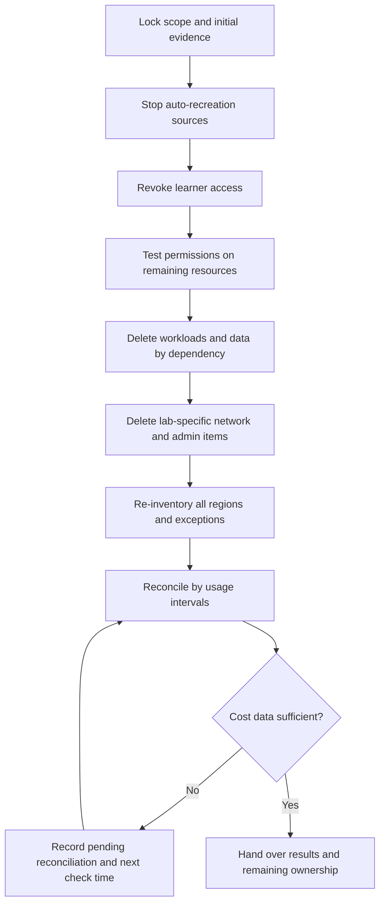

# Lab: Revoking Permissions, Deleting Resources, and Reconciling Costs

An Oracle Cloud Infrastructure (OCI) environment only completes its lab lifecycle when access permissions have been revoked within the proper scope, resources have been handled to a final state, and costs have been accounted for with usage data. Signing out of the Console, stopping a virtual machine, or seeing a flat cost chart is not enough to prove those three things.

This lab belongs to the **OCI Fundamentals Labs** chapter, focusing on the environment teardown phase across tenancy, compartments, IAM, VCN, Compute, storage, and Oracle database services. The workflow below is a recommended practice approach: learners apply it to the lab resources they own, record evidence, and clearly separate completed actions from items still awaiting system updates.

## 1. Objectives and Lab Prerequisites

After this lab, learners can:

- Build a resource inventory by OCID, compartment, region, and responsible owner.
- Revoke learner permissions and lab credentials while preserving the administrative path needed for cleanup.
- Delete resources in dependency order, monitor asynchronous operations, and detect leftover resources.
- Reconcile stop timestamps against usage intervals in cost reports, explaining delayed postings and items needing investigation.
- Hand over a lab closure report with clear evidence, exceptions, and follow-up owners.

### 1.1. Input environment

Use a dedicated lab compartment, such as `lab-oci-cleanup`, along with existing resources from earlier practice. The minimum scope consists of one Compute instance, its boot volume, a VCN, and a learner identity with instance read permission. If a lab block volume, Object Storage bucket, Load Balancer, or Autonomous Database already exists, include it in the inventory. There is no need to provision extra services solely to perform the cleanup lab.

You must identify:

| Component | Prerequisite before starting |
| --- | --- |
| Tenancy and compartment | Exact OCIDs; confirmed that this environment is authorized for teardown |
| Regions | List of every region the lab ever used, including regions holding replicas |
| Data | Classified which data can be destroyed and which must be retained |
| Learner identity | A test account or test identity, not the sole administrative account |
| Cleanup identity | Has permissions required to inventory, delete resources, and verify outcomes |
| Reconciler | Has appropriate permissions to view Billing & Cost Management data |
| Administrative path | Remains operational after removing learner rights and deleting the lab network |

Never issue delete commands on a resource solely because its display name contains `lab`. Names can collide or be reused; OCID, compartment, region, and verified ownership are the proper basis for selecting targets.

### 1.2. Three roles to distinguish

The **learner** is the subject whose access is being revoked. The **cleanup operator** acts using a separate identity to finish deleting resources. The **reconciler** checks costs and exceptions; in a small lab this may be the same person as the cleanup operator, yet the two evidence groups must still remain separate.

If the learner is also a tenancy administrator, use a separate test identity for the revocation test. Never strip the last administrative rights to simulate lab closure.

## 2. Define Outcomes and Timestamps

Create a tracking record across three independent axes:

| Axis | What must be proved | Insufficient evidence |
| --- | --- | --- |
| Access | The lab identity can no longer perform the revoked operations | Merely closing a tab or signing out |
| Resources | Every resource in the inventory is deleted or has a confirmed retention exception | Looking only at the Compute list in a single region |
| Cost | Incurred charges tie back to usage intervals and retained resources are explained | Looking only at monthly totals or forecasts |

Record timestamps in UTC using a format such as `2026-11-21T03:10:00Z`:

- `T_inventory`: lock the initial inventory and baseline cost data.
- `T_revoke`: final IAM or credential change for each access path.
- `T_access_verified`: completion of tests confirming permissions were revoked.
- `T_delete_requested`: deletion request submitted for each resource.
- `T_delete_completed`: service confirms the operation finished.
- `T_cost_checked`: query cost data for a defined usage window.

Do not lump every resource into a single deletion timestamp. An instance may terminate before its boot volume; a retained backup has a different lifecycle from the entire application environment.



## 3. Step 1 — Lock Inventory and Save Evidence

### 3.1. Teardown inventory

Populate an actual table before taking action. One row can represent a single resource; for larger counts, attach a detailed list to the closure record.

| Resource | Identifiers to record | Relationships to inspect | Decision |
| --- | --- | --- | --- |
| Compute instance | OCID, region, compartment | Boot volume, data volumes, VNICs, pools | Delete or keep with justification |
| Boot/block volume | OCID, availability domain | Attachments, backups, replication | Handle independently of instance |
| Object Storage bucket | Namespace, name, region, compartment | Object versions, PARs, replication, multipart uploads | Clean scope properly, then delete |
| Load Balancer | OCID, region | Backends, subnets, associated IPs | Delete if lab-only |
| Oracle database | OCID, service type, region | Backups, clones, replicas, shared apps | Follow service-specific lifecycle |
| VCN and subnets | OCID, region | VNICs, gateways, endpoints, routes | Delete after resources using the network |
| Lab IAM | Users/groups/policies/dynamic groups and scope | Inherited rights, other groups, credentials | Revoke by identity and effective permissions |
| Automation | Pipelines, stacks, schedules, pools | Which resources they might recreate | Stop before deleting workloads |
| Monitoring & logs | Log groups, alarms, notification channels | Where operational evidence must be kept | Keep or delete per retention rules |

Mark each item as `DELETE`, `KEEP`, or `SHARED`. For `KEEP`, record the owner, retention deadline, expected cost, and review date. For `SHARED`, confirm the lab detached its own associations without deleting shared resources.

Compartments span the tenancy and appear across subscribed regions. Therefore, an empty service page in the currently selected region does not prove a compartment has no remaining resources. [Oracle: Working with Compartments](https://docs.oracle.com/en-us/iaas/Content/Identity/compartments/Working_with_Compartments.htm).

Use Tenancy Explorer or search tools to assist discovery, then verify directly in each relevant service. Search results are bounded by supported resource types and visibility permissions; never treat an empty search result as sole proof.

### 3.2. Inventory via OCI CLI in PowerShell

The following commands are read-only. Replace all sample placeholders with real identifiers; profiles must already be configured for the corresponding identities. Never include private keys, auth tokens, or passwords in the closure record.

```powershell
$CleanupProfile = 'LAB_CLEANUP'
$StudentProfile = 'LAB_STUDENT'
$LabRegion = '<lab-region>'
$LabCompartmentId = '<lab-compartment-ocid>'
$LabInstanceId = '<instance-ocid-to-revoke>'
$LabAvailabilityDomain = '<actual-availability-domain-name>'

oci compute instance list --profile $CleanupProfile --region $LabRegion --compartment-id $LabCompartmentId --all
oci bv volume list --profile $CleanupProfile --region $LabRegion --compartment-id $LabCompartmentId --all
oci bv boot-volume list --profile $CleanupProfile --region $LabRegion --availability-domain $LabAvailabilityDomain --compartment-id $LabCompartmentId --all
oci network vcn list --profile $CleanupProfile --region $LabRegion --compartment-id $LabCompartmentId --all
```

Repeat inventory across every region the lab used and every availability domain associated with boot volumes. `--all` fetches all pages of the current query; it does not automatically scan all regions, child compartments, or availability domains.

If the lab has child compartments, include each child compartment in the audit scope. If resources were ever moved between compartments, record their OCIDs and current locations so nothing is missed in either cleanup or cost tracking.

### 3.3. Preserve evidence and data to retain

Save the inventory, required configs, permission test results, and initial cost snapshots in a location permitted to persist after lab deletion. Never store the sole copy inside an instance or bucket about to be destroyed.

Distinguish **operational evidence** from **application data backups**. A small inventory export may suffice as evidence; taking full volume backups extends storage obligations and incurs costs. Only create backups when data retention is required, verify readability or restore capability per that requirement, and record storage location and deletion date.

If non-lab data is present, halt deletion of the resource holding that data until the owner confirms how to handle it. Never move or delete shared data merely to make a checklist look clean.

## 4. Step 2 — Stop Sources That Can Recreate Resources

Check the following sources beforehand if the lab used any of them:

1. CI/CD pipelines, scheduled OCI CLI or SDK jobs, and automated deployment tasks.
2. Instance pools, autoscaling, application controllers, or service startup schedules.
3. Terraform and OCI Resource Manager: identify which stack/workspace owns the resources.
4. Backup, replication, or export jobs, or applications still writing into buckets.
5. Automation that can recreate IAM configurations, network resources, or databases.

With pools or controllers maintaining instance counts, deleting a single instance can trigger creation of a replacement. Address the controller and member resources within their proper ownership scope instead of repeatedly deleting symptoms.

Record the automation source name, stop timestamp, and how cessation was verified. Retain only the minimal credentials still needed by cleanup tooling; revoke them once tooling finishes. Such temporary retention must have an assigned owner and deadline so they never become orphaned credentials.

**Checkpoint:** no known source remains capable of auto-recreating lab resources; IaC state and administrative paths remain usable for deletion steps.

## 5. Step 3 — Revoke Permissions and Test Before Deleting Targets

### 5.1. Map effective permissions

List every path through which the learner can gain access:

| Access path | What to review |
| --- | --- |
| Console via identity domain or federation | Lab account, group memberships, groups synced by identity provider |
| CLI/SDK using API signing keys | Keys bound to user, profiles, and that user's IAM permissions |
| Auth tokens or customer secret keys | Credentials serving corresponding protocols or tools |
| Instance/resource principals | Dynamic groups, matching rules, policies, and running workloads |
| Object Storage PARs | Pre-Authenticated Requests created for lab buckets or objects |
| SSH and OS accounts | Keys installed on hosts, local users, open sessions |
| Databases and applications | Database users, wallets, passwords, secrets, or app tokens |

Revoking OCI IAM does not automatically delete Linux accounts or database users. Likewise, changing a Console password does not prove API keys, customer secret keys, or SSH paths have stopped working.

IAM grants permissions based on policies applicable to an identity. A user can receive the same permission through multiple groups or policies at the tenancy/parent-compartment level. Deleting a lab-specific policy only suffices when no other grant path remains. In particular, never alter shared admin policies or another team's group policies just to force one user's test to fail.

### 5.2. Capture baseline access evidence

Pick an existing lab instance on which the learner currently has `read` permission. Testing read permission proves revocation without creating extra resources.

```powershell
oci compute instance get --profile $StudentProfile --region $LabRegion --instance-id $LabInstanceId
$StudentBeforeExitCode = $LASTEXITCODE

oci compute instance get --profile $CleanupProfile --region $LabRegion --instance-id $LabInstanceId
$CleanupBeforeExitCode = $LASTEXITCODE
```

Record the actual identity of each profile, target OCID, region, timestamp, exit code, and result. Both reads must succeed before using them as a control baseline. If the learner was already denied from the start, the test cannot prove a change caused by this revocation.

### 5.3. Execute lab-scoped revocation

Perform these actions using an authorized administrator or cleanup operator identity:

1. Open the identity domain containing the learner. Remove the learner from groups granting lab permissions, or adjust the group-granting mechanism at the federated identity source.
2. Remove lab-only statements/policies once their purpose ends. For multi-statement policies, keep statements still serving others intact.
3. Audit permissions inherited from the tenancy, parent compartments, and other groups. If the test account is still an administrator, switch to an appropriate test identity for evaluation.
4. Revoke API keys, auth tokens, and customer secret keys created solely for the lab. Never copy secret values into screenshots or reports.
5. Handle temporary lab accounts and active sessions per the identity domain's or identity provider's administrative procedures. Do not delete personal accounts still used for other work.
6. Remove workload permissions via dynamic groups/policies after confirming those workloads no longer need permissions to export data or complete cleanup.
7. Revoke lab PARs; handle OS/database accounts and application secrets separately if the underlying resources are retained.

IAM changes propagate across regions, so retest in the target region after allowing time for changes to take effect. If tested too early, record the result and retest; never escalate user privileges to force past this step. [Oracle: Managing Policies](https://docs.oracle.com/en-us/iaas/Content/Identity/Tasks/managingpolicies.htm).

PARs must be inventoried separately: changing the creator's login credentials does not automatically invalidate existing PARs. Deleting a PAR revokes that access path; never save the full URL because the URL itself is a bearer access credential. [Oracle: Object Storage Pre-Authenticated Requests](https://docs.oracle.com/en-us/iaas/Content/Object/Tasks/usingpreauthenticatedrequests.htm).

### 5.4. Post-revocation verification test

Before terminating the instance, re-run the exact read test with both identities:

```powershell
oci compute instance get --profile $StudentProfile --region $LabRegion --instance-id $LabInstanceId
$StudentAfterExitCode = $LASTEXITCODE

oci compute instance get --profile $CleanupProfile --region $LabRegion --instance-id $LabInstanceId
$CleanupAfterExitCode = $LASTEXITCODE
```

Expected results:

| Check | Before revocation | After revocation |
| --- | --- | --- |
| Learner reads exact instance | Succeeds | Denied or fails authentication, depending on measures applied |
| Cleanup operator reads same instance | Succeeds | Still succeeds |
| Other lab access paths | Inventoried | Revoked and tested appropriately |

Distinguish authentication failures caused by a deleted key from authorization denials where the identity still authenticates but no longer holds read rights. To prove IAM removal independently, test with a still-valid credential after removing IAM grants, and only then revoke that credential.

Messages like `NotAuthorizedOrNotFound` may not distinguish missing permissions from a nonexistent resource. Conclude the revocation test passed only when the cleanup operator can still read the **exact same OCID in the same region** at verification time. Network errors, wrong profiles, wrong regions, or already-deleted resources do not prove IAM was properly revoked.

One failed read only proves that specific action against that target is blocked. Completing this step also requires checking all listed paths, including PARs and OS/database credentials if they belong to the lab scope.

## 6. Step 4 — Delete Resources in Dependency Order

Follow the `DELETE` inventory. Actual dependencies determine order; do not treat the table below as a mandatory list requiring all services to exist.

| Group | Order and checkpoints |
| --- | --- |
| Workloads | Stop traffic and controllers; handle Load Balancers, apps, Compute, or lab databases |
| Storage | Check attachments; handle volumes, backups, buckets, and replicas per data-retention decisions |
| Network | Wait for resources using subnets/VNICs to detach; delete lab-only network items by dependency |
| Dedicated admin | Handle policies, dynamic groups, alarms, stacks, and temp credentials after their tasks end |
| Compartment | Delete only if tasked with closing the compartment and all internal resources are cleared |

For every operation, record the OCID, request timestamp, final state, and any errors. An accepted API request does not mean deletion is finished; wait for the lifecycle state or work request per the service's mechanism.

### 6.1. Compute: explicitly choose the fate of each volume

In the Console, open the instance by OCID, click **Terminate**, and carefully read the boot/data volume handling options. Oracle notes the Console preserves the boot volume by default; therefore, explicitly choose whether to keep or delete it, then re-inventory storage afterward. [Oracle: Terminating an Instance](https://docs.oracle.com/en-us/iaas/Content/Compute/Tasks/terminatinginstance.htm).

The CLI example below deletes **one verified instance** along with its boot volume. Run it only when the boot volume holds no data that must be kept:

```powershell
oci compute instance get --profile $CleanupProfile --region $LabRegion --instance-id $LabInstanceId
if ($LASTEXITCODE -ne 0) {
    throw 'Instance not yet verified; stop before terminate command.'
}

$InstanceConfirmation = Read-Host 'Re-enter the instance OCID verified in the DELETE list'
if ($InstanceConfirmation -ne $LabInstanceId) {
    throw 'Confirmation OCID does not match; aborting operation.'
}

oci compute instance terminate --profile $CleanupProfile --region $LabRegion --instance-id $LabInstanceId --preserve-boot-volume false --preserve-data-volumes-created-at-launch true --wait-for-state SUCCEEDED
if ($LASTEXITCODE -ne 0) {
    throw 'Terminate command or wait step failed; check actual status.'
}

oci compute instance get --profile $CleanupProfile --region $LabRegion --instance-id $LabInstanceId
```

In the CLI version documented in the reference, `--wait-for-state SUCCEEDED` waits on the **work request**; `TERMINATED` is the **instance** state to verify afterward. The command preserves launch-attached data volumes so they can be handled explicitly in the next step. Check exact flags with `oci compute instance terminate --help` for your installed CLI version. [OCI CLI: compute instance terminate](https://docs.oracle.com/en-us/iaas/tools/oci-cli/latest/oci_cli_docs/cmdref/compute/instance/terminate.html).

If you need to keep the boot volume, set `--preserve-boot-volume true` and move it to the `KEEP` list. Never assume Console defaults match API/CLI defaults.

After instance termination completes:

- Cross-check boot volumes and block volumes against the inventory; confirm attachment states before separately deleting remaining volumes.
- Check boot/block volume backups, custom images if created during the lab, volume replicas, and copies in other regions.
- For data on local NVMe/ephemeral disks, finalize data preservation decisions before terminating; never assume they can be reattached like a block volume.
- Distinguish an instance record in `TERMINATED` state from a running instance. Do not repeat delete commands simply because the record still appears.

Stopping an instance is a temporary operational measure, not a completion state for this teardown lab. Storage resources and remaining services still require separate verification.

### 6.2. Object Storage: check multiple layers before deleting a bucket

Operate in the exact namespace, bucket, region, and compartment. Stop applications writing data first, then process inventoried components:

1. Delete lab PARs and check public access settings if the bucket is retained.
2. Handle replication according to source/destination relationships; add destination buckets to a separate inventory if lab-owned.
3. List objects and versions; permanently delete only the versions marked for destruction.
4. Check delete markers to confirm no hidden content remains outside standard listings.
5. Abort uncommitted lab multipart uploads.
6. Delete the bucket once all service preconditions are met.

In a versioned bucket, deleting an object without specifying a version ID may only insert a delete marker; older versions remain stored and must be handled separately. [Oracle: Object Storage Versioning](https://docs.oracle.com/en-us/iaas/Content/Object/Tasks/usingversioning.htm).

Troubleshoot bucket deletion failures by checking remaining objects/versions, PARs, replication policies, and uncommitted multipart uploads. [Oracle: Troubleshooting Object Storage Object Versioning](https://docs.oracle.com/en-us/iaas/Content/Object/Troubleshooting/usingversioning_topic-Troubleshooting_Versioning.htm).

In the Console's multipart uploads list, check the upload age filter; clear the default filter if needed to view recent uploads. [Oracle: Deleting a Multipart Upload](https://docs.oracle.com/en-us/iaas/Content/Object/Tasks/To_delete_uncommitted_multipart_uploads.htm).

If an active retention rule blocks deletion, identify the protected objects and retention expiration. Never attempt to bypass locked retention rules; record the exception and the person responsible for cleanup after the retention period ends. [Oracle: Object Storage Data Retention Rules](https://docs.oracle.com/en-us/iaas/Content/Object/Tasks/usingretentionrules.htm).

Do not enable retention locks just to test deletion errors in this lab. Likewise, do not enable versioning if the bucket does not already use it; handle only features already present in the environment.

### 6.3. Oracle database services, if present

Clearly identify whether the resource is Autonomous Database, Base Database Service, or another database service. Operation names, dependency links, and backup policies differ; never apply Compute termination steps blindly to all databases.

For the specific service in use:

- Confirm applications and users have stopped writing and data to keep has been handled.
- Review database users, wallets, and secrets if the database is kept or shared targets exist.
- Read the terminate/delete dialog carefully, recording choices on backups and recoverability; never guess whether backups are always deleted or always kept.
- Check clones, high-availability standbys, standalone backups, and exports to Object Storage if the lab created them.
- Wait for the service's terminal state; cross-check every retained component by real identifier.

If the lab has no database, record `not applicable`; do not spin up a database just to complete the checklist. If backups must be retained, the remaining backups constitute a managed exception and must not be reported as a zero-cost environment.

### 6.4. Network: release consumers first, VCN last

After handling workloads and related endpoints, check each subnet for remaining VNICs or service components. Continue handling Load Balancers, private endpoints, mount targets, or attachments if they appear in the actual inventory.

For lab-only resources, the usual sequence is:

1. Detach or delete resources consuming subnets and IP addresses.
2. Check reserved public IPs allocated by the lab; handle leftovers separately after workloads are gone.
3. Handle gateways, routes, and peering/connectivity links per Console/API dependency messages.
4. Delete subnets and custom network objects once no consumers remain.
5. Delete the VCN; allow the VCN deletion workflow to clean up default objects per service behavior.

Do not force-delete default objects one by one as if they were independent resources. If using a VCN deletion workflow that summarizes associated resources, review the entire scope before confirming. For shared VCNs/subnets, delete only authorized lab workloads and associations.

Keep administrative access working until tasks needing it are finished. For instance, if the CLI runs from a host inside the VCN about to be deleted, move to another active administrative point before deleting that network path.

### 6.5. Administrative components and compartment

Finish saving evidence before deleting log groups, export buckets, or the lab's CLI runner host. Retain logs and notifications needed to catch cleanup errors until technical closure; never delete tenancy-wide Audit configs or shared logging mechanisms to make the lab look tidy.

Clean up remaining policies, dynamic groups, and temporary credentials once certain no cleanup tasks still depend on them. Audit IAM objects outside the compartment that were created solely for the lab. For shared groups or policies, remove only lab-specific bindings within your granted authority.

Delete the compartment only if the lab goal includes doing so. Oracle requires internal resources—including policies attached to the compartment—to be handled first; deletion uses a work request and can fail. Verify the final outcome rather than merely watching the compartment vanish from a selector. [Oracle: Managing Compartments](https://docs.oracle.com/en-us/iaas/Content/Identity/Tasks/managingcompartments.htm).

Never use compartment deletion as a cascading delete shortcut in place of inventorying. If keeping the compartment for cost tracking or further study, document that decision; an empty compartment and closing a tenancy are two separate matters.

## 7. Branch for Terraform or OCI Resource Manager

Apply this section when lab resources are managed by IaC. Choose a controlled cleanup path that preserves resource traceability:

1. Stop scheduled `apply` runs and pipelines that could redeploy.
2. Verify workspace/stack, tenancy, provider region, and state match the lab.
3. Store state per security policy since state can hold sensitive data.
4. Inspect the destroy plan or change summary provided by the tool; cross-check the delete list against the manifest.
5. Execute destroy using credentials with sufficient permissions, monitoring job status and any dependency errors.
6. Re-inventory via OCI to catch manually created resources, out-of-state resources, or resources retained by configuration.
7. Delete the stack/state backend or revoke cleanup credentials only after no unhandled resources need them.

A successful destroy job confirms only the scope actually managed by that tool. Never use that result to conclude all out-of-state backups, objects, credentials, or costs are gone.

If destroy fails partially, record what succeeded and what remains. Fix the underlying permission, dependency, or data-protection issue; never delete state to hide unhandled resources.

## 8. Step 5 — Re-Inventory and Confirm Technical Closure

Use an identity with full visibility across the lab scope to re-check the exact same compartment × region × resource-type matrix from step 1. For boot volumes, check every relevant availability domain as well. Querying resources with a revoked identity proves nothing about whether the environment is clean.

Cross-check every row in the manifest:

| Recorded status | Interpretation and action |
| --- | --- |
| Deleted | Terminal state or service evidence captured along with completion timestamp |
| Deleting | Still pending; keep monitoring, do not mark complete |
| Delete failed | Record error, dependency links, and assigned owner |
| Retained | Has justification, owner, expiration date, and cost responsibility |
| Shared | Confirm lab associations were removed; leave shared resource intact |
| Not visible | Recheck permissions, region, compartment, and tooling before concluding |

Perform one more verification pass after automation sources stop to catch recreated resources. If a new OCID appears, trace its source via Audit, pipelines, pools, or application accounts; update the inventory instead of blindly deleting the new item and closing out.

Technical closure passes when no `DELETE` resource remains active or stuck deleting, lab permissions are proven revoked, and exceptions have assigned owners. Cost data may still be pending; record both statuses clearly in the report.

## 9. Step 6 — Reconcile Costs by Usage Time

### 9.1. Capture before and after data with the same scope

In Billing & Cost Management, open Cost Analysis with an appropriately authorized identity. Record filters and display settings so queries can be reproduced:

- Time window and timezone; use UTC consistently with operational timestamps.
- Compartment, child-compartment scope, and regions evaluated.
- Service, resource OCID where supported by data, and cost-tracking tags if present.
- Granularity (hourly or daily) provided by the report.
- Metric type: usage, posted cost, or forecast; currency and how credits/discounts are handled if shown.

Capture the first snapshot covering from lab start through inventory, then capture again for a window extending past deletion completion. You can group by service to locate cost drivers, then drill down to resource and usage interval where data supports it.

Cost Analysis has latency and includes forecasts; never treat near-present forecast numbers as confirmed actual usage. [Oracle: Cost Analysis](https://docs.oracle.com/en-us/iaas/Content/Billing/Concepts/costanalysisoverview.htm).

If the compartment was deleted and no longer appears in familiar filters, use a broader authorized reporting scope together with the saved compartment OCID to query historical data. Never recreate a compartment with the same name expecting historical data to attach to the new object.

### 9.2. Distinguish usage time from report appearance time

Use **Cost Reports** to investigate line-item detail when summary charts do not explain discrepancies. Pick one report format and record the schema in use; never mix OCI legacy format columns directly with FOCUS columns. Oracle notes data can arrive up to 24 hours late, so inspect the row's usage interval rather than just the report download time. [Oracle: Cost Reports](https://docs.oracle.com/en-us/iaas/Content/Billing/Concepts/costusagereportsoverview.htm).

A recommended check schedule for labs is once at technical closure and once after data has cleared published reporting latency. If data is still missing or late adjustments appear, mark `pending reconciliation` and schedule the next check; do not treat pending time as a finalized invoice guarantee.

Timestamps to compare for any questionable row:

| Timestamp | Meaning |
| --- | --- |
| Usage interval start/end | Window during which the service recorded usage |
| Resource deletion completion | Operational milestone used for cross-checking |
| Report generation/download | Time when data became visible to the reviewer |
| Billing period | Accounting reconciliation frame; may include separate credits or adjustments |

A row appearing after deletion whose usage interval falls before deletion does not prove the resource is still running. If a usage interval straddles the deletion timestamp, inspect granularity, service metering rules, and any retained components before concluding.

### 9.3. Hypothetical data example

Suppose an instance finishes terminating at `10:00Z`; a retained boot volume is deleted at `10:30Z`. A report downloaded at `16:00Z` shows the following lines. USD figures are strictly for reading practice, not an OCI price list.

| Component | Usage interval | Hypothetical cost | Initial assessment |
| --- | --- | ---: | --- |
| Instance Compute | 09:00–10:00Z | 0.060 | Consistent with usage before termination |
| Boot volume | 10:00–11:00Z | 0.004 | Metering interval straddles deletion; check metering rules rather than assuming full-hour runtime |
| Retained volume backup | 11:00–12:00Z | 0.001 | Consistent with backup retention exception if OCID matches |
| Lab NAT Gateway | 12:00–13:00Z | 0.010 | Interval after workloads were deleted; inspect gateway and network retention decisions |

The sum of rows is `0.075 USD`. Summing like this is valid only when metric type and currency match, with no duplicate rows or separate adjustment entries. Never divide cost by hours to reverse-engineer price lists from this example.

Expected totals can be grouped conceptually as:

```text
Lab cost to explain
= usage before closure
+ usage while deletion was completing
+ charges from intentionally retained resources
+ valid billing-period adjustments
```

An unexplained discrepancy is an item to investigate, not automatically a billing error. Cross-check OCID, region, usage interval, unit of measure, and dependent resources one by one.

### 9.4. Commonly missed items

Use the checklist below as audit questions rather than assuming every item incurs fees in every tenancy:

- Boot/block volumes, volume backups, custom images, or replicas left behind after Compute.
- Object versions, multipart uploads, bucket replicas, and retained log storage.
- Load Balancers, gateways, public IPs, or network components billed under active service terms.
- Database backups, clones, or replicas excluded from the primary delete operation.
- Outbound data transfer, requests, minimum storage durations, or adjustments tied to actual storage tiers.
- Resources in other regions, child compartments, or compartments moved earlier.
- Un-tagged charges or shared infrastructure costs requiring separate allocation rules.

Even if resources carry Free Tier or Always Free labels, still inventory and reconcile them against actual account eligibility. Zero total cost can coincide with non-zero usage or offsetting credits; it does not prove no resources remain.

Budgets alert on spend thresholds and do not automatically stop all usage when exceeded. Keep necessary alerts active while awaiting reconciliation and review them after handoff. [Oracle: Track and Manage Usage and Cost](https://docs.oracle.com/en/solutions/oci-best-practices/track-and-manage-usage-and-cost1.html).

### 9.5. Reconciliation completion criteria

Mark cost reconciliation complete when:

1. Data for the target usage window is complete enough for analysis given reporting latency and granted scope.
2. Every lab charge maps to an explainable resource, service, or allocation rule.
3. Post-deletion charges are classified as delayed usage posting, straddling metering interval, retained resource, adjustment, or actionable issue.
4. Retained resources have clear cost estimates and monitoring owners.
5. No unexplained discrepancies remain; if any remain, status explicitly reflects pending or under investigation.

Monthly total cost does not need to drop to 0 because historical charges remain. The goal is zero unintended ongoing usage and full accountability for charges across the lab lifecycle. This operational reconciliation does not replace the end-of-period invoice.

## 10. Troubleshooting Common Issues

| Symptom | Root causes to check | Resolution within lab scope |
| --- | --- | --- |
| Learner can still read instance | Other groups, inherited policies, active CLI profile, IAM propagation lag | Verify identity and all grant paths, then retest the exact OCID |
| Both profiles fail to read | Wrong region/OCID, network error, resource already deleted, or cleanup operator lost rights | Restore the control check before concluding revocation succeeded |
| Credential errors yet Console still has access | Only one API key revoked; group membership or another session remains | Inventory and revoke every individual access path |
| New instance appears after deletion | Pool, deployment schedule, pipeline, or controller still active | Stop the recreation source, record the new OCID, and re-inventory |
| Subnet/VCN refuses deletion | Remaining VNICs, endpoints, gateways, or other dependencies | Read service error, locate owner, and resolve dependencies first |
| Bucket looks empty yet deletion fails | Versions, delete markers, PARs, replication, or multipart uploads | Surface all components and handle each type properly |
| Object cannot delete due to retention | Data remains protected under an active retention rule | Record exception and valid expiration date; never try to bypass locked rules |
| Compartment refuses deletion | Remaining resources, policies, child compartments, or missing visibility | Inspect full scope with an authorized identity and check work request |
| Costs keep rising after termination | Retained volumes/backups, network services, replicas, or delayed usage | Compare OCIDs and usage intervals against deletion completion timestamps |
| Destroy reports partial failure | Missing permissions, dependencies, data protection, or state mismatch | Keep state, fix the exact error, and clean up remaining items |

If evidence is missing, state clearly what remains unverified and the next verification step. Never grant tenancy-wide permissions to learners or strip all data protections solely to speed up cleanup.

## 11. Handover Report and Completion Criteria

The end-of-lab report should follow this structure; this is a template for learners to fill with actual observed results:

```text
Tenancy / compartment OCID:
Regions and child compartments checked:
Cleanup operator / reconciler:
Lab timeframe (UTC):

Access:
- Lab identities and access paths reviewed:
- IAM / credential changes performed:
- Before and after tests, target OCID, timestamps, control results:

Resources:
- DELETE list and final state per resource:
- Relevant work requests or request IDs:
- KEEP / SHARED resources, owners, review deadlines, and cost responsibility:
- Re-inventory results, stopped automation sources:

Cost:
- Filters, usage window, metric type, and currency:
- Data pull timestamp, report format:
- Explained total, discrepancies, and causes:
- Items awaiting data / next check time / responsible owner:

Conclusion:
- Access revocation: pass / fail.
- Technical closure: complete / with exceptions / incomplete.
- Cost reconciliation: reconciled / pending data / needs investigation.
- Evidence storage location and handover recipient:
```

Mask credentials, PAR URLs, secret contents, and sensitive data in all exports or screenshots. Store request IDs and investigative identifiers in an authorized location; never include private keys or tokens in reports.

The lab is complete when all three axes have evidence-backed conclusions and retained items have named owners. If resources are deleted while cost data is not yet complete, report the exact status **technical closure complete, pending cost reconciliation** with a scheduled follow-up check; never mark the entire lifecycle closed merely to end the session.
