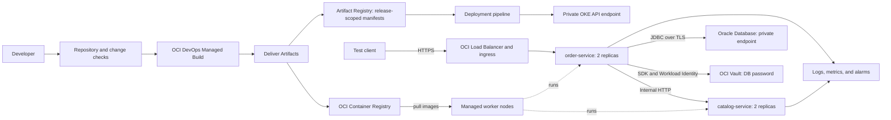

# Microservices Project on OKE with CI/CD and OCI Vault

## 1. Problem Statement and Expected Outcomes

You are responsible for deploying a small order-processing application on Oracle Cloud Infrastructure (OCI). The application must run on Oracle Kubernetes Engine (OKE), release from source code via CI/CD, retrieve database passwords from OCI Vault, and provide evidence of recovery from faulty deployments.

This lab belongs to the **Capstone Projects and Assessment** chapter of the Oracle Cloud Infrastructure module. The final deliverables must demonstrate the connection between tenancy, compartment, IAM, VCN, Compute running worker nodes, Container Registry, Vault, Oracle Database, monitoring, and cost control. A Pod reaching the `Running` state is only part of the result.

After completing the project, learners should be able to:

- Design and deploy two microservices with clear functional boundaries.
- Distinguish operator, pipeline, node, and application identities.
- Release container images with versions traceable from commit to Pod.
- Read secrets using OKE Workload Identity without putting passwords into Git or images.
- Verify persistent storage, idempotency, rollout, rollback, and secret rotation.
- Explain costs, availability limitations, and resource teardown steps.

The code snippets in this guide serve as the project's implementation skeleton. Learners create their own application repository to complete the business logic and IaC according to the contracts below. Strings like `<...>` and `${...}` are placeholders or pipeline parameters; do not leave them unexpanded at deployment time. Example shell commands use Bash on an administrative workstation or Linux build environment configured with OCI CLI and kubectl.

## 2. Functional Scope and Success Criteria

### 2.1. Two Services and One Durable Data Store

| Component | Responsibility | Data and Permissions |
| --- | --- | --- |
| `catalog-service` | Return product details and current pricing | Sample catalog packaged with the application version; no secrets |
| `order-service` | Validate products, calculate totals, create and look up orders | Writes data via `ORDER_APP` account; permitted to read only that account's password secret |
| Oracle Database | Store orders, idempotency keys, and reconciliation data | Private endpoint; no direct Internet client access allowed |

A static catalog keeps the focus on OKE, CI/CD, and Vault. Keeping order data in Pod memory does not satisfy the project: two replicas must observe the same orders, and replacing Pods must not lose committed orders.

Select an Oracle Database service suited to your account and region, such as Autonomous Database with a private endpoint. The application account has privileges only on the required schema. The project uses JDBC over TLS with hostname verification and trust chain validation. If your database configuration supports walletless TLS connections, use the corresponding connection string from the Console. If the configuration requires mTLS/wallet, you must also implement wallet distribution and rotation; do not assume a password alone suffices.

### 2.2. API Contract

| API | Required Behavior |
| --- | --- |
| `GET /api/products/P100` on catalog | Return sample product, decimal price, and currency |
| `POST /api/orders` on order | Accept product, quantity, and `Idempotency-Key` header; fetch price from catalog server-side |
| `GET /api/orders/{id}` on order | Read persisted order from the database |
| `GET /health/live` | Check whether the process can continue running |
| `GET /health/ready` | Check whether the Pod is eligible to serve traffic |
| `GET /version` | Return running commit or release ID, without exposing sensitive configuration |

Example request:

```http
POST /api/orders HTTP/1.1
Content-Type: application/json
Idempotency-Key: demo-order-001

{"productId":"P100","quantity":2}
```

Lab conventions:

- Initial creation returns `201`, an `orderId`, and a server-calculated total amount.
- Same key and same payload return `200` with the same persisted order body.
- Same key with a different payload returns `409`.
- Non-existent product returns `404`; invalid quantity returns `400`.
- If catalog fails to respond within the allowed timeout, order returns a controlled dependency error such as `503`; never record a fake successful order.
- Prices are processed using `BigDecimal` or an equivalent decimal type; never use `double` for monetary calculations.

Key uniqueness must be enforced by the database. Checking the key in memory before inserting will not prevent two replicas from concurrently processing the same request.

A starter schema:

```sql
CREATE TABLE orders (
    order_id        VARCHAR2(36) PRIMARY KEY,
    idempotency_key  VARCHAR2(128) NOT NULL,
    payload_hash    CHAR(64) NOT NULL,
    product_id      VARCHAR2(64) NOT NULL,
    quantity        NUMBER(10) NOT NULL,
    unit_price      NUMBER(12, 2) NOT NULL,
    total_amount    NUMBER(14, 2) NOT NULL,
    currency        CHAR(3) NOT NULL,
    created_at      TIMESTAMP WITH TIME ZONE DEFAULT SYSTIMESTAMP NOT NULL,
    CONSTRAINT uq_orders_idempotency UNIQUE (idempotency_key),
    CONSTRAINT ck_orders_quantity CHECK (quantity > 0)
);
```

`payload_hash` is the hash of canonicalized business fields, not an arbitrary hash over JSON with non-deterministic field ordering. When an insert hits a unique constraint conflict, read the existing row and compare hashes. Only return success after the transaction has committed.

In multi-tenant systems, keys must be scoped by authenticated customer identity. This project uses a single test business tenant and mock data. Test endpoints must be exposed only to authorized sources; before offering a public service, add user authentication and order-ownership checks.

### 2.3. Lab Measurement Targets

| Criterion | Lab Target | How to Prove |
| --- | --- | --- |
| Release | Valid commit builds images and deploys to dev via pipeline | Build run, artifacts, deployment run, and Pod versions match |
| Durability | Replacing all application Pods loses zero committed orders | Create order, replace Pods, read back the same `orderId` |
| Performance | 20 requests/second for 10 minutes, p95 under 500 ms, error rate under 1% | Report with workload, sample size, DB config, and resources |
| Rollout readiness | Zero window with all backends non-ready | Monitor EndpointSlices/Pods and continuous call results |
| Faulty release recovery | Restore good release within 10 minutes of detection | Timeline of the drill |
| Authorization | Catalog cannot read order's secret | Negative test results and corresponding OCI audit trail |

These are lab evaluation thresholds, not default OCI SLAs. If not met, report actual measurements and root causes. Recovering data after a database failure is a separate problem from application rollback; only state data RPO/RTO after conducting an appropriate backup/restore test.

## 3. Reference Architecture



The release flow and the application runtime flow must be examined independently:

1. The build pipeline reads source code, runs tests, and builds two images.
2. Deliver Artifacts pushes the images and manifests to artifact repositories.
3. The deployment pipeline retrieves the exact manifest version to update OKE.
4. Kubelet on worker nodes pulls images using the configured registry authentication mechanism.
5. The order application uses its Pod service account to fetch the secret from Vault.
6. Order uses that password to connect to the database over the private network.

Image push permissions do not grant permission to read database passwords. Pod secret-read permissions do not automatically grant image pull permissions before a container starts.

### 3.1. Compartment and Environment Layout

An easily governable layout in the lab:

| Compartment | Resources Contained |
| --- | --- |
| `capstone-cicd` | DevOps project, repository, build/deployment pipelines, OCIR repositories, Artifact Registry |
| `capstone-dev` | VCN, OKE Enhanced cluster, node pool, Load Balancer, Vault, secrets, and dev DB |

Place the cluster and runtime secret in the same `capstone-dev` compartment in the main track of this guide. If placing target resources in different compartments, also verify OKE workload mapping requirements and related IAM rules; do not simply change compartment names in policies.

An extended setup can use `capstone-stage` and `capstone-prod` with separate clusters, DBs, and secrets. Two namespaces on one cluster are useful for saving learning costs, but are not equivalent to separate clusters for two trust domains. Do not label a lab with a shared DB as "production" while ignoring this boundary.

### 3.2. Network Decisions

- Use an OKE Enhanced cluster with a managed node pool. Worker nodes have no public IPs.
- Place the Kubernetes API endpoint in a private subnet; administrators connect via VPN or an approved administrative path.
- The OCI DevOps deployment environment must have private connectivity to the API endpoint; valid IAM without a network route will still fail to deploy.
- Allocate appropriate subnets for the Load Balancer, nodes, Pods if required by the CNI mode, and the DB private endpoint.
- Configure routes, DNS, NSGs, and OKE control-plane flows according to the chosen networking mode.
- Use Service Gateway for supported OCI services; other destinations require NAT Gateway or an egress proxy by design. Do not treat Service Gateway as an outbound route for every API.
- Explicitly verify paths to the registry, Secrets endpoint, workload authentication endpoint, and dependent hosts. Simply opening TCP 443 without DNS or routes will still fail.

| Application Flow | Allowed From | Destination and Purpose |
| --- | --- | --- |
| External HTTPS | Evaluator/tester CIDR | Load Balancer listener 443 |
| Ingress to order | Identified ingress controller Pods | Order port 8080 |
| Order to catalog | Pods labeled `app: order-service` | Catalog port 8080 |
| Order to DB | Actual Pod or node network source per CNI | TCPS port in connection string |
| Pod to DNS | Application Pods | Cluster resolver, UDP/TCP 53 when egress policies apply |
| Order to OCI | Permitted egress path | HTTPS to endpoints needed for Vault and authentication |

This table describes application flows and does not replace all OKE networking requirements. NSGs control OCI network resources; Kubernetes NetworkPolicies control Pod traffic when enforced by the CNI. The two mechanisms do not replace each other.

## 4. Preparing Infrastructure and Repository

### 4.1. Inputs to Record

Before building, prepare a configuration table containing no secrets:

| Variable | Format Example | Meaning |
| --- | --- | --- |
| `OCI_REGION` | `<region-id>` | Project region |
| `REGISTRY` | `<region-key>.ocir.io` | Region-specific registry host |
| `OCIR_NAMESPACE` | `<object-storage-namespace>` | Tenancy namespace; do not assume it equals tenancy name |
| `CLUSTER_OCID` | `ocid1.cluster...` | Target Enhanced cluster |
| `ORDER_DB_SECRET_OCID` | `ocid1.vaultsecret...` | Secret identifier, not the secret value |
| `DB_URL` | Verified TCPS connection string | DB address and TLS settings |
| `DB_USERNAME` | `ORDER_APP` | Least-privilege application account |
| `RUNTIME_IMAGE` | `<approved-jre21-image>@sha256:<digest>` | Chosen and digest-pinned base image |

Record versions of Kubernetes, kubectl, OCI CLI, Java, Maven, OCI SDK, CNI, ingress controller, and CPU architecture. Use versions supported in your region and pin them in project configuration. An image built for `amd64` will not natively run on `arm64` nodes.

### 4.2. Infrastructure Provisioning Order

1. Create compartments, operator groups, and alert budgets.
2. Provision VCN, subnets, route tables, gateways, NSGs, and required DNS.
3. Create the OKE Enhanced cluster, a node pool with at least two nodes, and verify the administrative path.
4. Create the DB private endpoint, schema, application privileges, and initial migration.
5. Create the Vault, encryption key, and password secret; grant runtime access in the next section.
6. Create private OCIR repositories, Artifact Registry, and the DevOps project.
7. Create the deployment environment connecting to the private OKE endpoint.
8. Bootstrap the namespace, service accounts, image pull secret, ingress, and TLS.
9. Run the initial pipeline and perform acceptance testing.

Describe infrastructure with Terraform or OCI Resource Manager for reproducibility. Separate broad-privilege infrastructure changes from the application release pipeline. If using Terraform to create secrets or DB passwords, evaluate whether sensitive values appear in state; marking outputs `sensitive` only masks display and does not remove values stored in state.

An application repository structure:

```text
.
├── pom.xml
├── mvnw
├── .mvn/
├── catalog-service/
│   ├── pom.xml
│   ├── Dockerfile
│   └── src/
├── order-service/
│   ├── pom.xml
│   ├── Dockerfile
│   └── src/
├── database/
│   └── migrations/
├── deploy/
│   └── workloads.yaml
├── tests/
│   └── smoke.sh
└── build_spec.yaml
```

Each module produces `target/app.jar` via `finalName` configuration. Run unit and integration tests during the `verify` lifecycle; configure Surefire/Failsafe so business and transaction tests actually execute. In CI, use mock credentials or an isolated test DB; the build pipeline does not need the runtime DB password.

## 5. Identity and Authorization Design

### 5.1. Permissions Matrix

| Identity | Required Permissions | Limitation to Verify |
| --- | --- | --- |
| Infrastructure builder | Create networking, OKE, DB, and configure IAM within assigned scope | Personal credentials of this user are never used inside containers |
| Build pipeline | Read source, write images/artifacts, trigger deployments as configured | Cannot read application DB secrets |
| Deployment pipeline | Read artifacts and deploy to target cluster/environment | Does not receive tenancy-wide admin rights |
| Node/kubelet | Pull private images via chosen mechanism | Not granted DB secret read access just to pull images |
| `order-sa` | Read bundle of its specific DB secret | Cannot manage Vault or update secrets |
| `catalog-sa` | No Vault access needed | Cannot read order's secret |
| Release team | Approve or trigger releases per role | Audit log tracks actor and approved release |

OCI IAM governs access to OCI resources. Kubernetes RBAC governs actions against the Kubernetes API. An application service account does not need Kubernetes `get secrets` permission just to call the OCI Secrets API.

Anyone with permission to create or edit Pods to use `order-sa` can launch a workload carrying order's identity. Therefore, restricting workload modification, Pod exec, and pipeline edits is part of the secret protection boundary.

### 5.2. Runtime with OKE Workload Identity

The primary track uses **Enhanced cluster** Workload Identity. Identity is bound to cluster, namespace, and service account; no dynamic group is created for workload identity. The application uses an OCI SDK version supporting this mechanism. The Java SDK 3.x line requires at least version 3.88.0 per Oracle documentation; pin a consistent version across all OCI dependencies. See [Granting Workloads Access to OCI Resources](https://docs.oracle.com/en-us/iaas/Content/ContEng/Tasks/contenggrantingworkloadaccesstoresources.htm).

Sample policy scoped to the exact workload and exact secret:

```text
Allow any-user to read secret-bundles in compartment capstone-dev where all {
  request.principal.type = 'workload',
  request.principal.cluster_id = '<CLUSTER_OCID>',
  request.principal.namespace = 'capstone-dev',
  request.principal.service_account = 'order-sa',
  target.secret.id = '<ORDER_DB_SECRET_OCID>'
}
```

The conditions after `where all` are mandatory in this design. `any-user` does not allow everyone to read the secret while all identity conditions remain enforced.

`read secret-bundles` retrieves the secret payload. Do not substitute `manage secret-family` for convenience. The `target.secret.id` variable restricts access by secret OCID; see [IAM Policy Reference for Vault and Secret Management](https://docs.oracle.com/en-us/iaas/Content/Identity/policyreference/keypolicyreference.htm).

Secret creators' operations on Vault and encryption keys belong to a separate role. Do not grant key-decryption or Vault-management permissions to the application when all it needs is fetching a secret bundle via the Secrets API.

### 5.3. Pipelines Using Resource Principals

Create two separate dynamic groups matching the exact pipeline resources rather than grouping all resources in the tenancy:

```text
ALL {
  resource.type = 'devopsbuildpipeline',
  resource.id = '<BUILD_PIPELINE_OCID>'
}
```

```text
ALL {
  resource.type = 'devopsdeploypipeline',
  resource.id = '<DEPLOY_PIPELINE_OCID>'
}
```

Starter policies in the CI/CD compartment may require repository/artifact write and DevOps operations. The deployment side requires artifact read and appropriate OKE permissions. Oracle publishes examples such as the following; replace dynamic group names with your actual configuration:

```text
Allow dynamic-group CapstoneBuild to manage repos in compartment capstone-cicd
Allow dynamic-group CapstoneBuild to manage generic-artifacts in compartment capstone-cicd
Allow dynamic-group CapstoneBuild to manage devops-family in compartment capstone-cicd

Allow dynamic-group CapstoneDeploy to read all-artifacts in compartment capstone-cicd
Allow dynamic-group CapstoneDeploy to manage cluster in compartment capstone-dev
```

This is a compartment-scoped lab starting point, not least privilege for every organization. Add the networking permissions needed by the private environment via the infrastructure setup role, then tighten pipeline permissions to actual operations and resources. With identity domains, use domain-qualified group names. Cross-check [OCI DevOps IAM Policies](https://docs.oracle.com/en-us/iaas/Content/devops/using/devops_iampolicies.htm).

Do not assume a namespaced RoleBinding restricts every privilege of a principal that already holds broad OKE permissions. Verify effective permissions of the deployment identity, especially on shared clusters. Cluster bootstrap admin accounts must never be reused as runtime identities.

## 6. Reading the Password from OCI Vault in the Java Application

### 6.1. Organizing the Secret

Create secret `order-db-password` containing the password of account `ORDER_APP`. Place only the secret OCID, username, and passwordless connection string in deployment configuration.

Distinguish three types of data:

| Data | Storage Location in Design |
| --- | --- |
| DB hostname, service name, username, secret OCID | ConfigMap or deployment parameters |
| DB password | OCI Vault |
| Credentials for pulling private images | Separate registry bootstrap flow in Section 7 |

The returned secret bundle content is Base64-encoded. Base64 is a representation encoding, not security encryption. The SDK fetches the authorized bundle and the application decodes the representation in memory. See [SecretsClient](https://docs.oracle.com/en-us/iaas/tools/java/latest/com/oracle/bmc/secrets/SecretsClient.html) and [Base64SecretBundleContentDetails](https://docs.oracle.com/en-us/iaas/tools/java/latest/com/oracle/bmc/secrets/model/Base64SecretBundleContentDetails.html).

### 6.2. Dependencies and DataSource Configuration

With Spring Boot, use JDBC, Actuator, and an Oracle JDBC driver compatible with your Java/DB version. Pin OCI SDK dependencies together, for example using an `oci.sdk.version` property with a 3.x version verified to support Workload Identity. Declare these artifacts with matching versions:

```xml
<dependency>
    <groupId>com.oracle.oci.sdk</groupId>
    <artifactId>oci-java-sdk-addons-oke-workload-identity</artifactId>
    <version>${oci.sdk.version}</version>
</dependency>
<dependency>
    <groupId>com.oracle.oci.sdk</groupId>
    <artifactId>oci-java-sdk-secrets</artifactId>
    <version>${oci.sdk.version}</version>
</dependency>
<dependency>
    <groupId>com.oracle.oci.sdk</groupId>
    <artifactId>oci-java-sdk-common-httpclient-jersey3</artifactId>
    <version>${oci.sdk.version}</version>
</dependency>
```

The configuration below reads the secret at startup. Imports and beans are shown in full to trace the credential path:

```java
import com.oracle.bmc.auth.okeworkloadidentity
        .OkeWorkloadIdentityAuthenticationDetailsProvider;
import com.oracle.bmc.secrets.SecretsClient;
import com.oracle.bmc.secrets.model.Base64SecretBundleContentDetails;
import com.oracle.bmc.secrets.requests.GetSecretBundleRequest;
import com.zaxxer.hikari.HikariDataSource;
import org.springframework.context.annotation.Bean;
import org.springframework.context.annotation.Configuration;

import java.nio.charset.StandardCharsets;
import java.util.Arrays;
import java.util.Base64;

@Configuration
public class OrderDatabaseConfiguration {

    @Bean
    OkeWorkloadIdentityAuthenticationDetailsProvider workloadIdentity() {
        return new OkeWorkloadIdentityAuthenticationDetailsProvider
                .OkeWorkloadIdentityAuthenticationDetailsProviderBuilder()
                .build();
    }

    @Bean(destroyMethod = "close")
    SecretsClient secretsClient(
            OkeWorkloadIdentityAuthenticationDetailsProvider identity) {
        return SecretsClient.builder()
                .region(required("OCI_REGION"))
                .build(identity);
    }

    @Bean(destroyMethod = "close")
    HikariDataSource dataSource(SecretsClient secrets) {
        var response = secrets.getSecretBundle(
                GetSecretBundleRequest.builder()
                        .secretId(required("ORDER_DB_SECRET_OCID"))
                        .stage(GetSecretBundleRequest.Stage.Current)
                        .build());

        var content = response.getSecretBundle().getSecretBundleContent();
        if (!(content instanceof Base64SecretBundleContentDetails encoded)) {
            throw new IllegalStateException("Unsupported secret content type");
        }

        byte[] password = Base64.getDecoder().decode(encoded.getContent());
        try {
            var pool = new HikariDataSource();
            pool.setJdbcUrl(required("DB_URL"));
            pool.setUsername(required("DB_USERNAME"));
            pool.setPassword(new String(password, StandardCharsets.UTF_8));
            pool.setMaximumPoolSize(5);
            pool.setMinimumIdle(1);
            pool.setConnectionTimeout(3000);
            pool.setInitializationFailTimeout(10000);
            return pool;
        } finally {
            Arrays.fill(password, (byte) 0);
        }
    }

    private static String required(String name) {
        String value = System.getenv(name);
        if (value == null || value.isBlank()) {
            throw new IllegalStateException("Missing configuration: " + name);
        }
        return value;
    }
}
```

Use a single provider and client reused across the application lifecycle. Never construct a provider per order request. The code does not log the secret response and does not pass the password via Pod environment variables. The byte array is zeroed after use, though `String` and connection libraries may still retain credentials in the heap; do not describe this step as guaranteeing complete erasure of every copy in memory.

This starter reads `CURRENT` once when creating the DataSource. Updating Vault does not automatically replace the password inside a running connection pool. The lab handles rotation with a rolling restart after verifying the new credential.

### 6.3. Health Endpoints and Behavior When Dependencies Fail

Map Actuator to the project's endpoint contract, for example on order:

```yaml
server:
  shutdown: graceful

spring:
  lifecycle:
    timeout-per-shutdown-phase: 20s

management:
  endpoints:
    web:
      base-path: /
      exposure:
        include: health
  endpoint:
    health:
      probes:
        enabled: true
      show-details: never
      group:
        live:
          include: livenessState
        ready:
          include: readinessState,db
```

For catalog, the `ready` group only needs `readinessState` because it has no DataSource. Both `/health/live` and `/health/ready` must return proper HTTP status codes before applying the manifests below.

Do not probe Vault on every health check once the application holds a valid credential. Liveness checks process health; readiness can reflect order's ability to use the DB. When catalog fails, order returns a controlled error for catalog-dependent APIs rather than causing all order Pods to restart continuously.

A startup probe gives the Java application time to boot; a failed readiness probe removes the Pod from ready endpoints, whereas a failed liveness probe can cause the container to restart. See [Configure Liveness, Readiness and Startup Probes](https://kubernetes.io/docs/tasks/configure-pod-container/configure-liveness-readiness-startup-probes/).

## 7. Kubernetes Bootstrap and Image Pull Credentials

### 7.1. Namespace and Service Accounts

Foundational resources are bootstrapped by an administrator ahead of the application pipeline:

```yaml
apiVersion: v1
kind: Namespace
metadata:
  name: capstone-dev
  labels:
    pod-security.kubernetes.io/enforce: restricted
---
apiVersion: v1
kind: ServiceAccount
metadata:
  name: order-sa
  namespace: capstone-dev
automountServiceAccountToken: true
---
apiVersion: v1
kind: ServiceAccount
metadata:
  name: catalog-sa
  namespace: capstone-dev
automountServiceAccountToken: false
```

Order needs a service account token for Workload Identity. Catalog does not need a token in the application. Order's token must stay inside the Pod; never print the token for a "quick check".

### 7.2. Image Pull Secret as a Separate Flow

The lab track uses private OCIR repositories and a Kubernetes Secret of type `kubernetes.io/dockerconfigjson`. Create an image-pull account with read access to the required repositories, use its OCI auth token, and format the username per your tenancy/identity domain. Never use a Console login password instead of an auth token. See [Pulling Images from Registry during Deployment](https://docs.oracle.com/en-us/iaas/Content/ContEng/Tasks/contengpullingimagesfromocir.htm).

One bootstrap approach that avoids passing tokens on the command line is storing a valid **complete Docker config JSON** in a separate Vault secret `ocir-pull-dockerconfig`. The JSON contains the `auths` section for the exact registry host. This secret is not the DB secret and must not be granted to `order-sa`.

On a Linux admin workstation with an in-memory temporary directory, a bootstrap operator authorized to read the registry secret runs:

```bash
set -euo pipefail
set +x
umask 077

: "${OCIR_PULL_SECRET_OCID:?Set the registry secret OCID}"
tmp_dir="$(mktemp -d "${XDG_RUNTIME_DIR:-/dev/shm}/capstone-pull.XXXXXX")"
trap 'rm -f "$tmp_dir/config.json"; rmdir "$tmp_dir"' EXIT

oci secrets secret-bundle get   --secret-id "$OCIR_PULL_SECRET_OCID"   --stage CURRENT   --query 'data."secret-bundle-content".content'   --raw-output   | base64 --decode > "$tmp_dir/config.json"

jq -e '.auths | type == "object"' "$tmp_dir/config.json" > /dev/null

kubectl -n capstone-dev create secret generic ocir-pull   --type=kubernetes.io/dockerconfigjson   --from-file=.dockerconfigjson="$tmp_dir/config.json"   --dry-run=client -o yaml   | kubectl apply --server-side -f -
```

Do not enable shell tracing, record intermediate stdout, or save temporary files into the repository. Execute in an authenticated admin session with network connectivity to both Vault and OKE. Verify that cluster audit/logging policies do not capture Secret payloads.

The Kubernetes Secret still resides in the cluster and must be protected via RBAC, encryption configuration, and Pod creation controls. After rotating the registry auth token, update this secret and verify pulling a new image. Already-running containers do not prove the new token can pull images.

### 7.3. Non-Sensitive Configuration

Create the ConfigMap with dev-specific configuration:

```yaml
apiVersion: v1
kind: ConfigMap
metadata:
  name: order-config
  namespace: capstone-dev
data:
  OCI_REGION: "<region-id>"
  ORDER_DB_SECRET_OCID: "<ORDER_DB_SECRET_OCID>"
  DB_URL: "<verified-jdbc-tcps-connection-string>"
  DB_USERNAME: "ORDER_APP"
  CATALOG_BASE_URL: "http://catalog-service:8080"
```

In this lab, the ConfigMap is managed at bootstrap. If placing the ConfigMap in release artifacts, version and roll it back alongside manifests. Updating a ConfigMap does not automatically update environment variables of running Pods; an appropriate rollout is required.

## 8. Packaging and Deploying the Two Services

### 8.1. Shared Dockerfile Structure

Each module uses the following Dockerfile; the pipeline supplies a digest-pinned base image:

```dockerfile
ARG RUNTIME_IMAGE
FROM ${RUNTIME_IMAGE}
WORKDIR /app
COPY --chown=10001:10001 target/app.jar /app/app.jar
USER 10001:10001
ENV JAVA_TOOL_OPTIONS="-XX:MaxRAMPercentage=70.0 -Djava.io.tmpdir=/tmp"
EXPOSE 8080
ENTRYPOINT ["java", "-jar", "/app/app.jar"]
```

Do not copy `.oci`, kubeconfig, unprotected wallets, or password files into the build context. `.dockerignore` must exclude those files while still allowing `target/app.jar` to be copied. `JAVA_TOOL_OPTIONS` must contain only JVM options, never credentials.

### 8.2. Release-Scoped Application Manifests

`deploy/workloads.yaml` defines both Deployments and Services. `${REGISTRY}`, `${OCIR_NAMESPACE}`, and `${RELEASE_ID}` are substituted by DevOps artifact parameter replacement at deployment time.

```yaml
apiVersion: apps/v1
kind: Deployment
metadata:
  name: catalog-service
  namespace: capstone-dev
spec:
  replicas: 2
  revisionHistoryLimit: 5
  minReadySeconds: 10
  progressDeadlineSeconds: 300
  strategy:
    type: RollingUpdate
    rollingUpdate:
      maxSurge: 1
      maxUnavailable: 0
  selector:
    matchLabels:
      app: catalog-service
  template:
    metadata:
      labels:
        app: catalog-service
        release: "${RELEASE_ID}"
    spec:
      serviceAccountName: catalog-sa
      automountServiceAccountToken: false
      imagePullSecrets:
        - name: ocir-pull
      terminationGracePeriodSeconds: 45
      securityContext:
        runAsNonRoot: true
        runAsUser: 10001
        runAsGroup: 10001
        fsGroup: 10001
        seccompProfile:
          type: RuntimeDefault
      topologySpreadConstraints:
        - maxSkew: 1
          topologyKey: kubernetes.io/hostname
          whenUnsatisfiable: ScheduleAnyway
          labelSelector:
            matchLabels:
              app: catalog-service
      containers:
        - name: app
          image: "${REGISTRY}/${OCIR_NAMESPACE}/capstone-catalog:${RELEASE_ID}"
          imagePullPolicy: Always
          ports:
            - name: http
              containerPort: 8080
          env:
            - name: APP_RELEASE
              value: "${RELEASE_ID}"
          resources:
            requests:
              cpu: "250m"
              memory: "384Mi"
            limits:
              cpu: "1"
              memory: "768Mi"
          securityContext:
            allowPrivilegeEscalation: false
            readOnlyRootFilesystem: true
            capabilities:
              drop: ["ALL"]
          startupProbe:
            httpGet:
              path: /health/live
              port: http
            periodSeconds: 5
            failureThreshold: 36
          readinessProbe:
            httpGet:
              path: /health/ready
              port: http
            periodSeconds: 5
          livenessProbe:
            httpGet:
              path: /health/live
              port: http
            periodSeconds: 10
          volumeMounts:
            - name: tmp
              mountPath: /tmp
      volumes:
        - name: tmp
          emptyDir:
            sizeLimit: 128Mi
---
apiVersion: v1
kind: Service
metadata:
  name: catalog-service
  namespace: capstone-dev
spec:
  type: ClusterIP
  selector:
    app: catalog-service
  ports:
    - name: http
      port: 8080
      targetPort: http
---
apiVersion: apps/v1
kind: Deployment
metadata:
  name: order-service
  namespace: capstone-dev
spec:
  replicas: 2
  revisionHistoryLimit: 5
  minReadySeconds: 10
  progressDeadlineSeconds: 300
  strategy:
    type: RollingUpdate
    rollingUpdate:
      maxSurge: 1
      maxUnavailable: 0
  selector:
    matchLabels:
      app: order-service
  template:
    metadata:
      labels:
        app: order-service
        release: "${RELEASE_ID}"
    spec:
      serviceAccountName: order-sa
      automountServiceAccountToken: true
      imagePullSecrets:
        - name: ocir-pull
      terminationGracePeriodSeconds: 45
      securityContext:
        runAsNonRoot: true
        runAsUser: 10001
        runAsGroup: 10001
        fsGroup: 10001
        seccompProfile:
          type: RuntimeDefault
      topologySpreadConstraints:
        - maxSkew: 1
          topologyKey: kubernetes.io/hostname
          whenUnsatisfiable: ScheduleAnyway
          labelSelector:
            matchLabels:
              app: order-service
      containers:
        - name: app
          image: "${REGISTRY}/${OCIR_NAMESPACE}/capstone-order:${RELEASE_ID}"
          imagePullPolicy: Always
          ports:
            - name: http
              containerPort: 8080
          envFrom:
            - configMapRef:
                name: order-config
          env:
            - name: APP_RELEASE
              value: "${RELEASE_ID}"
          resources:
            requests:
              cpu: "250m"
              memory: "384Mi"
            limits:
              cpu: "1"
              memory: "768Mi"
          securityContext:
            allowPrivilegeEscalation: false
            readOnlyRootFilesystem: true
            capabilities:
              drop: ["ALL"]
          startupProbe:
            httpGet:
              path: /health/live
              port: http
            periodSeconds: 5
            failureThreshold: 36
          readinessProbe:
            httpGet:
              path: /health/ready
              port: http
            periodSeconds: 5
          livenessProbe:
            httpGet:
              path: /health/live
              port: http
            periodSeconds: 10
          volumeMounts:
            - name: tmp
              mountPath: /tmp
      volumes:
        - name: tmp
          emptyDir:
            sizeLimit: 128Mi
---
apiVersion: v1
kind: Service
metadata:
  name: order-service
  namespace: capstone-dev
spec:
  type: ClusterIP
  selector:
    app: order-service
  ports:
    - name: http
      port: 8080
      targetPort: http
```

The application implements `/version` using `APP_RELEASE`; this variable does not create the endpoint automatically. With `ScheduleAnyway` topology spread, the scheduler attempts to spread Pods across nodes without strictly guaranteeing two replicas on two distinct nodes. Inspect `kubectl get pods -o wide` and record the actual placement.

Two replicas also require headroom to schedule surge Pods. If the cluster runs out of CPU or RAM, rollouts can stall even when the application has no bugs. Kubernetes governs rolling updates with `maxSurge` and `maxUnavailable`; see [Update a Deployment Without Downtime](https://kubernetes.io/docs/tasks/run-application/update-deployment-rolling/).

### 8.3. NetworkPolicy and Ingress

Use a CNI verified to enforce NetworkPolicy. The example below denies ingress by default and allows catalog access only from order:

```yaml
apiVersion: networking.k8s.io/v1
kind: NetworkPolicy
metadata:
  name: default-deny-ingress
  namespace: capstone-dev
spec:
  podSelector: {}
  policyTypes:
    - Ingress
---
apiVersion: networking.k8s.io/v1
kind: NetworkPolicy
metadata:
  name: catalog-from-order
  namespace: capstone-dev
spec:
  podSelector:
    matchLabels:
      app: catalog-service
  policyTypes:
    - Ingress
  ingress:
    - from:
        - podSelector:
            matchLabels:
              app: order-service
      ports:
        - protocol: TCP
          port: 8080
```

Add a policy allowing order to receive TCP 8080 from the actual ingress controller namespace and Pod labels. If the controller uses host networking or a different traffic-source mechanism, verify the source address observed at the Pod before finalizing the policy. Likewise, allow scraping from your monitoring system and test traffic from distinctly labeled test Jobs. Once default deny is enabled, those flows are not permitted automatically.

These policies isolate **ingress** only. Egress must still be designed, monitored, and narrowed with appropriate controls; do not claim these manifests block outbound data exfiltration.

Bootstrap ingress using a controller supported on the chosen OKE configuration. Configure the test hostname, certificate, HTTPS 443 listener, order backend, and health checks. Catalog stays ClusterIP-only. Never disable TLS verification in the client to make a test "pass".

### 8.4. Voluntary Disruptions and Scaling

Example PDB for order:

```yaml
apiVersion: policy/v1
kind: PodDisruptionBudget
metadata:
  name: order-service
  namespace: capstone-dev
spec:
  minAvailable: 1
  selector:
    matchLabels:
      app: order-service
```

Create a similar PDB for catalog if draining nodes. A PDB governs voluntary evictions that honor this mechanism; it does not prevent node failures, replace rollout strategies, or block direct Pod deletions.

You can add an HPA for order with `minReplicas: 2`, `maxReplicas: 4`, and a 70% CPU target once a metrics API is running. When HPA manages replicas, avoid overwriting `spec.replicas` back to 2 on every manifest apply; adjust the manifest template or field ownership accordingly.

Calculate the DB connection budget before scaling:

```text
(maxReplicas + surge Pods) × poolSize + Job connections
    <= DB limit - reserved for admin and other tasks
```

For example, `(4 + 1) × 5 + 2 = 27` connections, within an application budget of 30. HPA scaling up Pods does not automatically make the DB handle more load or provision additional nodes.

## 9. Building CI/CD with OCI DevOps

### 9.1. Release Invariants

Every release must identify:

- Full source commit hash.
- Unique build run.
- Both image URIs and their digests.
- Manifest version.
- Target deployment environment, approver if applicable, and test results.

Do not use `latest` for releases. The starter track uses a unique tag derived from commit and build run, never reassigning a tag to different content. Record each image digest after Deliver Artifacts for acceptance cross-checks. For stricter environments, generate manifests pointing directly to `image@sha256:...` from verified digests.

A unique tag is a release convention that must be protected by permissions and process; tags still lack the intrinsic immutability of digests. Rebuilding the same commit must produce a different release ID. Promote across environments using the exact verified artifacts rather than rebuilding from source per environment.

### 9.2. Managed Build

`build_spec.yaml`:

```yaml
version: 0.1
component: build
timeoutInSeconds: 1800
shell: bash
failImmediatelyOnError: true

env:
  variables:
    RUNTIME_IMAGE: "<approved-jre21-image>@sha256:<digest>"
  exportedVariables:
    - RELEASE_ID

steps:
  - type: Command
    name: Test and package application
    timeoutInSeconds: 900
    command: |
      set -euo pipefail
      cd "$OCI_PRIMARY_SOURCE_DIR"
      : "${OCI_PRIMARY_SOURCE_COMMIT_HASH:?Missing source commit}"
      : "${OCI_BUILD_RUN_ID:?Missing build run ID}"
      run_suffix="$(printf '%s' "$OCI_BUILD_RUN_ID" | sha256sum | cut -c1-12)"
      RELEASE_ID="${OCI_PRIMARY_SOURCE_COMMIT_HASH}-${run_suffix}"
      export RELEASE_ID
      ./mvnw -B -ntp verify

  - type: Command
    name: Build container images and package manifest
    timeoutInSeconds: 700
    command: |
      set -euo pipefail
      cd "$OCI_PRIMARY_SOURCE_DIR"
      docker build --pull         --build-arg RUNTIME_IMAGE="$RUNTIME_IMAGE"         -t capstone-catalog:build         -f catalog-service/Dockerfile catalog-service
      docker build --pull         --build-arg RUNTIME_IMAGE="$RUNTIME_IMAGE"         -t capstone-order:build         -f order-service/Dockerfile order-service
      mkdir -p dist
      cp deploy/workloads.yaml dist/workloads.yaml
      printf '%s\n' "$RELEASE_ID" > dist/release-id.txt

outputArtifacts:
  - name: catalog_image
    type: DOCKER_IMAGE
    location: capstone-catalog:build
  - name: order_image
    type: DOCKER_IMAGE
    location: capstone-order:build
  - name: workloads_yaml
    type: BINARY
    location: dist/workloads.yaml
  - name: release_id
    type: BINARY
    location: dist/release-id.txt
```

Select a build runner with Java/Maven or Maven Wrapper, Docker, and required Linux utilities, and confirm the image architecture matches your nodes. If integration tests use a DB container, the runner must support that execution mode. Pin dependencies and plugins in the POM; using the Maven Wrapper alone does not pin all dependencies.

`catalog_image` and `order_image` are stage output names, not OCIR repository names. The local `:build` tag exists only during the build run; Deliver Artifacts binds each output to its unique release target.

`exportedVariables` passes `RELEASE_ID` to subsequent stages. `outputArtifacts.location` in this example uses fixed local paths or tags; do not rely on interpolating exported variables in this field. Variable formats and scopes are described in [Build Specification](https://docs.oracle.com/en-us/iaas/Content/devops/using/build_specs.htm).

This build does not need to read the runtime DB password. If an external source repository requires a PAT, store the PAT in a dedicated secret and grant access only to the principal using that connection. Never put PATs or secrets into `exportedVariables`, output artifacts, or test logs.

### 9.3. Deliver Artifacts

Create DevOps artifact resources and map them as follows:

| Managed Build Output | Destination Repository | Destination Version |
| --- | --- | --- |
| `catalog_image` | `REGISTRY/OCIR_NAMESPACE/capstone-catalog` | Tag `${RELEASE_ID}` |
| `order_image` | `REGISTRY/OCIR_NAMESPACE/capstone-order` | Tag `${RELEASE_ID}` |
| `workloads_yaml` | Generic artifact at path `capstone/workloads.yaml` | Version `${RELEASE_ID}` |
| `release_id` | Generic artifact at path `capstone/release-id.txt` | Version `${RELEASE_ID}` |

For container artifacts, the reference URI has the form:

```text
<region-key>.ocir.io/<namespace>/capstone-order:${RELEASE_ID}
```

Enable parameter substitution on artifact resources that require the release ID. Verify output names in Deliver Artifacts match the build spec verbatim. This stage pushes artifacts to OCIR or Artifact Registry using the pipeline's identity, without needing a `docker login` script containing personal auth tokens. See [Deliver Artifacts Stage](https://docs.oracle.com/en-us/iaas/Content/devops/using/deliverartifact-stage.htm).

### 9.4. Deployment Pipeline and Verification Gates

Minimum flow:

```text
Accepted commit
  → Managed Build: test and build images
  → Deliver Artifacts
  → Trigger Deployment: pass RELEASE_ID
  → Deploy OKE to dev
  → Run OKE Job: smoke test
  → Record results and mark release eligible
```

In the deployment pipeline:

1. Declare `RELEASE_ID`, `REGISTRY`, and `OCIR_NAMESPACE` as non-sensitive parameters.
2. Point the manifest artifact to `capstone/workloads.yaml` at exact version `${RELEASE_ID}` in Artifact Registry.
3. Enable parameter replacement on the manifest content to substitute the three image variables and release labels.
4. Select the private OKE cluster deployment environment; verify the target namespace.
5. Configure the **Deploy - OKE** stage, timeout, and rollback policy if the stage's deployment validation fails.
6. Add a **Run OKE Job** stage using a version-pinned test-tool image containing Bash, curl, jq, and the smoke script.
7. Ensure the Job has a service account needing no OCI permissions, resource limits, timeout, and a NetworkPolicy allowing calls to order.
8. Record test results alongside the release before promoting across environments.

OCI DevOps applies Deploy OKE manifests using server-side apply; artifacts must be ordered according to dependencies. Automatic rollback on stage validation failure must be explicitly configured. See [Deploying to a Kubernetes Cluster](https://docs.oracle.com/en-us/iaas/Content/devops/using/deploy_oke.htm).

Do not treat a passing deploy stage as proof of business functionality. Likewise, a failing smoke Job in a later stage does not automatically trigger every rollback mechanism from an earlier stage. In the lab, maintain a procedure to redeploy an identified good release; if you automate this response, drill that exact failure path.

For stage/prod extensions, add approval by the release team and reuse the two tested images with environment-specific configuration and secrets. The example manifest hardcodes namespace `capstone-dev`; build overlays or namespace templates before targeting other environments.

### 9.5. Dependency and Image Scanning

Run dependency and image checks using version-pinned tools or your chosen OCI service. At a minimum, store scan reports and factor critical, exploitable vulnerabilities into release acceptance decisions.

If the scanner runs asynchronously after push, the pipeline must wait for and inspect results for the **exact digest**, or gate approval on those results. Merely "enabling scanning" does not create a quality gate. Your lab documentation must state which gates are automated and which are manual; do not describe manual checks as automated.

## 10. Acceptance Testing

### 10.1. Content-Validating Smoke Test

Standardize create/read order responses to include at least `orderId`, `productId`, `quantity`, `unitPrice`, `totalAmount`, and `currency`. For sample product `P100`, currency `VND`, price `120000.00`, quantity 2 must produce total `240000.00`.

Run `tests/smoke.sh` inside an internal toolbox Job or a test host permitted through ingress. An internal Job must be permitted by NetworkPolicy.

```bash
#!/usr/bin/env bash
set -euo pipefail

: "${BASE_URL:?Set the order API base URL}"
: "${RELEASE_ID:?Set the release under test}"

base="${BASE_URL%/}"
key="smoke-${RELEASE_ID}"
work="$(mktemp -d)"
trap 'rm -f "$work/first.json" "$work/replay.json" "$work/read.json"; rmdir "$work"' EXIT
payload='{"productId":"P100","quantity":2}'

create_code="$(curl --silent --show-error   --connect-timeout 3 --max-time 10   -o "$work/first.json" -w '%{http_code}'   -H 'Content-Type: application/json'   -H "Idempotency-Key: $key"   -d "$payload" "$base/api/orders")"
[[ "$create_code" == 201 || "$create_code" == 200 ]]

order_id="$(jq -er '.orderId' "$work/first.json")"
jq -e '.productId == "P100" and .quantity == 2
       and .totalAmount == 240000 and .currency == "VND"'   "$work/first.json" > /dev/null

replay_code="$(curl --silent --show-error   --connect-timeout 3 --max-time 10   -o "$work/replay.json" -w '%{http_code}'   -H 'Content-Type: application/json'   -H "Idempotency-Key: $key"   -d "$payload" "$base/api/orders")"
[[ "$replay_code" == 200 ]]
[[ "$(jq -cS . "$work/first.json")" == "$(jq -cS . "$work/replay.json")" ]]

curl --fail --silent --show-error   --connect-timeout 3 --max-time 10   "$base/api/orders/$order_id" -o "$work/read.json"
[[ "$(jq -er '.orderId' "$work/read.json")" == "$order_id" ]]

conflict_code="$(curl --silent --show-error   --connect-timeout 3 --max-time 10   -o /dev/null -w '%{http_code}'   -H 'Content-Type: application/json'   -H "Idempotency-Key: $key"   -d '{"productId":"P100","quantity":3}' "$base/api/orders")"
[[ "$conflict_code" == 409 ]]

printf 'Smoke passed for release %s\n' "$RELEASE_ID"
```

The script accepts `200` on the initial request so it can be re-run against the same release. The API must return a stable order body without adding random per-replay timestamps. Never add `--insecure` or enable curl verbose output with credentials.

The smoke test alone does not prove race safety. Add a concurrency test sending simultaneous requests with the same key through the Service to increase the chance of hitting multiple replicas, then confirm the database holds only one order and every valid response carries the same `orderId`.

### 10.2. Deployment and Persistence Verification

Observation commands that do not print secrets:

```bash
kubectl -n capstone-dev get deploy,pods,svc
kubectl -n capstone-dev get pods -o wide
kubectl -n capstone-dev rollout status deployment/catalog-service --timeout=5m
kubectl -n capstone-dev rollout status deployment/order-service --timeout=5m
kubectl -n capstone-dev get endpointslices   -l kubernetes.io/service-name=order-service
kubectl -n capstone-dev get pods   -o jsonpath='{range .items[*]}{.metadata.name}{"\t"}{range .status.containerStatuses[*]}{.imageID}{" "}{end}{"\n"}{end}'
```

Cross-check each running `imageID` against the digest in your release record. If using multi-platform images, document the relationship between the manifest list digest and the architecture-specific digest running on the nodes.

Create an order first, record its `orderId`, run a rolling restart of both order and catalog, and read the order back. This test proves data does not depend on Pod lifecycle; it does not replace a database recovery drill.

### 10.3. Authorization and Network Testing

| Scenario | Controlled Test Method | Expected Result |
| --- | --- | --- |
| Order reads valid secret | Start order with the designated service account | DB connection succeeds, password never logged |
| Catalog reads order secret | Test Job using `catalog-sa`, with token mounted solely for this test, calling SDK with order's secret OCID | Denied by OCI; must not fail merely for missing token |
| Wrong namespace | SDK Job using a same-named service account in another namespace | Denied |
| Wrong cluster | Test from another cluster if a drill environment exists | Denied |
| Different secret | Workload attempts to read a secret omitted from the policy | Denied |
| Access catalog from another Pod | Test Pod without order's label calls catalog | Blocked by NetworkPolicy |
| Pipeline reads DB secret | Test call using the exact pipeline principal | Not authorized to retrieve bundle |

Negative test Jobs must be created and cleaned up by an authorized administrator after testing. Never relax policies "to make the test run". In particular, missing tokens, broken DNS, or missing routes are not proof that IAM properly scoped resources.

OCI may return a combined unauthorized/not-found error. Record error codes, request IDs, and correlate with Audit logs when events are emitted; not every scenario is guaranteed to show an identical `403` message.

### 10.4. Load Testing and Failure Scenarios

Design load tests combining new order creation, replays, and reads. Use a distinct key for every new order; if all requests share one key, results primarily measure replay rather than DB writes.

| Drill | What to Observe |
| --- | --- |
| Delete one order Pod | Service retains a ready endpoint and new requests continue succeeding |
| Gracefully drain one node | How PDB, Pod distribution, and spare capacity behave |
| Catalog slow or returning errors | Order timeouts are bounded and avoid retry storms |
| DB loses connectivity | Order never fakes success; readiness and alerts reflect the outage |
| Non-existent image tag | `ImagePullBackOff` is detected while the good release keeps serving or is restored |
| Wrong CPU architecture image | Container startup error is diagnosed and a compatible release is restored |
| Secret unreadable | New Pods receive no traffic; root cause isolated to IAM/network layer |
| Build/test failure | No subsequent deployment runs for that build |

Use mock data and the lab environment. When simulating DB or IAM failures, keep blast radius small and record recovery timestamps. Never sacrifice an entire shared environment just to capture an error screenshot.

## 11. Secret Rotation and Rollback

### 11.1. Coordinated Password Rotation

For applications that load secrets only at startup, rotation requires coordinating DB and Vault:

1. Record the current secret version, running release, and fallback plan.
2. Prepare the new credential in the DB using a mechanism that supports overlap. You may use two equally privileged application accounts or password rollover if your DB version/configuration supports it.
3. Store the new credential as a new version in Vault; verify it using an appropriately authorized drill workload.
4. Promote the verified version to `CURRENT`. If switching usernames, update the corresponding environment configuration.
5. Rolling-restart order so new Pods load the new credential; keep old Pods until new Pods become ready.
6. Verify order creation, reads, connection pools, and authentication errors throughout the transition.
7. After an observation window, disable the old credential, clean up versions per policy, and retain evidence.

Do not assume every Oracle Database configuration allows two simultaneous passwords. Without an overlap mechanism, schedule a maintenance window or adjust account design.

Vault does not automatically change the DB password when an operator adds a secret version. Changing the DB first can break old Pods; promoting Vault first can cause new Pods to use a password the DB has not yet accepted. This is why an ordered sequence and compatibility window are required.

Acceptance evidence must show new Pods loaded the new version and the old credential has been revoked. Never prove rotation by printing both passwords to the screen.

### 11.2. Application Rollback

Retain at least one known-good release consisting of compatible images and manifests. When a new release fails:

1. Halt further deployments into the same environment.
2. Identify scope: image, manifest, ConfigMap, credential, or migration.
3. Run a deployment with the saved good `RELEASE_ID`, using the exact prior artifacts.
4. Wait for rollout completion, re-run smoke tests, and monitor business metrics.
5. Record detection time, recovery start, error clearance, and data verification results.

`kubectl rollout undo` can assist as an emergency action on Deployment revisions, but it does not restore full configuration, secrets, DB schemas, or all release artifacts. The final state must be reflected back into release sources so the next run does not reintroduce the defect.

Schema changes should follow expand–migrate–contract: add compatible structures first, migrate application and data, and only then remove old structures. Run migrations via a versioned Job with separate privileges; never let every replica alter schemas at startup.

Rolling back an image is not rolling back data. If a migration breaks backward compatibility, you need a dedicated recovery plan and verified drill results before claiming an RTO target.

## 12. Observability, Troubleshooting, and Cost Control

### 12.1. Logs and Metrics to Collect

The application emits JSON logs to stdout containing `service`, `release`, `traceId`, `orderId` when present, HTTP status, and duration. Never log Authorization headers, service account tokens, secret bundles, connection strings containing passwords, or sensitive full request payloads.

Deploy a supported log collector for OKE to forward application logs to OCI Logging or your chosen backend. Enabling logs on the DevOps project does not automatically collect logs from all Pods.

Minimum metric groups:

| Group | Metrics and Purpose |
| --- | --- |
| HTTP | Request rate, error rate, p50/p95/p99 to detect business degradation |
| Kubernetes | Ready Pods, restarts, Pending, OOMKilled, and incomplete rollouts |
| Node | CPU, RAM, filesystem, and delta between allocatable and requests |
| JVM | Heap, GC, and thread count to distinguish memory pressure from other bottlenecks |
| DB pool | Active, pending, timeout counts, and query duration |
| Vault | Secret fetch errors, last successful load timestamp, loaded version if metadata logging is permitted |
| Pipeline | Build/deploy duration, failure rate, and active release per environment |

Do not assume application metrics appear automatically in OCI Monitoring. Configure Micrometer/Prometheus or an appropriate export path, along with collectors and dashboards.

Starter alarms may cover: HTTP error rate above 1% over 5 minutes with a minimum request volume, zero ready backends, abnormal restart spikes, sustained DB pool exhaustion, and deployments exceeding deadlines. Every alarm must have an owner and a first-response check.

### 12.2. Troubleshooting Matrix

| Symptom | Check First | Common Mistake |
| --- | --- | --- |
| Deployment pipeline timeout | Private endpoint, routes, DNS, NSGs, environment setup permissions | Only increasing the timeout |
| `ImagePullBackOff` | URI/tag, registry host, image pull secret, repo read permissions, network path | Granting the app broader Vault access |
| `CrashLoopBackOff` loading secret | Enhanced cluster, SDK, service account, policy, endpoint, and request ID | Printing tokens or passwords to debug |
| Pod `Running` but not ready | Health endpoint, DB TLS, credentials, connection pool | Changing readiness to always return `200` |
| Catalog reachable from any Pod | Whether CNI enforces policy, actual selectors and labels | Seeing a NetworkPolicy object and assuming isolation |
| Duplicate orders | Unique constraint, transactions, and race handling | Relying on per-replica in-memory idempotency cache |
| Scaling Pods breaks DB | Total pool sizes, live connections, and DB budget | Continuing to add replicas |
| Rollout stuck in `Pending` | Available CPU/RAM, quotas, topology, and node capacity | Immediately blaming the image |

### 12.3. Budget and Incurred Resources

Build estimates from current pricing for your chosen region and configuration; never assume every resource falls under Free Tier. Account for:

- Enhanced cluster fee, worker node Compute, and boot volumes.
- Load Balancer, network traffic, and egress components.
- Database service, backups, and storage.
- Retained images/artifacts, log ingestion, and log retention duration.
- Build runs, test executions, and simultaneously running environments.
- Selected Vault/key types and applicable charges.

Apply tags such as `project=oke-capstone`, `environment=dev`, `owner=<team>`, `expires-on=<date>`, and configure budget alerts. Budget alerts help detect spend; they do not automatically stop resources when thresholds are crossed.

Keep two nodes running during availability drills. If scaling down to one node afterward to save costs, explicitly note that the environment no longer meets the previously tested node-failure tolerance target.

## 13. Handover Package and Evaluation

Deliver an evidence bundle tied to an actual release:

1. Architecture diagram showing compartments, subnets, network flows, identities, and secret storage locations.
2. Repository with source code, tests, Dockerfiles, manifests, and IaC sufficient to reproduce the environment.
3. Table of tool versions, reference resource OCIDs, and non-sensitive parameters.
4. Build run, deployment run, commit, release ID, image digests, and scan results.
5. Smoke test, same-key concurrency test, Pod replacement, and load test results.
6. Denied Vault access test and network isolation test results.
7. Faulty rollout timeline, rollback, and credential rotation records.
8. Dashboards, alarms, cost estimate, and post-teardown resource inventory.
9. Remaining limitations, including user authentication, data, availability, and manual steps.

Grading can follow a 100-point scale:

| Evaluation Area | Points | Indicators of Mastery |
| --- | --- | --- |
| OCI architecture and networking | 15 | Private nodes/API/DB, deployment path, and ingress backed by evidence |
| Application and data | 15 | Correct APIs, accurate monetary math, durable orders, and concurrency-safe idempotency |
| Kubernetes and availability | 15 | Probes, resource limits, rollouts, Pod spread, and PDB limits verified |
| CI/CD and artifacts | 20 | Commit-to-Pod traceability, non-reused tags, environment promotion using tested artifacts |
| Vault and IAM | 20 | Proper Workload Identity, scoped secret access, zero leaked credentials, negative tests and rotation pass |
| Operations, cost, and handover | 15 | Failures observable, timed rollback, costs and cleanup documented |

Mandatory gate requirements fail if real credentials remain in Git/images/logs, `cluster-admin` is granted to the application, order data is lost upon Pod replacement, or no recovery path exists from a faulty release. High scores elsewhere cannot compensate for these violations.

A strong demonstration explains: which identity performs each action; why catalog cannot read order's secret; which build produced the image running in a Pod; what happens when Vault is temporarily unreachable; and whether recovery limits lie in the application or the data tier.

## 14. Post-Project Resource Teardown

Execute according to ownership and dependency order:

1. Disable triggers and pipelines that could recreate resources automatically.
2. Save non-sensitive evidence, backups, or test data exports if needed.
3. Remove ingress and Load Balancer Services; confirm corresponding OCI resources are released.
4. Delete workloads, Jobs, PVCs, and verify reclaim policies before handling volumes.
5. Delete node pools, the cluster, and lab-dedicated components.
6. Handle the DB and backups per agreed retention requirements.
7. Delete unneeded images/artifacts; revoke registry auth tokens and source-connection credentials.
8. Delete lab-only policies/dynamic groups once dependent resources no longer need them.
9. Schedule deletion of secrets, keys, or Vaults per service mechanisms and waiting periods; re-verify state afterward.
10. Delete gateways, subnets, NSGs, and VCN once attached resources are removed.
11. Audit remaining resources and cost reports, accounting for billing update lag.

Deleting a namespace does not mean all associated OCI services have stopped accruing charges. Close the project only when the dossier clearly distinguishes deleted resources, resources pending deletion, and intentionally retained resources.
