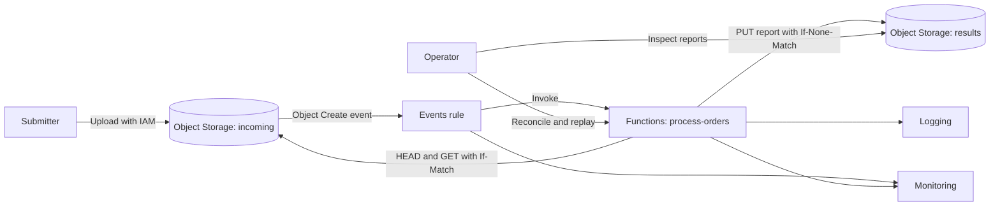

# File Processing Project with Object Storage, Events, and Functions

## 1. Context and Objectives

This lab belongs to the **Capstone Projects and Assessment** chapter of the `CLOUD_PROVIDERS_ORACLE` module. You will combine compartment, IAM, VCN, Object Storage, Events, Functions, and monitoring to build a file ingestion pipeline on Oracle Cloud Infrastructure (OCI).

Scenario: a business team uploads CSV order files into a private bucket. The system must automatically validate the file, calculate the total amount if the data is valid, and store a JSON report. The operations team needs to know which files were rejected, which runs failed due to infrastructure issues, and how to replay runs without producing duplicate results for the same input.

After this lab, you must be able to prove independently that:

- A new file triggers the intended function via a properly scoped Events rule.
- The function uses a resource principal with permissions restricted by bucket and action.
- Data is validated before any result is published.
- Duplicate events, concurrent runs, and overwritten files do not corrupt reports.
- Logs, metrics, and a reconciliation procedure are sufficient to detect unprocessed files.
- The system has documented procedures for redeployment, cost control, and resource teardown.

This is an infrastructure integration project with lightweight data processing. The JSON report can also serve as input to a later Oracle Database loading step; the baseline version does not yet require a database.

## 2. Problem Statement and Processing Contract

### 2.1. Baseline Scope

The names below are conventions of the sample project; replace them consistently if your environment uses different names.

| Component | Convention |
| --- | --- |
| Lab compartment | `cpt-capstone-files` |
| Incoming bucket | `capstone-incoming` |
| Report bucket | `capstone-results` |
| Functions application | `capstone-file-app` |
| Function | `process-orders` |
| Incoming prefix | `incoming/` |
| Report prefix | `reports/` |
| Algorithm version | `orders-v1` |

Place both buckets, the application, and the Events rule in the same region and the same lab compartment. Each file submission must use a new object name, such as `incoming/2026-11-21/batch-001.csv`. Do not overwrite input objects in normal operation.

The following limits are **lab design decisions**, not OCI hard maximums:

| Property | Starter Value |
| --- | --- |
| File size | Maximum 5 MiB, i.e., `5 * 1024 * 1024` bytes |
| Data record count | 1 to 50,000, excluding header |
| Encoding | UTF-8; UTF-8 BOM accepted |
| Function memory | 512 MB |
| Function timeout | 120 seconds |
| Invalid data rule | Reject entire file, report first error |
| Dataset currency | USD, fixed across the entire lab |

Do not treat this timeout target as a latency SLA. You must measure event delivery delay, cold start time, and processing time in your actual environment.

### 2.2. Input Data

Sample `orders.csv` for testing the happy path:

```csv
order_id,amount
ORD-001,100.50
ORD-002,250.00
ORD-003,15.25
```

Validation rules:

1. The header must be exact: two columns `order_id,amount`, in order, with no extra columns.
2. `order_id` is 1–64 characters, consisting solely of ASCII letters, digits, hyphens, or underscores; unique within the same file.
3. `amount` is non-negative, with at most 9 integer digits and at most 2 decimal places; no thousand separators or scientific notation.
4. Leading and trailing whitespace on values is trimmed before validation. The header is not auto-corrected.
5. The file must contain at least one record. A row with missing columns, extra columns, or malformed CSV syntax causes the entire file to be rejected.
6. Monetary totals are summed using an exact decimal type, never `float`.

For the sample data above, the expected result is 3 records and a total of `365.75` USD. Blank lines skipped by the CSV library are not counted as records.

### 2.3. Output Report

Each input identifier and algorithm version produces one report object:

```text
reports/<operation_id>.json
```

`operation_id` is the SHA-256 hash of a JSON array containing namespace, bucket, object name, ETag, and algorithm version. Serializing as JSON before hashing avoids delimiter ambiguity inside object names.

Example success report; identifier values are illustrative:

```json
{
  "operation_id": "<sha256-64-chars>",
  "processor_version": "orders-v1",
  "source": {
    "namespace": "<namespace>",
    "bucket": "capstone-incoming",
    "object_name": "incoming/2026-11-21/batch-001.csv",
    "etag": "<etag-from-event>"
  },
  "status": "accepted",
  "record_count": 3,
  "currency": "USD",
  "total_amount": "365.75"
}
```

Invalid files produce `status: rejected`, a `reason` code, and, when determinable, the physical line number `line`. A rejected report contains no partial valid total. Never copy invalid cell values into logs or error reports.

Distinguish the four outcomes of a single invocation:

| Invocation Outcome | Meaning |
| --- | --- |
| `accepted` | Acceptance report has been durably written |
| `rejected` | Business rejection report has been durably written |
| `duplicate` | A report for this identifier already exists; read the report to determine `accepted` or `rejected` |
| `ignored` | Event falls outside the contract, such as a non-CSV object or outside the required prefix |

Permission errors, connectivity errors, timeouts, or report write failures must cause the invocation to fail. Only return normally after confirming the report exists or intentionally ignoring an out-of-scope event.

## 3. Architecture and Responsibility Boundaries



Object Storage stores the file's bytes; the event carries only metadata to locate the file. Events matches relevant messages and forwards them to the action. The Function downloads, validates, and writes the report. OCI supports actions for Functions, Notifications, and Streaming; the baseline version needs only a Functions action. See [Overview of Events](https://docs.oracle.com/en-us/iaas/Content/Events/Concepts/eventsoverview.htm).

Separating the incoming and output buckets establishes a clean, verifiable boundary: the rule listens only to the incoming bucket, so the function writing JSON to the output bucket never re-triggers itself. The code also verifies namespace, bucket, and prefix as an additional safeguard.

### 3.1. Network Connectivity

Create the application in a private regional subnet. Configure:

- A Service Gateway serving the region's Oracle Services Network.
- A route to the appropriate service CIDR, typically `All <region> Services in Oracle Services Network`, via the Service Gateway.
- Outbound HTTPS TCP 443 to required service endpoints, along with working DNS per VCN configuration.
- Sufficient IP addresses in the subnet for expected concurrency and shared resources.

The function in this lab calls only Object Storage in the same region. If adding external Internet APIs, design the corresponding outbound path. The build environment also needs connectivity to the registry and dependency sources; that is a separate network path from runtime CSV fetching. See [Private Network Access](https://docs.oracle.com/en-us/iaas/Content/Functions/Concepts/functionsprivateaccess.htm) and [Preparing for Functions](https://docs.oracle.com/en-us/iaas/Content/Functions/Concepts/functionsprerequisites.htm).

A private subnet alone does not turn the invoke endpoint into a private-only endpoint. Permission to invoke the function must still be governed by IAM. Oracle explains this separately in [Creating Applications](https://docs.oracle.com/en-us/iaas/Content/Functions/Tasks/functionscreatingapps.htm).

### 3.2. Identities and Permissions

Three permission groups must be separated:

| Actor | Role | Permission Scope |
| --- | --- | --- |
| Deployer | Create and update the application, function, image, and rule | Deployment resources in the lab compartment |
| Events service | Invoke target function | Invocation in the compartment holding the function |
| Function resource principal | Read CSV and write reports | Only the two designated buckets |

Deployer credentials may be used in OCI CLI / Fn CLI. The running function uses a resource principal—never bake an API private key, user auth token, or OCI config file into the image.

After deploying the function and obtaining its OCID, create dynamic group `dg-capstone-file-processor` with the matching rule:

```text
resource.id = '<FUNCTION_OCID>'
```

This scopes membership to the exact assigned function. If you delete and recreate the function, its OCID changes and the dynamic group must be updated. Place IAM policies where they can grant access to the target compartment. For non-default identity domains, use your tenancy's domain-qualified dynamic group syntax. See [Resource Principal for Functions](https://docs.oracle.com/en-us/iaas/Content/Functions/Tasks/functionsaccessingociresources.htm).

Sample runtime policies, one statement per line:

```text
Allow dynamic-group dg-capstone-file-processor to manage objects in compartment cpt-capstone-files where all {target.bucket.name='capstone-incoming', request.permission='OBJECT_READ'}
Allow dynamic-group dg-capstone-file-processor to manage objects in compartment cpt-capstone-files where all {target.bucket.name='capstone-results', any {request.permission='OBJECT_READ', request.permission='OBJECT_CREATE', request.permission='OBJECT_OVERWRITE'}}
Allow service cloudEvents to use fn-invocation in compartment cpt-capstone-files
```

The first two statements combine `manage` with `request.permission` conditions, so the function does not get full object privileges. The incoming bucket grants read-only access. The output bucket grants read access to check for existing reports and write access to create objects. Do not grant delete or list permissions to runtime.

`PutObject` may require `OBJECT_OVERWRITE` if an object name already exists. The sample policy permits that permission in the output bucket; the code always sends a no-overwrite condition to resolve races. IAM and request conditions serve different roles: this policy is not an immutability lock against modified function code. Cross-check [Object Storage API Permissions](https://docs.oracle.com/en-us/iaas/Content/Identity/policyreference/objectstoragepolicyreference.htm).

The final statement narrows Events' invocation to `fn-invocation`, the resource type containing `FN_INVOCATION`. The rule creator also needs separate manage/inspect permissions on target resources. If multiple functions share a compartment and tighter isolation is needed, design additional IAM conditions or split compartments after verifying effective policy behavior. See [Details for Functions](https://docs.oracle.com/en-us/iaas/Content/Identity/policyreference/functionspolicyreference.htm) and [Oracle's example of Events invoking Functions](https://blogs.oracle.com/cloud-infrastructure/governance-and-automation-with-oracle-events-and-functions).

Foundational permissions for creating VNICs, pulling images, and deploying must be set up per [Creating Policies for Functions](https://docs.oracle.com/en-us/iaas/Content/Functions/Tasks/functionscreatingpolicies.htm). The CSV read/write policies above do not replace this tenancy setup.

## 4. Events, ETags, and Idempotent Processing

### 4.1. Parsing the OCI Payload Correctly

For objects, event emission must be enabled on the bucket; creating a standard bucket alone is not enough. The target event type is `com.oraclecloud.objectstorage.createobject`. A trimmed payload to illustrate the contract:

```json
{
  "cloudEventsVersion": "0.1",
  "eventID": "lab-event-001",
  "eventType": "com.oraclecloud.objectstorage.createobject",
  "eventTime": "2026-11-21T03:00:00Z",
  "source": "objectstorage",
  "data": {
    "compartmentId": "<COMPARTMENT_OCID>",
    "resourceName": "incoming/2026-11-21/batch-001.csv",
    "additionalDetails": {
      "namespace": "<NAMESPACE>",
      "bucketName": "capstone-incoming",
      "eTag": "<ETAG>"
    }
  }
}
```

The object name comes from `data.resourceName`; the ETag uses camelCase `eTag` inside `additionalDetails`. Do not assume `objectName`, `versionId`, or another cloud provider's `Records` structure exists. Verify real payloads during acceptance against [Oracle Object Event Types and Examples](https://docs.oracle.com/en-us/iaas/Content/Events/Reference/eventsproducers.htm).

### 4.2. Why Not Rely Solely on Event ID?

Oracle notes that Events may deliver duplicate messages. Designs must tolerate multiple invocations for the same resource change; do not rely on event arrival order to determine the latest data. See [Events Service Delivery Characteristics](https://www.oracle.com/apac/cloud/events-service/).

`eventID` is useful for tracing a specific delivery. The processing identifier in this project is derived from the source input and `orders-v1`, allowing a replay with a different event ID to still map to the exact prior report. Two differently named objects with identical content remain two independent inputs.

Report publication flow:

1. Compute a deterministic `operation_id` from source metadata.
2. Check if the report already exists to avoid redundant processing.
3. Read the object using the event's ETag, validate the data, and build the report in memory.
4. Write a single report object with `If-None-Match: *`.
5. If the write fails with `412`, verify the existing report and terminate as `duplicate`.

Step 2 is only an optimization; step 4 is what protects against two concurrent invocations both seeing no report yet. Both invocations may still read and compute, but only one publish succeeds. This mechanism does not eliminate duplicate execution or automatically guard other side effects such as sending emails or writing multiple database tables.

### 4.3. File Overwritten Between Event Emission and Read

An ETag is a resource consistency token—do not treat it as a content SHA-256 or a substitute for a version ID. The function sends `If-Match` on source `HEAD` and `GET` calls to avoid accidentally reading a newer object under the same name. The corresponding SDK parameters are `if_match` and `if_none_match`; see [ObjectStorageClient](https://docs.oracle.com/en-us/iaas/tools/python/latest/api/object_storage/client/oci.object_storage.ObjectStorageClient.html).

If the read precondition fails, the baseline implementation writes a `rejected` report with `SOURCE_CHANGED`. This indicates the bytes described by the event were not processed. The operator must request resubmission under a new object name, or restore the exact version in a design using versioning.

Enabling versioning preserves history, but the code below does not yet look up and read historical versions. Supporting overwrites as a feature requires an event-to-version-ID contract, version-read permissions, and dedicated tests. Simply adding `updateobject` to the filter does not fulfill this requirement.

## 5. Preparing Resources and Deployment Environment

### 5.1. Starting Prerequisites

You need a tenancy authorized to create resources, a lab compartment, sufficient Functions limits, a prepared VCN/subnet, and an administrator able to grant IAM policies.

Terminal commands in this guide use **Bash**, suitable for a Linux development environment or Cloud Shell configured for Functions. You need OCI CLI, Fn CLI, Docker, and `jq`; verify region and registry access before deploying. Source filenames below are files learners create inside their own project directory.

Complete Functions setup and registry login per [Functions: Get Started using Cloud Shell](https://docs.oracle.com/en-us/iaas/Content/developer/functions/func-setup-cs/01-summary.htm). The Fn context must point to the exact compartment, API endpoint, and registry of the lab. Never place auth tokens or API private keys in source code.

Set session variables:

```bash
export OCI_CLI_REGION='<region-id>'
export COMPARTMENT_OCID='<lab-compartment-ocid>'
export SUBNET_OCID='<private-regional-subnet-ocid>'
export NAMESPACE="$(oci os ns get --query data --raw-output)"
export SOURCE_BUCKET='capstone-incoming'
export RESULT_BUCKET='capstone-results'
```

Record CLI, runtime, region, and resource OCIDs in your deployment log. Placeholders inside `<...>` must be replaced before running.

### 5.2. Creating Private Buckets

```bash
oci os bucket create \
  --compartment-id "$COMPARTMENT_OCID" \
  --namespace-name "$NAMESPACE" \
  --name "$SOURCE_BUCKET" \
  --public-access-type NoPublicAccess \
  --storage-tier Standard \
  --object-events-enabled true

oci os bucket create \
  --compartment-id "$COMPARTMENT_OCID" \
  --namespace-name "$NAMESPACE" \
  --name "$RESULT_BUCKET" \
  --public-access-type NoPublicAccess \
  --storage-tier Standard \
  --object-events-enabled false
```

If a bucket already exists, inspect its current configuration before proceeding. In the Console, confirm access is private and only the incoming bucket emits object events. Parameters are documented in [OCI CLI: bucket create](https://docs.oracle.com/en-us/iaas/tools/oci-cli/latest/oci_cli_docs/cmdref/os/bucket/create.html).

Do not use the Archive tier for pending inputs; archived data requires a restore workflow before reading. Automated tier transitions should only be applied after defining the data lifecycle.

### 5.3. Initializing the Application and Function

Once the Fn context is configured:

```bash
fn list apps
fn create app capstone-file-app --subnet-id "$SUBNET_OCID"
fn init --runtime python process-orders
cd process-orders
```

Keep the runtime, entrypoint, build image, and run image fields generated by the Fn CLI. In `func.yaml`, set or update:

```yaml
memory: 512
timeout: 120
```

In `requirements.txt`, keep the FDK dependency and add the OCI Python SDK. A starter configuration for test builds is:

```text
fdk
oci
```

Before handover, pin verified dependency versions and record the image digest. Two unpinned lines above do not guarantee reproducible builds over time. Runtimes and FDKs are updated by Oracle; pick a supported version per [Function Development Kits](https://docs.oracle.com/en-us/iaas/Content/Functions/Tasks/functionssupportedlanguageversions.htm).

## 6. Implementing the CSV Processing Function

The sample code below is for `func.py`. It processes only data within the lab limits, uses one report object as the unit of publication, and has no side effects beyond Object Storage and logs.

```python
import csv
import hashlib
import io
import json
import os
import re
import time
from decimal import Decimal

import oci
from fdk import response


MAX_BYTES = 5 * 1024 * 1024
MAX_ROWS = 50_000
PROCESSOR_VERSION = "orders-v1"
EVENT_TYPE = "com.oraclecloud.objectstorage.createobject"
ORDER_ID = re.compile(r"[A-Za-z0-9_-]{1,64}")
AMOUNT = re.compile(r"(?:0|[1-9][0-9]{0,8})(?:\.[0-9]{1,2})?")
_client = None


class RejectFile(Exception):
    def __init__(self, reason, line=None):
        super().__init__(reason)
        self.reason = reason
        self.line = line


def storage_client():
    global _client
    if _client is None:
        signer = oci.auth.signers.get_resource_principals_signer()
        _client = oci.object_storage.ObjectStorageClient(
            config={},
            signer=signer,
            timeout=(5, 20),
            retry_strategy=oci.retry.NoneRetryStrategy(),
        )
    return _client


def emit(status, **fields):
    print(json.dumps({"status": status, **fields}, ensure_ascii=False),
          flush=True)


def report_exists(client, namespace, bucket, name):
    try:
        client.head_object(namespace, bucket, name)
        return True
    except oci.exceptions.ServiceError as exc:
        if exc.status == 404:
            return False
        raise


def fetch_source(client, namespace, bucket, name, etag):
    try:
        head = client.head_object(
            namespace, bucket, name, if_match=etag
        )
        if int(head.headers["content-length"]) > MAX_BYTES:
            raise RejectFile("FILE_TOO_LARGE")

        downloaded = client.get_object(
            namespace, bucket, name, if_match=etag
        )
        try:
            payload = downloaded.data.raw.read(
                MAX_BYTES + 1, decode_content=True
            )
        finally:
            downloaded.data.close()
    except oci.exceptions.ServiceError as exc:
        if exc.status == 412:
            raise RejectFile("SOURCE_CHANGED") from exc
        raise

    if len(payload) > MAX_BYTES:
        raise RejectFile("FILE_TOO_LARGE")
    return payload


def summarize_csv(payload):
    try:
        text = payload.decode("utf-8-sig")
    except UnicodeDecodeError as exc:
        raise RejectFile("INVALID_UTF8") from exc

    reader = csv.DictReader(io.StringIO(text, newline=""), strict=True)
    seen = set()
    count = 0
    total = Decimal("0.00")

    try:
        if reader.fieldnames != ["order_id", "amount"]:
            raise RejectFile("INVALID_HEADER", line=1)

        for row in reader:
            count += 1
            if count > MAX_ROWS:
                raise RejectFile("TOO_MANY_ROWS", reader.line_num)
            if None in row or any(value is None for value in row.values()):
                raise RejectFile("INVALID_COLUMN_COUNT", reader.line_num)

            order_id = row["order_id"].strip()
            amount = row["amount"].strip()
            if ORDER_ID.fullmatch(order_id) is None:
                raise RejectFile("INVALID_ORDER_ID", reader.line_num)
            if order_id in seen:
                raise RejectFile("DUPLICATE_ORDER_ID", reader.line_num)
            if AMOUNT.fullmatch(amount) is None:
                raise RejectFile("INVALID_AMOUNT", reader.line_num)

            seen.add(order_id)
            total += Decimal(amount)
    except csv.Error as exc:
        raise RejectFile("INVALID_CSV", reader.line_num) from exc

    if count == 0:
        raise RejectFile("NO_DATA_ROWS")
    return {
        "record_count": count,
        "currency": "USD",
        "total_amount": format(total.quantize(Decimal("0.01")), "f"),
    }


def handler(ctx, data: io.BytesIO = None):
    started = time.monotonic()
    trace = {"event_id": "unknown", "operation_id": "unknown"}

    def finish(status, **fields):
        elapsed_ms = round((time.monotonic() - started) * 1000)
        emit(status, **trace, elapsed_ms=elapsed_ms, **fields)
        return response.Response(
            ctx,
            response_data=json.dumps({"status": status, **fields}),
            headers={"Content-Type": "application/json"},
        )

    try:
        event = json.loads(data.getvalue() if data else b"{}")
        if not isinstance(event, dict):
            raise ValueError("INVALID_EVENT")
        event_id = event.get("eventID")
        if not isinstance(event_id, str) or not event_id:
            raise ValueError("MISSING_EVENT_ID")
        trace["event_id"] = event_id[:128]

        if event.get("eventType") != EVENT_TYPE:
            return finish("ignored", reason="EVENT_TYPE")

        item = event["data"]
        details = item["additionalDetails"]
        namespace = details["namespace"]
        bucket = details["bucketName"]
        name = item["resourceName"]
        etag = details["eTag"]
        required = (namespace, bucket, name, etag)
        if not all(isinstance(value, str) and value for value in required):
            raise ValueError("INVALID_SOURCE_FIELDS")

        if (namespace != os.environ["SOURCE_NAMESPACE"]
                or bucket != os.environ["SOURCE_BUCKET"]):
            return finish("ignored", reason="SOURCE_SCOPE")
        if not name.startswith("incoming/") or not name.endswith(".csv"):
            return finish("ignored", reason="OBJECT_NAME")

        result_bucket = os.environ["RESULT_BUCKET"]
        if result_bucket == bucket:
            raise ValueError("RESULT_BUCKET_MUST_DIFFER")

        identity = json.dumps(
            [namespace, bucket, name, etag, PROCESSOR_VERSION],
            ensure_ascii=False, separators=(",", ":"),
        ).encode("utf-8")
        operation_id = hashlib.sha256(identity).hexdigest()
        trace["operation_id"] = operation_id
        result_name = f"reports/{operation_id}.json"
        client = storage_client()
        emit("started", **trace)

        if report_exists(client, namespace, result_bucket, result_name):
            return finish("duplicate", result_object=result_name)

        report = {
            "operation_id": operation_id,
            "processor_version": PROCESSOR_VERSION,
            "source": {
                "namespace": namespace,
                "bucket": bucket,
                "object_name": name,
                "etag": etag,
            },
        }

        try:
            payload = fetch_source(client, namespace, bucket, name, etag)
            report.update(summarize_csv(payload))
            report["status"] = "accepted"
        except RejectFile as exc:
            report["status"] = "rejected"
            report["reason"] = exc.reason
            if exc.line is not None:
                report["line"] = exc.line

        body = json.dumps(
            report, ensure_ascii=False, sort_keys=True, separators=(",", ":")
        ).encode("utf-8")
        try:
            client.put_object(
                namespace, result_bucket, result_name, body,
                content_length=len(body),
                content_type="application/json",
                if_none_match="*",
            )
        except oci.exceptions.ServiceError as exc:
            if exc.status == 412 and report_exists(
                client, namespace, result_bucket, result_name
            ):
                return finish("duplicate", result_object=result_name)
            raise

        fields = {"result_object": result_name}
        if "reason" in report:
            fields["reason"] = report["reason"]
        return finish(report["status"], **fields)

    except Exception as exc:
        # Do not log payloads, cell values, or full SDK messages.
        emit(
            "failed", **trace,
            error_type=type(exc).__name__,
            service_status=getattr(exc, "status", None),
            service_code=getattr(exc, "code", None),
            elapsed_ms=round((time.monotonic() - started) * 1000),
        )
        raise
```

### 6.1. Design Choices to Understand in the Code

**Resource bounds:** the code checks file size before downloading and reads at most the limit plus one byte. The row-count limit also bounds memory consumed by the `seen` set. This sample loads small files into memory; it is not a streaming processor for multi-gigabyte files.

**Numeric precision:** `Decimal` avoids binary floating-point rounding errors. Format validation runs before constructing `Decimal`, so values like `NaN`, `Infinity`, `1e3`, and negative numbers are all rejected.

**Stable identifiers:** reports exclude invocation timestamps and event IDs. Delivery-specific details remain in logs, keeping report payloads stable for the same input and processor version.

**Scoped error handling:** only a `412` on source reads is interpreted as `SOURCE_CHANGED`; only a `412` on report writes confirmed by report existence is interpreted as a duplicate. A `404` on source read remains an error to investigate, as it can indicate a missing object or an authorization issue masked under the same status.

**Intentional retry behavior:** SDK retries are disabled in the example to prevent unexpected stacked wait loops. The `(5, 20)` timeout applies to per-request network connect/read operations, not the total invocation clock. When adding retries for transient errors, cap the total time budget and retain replay/reconciliation mechanisms. The function timeout is the final boundary.

**Information protection boundaries:** application-emitted logs contain no CSV contents. Exceptions are re-raised so the invocation fails; because the runtime may log tracebacks, keep log-viewing permissions restricted and never place sensitive data inside exception messages, object names, or resource names.

### 6.2. Deploying and Configuring Runtime Settings

Inside `process-orders`, deploy after updating code and dependencies:

```bash
fn deploy --app capstone-file-app

fn config app capstone-file-app SOURCE_NAMESPACE "$NAMESPACE"
fn config app capstone-file-app SOURCE_BUCKET "$SOURCE_BUCKET"
fn config app capstone-file-app RESULT_BUCKET "$RESULT_BUCKET"
```

The application is dedicated to this lab, so configuration can be set at the application level. If sharing an application across multiple functions, evaluate tighter configuration scoping. Record the function OCID from the Console into `FUNCTION_OCID`, then complete the dynamic group and runtime policies in Section 3.

```bash
export FUNCTION_OCID='<ocid-of-process-orders>'
```

Do not immediately conclude a policy is wrong if an attempt fails right after editing IAM; identities and permissions may still be cached in active tokens. Record edit and test timestamps in your log for investigation.

## 7. Connecting Object Storage to the Function via Events

### 7.1. Creating a Scoped Filter

In the Console, create a rule in the exact source region and compartment. Select Object Storage **Create Object** events, scoped further to the bucket and namespace. Equivalent filter:

```json
{
  "eventType": ["com.oraclecloud.objectstorage.createobject"],
  "data": {
    "compartmentId": ["<COMPARTMENT_OCID>"],
    "additionalDetails": {
      "bucketName": ["capstone-incoming"],
      "namespace": ["<NAMESPACE>"]
    }
  }
}
```

This is an Events JSON matching pattern, not a SQL expression or full event payload. The code checks the prefix and `.csv` suffix, so the baseline version does not rely on filter wildcard syntax. See [Matching Events with Filters](https://docs.oracle.com/en-us/iaas/Content/Events/Concepts/filterevents.htm).

Select a **Functions** action pointing to the deployed application and function; enable both the rule and the action. You can create it via OCI CLI using `jq` to construct the JSON from variables:

```bash
CONDITION=$(jq -nc \
  --arg cid "$COMPARTMENT_OCID" \
  --arg bucket "$SOURCE_BUCKET" \
  --arg ns "$NAMESPACE" \
  '{eventType:["com.oraclecloud.objectstorage.createobject"],
    data:{compartmentId:[$cid],
      additionalDetails:{bucketName:[$bucket],namespace:[$ns]}}}')

ACTIONS=$(jq -nc --arg fid "$FUNCTION_OCID" \
  '{actions:[{actionType:"FAAS",isEnabled:true,functionId:$fid}]}')

RULE_OCID=$(oci events rule create \
  --compartment-id "$COMPARTMENT_OCID" \
  --display-name 'capstone-on-order-created' \
  --is-enabled true \
  --condition "$CONDITION" \
  --actions "$ACTIONS" \
  --query data.id --raw-output)
```

Rule parameters are described in [OCI CLI: events rule create](https://docs.oracle.com/en-us/iaas/tools/oci-cli/latest/oci_cli_docs/cmdref/events/rule/create.html). After creation, inspect the function OCID inside the action; do not rely solely on matching display names.

### 7.2. Testing the Happy Path

Create `orders.csv` matching Section 2, then upload it under a fresh name:

```bash
export OBJECT_NAME="incoming/$(date -u +%Y-%m-%d)/batch-$(date -u +%s)-${RANDOM}.csv"

oci os object put \
  --namespace-name "$NAMESPACE" \
  --bucket-name "$SOURCE_BUCKET" \
  --name "$OBJECT_NAME" \
  --file orders.csv \
  --if-none-match '*'
```

Record the object name and returned ETag. Watch rule metrics, invocations, and application logs. From the `accepted` log entry, take `result_object` and download the report using a tester identity permitted to read the bucket:

```bash
export RESULT_OBJECT='reports/<operation-id-from-log>.json'

oci os object get \
  --namespace-name "$NAMESPACE" \
  --bucket-name "$RESULT_BUCKET" \
  --name "$RESULT_OBJECT" \
  --file result.json
```

Confirm success only when the report matches the source object, ETag, record count, and total amount. A normal invocation exit or an increased output object count alone does not prove the math is right.

Objects existing before enabling object events or before creating the rule are not automatically backfilled. Record them in a reconciliation list for controlled processing.

## 8. Test Plan and Acceptance Evidence

### 8.1. Mandatory Test Matrix

Execute the scenarios below in the lab compartment. Each case requires a new object name or isolated input set so prior reports do not mask the behavior under test.

| Case | Action | Expected Observation |
| --- | --- | --- |
| T01 | Upload sample 3-row CSV | `accepted` report, 3 records, total `365.75` |
| T02 | Replace one amount with `abc`, `-1`, `1e3`, or `NaN` | `rejected` report, `INVALID_AMOUNT`, no total amount |
| T03 | Header-only file | `rejected`, `NO_DATA_ROWS` |
| T04 | Missing/extra column or swapped header order | `INVALID_COLUMN_COUNT` or `INVALID_HEADER` respectively |
| T05 | Two rows sharing the same `order_id` | `DUPLICATE_ORDER_ID` and offending line number |
| T06 | File not decodable as UTF-8 | `INVALID_UTF8` |
| T07 | File larger than 5 MiB or more than 50,000 rows | `FILE_TOO_LARGE` or `TOO_MANY_ROWS` |
| T08 | Re-invoke the same payload multiple times | One report exists; subsequent calls return `duplicate` |
| T09 | Invoke twice concurrently for an input with no report yet | Exactly one final report; never overwritten or duplicated |
| T10 | Disable rule, upload then overwrite file; invoke payload with old ETag | Without prior report, produces `rejected` with `SOURCE_CHANGED` |
| T11 | Remove source-read or result-write permission in test env | Invocation fails, `failed` log emitted; never reports business success |
| T12 | Upload an object into the results bucket | No invocation loop triggered by the lab's rule |
| T13 | Upload `.txt` or CSV outside `incoming/` to source bucket | Invocation may fire, but finishes `ignored` with no report |
| T14 | Restore permissions after T11 and replay untouched input | Report created; subsequent replay remains safe |

In T10, save the old ETag before overwriting. If a report for the old input already exists, returning `duplicate` is correct; it does not re-check source bytes. After testing, re-enable the rule and restore the non-overwrite submission discipline.

In T11, wait for IAM changes to propagate before drawing conclusions. Record which identity lost permissions; revoking CLI user permissions does not revoke the function's resource principal.

### 8.2. Generating Controlled Replay Payloads

For an object you own, take the ETag saved from upload or from a metadata check on that exact current object. The following payload is for direct invocation; it is test input you craft, not proof that Events emitted the event itself:

```bash
export SOURCE_ETAG='<etag-of-exact-input>'

jq -n \
  --arg ns "$NAMESPACE" \
  --arg bucket "$SOURCE_BUCKET" \
  --arg name "$OBJECT_NAME" \
  --arg etag "$SOURCE_ETAG" \
  '{cloudEventsVersion:"0.1",eventID:"manual-replay-001",
    eventType:"com.oraclecloud.objectstorage.createobject",
    source:"objectstorage",
    data:{resourceName:$name,
      additionalDetails:{namespace:$ns,bucketName:$bucket,eTag:$etag}}}' \
  > event.json

fn invoke capstone-file-app process-orders < event.json
fn invoke capstone-file-app process-orders < event.json
```

To test concurrency races, prepare a source object with no report yet, then invoke the same `event.json` simultaneously from two authorized terminals. Use the resulting object key and report write count as evidence. Do not merely count invocations, because multiple executions can still be valid behavior.

### 8.3. Evidence Structure per Case

Record the following in your test dossier:

- Case ID, input data or generation method, UTC timestamp, and expected outcome.
- Object name, ETag, and `operation_id` if generated.
- Corresponding terminal log entry, report payload, and independent calculation check.
- Actual outcome, discrepancies, and any configuration restoration steps.

Clearly distinguish cases executed on OCI, simulated cases, and unexecuted cases. Never use a single Console screenshot of one successful run in place of the full matrix.

## 9. Three-Layer Monitoring

### 9.1. Event Delivery Layer

Monitor the `oci_cloudevents` metric namespace, filtered by rule:

| Metric | What to Check |
| --- | --- |
| `PublishedEvents` | Whether the source emits events in the compartment |
| `MatchedEvents` | Whether the filter matches expected messages |
| `DeliverySucceedEvents` | Events records delivery to the action |
| `DeliveryFailedEvents` | Any failed deliveries to the action |

These measure event emission, matching, and delivery. They do not prove CSV validity or report accuracy. Cross-check metric names and dimensions in [Events Metrics](https://docs.oracle.com/en-us/iaas/Content/Events/Reference/eventsmetrics.htm).

### 9.2. Function Execution Layer

In namespace `oci_faas`, track `FunctionInvocationCount`, `FunctionExecutionDuration`, and `FunctionResponseCount`. For response metrics, inspect `responseType` values such as `Error` and `Throttled`. Select the exact time window and function OCID; metrics may lag behind logs. See [Function Metrics](https://docs.oracle.com/en-us/iaas/Content/Functions/Reference/functionsmetrics.htm).

Create test alarms for event delivery failures, function errors, and throttling; verify alert routing to a destination managed by your lab team. Thresholds must match test load and response needs. Do not treat an empty chart as proof of a completely healthy system.

### 9.3. Business Result Layer

Enable Function Invocation Logs on the application via OCI Logging, selecting an appropriate log group and retention period. The sample code intentionally writes JSON logs via `print`; Oracle's instructions are in [Storing and Viewing Function Logs](https://docs.oracle.com/en-us/iaas/Content/Functions/Tasks/functionsexportingfunctionlogfiles.htm).

Example completion log:

```json
{
  "status": "accepted",
  "event_id": "lab-event-001",
  "operation_id": "<sha256>",
  "elapsed_ms": 620,
  "result_object": "reports/<sha256>.json"
}
```

`accepted`, `rejected`, `duplicate`, `ignored`, and `failed` are application statuses. They do not automatically become new OCI metrics. If alerting on rejected file ratios is required, configure log queries/aggregations or explicitly emit custom metrics with corresponding IAM and cost accounting.

The lab dashboard should answer: how many inputs need processing, how many identifiers have an accepted or rejected report, and how many identifiers still lack a report. Count by `operation_id`; counting raw log lines inflates numbers during replays.

If adding Notifications as a second action on the same Events rule, that notification reflects the file-arrival event. Actions do not form a transactional "notify only after function finishes" chain; business-completion notifications require a separate emission step after the report is durably written.

## 10. Troubleshooting, Reconciliation, and Replay

### 10.1. Triage Before Fixing

| Symptom | First Investigation Path | Resolution |
| --- | --- | --- |
| Upload completes with no matching event | Emit events setting, region, compartment, filter | Fix configuration and add missed objects to reconciliation |
| Event matches but function is not invoked | Disabled action, wrong OCID, invocation permissions | Check action and IAM before retrying |
| Function fails to initialize | Image, application architecture, dependencies, entrypoint | Inspect invocation logs, fix, and redeploy pinned image |
| Function times out calling Object Storage | Routes, Service Gateway, egress, DNS | Restore connectivity and replay |
| Source read returns permission or not-found error | Dynamic group, policy, object name, deleted source | Verify both identity and existence using an operator account |
| Report write fails | Output bucket permissions, bucket name config, network | Fix and replay; keep source intact |
| `rejected` report created | `reason` code and failing line | Fix data and submit under a new object name |
| `SOURCE_CHANGED` reported | Input was overwritten | Resubmit immutable input or restore exact version via separate workflow |
| Multiple invocations but one report | Duplicate events, replays, concurrency races | Verify report correctness and incurred cost |
| Invocations spike continuously after each result | Rule matches output bucket/prefix as well | Disable rule, fix filter, and re-verify |

Do not blindly interpret every `404` as "file deleted". OCI may conceal the existence of resources the caller is unauthorized to view. Nor should you turn every exception into a `200` response carrying an `error` string in JSON.

### 10.2. Boundaries of Retries

Event delivery, invocation acceptance, and report publication are distinct milestones. Do not assume every business or infrastructure exception inside a function is automatically retried by the service until it succeeds.

The baseline relies on three mechanisms: durable reports, error logs, and operator-driven replays. It does not yet include queues, dead-letter queues, or automated orchestrators. Do not label a bucket a "DLQ" simply because it holds `rejected` reports.

During deliberate fault testing, document the actual Events → Functions behavior in your tenancy: action-delivery failures differ from failures after the function begins executing. Even when service retries are observed, you must still reconcile inputs lacking reports and verify retry expiration/exhaustion conditions.

### 10.3. Baseline Reconciliation Procedure

In a small lab, operators can run this procedure manually. The reconciliation identity holds appropriate list/read permissions without expanding the function's runtime permissions.

1. List objects under `incoming/` along with source metadata; paginate if results exceed one page.
2. Select only objects old enough relative to normal measured processing times to avoid replaying runs still in progress.
3. From namespace, bucket, object name, ETag, and algorithm version, compute `operation_id` using the exact rule in code.
4. Check `reports/<operation_id>.json`. Separately record `accepted` reports, `rejected` reports, and inputs still lacking a report.
5. For inputs without a report, locate the corresponding error, resolve the root cause, and invoke a replay payload with the exact ETag.
6. Re-verify reports after replay and record the incident resolution.

If an input object was overwritten, current object listings cannot reconstruct all past submissions. Reconciling full history requires an upload manifest or versioning with version lookup. This is why the non-overwrite rule is a baseline requirement.

Never delete a rejection report just to force a later run to succeed. When data is corrected, submit under a new name. When the algorithm changes, increment `PROCESSOR_VERSION`, update test evidence, and accept that new report identifiers will differ.

## 11. Performance, Cost, and Resilience

### 11.1. Bounded Load Testing

Start with one small file, then scale up to a few dozen files with distinct object names. Keep data contents constant when comparing the effect of memory settings.

Measure at least two intervals:

- **In-invocation duration:** from handler start to return, such as `elapsed_ms` in logs.
- **End-to-end duration:** from upload completion until the report is readable, recorded by the test harness or operator tooling.

Separately note identifiable cold starts and throttled invocations. A self-defined target might be 95% of small files producing reports within a team-agreed window; state file sizes, concurrency, sample counts, and measured results. This is a team acceptance criterion, not an OCI SLA.

If increasing memory, measure both latency and cost again. If increasing concurrency, watch service limits, subnet IPs, and Object Storage request rates. Do not raise timeouts to mask a function processing workloads beyond its design.

### 11.2. Cost Model

Costs to examine include Functions duration/memory, Object Storage request counts and capacity, registry image storage, logs, alarms, and active network components. Use current region/tenancy rate cards when estimating; this lab does not assume all resources are free.

Rough model for comparison:

```text
Compute resource ≈ sum(memory_GB × runtime_seconds)
Storage requests ≈ HEAD + GET + PUT + reconciliation operations
Storage capacity ≈ source files + reports + retained versions
```

This model excludes billing rounding and all provider line items. Duplicate events may produce no extra reports yet still incur invocations, storage requests, and logs.

Set budgets per compartment or tag, with alert recipients and clear rules on when to stop load tests. Budgets are soft tracking thresholds that do not automatically terminate resources upon reaching a limit; see [OCI Budgets](https://docs.oracle.com/en-us/iaas/Content/Billing/Concepts/budgetsoverview.htm).

Tag purpose, owner, and expiration date on supported resources. Choose appropriate log retention and object lifecycles: retain source inputs at least long enough for reconciliation, investigation, and replay; transition tiers or delete only after confirming business conditions. Versioning, if enabled, requires explicit version retention/deletion rules.

### 11.3. Resilience

Intact source bytes in Object Storage enable re-running after function bugs or broken deployment configurations. Storing source code, application settings, policies, filters, and image digests enables pipeline reconstruction.

A recovery drill can include: breaking the output configuration, uploading a small batch, observing failures, restoring configuration, reconciling, and replaying until every input has a report. Record measured time to detect and time to recover.

The baseline deploys in a single region with no cross-region failover. Managed services reduce infrastructure administration, but do not automatically fix deleted inputs, wrong policies, disabled rules, or overwritten data. Adding regional redundancy requires explicitly designing data replication, resource redeployment, pipeline activation in the standby region, and preventing uncontrolled dual processing.

## 12. Handover and Evaluation Criteria

### 12.1. Deliverables

The learner's capstone dossier must include:

1. Architecture diagram with region, compartment, and network/identity boundaries.
2. Function code, pinned dependencies, build/runtime configuration, and image digest.
3. Bucket settings, Events filter/action, dynamic group, and policies; replace sensitive OCIDs with placeholders if sharing publicly.
4. Valid sample file, representative invalid files, output reports, and test results table.
5. Evidence of duplicate and concurrency handling, including object keys and report contents.
6. Log/metric/alarm configurations, plus one end-to-end root-cause investigation example.
7. Reconciliation/replay runbook, recovery drill results, cost estimate, and teardown inventory.

Document deployment steps clearly enough for someone else to reproduce in a clean compartment. If using Terraform or OCI Resource Manager, parameterize environment inputs and inspect plans before applying. Never commit state containing sensitive data or credentials.

### 12.2. Reference Rubric

| Criterion | Points | Evidence of Mastery |
| --- | ---: | --- |
| Integration flow and business output | 20 | Real upload triggers processing; reports compute and reject accurately |
| IAM and networking | 15 | Resource principal, scoped policies, and private connectivity verified |
| Idempotency and input consistency | 20 | ETag checks, conditional writes, replays, and concurrency races safe |
| Error handling and recovery | 15 | Infrastructure errors never swallowed; reconciliation and batch recovery work |
| Observability and test evidence | 15 | Event delivery, invocations, and business outcomes all tracked |
| Redeployment and operations | 10 | Pinned dependencies/images, complete config, and usable runbook |
| Cost and resource teardown | 5 | Cost estimate, budget, and verified lab cleanup |
| **Total** | **100** | |

Blocking conditions failing acceptance include: miscalculated output still reported as `accepted`, user secrets baked into images, rules causing infinite invocation loops, or invocations returning success before writing a report. High scores elsewhere do not offset these defects.

### 12.3. Demo Sequence

A demonstration can proceed in order: walk through the flow and policies; upload a valid CSV; open the report; submit an invalid CSV; replay an input; run concurrent invocations; inject a controlled permission failure; recover and reconcile. Conclude with measured metrics and remaining limitations.

The presenter should be able to explain why rejected inputs differ from failed invocations, why conditional writes are necessary even after checking object existence, and why adding a database write step would require redesigning idempotency.

## 13. Explicitly Scoped Extensions

Add only after the baseline version passes acceptance:

- **Versioning:** read exact versions using a verified identifier contract; never infer version IDs from ETags.
- **Business state persistence:** use OCI NoSQL or Oracle Database for multi-step tracking, with unique keys and proper transactions/coordination. Report uniqueness in Object Storage does not automatically create an atomic transaction with a database.
- **High-volume processing:** add a durable work queue and concurrency-bounded consumers, or offload long jobs to a more suitable service. Design enqueuing, retries, expiration, and failure handling; do not assume Events has direct actions for every queuing service.
- **Result notifications:** emit only after report publication; key notifications by input and version to control duplicate sends.
- **Real data:** assess data classification, encryption, retention periods, and report/log viewing permissions; avoid putting personal information into object names.

Each extension requires a new failure scenario in the test plan and a way to reconcile outputs. Keep algorithm versions, input identifiers, and side-effect boundaries consistent throughout the design.

## 14. Lab Resource Teardown

Before deleting, save required deliverables and confirm the compartment contains only lab resources. Proceed in order:

1. Halt new uploads and disable the Events rule to stop triggering work from the lab flow.
2. Wait for in-flight invocations to finish, complete reconciliation, and save reports you wish to keep.
3. Delete the rule, function, and application created for the lab; inspect shared resources first.
4. Delete unused dedicated images/repositories and lab-specific log/alarm configurations.
5. Delete test objects, versions, and any incomplete multipart uploads, then delete dedicated buckets once eligible.
6. Remove the function-specific policy and dynamic group; revoke temporary deployment credentials or tokens created for the lab.
7. Delete dedicated subnets, gateways, and the VCN after confirming no dependent resources remain.
8. Re-check the resource inventory and usage in the compartment; record completion time to reconcile delayed billing entries.

If data or resources fall under a retention policy, document the owner and expiration date rather than forcing deletion. The closure record must distinguish deleted resources from resources intentionally retained.
