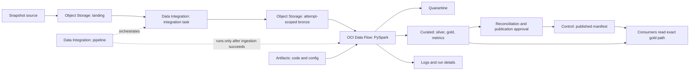

# Data Lake Project with Data Integration and Data Flow

## 1. Objectives and Deliverables

This capstone belongs to the **Capstone Projects and Assessment** chapter of the `CLOUD_PROVIDERS_ORACLE` module. You build a batch data lake on Oracle Cloud Infrastructure (OCI), combining compartments, IAM, Object Storage, data processing, and monitoring into an operable system. The two core services are **OCI Data Integration** for designing ingestion flows, parameterization, and orchestration, and **OCI Data Flow** for running Apache Spark without managing server clusters yourself.

After completing the project, you must prove four things:

- Data moves from source to reports according to clearly documented business rules.
- Users, workspaces, and Spark runs hold only the permissions required to perform their tasks.
- A failed run or rerun never causes readers to consume partial data or double-count revenue.
- Reconciliation evidence, operational observability, cost estimates, and resource teardown are documented.

Deliverables include an architecture diagram, resource/IAM configurations, Data Integration designs, PySpark code, test data, reconciliation outputs, fault-test logs, and a runbook. The files referenced in this guide are artifacts learners create themselves while implementing the project.

## 2. Problem Statement: Aggregating Daily Order Revenue

A retail business receives order snapshots for each business day. The analytics team needs paid revenue by date and region. Source files may contain multiple versions of the same order, invalid prices, or out-of-contract statuses.

Mandatory scope for the lab:

| Item | Project Decision |
| --- | --- |
| Source | CSV inside a private Object Storage bucket |
| Data unit | One row represents one version of an order |
| Business key | `order_id` within a single day's snapshot |
| Winning version | Valid row with the latest `updated_at` |
| Revenue | `quantity × unit_price` for orders with status `PAID` |
| Business date | `event_date` supplied by the source system, on the Vietnam business calendar |
| Update timestamp | `updated_at` in UTC, denoted with suffix `Z` |
| Outputs | Detailed silver, aggregated gold, quarantine, and reconciliation metrics |
| Update strategy | Reprocess an entire day's snapshot and publish one result version |

This is a **daily snapshot** problem, not CDC or event-by-event incremental ingestion. When late adjustments arrive for an earlier date, the source delivers a new full snapshot for that date. The pipeline recomputes that date and consumers switch to the newly approved version. Never add a new snapshot's totals onto an old snapshot.

Completion thresholds are set by the team before running. For example: finish processing before 07:00 Vietnam time once source data is ready, with the ability to recompute a day and revert to the previous published version. These are project goals, not OCI-guaranteed SLAs.

## 3. Architecture and Responsibility Boundaries



Data tiers are used as follows:

- **Landing:** stores unmodified source snapshots and source manifests; never edit contents after readiness is confirmed.
- **Bronze:** Data Integration ingestion output, keeping all eight fields as strings so business-rule violations still reach validation.
- **Silver:** standardized, valid data keeping only the latest version per order.
- **Gold:** revenue table grouped by date and region, counting only `PAID` orders.
- **Quarantine:** rejected rows with reason codes and lineage back to the bronze file. Original raw files remain in landing.
- **Control:** manifest declaring which result version is approved for consumption.

Distinguish three easily confused concepts:

| Concept | Role in This Project |
| --- | --- |
| Data flow in Data Integration | Graph of sources, mappings, and targets designed inside your workspace |
| OCI Data Flow application | Definition of the Spark application, executable code, and runtime settings |
| OCI Data Flow task in Data Integration | Task that invokes an existing OCI Data Flow application |

This project uses a custom PySpark application and invokes it via an OCI Data Flow task. Oracle describes this task as the way to run, schedule, and monitor Data Flow applications from Data Integration. See [OCI Data Flow Tasks](https://docs.oracle.com/en-us/iaas/Content/data-integration/using/oci-dataflow-tasks.htm).

Another integration option is publishing an integration task or data loader task to OCI Data Flow to generate a JAR and corresponding application. Do not mix that approach with this project's PySpark workflow; in particular, Oracle documentation notes specific parameterization limitations on applications created via that publish mechanism. See [Publishing to OCI Data Flow](https://docs.oracle.com/en-us/iaas/Content/data-integration/using/publish-to-service.htm).

## 4. Resource Preparation and Data Layout

### 4.1. Lab Prerequisites

You need a tenancy permitted to use the relevant services, a single consistent region, permission to create or use resources in the project compartment, and sufficient Data Flow limits. Verify service, shape, and Spark version availability in the region before deploying. A Free Tier account alone does not mean the entire project incurs zero charges.

Create a dedicated compartment, such as `lake-capstone`. Apply tags like `project=oci-sales-lake`, `owner=<team>`, and `environment=lab` to taggable resources. Record the region, compartment OCID, and Object Storage namespace. The namespace is not necessarily equal to the tenancy display name.

### 4.2. Buckets and Prefixes

The names below are examples; if renaming, update them consistently across IAM, Data Integration, the application, and manifests.

| Bucket | Contents | Primary Writer |
| --- | --- | --- |
| `lake-landing` | Immutable source CSVs and manifests | Data provider or upstream system |
| `lake-bronze` | Attempt-scoped ingestion outputs | Data Integration workspace |
| `lake-curated` | Attempt-scoped silver, gold, and metrics | Data Flow run |
| `lake-quarantine` | Rejected records | Data Flow run |
| `lake-artifacts` | Versioned PySpark code | Code publisher |
| `lake-logs` | Data Flow logs | Principals per log configuration |
| `lake-control` | Approved manifests | Publisher or publication controller |

Example paths:

```text
lake-landing/
  sales/business_date=2026-11-20/snapshot_id=s001/orders.csv
  sales/business_date=2026-11-20/snapshot_id=s001/source-manifest.json

lake-bronze/
  sales/business_date=2026-11-20/attempt_id=a001/<CSV-files-created-by-DI>

lake-curated/
  sales/attempts/business_date=2026-11-20/attempt_id=a001/silver/
  sales/attempts/business_date=2026-11-20/attempt_id=a001/gold/
  sales/attempts/business_date=2026-11-20/attempt_id=a001/metrics/

lake-quarantine/
  sales/business_date=2026-11-20/attempt_id=a001/

lake-control/
  sales/published/business_date=2026-11-20/manifest.json
```

Object Storage uses object keys and prefixes; `/` does not turn prefixes into folders supporting atomic renames. Splitting buckets simplifies permission boundaries in this lab; for larger systems, evaluate bucket counts, prefix-based permissions, and governance.

Spark accesses Object Storage via URIs:

```text
oci://<bucket>@<namespace>/<object-key-or-prefix>
```

Parquet outputs are sets of files under a prefix, not a single `.parquet` file. Silver and gold are already separated by date through the attempt path; no extra date partitioning inside each output is needed for this small dataset.

## 5. IAM: Separating Designer, Workspace, and Spark Run

### 5.1. Permissions Matrix

| Principal | Permissions Required in Design |
| --- | --- |
| Infrastructure setup | Create compartments, buckets, and configure IAM within assigned scope |
| Pipeline developer | Use workspace, browse sources/targets, manage assigned applications and runs |
| Data Integration workspace | Read landing, write bronze, invoke Data Flow applications/runs |
| Data Flow run | Read bronze and artifacts; write curated, quarantine, and logs |
| Publisher | Read results and runs; update manifests in control |
| Analyst | Read manifests and authorized gold outputs |

Consumers reading only the manifest is an **application access convention**. If granted read access to the entire curated bucket, users could still read unpublished prefixes. When strict enforcement is needed, add appropriate IAM conditions or a serving layer exposing only published versions.

### 5.2. Sample Workspace Policies

The statements below illustrate the lab's runtime permissions within one tenancy. Replace all placeholders before applying. Deployers must still grant user groups permission to browse resources, use the workspace, and create applications; workspace permissions do not replace Console user permissions.

```text
Allow any-user to read objectstorage-namespaces in tenancy where all {request.principal.type='disworkspace', request.principal.id='<workspace-ocid>'}

Allow any-user to read buckets in compartment lake-capstone where all {request.principal.type='disworkspace', request.principal.id='<workspace-ocid>'}

Allow any-user to read objects in compartment lake-capstone where all {request.principal.type='disworkspace', request.principal.id='<workspace-ocid>', target.bucket.name='lake-landing'}

Allow any-user to manage objects in compartment lake-capstone where all {request.principal.type='disworkspace', request.principal.id='<workspace-ocid>', target.bucket.name='lake-bronze'}
```

Conditions restrict access to a single workspace and exact data buckets. Cross-check user browsing permissions and workspace resource principal permissions with [Data Integration Policy Examples](https://docs.oracle.com/en-us/iaas/Content/data-integration/using/policy-examples.htm).

To let the workspace orchestrate Data Flow, add in the compartment holding applications and runs:

```text
Allow any-user to manage dataflow-application in compartment lake-capstone where all {request.principal.type='disworkspace', request.principal.id='<workspace-ocid>'}

Allow any-user to manage dataflow-run in compartment lake-capstone where all {request.principal.type='disworkspace', request.principal.id='<workspace-ocid>'}
```

These are compartment-scoped integration examples. Because `manage` allows broad actions, use a dedicated lab compartment and evaluate narrowing by API, application, or role for real environments. See [Required Policies and Setup](https://docs.oracle.com/en-us/iaas/Content/data-integration/using/oci-dataflow-tasks.htm).

### 5.3. Dynamic Group for Data Flow Runs

Create dynamic group `lake-spark-runs` with matching rule:

```text
ALL {resource.type='dataflowrun', resource.compartment.id='<compartment-ocid>'}
```

This rule matches every Data Flow run in the compartment. The compartment must be dedicated to this project; when shared, narrow further by application per Oracle's guidance. See [Resource Principal Policies](https://docs.oracle.com/en-us/iaas/Content/data-flow/using/resource-principal-policies.htm).

Example data-access policies:

```text
Allow dynamic-group lake-spark-runs to read objectstorage-namespaces in tenancy

Allow dynamic-group lake-spark-runs to read buckets in compartment lake-capstone

Allow dynamic-group lake-spark-runs to read objects in compartment lake-capstone where any {target.bucket.name='lake-bronze', target.bucket.name='lake-artifacts'}

Allow dynamic-group lake-spark-runs to manage objects in compartment lake-capstone where any {target.bucket.name='lake-curated', target.bucket.name='lake-quarantine', target.bucket.name='lake-logs'}
```

Configure the application/run to use resource principal, such as Spark property `dataflow.auth=resource_principal`. Creating a dynamic group alone does not switch a run from another authentication mode to resource principal. See [Supported Spark Properties](https://docs.oracle.com/en-us/iaas/Content/data-flow/using/dfs_provide_jvm_options.htm).

Configure log-read permissions for the service and operators according to your chosen logging setup. If Data Flow needs to read logs from a bucket, scope the policy to `lake-logs` per the setup documentation rather than opening access to all data buckets. See [Task Run Configuration Setup](https://docs.oracle.com/en-us/iaas/Content/data-integration/using/task-run-configuration-setup.htm).

Verify both allow and deny directions: the run can read bronze and write curated, while failing to write to landing or control. When testing denied writes, use dedicated test resources—never attempt writes against finalized snapshots.

## 6. Networking and Data Protection

The baseline connects OCI services only to private buckets through service-supported endpoints; no always-on Compute instance is needed. A private bucket is an access-control setting and does not by itself define the full network path.

If extending the source to an Oracle Database in a private subnet, design connectivity for **both sides accessing the source**: the Data Integration workspace and the Data Flow run. The workspace's private endpoint does not automatically become Data Flow's private endpoint. Prepare VCN/subnets, DNS resolution, routes, and NSGs/security lists for every flow actually required, opening only the configured listener port. If the path from a subnet to Object Storage uses a Service Gateway, routes must target the appropriate regional service CIDR.

Database connection passwords are referenced from OCI Vault as supported by the connector; never place passwords, wallets, or API keys in code, arguments, or logs. When configuring integration tasks executed via Data Flow, Oracle specifies particular Vault and FQDN requirements to verify before extending. See [Required Setup and Policies](https://docs.oracle.com/en-us/iaas/Content/data-integration/using/task-run-configuration-setup.htm).

Sample data uses mock customer IDs only. With real data, assess sensitive fields, retention limits, quarantine read permissions, and encryption key requirements. Quarantine often retains raw values and therefore requires the same protection as source data.

## 7. Data Contract and Verification Dataset

### 7.1. Schema and Rules

CSVs use UTF-8, comma delimiters, a header on the first line, and the exact eight-column order. This lab does not use multiline fields. When ingesting into bronze, map all columns to strings long enough to hold test data; never infer `unit_price` as numeric and silently drop rows with price `abc`.

| Column | Bronze Type | Silver Validation Rule |
| --- | --- | --- |
| `order_id` | String | Non-empty after trimming |
| `updated_at` | String | Valid ISO timestamp matching `YYYY-MM-DDTHH:MM:SSZ` |
| `event_date` | String | Valid date matching the requested business date |
| `customer_id` | String | Non-empty |
| `region` | String | Uppercased; one of `HCM`, `HN`, `DN` |
| `status` | String | Uppercased; one of `PAID`, `CANCELLED` |
| `quantity` | String | Integer digits from 1 to 999999 |
| `unit_price` | String | Non-negative, up to 9 integer digits and 2 decimal places |

Monetary values use decimal types in VND; never use binary floating-point numbers for revenue calculations. Numeric bounds in the table are lab dataset rules, not OCI limits.

Version-handling rules:

1. Trim whitespace and normalize region and status; retain the pre-normalization row representation for investigation.
2. Perform controlled type casting and route violating rows to quarantine with one or more error codes.
3. Among valid rows, if two records share the same `order_id` and `updated_at` timestamp with different contents, fail the run due to a source version conflict.
4. Select the latest update for each order; older versions or identical duplicates are excluded from silver.
5. Keep `CANCELLED` orders in silver, but include only `PAID` orders in gold.

The unit of processing is an order with one price and one quantity. If real source data has multiple line items per order, change the key to the line-item key and redefine aggregation; the `order_id`-based deduplication algorithm cannot be kept as-is.

### 7.2. Input CSV

Save the following as `orders.csv` under snapshot `s001` for date `2026-11-20`:

```csv
order_id,updated_at,event_date,customer_id,region,status,quantity,unit_price
O1001,2026-11-20T01:00:00Z,2026-11-20,C001,HCM,PAID,2,120000.00
O1002,2026-11-20T01:10:00Z,2026-11-20,C002,HN,PAID,1,250000.00
O1002,2026-11-20T02:10:00Z,2026-11-20,C002,HN,PAID,2,250000.00
O1003,2026-11-20T01:20:00Z,2026-11-20,C003,HCM,CANCELLED,1,100000.00
O1004,2026-11-20T01:30:00Z,2026-11-20,C004,HCM,PAID,-1,50000.00
O1005,2026-11-20T01:40:00Z,2026-11-20,C005,HN,PAID,1,abc
O1006,2026-11-20T01:50:00Z,2026-11-20,C006,DN,PAID,3,30000.00
O1007,2026-11-20T02:00:00Z,2026-11-20,C007,DN,REFUNDED,1,90000.00
```

The source writes `source-manifest.json` after all CSVs are uploaded. Minimal example:

```json
{
  "business_date": "2026-11-20",
  "snapshot_id": "s001",
  "schema_version": "1",
  "expected_rows": 8,
  "objects": ["orders.csv"],
  "ready": true
}
```

In the lab, the operator verifies the manifest and filenames before launching, and records each source object's ETag or checksum in the acceptance log. Do not read this JSON as CSV. In automated deployments, add readiness, file-list, schema, and integrity checks ahead of ingestion. Expected row counts must come from an independent source; never count bronze rows and treat that as the expected count.

## 8. Building Ingestion with Data Integration

### 8.1. End-to-End Parameters

| Parameter | Sample Run Value | Meaning |
| --- | --- | --- |
| `P_BUSINESS_DATE` | `2026-11-20` | Business date to compute |
| `P_SNAPSHOT_ID` | `s001` | Immutable source snapshot |
| `P_ATTEMPT_ID` | `a001` | Attempt ID; every real run uses a new value |
| `P_EXPECTED_ROWS` | `8` | Total rows declared by the source |
| `P_MAX_BAD_RATIO` | `0.40` | Intentionally relaxed threshold for the test dataset |
| `P_INPUT_URI` | Attempt-scoped bronze URI | Input to PySpark |
| `P_OUTPUT_BASE` | Attempt-scoped curated URI | Base path for silver, gold, and metrics |
| `P_QUARANTINE_URI` | Attempt-scoped quarantine URI | Destination for rejected rows |

Business date, snapshot, and attempt are three separate identifiers. Rerunning the same snapshot still requires a new attempt. URIs must be constructed or passed consistently with all three identifiers; never let one task write `a002` while Spark still reads `a001`.

### 8.2. Designing the Ingestion Data Flow

1. Create a workspace and project, such as `SalesLakeProject`.
2. Create an Object Storage data asset with an appropriate connection; verify connectivity and bucket browsing permissions.
3. Create data flow `df_ingest_orders` with Source pointing to the snapshot CSV, mapping eight columns, and Target set to `lake-bronze`.
4. Declare or adjust the source schema as strings; verify the preview shows `abc`, negative quantities, and unexpected statuses.
5. Configure Target as CSV, UTF-8, header enabled, comma-delimited. Align quoting and escaping with the Spark reader.
6. Parameterize source entity and target prefix so the exact snapshot loads into the exact attempt.
7. Validate the data flow; create integration task `task_ingest_orders` wrapping this data flow.

Example parameterized source entity name:

```text
sales/business_date=${P_BUSINESS_DATE}/snapshot_id=${P_SNAPSHOT_ID}/*.csv
```

Example parameterized target entity name when writing to a prefix:

```text
sales/business_date=${P_BUSINESS_DATE}/attempt_id=${P_ATTEMPT_ID}/
```

Select the proper multi-file or single-file output mode in the UI, then inspect actual output object keys after a test run. Do not assume the tool names the output file `orders.csv`. Oracle supports parameters in entity names and enforces different `/` rules for directory-style versus single-file outputs. See [Using Data Flow Operators](https://docs.oracle.com/en-us/iaas/Content/data-integration/using/using-operators.htm).

The target prefix must be fresh for every attempt. Ingestion must never silently append to a previous run's data. If ingestion partially fails, preserve evidence and start a new attempt.

### 8.3. Validating Ingestion

Publish the integration task to your lab Data Integration application, wait for publish completion, and run a test execution. Verify bronze holds all eight data rows with the exact header and did not turn `abc` into null or drop rows. Only after confirming this should you attach the Spark task.

If re-running the full pipeline after testing ingestion alone, use a new `P_ATTEMPT_ID`. In Data Integration, tasks must be published before running or scheduling. See [Running Published Tasks](https://docs.oracle.com/en-us/iaas/Content/data-integration/using/published-tasks.htm).

## 9. PySpark Application on OCI Data Flow

### 9.1. Behavior of the Sample Code

The code below processes one snapshot for one date, reading bronze with the eight-column schema. Structurally malformed CSVs fail the run; business-rule errors are written to quarantine. The default bad-row threshold is 0. For this test dataset intentionally containing three errors out of eight rows, pass `--max-bad-ratio 0.40` to complete the verification run.

Each output uses `errorifexists` to prevent overwriting data within the same attempt. Writing multiple outputs is not an atomic transaction; the publication mechanism in the next section prevents consumers from reading incomplete runs.

### 9.2. `sales_lake.py` Source Code

```python
import argparse
import json
import re
from datetime import date
from decimal import Decimal

from pyspark.sql import SparkSession, Window
from pyspark.sql import functions as F
from pyspark.sql import types as T


parser = argparse.ArgumentParser()
parser.add_argument('--input', required=True)
parser.add_argument('--output-base', required=True)
parser.add_argument('--quarantine', required=True)
parser.add_argument('--business-date', required=True)
parser.add_argument('--snapshot-id', required=True)
parser.add_argument('--attempt-id', required=True)
parser.add_argument('--expected-input-rows', type=int, required=True)
parser.add_argument('--max-bad-ratio', type=Decimal, default=Decimal('0'))
args = parser.parse_args()

date.fromisoformat(args.business_date)
if not re.fullmatch(r'[A-Za-z0-9][A-Za-z0-9_-]{0,63}', args.attempt_id):
    raise ValueError('Invalid attempt ID')
if not Decimal('0') <= args.max_bad_ratio <= Decimal('1'):
    raise ValueError('Invalid bad-row threshold')
if args.expected_input_rows <= 0:
    raise ValueError('This lab requires a non-empty snapshot')

spark = SparkSession.builder.appName('sales-lake-capstone').getOrCreate()
spark.conf.set('spark.sql.session.timeZone', 'UTC')
# Invalid casts become null and are handled by the quality rules below.
spark.conf.set('spark.sql.ansi.enabled', 'false')
spark.conf.set('spark.sql.legacy.timeParserPolicy', 'CORRECTED')

fields = [
    'order_id', 'updated_at', 'event_date', 'customer_id',
    'region', 'status', 'quantity', 'unit_price'
]
schema = T.StructType([T.StructField(c, T.StringType(), True) for c in fields])

raw = (
    spark.read.schema(schema)
    .option('header', 'true')
    .option('enforceSchema', 'false')
    .option('mode', 'FAILFAST')
    .csv(args.input)
    .withColumn('source_file', F.input_file_name())
    .cache()
)
n_input = raw.count()
if n_input != args.expected_input_rows:
    raise RuntimeError(
        f'Source count mismatch: expected={args.expected_input_rows}, actual={n_input}'
    )

base = raw.withColumn('raw_record_json', F.to_json(F.struct(*fields)))
for name in fields:
    base = base.withColumn(name, F.trim(F.col(name)))
base = (
    base.withColumn('region', F.upper('region'))
    .withColumn('status', F.upper('status'))
    .withColumn('_event_date', F.to_date('event_date', 'yyyy-MM-dd'))
    .withColumn('_updated_ts', F.to_timestamp(
        'updated_at', "yyyy-MM-dd'T'HH:mm:ssX"
    ))
    .withColumn('_quantity', F.col('quantity').cast('long'))
    .withColumn('_unit_price', F.col('unit_price').cast(T.DecimalType(18, 2)))
)

rules = [
    ('MISSING_ORDER_ID', F.length('order_id') > 0),
    ('MISSING_CUSTOMER_ID', F.length('customer_id') > 0),
    ('INVALID_REGION', F.col('region').isin('HCM', 'HN', 'DN')),
    ('INVALID_STATUS', F.col('status').isin('PAID', 'CANCELLED')),
    ('INVALID_DATE', F.col('_event_date').isNotNull()
        & F.col('event_date').rlike(r'^\d{4}-\d{2}-\d{2}$')),
    ('WRONG_BUSINESS_DATE', F.col('_event_date')
        == F.lit(args.business_date).cast('date')),
    ('INVALID_UPDATED_AT', F.col('_updated_ts').isNotNull()
        & F.col('updated_at').rlike(r'^\d{4}-\d{2}-\d{2}T\d{2}:\d{2}:\d{2}Z$')),
    ('INVALID_QUANTITY', F.col('quantity').rlike(r'^[0-9]{1,6}$')
        & (F.col('_quantity') > 0)),
    ('INVALID_PRICE', F.col('unit_price').rlike(r'^[0-9]{1,9}(\.[0-9]{1,2})?$')
        & F.col('_unit_price').isNotNull()),
]

flagged = base.withColumn(
    'error_codes',
    F.concat_ws('|', *[
        F.when(~F.coalesce(test, F.lit(False)), F.lit(code))
        for code, test in rules
    ])
).cache()
invalid = flagged.filter(F.col('error_codes') != '').cache()
valid = flagged.filter(F.col('error_codes') == '').withColumn(
    '_record_hash', F.sha2(F.to_json(F.struct(*fields)), 256)
).cache()

n_bad = invalid.count()
n_valid = valid.count()
if n_input != n_bad + n_valid:
    raise RuntimeError('Input reconciliation failed')

# Even rejected runs retain bad records for investigation.
invalid.withColumn('attempt_id', F.lit(args.attempt_id)).write.mode(
    'errorifexists'
).parquet(args.quarantine)

bad_ratio = Decimal(n_bad) / Decimal(n_input)
print(json.dumps({
    'event': 'quality_check',
    'attempt_id': args.attempt_id,
    'input_rows': n_input,
    'invalid_rows': n_bad,
    'invalid_ratio': str(bad_ratio)
}))
if bad_ratio > args.max_bad_ratio:
    raise RuntimeError('Bad-row threshold exceeded')

conflicts = (
    valid.groupBy('order_id', '_updated_ts')
    .agg(F.countDistinct('_record_hash').alias('variants'))
    .filter(F.col('variants') > 1)
)
if conflicts.limit(1).count() > 0:
    raise RuntimeError('Conflicting records share order ID and update timestamp')

window = Window.partitionBy('order_id').orderBy(
    F.col('_updated_ts').desc(),
    F.col('_record_hash').desc(),
    F.col('source_file').asc()
)
silver = (
    valid.withColumn('_rank', F.row_number().over(window))
    .filter(F.col('_rank') == 1)
    .select(
        'order_id', 'customer_id', 'region', 'status',
        F.col('_event_date').alias('event_date'),
        F.col('_updated_ts').alias('updated_at'),
        F.col('_quantity').alias('quantity'),
        F.col('_unit_price').alias('unit_price'),
        'source_file'
    )
    .withColumn('line_amount',
        (F.col('quantity') * F.col('unit_price')).cast(T.DecimalType(28, 2)))
    .withColumn('attempt_id', F.lit(args.attempt_id))
    .cache()
)
if silver.filter(F.col('line_amount').isNull()).limit(1).count() > 0:
    raise RuntimeError('Amount conversion failed')

paid = silver.filter(F.col('status') == 'PAID')
gold = (
    paid.groupBy('event_date', 'region')
    .agg(
        F.count('*').alias('paid_order_count'),
        F.sum('line_amount').alias('revenue_vnd')
    )
    .withColumn('attempt_id', F.lit(args.attempt_id))
    .cache()
)
n_silver = silver.count()
n_paid = paid.count()
revenue = gold.agg(F.sum('revenue_vnd')).first()[0]
if n_paid > 0 and revenue is None:
    raise RuntimeError('Revenue aggregation failed')

metrics = {
    'schema_version': '1',
    'business_date': args.business_date,
    'snapshot_id': args.snapshot_id,
    'attempt_id': args.attempt_id,
    'input_rows': n_input,
    'valid_rows_before_dedup': n_valid,
    'invalid_rows': n_bad,
    'removed_versions': n_valid - n_silver,
    'silver_rows': n_silver,
    'paid_order_count': n_paid,
    'gold_rows': gold.count(),
    'revenue_vnd': str(revenue if revenue is not None else Decimal('0.00')),
    'invalid_ratio': str(bad_ratio),
    'max_bad_ratio': str(args.max_bad_ratio),
    'quality_pass': True,
}
if n_input != n_bad + metrics['removed_versions'] + n_silver:
    raise RuntimeError('Final row reconciliation failed')

output = args.output_base.rstrip('/')
silver.write.mode('errorifexists').parquet(output + '/silver')
gold.write.mode('errorifexists').parquet(output + '/gold')
spark.createDataFrame([(json.dumps(metrics),)], ['value']).coalesce(1).write.mode(
    'errorifexists'
).text(output + '/metrics')
print(json.dumps({'event': 'candidate_outputs_written', **metrics}))
spark.stop()
```

The code pulls only tiny aggregate values and conflict checks to the driver; it never calls `collect()` on all orders. `cache()` and `count()` calls make the lab easy to reconcile, but intermediate storage and scan counts must be re-evaluated at larger scale.

The metric is named `removed_versions` because eliminated rows include older versions as well as identical duplicates, not solely physical duplicates. If the source expects a newer invalid row to invalidate an older valid version, the business rule must change; the current code picks the latest version **within the valid set**.

### 9.3. Creating the Application and Standalone Testing

Upload versioned code to `lake-artifacts`, for example `sales/v1/sales_lake.py`. Create a Python application in OCI Data Flow, pick a supported Spark version, configure small driver/executor shapes, and set the log location. Record the exact Spark version, shape, OCPUs, memory, executor count, and source code used for the run. See [Creating a PySpark Data Flow Application](https://docs.oracle.com/iaas/data-flow/using/dfs_create_pyspark_data_flow_app.htm).

Enable resource principal per the IAM section. Do not set `spark.master` or hardcode cluster addresses; Data Flow manages the execution environment.

Arguments for the sample run, formatted one flag/value pair per line for readability:

```text
--input oci://lake-bronze@<namespace>/sales/business_date=2026-11-20/attempt_id=a001/
--output-base oci://lake-curated@<namespace>/sales/attempts/business_date=2026-11-20/attempt_id=a001
--quarantine oci://lake-quarantine@<namespace>/sales/business_date=2026-11-20/attempt_id=a001/
--business-date 2026-11-20
--snapshot-id s001
--attempt-id a001
--expected-input-rows 8
--max-bad-ratio 0.40
```

These are application argument tokens, not a complete shell command. Enter them in the format required by the Data Flow UI. When testing Spark standalone after a successful write, change the attempt ID on outputs and quarantine; if reusing prior bronze data, note that explicitly in standalone test evidence. During full pipeline runs, bronze and outputs must share the same attempt.

The script uses only PySpark APIs and the Python standard library; no dependency archive is needed yet. If adding external libraries, package and version dependencies alongside the application's Spark version.

## 10. Orchestration with a Data Integration Pipeline

### 10.1. Creating the OCI Data Flow Task

Create task `task_transform_sales` of type **OCI Data Flow**, select the PySpark application just created, and configure runtime settings. Use scalar parameters for argument values.

Example Arguments field in Data Integration's OCI Data Flow task as a comma-separated list:

```text
--input,${P_INPUT_URI},--output-base,${P_OUTPUT_BASE},--quarantine,${P_QUARANTINE_URI},--business-date,${P_BUSINESS_DATE},--snapshot-id,${P_SNAPSHOT_ID},--attempt-id,${P_ATTEMPT_ID},--expected-input-rows,${P_EXPECTED_ROWS},--max-bad-ratio,${P_MAX_BAD_RATIO}
```

Inspect actual arguments received in the run to confirm each flag and value is passed as a separate token. Oracle supports scalar parameters with `${PARAMETER_NAME}` syntax; when using scalars inside Arguments, do not simultaneously parameterize the entire Arguments property. See [Creating an OCI Data Flow Task](https://docs.oracle.com/en-us/iaas/Content/data-integration/using/oci-dataflow-tasks-create.htm).

### 10.2. Assembling the Pipeline

Create pipeline `pipeline_daily_sales`:

```text
Start
  → task_ingest_orders
  → task_transform_sales
  → End
```

Configure the Spark task to execute only upon ingestion success. Configure the End operator so the mandatory sequence must succeed; never choose an end rule that marks the pipeline successful even when data processing fails. If adding an error notification branch, sending a notification must not turn a failed run into a success. See [Using Pipeline Operators](https://docs.oracle.com/en-us/iaas/Content/data-integration/using/pipeline-operators.htm) and [Listing Task Runs](https://docs.oracle.com/en-us/iaas/Content/data-integration/using/task-runs-list.htm).

Map pipeline parameters down to both tasks. For this dataset, the initial run configuration is:

```text
P_BUSINESS_DATE = 2026-11-20
P_SNAPSHOT_ID = s001
P_ATTEMPT_ID = a002
P_EXPECTED_ROWS = 8
P_MAX_BAD_RATIO = 0.40
P_INPUT_URI = oci://lake-bronze@<namespace>/sales/business_date=2026-11-20/attempt_id=a002/
P_OUTPUT_BASE = oci://lake-curated@<namespace>/sales/attempts/business_date=2026-11-20/attempt_id=a002
P_QUARANTINE_URI = oci://lake-quarantine@<namespace>/sales/business_date=2026-11-20/attempt_id=a002/
```

`a002` is used because `a001` may have been spent on standalone tests. If `a001` is unused, you may use it, provided all prefixes for the new attempt contain no existing data.

Create a pipeline task wrapping the pipeline, publish it to the Data Integration application, and wait for publish completion. Run the published pipeline task. After modifying the design or mappings, publish the updated version and verify the running version; simply clicking Save in the designer does not update the published copy. See [Use a Pipeline](https://docs.oracle.com/en-us/iaas/Content/data-integration/tutorials/06-use-a-pipeline.htm).

### 10.3. Scheduling and Preventing Concurrent Runs

In the lab, complete a manual run first, then create a schedule/task schedule for the published pipeline task to prove automated triggering. Explicitly set the trigger time, time zone, and parameters, verify one scheduled execution, and then disable the test schedule. Each scheduled test run must use a fresh attempt and ready source data.

A schedule with fixed parameter values does not dynamically generate business dates, snapshots, or new attempts. For daily production operation, you need a preparation step or controller that determines the business calendar date, picks a `ready` snapshot, generates a unique attempt, and supplies aligned parameters when invoking the pipeline. Never assume the UTC system date always equals the Vietnam business date.

If enabling **Disable simultaneous execution**, note the exact scope enforced by the service for your task type and invocation method; do not treat this checkbox as a distributed lock across all invocation paths. This lab permits only one operator/controller to trigger runs for a given date at a time. Attempt-scoped prefixes still isolate outputs if overlapping runs occur.

Retries apply only to transient failures and must allocate a new attempt for the entire write chain. Schema, data-quality, or version-conflict failures require fixing the root cause before rerunning. Never retry infinitely.

## 11. Output Reconciliation and Result Publication

### 11.1. Expected Results for the Sample Dataset

| Metric | Expected Result | Explanation |
| --- | --- | --- |
| Bronze input rows | 8 | Excluding header |
| Quarantined rows | 3 | `O1004`, `O1005`, `O1007` |
| Valid rows before deduplication | 5 | Includes two versions of `O1002` |
| Superseded versions removed | 1 | `O1002` version updated at 01:10 |
| Silver rows | 4 | `O1001`, `O1002`, `O1003`, `O1006` |
| Paid orders | 3 | Excludes cancelled `O1003` |
| Gold rows | 3 | One group per region |
| Total revenue | 830000.00 VND | 240000 + 500000 + 90000 |

Gold table (display order may vary):

| event_date | region | paid_order_count | revenue_vnd |
| --- | --- | --- | --- |
| 2026-11-20 | DN | 1 | 90000.00 |
| 2026-11-20 | HCM | 1 | 240000.00 |
| 2026-11-20 | HN | 1 | 500000.00 |

Three arithmetic checks to include in the report:

```text
8 = 3 invalid rows + 5 valid rows before deduplication
5 = 1 superseded version + 4 orders in silver
830000.00 = sum of line_amount across 3 PAID orders in silver
```

Row `O1002` must have quantity 2 and revenue 500000.00. If gold reports 1080000.00, you likely summed the superseded version worth 250000.00 as well. If it reports 930000.00, you likely included the cancelled order worth 100000.00.

Read `metrics/part-*` to retrieve the JSON emitted by the application; do not expect a file literally named `metrics.json`. Beyond metrics, inspect the silver and quarantine tables to verify the winning orders and error codes. A succeeded run status alone does not prove business accuracy.

### 11.2. Publication Gate

Consumers read only outputs referenced by the manifest in `lake-control`. Spark produces only **candidate outputs** and holds no permission to write publication manifests.

The lab operator follows this procedure:

1. Verify the pipeline task succeeded under the configured End rule and all mandatory child tasks succeeded.
2. Confirm the corresponding Data Flow run reached `SUCCEEDED` and is no longer running or cancelling.
3. Cross-check date, snapshot, attempt, code version, paths, and metrics against the source manifest.
4. Verify business checks, row counts, and totals; confirm the error rate is acceptable for the attempt.
5. Build a publication manifest referencing silver/gold paths of that exact attempt plus run lineage.
6. Write a single manifest object with conditional overwrite protection; read back the manifest and confirm consumers resolve the expected URI.

Example `approved-manifest.json` for attempt `a002`:

```json
{
  "schema_version": "1",
  "business_date": "2026-11-20",
  "snapshot_id": "s001",
  "attempt_id": "a002",
  "source_manifest": "oci://lake-landing@<namespace>/sales/business_date=2026-11-20/snapshot_id=s001/source-manifest.json",
  "code_version": "sales/v1/sales_lake.py",
  "data_integration_run_key": "<actual-run-key>",
  "data_flow_run_ocid": "<actual-run-ocid>",
  "silver_uri": "oci://lake-curated@<namespace>/sales/attempts/business_date=2026-11-20/attempt_id=a002/silver",
  "gold_uri": "oci://lake-curated@<namespace>/sales/attempts/business_date=2026-11-20/attempt_id=a002/gold",
  "input_rows": 8,
  "invalid_rows": 3,
  "silver_rows": 4,
  "revenue_vnd": "830000.00",
  "quality_pass": true
}
```

Replace placeholders with real values and include recorded source ETags/checksums. Never publish the example verbatim with unreplaced placeholders.

Example OCI CLI command in PowerShell for initial publication after saving a valid manifest locally:

```powershell
oci os object put `
  --namespace-name '<namespace>' `
  --bucket-name 'lake-control' `
  --name 'sales/published/business_date=2026-11-20/manifest.json' `
  --file '.\approved-manifest.json' `
  --content-type 'application/json' `
  --if-none-match '*'
```

If the object already exists, this conditional operation must fail instead of silently replacing the published version. When publishing a replacement, read the current manifest and its ETag, verify snapshot ordering permits publishing, and pass `--if-match '<current-etag>'`. If the ETag has changed, stop and reconcile. OCI CLI supports these preconditions in [Object Storage object put](https://docs.oracle.com/en-us/iaas/tools/oci-cli/latest/oci_cli_docs/cmdref/os/object/put.html).

ETags detect concurrent updates; they do not inherently know which snapshot is newer in business terms. The publication controller must prevent a late-finishing older run from overwriting a newer approved snapshot.

Updating one manifest object does not create a transaction spanning multiple data objects. Consistency comes from completed immutable outputs, a single publication pointer, and consumers reading the manifest once per query. Never rely on a `_SUCCESS` file in one output directory as proof that all other outputs or the entire pipeline succeeded.

### 11.3. Reruns, Rollback, and Further Automation

With the same snapshot and code, a new attempt must yield identical business results; provenance fields like `attempt_id` and `source_file` may differ. Publish only one attempt per date. Consumers must never wildcard across all `attempt_id` prefixes, as that reads recomputed attempts and double-counts revenue.

To roll back, verify the prior version still has intact data, then update the manifest conditionally using ETag. Preserve manifest change history and publisher identity; Object Storage versioning may be enabled on the control bucket per your retention policy.

The mandatory lab scope automates ingestion and processing via a pipeline, while the publication gate follows a runbook. An extension is a controller or OCI Function executing full checks, per-date locking, and conditional manifest updates. Only once that component and its failure tests exist should you describe the system as automated from source to publication.

## 12. Operational Observability and Troubleshooting

### 12.1. Required Traceability Chain

Each attempt must link:

```text
business_date + snapshot_id + attempt_id
  → Data Integration application / pipeline run key
  → ingestion task run
  → OCI Data Flow application OCID / run OCID
  → code version and Spark configuration
  → input, output, quarantine, and metrics URIs
  → published manifest or reason for non-publication
```

Separately record source readiness time, submission time, queue/provisioning wait time, execution duration, and publication time. Resource provisioning wait time is not Spark processing time. With small datasets, service startup often dominates total runtime.

Track at least input row count, invalid rows by code, superseded versions, total revenue, completion duration, and retry count. The sample code prints JSON for quality checks and candidate results to logs; to alert on those numbers, configure log collection and metrics or log-based queries. Merely printing a JSON field does not automatically create a custom metric in OCI Monitoring.

Inspect Runs / Pipeline graphs in Data Integration, driver/executor logs, and the Data Flow Spark UI. When configuring alarms, document the exact source metric/log, condition, and notification channel; never assume every business field automatically appears as a service metric.

### 12.2. Troubleshooting Matrix

| Symptom | Evidence to Inspect | Appropriate Action |
| --- | --- | --- |
| Cannot browse buckets in designer | User group permissions, compartment, and data asset | Fix designer permissions or resource selection |
| Designer reads fine, but run reports access denied | Runtime principal, dynamic group, policies, and auth mode | Identify whether workspace or Data Flow run is denied |
| Input not found | Namespace, actual prefix, date/snapshot/attempt, and ingestion output | Cross-check parameters across both tasks |
| Row count mismatches manifest | Source file list, schema, bronze read/write counts | Halt publication and investigate missing or extra rows |
| Run fails at quality gate | `quality_check`, quarantine, and passed threshold | Fix source data or document approved exception |
| Header/CSV parsing error | Schema, delimiter, header, quoting/escaping of source and bronze | Align configurations and retain raw copy for tracing |
| Path already exists error | Attempt ID and previously written outputs | Allocate a new attempt; never delete evidence to force continuation |
| Long resource wait | Limits, shapes, quotas, and run status | Adjust configuration within budget |
| Job slows as data scales | Spark UI, shuffles, skew, and file sizes | Analyze bottlenecks before adding executors |
| Pipeline succeeds, but gold is wrong | End rule, child tasks, deduplication rules, and status filtering | Inspect success conditions and run business reconciliation |

## 13. Fault Injection and Availability Proof

Before injecting faults, have a valid published manifest in place. Each test case uses a fresh attempt; modify permissions or test data strictly within the project scope.

| Test Case | Action | Acceptance Criteria |
| --- | --- | --- |
| Sample happy path | Run eight rows with threshold 0.40 | Exact figures in reconciliation section |
| Strict threshold | Run same source with threshold 0 | Run fails, quarantine written, prior manifest unchanged |
| Missing source | Point to non-existent snapshot/prefix | Processing chain fails and nothing is published |
| Write denied | Remove runtime write permission on test bucket | Permission error evidenced; no new manifest created |
| Duplicate attempt | Reuse an existing output prefix | Blocked by output mode; no overwrite |
| Version conflict | Add valid row with same ID/timestamp but different price | Run fails on conflict; update `expected_rows` for test input |
| Recompute same snapshot | Run new attempt with identical source and code | Identical orders and revenue; consumers still read one version |
| Late adjustment | Create full snapshot `s002`, change `O1001` price to 130000.00 | New total 850000.00 takes effect only after publication |
| Mid-output failure | In test code, inject failure after writing silver before gold | Partial outputs may exist, but consumers keep using old manifest |
| Concurrent publication | Two operators/controllers use the same old ETag | Only one conditional update succeeds |
| Rollback | Point manifest back to prior complete attempt | Consumers read the previous version's exact revenue again |

In the late-adjustment case, snapshot `s002` still contains the full day's dataset, including the three intentionally invalid rows. Since `O1001` has quantity 2, a price increase of 10000 adds 20000 to total revenue.

Managed services reduce cluster administration, yet a run can still fail. This project's availability strategy keeps sources immutable, isolates attempts, advances the manifest only after success, and preserves prior published versions for continued serving or rollback.

Your team's RPO/RTO proposal must define scope clearly: losing the ability to compute new data differs from losing already-published data. Recomputing from snapshots recovers a failed run, but does not guarantee survival if an entire region fails. Multi-region requirements demand explicit design for data replication, artifact syncing, IAM setup, service availability, replication lag, and failover drills, alongside acceptable cost and loss bounds.

## 14. Performance and Cost Control

### 14.1. Evidence-Based Optimization

Start with small datasets to prove correctness, then scale row counts deliberately while recording runtime and spend. Eight rows are insufficient to conclude Spark settings are optimal.

- Choose small shapes and executor counts fitting lab limits; scale up only when CPU, memory, or shuffle metrics justify it.
- Keep Parquet for silver/gold; avoid thousands of tiny files as write volume grows.
- Evaluate date partitioning when storing many days; avoid partitioning by high-cardinality `order_id`.
- Never collect entire datasets to the driver. Use `coalesce(1)` only for tiny JSON metrics as in the sample code.
- At larger scale, tune action count, caching, and group/window operations; a single key with many versions can cause skew.
- If using autoscaling or pools, cap limits and include idle pool retention costs in estimates.

### 14.2. Cost Estimate Table

Do not hardcode a fixed price into this guide because pricing, billing units, regions, and contracts vary. When executing the project, record the lookup date and actual unit prices from the OCI price list or estimator.

| Line Item | Usage Data to Record for Estimation |
| --- | --- |
| Data Integration | Applicable billing units for workspace/execution and usage hours |
| Data Flow | Driver/executors, OCPUs, memory, duration, run counts, and retries |
| Object Storage | Capacity per tier, retained versions, request counts, and storage tier |
| Logs/Monitoring | Log ingestion/storage volume, retention, and observability features used |
| Networking | Outbound data transfer and billable network components if applicable |
| Extended components | Functions, databases, catalogs, pools, or other added services |

Estimate using the general formula:

```text
Evaluation period cost
  = sum(usage per billing unit × corresponding unit price)
  + storage, requests, logs, networking, and supporting components
```

Create a budget for the compartment or project tag with alert thresholds and an owner. Budgets are soft tracking/alerting limits; never rely on them as an automatic circuit breaker that halts all services at a dollar threshold. See [OCI Budgets](https://docs.oracle.com/en-us/iaas/Content/Billing/Concepts/budgetsoverview.htm).

Cap retry counts, executor counts, and run durations. Include failed-run costs and storage costs of retained old attempts; do not report only the cost of the final successful run.

## 15. Evaluation Criteria and Acceptance Dossier

| Evaluation Group | Points | Required Evidence |
| --- | ---: | --- |
| Architecture and data contract | 15 | Diagram, snapshot/key/version definitions, scope boundaries |
| IAM and connectivity | 15 | Permissions matrix, populated policies, allow and deny tests |
| Data Integration | 15 | Data asset, ingestion task, parameters, published pipeline, and one scheduled trigger |
| Data Flow and data quality | 20 | Versioned code, run config, quarantine, version dedup, and 830000.00 reconciliation |
| Rerun, publication, and recovery | 20 | Manifest, recomputation run, mid-output failure, conditional update, and rollback |
| Observability, cost, and handover | 15 | Run lineage, logs, cost estimate, actual spend if available, and runbook |
| **Total** | **100** | |

A high-scoring implementation still fails acceptance if reruns double-count revenue, invalid rows vanish without trace, failed-run outputs are published, or secrets leak into deliverables. These are mandatory acceptance gates.

The dossier should enable another engineer to redeploy in their own clean lab compartment:

- Short document explaining architecture, design choices, and remaining manual steps.
- Resource inventory, region, code/Spark versions, and runtime configuration.
- Data Integration designs or suitable exports with parameter mapping table; no secrets included.
- Sample snapshot, source manifest, and silver/gold/quarantine/metrics outputs.
- Records of successful, failed, and rollback runs linked by attempt ID.
- Cost estimate table, proof that test schedules are disabled, and inventory of retained resources.

At a minimum, the runbook must describe how to verify source readiness, choose date/snapshot, generate an attempt ID, launch the published pipeline, monitor child tasks, handle errors, reconcile outputs, conditionally publish, and roll back to a prior version.

## 16. Resource Teardown and Extension Paths

After saving required evidence, disable task schedules first to prevent new runs. Cancel active lab runs; tear down any pools or always-on components if created. Clean up test outputs and incomplete multipart uploads within lab scope, and inspect object versions, retention rules, and lifecycles before deleting buckets. Never delete snapshots or outputs still referenced by an active manifest.

For full teardown, delete lab-specific applications, workspaces, buckets, private endpoints, policies, and dynamic groups in dependency order. Confirm no other project uses those resources; shared permissions must remain intact. Verify cost reports and resource inventories afterward rather than relying solely on an application disappearing from the Console.

Once the baseline passes acceptance, you may choose an extension with measurable targets:

- Ingest snapshots from Oracle Database via Data Integration over a private network, using Vault for connection credentials.
- Register metadata/schemas and lineage so analysts can discover datasets; do not assume having buckets automatically provides a business catalog.
- Serve gold outputs to an Oracle analytics database or BI tool, adding serving-layer reconciliation.
- Adopt transactional table formats like Delta Lake or runtime-supported alternatives when merge/upsert is needed; verify versions and semantics rather than treating Parquet overwrites as equivalent.
- Automate the readiness and publication gate via a controller validating run status, snapshot ordering, and conditional manifest updates.

What you must defend before reviewers is an OCI processing pipeline with accurate data, clear permissions, investigable errors, explainable costs, and recoverable published results.
