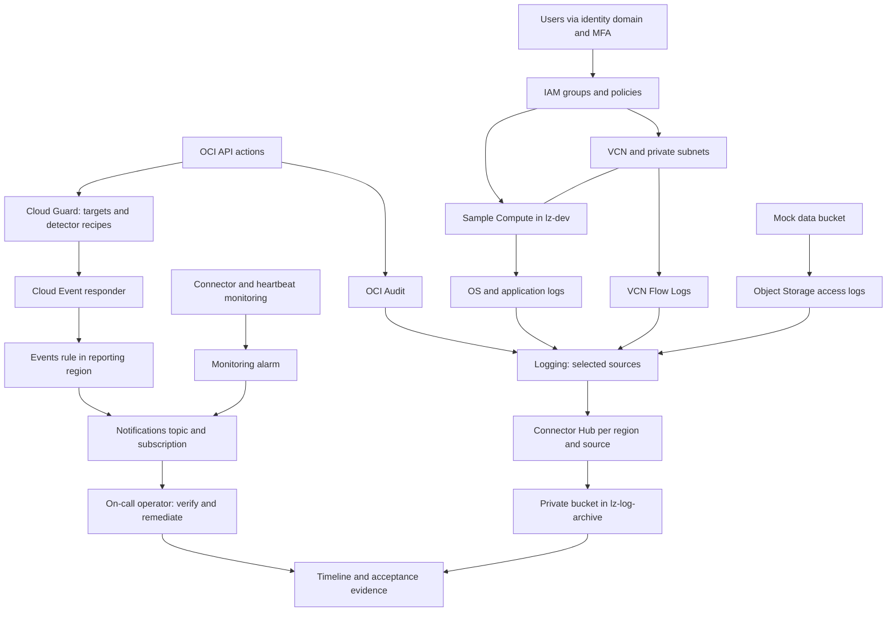

# Landing Zone Project with Auditing and Security Monitoring

## 1. Context and Expected Outcomes

In the **Capstone Projects and Assessment** chapter of the `CLOUD_PROVIDERS_ORACLE` module, you will build a landing zone on Oracle Cloud Infrastructure (OCI) for the fictional enterprise An Phú. This serves as the foundation for teams to deploy cloud applications with unified resource organization, access control, networking, storage, and operations.

An Phú is preparing to move an internal document-processing service to OCI. Development needs a test environment; the platform team manages networking and infrastructure; the security team needs to detect risky configurations; and auditors must trace who changed resources, when, and with what outcome. When a workload fails, the system must still retain evidence for investigation.

The assignment requires building a lab-scale landing zone capable of scaling to a production design. You must prove the chain:

**Authorization → deployment → activity capture → detection → notification → remediation → evidence retention.**

The project is complete when you can:

- Explain the boundaries between tenancy, identity domain, compartment, region, and VCN in the design.
- Deploy a sample workload on a private network, separating application operations from security administration and the log archive.
- Trace a configuration change via OCI Audit and distinguish it from data-access logs.
- Export log copies to Object Storage, verifying read and delete permissions across distinct identities.
- Detect a risky configuration with Cloud Guard, receive a real notification, and execute a remediation runbook.
- Detect a broken log-collection pipeline itself, rather than monitoring only the workload.
- Reproduce infrastructure with Infrastructure as Code (IaC), manage costs, and articulate availability limits.

This exercise focuses on OCI governance foundations. You can use Compute as the sample workload; integrating an Oracle database service via a private endpoint is an extension after core controls are complete.

## 2. Scope, Prerequisites, and Lab Conventions

### 2.1. Mandatory Scope

A minimal deployment includes functional compartments; IAM groups and role-based policies; a VCN with private subnets; a small Compute workload; OCI Audit; appropriate service logs; Cloud Guard; Events and Notifications; a log export pipeline via Connector Hub into a private bucket; log-pipeline health monitoring; budgets; and an acceptance evidence bundle.

Security Zones are used to add a preventive control test in a dedicated compartment. If your account or region does not support all deployment prerequisites, document the limitation, provide an alternative design, and mark the corresponding experiment as not executed. A paper design alone does not count as a passed test.

### 2.2. Prerequisites

You need a tenancy authorized for lab exercises, bootstrap permissions granted by an administrator, a subscribed region containing the required services, an authenticated OCI CLI, and a configured IaC tool. Maintain at least separate test identities for the workload deployer, security operator, and auditor.

One person may wear multiple hats in the lab, but must switch to the exact login session or CLI profile when testing. Running every test as an administrator hides authorization defects.

Set a spending cap for the lab session upfront and verify quotas, service limits, and Compute provisioning capacity. Do not assume Free Tier covers every component in the design. Use only synthetic data for testing—never real records, passwords, or live access keys.

### 2.3. Result Conventions

Each test case records an ID like `T01`, the acting identity, UTC timestamp, target resource, expected result, actual result, and evidence reference. Status values are `PASS`, `FAIL`, or `NOT_RUN`; never mark `PASS` after merely viewing configuration without executing the action.

Durations, thresholds, and retention periods chosen here are design requirements of the fictional project, not Oracle SLAs. Measure actual latencies and explain variances during acceptance.

## 3. Reference Architecture

### 3.1. Compartment Tree

```text
Tenancy root
└── lz-ap
    ├── lz-network
    ├── lz-security
    ├── lz-log-archive
    ├── lz-workloads
    │   ├── lz-dev
    │   └── lz-prod
    └── lz-drill
```

| Scope | Core Resources or Functions | Accountable Owner |
| --- | --- | --- |
| Tenancy root | Identity integration, tenancy-level policies, bootstrap configuration | Tenancy admin |
| `lz-network` | Shared VCN, subnets, route tables, gateways, and NSGs | Network team |
| `lz-security` | Security orchestration resources, topics, rules, alarms, centralized log groups | Security team |
| `lz-log-archive` | Buckets storing log copies and evidence | Log archive team |
| `lz-dev`, `lz-prod` | Compute and per-environment application resources | Application teams per granted scope |
| `lz-drill` | Synthetic resources for detection and prevention drills | Lab coordinator |

A compartment is an organizational and authorization boundary, not a subnet. Compartments are not bound to a single region; many resources inside them are regional. VCNs and subnets are regional networking resources. Identity domains manage identities; placing a VM inside `lz-prod` does not automatically create user groups or policies for that environment.

Cloud Guard has a dedicated reporting region and explicit target scopes. Naming a compartment `lz-security` does not automatically monitor every resource in the tenancy. Similarly, creating a log group in a central compartment does not automatically collect logs from all other compartments.

### 3.2. Core Flow Diagram



The diagram separates the evidence-storage path from the alerting path. An alert email does not replace raw logs; having logs in a bucket does not prove an on-call operator will receive alerts.

## 4. Security Requirements and Acceptance Criteria

Design begins from concrete threats before selecting implementation services.

| Control ID | Risk | Control to Build | How to Prove |
| --- | --- | --- | --- |
| C01 | Application account escalates privileges | Separate IAM admin from workload deployment; never grant tenancy-wide admin to app teams | App team deploys valid resources yet fails to edit foundational policies |
| C02 | Workload accessed directly from Internet | Private subnet, no public IP, NSGs, and routes per approved flows | Cross-check config and test connections from authorized and unauthorized sources |
| C03 | Unknown who altered configuration | Audit queryable by exact region, compartment, and time window | Locate the exact record matching an executed change |
| C04 | Confusing infrastructure audit with data access | Enable access logs on sample data bucket | Distinguish bucket-edit evidence from object-read evidence |
| C05 | Application operator erases tracks | Dedicated log bucket, separate IAM, and proper retention rules | App users cannot read/delete logs; delete-authorized principals are blocked by active retention |
| C06 | Risky configuration persists unnoticed | Cloud Guard, relevant detectors, Cloud Event responder, Events, and Notifications | A real finding reaches a real recipient |
| C07 | Log pipeline stops silently | Monitor connector, data freshness, and heartbeat | Outage drill triggers an alert and recovers data within supported window |
| C08 | Misconfigured resources created anew | Security Zone with selected specific policies | API call is blocked and non-compliant resource never appears |
| C09 | Manual edits cause IaC drift | Protected state, plan checks, and drift-remediation workflow | Re-running produces no surprises; a sample drift is detected |
| C10 | Lab resources incur lingering costs | Appropriate tags, budgets, quotas, and teardown plan | Cost estimate, owner, and post-teardown inventory exist |

For C05, separate two causes of denial: IAM blocking an unauthorized identity versus retention blocking modification of a protected object. A simple permission-denied error alone does not prove retention works.

## 5. IAM Design and Operational Responsibilities

### 5.1. Role Matrix

| Role | Required Permissions | Boundary to Test |
| --- | --- | --- |
| Bootstrap administrator | Create foundational identities and initial policies | Not used as a daily operational identity |
| Network operator | Manage networking within assigned scope | Cannot edit IAM or log archive |
| Workload deployer | Manage approved app resources in `lz-dev` | Cannot alter core network, Cloud Guard, connectors, or log buckets |
| Security operator | Inspect and triage findings, manage detection flows within scope | Does not simultaneously hold all archive-deletion rights |
| Log custodian | Manage retention settings and archive access | Change-control process exists for retention and access edits |
| Auditor | Read Audit, logs, and scoped evidence | Cannot modify workloads or security controls |
| Automation principal | Agent, connector, or job permissions scoped to task | Inherits no personal keys or broad admin rights |

A Workload deployer policy must include the dependent permissions actually needed to use subnets, VNICs, images, and volumes. Shared network permissions must be scoped as needed; never fix a VM provisioning failure by granting `manage all-resources in tenancy`.

OCI IAM aggregates permissions granted across all applicable policies and groups. Check both inherited permissions from parent compartments and other groups a user belongs to. Adding one narrow policy does not revoke an existing broad policy.

### 5.2. Example Evidence-Read Policy

The sample below uses OCIDs to avoid confusion between identically named groups across identity domains. Replace every `<...>` value with real OCIDs and place the policy at a level with authority over the target compartments:

```text
Allow group id <auditor_group_ocid> to read audit-events in compartment id <landing_zone_compartment_ocid>
Allow group id <auditor_group_ocid> to read log-groups in compartment id <security_compartment_ocid>
Allow group id <auditor_group_ocid> to read log-content in compartment id <security_compartment_ocid>
Allow group id <auditor_group_ocid> to read buckets in compartment id <archive_compartment_ocid>
Allow group id <auditor_group_ocid> to read objects in compartment id <archive_compartment_ocid>
```

This is only the evidence-reading portion of the design, not the complete operational policy set. The `group id` and `compartment id` syntax is documented in [OCI IAM Policy Syntax](https://docs.oracle.com/en-us/iaas/Content/Identity/Concepts/policysyntax.htm). Permission to read log-group metadata differs from permission to search log content; see [Logs and Log Groups](https://docs.oracle.com/en-us/iaas/Content/Logging/Task/managinglogs.htm).

The example intentionally reads Audit only for the landing zone tree. IAM actions at root or in the compartment holding the identity domain may occur outside that tree. Map where Audit events are emitted for each IAM operation you must monitor, then grant corresponding permissions and collection sources. If granting auditors tenancy-wide Audit reads, document that scope expansion explicitly. Never assume querying `lz-dev` covers all identity changes. Oracle illustrates identity-domain Audit scope in [Generate IAM Reports from OCI Audit](https://docs.oracle.com/en/learn/generating-iam-reports-from-oci-audit/).

### 5.3. Machine Identities and Emergency Access

Compute agents use instance principals with a dynamic group matching the exact instances emitting logs. Connectors use service-supported authorization scoped to source, target, and task. Maintain separate policies for the person creating a connector versus the connector executing; an administrator being able to create a connector does not prove the service can read/write data.

Maintain an emergency break-glass account with a designated owner, controlled authentication, and a logging procedure for every use. After bootstrap, test routine sessions with least-privilege identities and confirm emergency-privilege usage is traceable.

## 6. Private Networking and Verification Workload

### 6.1. Addressing Plan and Connectivity Flows

Use a sample VCN `10.60.0.0/16`, application subnet `10.60.10.0/24`, and reserved data subnet `10.60.20.0/24`. When extending connectivity to the enterprise, check for CIDR overlaps before interconnecting networks. These ranges are lab examples.

Compute has no public IP. Administrative access runs through OCI Bastion or an approved private path; if choosing Bastion, complete the required permissions, session settings, and network conditions. Claim Bastion SSH succeeded only after actually opening a live session.

| Flow | Control Method |
| --- | --- |
| Admin to VM SSH | Approved admin source, short-lived session, matching NSG and OS firewall |
| VM to Oracle Services Network | Service Gateway and appropriate route/service CIDR when target service is supported |
| VM outbound package updates, if needed | NAT Gateway for egress; document justification, target, and duration |
| App to database, if deployed | Private endpoint and NSG opening only the chosen service port |
| Unauthorized source to VM | No route path and no matching allow rule |

A NAT Gateway does not grant inbound Internet access to VMs. A Service Gateway does not replace IAM permissions. Route tables control forwarding paths, whereas NSGs, security lists, and host firewalls enforce traffic rules at their respective layers.

When a VNIC is governed by both NSGs and security lists, allow rules combine. Therefore, closing a port in an NSG does not override a broad allow rule still present in a security list. Inspect the entire rule set and test with new connections; this behavior is documented in [OCI Security Rules](https://docs.oracle.com/en-us/iaas/Content/Network/Concepts/securityrules.htm).

### 6.2. Minimal Workload

Deploy a small Compute instance running a service that returns health status or handles a mock request. Application logs must include UTC timestamps, request correlation IDs, and processing outcomes. Never log secrets or sensitive full payloads.

Enable VCN Flow Logs on the sample network scope and custom logs for OS/app logs if using an agent. One VM suffices for integration testing, but remains a single point of failure. A production design must specify instance distribution across fault domains or availability domains appropriate to the region, load balancing, backups, and recovery; anything unimplemented must not be claimed as achieving HA.

## 7. Building Auditing and the Evidence Archive

### 7.1. Classifying Data Sources

| Source | Questions It Helps Answer | Limitations to Understand |
| --- | --- | --- |
| OCI Audit | Who called supported control-plane APIs, when, on which resource, and with what outcome? | Does not replace full data-access logs or internal database auditing |
| Object Storage access logs | What object read/write operations occurred, from which identity and source? | Must enable appropriate categories and verify events actually arrive |
| VCN Flow Logs | Which network connections were observed, accepted, or rejected? | Not packet captures or SQL query contents |
| OS / application logs | Which process or business request failed? | Requires agent/config, log-emit permissions, and sensitive-data controls |
| Cloud Guard problems | Which detector flagged a risky state or behavior? | Findings are analytical records; must correlate back to resources and logs |
| Connector run logs and metrics | Is the log pipeline running and delivering data? | Does not automatically prove every expected source was included in config |

OCI Audit automatically records supported public API endpoint calls. For Object Storage, Audit documentation distinguishes bucket-level events from object-level events; never rely on Audit as the sole proof of `GetObject`. See [Overview of Audit](https://docs.oracle.com/en-us/iaas/Content/Audit/Concepts/auditoverview.htm).

On the mock data bucket, enable both Read Access Events and Write Access Events when testing reads/writes. Oracle notes that Object Storage service logs are delivered on a best-effort basis, so not every data request is guaranteed a delivered log entry. See [Details for Object Storage](https://docs.oracle.com/en-us/iaas/Content/Logging/Reference/details_for_object_storage.htm).

If extending to Oracle Database, design in-database auditing for data access or SQL statements requiring tracking. Creating/updating a database resource in OCI and querying a table inside the database are two distinct layers of activity.

### 7.2. Retention and Data Protection

OCI retains Audit logs for 365 days, and this period cannot be changed. This is separate from Logging retention for service/custom logs and bucket retention rules for archived copies. See [Audit Log Retention Period](https://docs.oracle.com/en-us/iaas/Content/Audit/Tasks/settingretentionperiod.htm).

The project adopts the following example policy:

| Storage Layer | Lab Policy | Production Decision Required |
| --- | --- | --- |
| OCI-managed Audit | Use service retention mechanism | Evaluate long-term copy retention or external SIEM forwarding |
| Service/custom logs in Logging | Choose 30 days for lab sources where supported | Size for typical investigation windows, volume, and query costs |
| Log archive bucket | Private; short test retention, unlocked | Corporate retention duration and whether to lock rules |
| Acceptance evidence bundle | Store where only authorized groups can read | Owner, retention period, sharing rules, and disposal process |

Place log buckets in `lz-log-archive`, denying bucket or object management rights to application teams. Separate retention-rule editing from evidence reading. Do not create pre-authenticated requests for the log archive in this lab.

To verify retention, place a mock object in a test bucket, apply an unlocked time-bound retention rule, and attempt to delete the object with an identity authorized to delete objects yet lacking rule-modification rights. Deletion must fail due to active retention. Run a control test on an object in a bucket without retention to confirm the test identity truly holds delete permissions.

An active retention rule protects objects even while unlocked; locking protects the rule itself from edits and is irreversible once active. The lab does not require locking retention. Oracle documents the mandatory 14-day lock wait and constraints in [Object Storage Data Retention Rules](https://docs.oracle.com/en-us/iaas/Content/Object/Tasks/usingretentionrules.htm).

A private bucket and an unlocked rule do not protect against every tenancy administrator. Document trust assumptions, who can edit policies/rules, and change-approval controls in a production design.

By default, data is protected by service-managed encryption. If choosing a customer-managed key in OCI Vault, add key-usage permissions, alerts on key state changes, and a recovery plan. Losing decryption capability can render evidence unusable even while objects remain intact.

### 7.3. Exporting Logs via Connector Hub

Connector Hub, formerly Service Connector Hub, transfers data from Logging to Object Storage. The service provides at-least-once delivery; downstream consumers must tolerate duplicate records. See [Overview of Connector Hub](https://docs.oracle.com/en-us/iaas/Content/connector-hub/overview.htm).

Proceed in order:

1. Build a source inventory listing region, compartment, log group, log, and owner. For Audit, select the `_Audit` source as supported by the configuration interface.
2. Create a private bucket in the selected region for the archive stream, then grant required read/write permissions for the connector's execution mechanism.
3. Create a connector with Logging as source and Object Storage as target; separate prefixes by region and source type for easier investigation.
4. Initially forward selected sources without filtering out critical event groups. Add filters only after proving baseline coverage.
5. Enable connector run logs and route them to a dedicated health-monitoring source.
6. Trigger a test change, locate it at the source, then inspect the target object and decompressed record contents.
7. Repeat for a child compartment and an IAM source outside the workload tree if within monitoring scope.

Never assume selecting a source on a parent compartment automatically covers all child compartments. Verify actual configuration coverage. Each region has its own log resources and export streams that must be tested; writing to a central bucket does not automatically populate every source.

A connector reading from Logging has a 24-hour forwarding buffer window. This is not the Audit retention period. Outages exceeding this window can leave gaps at the destination; a new connector also does not backfill 365 days of Audit history automatically. When historical backfill is needed, run a separate export from retained sources and record the backfilled range. See [Creating a Connector with a Logging Source](https://docs.oracle.com/en-us/iaas/Content/connector-hub/create-service-connector-logging-source.htm).

Avoid collection loops: if enabling access logs on the archive bucket itself, never forward writes to that bucket back into the same bucket in an infinite self-generating loop. Separate archive monitoring sources and inspect filters/scopes.

## 8. Detection and Prevention with Cloud Guard and Security Zones

### 8.1. Scoping Cloud Guard

Enable Cloud Guard using a privileged bootstrap identity. Record the reporting region, in-scope regions, targets, and detector/responder recipes attached to each compartment branch.

Attach detector recipes suited to the configurations and activities being monitored. Verify that a new child compartment inherits expected monitoring; child targets can override inherited configurations. Cloud Guard's reporting region cannot be assumed solely from the home region. These concepts are covered in [Cloud Guard Concepts](https://docs.oracle.com/en-us/iaas/Content/cloud-guard/using/cg-concepts.htm).

For the lab, allow automatic event emission for notifications while executing resource remediation only after operator verification. When cloning responder recipes, review every rule to enable automatic execution solely for well-understood, necessary actions.

### 8.2. Completing the Notification Chain

An often-missed setting is the **Cloud Event** responder. To receive findings via Events and Notifications, the target must use a responder recipe with the Cloud Event rule enabled and set to auto-execute. Do not disable all responders and expect Events to keep receiving findings.

In the reporting region:

1. Verify the responder recipe attached to the target and the status of the Cloud Event rule.
2. Create a security Notifications topic, add a subscription, and complete confirmation if required by the protocol.
3. Send a test message to prove the topic/subscription can deliver notifications.
4. Create an Events rule in a compartment scoping the target events, with an action routing to the topic.
5. Select the new-problem detection event type. The `eventType` value is:

```text
com.oraclecloud.cloudguard.problemdetected
```

6. Start with a condition broad enough to catch lab test problems. After verifying end-to-end delivery, add severity or payload attribute filters observed from real events.
7. Trigger a new finding and record the problem ID, timestamps, event, and received notification.

Responder, reporting region, and event type setup are documented in [Configuring Notifications](https://docs.oracle.com/en-us/iaas/Content/cloud-guard/using/export-notifs-config.htm).

The test message in step 3 proves only that Notifications works; completing step 7 is required to prove Cloud Guard integration to recipients. Problems that already existed before creating the rule do not necessarily emit new detection notifications. See [Troubleshooting Cloud Guard](https://docs.oracle.com/en-us/iaas/Content/cloud-guard/using/trouble.htm).

### 8.3. Security Zones as a Preventive Layer

Under `lz-drill`, create a child compartment allowing Security Zone testing and choose a recipe enforcing a policy relevant to your test, such as prohibiting public buckets. Document which rules are enabled and which resources fall under scope.

Attempt to create a violating configuration using an identity that normally holds permission for that action. The expected result is rejection by Security Zone, with no misconfigured resource created. This test must be distinct from an IAM denial due to missing permissions.

Security Zones evaluate actions against recipe policies; Cloud Guard detects and tracks problems per monitoring configuration. Creating a Security Zone also creates a corresponding Cloud Guard target, so review your target map after this step. See [Getting Started with Security Zones](https://docs.oracle.com/en-us/iaas/Content/security-zone/using/get-started.htm).

Do not apply a strict recipe across an entire tree holding live resources without architectural review. This exercise uses a dedicated branch to observe preventive enforcement while keeping a detection drill area outside the zone.

## 9. Monitoring the Collection Pipeline and Alerting

A system may be quiet because nothing went wrong, or because the connector stopped forwarding logs. Therefore, dashboards must track both workload health and evidence-pipeline health.

Monitor at least connector state, run errors, data lag, and the last heartbeat observed at the target archive. Connector Hub exposes metrics for data freshness, while run logs provide per-run details. See [Troubleshooting Connectors](https://docs.oracle.com/en-us/iaas/Content/connector-hub/troubleshooting.htm) and [Logs for Connector Hub](https://docs.oracle.com/en-us/iaas/Content/connector-hub/service-logging.htm).

The project's heartbeat design:

- A job emits a custom log record containing marker `lz-heartbeat` and a UTC timestamp every 5 minutes.
- A flow forwards this source through the connector under test to the archive.
- An independent verification job reads heartbeat records at the destination and publishes a custom metric for the age of the latest heartbeat.
- A Monitoring alarm triggers when age exceeds 20 minutes, paired with detection if the verification job itself stops emitting metrics.

The 5- and 20-minute values are lab defaults. Adjust them after measuring batching, forwarding, and job runtimes. Heartbeats prove only the heartbeat source path; they do not substitute for coverage tests across each Audit/service log source in the inventory.

The connector alerting path must not depend on the broken connector itself. For instance, Monitoring alarms publish directly to Notifications, while on-call operators inspect metrics and run logs via an independent read-authorized session. When raising criticality for production, add backup recipients and fallback procedures if the primary notification channel fails.

## 10. Automation and Deployment Sequence

### 10.1. Splitting IaC by Responsibility and Lifecycle

Use Terraform with the OCI provider or OCI Resource Manager. Whichever tool you pick, represent the following layers in reproducible source code or bootstrap docs:

| Component | Key Inputs | Outputs to Publish |
| --- | --- | --- |
| Foundation | Tenancy, parent compartment, names, tags | Compartment OCIDs and role map |
| Identity | Group OCIDs, resource scopes, principals | Policies, dynamic groups, or delegation configs |
| Network | CIDRs, approved flows, gateway needs | VCN, subnet, NSG, and route identifiers |
| Evidence | Log sources, target bucket, retention | Log groups/logs, bucket, connector, and source table |
| Detection | Reporting region, targets, recipes | Target, Events rule, topic, and alarm identifiers |
| Workload | Image, shape, subnet, NSG | Instances and private test endpoints |

The illustrative input contract below is a design specification for project IaC, not a payload sent directly to OCI APIs:

```yaml
project: lz-ap
deployment_region: <oci-region-identifier>
cloud_guard_reporting_region: <oci-region-identifier>
network:
  vcn_cidr: 10.60.0.0/16
  app_subnet_cidr: 10.60.10.0/24
  public_ip_for_app: false
archive:
  bucket_name: <unique-lab-archive-bucket-name>
  access: private
  retention_lock_required_in_lab: false
monitoring:
  heartbeat_interval_minutes: 5
  initial_stale_threshold_minutes: 20
ownership:
  team: platform-lab
  environment: lab
```

Never store API private keys, database passwords, or secret values in variable files or repositories. Control access to IaC state and outputs as well, since they may contain sensitive details. Record verified tool/provider versions and retain appropriate lock files so future runs use identical dependencies.

### 10.2. Deployment Sequence

1. **Lock design:** diagrams, roles, regions, spending caps, log sources, and tests.
2. **Bootstrap:** compartments, groups, and foundational policies. Create isolated test profiles.
3. **Lay evidence foundation:** archive bucket, log groups, connectors, topics, and required read/write permissions.
4. **Build network and workload:** private subnet, NSGs, admin path, VM, and app logging.
5. **Enable detection:** targets, recipes, Cloud Event responder, Events rule, and test Security Zone.
6. **Enable health monitoring:** metrics, heartbeat, alarms, and source tracking table.
7. **Run tests:** capture live evidence, remediate failures, and record unexecuted items.
8. **Verify reproducibility:** run plan after apply, explain any remaining diffs, and resolve a sample drift.
9. **Acceptance and teardown:** hand over the evidence bundle, retained resources, and estimated spend.

Enabling Audit is not a manual per-VM agent installation step; what must be implemented are query permissions, source mapping, export pipelines, and evidence consumption workflows. After bootstrap, subsequent edits should flow through IaC; drill exceptions record start times, end times, and how state/config is restored to the desired baseline.

## 11. Hands-On Audit Evidence Retrieval

The PowerShell example below is read-only and fetches all pages within a 30-minute window. It requires a configured OCI CLI and an auditor profile with permissions on the target compartment. Replace placeholders before running:

```powershell
$auditProfile = '<auditor-cli-profile>'
$auditRegion = '<oci-region-identifier>'
$auditCompartmentId = '<compartment-ocid>'
$auditEndUtc = [DateTime]::UtcNow
$auditStartUtc = $auditEndUtc.AddMinutes(-30)

$auditArguments = @(
    'audit', 'event', 'list',
    '--profile', $auditProfile,
    '--region', $auditRegion,
    '--compartment-id', $auditCompartmentId,
    '--start-time', $auditStartUtc.ToString('yyyy-MM-ddTHH:mm:00Z'),
    '--end-time', $auditEndUtc.ToString('yyyy-MM-ddTHH:mm:00Z'),
    '--all',
    '--output', 'json'
)

$auditJson = & oci @auditArguments
if ($LASTEXITCODE -ne 0) {
    throw 'Failed to retrieve Audit events; check permissions, region, and parameters.'
}

$auditResult = ($auditJson -join [Environment]::NewLine) | ConvertFrom-Json
$auditResult.data
```

Syntax, pagination, and timestamp formats are documented in [OCI CLI: audit event list](https://docs.oracle.com/en-us/iaas/tools/oci-cli/latest/oci_cli_docs/cmdref/audit/event/list.html). This window ends at the start of the current minute due to timestamp formatting; very recent operations may fall outside the window or still be processing, so re-run later with adjusted times.

Do not assume querying one compartment returns all child compartments or all regions. Iterate across your source table and actual investigative scope. Do not pass an unsupported recursive flag.

To create an easily traceable trail, use an authorized identity to update a non-sensitive tag or attribute on a test resource. Record the timestamp, OCID, and request ID if shown in the UI, then match them against the Audit record. Never make broad IAM edits solely to generate sample logs.

When inspecting records, look for timestamps, action names, principals, target resources, request sources, and outcomes. Field wrappers and naming may differ across the Audit API, Logging Search, and exported objects. Inspect a real sample record before writing filters rather than copying field paths mechanically across formats.

## 12. Acceptance Test Plan

### 12.1. Mandatory Test Suite

| ID | Identity and Action | Expected Result | Minimum Evidence |
| --- | --- | --- | --- |
| T01 | Workload deployer deploys valid resources in dev | Succeeds within assigned scope | Deployment output, OCIDs, network config |
| T02 | Same identity attempts to modify foundational policy | Denied; policy unchanged | API error / request ID if any and post-test config |
| T03 | Auditor reads authorized Audit, logs, and archive objects | Reads succeed; cannot modify app resources | Read output and a denied modification test |
| T04 | Authorized admin source and unauthorized source open new connections to VM | Authorized flow works; out-of-design flow blocked | Routes, NSGs/security lists, connection output, and network logs if present |
| T05 | Authorized user updates test resource attribute | Matching Audit record appears | Timestamp, identity, OCID, and action outcome |
| T06 | Identity reads a mock object in sample bucket with read logs enabled | Matching access log appears when delivered | Object, timestamp, principal, action, and result code |
| T07 | Trigger sample change, then inspect source and archive | Matching record found in both locations | Source log, target object, correlation key, and lag |
| T08 | Workload deployer attempts to read/delete archive object | Blocked by IAM as designed | Identity, error, and object still intact |
| T09 | Delete-authorized identity attempts to delete retention-protected object | Blocked by retention; control delete test succeeds | Rule, effective window, and both control results |
| T10 | Create controlled risky config outside Security Zone | Cloud Guard emits finding and notification reaches real subscription | Test config, problem ID, event, and receipt timestamp |
| T11 | Create policy-violating config inside Security Zone | Blocked by Security Zone; non-compliant resource does not exist | Recipe/rule, operation error, and resource state |
| T12 | Pause lab connector per schedule | Monitoring detects stale/stopped data and fires alarm | Status, metrics, notification, recovery timeline |
| T13 | Introduce harmless drift, run plan, then remediate | Drift detected and cleanly resolved | Before/after plan and remediation actions |
| T14 | Verify source inventory with a child compartment and required IAM source | Collection scope matches design | Sample action at each source and target records |

For T06, if no access log appears within the observation window, record the actual result and investigate; never conclude with certainty that no data access occurred. For T10, a screenshot of the Problems list alone does not prove notifications reached recipients. For T12, a manually sent email does not prove the alarm detected data loss.

### 12.2. Controlled Finding Drill

Pick an enabled detector supported for the target resource type and scope. For example, use an empty bucket in the drill branch outside the Security Zone and switch it to a public access level monitored by the chosen detector. Never place real data, grant public write access, or target an archive bucket.

Before making the change, record the initial state, owner, end deadline, and steps to revert the bucket to private. During execution:

1. Record the change timestamp, bucket, and acting identity.
2. Check Audit for the bucket management action.
3. Observe the corresponding new finding on the expected target.
4. Inspect the event and notification naming the problem/resource to remediate.
5. Revert the resource to a safe configuration within the planned drill window.
6. Verify the actual configuration is secure and track the finding lifecycle.
7. If the deadline expires with no finding, revert anyway; mark `FAIL` or `NOT_RUN` per executed steps and investigate monitoring configuration.

Do not assume a fixed Cloud Guard scan interval and treat it as a service SLA. Record timestamps for misconfiguration, detection, notification receipt, and remediation to measure actual latency.

### 12.3. Log Export Outage Drill

Use the lab connector—never a pipeline serving a live system. Record pre-test settings, pause the connector, generate a heartbeat or marker event, and wait for the alarm at the configured threshold. Then resume the connector, confirm new data arrives at the destination, and locate the marker event.

If the outage stays within the service's buffer window, verify the actual backfilled delivery. Otherwise, document the gap and run a separate backfill export from retained source logs. Match by event ID or correlation key and timestamp; never compare raw counts alone, as some delivery paths can emit duplicates.

## 13. Alert Remediation Runbook

Apply this runbook to a public-bucket configuration alert in the lab; for other resource types, substitute corresponding remediation actions.

| Step | On-Call Operator Action | Output to Record |
| --- | --- | --- |
| Intake | Confirm topic, problem ID, region, compartment, and resource | Receipt timestamp and handler |
| Verify | Read finding and live config; distinguish drill from unplanned change | Detector/rule, risk level, and resource state |
| Preserve evidence | Save alert payload, related Audit events, and raw log references | Record IDs, request IDs if any, evidence object/prefix |
| Contain impact | Revert bucket to private using an authorized role | Timestamp and remediation outcome |
| Investigate | Identify actor, request source, nearby changes, and related scope | Timeline and evidence-backed hypothesis |
| Validate | Re-read config, test appropriate access, and track finding resolution | Post-fix config and test results |
| Close | Complete ticket, root cause, preventive action, and IaC update | Reviewer and remaining follow-up tasks |

Never merely click dismiss to clear the dashboard. Dismissing records a triage decision on the finding; whether the bucket remains public must be verified directly. If it is an approved exception, document rationale, owner, scope, and review expiration date.

Sample timeline template for a test:

```text
test_id: T10
resource_id: <bucket-ocid-or-supported-resource-id>
actor: <test-principal-id>
change_at_utc: <timestamp>
audit_event_id: <event-id>
cloud_guard_problem_id: <problem-ocid>
problem_first_detected_at_utc: <timestamp>
notification_received_at_utc: <timestamp>
configuration_restored_at_utc: <timestamp>
verification_result: <PASS|FAIL>
evidence_reference: <restricted-evidence-location>
```

Separately measure time from change to detection, detection to notification receipt, and receipt to restoration. One synthetic test does not prove system reliability across all scenarios; report the exact scope demonstrated.

## 14. Cost, Availability, and Resource Teardown

### 14.1. Cost Control

Apply project, environment, and owner tags. Separately estimate Compute/volumes, gateways, ingested and retained logs, Object Storage, access requests, jobs/Functions if used, and associated data transfer. Use current rate cards and account terms at deployment time; never assume a service labeled free in one scenario is free in all configurations.

Simple estimation formula:

```text
Estimated lab cost
  = runtime resource costs over duration
  + log ingestion, storage, and query costs per service pricing
  + object storage and request costs
  + heartbeat/verification execution costs
  + applicable networking costs
```

Set budgets with alerts on actual spend and appropriate forecasts. Budgets are soft tracking and alerting limits and do not automatically halt resources upon reaching a set amount. Combine appropriate quotas for specific resource types with teardown procedures to control lab spend. See [OCI Budgets](https://docs.oracle.com/en-us/iaas/Content/Billing/Concepts/budgetsoverview.htm).

### 14.2. Availability of Security Functions

| Incident | Consequence to Anticipate | Required Design or Evidence |
| --- | --- | --- |
| App VM stops | App/heartbeat logs from the VM may stop | Independent check distinguishing a stopped workload from a broken connector |
| Connector stops or loses permissions | Archive misses new data | Independent alarm, recovery procedure, and backfill export |
| On-call misses emails | No action taken despite emitted findings | Verified subscriptions and backup recipients per severity |
| Deployment region unavailable | Log reading or orchestration in that region impacted | Standby region decision, replication scope, and restore drill if required |
| Customer-managed key disabled | Data still exists but becomes unreadable | Key lifecycle controls and recovery runbook |

Centralizing data into one bucket is a governance choice and does not automatically provide multi-region recovery. Production designs must define evidence RPO, investigation RTO, and corresponding recovery tests. Single-region labs must state this limitation explicitly.

### 14.3. Teardown Order

After acceptance, stop tests and data-generating jobs, revert drill settings, and remove workloads and dependent resources per your IaC plan. Keep the evidence pipeline active long enough to capture recorded teardown operations. Export the acceptance bundle before tearing down lab-owned connectors and log infrastructure.

Check remaining volumes, gateways, reserved IPs, buckets, rules, topics, alarms, and supporting policies created for the lab. For tenancy-shared IAM or Cloud Guard resources, remove only lab-assigned items after verifying ownership.

Objects still under retention protection can cause bucket deletion to fail. For unlocked lab rules, authorized principals follow the evidence retention/deletion plan; never attempt to disable protections on live operational archives. Document any retained resources along with rationale, owner, and expected post-lab cost.

## 15. Handover Dossier and Grading Rubric

### 15.1. Required Deliverables

The learner's dossier includes the architecture diagram; compartment and region map; IAM matrix; IaC code and bootstrap/reproduction instructions; log source inventory; detector, responder, Events, and Notifications configurations; alarm list; runbook; cost table; test results; and evidence.

Every test row must point to a specific resource or record. Screenshots only support explanation; primary evidence should retain raw payloads or controlled-access references, UTC timestamps, and correlation IDs. When sharing reports outside authorized groups, share sanitized copies and keep raw evidence in a restricted location.

Clearly separate three categories in the dossier: implemented and tested items; designed but unimplemented items; and failing or insufficiently evidenced items. An honest gap list demonstrates stronger operational maturity than an all-`PASS` table lacking proof.

### 15.2. Suggested Grading Rubric

| Category | Max Points | Indicators of Mastery |
| --- | ---: | --- |
| Architecture and responsibility boundaries | 15 | Accurately explains tenancy, identity domain, compartment, region, VCN, and monitoring scope |
| IAM and private networking | 20 | Tests valid access, denied access, and real network paths |
| Audit, service logs, and evidence archive | 20 | Distinguishes sources, traces activity, and proves object protection |
| Detection, notification, and prevention | 20 | Produces real findings, real notifications, and Security Zone tests where available |
| Pipeline operations and incident handling | 10 | Detects outages, reverts cleanly, and identifies data gaps if any |
| IaC, cost, availability limits, and teardown | 10 | Reproducible infra, cost estimate, and final resource inventory |
| Documentation quality and rationale | 5 | Consistent evidence, explicit limitations, and grounded improvement proposals |
| **Total** | **100** | |

Suggested passing threshold is 80/100 alongside mandatory gates: no tenancy-wide admin rights on application identities; traceable Audit records; applications cannot delete the log archive; end-to-end alert verified from detection source to recipient; and a log-export outage drill executed with test configurations cleanly reverted.

If any mandatory gate is unmet, mark the project **incomplete for the corresponding acceptance gate** regardless of high scores elsewhere. During project defense, learners must explain why evidence supports each result and what controls must be added before adopting the design for production.
