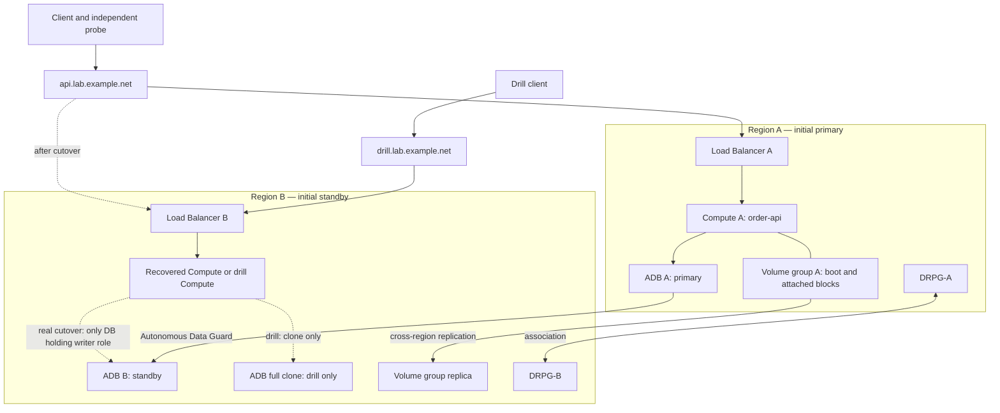

# Two-Region Application Project with Full Stack DR Drills

In the **Capstone Projects and Assessment** chapter of the **CLOUD_PROVIDERS_ORACLE** module, this project requires deploying and proving the recoverability of an ordering application across two OCI regions. Learners combine tenancy, compartment, IAM, VCN, Compute, storage, Oracle Database, monitoring, and automation into a repeatable operational workflow.

What must be proven is: when failing over or switching the service to the standby region, users reach it via the familiar domain name, the application connects to the right database, acknowledged data is reconciled, and only one side is permitted to accept real writes. A DR plan showing a succeeded execution status is only part of the evidence.

## 1. Problem Statement and Acceptance Scope

Build an `order-api` application paired with a simple web page or HTTP client acting as the customer. The application persists orders in Oracle Autonomous Database Serverless (ATP workload), running on OCI Compute behind an OCI Load Balancer. Region A serves normal traffic; Region B is prepared for recovery.

Use OCI Full Stack Disaster Recovery (**Full Stack DR**) to orchestrate Compute, storage, and database recovery, combined with user-defined steps for application configuration, load balancer backends, verification, and DNS cutover.

All four operations must be executed:

1. **Start drill and Stop drill:** stand up a test copy in B, test reads/writes against a database clone, then tear it down.
2. **Switchover A → B:** planned role transition while both regions remain healthy.
3. **Switchover B → A:** verify failback capability after re-establishing protection in the reverse direction.
4. **Simulated Failover A → B:** isolate side A in the lab environment, recover in B, and reconcile any observed data loss.

This is a lab deployment in a tenancy with billable resources. Do not assume Free Tier accounts, existing quotas, or every region pair will satisfy requirements. Before creating resources, verify availability of Full Stack DR, cross-region Autonomous Data Guard, Compute shapes, storage capacity, and budget in both chosen regions.

### Project-Defined Targets

| Item | Acceptance Target | Required Evidence |
| --- | --- | --- |
| Switchover | User-facing outage duration under 15 minutes | Probe logs via primary domain and stable recovery timestamp |
| Data after switchover | Zero missing orders acknowledged by the app before halting writes | Comparison of request ID sets and order contents |
| Simulated failover | Observed RTO under 30 minutes | Timeline from fault injection until transactions via primary DNS stabilize |
| Data after failover | Observed data-loss window under 5 minutes | Client-side ledger and target database reconciliation results |
| Drill | Complete stand-up and verification within 45 minutes | Execution logs, clone tests, and proof that app A continued serving |
| Isolation | Zero drill transactions touch the production database | Connection configs, identities, networking, and data inspection results |
| End state | Clear single primary, protection restored or lab cleaned up per plan | Database roles, replication direction, remaining resources, and spend |

The numbers above are learning targets, not Oracle SLAs or RTO/RPO guarantees. If quotas, topology, or budget require revising targets, document the decision before testing; keep failed results as well for analysis.

## 2. Reference Architecture: Pilot Light and Single Writer

Adopt the **pilot light** model for the application tier:

- Serving Compute in A is registered as a **moving instance**.
- The Compute boot volume belongs to a volume group replicated to B.
- B pre-provisions VCN, subnets, NSGs, load balancer, and dependencies required to launch recovered Compute.
- The database uses **cross-region Autonomous Data Guard**; this protects business data.
- During drills, use a **Full clone** in B per the capabilities of the deployed ADB/Full Stack DR configuration.
- All durable business state lives in the database. The boot volume holds the OS, application, and scripts; never store orders, critical sessions, or long-lived wallets there.

For moving instances, protect both the boot volume and attached block volumes inside the appropriate volume group. Full Stack DR uses prepared infrastructure components; creating a DR plan does not replace setting up replication. See [Compute Instances for Full Stack Disaster Recovery](https://docs.oracle.com/en-us/iaas/disaster-recovery/doc/compute-instances-disaster-recovery.html).



The two links from Compute B to databases represent mutually exclusive modes. A single application process must never open connections to both the live database and the clone simultaneously.

### Pre-Existing Components vs. Recovered Components

| Component | A in Normal Operation | B Before an Event | Project Handling |
| --- | --- | --- | --- |
| VCN, subnets, routes, NSGs | Present | Present | Provisioned via IaC; verified before drills |
| Load balancer and TLS | Present | Present | Pre-created; scripts manage backends by mode |
| Application Compute | Running | No always-on app Compute needed | Full Stack DR launches from recovered storage |
| Boot volume | Attached to Compute A | Volume group replica present | Managed by Full Stack DR recovery |
| Business ADB | Primary | Cross-region standby peer | Autonomous Data Guard and DR plans |
| Drill database | None | Created during Start drill | Select Full clone; never write drill tests to live DB |
| Primary DNS | Points to Load Balancer A | Receives no real traffic yet | User-defined step gated on verification |
| Drill DNS | Unused for real users | Points to Load Balancer B | Routes only to drill backends |

The project intentionally manages load balancer membership via **user-defined steps** to separate live backends from drill backends. Do not also configure built-in load balancer members to do the same job; two mechanisms modifying backends simultaneously obscure the true state.

One application VM per side suffices for minimum project scope. That design still carries a single point of failure within a region. In your report, explain how to add multiple instances distributed across fault domains or availability domains without equating intra-region HA with cross-region DR.

## 3. Concepts That Must Be Distinguished

A **DR protection group (DRPG)** groups protected components under one DR configuration. A **DR plan** is the workflow for a specific recovery operation. A **plan execution** is a concrete run with its own outcome and logs.

Plan groups execute sequentially; steps within the same group can run in parallel. Therefore, a step that starts an application depending on the database must not run in the same group as the step creating or switching the database role. Plans can be customized with user-defined groups while preserving dependencies of built-in groups. See [Overview of DR Plans](https://docs.oracle.com/en-us/iaas/disaster-recovery/doc/overview-dr-plans.html).

| Operation | Switches Live Service? | Requires Source Alive to Complete Source Steps? | Data Implication |
| --- | --- | --- | --- |
| Precheck | No | Depends on check | Verifies readiness; does not prove business data recovered |
| Start drill | No | Never used to prove behavior in a real outage | Creates an isolated verification environment per drill config |
| Stop drill | No | Must not disrupt live serving source | Tears down drill resources; clone writes are not real data |
| Switchover | Yes, planned | Yes, to quiesce source and transition cleanly | Must halt writes, finish role switch, then open target writes |
| Failover | Yes, incident-driven | Target recovery steps must not depend on commands succeeding at source | Data not yet replicated to standby may be lost; must measure and reconcile |

**Replication** propagates state to the peer; bad actions and corrupt data can propagate too. **Backups** provide independent restore points per retention policy. The project needs a database backup and restore verification plan even when using Data Guard.

**RTO** is the Recovery Time Objective. **RPO** is the maximum acceptable data loss, usually expressed in time. Reports must separate initial targets from measured results.

## 4. Prerequisites and Authorization

### 4.1. Tenancy and Operator Preparation

Before creating DRPGs, complete the following:

1. Subscribe to two regions in the same tenancy and record region identifiers.
2. Select a dedicated lab compartment, e.g. `cmp-oci-dr-lab`; record resource OCIDs rather than relying only on display names.
3. Verify service limits and capacity in B, including launching Compute and creating database clones.
4. Own an administrable subdomain, valid TLS certificates, and permissions to update only the lab's DNS records.
5. Have OCI CLI or equivalent API tooling, execution log read permissions, plus `curl` and `jq` on the probe host.
6. Synchronize clocks across measurement hosts; record UTC timestamps.
7. Assign roles for cutover decision-maker, operator, and observer. One person may fill multiple roles in the lab, provided logs stay clear.

Choose a probe host outside both application Compute instances. If the probe sits in the region being simulated as down, add an independent observation source; otherwise losing the probe looks like losing the application.

### 4.2. Separating Orchestration and Runtime Permissions

| Principal | Required Permission Group | Recommended Scope Limitation |
| --- | --- | --- |
| Lab builder | Create networking, Compute, storage, database, and DR configs | Lab compartment; tenancy-wide only when required by action |
| DR operator | Read configs, run and monitor plans per chosen authorization model | Project DRPGs and resources |
| Full Stack DR resource principal | Manipulate members and write operation logs | Compartments holding each managed resource type |
| Recovered Compute | Read exact required secret/wallet; emit logs and metrics | Distinguish identities or conditions between active and drill modes |
| DNS cutover step | Read, update assigned record, and verify result | Lab DNS zone only; never tenancy admin keys |
| Evaluator | Read logs, metrics, and sanitized configs | Never needs database passwords |

Oracle documentation recommends resource principals for Full Stack DR. Policies depend on member types, log locations, and custom step types; no single minimal policy fits every topology. When using Run Command, prepare Oracle Cloud Agent, plugins, and execution permissions. Cross-check [Resource Principals](https://docs.oracle.com/en-us/iaas/disaster-recovery/doc/policies/resource-principals.html) and [Policies for Compute Service and Oracle Cloud Agent](https://docs.oracle.com/en-us/iaas/disaster-recovery/doc/policies/policies-for-compute-service-and-oracle-cloud-agent.html).

Never embed API signing keys, ADMIN passwords, wallets, or plaintext secrets inside boot images, Terraform outputs, scripts, screenshots, or operation logs. Scripts accept only secret references; sensitive values are fetched at runtime, stored in restricted temporary paths, and removed afterward.

### 4.3. Verifiable Network Connectivity

Use two VCNs with non-overlapping CIDRs, such as `10.40.0.0/16` in A and `10.50.0.0/16` in B. Each side has a load balancer subnet and a private Compute subnet. Prepare private database connectivity per your chosen ADB configuration.

Minimum allowed flows:

- Clients to the load balancer HTTPS listener.
- Load balancer to the application port, e.g. `8080`, and health check endpoint.
- Active Compute to the serving database over TLS per database config.
- Compute to OCI endpoints required by Agent, secrets, and telemetry.
- Drill Compute only to the drill clone database and permitted test services.

Do not assign public IPs to Compute or the database to cut corners. Use Bastion or Run Command for administration. Do not create remote VCN peering just because two regions are used; determine which flows actually need cross-region connectivity. Managed replication services must be configured per service requirements rather than assuming they share application routes.

Inspect NSGs, security lists, routes, and OS firewalls together. Traffic can still pass if another allow rule remains open.

## 5. Designing the Application for Measurable Correctness

### 5.1. HTTP Contract

| Endpoint | Required Behavior |
| --- | --- |
| `GET /live` | Confirms HTTP process is alive; never used as proof of business recovery |
| `GET /ready` | Returns `200` only when mode is properly configured, target DB connection is valid, and app is ready to serve writes per role |
| `POST /orders` | Persists order in one transaction; returns success only after commit |
| `GET /orders/{requestId}` | Reads exact persisted order; returns fields needed for reconciliation |
| `GET /internal/runtime` | Authenticated endpoint returning verified region, mode, build version, and database identifier |
| `GET /internal/orders?runId=...` | Authenticated export returning array of orders for one run; handles pagination if implemented |

Internal endpoints must never return connection strings containing passwords, wallet contents, or secrets. Response headers such as `X-App-Region` and `X-DR-Mode` aid observation, but do not replace real database verification.

Example order creation request:

```http
POST /orders HTTP/1.1
Host: api.lab.example.net
Content-Type: application/json
Idempotency-Key: run-20261121-001-000042
Authorization: Bearer <lab-token>

{
  "runId": "run-20261121-001",
  "clientSeq": 42,
  "amountVnd": 125000
}
```

Responses must include `requestId` matching the idempotency key, `runId`, `clientSeq`, amount, and serving region. Return `201` on creation; `200` may be returned when replaying a valid duplicate request.

### 5.2. Minimum Schema

Execute DDL with the application schema-owner account, then grant runtime only necessary privileges:

```sql
CREATE TABLE orders (
    request_id     VARCHAR2(96) PRIMARY KEY,
    run_id         VARCHAR2(64) NOT NULL,
    client_seq     NUMBER(18, 0) NOT NULL,
    amount_vnd     NUMBER(18, 0) NOT NULL,
    payload_hash   CHAR(64) NOT NULL,
    source_region  VARCHAR2(64) NOT NULL,
    dr_mode        VARCHAR2(16) NOT NULL,
    created_at     TIMESTAMP(6) WITH TIME ZONE
                   DEFAULT SYSTIMESTAMP NOT NULL,
    CONSTRAINT uq_orders_run_seq UNIQUE (run_id, client_seq),
    CONSTRAINT ck_orders_amount CHECK (amount_vnd > 0),
    CONSTRAINT ck_orders_mode CHECK (dr_mode IN ('ACTIVE', 'DRILL'))
);
```

`amount_vnd` uses integer Vietnamese Dong to avoid floating-point rounding errors. `payload_hash` is the SHA-256 hash of canonicalized request contents per application contract.

The write path must satisfy:

1. Validate request payload and idempotency key.
2. Insert order inside a database transaction.
3. If the key already exists, read the committed row and compare hashes. Matching payload returns the stored result; differing payload returns `409`.
4. Confirm success only after commit completes.
5. If the client times out, treat outcome as **unknown**. The client can query or retry with the same key.

The unique constraint must be the ultimate arbiter of concurrent requests. Never rely on "SELECT finds nothing then INSERT" for uniqueness.

HTTP sessions are stateless. If adding caches, file uploads, queues, or payment services, add DR mechanisms and consistency criteria for them; the baseline scope excludes those dependencies.

### 5.3. Preventing Booted Replicas from Calling the Wrong Database

Configure the application not to accept traffic automatically on boot. A simple lab approach is leaving the application service disabled at boot; custom steps inject runtime config, run checks, and then start the service.

Document the implication clearly: even a routine reboot requires running the controlled startup workflow. In real systems, this can be replaced by a tested startup guard, but verification must never be skipped just to let the app auto-start.

Before opening `/ready`, verify all of the following:

- Actual instance region, not just a value copied from the image.
- `ACTIVE` or `DRILL` mode passed for that exact execution.
- Target database OCID and endpoint verified via OCI API and live connection.
- Application version compatible with the schema.
- `DRILL` mode holds no credentials for the production database.
- `ACTIVE` mode opens only after the target database holds a writable status and role.

## 6. Building Infrastructure in Verifiable Milestones

### Milestone 1 — Lock Inventory and Identifiers

Create an inventory covering: both regions, compartments, VCNs, subnets, NSGs, load balancers, backend sets, instances, volume groups, databases, peer databases, DRPGs, secrets, DNS zone, and operation-log buckets.

Use location-anchored names like `drpg-a` and `drpg-b`. Primary and standby are swappable roles; never hardcode `primary` in scripts as an assumption that A always takes writes.

Example non-sensitive manifest:

```json
{
  "application": "order-api",
  "regionA": "<region-identifier-A>",
  "regionB": "<region-identifier-B>",
  "productionHost": "api.lab.example.net",
  "drillHost": "drill.lab.example.net",
  "databaseProtection": "CROSS_REGION_AUTONOMOUS_DATA_GUARD",
  "computeRecovery": "MOVING_INSTANCE",
  "drillDatabase": "FULL_CLONE",
  "applicationBuild": "<git-commit-or-image-digest>",
  "schemaVersion": "1"
}
```

This is a project documentation template. Strings inside `<...>` must be replaced with verified values rather than used as raw deployment parameters.

### Milestone 2 — Networking, IAM, TLS, and DNS

Provision infrastructure in both regions. Set up certificates for both primary and drill hostnames; verify HTTPS before testing recovery.

On Load Balancer B, create two separate backend sets:

- `bs-active`: used when B serves real traffic.
- `bs-drill`: used during drills.

Use hostname-based routing rules or equivalent listener configuration so `drill.lab.example.net` routes strictly to `bs-drill`. Before cutover, `bs-active` on B has no healthy backends.

Primary DNS initially points to A. Drill DNS points to B. In this project, primary DNS cutover is orchestrated by the plan after readiness checks; do not enable automatic health-check DNS failover that could bypass database checks and fencing.

Lower TTL per plan, such as 60 seconds, ahead of the test window. TTL does not terminate existing TCP connections and does not guarantee every client refreshes in exactly that many seconds.

### Milestone 3 — Database and Data Protection

Create ADB-S ATP in A, configure cross-region Autonomous Data Guard with a peer in B, and wait for initialization to finish. Full Stack DR requires a cross-region peer for this ADB-S configuration; never substitute a local standby and treat it as region-loss protection. See [Prepare Shared Autonomous Databases for Disaster Recovery](https://docs.oracle.com/en-us/iaas/disaster-recovery/doc/prepare-shared-databases-disaster-recovery.html).

Record database OCID, peer OCID, state, role, and service-reported replication details. Check workload feature limits, endpoint type, and actual authentication mode.

Create the schema, runtime user, and seed data. Configure backups, retention, and independent restore plans. Prepare secrets needed for drills in B, in the proper Vault/key with access scoped for clone creation.

In the ADB member configuration, select `Full clone` for DR drills if supported by your service combination. Supply password secrets and target attributes per current UI/API requirements. See [Add Autonomous Database to a Protection Group](https://docs.oracle.com/en-us/iaas/disaster-recovery/doc/add-autonomous-database-protection-group.html).

Before running, verify the plan references the exact protected database and peer B. Complete peer registration per current Console/API member models, then run a precheck; never manually add a similarly named database or clone to substitute for the Data Guard peer.

If your environment does not support Full clone drills as designed, halt at this milestone and record the missing prerequisite. Never silently switch the lab to writing tests on primary or substituting switchover for a drill.

### Milestone 4 — Compute and Volume Groups

Provision Compute A, install the application, runtime, and admin scripts. Pin the application version and record its checksum or build identifier. Prepare Oracle Cloud Agent and verify Run Command runs under the intended user.

Create a volume group in the same availability domain as Compute A, adding the boot volume and all attached block volumes. Enable cross-region replication and wait for a recovery-eligible replica to appear in B. Select recovery targets matching prepared subnets, availability domains, and shapes. See [Prepare Block Storage for Full Stack Disaster Recovery](https://docs.oracle.com/en-us/iaas/disaster-recovery/doc/get-started-with-full-stack-disaster-recovery/preparing-block-storage-for-full-stack-disaster-recovery.html).

Do not treat "replication configured" as proof the initial replica is ready. Record lag or replica availability timestamps before each drill.

Never store wallets or hardcoded primary runtime configs inside the boot volume. Use ephemeral configuration under `/run/order-api` or equivalent, generated fresh after recovered Compute boots.

Boot volume replication and Data Guard do not form an atomic transaction across filesystem and database. Therefore, freeze deployments and schema migrations during testing and verify version compatibility before starting the application.

### Milestone 5 — DRPGs and Operation Logs

Create DRPGs in A and B, associate them, and set A as initial primary and B as standby. Prepare Object Storage buckets as operation log locations on the required sides, with appropriate write permissions and retention.

Register Compute A as a moving instance along with its protected volume group. Register the database per current ADB member instructions and confirm linkage with the exact cross-region peer.

Resources such as VCN, TLS, and DNS remain required dependencies even when not declared as members in this design. Clearly document which components are managed by Full Stack DR built-ins, which by custom steps, and which are pre-existing prerequisites.

### Milestone 6 — Creating and Extending Plans

In the DRPG currently holding the standby role, create plans for `Start drill`, `Stop drill`, `Switchover`, and `Failover`. Name them with direction and operation type, e.g. `switchover-a-to-b`.

DR plans are created inside the associated DRPG holding the standby role. Therefore, do not assume a B → A plan exists on A initially. After the first switchover, A becomes standby; create and verify the failback plan then. See [Create DR Plan Groups](https://docs.oracle.com/en-us/iaas/disaster-recovery/doc/create-plan-groups.html).

After every member or related configuration change, refresh plans if required, review generated groups, and run prechecks before executing.

## 7. Contract for Custom Steps

Full Stack DR provides orchestration, while scripts must understand business rules and target state. Standardize these inputs:

| Input | Meaning |
| --- | --- |
| `EXECUTION_ID` | Unique identifier of the execution, used for logs and temp resource scoping |
| `DR_MODE` | `ACTIVE` or `DRILL` |
| `TARGET_REGION` | Region being recovered into |
| `TARGET_INSTANCE_OCID` | Target instance resolved from the execution's recovered resources |
| `TARGET_DATABASE_OCID` | Database holding the writer role or dedicated drill clone |
| `DATABASE_SECRET_OCID` | Secret matching the target database |
| `EXPECTED_BUILD` | Build expected to run after recovery |
| `TARGET_BACKEND_SET` | `bs-active` or `bs-drill` depending on mode |

These names are a **project contract**, not environment variables automatically injected by Full Stack DR. Learners must configure step parameters or write wrappers that query the execution and OCI API to resolve exact values.

Never select Compute using "first instance with this display name". Live, old, and drill resources can coexist. Use OCIDs retrieved from the execution, or strictly governed, uniquely verified tags/correlation IDs.

### Minimum Steps to Implement

| Project-Defined Step | Task | Success Condition |
| --- | --- | --- |
| `quiesce-source` | Block new requests, stop workers, drain in-flight transactions | Zero app writes still originating from source; UTC timestamp logged |
| `resolve-target` | Look up target instance, database, endpoint, and build | All identifiers belong to exact region, mode, and execution |
| `configure-runtime` | Fetch secret, generate temp config, set file permissions | Never uses stale connection strings from the boot image |
| `start-and-verify` | Start application; verify readiness and canary transaction | Reads/writes exact database, region, and mode |
| `attach-target-backend` | Register backend in exact backend set | Health checks pass; reachable over TLS |
| `switch-production-dns` | Update primary record conditional on expected state | Runs only in active mode, after verification and fencing confirmation |
| `detach-drill-backend` | Remove test traffic before tearing down resources | Zero requests hitting Compute/clone being deleted |
| `capture-evidence` | Record timestamps, state, and log references | Contains no secrets; correlated to execution |

Each step must define timeouts, clear exit codes, logs with execution ID, idempotent retries, and state checks. For instance, backend registration must recognize an already-registered backend; config creation must swap atomically; DNS updates must read back and verify the record.

When updating resources via API, use ETags or equivalent preconditions if supported to detect concurrent edits. Never let a stale retry flip DNS back to an outdated target.

### Pre-Startup Guard Conditions

This is pseudocode for the guard, not an out-of-the-box CLI:

```text
assert execution_id is recognized and belongs to order-api
assert actual_region(instance) == target_region
assert build_on_instance == expected_build
assert database_ocid and endpoint are verified via API

if mode == DRILL:
    assert database is a full clone from the current drill execution
    assert database is neither the live primary nor live standby
    assert egress rules and secret permissions forbid access to live database
    assert backend_set == bs-drill
    assert primary DNS switch step is disabled
else if mode == ACTIVE:
    assert target database is ready to accept writes per service state
    assert evidence confirms source is no longer serving writes
    assert backend_set == bs-active
else:
    fail

write runtime config containing no fallback to old database
start application
execute canary with dedicated request_id
read back canary and confirm exact database
only then publish readiness
```

If reading the clone secret fails, the guard must fail. Never fall back to the primary secret just to turn health checks green.

## 8. Workflow Layout and Control Checkpoints

Preserve the built-in group ordering generated by Full Stack DR per resource dependencies. Insert custom groups at appropriate positions after inspecting the generated plan. Oracle documents [Order of DR Plan Groups](https://docs.oracle.com/en-us/iaas/disaster-recovery/doc/Order-of-dr-plan-groups.html); do not use the summary table below to reorder built-in groups arbitrarily.

| Plan | Pre-Recovery | Target Recovery and Verification | Post-Verification |
| --- | --- | --- | --- |
| Start drill | Verify primary still serves; confirm drill path isolation | Built-in creates storage/Compute and ADB clone per config; custom steps resolve clone, configure, and test | Attach drill backend only; leave primary DNS untouched |
| Stop drill | Detach drill backend; stop drill app and workers | Built-in cleans up corresponding drill resources | Verify clone, Compute, and temp volumes removed; confirm primary and replication healthy |
| Switchover | Precheck; block new orders; drain; stop all source writers | Built-in switches database/storage and launches target Compute; custom steps configure and canary | Attach active backend, switch DNS, probe externally, verify reverse protection |
| Failover | Inspect target; record decision and lab fencing evidence | Built-in recovers at target; custom steps confirm writable DB and run canary | Open active backend, switch DNS, reconcile, and keep old source isolated |

For supported ADB-S configurations, Full Stack DR provides built-in drill steps to create and clean up clones. Do not generalize that behavior to every Oracle Database type. For example, built-in docs distinguish Base Database drill capabilities from ADB. See [Built-in Plan Groups](https://docs.oracle.com/en-us/iaas/disaster-recovery/doc/built-in-plan-groups.html).

**Point of no simple reversal:** once database B accepts real writes, pointing DNS back to A is not a safe rollback. At that point, you must restore protection relationships, synchronize data, and execute a controlled failback workflow.

Cancelling an execution does not undo already-completed steps. When a mid-execution failure occurs, record the actual state of every component before retrying, skipping, or starting another operation.

## 9. Generating Client-Side Evidence

### 9.1. Independent Ledger

Every measurement run uses a new `runId`. The client must write outside both application Compute instances:

- Request ID and sequence number.
- Send and receive timestamps in UTC.
- Payload or payload hash.
- HTTP status and transport errors.
- Returned region/mode.
- Classification: **ACK**, **explicit failure**, or **unknown outcome**.

ACK means only that the API returned success after commit with a valid response matching the request. A timed-out request may have committed; never classify it automatically as lost data.

Example sequential load-generator Bash script runnable from a Linux probe host or compatible Bash environment. It assumes the API implements Section 5's contract, `curl` and `jq` are installed, and `API_TOKEN` is provisioned beforehand:

```bash
#!/usr/bin/env bash
set -euo pipefail
export LC_ALL=C

: "${BASE_URL:?For example https://api.lab.example.net}"
: "${API_TOKEN:?Lab API token required}"

RUN_ID="${RUN_ID:-run-$(date -u +%Y%m%dT%H%M%SZ)-$$}"
LEDGER="${LEDGER:-attempts-${RUN_ID}.jsonl}"
INTERVAL_SECONDS="${INTERVAL_SECONDS:-2}"
body_file="$(mktemp)"
trap 'rm -f -- "$body_file"' EXIT

for seq in $(seq 1 1800); do
  request_id="${RUN_ID}-${seq}"
  payload="$(jq -nc \
    --arg run "$RUN_ID" --argjson seq "$seq" \
    '{runId:$run, clientSeq:$seq, amountVnd:125000}')"
  sent_at="$(date -u +%Y-%m-%dT%H:%M:%SZ)"
  : > "$body_file"
  rc=0

  status="$(curl --silent --show-error \
    --connect-timeout 3 --max-time 10 \
    --output "$body_file" --write-out '%{http_code}' \
    --header "Authorization: Bearer ${API_TOKEN}" \
    --header 'Content-Type: application/json' \
    --header "Idempotency-Key: ${request_id}" \
    --data "$payload" \
    "${BASE_URL%/}/orders")" || rc=$?

  received_at="$(date -u +%Y-%m-%dT%H:%M:%SZ)"
  ack=false
  if [[ "$rc" -eq 0 && ( "$status" == 200 || "$status" == 201 ) ]] &&
     jq -e --arg id "$request_id" --arg run "$RUN_ID" \
       --argjson seq "$seq" \
       '.requestId == $id and .runId == $run
        and .clientSeq == $seq and .amountVnd == 125000' \
       "$body_file" >/dev/null 2>&1; then
    ack=true
  fi

  jq -nc \
    --arg run "$RUN_ID" --arg id "$request_id" \
    --argjson seq "$seq" --arg payload "$payload" \
    --arg sent "$sent_at" --arg received "$received_at" \
    --arg status "$status" --argjson rc "$rc" \
    --argjson ack "$ack" --rawfile response "$body_file" \
    '{runId:$run, requestId:$id, clientSeq:$seq,
      payload:($payload|fromjson),
      sentAt:$sent, receivedAt:$received,
      httpStatus:$status, curlExit:$rc,
      ack:$ack, responseText:$response}' >> "$LEDGER"

  sleep "$INTERVAL_SECONDS"
done
```

The script logs each attempt without retrying automatically. After the drill, query unknown-outcome requests or resend with the same idempotency key to verify deduplication.

Actual iteration intervals exceed `INTERVAL_SECONDS` because of request processing time. Never multiply iteration count by sleep interval to infer recovery duration; read real timestamps from the ledger.

### 9.2. Readiness and Transaction Probes

Run a periodic probe through the **primary domain name**, logging HTTP status, latency, region/mode, and canary transaction results. Define "stable recovery" upfront, for example:

- At least 5 consecutive successful transactions through primary DNS.
- Verification streak lasting at least 60 seconds.
- Each transaction creates an order and reads back matching data.
- All responses originate from the region currently recognized as active.

`/live` returning `200` does not meet these criteria. Calling the load balancer IP directly also does not prove clients using primary DNS have recovered.

### 9.3. Dataset Reconciliation

After stopping the generator and resolving any in-flight requests, export all orders for `runId` from the active database. Call the authenticated internal endpoint or query with a read-only account, then normalize into a JSON array `recovered.json`.

Example generating two ID sets in your analysis environment:

```bash
export LC_ALL=C

jq -r 'select(.ack == true) | .requestId' "$LEDGER" \
  | sort -u > acknowledged.ids

jq -r '.[].requestId' recovered.json \
  | sort -u > recovered.ids

comm -23 acknowledged.ids recovered.ids > missing-acknowledged.ids
comm -13 acknowledged.ids recovered.ids > recovered-without-ack.ids
```

`missing-acknowledged.ids` lists ACKed transactions missing at the target. `recovered-without-ack.ids` may include requests that committed despite a client timeout; inspect the entire ledger before concluding those are errors.

Also compare amounts, run IDs, client sequences, and payload hashes. Comparing only row counts or `MAX(client_seq)` can miss gaps and content corruption.

## 10. Measuring RTO and RPO Within Exact Scope

### 10.1. Timeline

Record at least these milestones:

| Milestone | Definition |
| --- | --- |
| `t_incident` | Start of deliberate disruption in failover, or start of stop-serving window in switchover |
| `t_detected` | Monitoring/operator detects the issue |
| `t_decision` | Decision to shift service is recorded |
| `t_plan_start` | Execution starts |
| `t_target_verified` | Target app passes canary against the right database |
| `t_dns_updated` | Primary DNS update recorded |
| `t_recovered` | End of client-side stable recovery verification streak |
| `t_protection_restored` | DR protection re-established in the new direction |

Key intervals:

```text
Detection time = t_detected - t_incident
Decision time = t_decision - t_detected
Orchestration time = t_target_verified - t_plan_start
Observed RTO = t_recovered - t_incident
Post-recovery unprotected window
    = t_protection_restored - t_recovered
```

When faults are detected by periodic probes, the outage start time has uncertainty between the last success and first failure. Report that uncertainty bound. When fault injection has its own timestamp, use the recorded timestamp and cross-check probes.

Execution duration alone excludes detection, decision, DNS propagation, reconnect, and business verification times. Never report execution duration as full-system RTO.

### 10.2. RPO and Observed Data-Loss Window

Let:

- `A` be the set of requests recorded as ACK by the client before the event.
- `B` be the set of requests read back from the target database.
- `M = A \ B` be the set of ACKed requests not recovered.

If `M` is empty, conclude: **no ACKed data loss was observed in this test**. That does not prove the topology guarantees zero RPO for every incident.

If `M` is non-empty, order ACKs by sequential client order. Identify the contiguous prefix fully recovered and the last ACK timestamp in that prefix:

```text
Observed data-loss window
    ≈ t_incident - t_last_ack_of_recovered_prefix
```

Use this formula only when lost data forms a clean trailing tail matching the measurement model. If gaps appear among recovered ACKs, investigate consistency rather than picking a convenient timestamp to hide defects.

If pre-event ACKs are insufficient, clocks drifted, or the ledger was lost, report **insufficient evidence to measure RPO** instead of assuming 0. Report lost transaction count, corresponding time window, and load-test resolution.

In drills, measure environment stand-up time and clone data freshness relative to the snapshot/clone point. Do not call that number the RPO of a real failover.

## 11. Running a Drill Without Switching Live Traffic

### Before Start Drill

1. Verify A is serving stably; run generator and probes via primary DNS.
2. Record status of Data Guard, volume replication, DRPGs, and existing resources in B.
3. Run precheck on the drill plan; resolve errors before creating a clone.
4. Confirm `bs-active` on B cannot receive drill traffic.
5. Verify the primary DNS cutover custom step is disabled in drill mode.
6. Block outbound emails, webhooks, payments, scheduled jobs, and real consumers from the drill environment.
7. Confirm sufficient quota and budget for clone, Compute, volumes, and generated logs.

Full Stack DR prechecks verify resource prerequisites per member type. Learners must still add readiness and business data checks. See [Prechecks for Full Stack Disaster Recovery](https://docs.oracle.com/en-us/iaas/disaster-recovery/doc/prechecks-disaster-recovery.html).

### Execution and Verification

Execute Start drill on DRPG B, tracking the execution ID and groups. Wait for target resources to provision and the clone database to become available.

Custom steps must resolve the exact OCID of the clone created for the current execution, retrieve matching connection info, and supply it to drill Compute. Never reuse primary wallets or service names copied from the boot volume.

Then:

- Attach drill Compute to `bs-drill`.
- Call `drill.lab.example.net` and verify mode is `DRILL`.
- Create orders with a dedicated `runId` prefixed `drill-`, read them back, and test idempotency.
- Confirm drill data exists in the clone and does not appear in the live database.
- Continue verifying live orders on A throughout the drill.
- Run a controlled misconfiguration test, such as omitting the clone secret reference, and prove the guard refuses readiness and never falls back to primary.

Negative tests must be scoped to drill resources; never revoke live primary permissions just to induce a failure.

### Stop Drill and Cleanup

Run Stop drill to detach backends, stop the app, and tear down resources per the plan. Inspect actual resources afterward rather than trusting execution status alone.

You must verify:

- No drill backends remain active.
- Temporary Compute, clone, and volumes are cleaned up per design.
- Primary DNS, primary database, and app A remain unaffected.
- Data Guard and volume replication remain in expected healthy states.
- No temporary secrets, wallets, or background drill jobs remain.

Data written to the clone is for testing and is discarded with the drill environment. Never import drill orders into the live database.

## 12. Switchover A → B and Failback Verification

### 12.1. Planned Cutover

Execute within a lab maintenance window:

1. Freeze deployments, schema changes, and IaC edits; record inventory and plan revisions.
2. Run precheck and confirm data-protection mechanisms are ready.
3. Start measurement load and probes; capture baseline latency, error rates, and order counts.
4. Open the cutover window, block new orders, drain in-flight requests, and stop all source writers including workers.
5. Wait for active transactions to commit or record unknown outcomes for reconciliation.
6. Execute the switchover plan; monitor database, storage, and Compute transitions.
7. Resolve B resources; inject `ACTIVE` config; verify the right database holds the writer role.
8. Run canary, attach active backend, and verify HTTPS before changing DNS.
9. Switch primary DNS to B; maintain fencing and keep app A stopped while caches still hold old addresses.
10. Run the stable recovery probe streak via primary domain, stop the generator cleanly, and reconcile.

Errors or retries may occur during the cutover window. Data acceptance passes when zero measured ACKed orders are missing and resending identical keys creates zero duplicates.

### 12.2. Restoring Protection in the New Direction

After cutover, verify three separate layers:

- Actual roles of databases A and B.
- Roles and states of DRPGs A and B.
- Volume group protection direction and Compute recoverability back to A.

Only once B is protected again, A holds a valid standby, and replicas are ready is post-switchover operational readiness complete.

DRPGs and databases holding swapped roles does not mean every custom step automatically reversed. Re-verify destination subnets, load balancers, DNS records, secrets, and resource mappings in the failback plan.

### 12.3. Switchover B → A

Once A is standby, create or refresh the B → A plan, add custom steps, and run precheck. Execute switchover following the same controlled sequence.

Use a fresh `runId`; never mix forward and failback ledgers. Reconcile data written both before and after the initial switchover.

The goal is proving repeatable recoverability. One successful A → B switchover without protection restoration and failback leaves the system in a high-risk state.

## 13. Simulated Failover and Handling the Old Source

### 13.1. Scoped Fault Injection

After failing back to A and confirming A → B protection is ready, start a new run to test failover.

In the lab, simulate disruption by isolating A's application tier or stopping source Compute/workers per runbook. Explicitly label this **a simulated application outage in Region A**—never claim it proves survival of a true OCI region loss.

Stopping only Compute does not test control-plane, network, identity, or regional service loss. Document that limitation in your report.

### 13.2. Fencing and Single Writer

Before opening writes in B, prove writers in A are durably blocked within lab scope:

- Source Compute/workers are stopped or network-isolated from write paths.
- No cron jobs, queue consumers, batch jobs, or other hosts retain app credentials to keep writing.
- Source cannot auto-start the application and accept traffic after reboot.
- Connections hitting cached DNS addresses cannot execute transactions on the old side.

DNS only steers clients; it does not stop workers and is not a fencing mechanism. When truly losing contact with the source, rely on pre-designed single-writer controls and documented operational risk decisions. Never assume "ping failed, so the source must be dead."

Target recovery steps in B must not require an SSH or API command on A to succeed. Simulated fencing evidence is prepared and logged before executing target recovery.

### 13.3. Executing Failover and Reconciling

1. Record `t_incident`, keeping the client sending to observe disruption.
2. Record detection, decision, latest observable replication state, and acceptable loss bounds.
3. Run the failover plan on B; do not substitute switchover.
4. Monitor target database, recovered storage, and new Compute.
5. Configure runtime, verify the target database accepts writes, and run canary.
6. Attach active backend, switch primary DNS, and verify from an independent client.
7. Stop load after stable recovery; export data and reconcile against the ledger.
8. Investigate missing ACKs, unknown requests, and any duplicate entries.

Separate "plan finished", "users can transact", and "zero ACKed data lost". These are three distinct conclusions that may be reached at different times.

### 13.4. When Side A Comes Back Online

Keep application A isolated. Never reopen it merely because a load balancer reports healthy or the old region reappears in monitoring.

Inspect database roles through the service. Depending on post-failover state and configuration capabilities, follow Oracle's supported procedure to reinstate, recreate, or resynchronize the peer. Wait for protection to return, verify data, and run prechecks before planning failback.

Never assume the former primary automatically became a valid standby after failover. Never manually merge data from both sides if divergent writes occurred; preserve evidence and follow your designed recovery procedure.

## 14. Monitoring and Handling Failed Executions

### Signals for the Dashboard

| Layer | Signals | Decisions Supported |
| --- | --- | --- |
| User | Order create/read success rate, latency, serving region | Confirms real user recovery |
| Application | Readiness, connection pool errors, timeouts, build, mode | Detects post-boot misconfiguration |
| Database | Role, peer state, service-reported protection/lag metrics | Assesses readiness and potential data loss |
| Storage | Replication state, replica timestamps, and recovered volumes | Determines Compute launchability |
| Load balancer | Backend health, backend IPs, listener errors | Separates app errors from routing errors |
| Full Stack DR | Execution/group/step state, durations, retries, and error codes | Pinpoints slow or failing steps |
| Changes & cost | Audit logs, temp resources, spend by tag | Traces actions and spots leftover resources |

Full Stack DR operation logs are written to the configured bucket; dashboards and client ledgers must exist independently of source Compute. Progress monitoring is described in [Monitor Progress of DR Plan Executions](https://docs.oracle.com/en-us/iaas/disaster-recovery/doc/monitor-progress-dr-plan-executions.html).

### Scenarios for the Operations Runbook

| Symptom | Check First | Controlled Resolution |
| --- | --- | --- |
| Compute B fails to launch | Capacity, quotas, shape, subnet, volume recovery target | Fix target constraints; retry exact step after checking state |
| DB switched, but app errors | Endpoint, wallet, secret, TLS, connection pool, schema | Hold DNS cutover; fix config and re-run canary |
| Readiness green, yet orders fail | Does readiness actually verify write eligibility? | Fix guard; never substitute `/live` for readiness |
| Load balancer rejects new backend | Private IP and port of recovered Compute | Re-resolve from execution; update backend and verify health |
| Clients still hit A | DNS cache, persistent connections, resolver config | Maintain source fencing; measure across planned probes |
| Drill hits live database | Runtime config, identity, secret permissions, egress | Stop drill; preserve evidence; remediate impact before retrying |
| Custom step retry duplicates resources | Execution correlation key and existing state check | Add idempotency; never delete live resources by display name |
| Execution fails mid-run | Which steps already switched DB, DNS, or backends | Establish actual state and recovery point; perform verified retry |

Never skip canary, fencing, or database role-switch steps just to obtain a green execution. For steps failing due to permissions or config, fix root cause and evaluate retry impact.

Failed/Paused states can hold a DRPG during updates and block new executions. Retrying, resuming, or cancelling must follow actual execution state; never launch a separate execution to bypass state checks. See [Full Stack DR Lifecycle States](https://docs.oracle.com/en-us/iaas/disaster-recovery/doc/lifecylce-states-fsdr.html).

## 15. Automation, Costs, and Cleanup

### 15.1. IaC Must Account for DR-Driven Changes

Use Terraform or OCI Resource Manager to describe steady-state infrastructure across both regions. Pin provider versions and commit lock files in deliverables; never let a later drill silently shift provider schemas.

Clearly separate:

- Base infrastructure: networking, load balancers, DNS zone, compartments, and policies.
- Protection config: Data Guard, storage replication, DRPGs, and plans.
- DR-created runtime resources: recovered Compute, recovered volumes, and database clones.

Never run an old `terraform apply` mid-DR transition. DR may alter resources, members, or roles outside initial state; a stale plan might propose recreating or destroying active components.

After drills, reconcile state and config to the finalized target state. Read diffs carefully before applying; never add broad `ignore_changes` blocks to hide all drift.

### 15.2. Cost Estimation by State

| State | Items to Account For |
| --- | --- |
| Steady state | Compute A, storage A and replicas, ADB primary/standby, two load balancers, backups, logs, and applicable Full Stack DR fees |
| Active drill | Additional Compute, recovered volumes, ADB full clone, logs, and test traffic |
| Post-failover | Active resources in B, retained old source for triage, re-establishing protection |
| Post-lab | Retained backups/snapshots, orphaned volumes, databases/clones, load balancers, log storage, and remaining billable network resources |

Use rate cards or the estimator for your tenancy's regions and contract at deployment time; record runtime assumptions and licensing/database capacity. Do not estimate arbitrarily per DRPG count: Full Stack DR billing relates to protected resources. See [Full Stack DR Billing Details](https://docs.oracle.com/en-us/iaas/disaster-recovery/doc/billing-details.html).

Apply tags like `project=oci-dr-capstone` and `execution=<id>` to taggable resources, and configure budget alerts with recipients. Budget alerts provide notifications only; the project still needs review schedules and teardown procedures rather than treating alerts as an automatic kill switch.

### 15.3. Teardown Order

1. Decide whether to keep the environment or tear it down completely.
2. Stop generators, load probes, and all application jobs.
3. Export evidence, ledgers, and data to retain; verify readability.
4. If in a drill, run Stop drill and verify temporary resources are gone.
5. If closing the lab, identify the active primary and handle backups/retention before deleting databases.
6. Remove protection, associations, and resources in dependency order once plans are no longer needed for cleanup.
7. Delete Compute, volumes/replicas, clones, load balancers, and unused infrastructure per the verified inventory.
8. Revoke lab-only permissions, secrets, and DNS records after all steps needing them finish.
9. Audit remaining resources in both regions and update ongoing cost projections.

Never run bulk deletes matching only name prefixes. Distinguish live databases, standbys, drill clones, and retained backups by verified identifiers.

## 16. Deliverables and Grading Rubric

### Minimum Evidence Package

The learner's submission includes:

- Two-region diagram, sanitized inventory table, and dependency list.
- Application code, schema, build identifier, and idempotency logic.
- Reproducible IaC or deployment guide; custom step scripts and permission descriptions.
- Plan configs or exports, group ordering, and guard conditions.
- Logs for Start drill/Stop drill, bidirectional switchover, and simulated failover.
- Client ledger, target data exports, plus ID and content reconciliation results.
- RTO/RPO measurement timeline, measurement uncertainty, estimated/actual costs, and post-test state.
- Short report covering errors encountered, root causes, changes made, and untested limitations.

Never submit API keys, passwords, private keys, wallets, tokens, or plaintext secrets. Proving reference mechanisms and least-privilege access suffices.

### Reference Rubric

| Criterion | Points | Acceptance Condition |
| --- | ---: | --- |
| Architecture and scope | 15 | Two regions, full dependencies, HA vs. DR distinguished, measurable targets |
| IAM, networking, and secrets | 15 | Scoped permissions, private Compute, drill never touches live data |
| Application and data | 15 | ACK after commit, idempotency, guards, content reconciliation |
| Drill and cleanup | 15 | Create/verify/clean clone and drill Compute; primary keeps serving |
| Switchover and failback | 15 | Bidirectional cutover, zero missing measured ACKs, protection restored |
| Failover and measurement | 15 | Simulated with fencing, DNS recovery, client measurement, loss explained |
| Automation, cost, and report | 10 | Repeatable, handles retry/drift, identifies remaining billable resources |
| **Total** | **100** | |

These defects fail core requirements regardless of a high nominal score: drill writes to the live database; both sides accept writes concurrently without proper design; leaked secrets; claiming zero data loss with no ledger; or switching DNS alone and claiming full DR is complete.

The project is complete when evidence proves: which side is serving, which database accepts writes, how ACKed transactions fared, how long users saw disruption, and how protection was restored afterward.
