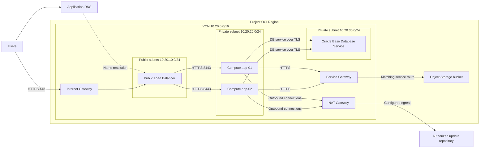
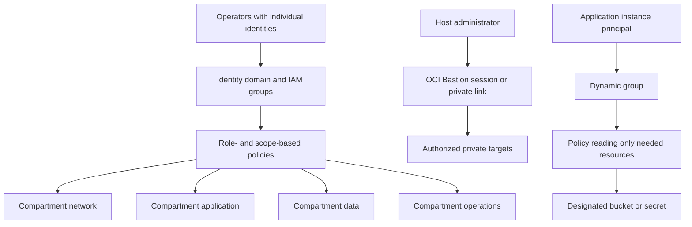

# Finalizing Diagrams, Runbooks, and OCI Environment Handover

## 1. Lesson Objectives

An Oracle Cloud Infrastructure (OCI) environment is ready to hand over for operations only when the receiving team can locate running resources, understand dependencies, and handle agreed scenarios. Succeeding at provisioning via the Console or Terraform only proves the environment was created at a point in time.

In the **Capstone Projects and Assessment** chapter of the **CLOUD_PROVIDERS_ORACLE** module, this lesson focuses on completing three project deliverables:

- **As-built diagrams**: describe deployed architecture, permission boundaries, traffic paths, and fault-tolerance scope.
- **Runbooks**: guide execution with preconditions, expected outcomes, decision branches, stop conditions, and recovery verification.
- **Handover dossier**: link resources, infrastructure code, access permissions, monitoring, data recovery, costs, and operational ownership.

After this lesson, learners can run a handover session where the receiving team independently locates resources, runs diagnostics with its own granted permissions, and drills a recovery procedure within approved scope.

Resource names, CIDRs, recovery targets, and record IDs below are **instructional examples**. They do not attest that any real tenancy has deployed or achieved these targets.

## 2. Defining the Environment and Handover Scope

### 2.1. End-to-End Scenario

Suppose the project deploys an order-management application with the following setup:

| Component | Example Option | Handover Details Required |
| --- | --- | --- |
| Tenancy and IAM | One tenancy, role-based ops groups | Tenancy ID, identity domain if used, groups, policies, and permission owners |
| Compartments | `network`, `application`, `data`, and `operations` | Parent-child hierarchy, resources per compartment, policy scopes |
| VCN | VCN `10.20.0.0/16`, tiered subnets | CIDRs, route tables, NSGs, security lists, gateways, and DNS |
| Entry point | Public Load Balancer accepting HTTPS | Listener, certificates, backend set, health check, and DNS owner |
| Compute | Two app instances with no public IPs | Image, shape, config, update method, and placement domains |
| Database | Oracle Base Database Service, single-node DB system | DB system, database, PDB/service, backup destination, and matching restore workflow |
| Object Storage | Application documents bucket | Namespace, bucket, permissions, lifecycle, and object recovery plan |
| Operations | Monitoring, Logging, Notifications, and Audit | Where to inspect, alert rules, recipients, and change-tracing method |
| Automation | Terraform or OCI Resource Manager if used | Source repo, tool versions, variables, state location, and run history |

Suppose the two app instances sit in two different fault domains within the same availability domain (AD), if permitted by the actual region and service configuration. The dossier must record the actual placement deployed. Two such instances do not prove the app survives losing an entire AD. A single-node DB remains a critical dependency even with two app instances.

If an actual project uses Autonomous Database or another Oracle database service, substitute the exact inventory, connectivity, backup, and recovery sections for that service. Never apply Base Database host-admin steps verbatim to Autonomous Database.

### 2.2. Three States That Must Be Distinguished

Every component and operational capability must carry one of the following states:

| State | Meaning | Example |
| --- | --- | --- |
| Deployed and verified | Real configuration and execution evidence exist | Receiving team used its own account to check Load Balancer status |
| Deployed, unverified | Resource exists, but behavior has not been tested | Backups are configured, but restore has not been drilled |
| Not deployed or out of scope | A known limitation or future option | No standby database exists in a second region |

Never draw planned resources on an as-built diagram as if they were already live. To show a target architecture, place it in a separate diagram explicitly labeled as planned.

### 2.3. Stating Support Boundaries Clearly

Before writing instructions, agree on:

- Whether this is a lab, test, or production environment, and its data sensitivity level.
- Which services fall under support scope and support hours.
- Who owns OCI infrastructure, application, database, security, and cost.
- Which incidents are self-handled versus requiring approval or another specialist.
- Effective handover timestamp and how long the deployment team stays on transitional support.

An operations team responsible only for VCN and Compute cannot implicitly be held accountable for validating order-data correctness after recovery. That responsibility requires an application or business representative.

## 3. Designing a Traceable Handover Dossier

### 3.1. Organizing Docs by Operational Questions

The tree below is a reference structure for the project dossier; this lesson does not require creating these files immediately:

```text
handover/
  index.md
  environment.md
  inventory/
    resources.csv
    dependencies.md
  architecture/
    context.mmd
    deployment.mmd
    traffic-and-trust.md
  access/
    role-matrix.md
    emergency-access.md
  runbooks/
    RB-01-application-unhealthy.md
    RB-02-database-recovery.md
    RB-03-access-denied.md
    RB-04-cost-anomaly.md
  operations/
    monitoring.md
    backup-and-retention.md
    maintenance.md
  automation/
    deployment-and-state.md
  evidence/
    manifest.csv
  acceptance.md
```

The index page should link to answers for common questions: "Where is the app running?", "What should we do for this alarm?", "Who can edit routes?", "When was the last recovery drill tested?", and "Who pays for newly incurred resources?"

Never rely solely on a portal reachable only through the very application being recovered. Operations must have out-of-band access to documentation and communication channels when the application or primary access paths fail.

### 3.2. Handover Manifest

Every handover needs a concise manifest:

```yaml
handover_id: HD-OCI-ORDER-001
environment: lab
service: order-service
documentation_revision: "<doc-revision-id>"
infrastructure_revision: "<infra-code-commit>"
application_release: "<version-or-artifact-digest>"
verified_at_utc: "<YYYY-MM-DDThh:mm:ssZ>"
tenancy_reference: "<internal-identifier>"
region: "<actual-region>"
resource_inventory_reference: "<inventory-reference>"
runbook_revision: "<runbooks-version>"
evidence_manifest_reference: "<evidence-reference>"
service_owner: "<accountable-role>"
operations_owner: "<receiving-role>"
acceptance_state: DRAFT
```

This is a handover dossier manifest template, not an OCI config or lesson metadata structure. Replace values inside `<...>` with verified data before acceptance.

Document update dates and test execution dates may differ. Keep both whenever they affect evidence validity.

### 3.3. Inventory Must Hold Enough Detail to Locate Exact Resources

An inventory row should contain:

| Field Group | Details to Record |
| --- | --- |
| Identity | Internal ID, resource type, display name, OCID or controlled-store OCID reference |
| Location | Tenancy, region, compartment; AD/fault domain if applicable |
| Dependencies | Associated subnet, NSG, backend set, volume, database service, or gateway |
| Ownership | Accountable team, change approver, environment, and cost center |
| Config source | IaC resource address or manual configuration record location |
| Lifecycle | Backup policy, maintenance window, temporary resource expiry, and teardown criteria |

Display names can collide or change. OCIDs pinpoint specific resources, but must accompany region and compartment context so operators never act on the wrong environment.

OCIDs are not passwords. Still, inventories reveal internal topology and should be restricted by need-to-know. Never put private keys, database passwords, secret payloads, or wallets in the inventory table.

## 4. Finalizing As-Built Diagrams

### 4.1. Using Multiple Views, Each Solving One Purpose

A single diagram crammed with every policy, subnet, data flow, and backup schedule is hard to use during an incident. Maintain at least three views:

| View | Questions to Answer | Key Details |
| --- | --- | --- |
| Context & dependencies | How do users and external systems interact with the app? | DNS, entry points, external systems, operators |
| Deployment & traffic | Where do packets flow and where do resources reside? | Region, VCN, subnets, gateways, Compute, DB, ports |
| Governance & fault tolerance | Who can change what, and which failures are covered? | Compartments, IAM, admin paths, AD/fault domains, recovery limits |

Every diagram must list environment name, scope, revision, verification date, and legend. Resources outside a VCN, such as Object Storage buckets, must sit outside the VCN boundary.

### 4.2. Example Deployment and Traffic Diagram

The diagram below illustrates application flows. It omits AD/fault domain placement and IAM details; those must appear in the inventory or other views.



The DNS arrow shows name resolution, not HTTP packet flow. Likewise, a simplified diagram does not replace actual routes and security rules.

In the example setup, TLS terminates at the Load Balancer and is re-established to backends on port `8443`. The dossier must explain how backend certificates, trust stores, and renewal schedules are checked. If the project uses internal HTTP or TLS passthrough, document that exact choice and its consequences.

Internet Gateway, NAT Gateway, and Service Gateway serve distinct roles. Traffic traversing a gateway requires matching routes and security rules; merely drawing a gateway does not prove the flow works. See [VCN and Gateway Security](https://docs.oracle.com/en-us/iaas/Content/Security/Reference/networking_security.htm).

### 4.3. Building a Flow Matrix to Make Diagrams Testable

| Flow | Source → Destination | Example Protocol/Port | What to Verify |
| --- | --- | --- | --- |
| F-01 | Users → Load Balancer | HTTPS/443 | DNS, public IP, listener, certificate, route, and ingress rule |
| F-02 | Load Balancer → Application | HTTPS/8443 | Backend set, both NSGs, host firewall, process, and certificate |
| F-03 | Application → DB service | Per configured connect descriptor | Private endpoint, service/PDB name, actual TLS port, NSGs, and credentials |
| F-04 | Application → Object Storage | HTTPS/443 | Service Gateway route if applicable, service CIDR label, IAM, and bucket permissions |
| F-05 | Application → Update repository | HTTPS/443 | NAT route, DNS, and destination controls if required |
| F-06 | Operator → Private resources | Per Bastion session type or private link | Session-create permissions, allowed source, session TTL, routes, and target port |
| F-07 | Monitoring component → Ingestion service | Per actual service and agent | Agent/plugin if needed, network path, IAM, and data arrival |

For F-03, never fill in one default port across all Oracle Database services. Use the connect descriptor for the exact deployed database and connection mode.

Inspect both NSG and security list rules. A broad allow rule in a security list can defeat an intended restriction in an NSG; NSGs do not overlay a "deny" layer on top of other allow rules. Also examine stateful/stateless flags and host firewalls. See [OCI Security Rules](https://docs.oracle.com/en-us/iaas/Content/Network/Concepts/securityrules.htm).

A NAT Gateway does not filter by domain name. If requirements allow outbound access only to specific repositories, the dossier must identify the actual proxy, firewall, or destination-control mechanism used.

### 4.4. Representing Administrative Boundaries Separately



This diagram shows two distinct controls: IAM governs actions on OCI resources; administrative network paths permit connections to the OS or target service. Permission to view an instance does not grant SSH access; reaching a DB port does not grant access to read business tables.

If using OCI Bastion Managed SSH, document OS and plugin prerequisites for that session type. For SSH port forwarding, document the corresponding session rules. Never give a single generic Bastion instruction for every target type.

### 4.5. Cross-Checking Diagrams Against the Live Environment

Walk each flow end to end rather than just scanning resource names:

1. Starting from DNS, find the exact Load Balancer, listener, and backend set.
2. From the backend, verify instances/VNICs, subnets, NSGs, and applicable security lists.
3. From app connections, verify the exact DB endpoint, service, and buckets.
4. From route tables, confirm where Oracle service traffic and Internet traffic go.
5. Check AD/fault domain placement, replica counts, and shared dependencies.
6. Record the verifier, timestamp, evidence IDs, and unverified items.

If drift exists between IaC code and live config, record the discrepancy before signing off on diagrams. A clean Terraform plan does not replace verifying the application can reach its dependencies.

## 5. Documenting Availability, Backups, and Recovery Limits

### 5.1. Never Infer Fault Tolerance from Machine Counts

The handover must answer separately for each failure scope:

| Failure Scope | What Must Be Proven | Limitation of Example Setup |
| --- | --- | --- |
| Single app process | Health check detects it; traffic shifts to healthy backend | Insufficient if both hosts share a bad config |
| Single Compute instance | App tier keeps capacity; host can be rebuilt | Must test with session state, background jobs, and connection pools |
| Single fault domain | Hosts and dependencies placed appropriately | Single-node DB can still cause full app outage |
| Single AD | Critical components have capacity outside the failed AD | Two hosts in one AD do not cover this case |
| Single region | Data, infrastructure, and cutover plan exist in another region | Not present in the default example |
| Accidental delete or logical corruption | Clean restore point and data verification workflow exist | Replication propagates logical errors; never replaces backups |

The receiving team must know which rows were drilled, which exist only on paper, and which are accepted as out of scope.

### 5.2. RTO and RPO Must Bind to a Specific Scenario

- **RTO** is the target time to restore service after disruption, measured between agreed start and end milestones.
- **RPO** is the target tolerable data loss, typically expressed as time between the incident and the recoverable data point.

For example, the project proposes a 120-minute RTO and 15-minute RPO for losing database availability within an active region. These are project goals, not default OCI commitments.

During drills, record at least these timestamps:

```text
T0: Service disruption starts or agreed simulation milestone.
T1: Monitoring system detects the issue.
T2: On-call operator begins response.
T3: Database / recovery target is ready.
T4: Application reconnects.
T5: Verification transaction completes; service is confirmed recovered.

Observed recovery time = T5 - T0.
Observed data-loss window = incident timestamp - recovered data point.
```

Never report `T3 - T2` as full-service recovery time. That omits detection, coordination, connection reconfiguration, and application verification.

Illustrative numeric example: incident at 10:00 UTC, recoverable data point at 09:53 UTC, service verified at 11:17 UTC. Recovery time is 77 minutes and potential data loss is 7 minutes. These numbers illustrate the math only, not proof that a project met RTO/RPO.

### 5.3. Handing Over Recoverability by Data Type

| Asset | Details to Document | Meaningful Evidence |
| --- | --- | --- |
| Oracle Database | Exact service, backup destination, schedule, retention, restore points, encryption keys, and operator | One restore drill with data verification and app transaction |
| Block/Boot Volume | Which volumes are backed up, policy, consistency scope | Create volume/instance from backup and verify usability |
| Object Storage | Versioning if used, lifecycle, replication/copies if any, delete rights, and retention protection if applied | Restore a test object or version per chosen procedure |
| App config | Artifacts, env vars, secret references, and rebuild steps | Stand up a replacement instance with a verified version |
| IaC and state | Code repo, state backend, access rights, versions, and state recovery | Receiving team accesses exact code/state and identifies revisions |
| Encryption keys and credentials | Owners, grant process, rotation, and recovery dependencies | Recovery account/target can use the key without putting secrets in docs |

A "successful" backup alone does not prove end-to-end recoverability. Unreachable encryption keys, missing capacity, exhausted quotas, or missing target networking can still block restores.

Never assume the app documents bucket also holds Oracle Database backups. For Base Database Service, record the exact backup destination and recovery mechanism of the active configuration. Oracle documents [Integrating Base Database Service with Recovery Service](https://docs.oracle.com/en/solutions/back-up-base-database-zero-data-loss-recovery/integrate-oracle-base-database-service-and-oracle-zero-data-loss-autonomous-recovery-service1.html).

## 6. Turning Operational Knowledge into Runbooks

### 6.1. Distinguishing Three Document Types

**Design docs** explain why an architecture was chosen. **Runbooks** guide executing a task or handling a specific incident. **Incident logs** record what actually happened.

Writing "check database then restart app" lacks preconditions, how to identify the right database, and success criteria. Runbooks must enable someone else to decide without guessing the author's intent.

### 6.2. Minimum Runbook Template

| Section | Required Content |
| --- | --- |
| Header | Runbook ID, version, environment, owner, last tested date |
| Trigger | Alarm, symptom, scheduled task, or change request |
| Scope | Applicable services/resources and explicit exclusions |
| Preconditions | Permissions, connectivity, tools, backups, maintenance window, and approvers if needed |
| Target resolution | Tenancy, region, compartment, OCIDs, app version |
| Diagnostics | Observation commands, expected output, and how to interpret anomalies |
| Actions | Numbered steps, each with inputs and verification check |
| Stop conditions | Missing permissions, wrong environment, ambiguous data, or escalating risk |
| Rollback / forward recovery | How to revert and limits once new data has been written |
| Success verification | Technical checks, business checks, alarms, and soak window |
| Escalation | Roles to page, trigger conditions, and handoff details |
| Evidence | Timestamps, operator, request/work request IDs if any, sanitized outputs |

Runbooks should include expected stage durations so on-call responders notice when recovery slips. Tune durations from drills rather than inventing optimistic numbers to flatter RTO.

### 6.3. Writing Verifiable Decision Branches

A well-written step looks like: "If only backend `app-01` is unhealthy while `app-02` has sufficient capacity and canary transactions pass, isolate `app-01` per the approved change procedure; then verify zero new requests reach `app-01`."

That step specifies:

- Applicability condition.
- Narrowly scoped action.
- Expected observation.
- Reference to the governing change process.

If both backends lose DB connectivity together, replacing Compute hosts one by one will not fix the root cause. The runbook must pivot to checking shared dependencies.

### 6.4. Collecting Status with OCI CLI

The PowerShell example below queries Compute and alarm status only. Placeholders must come from the inventory, using an OCI CLI configured with your organization's authentication method. Profile names alone do not grant permissions.

```powershell
$ErrorActionPreference = 'Stop'

$OciProfile = '<OPERATIONS_PROFILE>'
$OciRegion = '<VERIFIED_REGION>'
$InstanceOcid = '<TARGET_COMPUTE_OCID>'
$AlarmCompartmentOcid = '<ALARM_COMPARTMENT_OCID>'

$RequiredValues = @(
    $OciProfile,
    $OciRegion,
    $InstanceOcid,
    $AlarmCompartmentOcid
)

if ($RequiredValues.Where({ $_ -match '^<.*>$' }).Count -gt 0) {
    throw 'Replace all placeholders with values from the inventory.'
}

oci --version
if ($LASTEXITCODE -ne 0) {
    throw 'Unable to run OCI CLI.'
}

$InstanceJson = oci compute instance get --instance-id $InstanceOcid --profile $OciProfile --region $OciRegion --output json
if ($LASTEXITCODE -ne 0) {
    throw 'Compute query failed; stop and verify error/permissions/target.'
}

$InstanceData = (($InstanceJson -join [Environment]::NewLine) | ConvertFrom-Json).data
[pscustomobject]@{
    Id = $InstanceData.id
    Name = $InstanceData.'display-name'
    State = $InstanceData.'lifecycle-state'
    Compartment = $InstanceData.'compartment-id'
    AvailabilityDomain = $InstanceData.'availability-domain'
    FaultDomain = $InstanceData.'fault-domain'
} | ConvertTo-Json

oci monitoring alarm-status list-alarms-status --compartment-id $AlarmCompartmentOcid --all --profile $OciProfile --region $OciRegion --output json
if ($LASTEXITCODE -ne 0) {
    throw 'Alarm query failed; stop and verify error/permissions/target.'
}
```

Interpret results in context:

- Instance `RUNNING` describes only Compute lifecycle; the app or database may still be failing.
- The compartment holding alarms may differ from the compartment holding Compute. Never reuse one compartment variable blindly across commands.
- An empty alarm list does not prove the system is healthy; verify region, compartment, permissions, and that alarms actually exist.
- An `OK` alarm is insufficient if metrics are missing or queries/dimensions do not match live resources.

Syntax references: [Get Compute Instance](https://docs.oracle.com/en-us/iaas/tools/oci-cli/latest/oci_cli_docs/cmdref/compute/instance/get.html) and [List Alarm Statuses](https://docs.oracle.com/en-us/iaas/tools/oci-cli/latest/oci_cli_docs/cmdref/monitoring/alarm-status/list-alarms-status.html). Verify the operations team's CLI version before running. Never enable debug mode and paste unsanitized raw output into shared records.

## 7. Sample Runbook RB-01: Application Returning Errors or Unhealthy Backend

### 7.1. Scope and Entry Conditions

**Trigger:** error rate or latency breaches project thresholds, external probes fail, or Load Balancer flags an unhealthy backend.

**Scope:** application behind the Load Balancer in the environment listed in the inventory.

**Required permissions:** read Load Balancer, Compute, relevant metrics, and logs; backend-modification or deployment rights are needed only when moving to remediation. Observer accounts do not need tenancy admin rights.

**Immediate stop conditions:** target environment unclear, suspected data corruption/leak, both backends unable to serve, or a database change with unclear rollback status.

### 7.2. Collection and Triage

| Step | Action | Expected Output | Next Branch |
| --- | --- | --- | --- |
| 1 | Confirm URL, region, Load Balancer OCID, and outage start time | Right service, right environment, UTC timestamp | Wrong target: stop before modifying anything |
| 2 | Test DNS, TLS, and an authorized external test request | Separate DNS, certificate, TCP, and HTTP errors | DNS/TLS failures escalate to component owner |
| 3 | Inspect backend health, listener, and health-check settings | Know which backend fails and actual health path/port/timeout | Single backend failing: isolate host; all failing: check shared dependencies |
| 4 | Inspect Compute state, processes, host resources, and app logs | Distinguish dead VM, crashed process, overload, and dependency errors | Host up, app failing: inspect config/logs |
| 5 | Check DB, Object Storage connectivity, and app permissions | Identify network, auth, pool exhaustion, or service errors | Pivot to matching runbook if dependency is root cause |
| 6 | Cross-check recent releases, config edits, and Audit in window | Change list with actors, timestamps, and tickets | Act on evidence; never blame every error on the latest release |

Health paths must reflect what the team intends to measure. An endpoint returning `200` whenever the process is alive ignores DB failures; an endpoint checking every external system can eject all backends when a minor side feature fails. Hand over health-check semantics alongside config.

### 7.3. Branch-Based Remediation

**One backend failing, remaining backend has capacity:**

1. Confirm traffic and resource utilization on the healthy backend stay within agreed bounds.
2. Drain/offline the failing backend per Load Balancer configuration; check background jobs and in-flight requests.
3. Save required logs before restarting or replacing the host.
4. Remediate root cause: configuration, process, release version, or rebuild instance from verified source.
5. Verify locally, check health probes, and run a test transaction before re-attaching.
6. Monitor traffic distribution and error rates after the backend rejoins.

**Both backends fail after a release:**

1. Verify compatibility of the prior artifact against the current schema and data.
2. If application rollback is permitted and schema-safe, run the tested rollback workflow.
3. If a migration broke backward compatibility, halt ad-hoc rollback; coordinate with app/DB owners to roll forward or restore data.
4. Never mass-restart hosts blindly without identifying root cause.

**Shared dependency failure:** preserve relevant evidence and switch to the DB, access, or network runbook. Replacing an app VM cannot fix a broken shared route or credential.

### 7.4. Verification and Incident Closure

Declare recovery only when all project conditions pass:

- Expected count of backends are healthy; none left forgotten in drain/offline state.
- End-user path verification succeeds.
- A test transaction through the app succeeds, with test data tagged and cleaned up as planned.
- Error rate, latency, and resource utilization remain stable over the agreed soak window.
- Alarms return to normal state without being silenced to mask errors.
- Emergency changes are documented with an owner to reconcile them into IaC or standard config.

Record timeline, impact, actions taken, results, and follow-up items. If an alarm remains firing, state why; never close an incident simply because one manual request succeeded.

## 8. Sample Runbook RB-02: Recovering Oracle Database and Reconnecting the Application

### 8.1. Selecting the Right Recovery Goal

Distinguish **recovery drill**, **recovery after data loss**, **switching to standby**, and **reverting a change**. Each carries different preconditions and risks.

This sample runbook structures a drill or recovery using configured backup/recovery on **Oracle Base Database Service**. Real runbooks must specify whether recovery creates a new target or restores in place per service capabilities. Never apply one generic restore command across all Oracle Database types.

**Mandatory inputs:**

- DB system, database, PDB/service identifiers, region, and environment.
- Incident type, timestamp when data became untrustworthy, and chosen recovery point.
- Eligible backup/recovery point and required dependencies.
- Recovery target, access rights, networking, quota/capacity, and encryption keys.
- Authority approving data loss or downtime within agreed bounds.
- Steps to fence writes, validate business data, and update connect descriptors.

When the clean point before a logical corruption is unknown, never select "latest" merely because it is the newest option.

### 8.2. Sequence with Decision Gates

| Step | Task | Gate to Proceed |
| --- | --- | --- |
| 1. Record | Assess impact, open timeline, and preserve evidence | Coordinator assigned and target environment clear |
| 2. Verify source | Confirm backup/recovery point, retention, keys, and permissions | Recovery point usable and suited to incident cause |
| 3. Prepare target | Check network, capacity, quotas, service config, and temp cost | Target meets specs; never overwrite a source needed for forensics |
| 4. Control writes | Stop or coordinate all writers per cutover plan | All apps, batches, and integrations capable of writing accounted for |
| 5. Execute recovery | Run service-specific procedure and record request/work request IDs | Task completes with no ignored error notices |
| 6. Verify DB | Check state, PDB/service, grants, data point, and canary dataset | DBA/owner confirms data consistency |
| 7. Reconnect apps | Update endpoints or secret references if needed; refresh pools | Apps connect to the exact recovered target |
| 8. End-to-end check | Run test transaction and verify key integrations | App owner confirms proper serving |
| 9. Reopen writes | Allow only one side to accept writes per plan | No unintended dual writers exist |
| 10. Monitor & close | Measure RTO/RPO, confirm next backup, and handle temp target | Evidence, sign-off, and cleanup schedule recorded |

In drills, prefer a separate target when supported by the service and budget. Isolate test targets from sending emails, payments, webhooks, or live external integrations.

### 8.3. Data Verification Beyond "Database Available"

Verification checks must fit the application, such as:

- A transaction marker created prior to the drill timestamp.
- Total record counts or checksums within test data scope.
- Ability to read an existing order and execute an authorized test transaction.
- Consistency across DB, Object Storage files, and events emitted to other systems.
- Working service name/PDB, schemas, grants, and secrets after target switch.

For an app using both database and buckets, restoring the DB to 09:53 does not automatically roll back buckets to 09:53. Specify how mismatched file references are detected and reconciled.

### 8.4. Reversal Limits After Cutover

Once the recovered target accepts new transactions, flipping back to the old DB risks data loss or divergence. The runbook needs a decision gate before reopening writes and a reconciliation plan if reversal is ever required.

If a restore fails, record source/target states, running work requests, and any connection changes made. Never delete resources "to clean up" before knowing which resources hold data or forensic evidence.

Backups, replication, and cross-region recovery are distinct capabilities. Claim cross-region DR only when data, keys, permissions, networking, app infrastructure, and cutover procedures are all prepared within that scope.

## 9. Additional Runbooks for Access and Cost

### 9.1. RB-03: Unable to Access a Resource

**Trigger:** Console/CLI returns unauthorized, expected resource is not found, or administrative connection fails.

Proceed in order:

1. Confirm URL/endpoint, tenancy, profile, region, compartment, and OCID. Compare against inventory before editing permissions.
2. Distinguish auth errors, IAM errors, and network errors. For users, inspect login session or request signing; for workloads, check exact principal and dynamic group used.
3. Verify membership in the proper identity domain if applicable, policies for exact action/resource types, compartment scope, and parent-level policies.
4. For `NotAuthorizedOrNotFound` errors, check both permissions and resource existence/location. Never assume with certainty that the resource was deleted.
5. If CLI reads Compute yet SSH fails, inspect Bastion/private path, session expiry, target port, firewalls, SSH keys, and sshd/agent services. Permission to inspect Compute does not grant OS login rights.
6. If new permissions are needed, an IAM admin applies the minimal documented change.
7. Retry using the receiving operator's own identity, save sanitized outputs, and revoke temporary privileges when done.

**Stop conditions:** calling identity unknown, request asks for privileges beyond role scope, or signs of unauthorized account use appear.

Never resolve a bucket-read error by granting `manage all-resources in tenancy`. Overbroad privileges obscure actual requirements and create ongoing operational liability.

### 9.2. RB-04: Unexpected Cost Spike

**Trigger:** budget alert, usage report, or cost owner spots deviation from baseline.

| Phase | Actions |
| --- | --- |
| Verify | Check billing period, data lag, currency, compartment/tag scope, and baseline |
| Isolate | Break down by service, resource, region, creation date, owner, and recent deployments |
| Assess | Distinguish legitimate traffic growth, forgotten temp resources, log/storage growth, and misconfiguration |
| Contain | Work with owner to stop lab schedules, rightsize, or tear down exact items after checking data and dependencies |
| Confirm | Track trend post-change, account for billing lag, and verify live services stay healthy |
| Prevent | Add owner tags, temp-resource expiry, review cadence, quotas, or pre-deploy checks |

OCI Budgets are soft thresholds for tracking and alerting; they do not automatically stop resources from exceeding spend limits. Controls require pairing governance processes with technical limits. See [OCI Track and Manage Usage and Cost](https://docs.oracle.com/en/solutions/oci-best-practices/track-and-manage-usage-and-cost1.html).

Before stopping or deleting, verify whether the item is a needed DB, volume, backup, or temporary recovery asset. Stopping a Compute instance does not zero out all related charges; attached volumes and dependent services continue billing per their respective rules.

**Closure condition:** owner, root cause, action taken, post-change tracking, and any intentionally retained resources with rationale are recorded. Never delete data solely to hit a cost threshold without an owner's decision.

## 10. Handing Over Role-Based Permissions and Secrets

### 10.1. Reference Role Matrix

| Role | Primary Duties | Permission Scope to Clarify |
| --- | --- | --- |
| On-call observer | View status, metrics, logs, and open incidents | Supported compartments/services and permitted log data |
| Application operator | Swap backends, deploy, and roll back apps | Scoped Compute/Load Balancer and deployment tools |
| Network administrator | Edit routes, NSGs, security lists, gateways, and related DNS | Network resources and coordination process when apps are impacted |
| Database owner | Backups, recovery, maintenance, and data validation | OCI DB service permissions plus required in-DB privileges |
| IAM / security admin | Grant/revoke access, manage emergency access, investigate | Policies, groups, identity domain, keys/secrets per assignment |
| Cost owner | Review usage, budgets, and owner allocation | Reporting scope separate from resource-mutation rights |

This is a responsibility model, not mandatory group names or copy-paste policies. One person may fill multiple roles in a lab, yet the dossier must still separate duties.

Verify permissions using the receiving team's own accounts. A screenshot from the deployer's admin account does not prove the receiving team can operate.

### 10.2. Never Hand Over Credentials by Copying Secrets

For each secret class, document only:

- Controlled storage location, such as an OCI Vault secret reference.
- Which applications or roles are authorized to use it.
- How to request access, rotate, revoke, and respond to suspected exposure.
- Which components require reload/restart when a secret version rotates.
- How to verify success without printing secret values into logs.

Never embed API private keys, DB passwords, tokens, wallets, private SSH keys, or token-bearing URLs in Markdown, diagrams, screenshots, or repositories. Pre-authenticated request URLs must also be treated as access-granting credentials.

Terraform state and plans can contain sensitive values. Never assume marking a variable `sensitive` makes every state or plan file safe to share with documentation readers.

### 10.3. Emergency Access and Post-Handover Revocation

Emergency access procedures must specify credential custodians, invocation criteria, identity verification, action logging, and post-incident review. If temporary access does not expire automatically, name an owner and deadline for revocation.

Once the receiving team verifies operational access:

1. Inventory temporary credentials, keys, and accounts created during deployment.
2. Transfer ownership to organizational roles/accounts per policy.
3. Rotate or revoke access no longer needed.
4. Re-test workloads and support access paths afterward.
5. Retain verified emergency access so you do not lock yourself out of administration.

## 11. Handing Over Observability and Operational Schedules

### 11.1. Linking Symptoms to Handlers

A dashboard is useful only when the receiving team knows what decisions it drives.

| Signal | Context to Hand Over | Action Document |
| --- | --- | --- |
| App error rate / latency | Metric source, window, dimensions, thresholds, and active hours | RB-01 |
| Unhealthy backend | Backend set name, health path/port, and minimum backend count | RB-01 |
| Compute overload | Infrastructure metrics and OS/agent metrics actually collected | Load check or host replacement workflow |
| DB / backup errors | Signal source, target database, and alert scope | RB-02 or matching DB procedure |
| Missing monitoring data | How stopped metrics/logs are detected | Agent, permission, and network check workflow |
| Critical network/IAM edits | Audit events, search window, and resource IDs | RB-03 or investigation workflow |
| Cost spike | Budget, tracking scope, and billing lag | RB-04 |

Record the compartment holding alarms, the compartment holding monitored resources, and log locations. Under centralized collection, they often differ.

Audit traces actions captured by OCI Audit; it does not replace business transaction logs or full in-database SQL auditing. Tracing who changed an NSG versus who modified an order requires their respective data sources.

### 11.2. Testing the Entire Alert Delivery Path

Confirm alarms evaluate, Notifications destinations are accurate, and on-call staff actually receive alerts. If a subscription type requires confirmation, verify confirmation completed.

A controlled test should record:

```text
Test ID: OBS-001
Alarm / trigger source: <identifier>
Safe trigger method: <test action or test data>
Trigger timestamp UTC: <timestamp>
Notification target and verifier: <role/channel>
Receipt timestamp UTC: <timestamp>
Runbook accessible by recipient: <ID and version>
Steps to revert config to normal: <executed steps>
Result: NOT_TESTED / PASS / FAIL
```

Never leave test overrides firing continuously or leave live alarms disabled after testing. External monitoring, fault drills, and DR plan testing are operational practices covered in [Operating Cloud Deployments Efficiently](https://docs.oracle.com/en/solutions/oci-best-practices/best-practices-operating-cloud-deployments-efficiency.html).

### 11.3. Operational Schedules Must Have Named Owners

| Cadence / Event | Tasks | Output to Retain |
| --- | --- | --- |
| Per shift or support schedule | Review open incidents, alarms, backup status, and anomalous resources | Shift log or check confirmation |
| Weekly / monthly per project | Audit temp resources, capacity, log retention, and spend | Action list with owners |
| Before cert / credential expiry | Renew or rotate ahead of actual expiration | Post-change verification results |
| Per service maintenance window | Assess impact, patch OS/DB/app within ownership scope | Change record and verification output |
| After significant changes | Update inventory, diagrams, runbooks, and related evidence | New dossier revision |
| Per drill schedule | Drill recovery and alert delivery | Measurements, limits, and follow-up items |

Pick cadences matching project requirements. Never write "periodically" without an owner, due schedule, and record location.

## 12. Handing Over Infrastructure Code and Redeployment Steps

### 12.1. What the Receiving Team Must Find

If using Terraform or OCI Resource Manager, the dossier must link:

- Repository and revision matching the live environment.
- Terraform, provider, and lock file versions used by the project.
- Stack/workspace, state backend, access controls, and state-lock handling.
- Variable sources and secret references; never copy secret values into docs.
- How to generate and read plans; who may apply; how to inspect job history.
- Manually created, imported, or externally managed resources.
- How drift and emergency changes are reconciled.
- How to tear down drill resources alone without affecting the handed-over environment.

A no-diff plan only proves the tool proposes no changes given the inputs it reads and current permissions. It does not prove data is recoverable, DNS is right, or app transactions succeed.

For shared state, instructions must forbid operators from force-deleting state locks without first confirming the lock-holding process is not still running.

### 12.2. Mapping Code to Resources and Procedures

A compact traceability table beats a folder full of raw exports:

| Component | Deployment Reference | Operations Reference |
| --- | --- | --- |
| App Compute | IaC resource/module address and app artifact | Inventory + RB-01 |
| DB | IaC resource or separately managed provisioning workflow | Inventory + RB-02 |
| NSGs / routes | Resource address and latest change record | Flow diagram + RB-03 |
| Alarms | Resource address or documented config | Signal table + OBS-001 |
| Temp resources | Creating revision/job, owner tag, and expiry | RB-04 + teardown list |

Execute create, modify, or destroy commands in the lab only when execution scope is verified. Handover docs must never put a full-stack `destroy` command inside a "clean up test resources" step.

## 13. Validating Handover Through Receiving-Team Execution

### 13.1. Swapping Operators

Walkthroughs by the deployment team explain the system. Stronger evidence is the receiving team operating independently from documentation while the deployment team observes and intervenes only to prevent exceeding agreed scope.

A verification session may cover:

1. Receiving team opens the index and identifies tenancy, region, and compartments.
2. Uses diagrams to trace a request from user to database.
3. Uses its own identity to locate Load Balancer, backends, Compute, DB, and logs.
4. Queries status and identifies matching alarms/runbooks.
5. Handles a safe scenario, such as draining one lab backend while the other carries load.
6. Executes or reviews DB recovery evidence within approved drill scope; checks RTO/RPO.
7. Identifies cost owner, temporary resources, and drill teardown steps.

If a live recovery cannot run during the session, use valid evidence from the matching drill and record who executed it under which revision/config. Tabletop walkthroughs verify procedural understanding only; they do not replace real recovery evidence.

### 13.2. Managing Context-Rich Evidence

Every piece of evidence needs an ID and minimal context:

| Field | Meaning |
| --- | --- |
| `evidence_id` | Code referenced from runbooks and sign-off records |
| `scenario` | What is being proven, e.g. single-backend loss |
| `environment/resource` | Environment and resource reference |
| `executor/time` | Acting role and UTC timestamp |
| `revision` | Relevant doc, infra code, and app versions |
| `expected/observed` | Expected vs. observed outcome |
| `location/access` | Storage path and authorized readers |
| `result/follow_up` | Pass, fail, not run; required next actions |

Screenshots should show sufficient context while masking secrets and sensitive data. When using logs or CLI outputs, keep lines proving the conclusion and strip unnecessary sensitive details.

Never pass off placeholders or instructional figures as "PASS" results. Evidence lacking timestamps or identifiable resources cannot certify current state.

## 14. Acceptance, Risk Logging, and Ownership Transfer

### 14.1. Acceptance Criteria

| Group | Acceptance Criterion |
| --- | --- |
| As-built state | Inventory and diagrams match live resources; planned vs. active never mixed |
| Permissions | Receiving team performs role actions using its own identities |
| Runbooks | Include inputs, decision branches, stop conditions, verification, and escalation |
| Recovery | Scope-appropriate evidence exists, data verified, and RTO/RPO measured |
| Observability | On-call receives alerts and can open matching runbooks |
| Automation | Code, revisions, state/jobs, and change workflows are traceable |
| Cost | Baseline, owner, budgets/alerts, and temp-resource plan exist |
| Ownership | Named recipient, effective date, transition support, and backlog recorded |

Out-of-scope capabilities must be stated explicitly. Passing a single-region lab does not certify production readiness or multi-region DR.

### 14.2. Logging Risks by Impact and Decision

Example risk entry:

```text
ID: RISK-DB-01
Current state: Single-node DB with no cross-region standby.
Impact: A DB/region outage can cause disruption beyond current lab capabilities.
Existing controls: Backups and recovery drills within tested scope.
Unproven scope: Recovery upon losing the entire region.
Accountable owner: <role>
Lab-scope approver: <role>
Next action and due date: <action + due date or review milestone>
Status: OPEN
```

"Backups enabled" is not grounds to close a region-loss risk unless backups, keys, and target infrastructure exist in an appropriate recovery location.

### 14.3. Concise, Binding Handover Sign-Off

The sign-off record should contain:

- Dossier ID and version; list of handed-over environments/services.
- Names or roles of delivering party, receiving party, and risk approver.
- Verification results, evidence IDs, and unexecuted items.
- Limitations, exceptions, and open action items with owners and due dates.
- Effective on-call start time; transitional support duration and channels.
- Acceptance status: accepted, accepted within scope with approved exceptions, or rejected.
- Schedule for reviewing temporary permissions and updating docs after changes.

Exceptions must never label an unrun test as passed. If mandatory project scope criteria remain unmet, the sign-off must reflect unaccepted status.

## 15. Hands-On Exercise: Finalizing the Handover Package

### 15.1. Inputs

Use your OCI capstone environment alongside your deployment code, existing inventory, and authorized lab scope. Do not assume the tenancy grants admin rights, capacity, or budget to spin up a second DB or region.

Before making changes, select a scenario safe to run in that environment, bound blast radius, and assign an accountable owner.

### 15.2. Deliverables to Complete

1. **Handover manifest** listing doc, infrastructure, app revisions, and verification timestamp.
2. **Inventory** with complete IDs, locations, dependencies, and owners.
3. **As-built diagram set** with flow matrix, placement, and fault-tolerance limits.
4. **Runbooks** for unhealthy app, DB recovery, access errors, and cost anomalies.
5. **Permissions matrix**, emergency access guide, and temporary credential handling.
6. **Operations dossier** covering monitoring, alert delivery, backup/retention, maintenance, and cost.
7. **Verification evidence** from receiving-team execution and an agreed drill scenario.
8. **Acceptance record** stating scope, outcomes, risks, and ongoing ownership.

If DB recovery cannot be tested, mark that item "UNVERIFIED", document missing prerequisites, and never claim completion of recovery criteria.

### 15.3. Suggested Grading Rubric

| Category | Max Points | Grading Basis |
| --- | ---: | --- |
| Inventory, diagrams, and flow matrix | 20 | Matches live resources with clear dependencies and boundaries |
| Runbooks | 25 | Actionable, with decision branches, stop conditions, and verification |
| Recovery and availability | 20 | Accurate scope, real evidence, and measured RTO/RPO |
| Permissions and secret management | 10 | Receiving team can operate, least privilege, zero leaked secrets |
| Infrastructure code and config traceability | 10 | Traceable revisions, state/jobs, and out-of-IaC changes |
| Monitoring and cost | 10 | Alerts reach handlers, clear owners, anomaly response defined |
| Acceptance and ownership transfer | 5 | Effective timestamp, backlog, and transition support defined |
| **Total** | **100** | Evaluated within agreed scope |

Even with a high numeric score, a handover fails if secrets are exposed, no owner accepts responsibility, the receiving team lacks permissions for mandatory actions, or recovery is claimed successful without evidence.

## 16. Mistakes That Make Dossiers Unusable

| Mistake | Consequence | How to Fix |
| --- | --- | --- |
| Diagram images only, no editable source | Hard to update when resources change | Hand over editable source and version alongside rendered views |
| Display names without OCIDs/context | Easy to act on the wrong resource | Pair inventory with region, compartment, and exact IDs |
| Calling every subnet "private" without checking routes/rules | Misstates real reachability | Inspect subnet attributes and actual routing paths |
| Runbooks containing only command lists | Responders cannot tell normal from abnormal | Add expected output, decision branches, and stop conditions |
| Marking backup success as meeting RTO/RPO | Misses restore duration and failures | Drill end to end, verify data, and time milestones |
| Demoing with deployer's admin account | Fails to prove receiving team's permissions | Verify using the receiving team's identities |
| Storing docs where unreachable during outages | Responders lose instructions right when needed | Provide policy-compliant out-of-band access |
| Deleting temp resources without checking dependencies | Data loss or broken environments | Tear down by inventory, owner, and drill scope |
| Skipping doc updates after emergency fixes | Docs and IaC diverge from live state | Assign owner and revision to reconcile changes |

## 17. Pre-Handover Self-Check Criteria

- [ ] Every core resource can be found in the inventory and appears accurately in the relevant diagrams.
- [ ] User, application, data, administrative, and monitoring flows can be traced clearly.
- [ ] AD/fault domain placement and architectural limits are documented honestly.
- [ ] Every runbook defines owner, target identification, entry/stop conditions, verification, and escalation.
- [ ] Receiving-team permissions have been tested with its own identities.
- [ ] Documents and evidence contain no secrets or sensitive data outside authorized sharing scope.
- [ ] Recovery is verified per actual DB service and config, or marked unverified.
- [ ] Alarms reach on-call staff, who can open the matching runbooks.
- [ ] Deployment code, artifacts, state/jobs, and manual changes are traceable.
- [ ] Costs and drill resources have owners, expirations, and cleanup plans.
- [ ] Risks/backlog items have accountable owners and due dates.
- [ ] Sign-off states exact handover timestamp and accepted scope.

The goal of this lesson is an OCI environment someone else can take over using concrete documentation, permissions, and evidence. Operational readiness is confirmed through hands-on execution by the receiving team and verified test outcomes within project scope.
