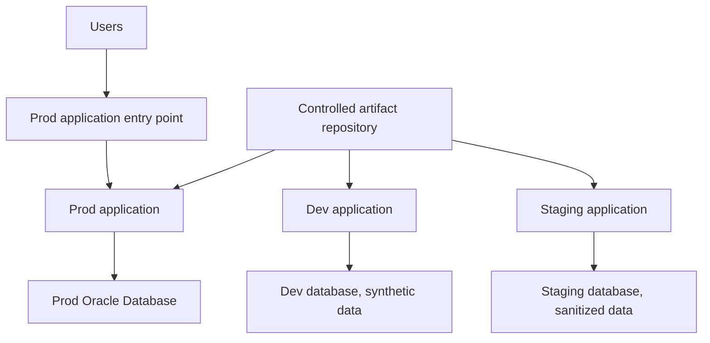

# Separating Production, Staging, and Development

## Goals and Context

Within the **Resource Governance and Landing Zones** chapter of the **CLOUD_PROVIDERS_ORACLE** module, environment separation is the step that turns a tenancy structure into verifiable operational boundaries. A testing mistake, a compromised developer account, or a data cleanup job in development must be contained before it can impact production.

This lesson examines a Java application running on Oracle Cloud Infrastructure (OCI) using Compute, Object Storage, and an Oracle database. The options below are illustrative designs; adapt them to your application requirements, operations team, and budget.

After this lesson, you will be able to:

- Define the roles of development, staging, and production.
- Design a compartment tree aligned with permission boundaries.
- Distinguish isolation across administrative permissions, networking, data, and deployment pipelines.
- Separate identities, configurations, and infrastructure state across environments.
- Define test criteria to prove that development cannot access production resources outside approved exceptions.

## 1. Three Environments Serving Three Purposes

| Environment | Question to answer | Recommended characteristics |
| --- | --- | --- |
| Development, abbreviated dev | Does the new change work during active development? | Frequent changes, synthetic data, reproducible, small quotas |
| Staging | Is this release ready to go into operation? | Close to production in architecture and deployment method, sanitized data, controlled changes |
| Production, abbreviated prod | Does the service serve real users safely and reliably? | Real data, strict access controls, monitoring, backups, and incident response procedures |

Staging can use fewer Compute resources than production if the goal is to validate configuration and deployment procedures. However, load-test results from a downscaled staging environment do not prove production capacity. To test performance, design a test at an appropriate scale and under suitable conditions.

A small organization can start with dev and prod. When introducing staging, define what it validates that dev does not—such as schema upgrades, zero-downtime deployments, or restoring from sanitized backups. If staging is merely an old server that is rarely updated, it easily creates a false sense of security.

**Design principle:** an environment is defined by dedicated resources, permissions, and processes; a display name or an `ENV=prod` variable is not enough to establish a boundary.

## 2. Which Layers Must Separation Cover?

Consider a hypothetical incident: a dev application contains a bug that causes it to write mistakenly to the prod database. Moving the dev machine to another compartment alone does not prevent the incident if the application still holds the prod password and can still reach that database.

| Layer to separate | Boundary to design | Verification question |
| --- | --- | --- |
| Resource organization | Environment compartments or separate tenancies | Which environment does this resource belong to? |
| OCI administrative IAM | Scoped groups, policies, dynamic groups, or deployment identities | Who can create, modify, delete, or read resources? |
| Networking | VCN, subnets, routes, security rules, and connectivity endpoints | Which network paths can actually carry traffic? |
| Data and credentials | Databases, buckets, secrets, keys, and application accounts | By what path could dev obtain or use prod data? |
| Automation | Separate state, configurations, pipeline identities, and approval gates | Could a misconfigured dev job affect prod? |
| Operations | Environment-specific monitoring, recovery, costs, and owners | Who receives alerts and who is authorized to act? |

You must verify both **resource management permissions via OCI APIs** and **application-level service access**. For example, an account might not be permitted to list a DB System in the OCI Console yet still be able to log into the database if it has valid credentials and a network path. OCI permissions and permissions inside Oracle Database are two separate layers that must be governed independently.

## 3. Choosing a Compartment Tree Based on Environment Boundaries

### 3.1. A Design Starting from Environments

For an application group, you can organize the tree as follows:

```text
Tenancy
├── Platform
│   ├── Security
│   └── SharedServices
├── Production
│   └── Orders
│       ├── Network
│       ├── Application
│       └── Data
├── Staging
│   └── Orders
│       ├── Network
│       ├── Application
│       └── Data
└── Development
    └── Orders
        ├── Network
        ├── Application
        └── Data
```

This is an illustrative option, not a mandatory OCI structure. If there are only a few resources and a single management team, you can omit the `Network`, `Application`, and `Data` child compartments to reduce administrative overhead.

Splitting by environment at a high level makes it clear where prod boundaries apply. Add child levels only when there is a real difference in owners, policies, or operational procedures. Oracle recommends separating production and non-production workloads into dedicated compartments. [See Oracle's resource isolation best practices](https://docs.oracle.com/en/solutions/oci-best-practices/isolate-resources-and-control-access1.html).

Compartment names should be stable. Pipelines use OCIDs to identify deployment targets, while operators use names and tags for readability. Do not rely solely on a name containing `prod` to determine how trustworthy a resource is.

### 3.2. Avoid Placing Prod Under Where Developers Have Full Control

Suppose the compartment tree is:

```text
Project
├── Development
├── Staging
└── Production
```

If the developer group is granted `manage all-resources` in `Project`, that scope includes the child compartments. Creating a narrower policy in `Production` does not automatically revoke the broad permissions already granted.

In OCI, permissions apply down to child compartments through inheritance. Therefore, review policies at the tenancy level and across all parent levels before concluding that an environment is isolated. [Policy Inheritance Documentation](https://docs.oracle.com/en-us/iaas/Content/Identity/policieshow/Policy_Inheritance.htm).

The design above can still work if permissions on `Project` are restricted to a trusted platform team, while developer permissions point only to `Development`. The issue lies in the effective permission scope, not solely in the shape of the tree.

### 3.3. When Should You Consider Separate Tenancies?

| Option | Appropriate when | Administrative overhead to accept |
| --- | --- | --- |
| Single tenancy, multiple compartments | Centralized IAM governance exists and some platform components are shared | Must control tenancy permissions, inheritance, and shared dependencies |
| Separate prod tenancy from non-prod | Stronger administrative boundaries are needed or shared power between areas must be reduced | Managing identity, connectivity, artifact distribution, and monitoring across multiple tenancies |
| Separate tenancies by business unit, then split environments | Business units have distinct owners and operational policies | Easy to accumulate multiple configurations and processes that require synchronization |

Policies do not inherit from one tenancy to another; however, intentionally configured cross-tenancy access must still be controlled. Oracle considers the tenancy the highest security boundary in the OCI governance structure. [See IAM Security Structure](https://docs.oracle.com/en-us/iaas/Content/cloud-adoption-framework/iam-security-structure.htm).

A separate tenancy does not by itself prevent shared passwords, sending data to the wrong destination, or overly permissive network connectivity. It adds an administrative boundary; the remaining layers must still be designed.

## 4. Designing IAM for Human Users and Machine Identities

### 4.1. Start from a Responsibility Matrix

A matrix for the Orders application might look like this:

| Role | Development | Staging | Production |
| --- | --- | --- | --- |
| Developer | Manage assigned application components | View information needed for testing | No standing direct modification access |
| QA / Testing team | Use test data and testing tools | Run acceptance tests within assigned scope | No infrastructure administration |
| Dev pipeline | Deploy dev | No deployment permission | No deployment permission |
| Staging pipeline | No modification permission | Deploy staging | No deployment permission |
| Prod pipeline | No modification permission | May read acceptance results through an approved channel | Deploy application scope after approval |
| Production operations | Per assigned duties | Per assigned duties | Operate and handle incidents |
| Platform administration | Per platform responsibilities | Per platform responsibilities | Sensitive privileges controlled and audited |

The matrix describes intent. Each cell must be translated into corresponding OCI policies, OS privileges, database privileges, and CI/CD tool permissions.

Do not share one tenancy-admin credential across all pipelines. For workloads using instance principals or resource principals, policy scopes must also be restricted; avoiding stored API keys does not mean the identity holds minimal privileges.

### 4.2. Example of Scoped Policies

The example below illustrates Compute management permissions for two distinct identities. Replace placeholders with real OCIDs before use:

```text
Allow group id <DEV_GROUP_OCID> to manage instance-family in compartment id <DEV_APPLICATION_COMPARTMENT_OCID>

Allow group id <PROD_OPERATOR_GROUP_OCID> to manage instance-family in compartment id <PROD_APPLICATION_COMPARTMENT_OCID>
```

The `group id` and `compartment id` syntax explicitly specifies the subject and target location. `instance-family` is an aggregate resource-type family; it does not mean access is limited to a single machine. [See Policy Syntax](https://docs.oracle.com/en-us/iaas/Content/Identity/Concepts/policysyntax.htm).

These two lines **are not a complete Compute deployment permission set**. Launching an instance also depends on permissions to use subnets, images, volumes, and related resources. In a design that separates Network from Application, dependency permissions must target the network resources of the matching environment.

To complete the permission set, list the operations the pipeline actually requires and grant them by appropriate resource type and location. Avoid fixing permission errors by adding `manage all-resources in tenancy`.

### 4.3. Check Privilege Escalation Paths

A developer restricted to dev can still introduce risk if they are simultaneously able to:

- Modify policies that apply to prod.
- Edit membership of the prod operations group.
- Edit dynamic group rules so a dev machine becomes a member of a group with prod permissions.
- Retrieve secrets or use keys that protect prod data.
- Modify the identity, scripts, or configuration of the prod pipeline.
- Move resources or compartments in ways that alter governance scope.

When assessing permissions, evaluate cumulative permissions across all groups and all relevant policies. A test account that also holds platform admin rights is unsuitable for proving that developers can only access dev.

Emergency access to prod should have an accountable owner, a justification, a time limit, and a post-use audit step. Never turn emergency access into an everyday credential.

## 5. Separating Networks with VCNs and Controlling Traffic Flows

Compartments organize resources and administrative permission boundaries. VCNs and connectivity configuration determine most of the workload's network boundary; do not treat a compartment as a firewall. [See Networking Access Control](https://docs.oracle.com/en-us/iaas/Content/Network/Concepts/accesscontrol.htm).

### 5.1. One VCN per Environment

For the Orders application, you might plan hypothetical address ranges:

| Environment | Illustrative VCN CIDR | Components |
| --- | --- | --- |
| Dev | `10.10.0.0/16` | Dev application and data subnets |
| Staging | `10.20.0.0/16` | Staging application and data subnets |
| Prod | `10.30.0.0/16` | Prod access, application, and data subnets |

Address ranges must be checked against corporate networks, VPNs, and future connectivity plans. Non-overlapping CIDRs prevent conflicts when connectivity is needed; differing CIDRs alone do not create a policy that blocks access.



The diagram illustrates intended flows. Omitting a line from dev to prod is not proof that the network path is blocked.

### 5.2. Translate Network Requirements into Concrete Flows

Examples for prod:

- Users enter the application's HTTPS ingress point as designed.
- Only the prod application tier may connect to the prod database service port.
- Administrative access goes through an approved channel with identity verification and time bounds.
- Dev and staging have no need to connect directly to the prod database.
- Connections to shared services are scoped strictly to what is needed, rather than opening full access between VCNs.

During implementation, inspect route tables, DRG or peering connections, security lists, NSGs, firewalls, and return paths. Also examine public endpoints: dev could egress to the Internet and call a prod endpoint even with no private connectivity between the two VCNs.

Both security lists and NSGs participate in permitting traffic. Do not assume a restrictive NSG overrides a permissive rule at another layer; inspect all applicable rules together with any additional protections if used. [See Security Rules](https://docs.oracle.com/en-us/iaas/Content/Network/Concepts/securityrules.htm).

### 5.3. Selective Service Sharing

Artifact repositories, log collection systems, or DNS may be centrally managed. For each shared service, document:

1. Who is allowed to write or change configuration.
2. Which environment may read which slice of data.
3. Which environments are affected by an outage of that service.
4. Whether shared credentials or connectivity open a path into prod.

For example, dev may download published artifacts but must not overwrite artifacts that the prod pipeline will consume. A shared repository with overly broad write permissions can break deployment isolation even when Compute instances already reside in separate VCNs.

## 6. Separating Data, Secrets, and Oracle Databases

### 6.1. Never Use the Prod Database Directly as Test Data

For the Orders application, choose appropriate separation for databases and application accounts:

| Component | Dev | Staging | Prod |
| --- | --- | --- | --- |
| Data | Synthetically generated, resettable | Sanitized representative dataset | Live operational data |
| Application account | Dedicated dev account | Dedicated staging account | Dedicated prod account |
| Endpoint | Separately configured dev target | Separately configured staging target | Controlled prod target |
| Secrets | Values dedicated to dev | Values dedicated to staging | Values dedicated to prod |
| Backups | Per development needs | For testing and rehearsal | Per the service's recovery objectives |

The database can use Oracle Base Database Service, Autonomous Database, or another option depending on the application. Regardless of the service chosen, separate OCI resource management permissions from database login and schema privileges.

If multiple environments use schemas inside the same database, they still share components such as compute capacity and database administration scope. That design may save cost for certain needs, but the level of sharing and incident blast radius must be documented explicitly. It is not equivalent to independent databases.

### 6.2. Workflow for Moving Representative Data to Staging

Do not grant developers permission to download prod backups and sanitize them themselves. A controlled workflow might be:

```text
Production source
    -> Extraction job with dedicated permissions
    -> Restricted-access processing area
    -> Anonymize or substitute sensitive data
    -> Verify results and check for residual sensitive data
    -> Approved dataset for staging
```

You must process free-text fields, attachments, export files, and logs as well. Deleting names in one table is insufficient if email addresses, phone numbers, or tokens still remain elsewhere.

Temporary processing areas and intermediate exports are also data that require protection. Specify who can access them, retention duration, and how they are purged upon completion.

### 6.3. Separate Secrets, but Application Configuration Must Also Be Correct

An illustrative configuration for staging:

```properties
app.environment=staging
app.database.endpoint=<STAGING_DATABASE_ENDPOINT>
app.database.secret-reference=<STAGING_DATABASE_SECRET_REFERENCE>
app.storage.bucket=orders-staging-documents
app.external.payment-mode=sandbox
app.notifications.delivery-mode=test-sink
```

This is an illustrative configuration contract, not standard properties across all Java applications or any specific framework.

Secret references must point to the secret of the right environment, fetched using an appropriately authorized identity. Never put passwords into Git, sample configuration files, or pipeline outputs.

For an order-processing system, also isolate payment gateways, email, SMS, and webhooks. A staging instance with a separate database can still cause real-world side effects if it sends notifications to customers or uses prod payment credentials.

## 7. Automation and Promoting the Same Release Across Environments

### 7.1. Share Infrastructure Provisioning Logic, Separate Targets and State

With Terraform or OCI Resource Manager, you can share infrastructure modules while separating parameters:

```text
Shared infrastructure module
├── dev: dedicated compartment, subnet, sizing, secret reference
├── staging: dedicated compartment, subnet, sizing, secret reference
└── prod: dedicated compartment, subnet, sizing, secret reference
```

Each environment requires a separate state scope and state access permissions by design. Separating variable files alone while accidentally sharing the same state or the same broad admin identity can cause a dev job to impact prod.

State files can contain sensitive information. Separating filenames is not enough; control read, write, concurrency locking, and recovery mechanisms appropriate for the backend in use.

Before applying changes, the pipeline should validate an approved set of target values:

```text
environment = staging
tenancy_ocid = <EXPECTED_TENANCY_OCID>
compartment_ocid = <EXPECTED_STAGING_COMPARTMENT_OCID>
region = <EXPECTED_REGION>
deployment_identity = <EXPECTED_STAGING_IDENTITY>
state_or_stack = <EXPECTED_STAGING_STATE_OR_STACK>
```

If any value mismatches, abort before modifying resources. During planning, display the environment, deployment target, and any destroy or replace actions clearly for reviewers to evaluate.

### 7.2. Promote Software Versions, Do Not Turn a Dev Machine into a Prod Machine

Recommended release flow:

1. Build an artifact from an identified source code version.
2. Run automated tests and record the artifact identifier.
3. Deploy that artifact to dev for integration checks.
4. Deploy the exact same artifact to staging with staging configuration.
5. Run acceptance tests, verify migrations, and prepare rollback/recovery.
6. Approve and deploy the exact accepted artifact to prod.
7. Monitor post-deployment and execute mitigation if thresholds are breached.

Do not rebuild arbitrarily at the prod step because the output may differ from the accepted build. Configuration varies by environment, while the release artifact itself must have a verifiable identifier.

Similarly, do not treat moving a Compute instance into the prod compartment as a complete release process. That machine may still retain development credentials, data, and configuration.

### 7.3. Database Migrations Require Their Own Plan

For a Java application using Oracle Database, verify on staging at a minimum:

- Whether the current schema matches the expected version.
- Whether the migration is compatible with the currently running application version.
- Whether table locks or load spikes cause disruption.
- Whether, if the new application fails, you can roll back to the old application against the new schema.
- If data recovery is required, how much data loss and downtime are acceptable.

Rolling back an application artifact does not mean the database migration has been reverted. Determine beforehand whether a migration is reversible, requires a roll-forward fix, or requires restoring from backup.

## 8. Operations, Availability, and Cost by Environment

### 8.1. Set Clear Recovery Objectives

Production requires a Recovery Time Objective (RTO) and an acceptable data-loss threshold, the Recovery Point Objective (RPO). Choose backups, redundancy, and availability architecture based on those objectives.

Staging should be capable of rehearsing recovery procedures needed in prod. Dev prioritizes recreation from source code and synthetic data. Having three environments does not automatically give production high availability; environments may still share the same network circuit or foundational platform service.

Prod alerts must reach the right on-call operators. Centralized logs should preserve environment labels and appropriate read permissions so dev engineers do not by default read logs containing prod data. Never write secrets or sensitive payloads to logs.

### 8.2. Budgets and Quotas Solve Two Different Problems

| Tool | What it is for | Limitations to understand |
| --- | --- | --- |
| Budget | Track spending and trigger configured alerts | Soft limit; does not automatically cut off spending |
| Compartment quota | Cap resource consumption in supported scopes and types | Does not replace IAM permissions or all cost controls |
| Service limit | Service limit applied to the tenancy and corresponding scope | Can affect multiple environments sharing the same limit scope |
| Tag | Identify environment, owner, and usage purpose | Does not by itself create an access boundary |

Oracle describes budgets as soft limits on infrastructure spending. Designated alert recipients and handling procedures are required; the system does not automatically stop resources when a budget is exceeded. [See Creating a Budget](https://docs.oracle.com/en-us/iaas/Content/Billing/Tasks/create-budget.htm).

Quotas are set by administrators to control compartment consumption; service limits still apply even if a quota is set higher. A quota is a usage ceiling, not a capacity reservation guaranteeing Compute availability for prod. [See Quota Policy Syntax](https://docs.oracle.com/en-us/iaas/Content/Quotas/Concepts/quota_policy_syntax.htm).

For dev, you can propose stop schedules, time-to-live limits, and small quotas. Apply stop schedules only after owners confirm which jobs must run continuously. Stopping Compute instances also does not eliminate all associated storage or service charges.

An illustrative internal tag set:

```text
Environment = dev | staging | prod
Application = orders
Owner = orders-platform
CostCenter = engineering
ExpiresAt = <expiration if the resource has a temporary lifecycle>
```

These tags are design conventions. If you want automated cleanup of expired resources, build a dedicated workflow that verifies the target environment and includes an exclusion mechanism for resources that must be kept.

## 9. Hands-On Lab: Designing and Verifying Orders Boundaries

### 9.1. Prerequisites and Scope

Execute inside an authorized training tenancy. You do not need real data or a real production deployment to learn separation. Names containing prod in the lab can be simulated resources only.

Preparation:

- OCI CLI configured with dedicated test identities.
- An administrator authorized to create lab compartments and policies.
- Target region identified.
- Small resources or existing resources authorized by the owner for testing.
- A cleanup plan for lab resources once finished.

### 9.2. Step-by-Step Procedure

**Step 1 — Draw the boundaries.** Choose a simple compartment tree, record the OCID of each environment, and list the resources belonging to each location. Only add child compartments when there is a concrete permission-separation reason.

**Step 2 — Build the permission matrix.** Create test identities for developer, staging deployment, and prod operator. Document intended permissions before writing policies. The developer identity must not simultaneously belong to a tenancy-admin group.

**Step 3 — Design networking and data.** Place test VCNs and databases per environment, explicitly defining allowed flows. Use synthetic datasets and dedicated credentials.

**Step 4 — Separate automation.** Define separate deployment targets and states or stacks. Add environment validation before applying any change.

**Step 5 — Verify allowed and denied actions.** Use the same operation type, correct region, and existing resources to avoid false conclusions.

Read-only PowerShell command example to verify Compute listing permissions using a developer profile:

```powershell
$devCompartmentOcid = '<DEV_APPLICATION_COMPARTMENT_OCID>'
$prodCompartmentOcid = '<PROD_APPLICATION_COMPARTMENT_OCID>'
$targetRegion = '<OCI_REGION>'

oci compute instance list --profile DEV_TEST --region $targetRegion --compartment-id $devCompartmentOcid --all
oci compute instance list --profile DEV_TEST --region $targetRegion --compartment-id $prodCompartmentOcid --all
```

Replace placeholders with lab values. A profile name is just a label in the CLI configuration; verify which identity that profile actually represents.

If the matrix permits developers to list dev instances but denies listing prod instances, the first command should succeed and the second should be denied. Do not use delete or modify operations on prod resources to test boundaries.

An empty list does not prove access was denied: the compartment may have no instances or you may be querying the wrong region. A `NotAuthorizedOrNotFound` error is also insufficient on its own to prove IAM was the cause. The administrator must confirm that the target exists, the region is right, and the same operation succeeds with a control identity holding appropriate permissions.

### 9.3. Verification Matrix

| Test | Expected result | Evidence to record |
| --- | --- | --- |
| Developer lists dev Compute | Succeeds per matrix | Identity, region, compartment, and API result |
| Developer lists prod Compute | Denied if read access is not granted | Valid target and control-identity result |
| Dev workload reads prod secret | Denied | Correct test secret and correct workload identity |
| Dev app connects to simulated prod database | Fails as designed | Route, rule, endpoint checks, and controlled connection test |
| Staging uses payment service | Sandbox only | Endpoint and configuration details with secrets redacted |
| Dev pipeline receives prod target config | Halts before apply step | Deployment target validation logs |
| Artifact promoted to staging and simulated prod | Same accepted identifier | Digest or equivalent immutable identifier |
| Staging data restore | Meets defined test objective | Execution duration and post-restore data verification |

For secret tests, record only allow or deny outcomes; never store secret values in test reports. For network tests, use simulated resources and endpoints explicitly approved for testing.

The tests above verify specific access paths. To conclude that the overall boundary meets requirements, still cross-check the compartment tree, inherited policies, network configuration, database privileges, and pipeline permissions.

**Step 6 — Finalize operational records.** Document the owner of each environment, emergency access procedures, alert recipients, expected budgets, and shared dependencies. After the lab, clean up resources strictly according to the approved inventory.

## 10. Mistakes to Recognize

| Mistake | Consequence | Remediation |
| --- | --- | --- |
| Only adding `-dev`, `-prod` suffixes | Different names, yet permissions and data remain shared | Design and test each boundary layer |
| Granting developers broad rights at a parent level | Permissions can cover prod underneath | Narrow the scope location and resource types granted |
| Using one API key for all pipelines | One compromised job can affect multiple environments | Separate identities and permission scopes |
| Dev, staging, and prod sharing database credentials | A configuration mistake easily causes wrong-data writes | Separate accounts, secrets, and endpoints |
| Staging sending real emails or payments | Testing causes external side effects | Isolate integrations and validate config before running |
| Assuming a narrow NSG disables all broad rules | Unintended traffic paths may still exist | Review all rules and network paths |
| Sharing state and only swapping environment variables | Changes can target the wrong resources | Separate state, permissions, and target checks |
| Treating budgets as automatic spend cutoffs | Costs can continue climbing after an alert | Combine alerts, quotas, and response workflows |
| Creating staging without matching architecture updates | Acceptance test results lack reliability | Document differences and maintain reproducibility |

## 11. Self-Check Questions

1. In the current compartment tree, which parent-level policies could grant access into production?
2. If the dev application's credentials are leaked, through which paths could an attacker read prod data?
3. Without peering between the dev and prod VCNs, can a public prod endpoint still be reached from dev?
4. Could the prod pipeline accidentally use dev credentials or dev state due to misconfiguration?
5. In which testable aspects does staging match prod, and where does it differ?
6. When the dev budget crosses its threshold, who handles it and through what mechanism?
7. Once a database migration has run, is it safe to roll back to an older application artifact?
8. What evidence proves a test was denied due to the intended permission boundary rather than the wrong region or wrong OCID?

An environment separation design has value when you can answer these questions with concrete configurations and verification evidence. The compartment tree is the starting point; IAM, networking, data, automation, and operations together establish the real boundary.