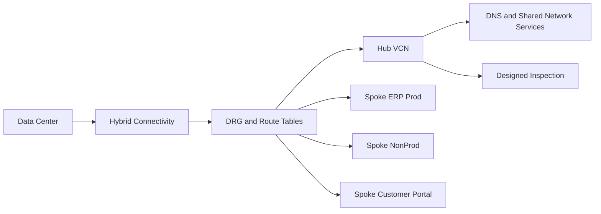

# Designing an Enterprise OCI Landing Zone

Within the **Resource Governance and Landing Zones** chapter of the **CLOUD_PROVIDERS_ORACLE** module, a landing zone is the foundation that enables teams to bring workloads onto Oracle Cloud Infrastructure in a consistent manner. This foundation connects tenancy, compartment, and IAM models with VCN networking, data protection, monitoring, automation, and cost controls.

A useful design must answer: who can deploy, where they deploy, what they can connect to, who receives alerts, and who is accountable during an incident. Those answers must be expressed as configurations that can be deployed, verified, and maintained across versions.

## Learning Objectives

After this lesson, you will be able to:

- Translate business requirements into OCI landing zone design decisions.
- Choose appropriate tenancy, compartment, identity domain, and VCN boundaries.
- Allocate administrative responsibilities across platform, security, network, application, and database teams.
- Design workload onboarding, cost attribution, monitoring, and recovery.
- Identify the evidence required before opening the landing zone to workload teams.

## 1. Scope of a Landing Zone

### 1.1. Required Layers

A landing zone can be viewed through six interconnected layers:

| Layer | Decisions to make | Deliverables |
| --- | --- | --- |
| Identity and organization | Governance boundaries; who can do what | Compartment tree, groups, policies, and authentication mechanisms |
| Connectivity | Network addressing, traffic flows, hybrid connectivity | VCNs, subnets, routes, NSGs, and DNS design |
| Protection | How to prevent risky configurations and protect secrets | Controls, key management, administrative access paths |
| Observability and operations | Detecting, routing, and resolving incidents | Logs, metrics, alarms, on-call contacts, and runbooks |
| Cost governance | Who owns costs and usage limits | Tags, budgets, quotas, and allocation reports |
| Automation | Reproducing, changing, and upgrading the foundation | IaC code, deployment state, and release processes |

Oracle provides Terraform-based landing zones and modules for these foundational layers. You can deploy from a blueprint and tailor it to your needs. See [Landing Zones Overview](https://docs.oracle.com/en-us/iaas/Content/cloud-adoption-framework/oci-landing-zones-overview.htm).

### 1.2. Choosing a Blueprint as a Starting Point

**OCI Core Landing Zone** unifies the Oracle Enterprise Landing Zone and CIS Landing Zone approaches using a modular framework. It is a suitable reference starting point when designing an enterprise OCI foundation. Actual scope and options must be checked against the specific blueprint version selected. See [OCI Core Landing Zone](https://docs.oracle.com/en-us/iaas/Content/cloud-adoption-framework/oci-core-landing-zone.htm).

When evaluating a blueprint, categorize items into three groups:

1. Components that fit and will be used in their reference configuration.
2. Components that need customization for organizational requirements.
3. Components the enterprise must add—such as incident paging integrations or internal access-approval workflows.

Record the blueprint version, provider version, and all modifications made. Alignment with a reference template's benchmark does not by itself prove the entire system meets compliance requirements. You must verify actual configurations, workload scope, and operational evidence.

## 2. Starting with Requirements and Assumptions

Consider a hypothetical enterprise **An Phu** with these characteristics:

- Six application teams, one network team, one security team, and one Oracle database administration team.
- An ERP system currently connected to an existing on-premises data center.
- Needs production, non-production, and sandbox environments.
- Some applications expose public interfaces; business data and database endpoints use private connectivity.
- Finance needs visibility into per-application costs and the shared platform cost share.
- The ERP system sets hypothetical targets of a two-hour RTO and a fifteen-minute RPO.

RTO is the Recovery Time Objective; RPO expresses the maximum acceptable data loss measured in time. These two values are scenario requirements, not outcomes the architecture has already proven.

Before drawing diagrams, capture requirements in a structured table:

| Requirement area | Questions to clarify | Design impact |
| --- | --- | --- |
| Governance scope | Does production need completely independent administration? | Single or multiple tenancies |
| Data | Which data is permitted in the target regions? | Region selection and backup placement |
| Connectivity | What are the required sources, destinations, protocols, and latency? | CIDRs, hybrid links, DNS, and inspection |
| Availability | Must it survive machine, fault/availability zone, or region failure? | Resource placement and recovery |
| Staffing | Who deploys, who approves changes, and who is on call? | IAM groups and separation of duties |
| Finance | By which units are costs allocated? | Compartments, tags, and budgets |
| Growth | How many workloads and what growth rate are expected? | Address space reserves, quotas, and onboarding templates |

Identify unverified assumptions and assign owners to verify them. For example, "the backup circuit has enough bandwidth to run ERP" must be verified through measurement and drills, not merely drawn on a diagram.

## 3. Choosing Organizational Boundaries and Delegation

### 3.1. Single Tenancy or Multiple Tenancies?

A tenancy is the highest administrative boundary in the OCI IAM model. Multiple tenancies increase autonomy and administrative isolation while also increasing the effort to maintain identities, policies, connectivity, and operations. See [IAM Security Structure](https://docs.oracle.com/en-us/iaas/Content/cloud-adoption-framework/iam-security-structure.htm).

| Option | Appropriate when | Trade-offs to consider |
| --- | --- | --- |
| Single tenancy, multiple compartments | Teams accept shared platform governance | Must tightly control parent-level and tenancy-level permissions |
| Separate tenancies by governance scope | Stronger autonomy or organizational boundaries are needed | Must maintain baselines and integrations across multiple places |
| Multiple tenancies within an OCI Organization | Need to manage a set of tenancies under an organizational structure | Must clarify governance rights, sharing policies, and reporting |

For An Phu, assume the architecture board accepts a single tenancy and separates production using compartments and dedicated networks. This decision must be revisited if the organization mandates a completely independent production administration group.

### 3.2. Compartment Tree by Accountability and Lifecycle

An illustrative structure:

```text
Tenancy / Root
└── Enterprise
    ├── Platform
    │   ├── Network
    │   ├── Security
    │   └── Operations
    ├── Workloads
    │   ├── ERP
    │   │   ├── Prod
    │   │   │   ├── App
    │   │   │   └── Data
    │   │   └── NonProd
    │   └── CustomerPortal
    │       ├── Prod
    │       └── NonProd
    └── Sandbox
```

In this example:

- `Network` holds network resources managed by the platform team.
- `Security` holds shared security resources according to supported service scopes.
- `Operations` holds monitoring and operational resources placed here.
- The workload branch separates ownership, environments, and data where needed.
- `Sandbox` has dedicated usage limits, expiration bounds, and cleanup processes.

This tree is a scenario design choice, not a mandatory blueprint layout. Some resources are tenancy-scoped or have specific placement requirements; map real resources accurately rather than forcing everything into the branches above.

Compartments exist across all regions to which the tenancy is subscribed. Permissions granted at parent levels can be inherited downward. Therefore, creating a `Prod` branch does not automatically remove overly broad permissions granted higher up. See [Managing Compartments](https://docs.oracle.com/en-us/iaas/Content/Identity/Tasks/managingcompartments.htm).

Distinguish these boundaries:

| Component | Role in the design |
| --- | --- |
| Tenancy | Top-level resource and IAM governance |
| Identity domain | Identity organization and identity management configuration |
| Compartment | Resource organization, permissions, and usage governance |
| VCN and network controls | Defines traffic paths and connectivity scope |

To verify production isolation, test both API permissions and network connectivity. A machine in another compartment can still reach production if network routing and security layers allow it.

### 3.3. Responsibility Matrix

| Group | Needed permissions in scenario | Design guardrails |
| --- | --- | --- |
| Platform team | Manage baseline and onboard workloads | Shared platform changes follow release control |
| Network team | Manage networks, routes, and hybrid links | No default permission to read application data |
| Security team | Manage controls, detection, and investigation | Config-change rights separate from reading business data |
| ERP application team | Deploy application components within assigned scope | Cannot open connectivity to other workloads on its own |
| DBA team | Administer required database services | Separate OCI service rights from in-database privileges |
| Finance team | Read costs and manage assigned budgets | No permission to modify Compute or networking |
| IaC pipeline | Execute approved changes within a specific scope | Credentials and permissions bound to task and environment |

Design centralized login with the enterprise IdP where appropriate, MFA for administrative access, and HR-driven provisioning/deprovisioning workflows. Maintain protected emergency-access accounts with periodic audits and usage monitoring. For workloads, evaluate instance principals or resource principals where supported by services to minimize long-lived key distribution.

Bootstrap deployment permissions and day-to-day operational permissions must be documented separately. Once bootstrap finishes, review temporary broad permissions, pipeline owners, and IAM modification rights.

## 4. Designing Networking for Growth and Isolation

### 4.1. IP Address Planning Before Creating VCNs

Illustrative address plan for the primary region:

| Network domain | Example CIDR | Purpose |
| --- | --- | --- |
| Hub | `10.80.0.0/20` | Shared connectivity and inspection components if selected |
| ERP production | `10.80.32.0/20` | ERP production subnets |
| ERP non-production | `10.80.48.0/20` | ERP development and testing |
| Customer Portal production | `10.80.64.0/20` | Customer portal application |
| Growth reserve | Remainder allocated via IPAM | Future workloads and subnets |

These are example ranges only. Before using them, cross-check against on-premises networks, other clouds, partner networks, and disaster-recovery region plans. Subnet sizing must account for scaling, rolling updates, and planned service types.

### 4.2. Illustrative Hub-and-Spoke Architecture



The diagram shows intended connectivity relationships; the arrows do not mean all traffic is permitted. The DRG is a virtual router; route tables and route distributions determine paths between attachments. To control connectivity, verify both the corresponding route tables and network security layers. See [Dynamic Routing Gateways](https://docs.oracle.com/en-us/iaas/Content/Network/Tasks/managingDRGs.htm).

Having a hub VCN or a firewall in the hub does not prove traffic actually passes through inspection. For flows requiring inspection, design both forward and return paths, verify there are no bypass routes, and inspect firewall logs during testing.

If an organization has only a few workloads and does not need complex shared connectivity, a simpler topology can be chosen. The decision to use hub-and-spoke should be driven by traffic flows, operational ownership, and control requirements.

### 4.3. Defining Flows by Source and Destination

| Source | Destination | Recommended flow for scenario |
| --- | --- | --- |
| Internet | Public application entry point | HTTPS through appropriate protection layers |
| ERP application tier | ERP database endpoint | Only required service protocols and ports |
| Authorized admin group | Private resources | Controlled, time-bound administrative path |
| NonProd | Prod | Blocked by design; only narrowly scoped exceptions opened |
| Workload | Supported OCI services | Private path appropriate to service and requirements |
| Workload | Internet | Only necessary outbound traffic through controlled paths |

A VCN is regional in scope. Subnets can be regional; private subnets help prevent public IP assignment. NSGs apply to resources in the group, while security lists apply across a subnet. NAT Gateways support outbound access for resources without public IPs; Service Gateways provide a private path to supported Oracle services. See [Networking Overview](https://docs.oracle.com/en-us/iaas/Content/Network/Concepts/overview.htm).

For ERP, choose a private database endpoint as supported by the service. Customer Portal's public entry point is placed separately from sensitive data zones. When designing rules, review the combined effect of security lists, NSGs, and firewalls; one remaining permissive rule can defeat the original restriction intent.

### 4.4. Hybrid and DNS as Dedicated Acceptance Items

Connectivity documentation must include:

- Which prefixes are advertised, which routes are accepted, and who manages the on-premises side.
- Primary link, backup link, capacity, and failover conditions.
- Which domains resolve where, query forwarding mechanisms, and name-conflict handling.
- Test results for latency, packet loss, return paths, and endpoint access by domain name.

FastConnect and VPN are connectivity options to evaluate against requirements. Having created two links does not prove they are independent in hardware, provider, or physical path. Check for common points of failure and rehearse failover.

## 5. Building Operable Security Controls

### 5.1. Combining Preventive, Detective, and Corrective Controls

| Control category | Purpose | Design example for An Phu |
| --- | --- | --- |
| Preventive | Restrict risky actions upfront | Least-privilege policies, private networks, appropriate Security Zones |
| Detective | Identify noteworthy configurations or activities | Cloud Guard, Audit, and service logs |
| Corrective | Return systems to an acceptable state | Runbooks, credential rotation, configuration restoration |

Cloud Guard uses targets to define inspection scope, detectors to surface issues, and responders to execute configured actions. Select targets and recipes suited to each resource area. See [Getting Started with Cloud Guard](https://docs.oracle.com/en-us/iaas/Content/cloud-guard/using/part-start.htm).

For An Phu, the security team starts by triaging findings and testing the intake workflow. Enable automated remediation responders only after verifying application impact. For example, making an unintentionally public bucket private may require different handling than a bucket intentionally designed to serve public content.

Security Zones evaluate resource create or update operations within supported scopes against a recipe and can block violating operations. Choose recipes based on data-zone requirements and verify resource dependencies. Start with the [Security Zones documentation](https://docs.oracle.com/en-us/iaas/Content/security-zone/home.htm) and [Core Landing Zone integration](https://docs.oracle.com/en-us/iaas/Content/cloud-adoption-framework/oci-core-landing-zone.htm).

Do not attach a recipe forbidding public resources to an entire application scope and still expect to create public components there. For ERP and Customer Portal, position public zones, application zones, and data zones so each control fits cleanly. When conflicts arise, adjust the architecture or document a clearly scoped exception.

### 5.2. Managing Keys, Secrets, and Administrative Paths

The design must specify:

- Which data requires customer-managed keys, which services support them, and who may use the keys.
- Who manages key lifecycles, who administers services using keys, and who has permission to read data.
- How secrets are delivered to runtime, rotated, and revoked.
- By which path administrators reach private resources, with which identity, and where evidence is stored.
- Which recovery procedure is used when keys, secrets, or administrative paths fail.

For Oracle databases, clarify both OCI resource management permissions and in-database privileges. A team may need to manage database infrastructure without holding default permission to read every business table.

## 6. Designing End-to-End Observability to Responders

### 6.1. Mapping Evidence to Each Question

| Operational question | Data sources to evaluate |
| --- | --- |
| Who changed a resource? | Audit for supported APIs |
| Did a network flow take the intended path? | Flow logs, inspection logs, and connectivity tests |
| Is the application serving users? | Application metrics, logs, and synthetic checks |
| Has a risky new configuration appeared? | Cloud Guard findings and configuration checks |
| Is the database meeting recovery objectives? | Data protection status and recovery test results |
| Do alerts reach the right person? | Evidence of notification delivery, receipt, and handling |

Audit automatically records supported public API calls. Verify coverage carefully: for instance, Audit documentation distinguishes bucket-level events from Object Storage object-level events. If object read/write tracking is needed, evaluate the corresponding service logs rather than assuming Audit captures every data access. See [Overview of Audit](https://docs.oracle.com/en-us/iaas/Content/Audit/Concepts/auditoverview.htm).

### 6.2. Completing the Alert Pipeline

An illustrative operational chain:

```text
Log / metric / finding sources
        ↓
Appropriate ingestion and routing path
        ↓
Centralized storage or SIEM; detection rules
        ↓
Accountable team notification channel
        ↓
Responder → runbook → handling evidence
```

For each source, specify region, compartment, emit/read permissions, retention duration, and failure handling when the forwarding pipeline breaks. If using Connector Hub or another forwarding tool, verify source, destination, and authentication mechanisms for that specific integration.

Run an end-to-end test: generate a sample event in a test environment, observe where it lands, verify alert conditions, and confirm the on-call engineer receives the notification. A topic that exists without active subscribers does not meet operational goals.

Logs can also contain sensitive data. Define read permissions, strip secrets from application logs, and control export destinations. Choose retention periods aligned with agreed investigation needs while accounting for storage and query costs.

## 7. Multi-Tool Cost Governance

### 7.1. Tag Conventions and Ownership

Example defined tag set for An Phu:

| Tag | Meaning | Example |
| --- | --- | --- |
| `Governance.Owner` | Accountable team | `erp-platform` |
| `Governance.CostCenter` | Cost allocation unit | `FIN-ERP` |
| `Governance.Environment` | Environment | `prod` |
| `Governance.Application` | Workload | `erp` |
| `Governance.DataClass` | Classification per internal standard | `internal` |

Tag defaults can apply defined tags when resources are created in a compartment and its child branches. They do not retroactively tag existing resources. Permissions to modify tag namespaces and tag values must also be governed. See [Managing Tag Defaults](https://docs.oracle.com/en-us/iaas/Content/Tagging/Tasks/managingtagdefaults.htm).

Verify whether actual resource types support the required tags and whether reports can group by the intended allocation dimensions. For shared platform components, document the allocation method explicitly—for instance, allocating connectivity or logging costs according to an agreed internal rule.

In sandbox environments, you can add expiration-date metadata. That metadata only cleans up resources when backed by an actual process or automation with exclusion rules and an accountable owner.

### 7.2. Distinguishing Budgets, Quotas, and Service Limits

| Tool | Role | Key considerations |
| --- | --- | --- |
| Budget | Track spending and alert | Soft threshold; does not automatically stop all resources |
| Compartment quota | Limit consumption of quota-supported resources | Not a monetary cap on the entire bill |
| Service limit | Service limit set by Oracle for the corresponding scope | Does not guarantee physical capacity is always available |

Budgets can target compartments or tags. Alerts are evaluated periodically, so never rely on a budget as an instantaneous spend cutoff. Budgets are created in the root compartment even when monitoring another compartment. See [Budgets](https://docs.oracle.com/en-us/iaas/Content/Billing/Concepts/budgetsoverview.htm).

Quotas are set by administrators, unlike service limits set by Oracle. Select the exact service family, quota name, and scope for the resources you want to govern. See [Overview of Compartment Quotas](https://docs.oracle.com/en-us/iaas/Content/Quotas/Concepts/resourcequotas.htm).

Example sandbox design:

- Send alerts at hypothetical thresholds of 70%, 90%, and 100% of assigned budget.
- Restrict certain costly resource types according to testing needs.
- Periodically review orphaned resources, unattached volumes, and retained backups.
- If automatically stopping or deleting resources, specify conditions, scope, and safeguards against affecting shared resources.

Platform cost planning must include firewalls, connectivity, logging, keys, backups, and standby resources. Size initially from real requirements, then calibrate from usage data; do not deploy every blueprint option by default.

## 8. Availability and Recovery Must Match the Workload

### 8.1. From Infrastructure Failures to Region Failures

| Scenario | What must be designed and tested |
| --- | --- |
| Process or host failure | Health checks, load balancing, and replacement mechanisms |
| Infrastructure zone failure | AD/FD resource placement and service capabilities |
| Loss of hybrid link | Redundant paths, routing, and failover bandwidth capacity |
| Region failure | Data, infrastructure, identities, and connectivity in the recovery region |
| Accidental deletion or corrupted data | Appropriate backups and point-in-time recovery procedures |

Do not assume every region has the same number of Availability Domains. Fault Domains help separate hardware placement within an Availability Domain; resource placement must match the selected service type and region. See [Regions and Availability Domains](https://docs.oracle.com/en-us/iaas/Content/General/Concepts/regions.htm).

For An Phu's ERP system, the recovery readiness checklist includes:

1. Target recovery region selected per data residency and required service availability.
2. Networking, addressing, DNS, and connectivity plans to dependent systems.
3. Data protection mechanism suited to the chosen Oracle Database service.
4. Keys, secrets, and access permissions required for recovery in the target region.
5. Service limits, quotas, and provisioning capacity plan in the target region.
6. Service failover sequence, business validation, and failback to the primary region.

Depending on database type, DBAs evaluate options such as Data Guard or backup-based restore according to service capabilities. IaC being able to recreate infrastructure does not mean application data is synchronized. Having backups on disk also does not prove restoration fits within the RTO.

### 8.2. Measuring Results Through Drills

To evaluate the two-hour RTO and fifteen-minute RPO targets, design drills with a recorded start time, reference data timestamp, and business acceptance criteria. Measure detection time, decision-to-failover time, resource provisioning, data recovery, and application validation.

If targets are missed, document root causes and adjust the plan: standby resource levels, data protection mechanisms, automation, or team coordination procedures. Balance those choices against ongoing cost and workload criticality.

## 9. Deploying the Foundation with IaC and Change Management

### 9.1. Separating State by Responsibility

An illustrative split of deployment scopes:

| IaC scope | Typical contents | Accountable owner |
| --- | --- | --- |
| Bootstrap | Initial deployment permissions and state management storage | Assigned platform team |
| Foundation | Compartment hierarchy, groups, and governance baseline | Platform team with security coordination |
| Regional network | Regional VCNs, DRGs, routes, and connectivity | Network team |
| Regional operations | Logging, notifications, and operational components per service scope | Operations team |
| Workload | Application and data resources within assigned scope | Workload team |

This is a suggested split; adapt it to module dependencies and your operating model. Use controlled outputs to pass OCIDs and connectivity metadata between scopes. Avoid having two states manage the same resource or two pipelines modify the same scope concurrently.

Treat state read/write access as sensitive because state files can contain configuration details and secrets. Processes must include state backup, recovery, and concurrency locking suitable for the chosen backend.

### 9.2. Change Lifecycle

```text
Requirements and architecture decision
        ↓
Code and environment configuration changes
        ↓
Validate configuration and review execution plan
        ↓
Assess IAM, network, data, and cost impact
        ↓
Deploy to test environment
        ↓
Verify and release within approved scope
        ↓
Monitor live state and update evidence
```

Before deploying to production, verify whether the plan replaces or deletes critical resources. Rollback plans must address data and dependencies; reverting to an older code commit does not necessarily restore a deleted resource.

If using OCI Resource Manager, drift detection compares live state against the stack's latest deployed configuration where supported. It helps catch out-of-band changes, though humans still need to triage and resolve findings. See [Detecting Drift in a Stack](https://docs.oracle.com/en-us/iaas/Content/ResourceManager/Tasks/detect-drift.htm).

For emergency Console changes, record who made the change, why, and which resources were affected. After the incident, reconcile live state with IaC code so the next run does not accidentally revert the fix or leave unneeded configuration behind.

### 9.3. Phased Rollout with Checkpoints

1. **Lock inputs:** responsibility matrix, tenancy boundaries, regions, addressing, and operational requirements.
2. **Controlled bootstrap:** prepare deployment identities and state management storage.
3. **Establish organization:** compartments, groups, policies, tags, and change-management permissions.
4. **Establish protection:** security baseline, key management, and detection scope.
5. **Deploy networking:** VCNs, hybrid connectivity, DNS, and defined traffic flows.
6. **Complete operations:** logs, metrics, alerts, and on-call recipients.
7. **Complete cost controls:** budgets, quotas, and allocation reports.
8. **Pilot workload onboarding:** use a low-risk application to test the end-to-end process.
9. **Accept and scale:** remediate gaps, publish baseline, and hand over to support.

Exact ordering may shift based on technical dependencies. For instance, a data control may require keys to exist before workloads; log forwarding may require service permissions before final verification.

## 10. Standardizing Workload Onboarding and Exception Management

### 10.1. A Complete Onboarding Record

Application teams should provide:

- Business owner, technical owner, and operational contact.
- Environment, data classification, target region, and dependent systems.
- Connectivity flows by source, destination, protocol, port, and purpose.
- Compute, storage, and Oracle Database service requirements.
- Availability targets, RTO, RPO, and testing approach.
- Budget, allocation tags, and expiration date if temporary.

Onboarding outputs should hand over compartments, groups and permissions, subnet/NSG references, configuration/secret retrieval patterns, log shipping paths, alerts, and relevant runbooks. Workload teams must know what they can change independently versus what remains shared platform infrastructure.

### 10.2. Recording Decisions and Exceptions

Example Architecture Decision Record (ADR):

```text
Decision: ERP Prod uses a private network with hybrid connectivity through the shared network foundation.
Rationale: Requires access to internal systems while restricting inbound paths to the database.
Owner: Network team in coordination with the ERP team.
Dependencies: IP addressing plan, DNS, routing, and backup link capacity.
Required evidence: Allowed-flow tests, blocked-flow tests, and link failover tests.
Review trigger: Requirement for independent governance autonomy or major scale changes.
```

If an application needs an exception, the record should specify resource scope, rationale, assessed risk, compensating controls, accountable owner, and review date. Prevent a single-application exception from becoming a tenancy-wide permissive policy.

When closing an exception, update live configuration, IaC code, and verification evidence together. Deleting a line from documentation does not ensure the network path or permission has been revoked.

## 11. Accepting the Landing Zone with Evidence

The table below lists proposed acceptance criteria for the An Phu scenario. Execute tests in a prepared acceptance scope, avoiding impact to live production workloads.

| Item | Test | Passing evidence |
| --- | --- | --- |
| IAM | Application identity acts within granted scope and tests outside scope | In-scope actions succeed; out-of-scope requests are denied |
| Networking | Test ERP-to-database flow and disallowed NonProd-to-Prod flow | Business paths work; no unintended connectivity exists |
| Inspection | Generate sample traffic on a path requiring inspection | Forward/return paths match and logs appear at inspection point |
| DNS and hybrid | Resolve names, reach endpoints, and test link failover | Connectivity meets agreed requirements |
| Security | Test a selected non-compliant config in a test scope | System prevents or detects per control type |
| Observability | Trigger an event and verify alert delivery to on-call group | Event is traceable and on-call responder receives it |
| Tags and cost | Inspect sample resources and allocation dimensions | Owner and cost-bearing unit are traceable |
| Quotas | Submit a request exceeding quota within acceptance scope | Blocked by configured quota with no impact outside scope |
| Recovery | Restore sample workload or data | Measured results compared against target RTO/RPO |
| IaC | Run next plan and check for out-of-band drift | No unresolved unexpected drift |

Common design pitfalls to cross-check:

- Creating many compartments while leaving overly broad permissions at tenancy or parent level.
- Drawing a firewall in the hub while actual routing lets traffic bypass it.
- Treating a budget as a guarantee that no extra spend can occur.
- Enabling logs and creating alarms without checking subscribers or data read permissions.
- Having a recovery region but missing keys, secrets, capacity, or dependent systems.
- Customizing a blueprint without recording versions or an upgrade path.

A landing zone is ready for general use when every layer has an owner, foundational configurations are managed under change control, essential tests have recorded evidence, and open gaps have clear remediation plans.

## 12. Design Exercise

Use the An Phu scenario to produce a design package containing:

1. Requirements matrix, assumptions, and single- vs. multi-tenancy decision.
2. Compartment tree along with group permission matrix.
3. VCN topology diagram, CIDR plan, and connectivity flow table.
4. List of preventive and detective controls plus responders.
5. Tagging convention, budgets, and proposed quota scopes.
6. IaC rollout plan, workload onboarding workflow, and recovery drill plan.
7. Acceptance checklist, required evidence, and open exceptions.

To self-evaluate your design, pick one additional workload and describe the exact additions required. If every new workload demands tenancy-wide admin rights or uncontrolled network changes, revisit your delegation model and onboarding template. A sound design enables teams to scale within clear boundaries while preserving security, cost control, and operability.