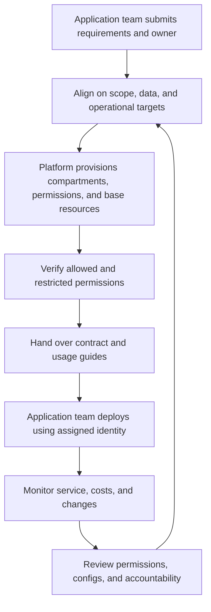

# Centralized Governance and Delegation Model for Application Teams

## Goals and Context

Within the **Resource Governance and Landing Zones** chapter of the **CLOUD_PROVIDERS_ORACLE** module, compartment design must connect to an operational question: who gets to decide and change what? A clearly named resource tree is still hard to manage if every deployment request must wait on an administrator, or if every application team has permission to modify the entire tenancy.

This lesson builds a model in which the platform team manages shared components and protective boundaries, while application teams independently deploy, observe, and operate services within their assigned scope. The illustrative scenario features two teams, **Orders** and **Billing**, developing Java applications on OCI Compute using Object Storage and Oracle database services.

After this lesson, you will be able to:

- Distinguish centralized governance, broad delegation, and a hybrid model.
- Build a responsibility matrix across platform, security, application teams, and service owners.
- Translate responsibilities into compartment scopes, IAM policies, and automation identities.
- Distinguish where a policy is attached from where it grants permissions.
- Establish workflows for application onboarding, permission grants, exception handling, and access revocation.
- Verify that an application team can perform its assigned work without crossing into another team's scope.

## 1. Governance Defines Decisions and Accountability

Cloud governance is not merely creating users or approving tickets. It defines:

1. Which rules apply universally.
2. Who has permission to modify each component.
3. Who is accountable when a service has an incident or incurs costs.
4. What evidence shows the rules are actually enforced.
5. When an exception is needed, who approves it and when it expires.

The Oracle Cloud Adoption Framework places roles, responsibilities, coordination processes, and continuous improvement under governance. OCI configurations should reflect how the organization actually works. [See Governance in the OCI Cloud Adoption Framework](https://docs.oracle.com/en-us/iaas/Content/cloud-adoption-framework/governance.htm).

For example, the platform team may be responsible for network connectivity to the database, the database team for backups, and the Orders team for queries and schema migrations. When the order API slows down, someone must coordinate troubleshooting based on symptoms and evidence rather than letting each team simply declare its own slice "healthy."

## 2. Three Models and the Practical Choice

| Model | How it operates | Best suited for | Problems to solve |
| --- | --- | --- | --- |
| Centralized | One team primarily provisions and modifies infrastructure for applications | Small scale, strict central control needed, app teams not yet ready to operate OCI | Ticket queues, admin bottlenecks, hard to scale |
| Broad delegation | Each team manages most of its own resources and rules | Teams with strong infrastructure skills and relatively independent org scopes | Inconsistent configs, overly broad privileges, fragmented costs and accountability |
| Hybrid | Platform provides foundation and guardrails; apps self-serve within defined boundaries | Multiple teams needing speed while maintaining shared standards | Requires clear contracts, supporting tooling, and boundary verification |

A hybrid model does not have to split work 50/50. An organization might centralize IAM and enterprise networking while delegating strongly to application teams for Compute, deployments, and monitoring.

Delegation depth also depends on team maturity. Newer teams can start with pre-approved deployment templates; more mature teams can be permitted to modify more components directly after proving operational capability. Never grant broad privileges merely because a team has a backlog of tickets.

### Example of a Delegation Decision

Orders wants to increase instance count during high traffic:

- If the change stays within pre-approved configuration and quotas, the Orders pipeline can execute it directly.
- If the change requires opening new network connectivity or raising shared consumption limits, it requires coordination with the owner of that component.
- If the change affects recovery objectives or service cost commitments, the service owner must participate in the decision.

Thus, autonomy is defined by change type and blast radius.

## 3. Defining What Platform Retains vs. What Applications Own

### 3.1. Recommended Centralized Governance Scope

The platform team, coordinating with security and specialized teams, can manage:

- Tenancy structure and platform compartments.
- Identity federation, administrative groups, and policies affecting multiple teams.
- Enterprise network connectivity, shared routing, and critical ingress/egress rules.
- Monitoring standards, log collection, key management, and platform incident response plans.
- Quotas, cost-attribution conventions, and resource allocation processes.
- Shared infrastructure modules, pre-deployment checks, and self-service catalogs.

"Centralized" here means clear ownership and accountability. It does not require one single person to perform every task. Even within the platform team, separate the identities used for IAM, networking, and automated deployment to limit blast radius if a mistake occurs.

### 3.2. Application Team Autonomy Scope

Application teams can be delegated:

- Managing application versions and application-level configurations.
- Deploying Compute or approved runtime components.
- Scaling within agreed quotas and guardrails.
- Building service dashboards, alerts, and application incident workflows.
- Managing data or buckets within their assigned scope.
- Executing schema migrations under workflows coordinated with database owners.
- Proposing cost optimizations and cleaning up end-of-life resources.

OCI permissions are only one part of this. Source code edit rights, pipeline approvals, OS access, and database schema administration must all align with the responsibilities above.

### 3.3. Illustrative Responsibility Matrix

In the table below, **A** is ultimately Accountable for the outcome, **R** is Responsible for executing the work, and **C** is Consulted. Each task should have one clear A.

| Task | Service owner | Platform | Security | Application team |
| --- | --- | --- | --- | --- |
| Set up compartments and initial permissions | C | A/R | C | C |
| Approve sensitive permission models | C | R | A | C |
| Operate shared network connectivity | C | A/R | C | C |
| Release application versions | A | C | Based on impact | R |
| Set service recovery objectives | A | C | C | R |
| Configure backups for assigned resources | A | R for platform services | C | R for application components |
| Troubleshoot application logic incidents | A | C | When security indicators appear | R |
| Analyze and optimize application costs | A | C | When needed | R |
| Grant security exceptions | C | R during implementation | A | R when requesting |
| Revoke permissions when a team wraps up | C | A/R | C | R during handover |

This is an illustrative model. If you have a dedicated database team or operations desk, add them and split tasks specifically enough so two parties never assume the other is accountable.

## 4. Representing the Model with Compartments

An example structure:

```text
Tenancy
├── Platform
│   ├── Network
│   │   ├── OrdersNetwork
│   │   │   ├── NonProduction
│   │   │   └── Production
│   │   └── BillingNetwork
│   ├── Security
│   └── Operations
└── Applications
    ├── Orders
    │   ├── NonProduction
    │   │   ├── Application
    │   │   └── Data
    │   └── Production
    │       ├── Application
    │       └── Data
    └── Billing
        ├── NonProduction
        └── Production
```

This structure reflects two intents:

- The platform team manages network resources, including networks dedicated to individual applications.
- Each application team has its own resource scope, further separated by environment where needed.

Not every system needs as many tiers as this example. Only add compartments when there is a difference in permissions, owners, or operational practices. Placing networks under Platform is also not mandatory; another option is placing networks alongside the application while granting edit rights only to the network team.

### Distinguish Managing Resources from Using Resources

Orders may need to use a platform-managed subnet to launch Compute instances. That does not mean Orders needs permission to edit route tables, create Internet Gateways, or change enterprise connectivity.

Document separately:

- Who manages network resources.
- Who may consume the components needed to deploy.
- Who may view configurations to diagnose issues.
- Who may alter traffic flows.

Compartments create organizational and IAM boundaries; they do not automatically create a firewall between Orders and Billing. Network configuration, data permissions, and workload identities must still be controlled.

### Do Not Grant Broad Permissions on a Parent and Expect to Narrow Them on Children

If Orders is granted permission to manage all resources in `Applications`, that permission can cover Billing underneath. A policy on a child compartment does not automatically revoke permissions inherited from a parent.

OCI applies policy inheritance down the compartment tree. Therefore, evaluating a team's effective permissions requires checking policies at the tenancy and all parent levels, plus all groups to which the identity belongs. [See Policy Inheritance](https://docs.oracle.com/en-us/iaas/Content/Identity/policieshow/Policy_Inheritance.htm).

## 5. Policy Attachment Location and Statement Scope Are Two Separate Decisions

An IAM policy has at least two aspects to distinguish:

| Aspect | Question | Governance significance |
| --- | --- | --- |
| Policy attachment location | Which compartment is the policy created in? | Helps determine who can modify or delete the policy |
| Target location in statements | Where do the statements allow resource actions? | Determines the scope of resources granted access |

A platform-managed policy can be attached at an appropriate parent level while granting Orders access only to a specific application compartment. Attaching at tenancy does not automatically turn every statement into tenancy-wide access; you must still read the target location and conditions inside each statement.

Oracle describes policy attachment location as the factor determining which policy-management groups can change or delete it. [See Working with Policies](https://docs.oracle.com/en-us/iaas/Content/Identity/policymgmt/managingpolicies_topic-Working_with_Policies.htm).

### Two Distinct Levels of Delegation

**Resource operations delegation:** Orders can deploy Compute and manage assigned application components. Platform retains ownership of policies.

**Policy administration delegation:** Orders can also write or edit policies within its own scope. This is a stronger privilege and must be evaluated separately.

Avoid defaulting to `manage all-resources` to satisfy application deployment needs. That privilege can include managing policies inside the compartment. If the organization wants to keep permission granting centralized, select specific resource types and verbs instead.

Oracle notes that `manage all-resources` includes policy management and recommends limiting who can write policies. [See Best Practices for IAM on OCI](https://docs.oracle.com/en-us/iaas/Content/Resources/Assets/whitepapers/best-practices-for-iam-on-oci.pdf).

Policy administration delegation can fit a business unit entrusted with full compartment governance. In that case, document that the unit can expand permissions within its allowed scope, define what the platform still controls, and assess impacts on shared resources.

## 6. Separating Human, Deployment, and Workload Identities

An application team typically needs at least three identity types:

| Identity type | Purpose | Design scope |
| --- | --- | --- |
| Human user | Inspect state, handle assigned tasks, emergency access | By group and role; sensitive rights controlled |
| Deployment pipeline | Create or modify infrastructure and app versions | By application, environment, and change type |
| Running workload | Call OCI services to fulfill app functionality | Only the APIs and data needed at runtime |

Do not share a single administrative account across all three. During incident investigation, you must distinguish actions performed by a human, a pipeline, or the application itself.

### 6.1. Example Policy for a Deployment Identity

The following statements illustrate part of the permissions for the Orders deployment group in non-production. Replace placeholders with real OCIDs when applying:

```text
Allow group id <ORDERS_NONPROD_DEPLOY_GROUP_OCID> to manage instance-family in compartment id <ORDERS_NONPROD_APPLICATION_COMPARTMENT_OCID>

Allow group id <ORDERS_NONPROD_DEPLOY_GROUP_OCID> to read virtual-network-family in compartment id <ORDERS_NONPROD_NETWORK_COMPARTMENT_OCID>
```

The first line scopes the Compute resource family to Orders' application compartment. The second line illustrates read access to network configuration in the network scope allocated to Orders non-production.

This **is not a complete permission set to launch Compute**. Real deployments also require permissions on dependencies such as subnets, images, and volumes depending on configuration. Read permission on networking does not allow attaching VNICs to a subnet or altering network configurations.

Writing policies with OCIDs explicitly pins the group and compartment; IAM syntax must still be cross-checked against each service's required permissions. [See Policy Syntax](https://docs.oracle.com/en-us/iaas/Content/Identity/Concepts/policysyntax.htm).

If the pipeline runs using an instance principal or resource principal, grant permissions to that exact principal type rather than copying a user-group statement verbatim. Authenticating without stored API keys does not automatically narrow permission scope.

### 6.2. Example Runtime Permission with Specific Data Scope

Suppose the Orders application reads configuration files from a dedicated bucket. An illustrative policy:

```text
Allow dynamic-group id <ORDERS_RUNTIME_DYNAMIC_GROUP_OCID> to read objects in compartment id <ORDERS_DATA_COMPARTMENT_OCID> where target.bucket.name = 'orders-runtime-config'
```

This statement expresses the intent for runtime to read objects in the chosen bucket. It does not grant object writes, tenancy management, or instance deployment. [See example policy for reading Object Storage from a dynamic group](https://docs.oracle.com/en-us/iaas/Content/Compute/Tasks/instances.htm).

Before use, verify the actual bucket, matching environment, required dependency permissions, and combined permissions from other policies. Do not treat the bucket name in this example as a system-wide security convention.

Dynamic groups define membership using matching rules, and IAM policies then grant permissions to that resource group. A compartment-based rule can include both existing instances and future instances created in that compartment. [See Managing Dynamic Groups](https://docs.oracle.com/iaas/Content/Identity/dynamicgroups/managingdynamicgroups.htm).

Example matching rule for an application compartment:

```text
instance.compartment.id = '<ORDERS_APPLICATION_COMPARTMENT_OCID>'
```

This is a membership condition, not a permission statement. It evaluates the specified compartment; do not assume this rule automatically includes all child compartments like policy inheritance does. [See Writing Matching Rules](https://docs.oracle.com/en-us/iaas/Content/Identity/dynamicgroups/Writing_Matching_Rules_to_Define_Dynamic_Groups.htm).

### 6.3. Deployment Permissions Can Lead to Runtime Privileges

If someone can launch an instance in a compartment where a dynamic group grants read access to sensitive data, they can deploy a workload to exercise that runtime permission. Similarly, anyone able to modify startup scripts, log into the OS, or introduce new code into the application can influence how the workload accesses data.

Therefore, "developers cannot read prod secrets in the Console" does not prove developers cannot obtain prod data. You must also evaluate:

- Permissions to edit source code and approve releases.
- Permissions to edit pipelines or substitute artifacts.
- Permissions to alter instance configurations and access the OS.
- Permissions that place resources into dynamic group membership.
- Permissions to modify policies or tags used in authorization decisions.

If the organization must prevent a single individual from pushing unreviewed code to prod, control both the approval chain and the prod deployment identity. An approval button in the CI/CD UI has little effect if that person still holds credentials to deploy directly via the CLI.

## 7. Building Multi-Layered Safeguards

Governance controls can be grouped into four categories:

| Category | Role in the delegation model | Examples |
| --- | --- | --- |
| Preventive | Block out-of-scope actions at enforcement points | Compartment-scoped IAM, quotas, network controls |
| Pre-change checks | Catch non-compliant configs before applying | Plan reviews, deployment target checks, pipeline guardrails |
| Post-change detection | Spot configuration drift or anomalous behavior | Cloud Guard, logs, alerts, live-config comparisons |
| Corrective | Fix errors or limit impact after detection | Revoke access, isolate resources, restore approved configs |

Not every rule can be expressed directly in IAM. A requirement such as "every database must have a tested recovery plan" also requires backup configurations, recovery test procedures, and recorded test evidence.

### 7.1. Distinguish Pipeline Checks from Controls Inside OCI

If a rule only runs inside a pipeline, anyone with permission to modify resources directly can bypass it. For automated governance checks to hold real weight, restrict direct manipulation rights and tightly control which identities can apply changes.

Emergency access can be retained for a designated group. Every invocation requires a documented justification, time limit, audit trail, and post-incident reconciliation of any configuration changes made.

Never describe a naming convention or a written approval rule as if it were a technical barrier. For every control, know whether it truly blocks, merely alerts, or only guides human operators.

### 7.2. Security Zones and Cloud Guard Serve Different Roles

Security Zones evaluate operations within supported scopes against an applicable recipe and can deny violating actions. Cloud Guard inspects configurations or activity to detect issues and can be configured with responders for certain actions.

They complement IAM and operational workflows. Do not assume every internal rule is supported by Security Zones or that every Cloud Guard finding is automatically remediated. [See OCI Security Services](https://docs.oracle.com/en-us/iaas/Content/Security/Concepts/security_features.htm).

Before applying them to an application, review the recipes, resource types, and operations involved. An application requiring a public entry point needs an appropriate design; never enable a rule set without assessing its architectural impact.

## 8. Providing a Service Contract for Application Teams

Self-service requires clear inputs and usable outputs. The platform team can offer a catalog such as:

- Application space with compartments, groups, and deployment identities.
- Application networking following an agreed template.
- Supported Compute or runtime platform configurations.
- Object Storage and secret access patterns.
- Oracle Database options with defined backup, patching, and schema responsibilities.
- Platform monitoring and guidance for connecting application alerts.

### 8.1. An Orders Onboarding Contract

Illustrative contract template:

```text
Application: Orders
Service owner: <accountable person or role>
Application operations team: <team>
Environment: <non-production or production>
Assigned compartment: <OCID>
Allowed deployment regions: <agreed list>
Deployment identity: <identifier>
Provided network and connectivity: <scope>
Authorized data and secrets: <scope>
Resource quotas: <types and limits>
Estimated cost and cost owner: <details>
Recovery objectives: <RTO, RPO>
Alert destination: <channel or on-call group>
Out-of-scope change path: <point of contact>
Next access review date: <date>
```

This is an operational contract, not a standard OCI configuration schema. Fields needed for automation can be represented in an internal management system with appropriate validation.

### 8.2. Clarifying Database and Data Responsibilities

For Oracle databases, separate at least three questions:

1. Who manages the database resource on OCI?
2. Who manages accounts, privileges, and schemas inside the database?
3. Who is accountable for data quality, migrations, and application recovery outcomes?

Platform provisioning the database does not mean platform understands every Orders migration. Conversely, Orders managing schemas does not mean Orders holds permission to alter backup policies or database network settings.

Similarly, Object Storage requires clear data ownership. If teams can create buckets themselves, define who decides access policies, retention periods, sharing mechanisms, and data deletion. Never grant bucket-management permissions and assume all sharing channels are already blocked by policy.

### 8.3. Contracts Need Support Boundaries

Application teams must know:

- Which configuration patterns are platform-supported.
- Who handles failures in shared infrastructure modules.
- Which changes teams can execute independently.
- Which changes require consultation or approval.
- What level of support applies when an application uses non-catalog components.

Clear boundaries reduce manual ticket churn and prevent one party from being held accountable for components it does not control.

## 9. Onboarding, Deployment, and Change Management Flow



### 9.1. Onboarding Workflow for a New Application

**Step 1 — Confirm owner and requirements.** Gather environments, planned services, data, integrations, availability targets, and cost expectations. Never start from a vague request to "grant admin rights for testing."

**Step 2 — Select the closest template.** Use approved modules or baseline configurations. Explicitly list any unmet requirements to handle as a scoped change or an owned exception.

**Step 3 — Provision resources and identities.** Create the application scope, user groups, deployment identities, and runtime permissions per responsibility. Platform can automate this step.

**Step 4 — Verify before handover.** Prove the team can perform required tasks and cannot access other application scopes. Record shared dependencies.

**Step 5 — Hand over and operate.** Deliver resource identifiers, deployment instructions, alert routing, scaling request paths, and support escalation channels.

### 9.2. Classifying Changes by Impact

| Change type | Recommended handling |
| --- | --- |
| Update application version within assigned scope | Application team executes via agreed release pipeline |
| Scale resources within approved quotas and patterns | Application team executes, tracking cost and results |
| Open new connectivity to another system | Network and data owners review jointly |
| Modify IAM, groups, or matching rules | Follow designated identity governance process |
| Raise quotas or request additional service limits | Evaluate shared demand and cost before adjusting |
| Changes that may degrade recovery capability | Service owner decides alongside relevant teams |
| Emergency remediation | Use controlled emergency path with post-incident review |

Any configuration edited directly during incident response must be reconciled with infrastructure code afterward. Otherwise, the next deployment can overwrite the fix or let live state drift further from managed code.

### 9.3. Managing Time-Bound Exceptions

An exception record should specify:

- Specific request and justification.
- Affected resources, identities, or connectivity scope.
- Approver and person accountable for remediation.
- Mitigating controls while the exception is active.
- Expiration date and revocation method.
- Verification results after closing the exception.

For example, Orders needs temporary access to an endpoint for data migration. Do not turn that request into a broad network rule with no expiration date. When the exception expires, verify that permissions and connectivity are actually revoked rather than merely closing the ticket.

## 10. Observing Operations, Cost, and Governance Effectiveness

### 10.1. Centralize Observability Capability, Authorize Observability Data

Platform needs visibility into overall health; application teams need enough logs and metrics to troubleshoot their own services. Those two needs do not mean every team should read every other team's logs.

Design should specify:

- Application, environment, and owner labels in observability data.
- Which log or dashboard scopes each application team may view.
- Which alerts route to the application team versus the platform team.
- How a deployment is correlated with resource changes and incidents.
- Who may modify or delete log collection, retention, and export configurations.

OCI Audit records calls to supported public APIs, including Console, CLI, and SDK actions. It supports tracing resource changes, though it does not replace full application logs or in-database auditing. [See Overview of Audit](https://docs.oracle.com/en-us/iaas/Content/Audit/Concepts/auditoverview.htm).

For example, investigating a data-deletion query may require records inside Oracle Database and the application. An OCI resource-management API audit log alone does not prove who executed a specific SQL statement.

### 10.2. Pair Cost Accountability with Deployment Permissions

When Orders is authorized to create resources, the contract must specify who tracks and explains costs. Platform can standardize tagging, provide reports, and set quotas; the Orders team still must review idle resources or oversized configurations.

An internal identification attribute set might include:

```text
Application = orders
Environment = non-production
Owner = orders-team
CostCenter = <cost-bearing unit>
Lifecycle = <long-lived or temporary>
```

These values are illustrative conventions. If tags participate in access or automation decisions, govern who can modify tags; do not treat them merely as display labels.

Budgets monitor and alert on spending without automatically blocking all over-threshold spend. Quotas control consumption of supported resource types within scope; raising quotas must still account for service limits and shared capacity needs. [See Track and Manage Usage and Cost](https://docs.oracle.com/en/solutions/oci-best-practices/track-and-manage-usage-and-cost1.html).

Never auto-stop production resources solely because of a cost alert without an appropriate operational decision. A cost-remediation action can itself cause a service outage.

### 10.3. Measuring Whether the Model Helps Application Teams Work Better

| Suggested indicator | What to observe |
| --- | --- |
| Lead time from valid request to usable environment | Whether onboarding waits too long on manual steps |
| Share of app changes self-served within standard patterns | Whether the self-service catalog meets real needs |
| Frequency of temporary out-of-pattern permission grants | Whether permission templates are missing capabilities or teams are overreaching |
| Number of live configs drifting from infrastructure code | Whether out-of-band changes or stale configs are occurring |
| Count of overdue exceptions | Whether remediation and revocation accountability is enforced |
| Resources lacking an explicit owner | Whether orphaned costs or unmanaged data risks exist |
| Recovery drill outcomes | Whether backup responsibilities translate into real recovery capability |

These are suggested governance indicators, not built-in metrics automatically available in every tenancy. Interpret them in context. Many denied requests might show boundaries working properly, or they might indicate under-scoped permissions blocking legitimate application work.

## 11. Hands-On: Handing Over the Orders Scope While Preserving the Billing Boundary

### 11.1. Lab Conditions

Use an authorized tenancy or training area. Orders and Billing can be two simulated applications without real production resources.

Preparation:

- Compartments and test resources with designated owners.
- An admin identity for setup and control verification.
- A test identity belonging only to the intended Orders groups.
- Verified region and OCIDs.
- Intended permission matrix and a cleanup plan for lab resources.

Do not use an account holding tenancy-admin rights to prove that Orders is restricted. If the test identity belongs to multiple groups, check cumulative permissions before testing.

### 11.2. Execution Sequence

**Step 1 — Write the contract.** Define what Orders operates independently, what platform retains, and what Billing components must remain protected. Record owners, data scopes, and where out-of-scope requests go.

**Step 2 — Map to resources.** Record the compartment OCIDs for Orders Application, Orders Data, networking allocated to Orders, and the Billing scope used for verification.

**Step 3 — Choose identities.** Separate human test user, deployment pipeline, and workload. Only create a dynamic group when the lab requires a workload calling OCI services.

**Step 4 — Write required policies.** Start from concrete operations. When dependency permissions are needed, document the service and rationale; never escalate directly to tenancy scope.

**Step 5 — Test boundaries.** Run both allowed operations and operations that must be denied. The following PowerShell commands are read-only:

```powershell
$ordersApplicationCompartment = '<ORDERS_APPLICATION_COMPARTMENT_OCID>'
$billingApplicationCompartment = '<BILLING_APPLICATION_COMPARTMENT_OCID>'
$ordersVcnOcid = '<ORDERS_VCN_OCID>'
$targetRegion = '<OCI_REGION>'

oci compute instance list --profile ORDERS_TEST --region $targetRegion --compartment-id $ordersApplicationCompartment --all
oci compute instance list --profile ORDERS_TEST --region $targetRegion --compartment-id $billingApplicationCompartment --all
oci network vcn get --profile ORDERS_TEST --region $targetRegion --vcn-id $ordersVcnOcid
```

The `ORDERS_TEST` profile must point to the exact test identity. In this illustrative model, Orders can list instances in its own scope and read its assigned network, but cannot view Billing instances.

An empty result does not prove an operation was denied: the compartment may have no instances or you may be querying the wrong region. A `NotAuthorizedOrNotFound` error also requires control-identity verification to rule out a wrong OCID or non-existent resource.

An administrator confirms target resources exist using an appropriately privileged control identity. Never write credentials, secrets, or sensitive data payloads into test records.

### 11.3. Handover Evidence Matrix

| Item | Outcome to prove | Suggested verification method |
| --- | --- | --- |
| Application scope | Orders can access its required resources | Read-only APIs and a small deployment in the lab area |
| Team boundary | Orders has no unauthorized access into Billing | Read-only APIs against control-verified targets |
| Networking | Orders uses or observes networking per contract | Check policies, configs, and appropriate network paths |
| Permission management | App team cannot edit policies unless delegated | Review cumulative permissions; test edits only in approved simulation scope |
| Runtime identity | Workload reads only authorized data | Use synthetic data and verify matching rule and policy |
| Deployment | App job does not use platform admin credentials | Inspect execution identity and job permission scope |
| Observability | App team receives alerts for its own service | Emit a controlled test signal |
| Cost | Every resource has an owner and tracking scope | Cross-check tags, compartments, and contract |
| Access revocation | Test permissions cease working after revocation | Re-test using the identity after procedural revocation |

Read-only commands do not directly prove that all write operations are blocked. Combine policy analysis with controlled write tests in the lab area. Never attempt to delete real resources or alter production IAM to test limits.

**Step 6 — Hand over.** Save results per identity and operation, documenting remaining limitations, owners, and due dates. The receiving team must be able to run basic deployment or observability flows using its own permissions.

## 12. Reviewing and Closing the Delegation Lifecycle

Permissions must be reviewed upon staff changes, architectural changes, incidents, project completion, or on the agreed review cadence.

A review should answer:

- Are the service owner and on-call group still accurate?
- Do users, pipelines, and workloads still need all currently granted permissions?
- Have new parent-level policies widened effective scope?
- Have groups or matching rules changed membership unexpectedly?
- Are any shared credentials or jobs running with emergency privileges?
- Have expired exceptions actually been closed?
- Do database, OS, and CI/CD tool permissions still align with IAM?

When a team retires or hands off an application, follow a handover order that avoids data loss or loss of auditability:

1. Identify the incoming service owner or confirm service retirement.
2. Handle data, backups, retention periods, and handover obligations.
3. Stop pipelines and scheduled automations that are no longer needed.
4. Revoke permissions, credentials, and access to related tools.
5. Verify revocation took effect; do not rely solely on having edited group membership.
6. Clean up scoped resources and check for residual ongoing charges.
7. Update ownership records, alerts, and remaining connectivity.

Revoking OCI permissions does not automatically delete downloaded data copies or revoke privileges inside a database. Access termination must be executed across all involved systems.

## 13. Common Mistakes

| Mistake | Consequence | Remediation |
| --- | --- | --- |
| Every request requires an admin action | Platform team becomes a ticket bottleneck | Standardize self-service scopes and automate onboarding |
| Granting `manage all-resources` to every team | Can unintentionally grant policy-management rights | Specify exact resource types and scopes |
| Inspecting policies only inside the app compartment | Misses permissions inherited from tenancy or parents | Evaluate cumulative permissions and inheritance |
| Merging user, pipeline, and runtime identities | Hard to audit; large blast radius | Separate identities by purpose |
| Keeping broad prod permissions and adding only CI/CD approval | Direct deployment path bypasses approval | Narrow direct access and protect deployment identities |
| Treating network usage rights as permission to edit all networking | Apps can disrupt another team's connectivity | Separate management, usage, and read visibility |
| Giving app teams autonomy without sufficient logs | Teams cannot diagnose their own incidents | Provide scoped observability access |
| Centralizing logs while letting every team read all logs | Other applications' data may be exposed | Authorize observability data by scope |
| Granting exceptions with no expiration date | Temporary rights become permanent | Assign accountable owners and revocation verification |
| Granting resource creation rights without cost accountability | Orphaned resources and forgotten spend | Bind ownership, monitoring, and lifecycle rules |

## 14. Self-Check Questions

1. Which decisions belong to the platform, and which changes can Orders execute on its own?
2. If a policy attached at tenancy grants access only into Orders Application, where is the permission granted and who can edit the policy?
3. Why must application deployment permissions and policy administration permissions be evaluated separately?
4. What risk can a developer pose if they cannot read secrets in the Console yet have permission to modify code running in prod?
5. In which operations does a deployment pipeline identity differ from a runtime identity?
6. Which controls truly block changes, and which only detect or alert?
7. When a deployment request is blocked by a missing dependency permission, what must be identified before widening permissions?
8. Who is accountable for proving the application's database can recover within target objectives?
9. Besides having separate compartments, what evidence proves Orders cannot cross into Billing?
10. When a team stops operating a service, across which systems must permissions and data be handled?

The governance model must enable application teams to execute their assigned work through a clear workflow while preserving verifiable boundaries. Compartments, policies, pipelines, and operational responsibilities must all express one consistent delegation model.
