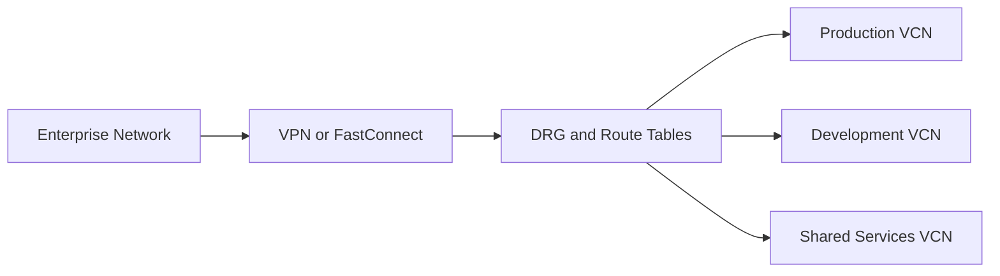
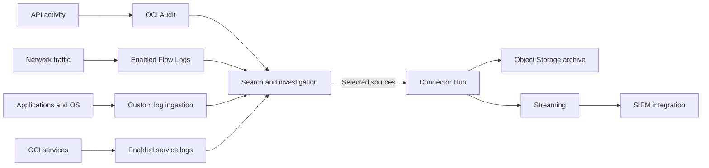

# Governing Identities, Connectivity, and Logging in a Landing Zone

An Oracle Cloud Infrastructure (OCI) landing zone must help teams deploy applications in an environment with clear rules. Pre-creating compartments and VCNs is only the beginning. Operations teams must also know who is allowed to alter infrastructure, where traffic is permitted to flow, and which sources contain operational evidence.

These three questions are tightly linked. If someone can alter networking and disable log sources without detection, separating compartments alone does not deliver the desired governance. If an application has the right IAM policies yet lacks a network path to a service, the workload still fails. If logging is enabled yet no one has search permissions or no one handles alerts, incidents can still go unnoticed.

This lesson belongs to the **Resource Governance and Landing Zones** chapter. It builds a coordinated governance model across identities, connectivity, and logging for Compute, storage, and Oracle database workloads on OCI.

## 1. Outcomes Required from an Operable Landing Zone

A landing zone is ready for handover when it can answer these concrete questions:

| Domain | Questions it must answer | Evidence |
| --- | --- | --- |
| Identity | Who can deploy, read data, alter networking, and change policies? | Groups, roles, policies, memberships, and revocation procedures |
| Connectivity | Which sources may access which targets, over which paths? | Connectivity matrix, routes, NSGs, DNS, and test results |
| Logging | Where are important activities recorded, who reads them, and for how long? | Log source catalog, read permissions, retention, and sample records |
| Operations | Who responds when permissions drift, connectivity breaks, or logs stop arriving? | Owners, alerts, runbooks, and recovery checks |

The running example throughout this lesson is an organization with a network team, a security team, an application team, and auditors. Production workloads need access to a private database, Object Storage reads, and logs shipped for investigation. Development environments must have separated permissions and separated connectivity paths from production.

This is an illustrative model. Do not treat the compartment names, CIDRs, or team splits in this lesson as mandatory requirements for every OCI landing zone.

## 2. Organizing Resources and Defining Owners

### 2.1. A Reference Compartment Structure

```text
Tenancy
└── lz-main
    ├── lz-network
    ├── lz-security
    │   ├── lz-logs
    │   └── lz-log-archive
    └── lz-workloads
        ├── lz-dev
        └── lz-prod
```

Design rationale:

- `lz-network`: shared connectivity infrastructure such as DRGs and network resources assigned to the network team.
- `lz-security`: security services structured according to the organization's operating model.
- `lz-logs`: centralized log groups and logs where supported by the source types.
- `lz-log-archive`: buckets storing log copies when longer retention is needed.
- `lz-dev`, `lz-prod`: workload resources separated by environment.

Some workload VCNs or network resources can reside in application-specific compartments with corresponding administrative permissions delegated appropriately. What matters is knowing the owner and permission scope, not forcing every VCN into one compartment at all costs.

The OCI Core Landing Zone likewise uses resource groups for networking, security, applications, and databases alongside IAM components to separate responsibilities. See [OCI Core Landing Zone](https://docs.oracle.com/en-us/iaas/Content/cloud-adoption-framework/oci-core-landing-zone.htm).

### 2.2. Compartments Are Not Network Firewalls

Placing two instances in different compartments does not automatically block IP connectivity between them. Conversely, placing resources in the same compartment does not automatically allow a user to access all of them.

Distinguish clearly:

- Compartments organize resources and establish scopes for governance policies.
- VCNs, subnets, routes, NSGs, and related mechanisms determine traffic paths and transport permissions.
- IAM governs API actions and service access according to policies.
- Operating systems, applications, and databases each have their own authentication and authorization layers.

Compartments also do not replace regions. Logs, VCNs, DRGs, and many other resources are regional; multi-region architectures must design sources, targets, and checks per region.

### 2.3. Responsibility Allocation

| Role | Primary responsibility | Guardrails to design |
| --- | --- | --- |
| Identity or platform team | Federation, groups, admin permissions, provisioning automation | Restrict tenancy-wide privileges for routine daily work |
| Network team | CIDRs, DRGs, DNS, routing, hybrid links, and segmentation | No default permission to read application data |
| Security team | Log collection requirements, security checks, alerting | Separate content read rights from config edit/delete rights where appropriate |
| Application team | Deploy and operate assigned workloads | Cannot modify shared connectivity or tenancy-wide policies on their own |
| Auditors | Inspect configurations and evidence within audit scope | Need no infrastructure modification rights to read evidence |

One person may wear multiple hats in a small organization. Even then, you still must know which role each action uses and who reviews high-impact changes.

## 3. Governing Human Identities

### 3.1. From Identity Source to Resource Permissions

The governance flow can be depicted as follows:

```text
Enterprise identity or local user
              ↓
Authentication, MFA, and sign-on policy
              ↓
Assigned groups or roles
              ↓
Scoped OCI IAM policies
              ↓
Permitted APIs and resources
```

Federation lets an organization use a centralized identity source, but it does not replace OCI authorization. Successfully authenticated users still require appropriate groups, roles, or grants.

Administrative accounts require MFA and recovery procedures. Everyday accounts should be separated from emergency administrative paths per organizational design. Never share a single administrative account among multiple people when you need accountability for who changed infrastructure.

### 3.2. Granting Permissions Through Groups and Job Functions

You can create groups such as:

- `LZ-Network-Operators`.
- `LZ-Security-Operators`.
- `LZ-Prod-Deployers`.
- `LZ-Dev-Deployers`.
- `LZ-Auditors`.

Names are just labels. Actual permissions come from policies and related roles; a group named "read-only" can still hold edit rights if a policy grants them.

Start from the job function, then identify the required APIs and resource types. Avoid granting `manage all-resources in tenancy` to bypass an unclear deployment dependency. Dependencies like using subnets, attaching volumes, or accessing keys must be handled per relevant service and scope.

### 3.3. Checking Inherited and Cumulative Permissions

A policy on a parent compartment can apply down to child compartments via inheritance. If the development team receives broad permissions on `lz-workloads`, creating `lz-prod` underneath does not automatically remove those permissions.

When evaluating a user, check:

1. All groups the user belongs to.
2. Identity domain or application administrative roles.
3. Policies at tenancy and all ancestor levels.
4. Permissions on the target compartment.
5. Automation identities the user can invoke or control.

A new narrow policy does not automatically shrink permissions granted by an older broad policy. Access design must evaluate the cumulative effective paths.

### 3.4. Revocation Must Include Non-Browser Credentials

When staff change roles or leave, review group memberships, roles, active sessions, and credentials such as API signing keys or auth tokens. Changing a Console password does not automatically rotate or revoke other credentials.

With federation, specify which team disables access in the IdP and which team verifies remaining permissions in OCI. If fallback local logins are allowed, include that path in the same review workflow.

## 4. Governing Workload and Pipeline Identities

Applications and deployment tools are also principals that call APIs. Do not assume every action executed by a pipeline can be attributed to the person who clicked Run if the pipeline uses an unmanaged shared credential.

### 4.1. Selecting Identities by Execution Environment

| Execution environment | Approach to evaluate |
| --- | --- |
| OCI Compute | Instance Principals and Dynamic Groups with appropriate matching rules |
| OCI services supporting resource identity | Resource Principals per the service's mechanism |
| External pipeline outside OCI | Platform-supported authentication with lifecycle management and scoped rights |
| Operator workstation | Personal credentials or appropriate authenticated sessions with traceability |

Dynamic Groups only define resource membership via conditions. Permissions are granted through policies. In particular, permissions to edit tags, launch instances, or move instances into compartments can affect whether a machine matches a matching rule.

### 4.2. Separating Deployment and Runtime Identities

An application that only reads one bucket does not need permission to create Compute instances. A deployment pipeline may need to create resources without necessarily reading production data payloads.

Explicitly document:

- Infrastructure provisioning identity.
- Runtime identity used by the application.
- Log collection and shipping identity.
- Log search or audit identity.

Each identity has an owner, scope, and revocation method. If a single pipeline can alter IAM, open networking, and delete log archives, the blast radius if that pipeline is compromised becomes far greater.

### 4.3. Managing Changes via Infrastructure as Code

Managing IAM, networking, and log source configurations alongside deployment changes lets reviewers inspect interrelated impacts. However, infrastructure code only describes intended configuration; drift detection is required to know whether live resources differ from that configuration.

Automation state files and credentials are sensitive assets. Never print tokens, passwords, or private keys into deployment outputs and forward raw outputs into centralized logs.

## 5. Governing Connectivity with a Flow Matrix

### 5.1. Define Source, Destination, and Purpose Before Writing Rules

A connectivity matrix might include:

| Source | Destination | Illustrative protocol or port | Purpose | Decision |
| --- | --- | --- | --- | --- |
| Authorized operator | Bastion or selected admin path | Per administrative mechanism | Reach private resources | Controlled allow |
| Load balancer | Application backend | HTTPS or actual backend port | Serve requests | Allow |
| Production application | Private Oracle Database | Actual listener port | Query data | Allow |
| Private workload | Authorized Object Storage | HTTPS 443 | Read configs or backups | Allow per IAM |
| Development | Production database | Database port | No business need | Deny |
| Any Internet | Direct SSH to private VM | TCP 22 | No need | Deny |

Database ports are not always 1521; take them from actual connection configurations. Every value in the table is illustrative design data, not a rule set to copy verbatim.

### 5.2. Routing and Traffic Filtering Are Two Separate Layers

Routes determine the next hop. NSGs and security lists filter traffic within their respective scopes. Having a route does not mean the application port is open; having an allow rule does not mean a routed path exists.

For every flow, check:

1. DNS resolves to the intended address.
2. Source and destination addresses do not overlap unintendedly.
3. Forward and return routes.
4. DRG attachments, route tables, and route distributions if present.
5. NSGs, security lists, and host OS firewalls.
6. Active process or listener bound on the target port.
7. Authentication and authorization inside the target service.

Because permissive layers combine additively, a broad security list can defeat restrictions a designer thought were enforced by an NSG. Inspect the entire set of applicable rules, not just the single object edited most recently.

## 6. Hybrid Connectivity, Hub-and-Spoke, and Administrative Access

### 6.1. DRGs Are Routing Components That Require Segmentation

A DRG can connect VCNs, FastConnect virtual circuits, Site-to-Site VPNs, and other supported attachments. DRG attachments and route tables govern which traffic is forwarded between which connections.

A logical model:



The arrows show potential connectivity paths, not an assertion that every spoke may talk to every other spoke. To isolate development and production, control imported routes together with traffic filtering layers.

Never assume hub-and-spoke automatically routes every packet through a firewall. When centralized traffic inspection is required, explicitly design the path through the inspection appliance, the return path, and behavior when the appliance fails. Oracle documents how DRG route tables and route distributions work in [Dynamic Routing Gateways](https://docs.oracle.com/en-us/iaas/Content/Network/Tasks/managingDRGs.htm).

### 6.2. Redundant Paths Must Be Verified

Having two links does not mean you have achieved the desired resilience. Examine common points of failure, BGP, route preference, on-premises equipment capacity, and how much disruption the application can tolerate.

In a primary FastConnect plus backup VPN topology, verify:

- Which prefixes are advertised over each link.
- When one link drops, which path gets selected.
- Whether return traffic shifts symmetrically.
- Whether stateful inspection appliances suffer asymmetric routing.
- Whether DNS and applications continue working after network convergence.

Disabling a production link to test failover is an impactful change that belongs under appropriate operational change control. Initial lab exercises should use isolated environments and small test scopes.

### 6.3. Service Gateway, NAT Gateway, and Private Endpoints

A Service Gateway provides private access to supported Oracle services within the same region over the Oracle Services Network. It does not provide a route to arbitrary Internet endpoints.

A NAT Gateway serves outbound connections initiated from private resources toward public endpoints per network design. A service private endpoint has its own addressing, routing, and DNS mechanics.

For example, reading Object Storage over a Service Gateway does not mean a workload can download software packages from a server outside OCI. For each dependency, identify hostname, region, and endpoint type before choosing the path. Service Gateway scope is documented in [Access to Oracle Services: Service Gateway](https://docs.oracle.com/en-us/iaas/Content/Network/Tasks/servicegateway.htm).

### 6.4. DNS Is Part of Connectivity Ownership

A hybrid connection with valid routes can still fail if OCI machines cannot resolve internal corporate names, or if on-premises systems receive public addresses by mistake.

Specify:

- Who owns zones and records.
- Name resolution flows between cloud and on-premises.
- Endpoints and forwarding rules within OCI DNS capabilities.
- How forwarding loops are prevented.
- How to test when service addresses change or during region failover.

Never edit host files on individual VMs as a long-term governance solution for a multi-workload landing zone.

### 6.5. Time-Bound Administrative Access Paths

OCI Bastion provides restricted, time-bound access to resources lacking public endpoints. Permissions to create sessions, allowed source CIDRs, SSH keys, and connectivity to target hosts still must be managed.

Do not assume a single Bastion in the hub can serve resources across every VCN. A Bastion is tied to one VCN; deploy according to service-supported scope. See [Bastion Overview](https://docs.oracle.com/en-us/iaas/Content/Bastion/Concepts/bastionoverview.htm).

Bastion also does not replace OS or database privileges, nor should it be assumed to capture every shell command or SQL payload. If evidence at that level is needed, design dedicated OS or database audit sources.

## 7. Building a Logging Catalog

"Enable logging" is not specific enough. Catalog each type of evidence and understand which questions each source can answer.

| Source | Typical questions | Limitations to understand |
| --- | --- | --- |
| OCI Audit | Who called which supported API, on which resource, when? | Does not replace all data, OS, or SQL logs |
| VCN Flow Logs | Which IP/port flows were recorded as accepted or rejected? | Not a payload capture or proof every app layer succeeded |
| Service logs | How did the target service process a request or job? | Must enable the right supported category and source |
| Custom application logs | Which business logic, errors, and correlation IDs ran? | Depends on instrumentation and log shipping |
| OS and database audit | Who logged into a host or acted inside a database? | Requires platform-specific configuration |
| Identity domain or IdP logs | How did logins and identity changes occur? | Distinct sources and scopes from typical service logs |

### 7.1. Audit and Service Logs Are Not Identical

OCI Audit records API operations for supported services. When searching for instance creation or configuration changes, pick the right compartment, region, and time window.

For data-plane read actions on a service, inspect that service's specific log category or audit mechanism. Never translate "not visible in Audit" into "the action never occurred."

Oracle explains the differences among Audit, service logs, and custom logs in [Logging Overview](https://docs.oracle.com/en-us/iaas/Content/Logging/Concepts/loggingoverview.htm).

### 7.2. Flow Logs Are for Flow Observation, Not Every Diagnostic

Flow Logs record traffic attributes at the configured capture scope. Select the right VCN, subnet, or VNIC as supported by the service and check active capture filters.

An ACCEPT record does not prove the application authenticated successfully; requests can still fail at TLS, IAM, database, or application layers. Absence of records also does not prove zero traffic: you may be checking the wrong source, wrong time window, filtered-out traffic, or an uncaptured traffic type.

Certain link-local infrastructure traffic does not appear in Flow Logs. Review supported sources and caveats in [Details for VCN Flow Logs](https://docs.oracle.com/en-us/iaas/Content/Logging/Reference/details_for_vcn_flow_logs.htm).

### 7.3. Standardize Identifiers and Timestamps

Include attributes that enable correlation:

- UTC timestamp and ingestion timestamp if supplied by the source.
- Tenancy, region, compartment, and resource OCID.
- Principal or user, when present in the event.
- Request ID, correlation ID, or trace ID.
- Standardized environment, application, and owner labels.

Never treat an application-logged correlation ID as proof of an authenticated identity. Also never inject tokens, passwords, private keys, secret-bearing connection strings, or full sensitive payloads just to make searching easier.

## 8. Centralizing Logs and Authorizing Read Access

### 8.1. Centralization Is a Governance Model

You can place log groups inside a security compartment in each region where supported by sources, then grant permissions by group and log group. Alternatively, keep logs in source compartments, grant search rights to security, and forward copies to a central location.

Both patterns must answer:

- Who can create or modify logs.
- Who can read log content.
- Who can alter retention or delete configurations.
- Who manages archive buckets and keys if used.
- Who receives alerts when a source stops emitting.

Creating a centralized log group does not automatically pull logs from every resource into it. Audit storage is also not relocated simply by creating a log group named `central-audit`.

### 8.2. Example Read Permissions for Auditors

Suppose group `LZ-Auditors` belongs to the `Default` identity domain. Replace `<...>` placeholders with real OCIDs:

```text
Allow group 'Default'/'LZ-Auditors' to read audit-events in compartment id <LZ_PARENT_COMPARTMENT_OCID>
Allow group 'Default'/'LZ-Auditors' to read log-groups in compartment id <LOG_COMPARTMENT_OCID>
Allow group 'Default'/'LZ-Auditors' to read log-content in compartment id <LOG_COMPARTMENT_OCID>
```

These three lines serve distinct needs:

| Policy | Purpose |
| --- | --- |
| `read audit-events` | Read Audit events within the granted scope |
| `read log-groups` | View log groups and log metadata |
| `read log-content` | Search and read log content per matching permissions |

Permission to read Audit under `lz-main` does not cover tenancy-wide events at the root compartment. If you need to track tenancy-scoped IAM changes, design permissions and event sources for that scope.

Change the domain name if the group resides in another domain. Attach the policy where it can grant rights to the target compartments. This example does not include permissions to configure logging or read objects inside an archive bucket.

Oracle documents Logging resource types in [Details for Logging](https://docs.oracle.com/en-us/iaas/Content/Identity/policyreference/loggingpolicyreference.htm) and Audit read permissions in [Viewing Audit Log Events](https://docs.oracle.com/en-us/iaas/Content/Audit/Tasks/viewinglogevents.htm).

### 8.3. Application Operators Should Not Automatically Read All Logs

Logs can contain customer data, internal structures, or sensitive error details. If multiple applications share a logging compartment, design appropriate read scopes—potentially using separate log groups and supported IAM conditions.

Separating read permissions from configuration-change permissions reduces the risk of evidence tampering or disabling sources. However, anyone with high privileges on the source host can still tamper with logs prior to ingestion; archiving does not guarantee completeness of data that was never emitted.

## 9. Shipping, Retaining, and Monitoring Log Pipelines

### 9.1. A Reference Log Pipeline



The diagram illustrates logical roles. Connector Hub reads configured Logging sources or supported sources, not a user's interactive search results. Multiple connectors may be needed across sources, regions, or destinations.

### 9.2. Shipping Permissions Must Be Separate from Connector Creator Permissions

Successfully creating a connector does not prove it can read the source and write to the target. Configure permissions for the corresponding service mechanism targeting the exact source compartment, target compartment, bucket, or stream.

If the destination uses customer-managed keys, verify key-related permissions and service dependencies as well. Never grant tenancy-wide rights to every service principal just to silence initial errors.

A complete test must generate a sample log record, confirm it appears at the source, and locate the corresponding record at the destination.

### 9.3. Audit Retention Differs from Logging Retention

OCI Audit currently retains logs for 365 days; documentation states this is an unchangeable tenancy-level setting. See [Audit Log Retention Period](https://docs.oracle.com/en-us/iaas/Content/Audit/Tasks/settingretentionperiod.htm).

For logs configured in Logging, retention options range from 30 to 180 days across supported tiers. Do not assume Audit's 365-day retention applies to every service log. See [Enabling Logging for a Resource](https://docs.oracle.com/en-us/iaas/Content/Logging/Task/enabling_logging.htm).

When longer retention is needed, design copies to Object Storage or a suitable retention system. Distinguish clearly:

- Direct search retention inside Logging.
- Object retention duration in the archive.
- How objects are protected against modification or deletion.
- Lifecycle rules, versioning, keys, and read permissions during recovery.

Putting logs into a bucket does not automatically make the bucket immutable. When using retention rules or deletion locks, confirm duration and impact before locking configurations. Lifecycle policies must also align with evidence-retention requirements.

### 9.4. Connectors Do Not Replace Data-Loss Monitoring

Connector Hub provides at-least-once delivery, so downstream systems must account for duplicate records. If exact counts are required, design unique keys or appropriate deduplication. See [Overview of Connector Hub](https://docs.oracle.com/en-us/iaas/Content/connector-hub/overview.htm).

A connector's Logging source has a read lookback window Oracle describes as 24 hours. This is not the retention of the underlying logs. A connector that stays broken for an extended period should not be assumed to backfill full history automatically after repair. Monitor gaps and maintain per-source recovery procedures. See [Creating a Connector with a Logging Source](https://docs.oracle.com/en-us/iaas/Content/connector-hub/create-service-connector-logging-source.htm).

Monitor as well:

- Connector state.
- Read and write errors.
- Latest record arriving at the target.
- Lag between event emission and archive copy.
- Anomalous spikes or drops in ingestion volume.

An absence of new records might mean a quiet environment or a broken pipeline. Periodic non-sensitive synthetic heartbeat records can help tell the two apart.

## 10. Hands-On Acceptance of an End-to-End Flow

Execute this lab on a test landing zone or dedicated assigned resources. You do not need to build full hybrid connectivity for initial validation.

### 10.1. Preparation

Prepare the components:

1. A private Compute workload in a test environment.
2. A private bucket containing a small non-sensitive text object.
3. A workload identity permitted to read only the required bucket.
4. Network path to Object Storage appropriate for the endpoint and region.
5. Flow Logs enabled for the selected network scope.
6. An appropriate service log category for the observed action, if supported.
7. A log group, log reader, and connector to an archive bucket if required.
8. An audit identity permitted only to read evidence within the lab scope.

Record OCIDs, region, UTC timestamps, and object names before running. Never put secrets into resource names or test payloads.

### 10.2. Verifying Identity and Connectivity

From Compute, use the workload identity to read the authorized object. Then test an existing private bucket outside the authorized scope.

Expected outcomes to observe:

| Case | Expected result |
| --- | --- |
| Valid network path, valid identity, authorized bucket | Read succeeds |
| Valid network path, out-of-scope bucket | Denied per service enforcement |
| Valid identity, broken network path | Connection error; do not blame IAM |
| Audit user attempts to modify networking or logs | Denied if design grants read-only |

The bucket used for negative testing must exist and be confirmed by an administrator. Testing against a random non-existent bucket does not prove permission boundaries work.

### 10.3. Checking Audit via CLI

The example below uses **Bash** with an OCI CLI profile configured for the audit identity and a time window around the test:

```bash
export LZ_REGION='<REGION>'
export LZ_RESOURCE_COMPARTMENT='<RESOURCE_COMPARTMENT_OCID>'
export LZ_START_UTC='<YYYY-MM-DDTHH:MM:00Z>'
export LZ_END_UTC='<YYYY-MM-DDTHH:MM:00Z>'

oci audit event list \
  --compartment-id "$LZ_RESOURCE_COMPARTMENT" \
  --start-time "$LZ_START_UTC" \
  --end-time "$LZ_END_UTC" \
  --region "$LZ_REGION" \
  --profile LZ_AUDITOR
```

Replace all placeholders; start time must precede end time. Choose a tight window and the exact compartment of the activity being traced. If output is paginated, fetch subsequent pages; never treat page one as complete evidence.

To generate an easy-to-correlate administrative event, make a non-sensitive description update on a test resource using an authorized identity, then record the timestamp and request ID. Do not require the auditor itself to hold resource-modification permissions.

Audit has processing latency. Empty results immediately after an operation do not prove logging is broken. Command parameters are documented in [OCI CLI — audit event list](https://docs.oracle.com/en-us/iaas/tools/oci-cli/latest/oci_cli_docs/cmdref/audit/event/list.html).

### 10.4. Searching Log Content Configured in Logging

Example querying a log group:

```bash
export LZ_LOG_SCOPE='<LOG_COMPARTMENT_OCID>/<LOG_GROUP_OCID>'

oci logging-search search-logs \
  --search-query "search \"$LZ_LOG_SCOPE\" | sort by datetime desc" \
  --time-start "$LZ_START_UTC" \
  --time-end "$LZ_END_UTC" \
  --region "$LZ_REGION" \
  --profile LZ_AUDITOR
```

The compartment in `LZ_LOG_SCOPE` is where the log group resides, which may differ from the workload compartment. To query one specific log, append `/<LOG_OCID>` to the scope per supported syntax.

Correlate sample records by resource, timestamp, and request or correlation ID available in the source. Do not assume Flow Logs share the same schema as custom application logs. CLI usage is documented in [Logging Search — Using the CLI](https://docs.oracle.com/en-us/iaas/Content/Logging/Task/using_the_cli_logsearch.htm).

### 10.5. Verifying Archive Copies and Permission Limits

If a connector is configured:

1. Confirm the record appears at the source.
2. Confirm the connector can process both source and destination.
3. Locate the destination object or message containing the test record.
4. Measure latency and check for duplicates.
5. Verify readers only hold permissions appropriate to their duties.
6. Document how you detect when a connector stops running.

An ACTIVE connector status is configuration evidence only; it does not replace verifying data at the destination.

Never attempt to delete production objects to test archive protection. To test deletion-lock rules, use test buckets and test objects under an approved procedure.

## 11. Investigating Incidents Across All Three Layers

Suppose a production application fails to connect to Oracle Database after a deployment.

Instead of widening IAM and NSGs at the same time, investigate sequentially:

1. Confirm whether the failure is DNS, TCP, TLS, database login, or SQL privileges.
2. Inspect the deployment identity and recent changes near the failure timestamp.
3. Use Audit to look for changes to routes, NSGs, resources, or configurations.
4. Trace forward and return paths across VCNs, DRGs, and inspection appliances.
5. Use Flow Logs in the relevant scope to add packet-flow evidence.
6. Cross-check application, listener, and database logs.
7. Fix the confirmed root-cause component, then re-verify both the traffic flow and log sources.

A successful TCP handshake does not prove the database account holds SQL privileges. An Audit record showing an NSG update does not prove the NSG was the sole cause. Connect pieces of evidence by timestamp and scope.

Similarly, if logs are missing after an incident, check whether the source is enabled, who could modify configuration, search permissions, region, retention, and forwarding pipelines. Never simply grant broad read permissions to everyone to fix empty search results.

## 12. Handover and Maintenance Criteria for a Landing Zone

| Item | Verifiable condition |
| --- | --- |
| Human identities | Groups and rights match roles; MFA, revocation, and emergency admin paths exist |
| Workload identities | Credentials have owners; runtime and deployment scopes are distinct |
| Connectivity | Flow matrix exists; DNS, bidirectional routes, and filtering layers verified |
| Segmentation | Development has no unintended path into production |
| Observability | Sample records verified across critical log sources |
| Log authorization | Read needs separated from configuration and archive management |
| Retention | Retention periods, archiving, lifecycle, and recovery rights documented |
| Log pipeline | Evidence of destination delivery and alerts when pipelines break |
| Availability | Redundant paths tested within appropriate scope |
| Costs | Major ingestion sources, retention durations, and budget owners identified |

Flow Logs, log ingestion, archive storage, Streaming, SIEM integrations, and networking components all incur costs. Choose collection scope and retention to match needs while preserving essential security evidence. Cutting production logs solely to trim a single cost metric can destroy investigation capability.

After every major change, review permissions, routes, and log sources together as one linked set. Whenever adding a new region, application, or corporate link, update owners, the flow matrix, and destination log verification. A landing zone retains value only as long as governance rules continue to reflect the live operating environment.
