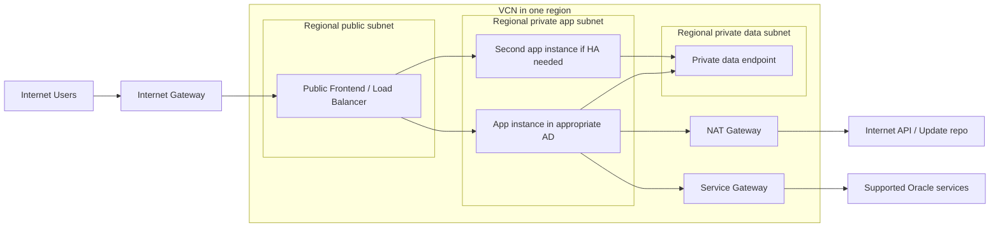

# Regional Subnets, Public Subnets, and Private Subnets

When designing Oracle Cloud Infrastructure (OCI) networking, you often have to answer two different questions: which availability domains can host the resources, and whether resources are allowed to have public addresses to communicate directly with the Internet. **Regional subnets** answer the availability domain scope question; **public subnets** and **private subnets** answer the public network accessibility question.

These two choices are independent. A subnet can be both regional and private, or both regional and public. Regional does not mean public, and private does not mean resources cannot communicate with external systems at all.

In the **Virtual Cloud Networks** chapter, this lesson helps you choose subnets for Compute, application entry points, and Oracle database services. The hands-on section focuses on IPv4 while pointing out considerations when enabling IPv6. The goal is to build infrastructure with proper authorization, clear network paths, observability, and operational practices aligned with cost and availability.

After this lesson, you will be able to:

- Distinguish regional subnets from AD-specific subnets.
- Explain why a public subnet alone is not enough for a server to be reachable from the Internet.
- Choose paths through an Internet Gateway, NAT Gateway, or Service Gateway.
- Design public/private subnets for a multi-tier application.
- Inspect subnet configurations via the Console or CLI and isolate connectivity failures.

## 1. Where Do Subnets Sit in the VCN Model?

A Virtual Cloud Network (VCN) is your virtual network within an OCI region. Subnets divide the address space and form the network configuration unit for resources attached to them.

Saying an instance "resides in a subnet" is a convenient shorthand. More accurately, an instance attaches to a virtual network interface card (VNIC), and the VNIC belongs to the subnet. The VNIC receives a private address from the subnet's valid address range.

A basic layout:

```text
OCI Region
└── VCN: 10.40.0.0/16
    ├── subnet-edge: 10.40.10.0/24
    ├── subnet-app:  10.40.20.0/24
    └── subnet-data: 10.40.30.0/24
```

This example uses one IPv4 CIDR per subnet. The ranges do not overlap and lie within the VCN range. In real designs, also verify against on-premises ranges, other VCNs, and future connectivity plans.

A subnet has configuration associations such as a route table, security lists, and DHCP options. Network Security Groups (NSGs) add a way to apply rules per group of supported resources or VNICs. Those components work together, but they do not replace the meaning of public/private.

## 2. Regional and AD-Specific: Choosing Resource Placement Scope

An availability domain (AD) is an infrastructure domain inside a region. When creating Compute, you select the instance's AD based on region and service capabilities. Subnet scope determines whether the subnet is compatible with that AD.

### 2.1. AD-Specific Subnets

An AD-specific subnet is tied to a specific AD. Resources with AD constraints using that subnet must match the subnet's AD.

For example, if `subnet-app-ad1` belongs to AD-1, you cannot choose it for an instance deployed in AD-2. In multi-AD architectures, designing this way typically requires separate subnets per AD and managing additional address ranges, route table associations, and security lists.

### 2.2. Regional Subnets

A regional subnet is not restricted to a specific AD; it can be used for resources in any compatible AD within the same region. Oracle recommends regional subnets for flexibility, as described in [Creating a Subnet](https://docs.oracle.com/en-us/iaas/Content/Network/Tasks/create_subnet.htm).

If a region has multiple ADs, one regional application subnet can serve instance A in AD-1 and instance B in AD-2. The two instances remain two separate resources, each with its own placement and lifecycle.

| Attribute | AD-specific subnet | Regional subnet |
| --- | --- | --- |
| AD scope | One selected AD | ADs within the same region, depending on resource support |
| Subnet selection when creating Compute | Must match AD | Not tied to a single subnet AD |
| Addressing across multiple ADs | Typically requires multiple subnets | Can share a subnet by role |
| Automatically replicates application | No | No |
| Spans across another region | No | No |

### 2.3. Regional Does Not Automatically Create Application Availability

A single instance in a regional subnet can still go down when that instance or its AD experiences an outage. For fault tolerance, you must still design instance counts, appropriate AD or fault domain distribution, load balancing, data, backups, and recovery mechanisms.

If a region has only one AD, a regional subnet does not create additional ADs. You need to evaluate intra-region fault tolerance capabilities and multi-region strategies according to system requirements.

In API/CLI output, the availability domain attribute of a regional subnet can be `null`. Automation tooling must handle this value rather than treating it as invalid data. Oracle documents the attribute in [Subnet in SDK](https://docs.oracle.com/en-us/iaas/tools/typescript/latest/modules/_core_lib_model_subnet_.subnet.html).

## 3. Public and Private: Choosing Public Addressability

This section examines IPv4 first.

### 3.1. Public Subnets

A public subnet allows eligible resources to be assigned a public IPv4 address. Assignment is optional; not every instance in a public subnet automatically gets a public IP.

For example, two instances in the same public subnet:

- Instance A has only a private IPv4 address.
- Instance B has a private IPv4 address and a public IPv4 address assigned via OCI mechanisms.

They do not have the same direct Internet reachability merely by sharing a subnet. You must also inspect IPs, routes, gateways, and network rules.

### 3.2. Private Subnets

A private subnet prohibits VNICs in the subnet from being assigned a public IPv4 address. This is a subnet-level constraint, useful when you want application or data servers to use private addresses.

A private subnet can still have access paths such as:

- Connecting to other subnets in the VCN when routing and rules permit.
- Reaching the Internet outbound-initiated via a NAT Gateway for IPv4.
- Reaching supported Oracle services via a Service Gateway.
- Connecting to corporate networks via a DRG and corresponding VPN/FastConnect configuration.
- Receiving traffic from a configured load balancer or intermediate access point.

Therefore, "private" does not mean "no inbound or outbound connectivity at all." Communication policy must be expressed through both path design and rules.

### 3.3. Two Independent Axes of Choice

| Scope | Public | Private |
| --- | --- | --- |
| Regional | Regional public subnet | Regional private subnet |
| AD-specific | Public subnet in one AD | Private subnet in one AD |

The public/private choice is made at subnet creation and cannot be changed directly afterward per [Overview of VCNs and Subnets](https://docs.oracle.com/en-us/iaas/Content/Network/Tasks/Overview_of_VCNs_and_Subnets.htm). Do not treat editing a route table as a way to convert subnet type.

If you need to change the access model, you may have to prepare a new subnet and migrate or redeploy resources according to each service's capabilities. Account for IPs, DNS, active connections, and downtime.

## 4. Why Is a Public Subnet Insufficient to Receive Internet Connections?

For a Compute instance using IPv4 in a standard Internet Gateway model, direct access requires several conditions working together:

| Verification layer | Condition to confirm |
| --- | --- |
| Subnet | Must be a public subnet if the VNIC needs a public IPv4 |
| Addressing | The VNIC/corresponding private IP has an appropriate public IPv4 |
| Gateway and routes | Internet Gateway is active and applicable route points to the gateway |
| OCI rules | Required ingress/egress is permitted by security lists or NSGs |
| Operating system | Host firewall permits the traffic |
| Application | Process is listening on the right address and port |
| Return path | Valid return path exists, not skewed by other configurations |

Oracle describes direct access components in [Internet Gateway](https://docs.oracle.com/en-us/iaas/Content/Network/Tasks/managingIGs.htm).

For example, a machine with a public IP whose web service only listens on `127.0.0.1` does not become a remotely reachable web server. Likewise, having a rule for TCP 443 without a route to the Internet Gateway still does not form a complete path.

Also distinguish "being able to open the instance management page in the Console" from "being able to connect to the instance." IAM permits reading resource metadata; the network path and OS/application authentication are separate layers.

## 5. Choosing a Gateway by Destination and Connection Initiation Direction

### 5.1. Internet Gateway: Direct Path with the Internet

In the basic IPv4 model, a public subnet uses a route to an Internet Gateway for resources with public IPs that need direct Internet communication.

Typical route:

```text
Destination CIDR: 0.0.0.0/0
Target: VCN's Internet Gateway
```

This route tells where to send matching packets; it is not a rule permitting every port. Security rules still must be configured separately. A public subnet without a default route to the Internet is still a public subnet by attribute, but lacks the corresponding path.

### 5.2. NAT Gateway: Private Workloads Initiating Internet Connections

An application in a private subnet may need to download patches or call an Internet API. For IPv4, an OCI NAT Gateway lets workloads initiate connections and receive return traffic, while providing no path for externally initiated new connections into the workload.

```text
Application private IP
    -> Route to NAT Gateway
    -> Internet
    -> Connection return traffic
    -> NAT Gateway
    -> Application
```

Typical route:

```text
Destination CIDR: 0.0.0.0/0
Target: VCN's NAT Gateway
```

Do not assign a public IP to an instance just to download updates if the model requires keeping it in a private subnet. Initiation/return behavior is described by Oracle in [NAT Gateway](https://docs.oracle.com/en-us/iaas/Content/Network/Tasks/NATgateway.htm).

An OCI NAT Gateway is a VCN gateway resource. You do not need to deploy it as a NAT virtual machine inside a public subnet as in some other products.

### 5.3. Service Gateway: Private Path to Supported Oracle Services

A Service Gateway allows access to supported services in the Oracle Services Network, such as Object Storage, without workloads needing a public IP or Internet path for that traffic.

The route uses a service CIDR label matching the region and gateway configuration, rather than substituting a guessed Internet IP range. This gateway is not a path to every website or every Oracle-branded endpoint. See the scope in [Access to Oracle Services: Service Gateway](https://docs.oracle.com/en-us/iaas/Content/Network/Tasks/servicegateway.htm).

Successful network connectivity also does not grant permission to read objects. Workloads still need authentication mechanisms and IAM policies appropriate for the target bucket or service.

### 5.4. Quick Selection Table

| Need | Common option | Conditions to remember |
| --- | --- | --- |
| Internet users access an HTTPS entry point | Public frontend and Internet Gateway | Appropriate IP, route, rules, listener, and TLS |
| Private app calls an Internet API over IPv4 | NAT Gateway | App initiates connection, has route and egress |
| Private app reads supported Object Storage | Service Gateway | Route/service label, rules, and IAM |
| Operators access private IPs from corporate network | VPN/FastConnect and DRG, or suitable admin path | Bidirectional routes and access control |
| App calls private database in the same VCN | Internal private connectivity | Appropriate rules and database endpoint |

In this lesson, paths are described at a basic level. Architectures using intermediate firewalls, resource-specific routing, or multiple VCNs must check the actual routes applied to each flow.

## 6. Illustrative Design: Public Frontend, Private Application and Data

Suppose An Binh company deploys an internal portal accessed by users over the Internet. The company wants a clear public entry point, applications that do not accept direct Internet connections, and a database serving only the application tier.

### 6.1. Address Plan

The illustrative VCN uses `10.40.0.0/16`:

| Subnet | CIDR | Scope | Access | Role |
| --- | --- | --- | --- | --- |
| `subnet-edge` | `10.40.10.0/24` | Regional | Public | Public entry point suited for frontend services |
| `subnet-app` | `10.40.20.0/24` | Regional | Private | Compute running the application |
| `subnet-data` | `10.40.30.0/24` | Regional | Private | Data resources requiring VCN connectivity |

This is a design example, not a requirement that every database service must have the same number of subnets or endpoint type. When choosing Base Database, Autonomous Database, or other Oracle services, verify the network requirements and private endpoint capabilities of the specific service.

### 6.2. Traffic Flow



The diagram represents logical communication paths. NAT and Service Gateways are drawn inside the VCN frame, which does not mean they reside inside the application subnet. Multi-AD instances are also not automatically created simply because the subnet is regional.

The frontend must forward to private backends according to the service configuration. Clients do not connect directly to the app's public IP, because the app in this model has no public IPv4 address.

### 6.3. Illustrative Route Tables

| Subnet | Destination | Target |
| --- | --- | --- |
| Edge | `0.0.0.0/0` | Internet Gateway |
| App | `0.0.0.0/0` if IPv4 Internet needed | NAT Gateway |
| App | Selected Service CIDR label | Service Gateway |
| Data | Only destinations needed for service and operations | Corresponding gateway/path per design |

With default intra-VCN routing, traffic from the app to the database in the same VCN does not need to detour through NAT or an Internet Gateway. However, internal connectivity must still be permitted by network rules.

Do not add a default Internet route to the data tier just because the application tier has one. If the database needs backups or dependent services, specify the exact endpoints and access method.

## 7. Public/Private Does Not Replace Security Rules

Dividing subnets helps organize addresses, routes, and public IP constraints. It does not automatically create a complete communication permission matrix across all resources.

A desired matrix for the example above might be:

| Source | Destination | Illustrative traffic | Purpose |
| --- | --- | --- | --- |
| Internet | Frontend | TCP 443 | Users accessing HTTPS |
| Frontend | App | Chosen backend port, e.g., TCP 8080 | Request forwarding |
| Frontend | App | Configured health check port/path | Backend health checks |
| App | Database | Actual service port | Data connection |
| App | Required Internet destination | TCP 443 if applicable | Calling APIs or downloading packages |
| Approved admin source | Workload to administer | Chosen admin protocol | Operations |

Do not assume every Oracle Database uses the same port or security protocol. Obtain the actual service's endpoint/port, and configure appropriate TLS and authentication.

### Security Lists and NSGs Can Act Together

Security lists apply at the subnet level. NSGs apply to resources/VNICs attached to the group as supported by the service. In this permissive rule model, all applicable rules must be reviewed; a narrow NSG does not automatically revoke broad permissions already granted in another security list.

If a security list already allows ingress from a broad source, merely adding an NSG restricted to the frontend does not prove the app only receives traffic from the frontend. Oracle explains rule evaluation in [Security Rules](https://docs.oracle.com/en-us/iaas/Content/Network/Concepts/securityrules.htm).

With stateful rules, connection return traffic is tracked by state. With stateless rules, appropriate rules must be designed for both directions. Do not confuse "ingress has a rule" with "the entire application session is guaranteed to work."

IAM is another layer: someone with permission to create subnets does not by default have permission to SSH into machines, log into databases, or read objects in buckets. Conversely, application users do not need VCN admin permissions to access services over the designed network path.

## 8. CIDR Planning and Configuration Changes

### 8.1. Calculating Usable Addresses

For the example IPv4 subnet `10.40.20.0/24`, there are 256 total addresses. OCI Networking reserves the first two addresses and the last address in the CIDR:

```text
10.40.20.0   -> reserved
10.40.20.1   -> reserved
10.40.20.255 -> reserved
```

By basic arithmetic, 253 addresses remain after network reservations. This is not a guarantee of deploying 253 instances: each VNIC, secondary IP, and managed service may require additional addresses or reserve capacity. Reservation rules are stated in [Networking Overview](https://docs.oracle.com/en-us/iaas/Content/Network/Concepts/overview.htm).

A regional subnet shares that subnet's address space; it does not allocate a separate `/24` per AD. If scaling resources across multiple ADs, you must still sum total demand across the subnet.

### 8.2. Planning Headroom for Services and Growth

When sizing subnets, explicitly document demand for:

- Current instances and additions during scaling.
- Secondary VNICs/IPs if used by the architecture.
- Managed service addresses required for assignment or reservation.
- Parallel old/new versions during upgrades.
- Recovery or traffic shifting when a resource group experiences an outage.

Avoid using overly small subnets and treating CIDR changes as zero-impact operations.

### 8.3. Distinguishing Modifiable Attributes from Initial Choices

Public/private is a choice made when creating the subnet. Attributes such as route tables, security lists, DHCP options, or CIDRs can be updated under supported conditions, but you should not assume every change is instantaneous and impact-free.

Oracle currently provides [Editing a Subnet](https://docs.oracle.com/en-us/iaas/Content/Network/Tasks/edit_subnet.htm), covering conditions for changing CIDRs and effects on address assignment/DHCP. Do not apply outdated assumptions that every subnet CIDR is immutable, nor skip checking in-use addresses before making changes.

For this lesson, select the right CIDR and subnet type at design time; only execute changes in real environments once appropriate verification and rollback plans are in place.

## 9. IPv6 Must Be Evaluated Separately

The `0.0.0.0/0`, public IPv4, and NAT examples in this lesson cannot be copied verbatim to IPv6.

OCI supports IPv6 addresses and prefix types according to current capabilities. For IPv6, consider the address type, the subnet's public/private flag, IPv6-capable gateways, routes such as `::/0`, and IPv6 rules. A global unicast address alone is insufficient to conclude a resource has a working Internet path.

Per [IPv6 Addresses](https://docs.oracle.com/en-us/iaas/Content/Network/Concepts/ipv6.htm), NAT Gateways and Service Gateways are not IPv6 equivalents to the IPv4 model used in this lesson; gateways supporting IPv6 must be evaluated separately. Public/private also affects Internet communication capabilities over IPv6.

When enabling dual-stack, inspect both IPv4 and IPv6. Checking only IPv4 rules and concluding entry points are restricted is insufficient; DNS and applications may choose IPv6 paths if configured.

## 10. Hands-On Subnet Inspection with Console and CLI

This section guides learners through inspecting an authorized environment. This lesson does not create resources or run commands against a real tenancy.

### 10.1. Prerequisites

You need:

- A lab VCN with an agreed CIDR, or a pre-provided set of network configurations.
- IAM permissions to read VCNs, subnets, and related network configurations.
- An OCI CLI profile or Console session in the correct tenancy and region.
- If testing real connectivity, prepared lab endpoints/workloads and cost boundaries.

If you are only learning how to classify subnets, reading existing configurations is sufficient; there is no need to create new load balancers or databases.

### 10.2. Inspecting in the Console

Open the VCN in the right region, then select the subnet to inspect. Record:

| Information | Value to verify |
| --- | --- |
| VCN and compartment | Matches the lab target? |
| CIDR/prefix | Within design and non-overlapping? |
| Subnet scope | Regional or AD-specific? |
| Subnet access | Public or private? |
| Route table | Correct ID and expected paths? |
| Security lists | Any unexpectedly broad rules? |
| DHCP/DNS | Supports the name resolution method used? |
| Related resources | Do VNICs have expected IPs and NSGs? |

Do not classify a subnet solely by its display name such as `private-app`. Names may not match the actual configuration.

### 10.3. Reading with the OCI CLI

PowerShell example, with a profile already configured with the proper authentication mechanism:

```powershell
$ociNetworkProfile = 'OCI_NETWORK_LAB'
$ociAuthMode = 'security_token'
$targetRegion = '<region-id>'
$networkCompartmentId = '<ocid-of-compartment-holding-subnet>'
$vcnOcid = '<vcn-ocid>'
$subnetOcid = '<subnet-ocid>'
```

Replace the `<...>` placeholders and select `--auth` appropriate to the profile. `security_token` is just an example for an established, valid token session.

List subnets by compartment and VCN:

```powershell
oci network subnet list --compartment-id $networkCompartmentId --vcn-id $vcnOcid --region $targetRegion --profile $ociNetworkProfile --auth $ociAuthMode --all
```

Read subnet details:

```powershell
oci network subnet get --subnet-id $subnetOcid --region $targetRegion --profile $ociNetworkProfile --auth $ociAuthMode
```

Command references: [subnet list](https://docs.oracle.com/en-us/iaas/tools/oci-cli/latest/oci_cli_docs/cmdref/network/subnet/list.html) and [subnet get](https://docs.oracle.com/en-us/iaas/tools/oci-cli/latest/oci_cli_docs/cmdref/network/subnet/get.html). `--all` fetches all pages of results; it does not mean automatically traversing all child compartments.

An illustrative snippet for a regional private subnet:

```json
{
  "availability-domain": null,
  "prohibit-public-ip-on-vnic": true,
  "cidr-block": "10.40.20.0/24"
}
```

This is an example for understanding a few fields, not the full real-world response. `availability-domain: null` identifies regional scope; `prohibit-public-ip-on-vnic: true` indicates that assigning public IPv4 addresses to VNICs is prohibited.

If the public IP prohibition field is `false`, continue checking VNICs, routes, and rules. That value permits public IPv4 assignment per resource capability; it does not prove a public IP is assigned or Internet traffic is flowing.

## 11. Verifying with Intentional Network Flows

After configuring correctly on paper, test both allowed business flows and flows that must be restricted. Use prepared lab workloads/endpoints; do not open rules to the entire Internet just to make a test pass.

| Test | Expectation in illustrative model | What it proves |
| --- | --- | --- |
| Internet client to HTTPS frontend | Succeeds if frontend is ready | Public entry path works |
| Frontend to backend app | Succeeds | Backend port, health check, and rules align |
| Internet client directly initiates to private app | No direct path to app per design | App is not directly exposed publicly |
| App calls allowed Internet endpoint via IPv4 NAT | Succeeds | Egress and return paths work |
| App calls supported Oracle service via SGW | Succeeds with proper service permissions | Private path and service auth align |
| App connects to private database | Succeeds with valid credentials | Network and data service layer work together |
| Unapproved source to database port | Fails per design boundaries | Rules are not broader than expected |

Note: the private app can still be used indirectly by Internet users through the public frontend. "No direct access" does not mean "the application does not serve the Internet."

Record the test source, destination IP/endpoint, protocol, port, timestamp, region, and result. If multiple network paths exist, determine which path the request actually used; a single successful access does not prove it traversed the Service Gateway rather than NAT.

## 12. Isolating Common Errors

### Public Subnet Yet Server Unreachable from the Internet

Check in order:

1. Does the VNIC actually have a public IPv4 address?
2. Does the applicable route lead to an Internet Gateway, and is the gateway active?
3. Do ingress/egress rules allow the right source, protocol, and port?
4. Does the OS firewall permit it?
5. Is the application listening on the appropriate address?
6. Are there DNS, TLS, or application configuration errors after network connectivity succeeds?

If there is no public IP, editing security rules will not create a public IP. If the process is not running, fixing routes will not start the process.

### Private Subnet Cannot Download Updates

Confirm whether the workload uses IPv4 or IPv6, whether DNS resolves, whether the route leads to a NAT Gateway when IPv4 Internet is needed, whether the gateway is blocked, and whether egress rules match.

If the destination is an Oracle service via a Service Gateway, verify the service label, region, supported service, and IAM permissions. A NAT Gateway cannot fix a bucket IAM error.

### Two Subnets in the Same VCN Cannot Connect

Public/private is not proof of internal communication permission. Check private IPs, actual routes, source/destination rules, NSGs, host firewalls, and listening applications. If the architecture includes firewalls or custom routes, also check intermediate hops.

### Cannot Select a Subnet When Creating a Resource

This may be due to wrong VCN/region, AD mismatch with an AD-specific subnet, insufficient permissions to use the subnet, address exhaustion, subnet state, or service-specific requirements. Read the specific API error instead of assuming private subnets are unsupported.

### Regional Subnet Yet Application Still Suffers Outage When One AD Fails

Check where resources are actually distributed, backend counts, health checks, data, and traffic failover mechanisms. A regional subnet only removes the restriction tying the subnet to one AD; it does not add instances or replicate databases.

## 13. Operations, Automation, and Cost

A subnet inventory table should store role, regional/AD scope, public/private, CIDR, route table, security lists, owner, and dependent workloads. When automating, check these configuration attributes rather than checking only resource names.

Example conditions that can be audited:

- App/data tiers belong to private subnets per design.
- Subnets use regional scope unless another service requirement dictates otherwise.
- Only tiers needing public exposure permit public IPs.
- Each subnet has a route table and rules matching business flows.
- No CIDR overlaps exist with interconnected networks.
- Tooling handles `availability-domain: null`.

When modifying shared route tables or security lists, changes can impact many resources. Know dependent resources and verify critical flows after changes. VCN Flow Logs, path analysis tools, and endpoint monitoring can aid investigation based on what is enabled in the environment.

Cost must be viewed across the whole architecture: Compute, load balancers, database services, data transfer, and related network services per current pricing. Choosing a private subnet does not automatically make a workload cheaper; choosing a regional subnet does not automatically create extra billable resources or replicate applications.

If deploying a new lab, inventory created resources and clean up following dependencies afterward. Do not delete shared subnets or gateways just because one test exercise has finished.

## 14. Knowledge Self-Check

1. **Can a subnet be both regional and private?**  
   Yes. Regional refers to AD scope; private refers to the subnet's public access constraint.

2. **Must an instance in a public subnet have a public IPv4 address?**  
   No. A public subnet permits assignment, but you must still check the VNIC's actual IPs.

3. **Does adding a route to an Internet Gateway turn a private subnet into a public subnet?**  
   No. A subnet's access type is not changed by routes, and a private subnet still prohibits assigning public IPv4 addresses to VNICs.

4. **Can a private app call Internet APIs?**  
   Yes, via a NAT Gateway for IPv4 when routes, rules, and related conditions permit. That does not allow the Internet to initiate new connections directly to the app through NAT.

5. **Why is SGW access to the service network insufficient to read Object Storage?**  
   Because network path and service authorization are two different layers. Requests still need valid authentication and IAM policies.

6. **Does a regional subnet guarantee a multi-AD fault-tolerant database?**  
   No. Fault tolerance depends on the deployment and configuration of the database service, not solely on the subnet.

7. **Why might a restrictive NSG not narrow all ingress?**  
   Because all other applicable permissive rules must be considered, including security lists and related NSGs.

A good subnet design must explain where resources are placed, address types, the path of each flow, and the control layers permitting that flow. When these four parts are verified together, public/private and regional become clear operational decisions rather than mere Console option names.
